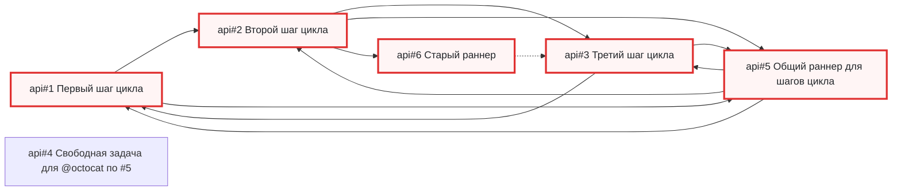

<!-- SYNC: mirrored in dmc-268-{ui,api}-t6/.agents/skills/issue-graph/tests/golden/cycle.md -->

### Граф задач: задачи [api#1](https://github.com/larchanka-training/dmc-268-api-t6/issues/1), [api#2](https://github.com/larchanka-training/dmc-268-api-t6/issues/2), [api#3](https://github.com/larchanka-training/dmc-268-api-t6/issues/3), [api#4](https://github.com/larchanka-training/dmc-268-api-t6/issues/4)

Задач: 4 (открыто 4, закрыто 0). Связей блокировки: 11. Вне выборки: 2.

#### Циклы

- [api#1](https://github.com/larchanka-training/dmc-268-api-t6/issues/1) → [api#2](https://github.com/larchanka-training/dmc-268-api-t6/issues/2) → [api#3](https://github.com/larchanka-training/dmc-268-api-t6/issues/3) → [api#1](https://github.com/larchanka-training/dmc-268-api-t6/issues/1)
  - в том же клубке связей ещё: [api#5](https://github.com/larchanka-training/dmc-268-api-t6/issues/5) (вне выборки), [api#6](https://github.com/larchanka-training/dmc-268-api-t6/issues/6) (вне выборки, закрыта)

#### In Progress с открытым блокером

- [api#1](https://github.com/larchanka-training/dmc-268-api-t6/issues/1) ждёт [api#3](https://github.com/larchanka-training/dmc-268-api-t6/issues/3), [api#5](https://github.com/larchanka-training/dmc-268-api-t6/issues/5) (вне выборки)

#### Слои: что можно брать параллельно

Не считаются: в графе цикл.

#### Критический путь

Не считается: в графе цикл.

#### Без связей

- [api#4](https://github.com/larchanka-training/dmc-268-api-t6/issues/4) [docs] Свободная задача для @&#8203;octocat по #&#8203;5

#### Вне выборки

- [api#5](https://github.com/larchanka-training/dmc-268-api-t6/issues/5) [infra] Общий раннер для шагов цикла — блокирует [api#1](https://github.com/larchanka-training/dmc-268-api-t6/issues/1), [api#2](https://github.com/larchanka-training/dmc-268-api-t6/issues/2), [api#3](https://github.com/larchanka-training/dmc-268-api-t6/issues/3); ждёт [api#1](https://github.com/larchanka-training/dmc-268-api-t6/issues/1), [api#2](https://github.com/larchanka-training/dmc-268-api-t6/issues/2), [api#3](https://github.com/larchanka-training/dmc-268-api-t6/issues/3)
- [api#6](https://github.com/larchanka-training/dmc-268-api-t6/issues/6) [infra] Старый раннер (закрыта) — блокирует [api#3](https://github.com/larchanka-training/dmc-268-api-t6/issues/3); ждёт [api#2](https://github.com/larchanka-training/dmc-268-api-t6/issues/2)
