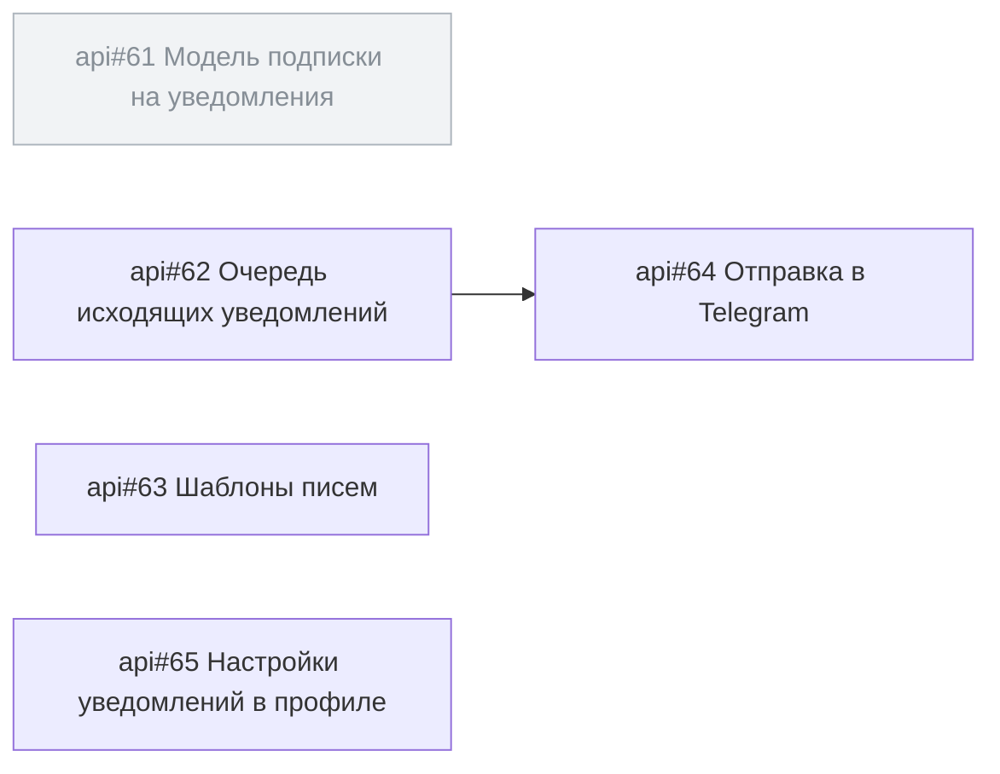

<!-- SYNC: mirrored in dmc-268-{ui,api}-t6/.agents/skills/issue-graph/tests/golden/epic-pages.md -->

### Граф задач: эпик [api#60](https://github.com/larchanka-training/dmc-268-api-t6/issues/60) [notify] Уведомления о завершении прогона

Задач: 5 (открыто 4, закрыто 1). Связей блокировки: 1. Вне выборки: 0.

#### Циклы

Нет.

#### In Progress с открытым блокером

Нет.

#### Слои: что можно брать параллельно

1. [api#62](https://github.com/larchanka-training/dmc-268-api-t6/issues/62), [api#63](https://github.com/larchanka-training/dmc-268-api-t6/issues/63), [api#65](https://github.com/larchanka-training/dmc-268-api-t6/issues/65) — можно брать сейчас
2. [api#64](https://github.com/larchanka-training/dmc-268-api-t6/issues/64)

#### Критический путь

[api#62](https://github.com/larchanka-training/dmc-268-api-t6/issues/62) → [api#64](https://github.com/larchanka-training/dmc-268-api-t6/issues/64) (задач: 2)

#### Без связей

- [api#63](https://github.com/larchanka-training/dmc-268-api-t6/issues/63) [notify] Шаблоны писем
- [api#65](https://github.com/larchanka-training/dmc-268-api-t6/issues/65) [notify] Настройки уведомлений в профиле

#### Вне выборки

Нет.
