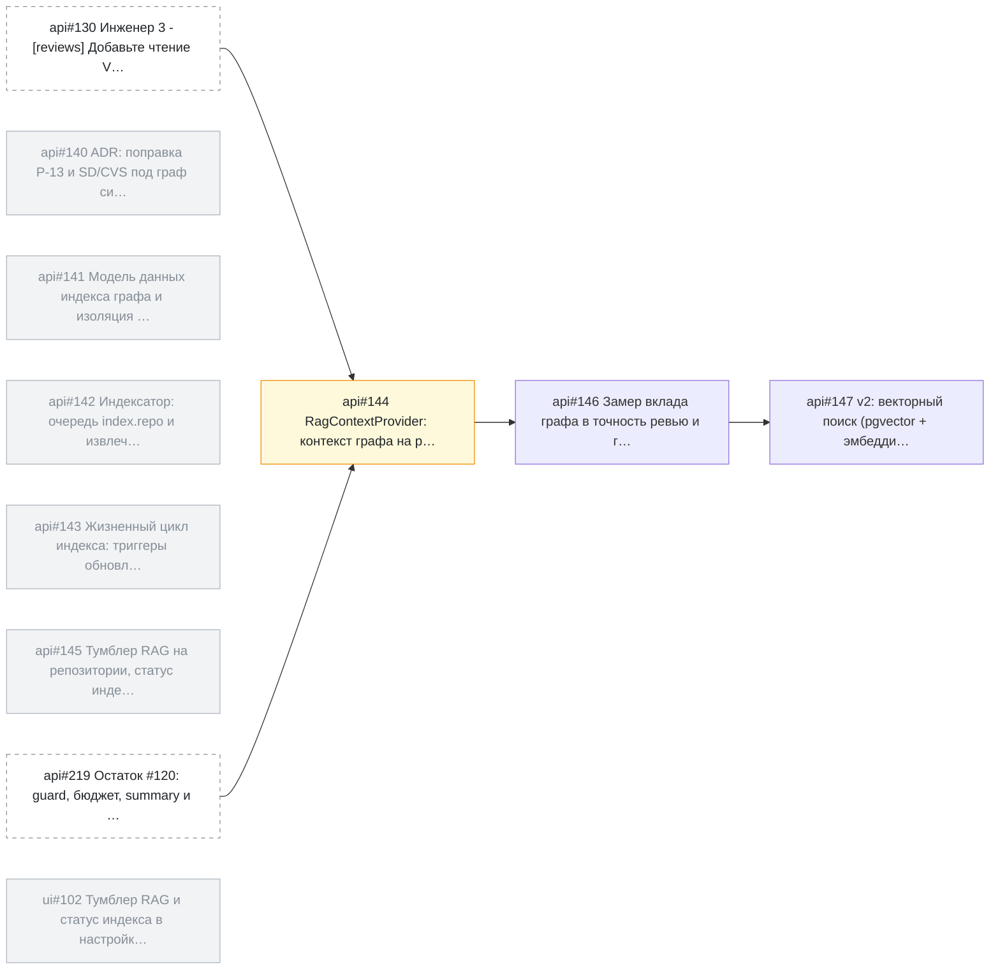

<!-- SYNC: mirrored in dmc-268-{ui,api}-t6/.agents/skills/issue-graph/tests/golden/epic.md -->

### Граф задач: эпик [api#139](https://github.com/larchanka-training/dmc-268-api-t6/issues/139) [context][rag] Graph RAG: граф символов репозитория как контекст ревью

Задач: 9 (открыто 3, закрыто 6). Связей блокировки: 4. Вне выборки: 2.

#### Циклы

Нет.

#### In Progress с открытым блокером

Нет.

#### Слои: что можно брать параллельно

1. [api#130](https://github.com/larchanka-training/dmc-268-api-t6/issues/130) (вне выборки), [api#219](https://github.com/larchanka-training/dmc-268-api-t6/issues/219) (вне выборки) — можно брать сейчас
2. [api#144](https://github.com/larchanka-training/dmc-268-api-t6/issues/144)
3. [api#146](https://github.com/larchanka-training/dmc-268-api-t6/issues/146)
4. [api#147](https://github.com/larchanka-training/dmc-268-api-t6/issues/147)

#### Критический путь

[api#130](https://github.com/larchanka-training/dmc-268-api-t6/issues/130) → [api#144](https://github.com/larchanka-training/dmc-268-api-t6/issues/144) → [api#146](https://github.com/larchanka-training/dmc-268-api-t6/issues/146) → [api#147](https://github.com/larchanka-training/dmc-268-api-t6/issues/147) (задач: 4)

#### Без связей

Нет.

#### Вне выборки

- [api#130](https://github.com/larchanka-training/dmc-268-api-t6/issues/130) Инженер 3 - [reviews] Добавьте чтение VCS, DiffMap, загрузчик политики и AST-контекст — блокирует [api#144](https://github.com/larchanka-training/dmc-268-api-t6/issues/144)
- [api#219](https://github.com/larchanka-training/dmc-268-api-t6/issues/219) [reviews][120] Остаток #&#8203;120: guard, бюджет, summary и отбрасывание кандидатов по CVS/RFS — блокирует [api#144](https://github.com/larchanka-training/dmc-268-api-t6/issues/144)
