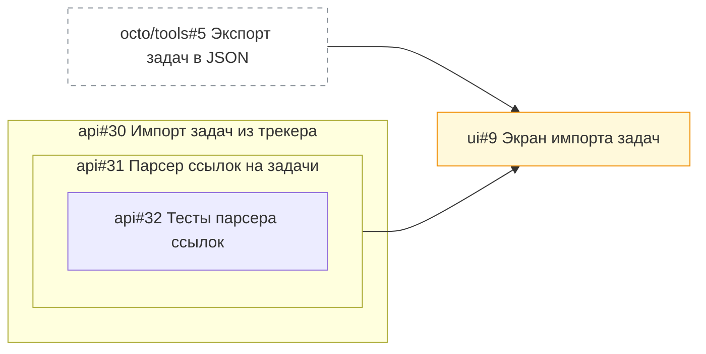

<!-- SYNC: mirrored in dmc-268-{ui,api}-t6/.agents/skills/issue-graph/tests/golden/issues.md -->

### Граф задач: задачи [ui#9](https://github.com/larchanka-training/dmc-268-ui-t6/issues/9), [api#31](https://github.com/larchanka-training/dmc-268-api-t6/issues/31), [api#32](https://github.com/larchanka-training/dmc-268-api-t6/issues/32), [api#30](https://github.com/larchanka-training/dmc-268-api-t6/issues/30)

Задач: 4 (открыто 4, закрыто 0). Связей блокировки: 2. Вне выборки: 1.

#### Циклы

Нет.

#### In Progress с открытым блокером

Нет.

#### Слои: что можно брать параллельно

1. [api#31](https://github.com/larchanka-training/dmc-268-api-t6/issues/31), [api#32](https://github.com/larchanka-training/dmc-268-api-t6/issues/32), [octo/tools#5](https://github.com/octo/tools/issues/5) (вне выборки) — можно брать сейчас
2. [ui#9](https://github.com/larchanka-training/dmc-268-ui-t6/issues/9)

#### Критический путь

[api#31](https://github.com/larchanka-training/dmc-268-api-t6/issues/31) → [ui#9](https://github.com/larchanka-training/dmc-268-ui-t6/issues/9) (задач: 2)

#### Без связей

- [api#32](https://github.com/larchanka-training/dmc-268-api-t6/issues/32) [import] Тесты парсера ссылок

#### Вне выборки

- [octo/tools#5](https://github.com/octo/tools/issues/5) [cli] Экспорт задач в JSON — блокирует [ui#9](https://github.com/larchanka-training/dmc-268-ui-t6/issues/9)
