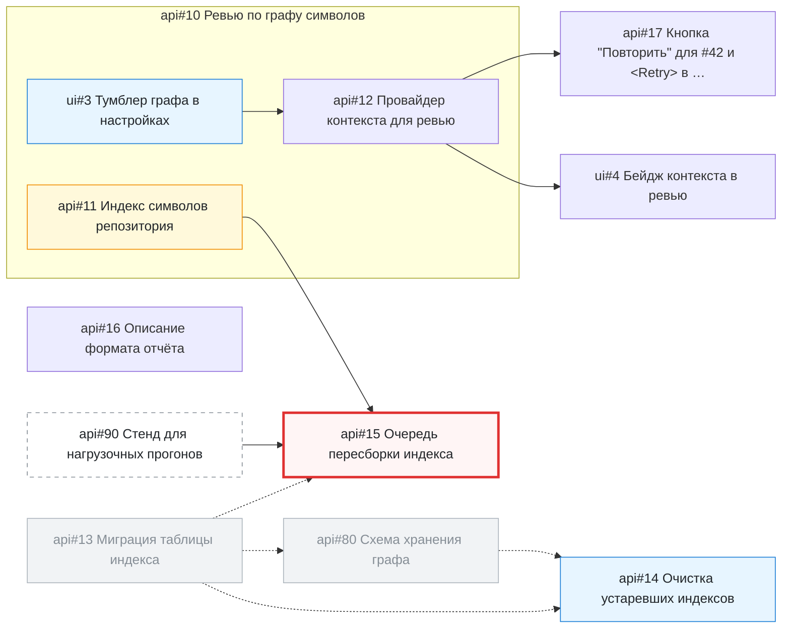

<!-- SYNC: mirrored in dmc-268-{ui,api}-t6/.agents/skills/issue-graph/tests/golden/milestone.md -->

### Граф задач: майлстоун «Спринт 5»

Задач: 10 (открыто 9, закрыто 1). Связей блокировки: 9. Вне выборки: 2.

#### Циклы

Нет.

#### In Progress с открытым блокером

- [api#15](https://github.com/larchanka-training/dmc-268-api-t6/issues/15) ждёт [api#11](https://github.com/larchanka-training/dmc-268-api-t6/issues/11), [api#90](https://github.com/larchanka-training/dmc-268-api-t6/issues/90) (вне выборки)

#### Слои: что можно брать параллельно

1. [api#11](https://github.com/larchanka-training/dmc-268-api-t6/issues/11), [api#14](https://github.com/larchanka-training/dmc-268-api-t6/issues/14), [api#16](https://github.com/larchanka-training/dmc-268-api-t6/issues/16), [api#90](https://github.com/larchanka-training/dmc-268-api-t6/issues/90) (вне выборки), [ui#3](https://github.com/larchanka-training/dmc-268-ui-t6/issues/3) — можно брать сейчас
2. [api#12](https://github.com/larchanka-training/dmc-268-api-t6/issues/12), [api#15](https://github.com/larchanka-training/dmc-268-api-t6/issues/15)
3. [api#17](https://github.com/larchanka-training/dmc-268-api-t6/issues/17), [ui#4](https://github.com/larchanka-training/dmc-268-ui-t6/issues/4)

#### Критический путь

[ui#3](https://github.com/larchanka-training/dmc-268-ui-t6/issues/3) → [api#12](https://github.com/larchanka-training/dmc-268-api-t6/issues/12) → [api#17](https://github.com/larchanka-training/dmc-268-api-t6/issues/17) (задач: 3)

#### Без связей

- [api#16](https://github.com/larchanka-training/dmc-268-api-t6/issues/16) [docs] Описание формата отчёта

#### Вне выборки

- [api#80](https://github.com/larchanka-training/dmc-268-api-t6/issues/80) [db] Схема хранения графа (закрыта) — блокирует [api#14](https://github.com/larchanka-training/dmc-268-api-t6/issues/14); ждёт [api#13](https://github.com/larchanka-training/dmc-268-api-t6/issues/13)
- [api#90](https://github.com/larchanka-training/dmc-268-api-t6/issues/90) [infra] Стенд для нагрузочных прогонов — блокирует [api#15](https://github.com/larchanka-training/dmc-268-api-t6/issues/15)
