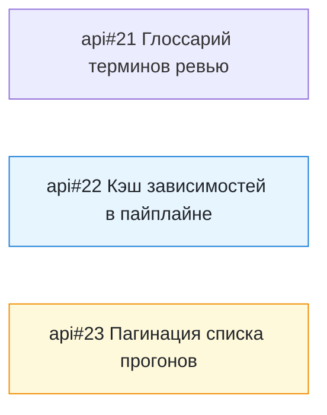

<!-- SYNC: mirrored in dmc-268-{ui,api}-t6/.agents/skills/issue-graph/tests/golden/no-links.md -->

### Граф задач: майлстоун «Спринт 9»

> Майлстоун «Спринт 9» не найден в ui.

Задач: 3 (открыто 3, закрыто 0). Связей блокировки: 0. Вне выборки: 0.

#### Циклы

Нет.

#### In Progress с открытым блокером

Нет.

#### Слои: что можно брать параллельно

1. [api#21](https://github.com/larchanka-training/dmc-268-api-t6/issues/21), [api#22](https://github.com/larchanka-training/dmc-268-api-t6/issues/22), [api#23](https://github.com/larchanka-training/dmc-268-api-t6/issues/23) — можно брать сейчас

#### Критический путь

Нет: между открытыми задачами нет связей.

#### Без связей

- [api#21](https://github.com/larchanka-training/dmc-268-api-t6/issues/21) [docs] Глоссарий терминов ревью
- [api#22](https://github.com/larchanka-training/dmc-268-api-t6/issues/22) [ci] Кэш зависимостей в пайплайне
- [api#23](https://github.com/larchanka-training/dmc-268-api-t6/issues/23) [api] Пагинация списка прогонов

#### Вне выборки

Нет.
