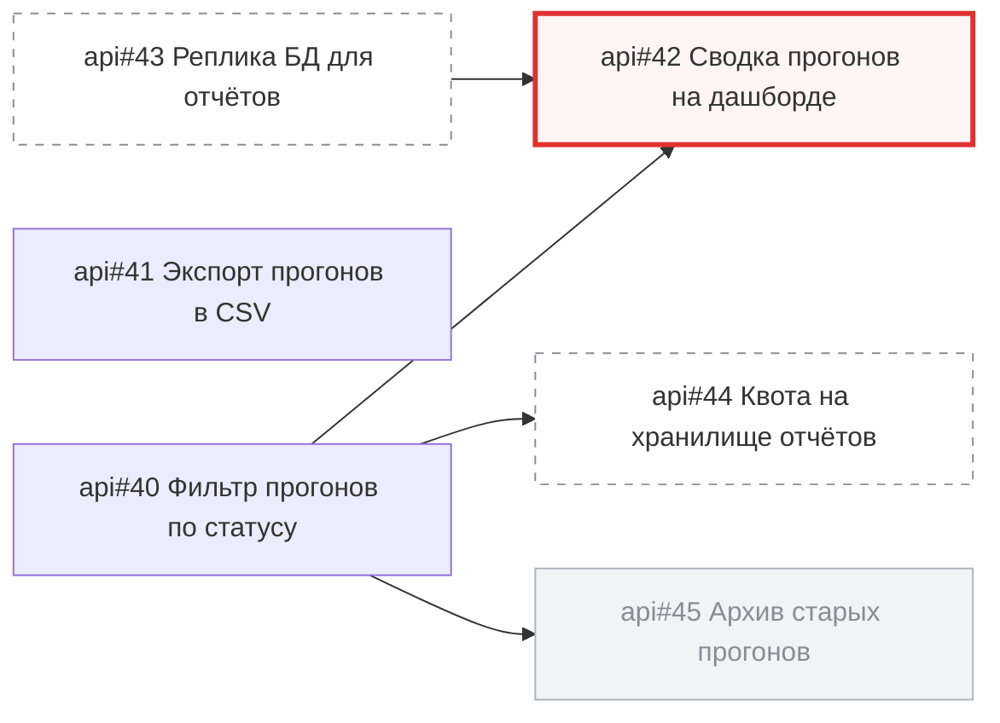

<!-- SYNC: mirrored in dmc-268-{ui,api}-t6/.agents/skills/issue-graph/tests/golden/pagination.md -->

### Граф задач: майлстоун «Спринт 7»

Задач: 3 (открыто 3, закрыто 0). Связей блокировки: 4. Вне выборки: 3.

#### Циклы

Нет.

#### In Progress с открытым блокером

- [api#42](https://github.com/larchanka-training/dmc-268-api-t6/issues/42) ждёт [api#40](https://github.com/larchanka-training/dmc-268-api-t6/issues/40), [api#43](https://github.com/larchanka-training/dmc-268-api-t6/issues/43) (вне выборки)

#### Слои: что можно брать параллельно

1. [api#40](https://github.com/larchanka-training/dmc-268-api-t6/issues/40), [api#41](https://github.com/larchanka-training/dmc-268-api-t6/issues/41), [api#43](https://github.com/larchanka-training/dmc-268-api-t6/issues/43) (вне выборки) — можно брать сейчас
2. [api#42](https://github.com/larchanka-training/dmc-268-api-t6/issues/42), [api#44](https://github.com/larchanka-training/dmc-268-api-t6/issues/44) (вне выборки)

#### Критический путь

[api#40](https://github.com/larchanka-training/dmc-268-api-t6/issues/40) → [api#42](https://github.com/larchanka-training/dmc-268-api-t6/issues/42) (задач: 2)

#### Без связей

- [api#41](https://github.com/larchanka-training/dmc-268-api-t6/issues/41) [api] Экспорт прогонов в CSV

#### Вне выборки

- [api#43](https://github.com/larchanka-training/dmc-268-api-t6/issues/43) [infra] Реплика БД для отчётов — блокирует [api#42](https://github.com/larchanka-training/dmc-268-api-t6/issues/42)
- [api#44](https://github.com/larchanka-training/dmc-268-api-t6/issues/44) [infra] Квота на хранилище отчётов — ждёт [api#40](https://github.com/larchanka-training/dmc-268-api-t6/issues/40)
- [api#45](https://github.com/larchanka-training/dmc-268-api-t6/issues/45) [infra] Архив старых прогонов (закрыта) — ждёт [api#40](https://github.com/larchanka-training/dmc-268-api-t6/issues/40)
