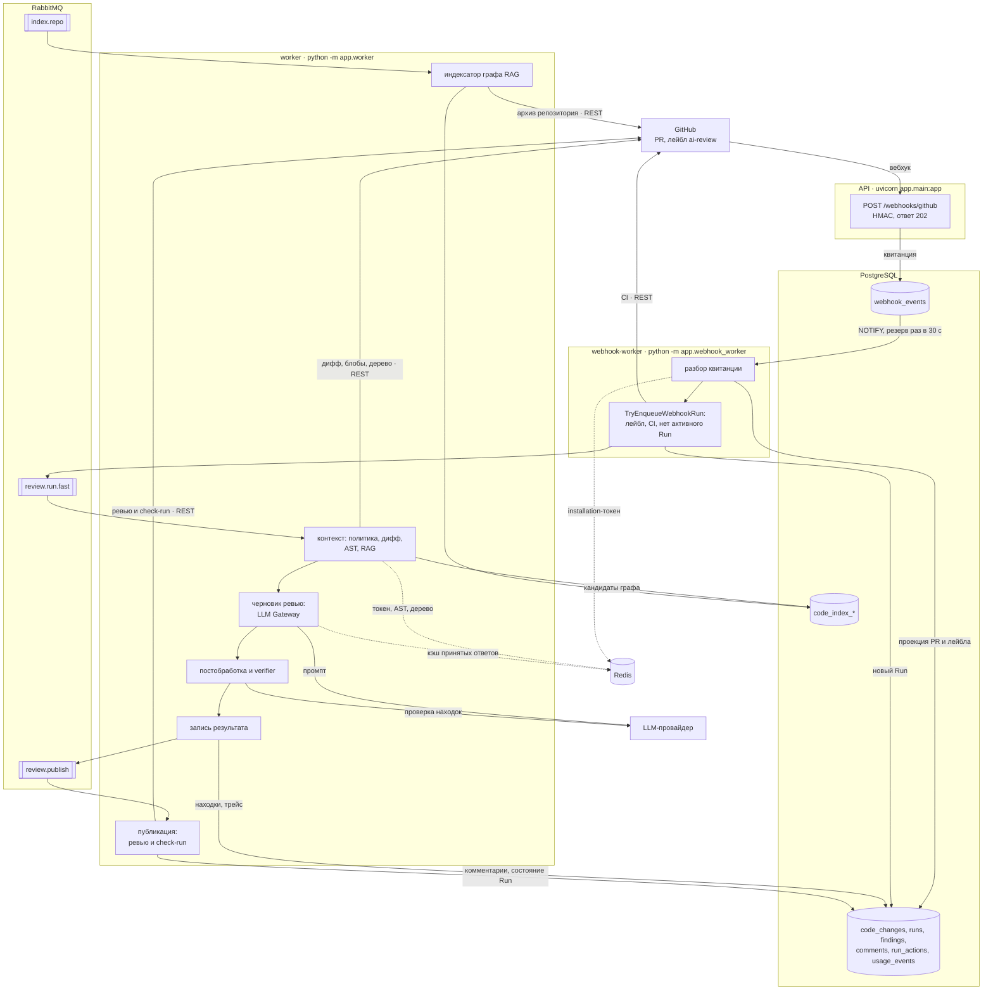

# Архитектура: от вебхука до опубликованного ревью

Как работает код, одной страницей; сверено с кодом 07.11.2026, при расхождении прав код.
Целевая раскладка и причины решений — [SD §4](SYSTEM_DESIGN.md#4-c4--уровень-2-контейнеры) и
[SD §14](SYSTEM_DESIGN.md#14-развёртывание-v1); прогон, retry и сбои —
[PIPELINE_SPEC.md](PIPELINE_SPEC.md); какой раздел открыть под задачу —
[READING_MAP.md](READING_MAP.md).

## Цепочка

## Шаги

Пути от `app/modules/`, если не указано другое.

| Шаг | Что происходит | Код |
|---|---|---|
| 1. Вебхук | `POST /webhooks/github` проверяет HMAC, сохраняет квитанцию в `webhook_events` и отвечает 202; разбора в запросе нет. GitLab и Bitbucket приходят на свои маршруты и пишут в ту же таблицу | `app/main.py` (`receive_github_webhook`), `integrations/gitlab/api/webhook.py`, `integrations/bitbucket/api/webhook.py` |
| 2. Разбор | Сохранение квитанции отправляет `NOTIFY webhook_work_available`. webhook-worker просыпается от него, резервно раз в 30 с, забирает квитанцию и проецирует событие в `code_changes`: PR и лейбл `ai-review` | `app/webhook_worker.py`, `integrations/webhooks/application/receive_github_delivery.py` (`ReceiveWebhookDelivery`), `integrations/webhooks/infrastructure/webhook_notifications.py` |
| 3. Решение о запуске | Run создаётся, когда на PR стоит лейбл `ai-review`, CI подходит под режим `wait_for_ci`, нет активного Run и нет Run с триггером `webhook` на этот `head_sha` ([условия](PIPELINE_SPEC.md#8-триггер-р-10-d2)). Открытие PR само по себе ревью не запускает. Сообщение уходит в `review.run.fast` | `reviews/application/try_enqueue_webhook_run.py` (`TryEnqueueWebhookRun`) |
| 4. Контекст | worker берёт сообщение (prefetch 1) и собирает контекст: снимок политики `.review/rules.md`, дифф, AST-факты (парсер в отдельном подпроцессе), кандидаты RAG из графа `code_index_*` | `reviews/application/handle_review_run.py` (`HandleReviewRun`), `process_run.py` (`ReviewRunProcessor`), `review_context_stage.py`, `review_context.py` (`BuildReviewContext`); парсер: `reviews/infrastructure/ast_worker.py` |
| 5. LLM | Черновик ревью приходит от модели через LLM Gateway, расход пишется в `usage_events`. Если показывать модели нечего (`NoReviewableText`, `SummaryOnlyReview`), вызова нет и публикуется результат backend | `reviews/application/execute_review.py` (`ExecuteReviewRun`), `reviews/infrastructure/llm/`, `analytics/infrastructure/usage_ledger.py` |
| 6. Verifier | Постобработка убирает шаблонные находки и дубли, затем `ReflectionPass` вторым вызовом модели проверяет оставшиеся. Шаг идёт, только когда у контекста есть снимок политики | `execute_review.py` (`_run_reflection_pass`), `findings_post_processor.py`, `reflection_pass.py` |
| 7. Запись | `StoreReviewOutput` фиксирует результат в PostgreSQL и после commit публикует `review.publish`; неудавшуюся публикацию повторяет реконсилер | `reviews/application/store_review_output.py`, `reconcile_runs.py` |
| 8. Публикация | Тот же процесс читает `review.publish` (prefetch 1): одно ревью и check-run в GitHub, комментарии и состояние Run в PostgreSQL | `reviews/application/publish_run_review.py` (`PublishRunReview`), `reviews/infrastructure/github_review_publication.py` |

Другие входы в ту же цепочку:

- **Ручной перезапуск:** API сразу отправляет Run в `review.run.fast` (`rerun_run` в `app/main.py`).
- **Нет CI:** при `wait_for_ci = auto` лидер worker запускает ревью, если CI не появился за 2 мин
  (`reviews/application/sweep_no_ci.py`).
- **Граф RAG:** лидер worker будит `index.repo` (`DispatchIndexWakeups`), а consumer строит
  `code_index_*`. Consumer работает, только если настроен GitHub App или ключи Bitbucket
  (`app/bootstrap/code_index_worker.py`).
- **Обновления для UI:** `NOTIFY run_updated` доходит до API и уходит в браузер по SSE
  (`app/bootstrap/run_update_listener.py`).

## Процессы

Один образ, разные точки входа. Команды и где какой процесс запущен — в
[README «Run»](../README.md#run) и [SD §14](SYSTEM_DESIGN.md#14-развёртывание-v1).

| Процесс | Точка входа | Роль |
|---|---|---|
| `backend` (на staging `api`) | `app/main.py` | маршруты портала, входа и вебхуков в одном приложении; читает и пишет PostgreSQL, Redis не использует |
| `worker` | `app/worker.py` | `review.run.fast`, `review.publish`, `index.repo`, лидер: no-CI sweep, повторная публикация, задачи индекса |
| `webhook-worker` | `app/webhook_worker.py` | квитанции `webhook_events` → проекция и Run |
| `bootstrap` | миграции Alembic, `app/bootstrap/seed_prompts.py` | разово: схема БД и промпты |

Хранилища:

- **PostgreSQL** — источник истины, здесь же блобы файлов (`cached_file_blobs`).
- **RabbitMQ** — обменники `reviews` и `code_index`, с retry и DLQ
  ([топология](SYSTEM_DESIGN.md#71-топология)).
- **Redis** — только кэш worker и webhook-worker: installation-токены, AST-факты, дерево
  репозитория, принятые ответы модели.

## Чего в коде нет

- Отдельных сервисов `portal-api`, `auth-api`, `webhook-api` и `publisher`: сейчас это логические
  роли `backend` и `worker`, разделение — цель Р-12 (#16).
- Sandbox Runner и `SandboxEngine` (фаза 3): очередь `review.run.deep` объявлена, потребителя у неё
  нет, настройки репозитория принимают только `fast`.
- Биллинга в API: в `app/modules/billing` только модели, маршрутов нет.
