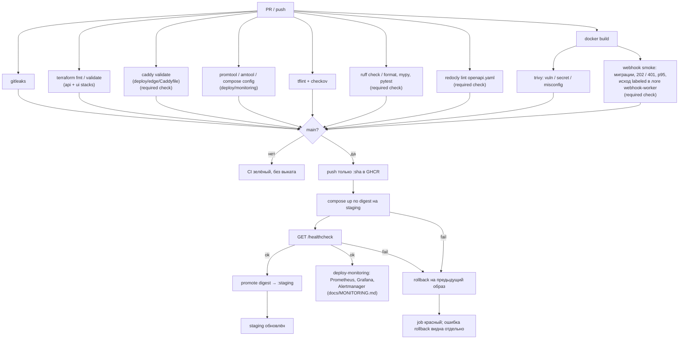

# CI/CD — API (команда 6)

| | |
|---|---|
| Статус | рабочий каркас пайплайна |
| Владелец | инфраструктура (роль 3) |
| Связанные документы | [INFRASTRUCTURE.md](INFRASTRUCTURE.md), [SECRETS.md](SECRETS.md) |

Пайплайн собирает FastAPI-бэкенд в OCI-образ, проверяет инфраструктурный код и выкатывает образ на staging — курсовой VPS (§8; Terraform-хост в Hetzner — задокументированная альтернатива). Вместе с `api` на staging работают воркеры `worker` и `webhook-worker` из того же образа, PostgreSQL 17, RabbitMQ (брокер очереди) и Redis (только кэш) — §3. Реестр — **GitHub Container Registry**.

---

## 1. Конвейер



| Job | Когда | Permissions | Что делает |
|---|---|---|---|
| `Secret scan` | PR и `main` | `contents: read` | Gitleaks с `.gitleaks.toml` и `--redact` (сканирует docs и examples) |
| `Terraform fmt / validate` | PR и `main` | `contents: read` | `fmt -check`, `validate` для `api-staging` и `ui-staging` |
| `Edge Caddyfile validate` | PR и `main` | `contents: read` | `caddy validate` для `deploy/edge/Caddyfile` с `APP_DOMAIN=example.test` — та же команда, что вручную (§8.2); образ caddy читается из `deploy/edge/compose.yml`, второго тега в workflow нет. Имя — required check в правилах `main`, менять только вместе с ними. Входит в `needs` у `Push Docker image`: Caddyfile с ошибкой не доходит до `caddy reload` при выкате |
| `Monitoring config validate` | PR и `main` | `contents: read` | `scripts/validate_monitoring.sh`: `promtool check config` и `promtool test rules` (`tests/monitoring/alerts.test.yml`), `amtool check-config` обоих вариантов Alertmanager (Telegram и без получателя) и шаблона сообщения, `docker compose config` в режимах edge и ports, JSON дашбордов. Образы — из `deploy/monitoring/compose.yml` ([MONITORING.md](MONITORING.md)) |
| `Terraform lint / security` | PR и `main` | `contents: read` | TFLint + Checkov (встроенные и custom policies `.checkov/policies`); отдельный шаг проверяет, что каждая custom policy падает на `.checkov/fixtures/bad` |
| `Python lint / type / test` | PR и `main` | `contents: read` | uv 0.12.11, Python 3.13: `uv sync --locked --all-groups`, `ruff check`, `ruff format --check` (Markdown исключён в `pyproject.toml`), `mypy`, `pytest`. Имя — required check в правилах `main`, менять только вместе с ними. Входит в `needs` у `Push Docker image`: с красными тестами образ не пушится и staging не выкатывается. Шаг «Gold corpus and recorded replay» запускает `validate_dataset.py --final` и `eval_replay.py` по закоммиченному baseline; без response manifest job падает. Интеграционные тесты идут против service-контейнеров PostgreSQL 17 и RabbitMQ 4 этого job (`TEST_DATABASE_URL`, `RABBITMQ_URL`); шаг «Integration suite (zero skips)» (`pytest -m integration`) падает, если хоть один тест skipped |
| `OpenAPI lint` | PR и `main` | `contents: read` | Redocly CLI 2.57.0: `npx --yes @redocly/cli@2.57.0 lint contracts/openapi.yaml` — та же команда, что локально (PIPELINE_SPEC §16); `redocly.yaml` расширяет `recommended-strict`, поэтому любое предупреждение — ошибка, осознанные исключения — `.redocly.lint-ignore.yaml`. Имя — required check в правилах `main` (с 04.10.2026), менять только вместе с ними. Входит в `needs` у `Push Docker image` |
| `Docker image build` | PR и `main` | `contents: read` | образ `python:3.13-slim` |
| `Docker image security scan` | после сборки | `contents: read` | Trivy `CRITICAL`/`HIGH` |
| `Webhook container smoke` | PR и `main` | `contents: read` | после `Docker image build`: собранный образ применяет миграции (`alembic upgrade head`) к service-контейнеру PostgreSQL 17 и стартует API с одноразовым `GITHUB_WEBHOOK_SECRET` (`openssl rand`, маскируется, не секрет репозитория); после `GET /healthcheck` — `scripts/webhook_smoke.py --count 50`: подписанная доставка → 202 `pending`, повтор → 202 `duplicate`, испорченная подпись → 401, 50 новых доставок → 202 и p50/p95/max. Затем стартуют заглушка GitHub `scripts/github_stub.py` (порт 9999) и `webhook-worker` из того же образа (`python -m app.webhook_worker`, одноразовый ключ App из `openssl genrsa`, `GITHUB_API_URL` на заглушку); job до 90 с ждёт в его логе строку исхода доставки `labeled` — `status=ignored_unknown_repository detail=action=labeled unknown_repository` (репозиторий 101 не заведён, Run не создаётся, RabbitMQ не нужен); при падении печатает логи воркера и заглушки. Имя — required check в правилах `main` (с 04.10.2026), менять только вместе с ними. Входит в `needs` у `Push Docker image` |
| `Push Docker image` | только `main` | `contents: read`, `packages: write`, `actions: read` | push `:sha`, resolve digest (тот же artifact, что прошёл Trivy) |
| `Deploy staging` | только `main` | `contents: read`, `packages: read` | выбор цели (курсовой VPS или Terraform-хост, §8), подготовка хоста (Docker, на VPS — edge-прокси), Compose по digest, health check, авто-rollback при ошибке deploy или health |
| `Deploy monitoring` | только `main`, после успешного `Deploy staging` | `contents: read` | загружает `deploy/monitoring` в `/opt/dmc-268-monitoring` и запускает его `deploy.sh` ([MONITORING.md](MONITORING.md) §5). Отдельный job и своя группа concurrency `staging-monitoring`: его сбой не откатывает приложение, а ожидание не отменяет `Promote staging tag` и не отменяется им |
| `Promote staging tag` | после успешного health check | `contents: read`, `packages: write` | под lock `staging-deploy` читает `.deploy-state` на VM; если там всё ещё этот digest — `:staging-previous` ← `:staging`, `:staging` ← проверенный digest, иначе warning и пропуск |

Корневые permissions workflow: `contents: read`. Остальное — только у job, которому это нужно.

---

## 2. Инструкция по deployment

Стенд должен уже существовать ([INFRASTRUCTURE.md](INFRASTRUCTURE.md)). Secrets и variables — [SECRETS.md](SECRETS.md).

1. Settings → Environments → `staging`: Deployment branches → только `main`; для Terraform-хоста заполнить secrets/variables environment (доступ к курсовому VPS — organization secrets и repository variables, §8). Для ссылки на конкретный Run задать публичную Environment variable `PORTAL_URL` адресом UI (§2.1). Required reviewers по умолчанию не включать — см. [SECRETS.md](SECRETS.md) §2.
2. Push (или merge) в `main`.
3. Дождаться зелёных проверок и job **Push Docker image** (immutable `:sha` + digest в логах).
4. Job **Deploy staging** выбирает цель (§8), копирует `deploy/` в `APP_DIR` (`/opt/dmc-268-api` на Terraform-хосте, `/opt/dmc-268-api-staging` на курсовом VPS), готовит хост и выкатывает образ по digest; bootstrap снимается только после `docker pull` и перед `compose up`.
5. Runner проверяет `GET /healthcheck` снаружи, 12 × 5 с: Terraform-хост — `STAGING_HEALTH_URL` или `http://$STAGING_HOST/healthcheck`; курсовой VPS — `https://staging-api.<APP_DOMAIN>/healthcheck` через edge-прокси.
6. Успех: job **Promote staging tag** продвигает проверенный digest в `:staging`, прежний `:staging` сохраняется как `:staging-previous`. Неуспех deploy или health: авто-rollback (первый выкат без previous → bootstrap), но deploy, остановленный до переключения релиза, оставляет релиз как есть (§5, «Действия при отказе»); отдельное сообщение при ошибке rollback, job красный.

Повторный ручной запуск того же workflow: **Actions → CI/CD → Run workflow** (ветка `main`).

Локально образ без выката:

```bash
docker build -t dmc-268-api:local .
docker run --rm -p 8000:8000 dmc-268-api:local
curl -fsS http://127.0.0.1:8000/healthcheck
```

### 2.1. Проверка ссылки на Run (#111)

До штатного выката настройте публичную variable (для текущего staging задана
и прочитана обратно 10.10.2026):

```bash
gh variable set PORTAL_URL --env staging -R larchanka-training/dmc-268-api-t6 \
  --body 'https://staging-ui.dmc268-t6.axyi.ru'
gh variable list --env staging -R larchanka-training/dmc-268-api-t6 \
  --json name,value --jq '.[] | select(.name == "PORTAL_URL")'
```

Workflow читает `vars.PORTAL_URL` в «Bundle application secrets», включает ключ
в `names` → `APP_SECRETS_B64` → `env-file.sh` (`WORKER_ENV_KEYS`) → `worker.env`
→ только review-worker (`worker`). Незаданное/пустое итоговое значение не создаёт
ключ: worker стартует без ссылки. Environment перекрывает одноимённую repository
variable. URL не выводится из `STAGING_HEALTH_URL` или API-домена; для отдельного
UI на Terraform-хосте задайте его origin явно. Rollback сохраняет текущий
`worker.env`, включая URL, записанный перед неуспешным выкатом.

После reviewed merge в `main` и зелёного **Deploy staging** проверьте на хосте
только публичный ключ, не печатая остальные переменные. Для курсового VPS:

```bash
cd /opt/dmc-268-api-staging
docker compose -p dmc-268-api-staging -f compose.yml -f compose.edge.yml --env-file .env \
  exec -T worker python -c 'import os; print(os.environ.get("PORTAL_URL"))'
```

Ожидается `https://staging-ui.dmc268-t6.axyi.ru`. На Terraform-хосте используйте
`/opt/dmc-268-api`, проект `dmc-268-api` и `compose.ports.yml` (§8).
В подключённом `axyi/dmc268-t6-sandbox` запустите новый обычный review с настоящим
GitHub App/LLM: открытый PR, новый head с зелёным CI и активным `ai-review`.
Дождитесь завершения и запишите UUID этого Run из портала. Старый check-run
не подтверждает доставку новой настройки; PR CI не выкатывает staging.

С рабочей машины получите check-runs нового head, выберите `id`, чей
`external_id` совпадает с UUID нового Run, и проверьте его summary и
`details_url`:

```bash
head_sha='<полный SHA нового sandbox head>'
run_id='<UUID нового Run из портала>'
gh api "repos/axyi/dmc268-t6-sandbox/commits/${head_sha}/check-runs?check_name=AI%20Review&filter=all&per_page=100" \
  --paginate --jq '.check_runs[] | {id, external_id, html_url, status}'
check_run_id='<id выбранного check-run>'
gh api "repos/axyi/dmc268-t6-sandbox/check-runs/${check_run_id}" > /tmp/check-run-111.json
jq -e --arg run_id "${run_id}" --arg head_sha "${head_sha}" \
  --arg url "https://staging-ui.dmc268-t6.axyi.ru/runs/${run_id}" \
  '.name == "AI Review" and .status == "completed" and .head_sha == $head_sha
   and .external_id == $run_id and (.output.summary | contains($url))
   and .details_url == $url' /tmp/check-run-111.json
jq -r '.html_url, .external_id, .head_sha, .details_url, .output.summary' /tmp/check-run-111.json
```

Откройте URL `/runs/{run_id}` из summary в авторизованном портале и подтвердите
тот же Run UUID. Кнопка «View more details» (`details_url`) check-run должна
открывать тот же Run. Корень портала в `details_url` при ссылке в summary
значит, что выкачен образ без #172; без ссылки и в summary — что `PORTAL_URL`
не дошёл до worker. К PR/приёмке приложите свежий `html_url`
check-run, UUID, SHA/digest staging и результат открытия страницы. Пока нет
штатного deployment или нужного доступа, live AC остаётся **pending**; зелёные
локальные тесты его не подтверждают.

### 2.2. Нагрузка на ACK вебхука staging (#163)

Ручной workflow **Webhook ACK load (staging)** (`.github/workflows/webhook-ack-load.yml`) меряет
ACK `POST /webhooks/github` на staging против [SD §13](SYSTEM_DESIGN.md#13-нефункциональные-требования):
p95 < 500 мс, внутренняя цель 200 мс. Запускается только через `workflow_dispatch`; job идёт
лишь для `main`, в `environment: staging`. Настоящая защита — branch policy environment
`staging` (Deployment branches → только `main`, [SECRETS.md §2](SECRETS.md#2-хранение-в-cicd) п. 4):
с другой ветки secrets environment недоступны.

Что отправляется. `scripts/webhook_ack_load.py` шлёт подписанные `GH_WEBHOOK_SECRET` доставки
`ping` без `installation`, с id `loadtest-<uuid4>`; тело добивается до `body_bytes` массивом
мелких объектов. API сохраняет каждую как квитанцию, `webhook-worker` завершает её как
`ignored_irrelevant_event`: ни Run, ни запросов к GitHub или LLM. Квитанции удаляются через
30 дней. Сначала идёт разогрев: по одной доставке на соединение, в счёт статусов входит, в
задержку нет.

Входы и лимиты (их же проверяет скрипт):

| Вход | По умолчанию | Предел |
| --- | --- | --- |
| `window` | — (обязателен) | одна непустая строка до 300 символов без управляющих символов: согласованное окно, кто согласовал, ссылка на issue/комментарий |
| `count` | 200 | 1000 доставок (плюс разогрев) |
| `concurrency` | 5 | 10 одновременно |
| `body_bytes` | 16384 | от 64 (размер `ping` без добивки — 63 байта) до 65536 байт |

Скрипт останавливается сам (fail-fast), если доставка разогрева не получила 202, после 5
неудачных замеряемых доставок подряд, когда среди 20 и более замеряемых доставок неудач
больше 10 %, или через 600 с (`--max-seconds`; job ограничен 15 минутами); отчёт пишется и
тогда, job падает. Превышение p95 — результат отчёта, не ошибка.

Цель скрипт тоже проверяет сам: доставки уходят только на локальный стенд (`localhost`,
127.0.0.0/8, `::1`) или на staging — первая DNS-метка хоста начинается со `staging` (курсовой VPS,
`staging-api.<APP_DOMAIN>`) или хост ровно равен `STAGING_HOST` (Terraform-хост; workflow передаёт
переменную в шаг нагрузки), а на любой другой хост, например `api.<домен>` или IP без
`STAGING_HOST`, скрипт ничего не шлёт и выходит с кодом 2. Это защита от случайного ручного
запуска, а не от намеренного: `STAGING_HOST` задаёт сам оператор, а правило префикса пропустит
любой хост, чья первая метка начинается со `staging`.

Окно. Staging делит VPS с prod, поэтому нагрузку заранее согласуют в issue или канале
команды. Время, длительность, имя согласовавшего и ссылку на согласование вписывают в
`window`. Запускает
участник с правом write на репозиторий (условие GitHub для `workflow_dispatch`). На время окна
не запускают deploy, promotion и Rollback. Workflow не делит группу `staging-deploy` намеренно:
в группе GitHub держит один ожидающий запуск, и нагрузка, ждущая своей очереди, заменила бы
ожидающий выкат. Workflow проверяет только форму `window` и записывает его; соблюдение окна
остаётся на людях.

Результат. Step summary и артефакт `webhook-ack-load-<run_id>-<attempt>` (JSON, хранится 90
дней): окружение, commit, `window`, хост, число доставок, фактический размер тела, статусы,
первая причина каждого вида транспортной ошибки (класс и сообщение, адрес цели вырезан),
p50/p95/p99/max (nearest rank, обрезка до 0,01 мс) и вердикт; при неудачной доставке или
досрочной остановке вердикт начинается с `INVALID`.
Клиент — GitHub-hosted runner, поэтому в цифрах есть WAN и TLS новых соединений, а не только
ACK сервера.

---

## 3. Образ и health check

Образ слушает `:8000`, Uvicorn `app.main:app`, пользователь `app`.

```http
GET /healthcheck
200 {"status":"ok"}
```

Сервисы staging (`deploy/compose/staging.yml`), все из одного compose-проекта:

| Сервис | Образ | Данные | Сеть |
|---|---|---|---|
| `api` | образ этого репозитория по digest | — | проектная + `dmc268-edge` (alias `api-staging`) |
| `bootstrap` | тот же образ, разово: `alembic upgrade head`, сид промптов | — | проектная |
| `worker` | тот же образ, `python -m app.worker` (#34): очереди ревью, очередь `index.repo` индексатора графа (#142), leader-цикл | — | только проектная |
| `webhook-worker` | тот же образ, `python -m app.webhook_worker` (#11): разбор квитанций вебхуков | — | только проектная |
| `postgres` | `postgres:17.11-alpine`, по digest | том `postgres-data` | только проектная |
| `rabbitmq` | `rabbitmq:4.3.6-management-alpine`, по digest, `hostname: rabbitmq` | том `rabbitmq-data` | только проектная |
| `redis` | `redis:8.10.2-alpine`, по digest, пароль, без персистентности, `maxmemory 128mb` + `allkeys-lru` (кэш, SD §10) | — | только проектная |

У PostgreSQL, RabbitMQ и Redis нет `ports:`: `ports:` в compose публикует порт на все интерфейсы в обход файрвола хоста. Панель управления RabbitMQ — через SSH-туннель к IP контейнера. Тома `postgres-data` и `rabbitmq-data` переживают выкат и rollback образа. Фиксированный `hostname` RabbitMQ держит имя узла, а с ним каталог данных в томе: без него каждое пересоздание контейнера начинало бы новый узел, и durable-очереди пропадали бы.

Образы хранилищ запиннены по digest (`<имя>:<версия>@sha256:…`), как Caddy в `deploy/edge/compose.yml`. При наличии digest Docker игнорирует тег, поэтому перевыкат и rollback не сдвигают хранилище на другую сборку; тег оставлен как подпись версии. Обновление — отдельным PR: `docker buildx imagetools inspect postgres:<версия>-alpine`, строка `Digest:` (digest multi-arch индекса), тег и digest меняются вместе. Rollback берёт compose из текущего checkout, поэтому пин хранилища вместе с образом приложения не откатывается: revert-коммит возвращает прежнюю ссылку на образ, но совместимость данных при возврате на старую версию не гарантирует — обновление хранилища проверять до мержа. Локальный `docker-compose.yml` и service-контейнеры CI остаются на плавающих тегах (`17-alpine`, `4-management-alpine`, `8-alpine`).

Миграции #132 идут после схемы policy/context #136: `20261012_0030` →
`20261010_0029` (App identity) → `20261010_0030` (origin Run). Первый выкат
миграции `20261010_0030` требует остановить все старые
процессы, создающие Run, **до мержа #132 в main**: `api`, `webhook-worker`,
`worker` (включая retry/rerun writers) и все независимые writers вне compose.
`Deploy staging` запускается автоматически после push в `main`
(`.github/workflows/ci-cd.yml`, job `deploy-staging`), поэтому момент мержа нужно
согласовать с техлидом @axyi заранее. Все старые writers должны оставаться
остановленными до завершения `bootstrap`; при успешном выкате затем запускаются
только сервисы нового образа. `depends_on: service_completed_successfully`
управляет запуском новых контейнеров и не останавливает старые writers. Использовать env/compose текущего релиза. Для курсового VPS из `/opt/dmc-268-api-staging` выполнить
`docker compose -p dmc-268-api-staging --env-file .env -f compose.yml -f compose.edge.yml stop api webhook-worker worker`
(для Terraform-хоста использовать его APP_DIR, имя compose-проекта и `compose.ports.yml`),
проверить отсутствие других старых writers, затем выполнить выкат с новым образом.
При успешном выкате после `bootstrap` возобновить только сервисы нового образа
обычным `up -d --wait`.

Пока `api` остановлен, `/webhooks/github` не принимает доставки. GitHub не
повторяет неуспешные доставки автоматически ([политика GitHub](https://docs.github.com/en/webhooks/using-webhooks/handling-failed-webhook-deliveries)).
После успешного выката владелец или manager App должен открыть настройки App:
**GitHub Apps → Edit → Advanced → Recent Deliveries**, выбрать GUID неуспешной
доставки и нажать **Redeliver**. GitHub разрешает повторную доставку только за
последние три дня; более старые доставки этой кнопкой восстановить нельзя
([инструкция GitHub](https://docs.github.com/en/webhooks/testing-and-troubleshooting-webhooks/redelivering-webhooks)).

Если миграция уже завершилась и БД находится на `20261010_0030`, предыдущий образ без
этой ревизии не может восстановить сервисы: его `bootstrap` запускает
`alembic upgrade head` и завершается с unknown revision. `api`, `worker` и
`webhook-worker` зависят от `service_completed_successfully`, поэтому не стартуют.
До [PR #126](https://github.com/larchanka-training/dmc-268-api-t6/pull/126)
rollback мог пересоздать контейнеры этим образом и оставить staging без сервисов.
Теперь `rollback.sh` в ручном и автоматическом откате проверяет граф целевого образа и
ревизию БД до того, как сам меняет конфигурацию и application-контейнеры (§5); образ без
`20261010_0030` отклоняется. Гарантия начинается при входе в `rollback.sh`: ручной edge
workflow до него уже меняет Compose-файлы и edge-прокси. Guard не восстанавливает
сервисы, уже затронутые неуспешным deploy.
Для восстановления после `20261010_0030` нужен исправленный forward release, знающий эту
ревизию. Не обходить admission и не выполнять downgrade ради запуска старого образа.

Независимый старый writer вне этого Compose stack, если он не остановлен, может
после backfill вставить Run с NULL origin. Только новый origin-aware worker
отменяет подходящие нетерминальные Run как `cancelled/installation_unavailable`
при обработке или stale reconciliation без provider calls для этих Run.
Старый worker не имеет origin guard; завершённая история не переписывается.

Ревизия `20261020_0037` (#143) строит частичный индекс `ix_code_index_files_closed` без
`CONCURRENTLY`: `CREATE INDEX` на время миграции блокирует запись в `code_index_files`.
До #143 пробуждения индексатора никто не публиковал, поэтому таблица пуста на всех
окружениях и блокировка длится мгновение.

Откат образа сам по себе не выполняет downgrade схемы. Ручной downgrade до целевой
ревизии откатывает **все ревизии выше целевой** в цепочке Alembic, а не только
миграции последней задачи. Цепочка идёт не по датам в id ревизий (`20261010_0029`
стоит после `20261012_0030`), поэтому состав отката определять по `alembic history`,
а не по именам файлов. Таблица ниже перечисляет ревизии выше `20261007_0028` в порядке
`alembic history` (сверху head): при цели `X` откатываются все строки выше строки `X`.
Это единственный полный перечень потерь downgrade; новая миграция добавляет свою строку
в эту таблицу первой, над текущим head, в том же PR.

Потери при downgrade:

| Ревизия | Что удаляет downgrade | Что даёт повторный upgrade |
|---|---|---|
| `20261023_0038` (#144) | колонки `code_index_states.review_full_requested_at` и `review_full_requested_sha` с CHECK `ck_code_index_states_review_full_sha_at`: время и цель последней полной сборки индекса, запрошенной ревью (троттлинг) | обе колонки = NULL; троттлинг забывает последний запрос, и следующее ревью может сразу запросить полную сборку, не дожидаясь окончания 24 ч и даже для той же цели |
| `20261020_0037` (#143) | колонку `code_index_states.wake_requested_at` с CHECK `ck_code_index_states_wake_live` и частичным индексом `ix_code_index_states_wake_requested`, частичный индекс `ix_code_index_files_closed`: висящие запросы пробуждения индексатора | `wake_requested_at` = NULL; запрошенные, но не отправленные пробуждения теряются, пока следующая сверка с HEAD, переустановка или включение RAG не запросят сборку снова |
| `20261019_0036` (#174) | только CHECK `ck_runs_trigger` на `runs.trigger`; строки и значения `trigger` сохраняются | CHECK `ck_runs_trigger` снова ограничивает `runs.trigger` значениями `webhook`, `manual`, `rerun`, `dry_run`; если за время отката в `runs.trigger` попало значение вне этих четырёх, upgrade отклоняется с 23514 и откатывается целиком (`alembic/env.py` выполняет весь `upgrade` одной транзакцией), поэтому БД остаётся на ревизии, с которой upgrade начинался |
| `20261018_0035` (#150) | таблицу `repository_rules_status` с индексом `ix_repository_rules_status_refresh` и её CHECK `ck_repository_rules_status_*`: сохранённые результаты чтения `.review/rules.md` (текст, checksum, маски, диагностика) и висящие запросы перечитывания | пустая таблица; каждый репозиторий отвечает `pending`, пока первый GET статуса правил или `push` в default branch не запросит чтение |
| `20261017_0034` (#142) | колонки `code_index_states.indexed_default_branch`, `exclusions_digest`, `stored_bytes`, `pending_bytes`, четыре CHECK `ck_code_index_states_profile_complete`, `ck_code_index_states_bytes`, `ck_code_index_states_pending_leased`, `ck_code_index_states_failed_code` и индекс `ix_code_index_states_live_lease` | `indexed_default_branch` и `exclusions_digest` = NULL, `stored_bytes` и `pending_bytes` = 0; upgrade обнуляет версии профиля, поэтому следующая сборка каждого индекса полная; пока строки графа сохранились, `stored_bytes` остаётся 0 до следующей публикации, и квоты хранения недосчитывают индекс до пересборки |
| `20261016_0033` (#145) | колонку `repositories.rag_enabled` | колонка со значением `false`; включённый RAG (opt-in) не восстанавливается |
| `20261015_0032` (#141) | таблицы `code_index_imports`, `code_index_edges`, `code_index_symbols`, `code_index_files`, `code_index_states` и ENUM `code_index_status`, `code_index_purge_reason`, `code_index_symbol_kind`, `code_index_edge_kind`, `code_index_import_resolution` | пустые таблицы; индекс графа строится заново с нуля |
| `20261014_0031` (#149) | колонки `repositories.severity_threshold` и `repositories.branch_filter`, ENUM `severity_threshold` | `branch_filter = '{}'` (все ветки), `severity_threshold = 'all'`; пользовательские настройки не восстанавливаются |
| `20261010_0030` (#132) | FK `runs_origin_provider_installation_id_fkey` и колонку `runs.origin_provider_installation_id` (сохранённый origin Run) | backfill может заполнить origin Run (только с `code_change_id`) по текущему FK Repository, а не по историческому: прежние значения удалённой колонки не гарантируются |
| `20261010_0029` (#132) | `repositories.installation_available` (сворачивание в `enabled` — под таблицей), индекс `ix_provider_installations_provider_account`, CHECK `ck_provider_installations_account_positive`, колонки `provider_installations.deleted_at` и `account_external_id`; с потерей `account_external_id` будущая переустановка без account evidence получает чистую цель | `installation_available` создаётся заново как `true` и снова становится `false` только backfill по квитанциям отзыва; свёрнутое `enabled=false` сохраняется; исходное пользовательское предпочтение и удалённая числовая идентичность не восстанавливаются; backfill может снова заполнить `deleted_at` по сохранившейся квитанции полного отзыва, но прежние значения удалённых колонок не гарантируются |
| `20261012_0030` (#136) | conventions с `policy_key IS NOT NULL` (строки удаляются), колонку `repo_conventions.policy_key`; ограничение `uq_repo_conventions_snapshot` возвращается без `policy_key` | колонка `policy_key` и расширенный уникальный ключ создаются заново; удалённые conventions не восстанавливаются |
| `20261011_0029` (#136) | таблицы `run_policy_snapshots` и `run_policy_documents` (policy documents/snapshots) | пустые таблицы; policy documents/snapshots не восстанавливаются |

Откат `20261010_0029` сворачивает доступность в `enabled = enabled AND
installation_available`: `enabled=true` при `installation_available=false` становится
`enabled=false`, недоступный репозиторий после отката не оживает.

Например, ручной downgrade до `20261012_0030` откатывает все строки таблицы выше строки
`20261012_0030`, а не только `20261010_0030` и `20261010_0029`: сейчас это ещё
`20261014_0031`, `20261015_0032`, `20261016_0033`, `20261017_0034`, `20261018_0035`,
`20261019_0036`, `20261020_0037` и `20261023_0038`; полный актуальный состав — таблица.

Более глубокий downgrade **до `20261007_0028`** дополнительно откатывает
policy/context #136: ревизии `20261012_0030` и `20261011_0029`, их потери перечислены в
двух нижних строках той же таблицы и добавляются к потерям всех строк выше `20261012_0030`.
Восстановление удалённых данных требует проверенного backup, согласованного плана и
образа под восстановленную схему (§5); повторный upgrade не заменяет восстановление БД.

`api` стартует после успешного `bootstrap` и здорового `postgres`. От RabbitMQ и Redis он не зависит: к брокеру API подключается при первой публикации (`LazyAmqpPublisher`), поэтому сбой брокера или кэша не мешает пересозданному `api` стартовать. `up --wait` всё равно ждёт healthcheck каждого сервиса, и падение любого запускает авто-rollback. Секреты приложения приходят в каждый контейнер только через env-файлы его роли: `api.env` → `api`, `app.env` (ключ App) → оба воркера, `worker.env` (LLM и `PORTAL_URL`) → `worker`, `webhook-worker.env` (логин бота) → `webhook-worker` — [SECRETS.md](SECRETS.md) §1, §3.

Воркеры стартуют после успешного `bootstrap` и здоровых `postgres` и `rabbitmq`: `worker` без брокера не объявит топологию очередей, а `webhook-worker` при проекции квитанций создаёт прогоны и публикует их в очередь ревью (#52). HTTP-порта у воркеров нет, поэтому HTTP-healthcheck образа у них заменён: процесс раз в 10 с трогает heartbeat-файл (`WORKER_HEARTBEAT_FILE`, `app/common/infrastructure/heartbeat.py`) — `worker` только после подключения консьюмеров (двух ревью и `index.repo`; без GitHub App — только ревью), — а healthcheck считает контейнер больным, если файлу больше 30 с. Воркер, упавший на старте (например, без `GITHUB_APP_BOT_LOGIN` или `RABBITMQ_URL`), или процесс с замороженным циклом событий не становится healthy, `up --wait` падает, и `deploy.sh` откатывает выкат. Heartbeat — отдельная задача того же цикла событий, поэтому зависшую работу он не ловит: застрявшее на одном сообщении ревью или проход `webhook-worker`, который каждый раз падает (например, с битым PEM App: ошибка уходит в лог, проход возвращает 0), оставляют контейнер healthy. Это намеренно: временная недоступность GitHub или БД не должна валить выкат; зависшую работу видно по логам и метрикам очередей, не по healthcheck. Docker не перезапускает контейнер, ставший unhealthy уже после выката: `restart: unless-stopped` срабатывает только при выходе процесса.

Откат (`rollback.sh`, авто и ручной) берёт compose из текущего checkout, а образ — предыдущий. Образ, собранный до heartbeat (до #35, часть 2), файл не трогает, поэтому healthcheck сначала проверяет, есть ли в образе `/srv/app/common/infrastructure/heartbeat.py`: нет — живой процесс считается здоровым (упавший на старте воркер `up --wait` всё равно не пройдёт), есть — строгая проверка возраста файла. Так откат на последний образ до воркеров проходит.

---

## 4. Container Registry

| Параметр | Значение |
|---|---|
| Host | `ghcr.io` |
| Repository | `ghcr.io/<owner>/dmc-268-api-t6` |
| Auth CI | `GITHUB_TOKEN` |
| Auth staging | тот же token, только на время `docker pull`, затем `docker logout` |
| Теги | `:<git-sha>` + `@sha256:…` (deploy), `:staging`, `:staging-previous` |

---

## 5. Rollback

1. **Автоматический.** Deploy или health check не прошли → шаг rollback вызывает `rollback.sh` с `ROLLBACK_MODE=auto` и `DEPLOY_RUN` этого run. Откат выполняется, только если `deploy.sh` этого run дошёл до переключения релиза: тогда скрипт поднимает образ из `.deploy-state.previous` и не записывает упавший образ в previous — повторный откат не вернёт сломанный релиз; на первом выкате без previous release восстанавливается bootstrap nginx. При падении `compose up` rollback вызывается и из `deploy.sh`. Какие отказы запускают откат и какой релиз становится целью — таблица в начале подраздела «Действия при отказе». Данные PostgreSQL не сбрасываются. Тег `:staging` в GHCR не меняется до успешного health check.
2. **Ручной.** Actions → **Rollback staging** → Run workflow, ветка `main` (с другой ветки jobs пропускаются; Environment `staging` тоже ограничен веткой `main`, см. [SECRETS.md](SECRETS.md)).
   - `reason` — обязателен.
   - Пустой `image` — предыдущий релиз из `.deploy-state.previous`; релиз, с которого откатились, становится новым previous (как `:staging` → `:staging-previous`).
   - Конкретная версия — полный 40-символьный git SHA (→ `ghcr.io/<owner>/dmc-268-api-t6:<sha>`) или полный `ghcr.io/...@sha256:...`. Тег разрешается в immutable digest этого репозитория до admission; `staging-previous` и другие alias могут пройти promotion по сохранённому digest. Образ из другого реестра или репозитория по-прежнему валит promotion allowlist. Для точного выбора релиза предпочтителен явно проверенный digest.
   - На курсовом VPS (режим `edge`) workflow выкладывает `deploy/edge/Caddyfile` из своего checkout и делает `caddy reload`, поэтому до первого обращения к хосту шаг `caddy validate` проверяет этот Caddyfile той же командой, что job `Edge Caddyfile validate`; при ошибке откат падает, не тронув VPS.
3. После отката проверка снаружи: для образа API — `/healthcheck`, для bootstrap — `GET /` с HTTP 200. Workflow синхронизирует `:staging` с фактически запущенным образом; bootstrap пропускает promotion, неожиданная ссылка на образ валит job.
4. Deploy, promotion и rollback делят группу `staging-deploy`; выполняющийся job не отменяется (`cancel-in-progress: false`). Если ручной rollback успел пройти между deploy и promotion, promotion видит на VM другой образ и не перезаписывает `:staging` (warning в job). Ожидающий job в группе GitHub отменяет, когда в неё встаёт следующий, — отменённая promotion безопасна: `:staging` просто не меняется.
5. **Отмена в очереди.** GitHub держит в группе concurrency один выполняющийся и только самый новый ожидающий run/job. Ожидающий **Rollback staging** отменится, если следом в группу встанет deploy из нового push в `main`, и наоборот: ожидающий deploy отменяется rollback, вставшим в очередь позже. Runbook на инцидент:
   1. Заморозить merge в `main` на время инцидента.
   2. Запустить **Rollback staging**.
   3. Если run показал `cancelled` — запустить заново (Re-run или новый Run workflow).
   4. Снять заморозку после зелёного rollback и внешней проверки.

### Допуск по ревизии БД

Ручной и оба автоматических пути используют один `rollback.sh`. После pull выбранного образа
скрипт разрешает локальный immutable image ID и release ref, затем передаёт хостовый
`check-rollback-revision.py` через stdin в Python **этого image ID**.
Временный `bootstrap` запускается с `run --rm --no-deps -T`: он только читает граф из
`/srv/alembic.ini` и текущую ревизию PostgreSQL, не запускает миграции, сид или зависимости.
Соединение read-only; connect, statement и lock ограничены пятью секундами, idle transaction —
десятью. Отдельный временный Compose-конфиг подключается к существующей сети проекта и не
требует создания отсутствующих env-файлов ролей. CI/CD доставляет checker вместе со скриптом;
ручной workflow обновляет их перед запуском и на `edge`, и на Terraform/`ports`.

После единственного pull строгий `.Id` фиксирует проверяемый артефакт. Для registry-тега
release ref выбирается только из валидных `.RepoDigests` того же полного repository (порт
registry сохраняется); отсутствующая, неоднозначная или не совпадающая по `.Id` запись означает
безопасный отказ. Явный `repo@sha256:...` сохраняется точно, включая допустимый tag@digest;
локальный `sha256:<image-id>` — только seam verifier после pull boundary: обычный Docker
не pull-ит такой ref, а wrapper проверяет уже собранный ID. Короткие Docker aliases
repository не нормализуются: без полного repository и подтверждённого digest допуска нет.
Probe и все четыре app roles (`api`, `worker`, `webhook-worker`, `bootstrap`) получают один
image ID через явный `IMAGE` override; rollback up использует `--pull missing`. Поэтому перемещение
remote/local тега между probe и up не меняет проверенный образ. `.env` и `current_image` содержат
immutable release ref, по которому ручной workflow делает promotion. Pinned store images могут
скачиваться, если отсутствуют локально. App ID уже есть после
проверенного pull и не переопределяется; pull policy обычного deploy не меняется.

Допуск требует ровно одну записанную ревизию БД и одну голову целевого графа. Ревизия должна
быть известна образу и совпадать с головой либо быть её предком. Известный предок после допуска
может быть продвинут обычным bootstrap целевого образа. Отсутствующая/пустая version table,
неизвестная или не связанная с головой ревизия, несколько голов, повреждённый граф и ошибки
чтения отклоняются. Отсутствующий checker, необходимые Python/Alembic/SQLAlchemy/psycopg в
историческом образе, ошибка pull, сети или БД тоже означают отказ; обхода проверки нет.

При отказе скрипт возвращает ненулевой код и контролируемую причину **до** перезаписи `.env`,
создания env-файлов ролей, пересоздания сервисов и записи текущего/предыдущего состояния.
Работающий стек и файлы сохраняются на момент входа в rollback. Не печатается `rolled back`,
ручные read-image/health/promotion не продолжаются. При автоматическом откате исходный deploy
остаётся красным, ошибка rollback видна отдельно, `:staging` не продвигается. Уже неудавшийся
forward deploy мог применить миграцию или заменить контейнеры **до** вызова rollback: отказ
не отменяет эти предыдущие изменения. Гарантия начинается при входе в `rollback.sh`: ручной
edge workflow до него уже мог загрузить bundle, подготовить host и изменить edge-прокси.
Отказ не восстанавливает эти workflow-изменения.

Граф — необходимое условие допуска, а не доказательство совместимости приложения, схемы,
данных или секретов. Автоматического downgrade нет. Lock `staging-deploy` сериализует обычные
workflow; оператор должен отдельно исключить параллельные ручные миграции между probe и up.
Checker печатает ровно один контролируемый verdict в stdout; stderr Compose и driver
отбрасывается. Нулевой код с точным compatible verdict допускает rollback; любой другой
вывод или код безопасно отклоняется без печати сырых сообщений.
После успешного `up --wait` скрипт сразу сохраняет current/previous по manual/auto правилам,
затем получает только имена env из работающих `api`, `worker` и
`webhook-worker` в отсортированных JSON-списках ([SECRETS.md](SECRETS.md#5-логи-ci)). `rollback completion failed` означает
ошибку диагностики после healthy up: identity работающего релиза уже записана, job остаётся
красным и promotion не продолжается. Следующий deploy берёт truthful current release.
Проверьте фактические образы и здоровье сервисов, устраните причину exec/диагностики и выполните
отдельный [рецепт диагностики SECRETS §5](SECRETS.md#5-логи-ci) на том же host/project с его
Compose-файлами и env-file. Для этого восстановления **не перезапускайте `rollback.yml` или
`rollback.sh`**: manual rollback уже сохранил уходящий релиз в previous, и повтор без явной
цели переключит стек обратно. Отдельная диагностика не возобновляет workflow или promotion.
Это отличается от отказа preflight, который оставляет стек нетронутым.

На первом выкате без previous release остаётся отдельный путь восстановления bootstrap nginx:
у него нет целевого приложения, графа и воркеров, поэтому admission и env-диагностика не нужны.
Этот путь останавливает проект и удаляет release metadata по прежним правилам.

### Действия при отказе

Автоматический откат зависит от того, где остановился выкат. `deploy.sh` пишет в `APP_DIR`
маркер `.deploy-switch` (`run=<DEPLOY_RUN>`, `image=<образ>`) прямо перед перезаписью `.env`
под новый образ — это переключение релиза. Шаги Deploy и rollback получают один `DEPLOY_RUN`
(`<run_id>-<run_attempt>`); нет маркера или его `run=` другой (старый run, другая попытка) —
значит, этот run хост не переключал. Маркер не удаляется.

| Где остановился выкат | Шаг rollback в CI | Цель и состояние хоста |
|---|---|---|
| Шаг workflow до Deploy: «Upload deploy files», «Upload edge proxy files», «Prepare host», «Wait for the edge certificate», «Bundle application secrets» | Не запускается: его `if:` смотрит только на Deploy и Health check | Отката нет, работает прежний релиз. Уже выложенные Compose-файлы и скрипты, изменения `provision.sh` и edge-прокси (`caddy reload`) не возвращаются |
| `deploy.sh` до переключения: аргументы, `DEPLOY_MODE`/`EDGE_ALIAS`, пароли хранилищ, bundle секретов, `docker login` | Печатает `release unchanged: ...` и завершается с кодом 0 до чтения `.env`, проверки `DEPLOY_MODE` и вызовов docker | Отката нет: контейнеры, `.env` и `.deploy-state` остаются на работающем релизе. После отказа `docker login` env-файлы ролей уже записаны из bundle, а `.deploy-state.previous` указывает на работающий релиз |
| `deploy.sh` после переключения: запись `.env`, `docker pull`, снятие bootstrap nginx | Откатывает | `.deploy-state.previous` — релиз, работавший до этого выката; `.env` переписывается под него |
| `deploy.sh`, `compose up` | `deploy.sh` откатывает сам, шаг CI повторяет откат идемпотентно | `.deploy-state.previous` |
| Health check | Откатывает | `.deploy-state.previous` |
| Первый выкат (нет `.deploy-state`): отказ после переключения или health check | Откатывает | bootstrap nginx |

Job остаётся красным, `:staging` не продвигается. Шаг rollback сохраняет свой вывод
(`capture_stdout`): если Deploy упал, откат завершился успешно и в выводе есть
`release unchanged: deploy run`, шаг «Fail the pipeline after rollback» печатает
`staging deploy failed before the release switch; the running release was left unchanged`; при
других отказах Deploy — `staging deploy failed; rollback was triggered`, при отказе Health check —
`staging health check failed; rollback was triggered`. Если упал сам откат, шаг ещё пишет
`rollback failed` в stderr. Ручной rollback (`ROLLBACK_MODE=manual`, значение по
умолчанию) маркер не проверяет; автоматический без `DEPLOY_RUN` (вызов `rollback.sh` на хосте,
`scripts/verify_rollback.py`) тоже работает как раньше: цель — `.deploy-state.previous` или
bootstrap nginx, где бы ни остановился выкат.

При отказе admission:

1. Сохранить контролируемую причину и остановить новые выкаты/ручные миграции на время разбора.
   Проверить фактические image refs, здоровье сервисов и текущую ревизию без вывода env/config.
2. При ошибке checker/pull/сети/доступа БД восстановить доставку или доступ и повторить проверку.
   При несовместимой ревизии выбрать проверенный образ, содержащий текущую ревизию и подходящий
   граф, либо выпустить корректирующий forward release под текущую схему. Не обходить guard.
3. Если нужен возврат самой БД, согласовать окно обслуживания и остановку пишущих процессов,
   сделать резервную копию текущей БД и проверить восстановление выбранного backup на отдельной
   БД. Согласовать допустимую потерю данных, образ под восстановленную схему и способ переключения;
   восстановить вручную по этому плану, затем проверить ревизию, данные, API и оба воркера.
   Не править `alembic_version` и не запускать downgrade вслепую ради прохождения admission.

На VM:

```bash
read -rs GHCR_TOKEN && export GHCR_TOKEN GHCR_USER=<github-user>   # PAT с read:packages, не попадает в history
/opt/dmc-268-api/rollback.sh
/opt/dmc-268-api/rollback.sh ghcr.io/<owner>/dmc-268-api-t6@sha256:<digest>
# курсовой VPS: APP_DIR обязателен, иначе скрипт возьмёт /opt/dmc-268-api
APP_DIR=/opt/dmc-268-api-staging /opt/dmc-268-api-staging/rollback.sh
```

Пакет в GHCR приватный: без `GHCR_TOKEN` `docker pull` на VM упадёт. Скрипт логинится только на время pull и делает `docker logout` при выходе.

### Изолированная проверка двумя образами

Opt-in verifier использует отдельные PostgreSQL/RabbitMQ volumes, уникальный Compose project,
внутреннюю сеть без исходящего доступа и без публикации портов. Он запускает реальные
`deploy.sh`/`rollback.sh` с синтетическими App credentials и PEM, не отправляет вебхуки и не
вызывает GitHub/LLM.

Compose `up` из `deploy.sh` verifier запускает с `--pull never` (см. ниже), поэтому закреплённые
по digest образы postgres, rabbitmq и redis из `deploy/compose/staging.yml` должны уже лежать в
локальном кеше Docker, иначе первый deploy A упадёт. `docker compose pull` здесь не подходит:
без `IMAGE`, паролей хранилищ и env-файлов ролей файл не рендерится, поэтому refs берутся из
файла напрямую. Затем соберите A из проверяемого checkout и зафиксируйте его immutable ID:

```bash
grep -oE '(postgres|rabbitmq|redis):[^ ]+@sha256:[0-9a-f]{64}' deploy/compose/staging.yml \
  | xargs -n1 docker pull
docker build -t dmc268-rollback110-prepared:a .
rollback_a_id="$(docker image inspect --format '{{.Id}}' dmc268-rollback110-prepared:a)"
uv run python scripts/verify_rollback.py \
  --image-a dmc268-rollback110-prepared:a --expect-image-a "$rollback_a_id" \
  --report "$(mktemp -d)/report.json"
```

Путь отчёта должен быть новым. Verifier создаёт B только с fixture-миграцией N, дочерней к
единственной валидной голове A=M, полученной из реального image graph; parent fixture
генерируется из M, revision N выбирается без коллизии. Production Alembic не меняется. Совместимый B-at-M — контролируемая подготовка,
в которой заменяются только app services и пропускается bootstrap B. Затем обычный deploy B
применяет N: ручной и auto rollback на A должны отказать с неизменными контейнерами, файлами,
ревизией и sentinel. Отдельная пустая сеть проверяет недоступную БД без остановки основного
PostgreSQL. Проверяются literal HTTP 200 `{"status":"ok"}`, heartbeat обоих воркеров и отсутствие
значений/строк PEM в выводе. Cleanup удаляет только ресурсы этого запуска и B; A сохраняется.
Auto rollback verifier вызывает без `DEPLOY_RUN`, то есть проверяет legacy-путь без маркера
`.deploy-switch` («Действия при отказе»).

Для локальных A/B wrapper заменяет только их pull после проверки ID и добавляет `--pull never`
к реальному Compose up, если флаг ещё не задан; rollback сохраняет production `--pull missing`.
Это verifier-only замена pull boundary: registry delivery и разрешение registry-тегов
не входят в live proof.
Регрессионная модель отдельно проверяет перемещение registry-тега и matching RepoDigest;
живой verifier использует настоящие local image IDs. На машине, где Compose plugin
установлен только в пользовательском Docker config, тот же plugin доступен через symlink в
приватном config, без копирования credentials. Реальные шесть acceptance cases, полные ID,
ревизии, снимки контейнеров, хеши файлов и cleanup от 2026-10-12:
[отчёт и ограничения](plans/110-verification.md), [redacted JSON](plans/110-verification.json).
Повторная проверка 2026-10-16 (PR #160: verifier ждёт `REDIS_URL` у worker):
[отчёт](plans/110-verifier-verification.md), [метаданные проверки](plans/110-verifier-verification.json).

---

## 6. Secrets и permissions

Перечень, хранение, доставка на VM и запрет утечек в git/логи — [SECRETS.md](SECRETS.md).

Кратко: курсовой VPS — organization variable `VPS_DMC268_IP_T6` и secrets `VPS_DMC268_U` / `VPS_DMC268_P`, плюс repository variables `STAGING_SSH_FINGERPRINT` и `APP_DOMAIN`. Terraform-хост — Environment `staging`: secret `STAGING_SSH_KEY`, variables хоста, SSH-порта и пользователя. `POSTGRES_PASSWORD` необязателен; пароли PostgreSQL, RabbitMQ и Redis генерируются на хосте. Секреты приложения (GitHub App, авторизация) — в Environment `staging`, в контейнеры их доставляет `deploy-staging` ([SECRETS.md](SECRETS.md) §1, §3). LLM-конфигурация `worker` — organization secret `AI_DMC268_T6` → `LLM_API_KEYS`, organization variable `AI_DMC268_URL` → `LLM_BASE_URL`, repository variables `LLM_MODEL` и `LLM_FALLBACK_MODEL` (одноимённая variable Environment `staging` их перекрывает). `HCLOUD_TOKEN` в Actions нет.

SSH на Terraform-хосте: нестандартный порт (`ssh_port`, по умолчанию `22022`), только ключи, fail2ban. На курсовом VPS — порт 22 и пароль; sshd и firewall общего VPS не меняем. Порт открыт миру намеренно — у GitHub-hosted runners нет стабильных egress IP ([INFRASTRUCTURE.md](INFRASTRUCTURE.md#41-ssh-доступ)). Все шаги `appleboy/*` берут хост, порт и способ входа из шага **Resolve staging target**: ключ уходит только на Terraform-хост, пароль — только на VPS. Deploy, promotion и rollback падают первым шагом, если цель задана не полностью или `STAGING_SSH_FINGERPRINT` не в формате `SHA256:…` (с пустым fingerprint appleboy принимает любой host key).

---

## 7. Локальные команды CI

```bash
docker run --rm -v "$PWD:/src:ro" ghcr.io/gitleaks/gitleaks:v8.28.0 \
  detect --source /src --config /src/.gitleaks.toml --no-banner --redact --exit-code 1

terraform fmt -check -diff -recursive terraform/
for stack in terraform/api-staging terraform/ui-staging; do
  terraform -chdir="${stack}" init -backend=false -input=false -lockfile=readonly
  terraform -chdir="${stack}" validate
done
tflint --init && tflint --recursive
checkov --config-file .checkov.yaml -d .

uv sync --locked --all-groups
uv run ruff check .
uv run ruff format --check .
uv run mypy .
uv run pytest
scripts/validate_monitoring.sh

docker build -t dmc-268-api:local .
trivy image --severity CRITICAL,HIGH --exit-code 1 dmc-268-api:local
```

Проверка Gitleaks на контролируемом секрете (вне git): временно добавьте строку `password = "gitleaks-test-secret-do-not-commit"` в любой файл, запустите команду выше — scan должен завершиться с exit code 1.

---

## 8. Курсовой VPS и edge-прокси

### 8.1. Две цели

Шаг **Resolve staging target** выбирает цель в `deploy-staging`, `promote-staging` и Rollback:

| | Курсовой VPS | Terraform / Hetzner |
|---|---|---|
| Когда | `STAGING_HOST` пуст | задан `STAGING_HOST` |
| SSH | `VPS_DMC268_IP_T6`:22, `VPS_DMC268_U` + пароль `VPS_DMC268_P` | `STAGING_HOST`:`STAGING_SSH_PORT` (22022), `STAGING_SSH_USER` + ключ `STAGING_SSH_KEY` |
| Host key | repository variable `STAGING_SSH_FINGERPRINT` | тот же variable (значение на уровне environment перекрывает repository) |
| `APP_DIR` / compose project | `/opt/dmc-268-api-staging` / `dmc-268-api-staging` | `/opt/dmc-268-api` / `dmc-268-api` |
| Публикация API | без host-порта: сеть `dmc268-edge`, alias `api-staging` (`compose.edge.yml`) | host-порт 80 (`compose.ports.yml`), без edge |
| URL | `https://staging-api.<APP_DOMAIN>` (нужен `APP_DOMAIN`) | `http://<STAGING_HOST>` |
| Docker | ставит CI (`provision.sh`, пакеты Debian) | из cloud-init, `provision.sh` ничего не делает |

Режим (`DEPLOY_MODE=edge|ports`) и alias сохраняются в `<APP_DIR>/.env`; ручной `rollback.sh` на хосте читает их оттуда.

При переключении цели (задать или очистить `STAGING_HOST`) обновите `STAGING_SSH_FINGERPRINT` под новый хост: при несовпадении host key все SSH-шаги падают, выката на чужой хост не будет.

### 8.2. Edge-прокси

Caddy (compose project `dmc-268-edge`, `/opt/dmc-268-edge`) принимает 80/443 на VPS, выпускает сертификаты Let's Encrypt и перенаправляет HTTP на HTTPS. Сертификаты лежат в томе `caddy_data` и переживают перевыкат.

- **Владелец — репозиторий API.** Каждый выкат API на VPS (и Rollback) обновляет прокси: `up -d --wait`, затем `caddy reload`. Репозиторий UI и другие сервисы прокси **не выкатывают** и `deploy/edge/` не копируют.
- Изменение маршрутов — PR в `deploy/edge/Caddyfile` этого репозитория. Перед PR проверить конфигурацию тем же образом, что на VPS: `docker run --rm -e APP_DOMAIN=example.test -v "$PWD/deploy/edge:/etc/caddy:ro" <образ caddy из deploy/edge/compose.yml> caddy validate --config /etc/caddy/Caddyfile --adapter caddyfile`. Ту же проверку на каждом PR и push в `main` выполняет job `Edge Caddyfile validate` (§1).
- Перед выкатом приложения (и перед Rollback) job до 180 с ждёт успешного TLS-рукопожатия с `https://staging-api.<APP_DOMAIN>/` (любой HTTP-статус, 502 тоже). Без сертификата job падает до изменений на хосте, поэтому медленный первый выпуск в Let's Encrypt не запускает авто-rollback.

| Hostname (`APP_DOMAIN` = `dmc268-t6.axyi.ru`) | Upstream в `dmc268-edge` | Статус |
|---|---|---|
| `staging-api.<APP_DOMAIN>` | `api-staging:8000` | выкатывается этим репозиторием |
| `grafana.<APP_DOMAIN>` | `grafana-staging:3000` | Grafana стека мониторинга, выкатывает job `Deploy monitoring` ([MONITORING.md](MONITORING.md)); `prometheus.*` и `victoria-metrics.*` — A-записи без сайта |
| `api.<APP_DOMAIN>` | `api-prod:8000` | prod-выката пока нет → заглушка 503 |
| `staging-ui.<APP_DOMAIN>` | `/api/*` → `api-staging:8000`, остальное → `ui-staging:8080` | UI выкатывает репозиторий UI; `/api/*` — этот |
| `ui.<APP_DOMAIN>` | `/api/*` → `api-prod:8000`, остальное → `ui-prod:8080` | prod-выката пока нет → заглушка 503 |
| `staging-webhook.<APP_DOMAIN>` | `webhook-staging:8000` | зарезервирован, сервиса нет → заглушка 503 |
| `webhook.<APP_DOMAIN>` | `webhook-prod:8000` | зарезервирован, сервиса нет → заглушка 503 |
| `staging.<APP_DOMAIN>`, `staging-www.<APP_DOMAIN>` | `landing-staging:8080` | публичный лендинг, выкатывает репозиторий UI (larchanka-training/dmc-268-ui-t6#91); до первого выката → заглушка 503 |
| `<APP_DOMAIN>`, `www.<APP_DOMAIN>` | `landing-staging:8080` | пока prod-выката нет — тот же staging-лендинг; с prod-выкатом переедут на `landing-prod:8080` |

Один origin (решение по #20): на хосте UI — и `staging-ui`, и prod `ui` — `/api/*`, включая `/api/auth/*` и SSE `/api/stream`, идёт в `api`. UI и API живут на одном origin — CORS не нужен, cookie refresh с `Path=/api/auth` доходит до API. Caddy сразу отдаёт клиенту ответы `text/event-stream`. Хост `staging-api.<APP_DOMAIN>` остаётся для healthcheck и вебхуков GitHub.

Контракт для сервиса за прокси: подключиться к внешней docker-сети `dmc268-edge` с alias `<service>-<env>` и слушать порт из таблицы; host-порты на VPS не публиковать (80/443 заняты прокси). Пока upstream не запущен, `staging-api` и `staging-ui` отвечают 502, маршруты с заглушкой — 503, остальные работают. Webhook в MVP — отдельный сервис; роль API gateway выполняет этот прокси.

Заглушка (решение по larchanka-training/dmc-268-ui-t6#66). Хосты без выкаченного сервиса — prod, отдельный webhook-сервис и хосты лендинга (маршруты заведены раньше первого выката лендинга из репозитория UI) — подключают сниппет `not_deployed`: когда Caddy не может достучаться до upstream (ошибка прокси 502), он отвечает `503` с коротким текстом. Ответ работающего upstream, включая его собственные 5xx, проходит без изменений. Маршруты уже финальные: первый prod-выкат подключает контейнеры к `dmc268-edge` с alias из таблицы, правка Caddyfile не нужна; исключение — `<APP_DOMAIN>` и `www`, которые с prod-выкатом лендинга переводятся на `landing-prod`. Заглушка отвечает всякий раз, когда upstream недоступен, — и до выката, и после него при падении или рестарте сервиса, — поэтому текст нейтральный и на staging не ссылается. Редирект prod-хостов на staging отвергнут: клиент API или вебхук по prod-адресу молча работал бы с данными staging, а постоянный редирект браузеры кэшируют. Единственное исключение — `<APP_DOMAIN>` и `www`, которые проксируют на `landing-staging:8080`: лендинг статический, без `/api/*` и без данных, поэтому довод про данные staging к нему не относится; его кнопки ведут через `APP_URL` на `staging-ui`. Исключение временное, до `landing-prod`, и не распространяется на `api`, `ui` и `webhook`; в `tests/test_env_parity.py` оно записано явно (`UPSTREAMS`). Маршруты `staging-api` и `staging-ui` заглушку не подключают: 502 на них — сигнал о сломанном выкате. Хосты лендинга заглушку оставляют и после выката: падение лендинга ловит `landing-healthcheck.sh` из репозитория UI, он проверяет `/health` через edge, и 503 его тоже валит.

Лог ошибок прокси. Как только у любого сайта есть `handle_errors`, Caddy пишет ошибки прокси на уровне debug для всех сайтов сервера, и причина 502 (`no such host`, `connection refused`) из лога пропадает. Глобальный лог `proxy_errors` в начале Caddyfile включает `http.log.error` на уровне DEBUG и возвращает эти строки в `docker logs` edge-прокси.

Метрики запросов. Глобальная опция `metrics { per_host }` считает запросы, коды и время ответа по каждому хосту; отдельный сайт `http://:9180` отдаёт их Prometheus стека мониторинга по пути `/metrics`. Порт 9180 открыт только в сети `dmc268-edge`: `ports:` в `deploy/edge/compose.yml` его не публикует, admin API Caddy остаётся на localhost ([MONITORING.md](MONITORING.md)).

`staging-webhook` (то же решение). Хост остаётся зарезервированным под отдельный сервис приёма вебхуков и до его появления отвечает заглушкой 503. GitHub App шлёт вебхуки на `https://staging-api.<APP_DOMAIN>/webhooks/github`, их принимает API. Маршрут с этого хоста на API не заведён намеренно: вторая публичная точка входа для того же эндпоинта не нужна, а 503 в журнале доставок GitHub сразу показывает ошибочно настроенный URL.

HSTS: `max-age=31536000` без `includeSubDomains` и `preload`. ACME email не задан.
