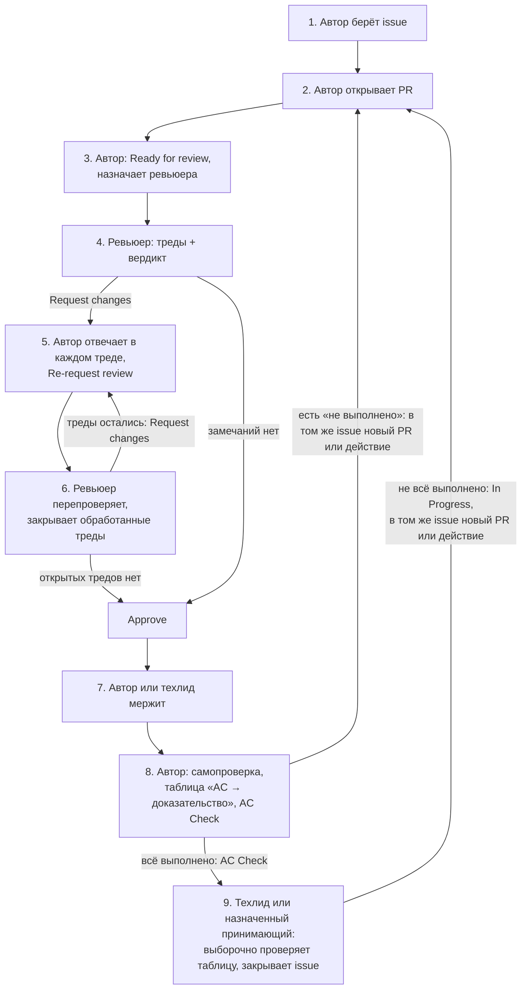

# Процесс работы с задачами и PR (команда 6)

| | |
|---|---|
| Статус | действует для `dmc-268-api-t6` и `dmc-268-ui-t6`; меняется только через PR в этот файл |
| Владелец | техлид спринта |
| Связанные документы | [`.agents/rules/git-workflow.md`](../.agents/rules/git-workflow.md) — ветки, коммиты, оформление PR |
| Задача | [#28](https://github.com/larchanka-training/dmc-268-api-t6/issues/28), [#56](https://github.com/larchanka-training/dmc-268-api-t6/issues/56), [dmc-268-ui-t6#173](https://github.com/larchanka-training/dmc-268-ui-t6/issues/173), [#273](https://github.com/larchanka-training/dmc-268-api-t6/issues/273), [#271](https://github.com/larchanka-training/dmc-268-api-t6/issues/271), [#272](https://github.com/larchanka-training/dmc-268-api-t6/issues/272) |

Здесь записано, кто, что и когда делает на пути от issue до мержа и приёмки, чтобы вопросы о процессе решались ссылкой на этот документ, а не спором. Как называть ветки, писать коммиты и оформлять тело PR — в `git-workflow.md`, здесь это не повторяется. Файл канонический для обоих репозиториев; в `dmc-268-ui-t6` лежит `docs/CONTRIBUTING.md` со ссылкой сюда.

---

## 1. Роли

| Роль | Кто | Отвечает за |
|---|---|---|
| Автор | разработчик, открывший PR | код; ответ в каждом треде; ребейз своей ветки; мерж (автор или техлид); как исполнитель issue (автор, назначенный в Assignees, шаг 1 §2) — самопроверка перед приёмкой: таблица «AC → доказательство» и статус AC Check (шаг 8 §2) |
| Ревьюер | участник из поля Reviewers PR, не автор | треды; закрытие тредов; вердикт Request changes или Approve |
| Техлид | техлид спринта, сейчас @axyi | решение споров в тредах; снятие чужого Request changes; приёмка задач: выборочно проверяет таблицу исполнителя, отмечает AC и DoD и закрывает issue или возвращает карточку в In Progress; вместо техлида это делает участник, которого техлид назначил принимающим (комментарием в issue); перенос AC в другую задачу — только техлид; мерж любого PR, готового по условиям [мержа](#мерж), не дожидаясь автора; комментарий в PR о мерже |

Агенты (Claude Code и другие) работают от имени автора и соблюдают те же правила.

## 2. Путь задачи



| # | Кто | Что делает | Статус issue на доске | Кому уходит уведомление |
|---|---|---|---|---|
| 1 | Автор | Назначает себя в Assignees issue и создаёт ветку по `git-workflow.md` | Todo → In Progress (вручную) | — |
| 2 | Автор | Открывает PR; пока работа не готова, PR остаётся Draft. В теле PR — `Refs #N` на issue из этого же репо или `Refs owner/repo#N` на issue из другого. Закрывающие ключевые слова (`Closes`, `Fixes`, `Resolves` и их формы) запрещены в заголовке и теле PR и в коммитах, а PR не привязывается к issue в панели Development: issue закрывает техлид на шаге 9 | In Progress | — |
| 3 | Автор | Работа готова, CI зелёный: нажимает Ready for review и назначает ревьюера в Reviewers. Срок первой подачи — [§9](#9-спринты) | On Review (вручную) | ревьюеру: запрос ревью |
| 4 | Ревьюер | Оставляет каждое замечание отдельным тредом на строке кода и отправляет всё одним Submit review с вердиктом (§4) | On Review | автору: отправлено ревью |
| 5 | Автор | Отвечает в каждом треде (§3). Когда ответ есть во всех открытых тредах, нажимает Re-request review (🔄 рядом с именем ревьюера) | On Review | ревьюеру: повторный запрос ревью |
| 6 | Ревьюер | Перепроверяет: закрывает (Resolve) обработанные треды, в необработанных отвечает, при необходимости открывает новые. Остались открытые треды — Request changes, возврат к шагу 5. Открытых нет — Approve | On Review | автору: отправлено ревью |
| 7 | Автор или техлид | Мержит, когда выполнены условия [мержа](#мерж): Approve на текущей голове PR, ветка на текущем `main`, все треды закрыты, CI зелёный и тело PR описывает весь PR. Техлид мержит любой PR, готовый по этим условиям, не дожидаясь автора, и оставляет в PR комментарий. Способ мержа — по `git-workflow.md`. Мерж не должен закрывать issue | On Review | — |
| 8 | Автор (исполнитель issue) | После мержа последнего PR задачи (у задачи без PR — после последнего действия) проводит самопроверку по правилам [приёмки](#приёмка-задачи): на каждый AC и DoD — доказательство или «не выполнено», комментарий-таблица «AC → доказательство» в issue. Всё выполнено — ставит AC Check; есть «не выполнено» — AC Check не ставит, возвращает карточку в In Progress (вручную, если она в On Review) и доделывает в том же issue: кодовый AC — новым PR (шаг 2), некодовый — действием и доказательством по правилам [приёмки](#приёмка-задачи) | On Review или In Progress → AC Check (вручную) или → In Progress (вручную) | подписчикам issue: новый комментарий |
| 9 | Техлид или назначенный им принимающий | Выборочно проверяет таблицу исполнителя, отмечает чекбоксы AC и DoD и закрывает issue по правилам [приёмки](#приёмка-задачи). Не всё выполнено — issue не закрывает: возвращает карточку в In Progress и пишет комментарием, что осталось | AC Check → Done (ставит workflow «Item closed», когда issue закрыт) или AC Check → In Progress (вручную) | подписчикам issue: issue закрыт или комментарий «что осталось» |

Про доску:

- PR к issue не привязывается (шаг 2), поэтому поле Linked pull requests на доске пустое: статусы вручную ставят автор (In Progress, On Review, AC Check) и принимающий (возврат в In Progress, шаг 9).
- `Refs` issue не закрывает. Done ставит workflow «Item closed», когда техлид закрывает issue; перенос карточки в Done issue не закрывает — workflow «Auto-close issue» в Project 12 выключен.
- AC Check ставит исполнитель после самопроверки (шаг 8) и снимает принимающий (шаг 9): закрыл issue — Done ставит workflow «Item closed»; вернул задачу в работу — переносит карточку в In Progress вручную. Если исполнитель нашёл «не выполнено» при самопроверке, он сам переносит карточку в In Progress, если она в On Review, и доделывает в том же issue: кодовый AC — новым PR (шаг 2), некодовый — действием и доказательством.
- Отдельного статуса «на доработке» нет. Перенос карточки не отправляет уведомлений, а о ходе ревью участники узнают из событий PR (§5).

### Приёмка задачи

Задача сдана, когда issue закрыт по правилам ниже. Смёрженный PR и карточка в Done сдачей не считаются. Приёмка идёт в два шага: самопроверка исполнителя (шаг 8 §2) и проверка техлида или назначенного принимающего (шаг 9). Issue не принимается, пока не выполнены все AC и DoD, кроме перенесённых по правилу ниже.

| Вопрос | Правило | Признак |
|---|---|---|
| Самопроверка | Обязательна перед AC Check. После мержа последнего PR задачи (у задачи без PR — после последнего действия) исполнитель issue (автор, §1) проверяет каждый AC и DoD и пишет в issue комментарий-таблицу «AC → доказательство»: на каждый пункт — PR, коммит, тест, прогон или скриншот, иначе «не выполнено»; у AC, который техлид перенёс по правилу ниже, — «перенесён в #M». Чекбоксы исполнитель не отмечает. AC Check ставит, только если «не выполнено» в таблице нет | в issue есть комментарий исполнителя с таблицей, где названы все AC и DoD из тела issue; карточка в AC Check |
| Кто закрывает | Техлид или участник, которого техлид назначил принимающим (комментарием в issue). Автор, мерж и перенос карточки не должны закрывать issue | issue в состоянии `CLOSED`, у последнего закрытия `actor` — техлид или назначенный, `closer` — `null` (команда 1) |
| Когда | Все PR задачи смёржены; карточка в AC Check, таблица исполнителя есть; в issue нет замечаний без ответа | карточка в AC Check, есть таблица исполнителя (строка «Самопроверка» выше); в выводе команды 2 среди PR задачи нет `open`; закрытые без мержа (`closed null`) не считаются; какие из ссылающихся PR относятся к задаче, решает принимающий по их `Refs`; на каждое замечание в комментариях issue есть ответ |
| Чем | Таблица исполнителя даёт доказательство на каждый AC и DoD. Принимающий проверяет её выборочно, отмечает все чекбоксы в теле issue (AC и DoD) и закрывает issue комментарием, который называет каждый AC | команда 3 выводит `0` неотмеченных и больше `0` чекбоксов всего; закрывающий комментарий называет каждый AC |
| Если не всё выполнено | Пункт «не выполнено» или доказательство не подтвердилось — принимающий issue не закрывает, возвращает карточку из AC Check в In Progress и пишет комментарием, что осталось | issue `OPEN` (команда 1), карточка в In Progress, в issue есть комментарий принимающего со списком |

- Задача из нескольких частей сдаётся по частям: каждая часть — отдельный PR с `Refs`, а issue закрывается после проверки всех частей.
- **Доработка — в том же issue.** Невыполненный AC или DoD доделывают в том же issue: кодовый — новым PR с `Refs #N` (он проходит §2 с шага 2), некодовый — действием и доказательством по правилу ниже; отдельный issue для этого не заводится. После мержа PR или действия исполнитель дополняет таблицу новым комментарием и снова ставит AC Check.
- **Перенос AC в другую задачу** — только решением техлида; назначенный принимающий AC не переносит. Техлид дописывает у самого AC в теле issue пометку «перенесён в #M решением техлида» и отмечает его чекбокс.
- **Некодовый AC** (ruleset, доска, живой прогон): действие выполняет исполнитель, а если нужны права администратора — техлид по его просьбе; доказательство даёт исполнитель комментарием в issue — что сделано и чем проверить (вывод команды, ссылка, скриншот); в таблице у этого AC — ссылка на комментарий.
- **Follow-up по итогам приёмки** заводится только для находки, сделанной при приёмке или позже и лежащей вне AC задачи: это новый скоуп, и issue заводится sub-issue исходного (родитель — исходный issue, скилл `create-issue`). Невыполненный AC или DoD follow-up не становится.
- **Уже открытые «Хвосты приёмки #N»**: исходные (закрытые) issue не переоткрывают, а «Хвосты» не сливают с ними — их дорабатывают и принимают как есть, по этим правилам. Новые «Хвосты приёмки» не заводят: находку вне AC оформляют как follow-up (правило выше), невыполненный AC — доработкой в том же issue.
- Если issue закрылся не по правилу — мержем, переносом карточки или через связь в панели Development, — техлид переоткрывает его, возвращает карточку в In Progress или On Review и пишет комментарием, что осталось.
- **Ловушка Development.** PR, вручную привязанный к issue в панели Development, закрывает issue при мерже, даже если в теле PR стоит `Refs` (в спринте 2 так закрылся #35 мержем #45). Перед мержем команда 4 должна вывести `0`; иначе убирают ключевое слово из тела PR или отвязывают PR в панели Development (какой из двух случаев — покажет команда 4 с `closingIssuesReferences(first: 10, userLinkedOnly: true)`: так она считает только ручные связи).

Команды запускаются из клона репозитория; `N` — номер issue или PR.

```bash
# 1. Состояние issue и кто чем закрыл его последним (ожидается CLOSED <техлид> null).
#    closer: null — вручную, PullRequest — мерж PR (в том числе через связь Development),
#    ProjectV2 — перенос карточки, Commit — коммит. OPEN — issue не закрыт или переоткрыт
gh api graphql -F owner='{owner}' -F repo='{repo}' -F n=N -f query='
  query($owner: String!, $repo: String!, $n: Int!) {
    repository(owner: $owner, name: $repo) { issue(number: $n) { state
      timelineItems(itemTypes: [CLOSED_EVENT], last: 1) { nodes { ... on ClosedEvent {
        actor { login } closer { __typename } } } } } } }' \
  --jq '.data.repository.issue as $i | $i.timelineItems.nodes[0]
        | "\($i.state) \(.actor.login) \(.closer.__typename)"'

# 2. PR, которые ссылаются на issue: состояние и время мержа (ожидается: среди PR задачи
#    нет open; closed null — закрыт без мержа)
gh api 'repos/{owner}/{repo}/issues/N/timeline' --paginate \
  --jq '.[] | select(.event == "cross-referenced") | .source.issue | select(.pull_request)
        | "\(.repository.full_name)#\(.number) \(.state) \(.pull_request.merged_at)"'

# 3. Чекбоксы в теле issue (AC и DoD): неотмеченные и всего (ожидается 0 и больше 0)
gh issue view N --json body --jq '[.body | scan("(?m)^ *[-*] \\[([ xX])\\]")[0]]
  | "\(map(select(. == " ")) | length) \(length)"'

# 4. Сколько issue закроет мерж PR по телу PR и связи Development (ожидается 0)
gh api graphql -F owner='{owner}' -F repo='{repo}' -F n=N -f query='
  query($owner: String!, $repo: String!, $n: Int!) {
    repository(owner: $owner, name: $repo) { pullRequest(number: $n) {
      closingIssuesReferences(first: 10) { totalCount } } } }' \
  --jq '.data.repository.pullRequest.closingIssuesReferences.totalCount'

# 4б. Заголовок и коммиты PR с закрывающим ключевым словом (ожидается 0); команда 4 их не видит,
#     а при squash заголовок PR становится сообщением коммита в main
gh pr view N --json title,commits --jq '[.title, (.commits[] | "\(.messageHeadline)\n\(.messageBody)")]
  | map(select(test("(?i)\\b(close[sd]?|fix(e[sd])?|resolve[sd]?)\\b:?\\s+([\\w.-]+/[\\w.-]+)?#[0-9]+"))) | length'
```

### Мерж

Автор или техлид мержит PR, только когда выполнены все условия ниже. Техлид мержит любой PR, готовый по этим условиям, не дожидаясь автора; для него условия те же. Техлид, смёрживший чужой PR, оставляет в нём комментарий. Условия, за которыми следит ruleset, GitHub проверяет сам: пока они не выполнены, кнопка Merge не работает.

| Условие | Признак | Чем обеспечено |
|---|---|---|
| Ветка на текущем `main` и обновлена rebase, а не merge `main` в ветку (делает автор): локально `git rebase origin/main` и `git push --force-with-lease` или кнопка «Update branch» в режиме «Update with rebase» | команда 5 выводит `0`, команда 5б — пустой вывод | ruleset: Require branches to be up to date before merging (актуальность); отсутствие merge-коммитов — договорённость (команда 5б) |
| Approve стоит на текущей голове PR | в выводе команды 6 `commit_id` одобряющего ревью равен голове PR | ruleset: Dismiss stale pull request approvals when new commits are pushed — push, меняющий дифф PR (новые коммиты, rebase или Update branch после изменений в `main`), снимает Approve; Approve именно на текущей голове при любом push — договорённость команды, она строже |
| Последний push одобрил не тот, кто его сделал | если ревьюер сам запушил коммит в PR, Approve даёт другой участник | ruleset: Require approval of the most recent reviewable push |
| Все треды закрыты, CI зелёный | кнопка Merge доступна | ruleset (§7) |
| Тело PR описывает весь PR | ревьюер сверяет раздел What с `gh pr diff N --name-only`; расхождение — Request changes | договорённость: автор обновляет тело при каждом новом коммите |
| Мерж не закроет issue | команды 4 и 4б выводят `0` | договорённость |
| Пользовательская документация обновлена или не нужна | одно из трёх (§8): PR в ui меняет видимое пользователю поведение — в этом PR есть правка `docs-site/content/docs/` или ссылка на follow-up issue; PR в api меняет видимое поведение — в теле PR есть ссылка на PR или issue в `dmc-268-ui-t6`; видимое поведение не меняется — пункт чек-листа отмечен, ревьюер сверяет это с диффом, как в строке «Тело PR описывает весь PR» | договорённость (§8) |
| Основная страница документации изменена только с явным ревью | в Submit review техлида или назначенного им участника есть строка «`<page>.mdx` прочитана целиком» для каждой изменённой страницы `index.mdx`, `how-it-works.mdx`, `features.mdx` | договорённость (§8) |

Ветку, отставшую от `main`, ребейзит автор и просит переодобрить (Re-request review, §4). Техлид в чужие ветки не пушит — ни rebase, ни «Update branch»: любой push, меняющий дифф PR, снимает Approve (`dismiss_stale_reviews_on_push`, §4), а по `require_last_push_approval` Approve техлида, сделавшего этот push, не считается и нужен Approve третьего участника (§7).

Шаблон тела PR с чек-листом перед мержем — `.github/pull_request_template.md`.

```bash
# 5. На сколько коммитов ветка PR отстаёт от main (ожидается 0)
gh api "repos/{owner}/{repo}/compare/main...$(gh pr view N --json headRefOid --jq .headRefOid)" \
  --jq .behind_by

# 5б. SHA merge-коммитов в ветке PR (ожидается пустой вывод и код выхода 0): «Update branch»
#     в режиме merge даёт актуальную ветку, но не rebase. Без конвейера: ошибка API остаётся
#     ненулевым кодом выхода, а не превращается в «0». Читаются все страницы; GitHub отдаёт
#     не больше 250 коммитов PR, для более длинного PR —
#     git rev-list --merges origin/main..origin/<ветка PR> (тоже ожидается пустой вывод)
gh api --paginate "repos/{owner}/{repo}/pulls/N/commits?per_page=100" \
  --jq '.[] | select(.parents | length > 1) | .sha'

# 6. На каком коммите стоит каждый Approve и какая сейчас голова PR (должны совпасть)
gh api --paginate 'repos/{owner}/{repo}/pulls/N/reviews?per_page=100' \
  --jq '.[] | select(.state == "APPROVED") | "\(.user.login) \(.commit_id)"'
gh pr view N --json headRefOid --jq .headRefOid
```

## 3. Треды

- **Одно замечание — один тред** на строке или файле. Комментарий в общей ленте PR закрыть нельзя, поэтому всё, что требует действия, пишется тредом.
- **Автор отвечает в каждом треде.** Молча править или молча пропускать замечание нельзя:
  - если автор согласен, он правит и пишет в ответе коммит: «Исправлено в `abc1234`»;
  - если не согласен, объясняет почему и ничего не меняет.
- **Автор тред не закрывает**, даже если согласен и уже исправил. Закрывает ревьюер: только он знает, снято ли замечание.
- Ревьюер закрывает тред, если исправление его устраивает, если его убедил аргумент автора или если спор решил техлид (§6).
- Тред, который открыл не ревьюер, а другой участник, закрывает тот, кто его открыл.
- Замечание, которое можно не исправлять, ревьюер начинает с `nit:`. Автор может не править, но ответить обязан.
- Отвечайте кнопкой Add single comment или отправьте все ответы одним Submit review. Незавершённый review (Start a review без Submit) никто, кроме автора ответа, не видит.

## 4. Вердикты ревью

| Вердикт | Когда ставить | Что даёт |
|---|---|---|
| Request changes | есть хотя бы один тред, который нужно исправить | блокирует мерж, пока тот же ревьюер не поставит Approve или техлид не снимет вердикт |
| Approve | открытых тредов нет | нужен для мержа, минимум один; себе Approve автор поставить не может |
| Comment | только вопросы, вердикта пока нет | мерж не блокирует и не разрешает |

Если ревьюер оставил замечания, которые нужно исправить, он ставит Request changes, а не Comment.

Push, меняющий дифф PR (новые коммиты, rebase или Update branch после изменений в `main`), снимает Approve: ruleset отклоняет устаревшие одобрения. Договорённость команды строже: Approve должен стоять на текущей голове PR (команда 6 из §2), поэтому после любого push в ветку автор снова нажимает Re-request review, и для мержа нужен новый Approve.

## 5. Кто получает уведомления

| Действие | Кто получает уведомление |
|---|---|
| Назначение ревьюера в Reviewers | ревьюер |
| Submit review с любым вердиктом | автор PR и все подписчики PR |
| Ответ в треде | все подписчики PR: автор, участники обсуждения, те, кто следит за репо |
| Re-request review | ревьюер |
| `@упоминание` | тот, кого упомянули |
| Resolve треда | никто |
| Перенос карточки на доске | никто |

Если по действию уведомление не уходит, дождаться реакции нельзя: нужно выполнить следующий шаг из §2, который уведомление отправляет.

## 6. Спор

1. Автор не согласен и пишет аргументы в треде.
2. Ревьюер либо соглашается и закрывает тред, либо отвечает, почему настаивает.
3. Если после этого круга согласия нет, любой из двоих зовёт в тред техлида (`@axyi`). Техлид отвечает в том же треде, и его решение окончательное. Тред закрывает ревьюер.
4. Если техлид сам автор или ревьюер этого PR, спор выносится в командный чат, а итог записывается в тред.

Решение остаётся в треде, поэтому к тому же вопросу потом не возвращаются.

## 7. Что проверяет GitHub, а что держится на договорённости

Ruleset `main` одинаков в обоих репо, кроме обязательных CI-проверок: в api это `Python lint / type / test`, `OpenAPI lint`, `Webhook container smoke` и `Edge Caddyfile validate`, в ui — `Docker image build` и `UI quality`.

| Правило | Как соблюдается |
|---|---|
| В `main` попадают только PR: без прямого push, force push и удаления ветки | ruleset |
| Обязательные CI-проверки зелёные: в api `Python lint / type / test`, `OpenAPI lint`, `Webhook container smoke`, `Edge Caddyfile validate`, в ui `Docker image build`, `UI quality` | ruleset `required_status_checks` |
| Ветка на текущем `main` | ruleset `strict_required_status_checks_policy` |
| Ветка обновлена rebase, а не merge `main` в ветку | договорённость; признак — команда 5б из §2 |
| Есть минимум один Approve, и не от автора | ruleset `required_approving_review_count: 1` + GitHub |
| Approve стоит на текущей голове PR: push, меняющий дифф PR (новые коммиты, rebase или Update branch после изменений в `main`), снимает его | ruleset `dismiss_stale_reviews_on_push`; Approve именно на текущей голове при любом push (команда 6 из §2) — договорённость команды, она строже |
| Последний push одобряет не тот, кто его сделал | ruleset `require_last_push_approval` |
| Все треды закрыты | ruleset `required_review_thread_resolution` |
| Request changes блокирует мерж, чужой вердикт снимает только техлид | ruleset `dismissal_restriction` |
| Мерж только squash или rebase: merge commit GitHub не примет | ruleset `allowed_merge_methods` |
| Автор отвечает в каждом треде | договорённость |
| Тред закрывает ревьюер (или тот, кто открыл тред), но не автор PR | договорённость: GitHub разрешает закрыть тред автору PR и любому с правом записи, а права записи есть у всей команды |
| Мержит автор или техлид; техлид, смёрживший чужой PR, оставляет в PR комментарий | договорённость |
| Ребейз отставшей ветки делает автор; техлид в чужие ветки не пушит | договорённость; иначе push техлида снимает Approve (`dismiss_stale_reviews_on_push`), а ruleset `require_last_push_approval` требует Approve третьего участника |
| Тело PR описывает весь PR | договорённость: ревьюер сверяет What с `gh pr diff N --name-only` |
| В заголовке, теле PR и коммитах нет закрывающих ключевых слов, PR не привязан к issue в панели Development | договорённость; признак — команда 4 из §2 (тело PR и связь Development) и команда 4б (заголовок PR и сообщения коммитов) |
| Issue закрывает техлид или назначенный им после проверки AC | договорённость; признак — команда 1 из §2 |
| Перенос карточки в Done не закрывает issue | workflow «Auto-close issue» в Project 12 выключен |
| Пользовательская документация обновлена или не нужна; основные страницы документации меняются только с явным ревью техлида или назначенного им участника (§8) | договорённость; признак — таблица «Мерж» (§2) |
| Статусы Todo → In Progress → On Review → AC Check | вручную: AC Check ставит исполнитель после самопроверки, снимает принимающий; Done ставит workflow «Item closed», когда issue закрыт |

Решение техлида 04.10.2026 (в рамках #56): в ruleset `main` обоих репо включены «Dismiss stale pull request approvals when new commits are pushed» (`dismiss_stale_reviews_on_push`), «Require approval of the most recent reviewable push» (`require_last_push_approval`) и «Require branches to be up to date before merging» (`strict_required_status_checks_policy`); в ui обязательной стала проверка `Docker image build` (с 07.10 добавлена `UI quality`, ui#73), иначе требование «up to date» там не действует. В api обязательными стали также `OpenAPI lint` и `Webhook container smoke` (джобы из #60; с мержа PR #98 добавлена `Edge Caddyfile validate`): иначе PR с красной проверкой проходил бы мерж и останавливал только выкатку на staging. В Project 12 выключен workflow «Auto-close issue», а «Item closed» оставлен. Причина: в спринте 2 PR #38 смёржен без rebase на `main`, и `main` был красным около 3 ч; PR #42 одобрен на `dcdf95d`, а смёржен после rebase и новых коммитов, в том числе коммита ревьюера, без повторного Approve. Такое правило должно проверять GitHub, а не договорённость. Цена решения: каждый push, меняющий дифф PR (новые коммиты, rebase или Update branch после изменений в `main`, в том числе после мержа чужого PR), требует нового Approve, а ревьюер, запушивший коммит в PR, одобрить его не может — нужен другой участник.

При смене техлида обновите `dismissal_restriction` в ruleset обоих репо и упоминания техлида в этом файле.

## 8. Пользовательская документация

Пользовательская документация живёт в `docs-site/` репозитория `dmc-268-ui-t6` ([dmc-268-ui-t6#173](https://github.com/larchanka-training/dmc-268-ui-t6/issues/173)).

- PR в любом из двух репо, который меняет поведение, видимое пользователю, в том же PR обновляет `docs-site/content/docs/` или ссылается на follow-up issue. Для PR в api правка — отдельный PR или issue в `dmc-268-ui-t6`, ссылка на него в теле PR.
- Видимое пользователю в api, например: формат `.review/rules.md` (`docs/RULES_FORMAT_SPEC.md`, его пользовательская версия — `docs-site/content/docs/rules-file.mdx`), настройки репозитория, статусы прогонов и check run, формат комментария ревью.
- PR в ui, который меняет макет в `docs-site/components/dashboard/` или компонент приложения, который этот макет использует, снимает картинки документации заново (`pnpm --dir docs-site shots`, подробности в `docs-site/README.md`) и коммитит `docs-site/public/screens/` вместе с `docs-site/components/mockups/screens.json`.
- Основные страницы `index.mdx` (Introduction), `how-it-works.mdx` и `features.mdx` меняются только с явным ревью: ревьюер пишет в Submit review «`<page>.mdx` прочитана целиком». Это ревью даёт техлид или назначенный им участник. Лучше дополнить Roadmap или FAQ либо поставить бейдж статуса, чем переписывать основную страницу.
- Пункт «User docs updated in `docs-site/content/docs/`, a follow-up issue linked, or not needed» из чек-листа шаблона PR автор отмечает и тогда, когда видимого пользователю поведения PR не меняет.

## 9. Спринты

Спринт в GitHub — это майлстоун. По нему задачи спринта выбираются в обоих репо, на доске 12 и в графе зависимостей ([#273](https://github.com/larchanka-training/dmc-268-api-t6/issues/273)).

| Вопрос | Правило |
|---|---|
| Название | «Спринт N», одинаковое в обоих репо. Майлстоуны в репо отдельные: название и срок правят в обоих. Дата старта — в описании («Спринт N курса Dmc-268: старт ДД.ММ.ГГГГ»), срок (Due date) ставят, когда он объявлен |
| Кто создаёт | Техлид, в обоих репо, к старту спринта |
| Кто и когда ставит | Тот, кто заводит issue, — при заведении, если задача сразу идёт в спринт (скилл `create-issue` ставит `milestone` из спеки); техлид — при разметке состава на старте; автор (§1) — когда берёт в работу задачу без майлстоуна, в момент шага 1 из §2 (назначает себя в Assignees): ставит майлстоун текущего спринта |
| Без майлстоуна | Открытая задача без майлстоуна — бэклог: она не входит ни в один спринт. Представление Backlog на доске 12 — другое: оно отбирает задачи по статусу. Задачи спринтов 1–3 майлстоуном не размечены |
| Состав спринта | Открытые на дату старта задачи с исполнителем в статусе In Progress, On Review или AC Check (самопроверка проведена, задача ждёт приёмки) плюс задачи из Todo по списку техлида. Задача, которую взяли в работу во время спринта, входит в него по строке «Кто и когда ставит» |
| Срок первой подачи на ревью | Ready for review (шаг 3, §2) — к пятнице первой недели спринта. Правило действует со Спринта 5; в Спринте 4 первая подача на ревью — до 31.10 |
| Issue «Спринт N» | Issue в api, куда техлид публикует граф зависимостей спринта. Его называют по номеру, заголовок «Спринт N» не обязателен: номер называет техлид, для Спринта 4 это эпик процесса [#261](https://github.com/larchanka-training/dmc-268-api-t6/issues/261), и его sub-issues остаются задачами эпика. Задачи спринта в такое issue sub-issues не добавляются: у issue один родитель, и это тематический эпик. Поэтому граф строится по майлстоуну, а не по sub-issues |

На доске 12 спринты видны в представлении [Sprints](https://github.com/orgs/larchanka-training/projects/12/views/8): таблица сгруппирована по Milestone, задачи без майлстоуна — отдельной группой.

```bash
# Задачи спринта в обоих репо, открытые и закрытые (пример — Спринт 4)
gh issue list -R larchanka-training/dmc-268-api-t6 --milestone "Спринт 4" --state all -L 200
gh issue list -R larchanka-training/dmc-268-ui-t6 --milestone "Спринт 4" --state all -L 200

# Поставить майлстоун задаче (для ui добавьте -R larchanka-training/dmc-268-ui-t6)
gh issue edit <номер issue> --milestone "Спринт 4"
```

### Старт спринта

Порядок работы в спринте задаёт граф зависимостей его задач: что можно брать параллельно, критический путь, циклы блокировок и задачи In Progress с открытым блокером. Граф строит скилл [`issue-graph`](../.agents/skills/issue-graph/SKILL.md) ([#268](https://github.com/larchanka-training/dmc-268-api-t6/issues/268)).

| # | Кто | Что делает |
|---|---|---|
| 1 | Техлид | Создаёт майлстоун «Спринт N» в обоих репо и называет номер issue «Спринт N» для графа |
| 2 | Кто заводит задачи, техлид | Заводят задачи спринта с майлстоуном и нативными связями: blocked-by и родительский эпик (скилл `create-issue`, [#262](https://github.com/larchanka-training/dmc-268-api-t6/issues/262)). Техлид размечает состав спринта по правилу выше |
| 3 | Техлид | Строит граф по майлстоуну. Граф с циклом (код выхода 1) не публикуется: сначала убирают лишнюю связь и строят граф заново |
| 4 | Техлид | Публикует граф в issue «Спринт N» той же командой с `--publish-to <номер issue>`. Повторный запуск с тем же майлстоуном обновляет тот же комментарий (по маркеру в его первой строке), поэтому граф обновляют запуском, а не правкой комментария вручную |
| 5 | Ведущие задач: исполнители (автор, §1) | Проверяют блокеры своих задач по графу: раздел «In Progress с открытым блокером», номер слоя в «Слои: что можно брать параллельно» (задача не из первого слоя ждёт блокер) и «Вне выборки». Для задачи In Progress с открытым блокером выбирают одно: доделать сначала блокер, вернуть задачу из In Progress или убрать связь, если блокер устарел; задачу из Todo берут после её блокера. После смены связей техлид обновляет граф (шаг 4) |

```bash
# Граф Спринта 4: только показать
.agents/skills/issue-graph/scripts/issue_graph.py --milestone "Спринт 4"

# Опубликовать его в issue «Спринт 4» (#261) или обновить опубликованный
.agents/skills/issue-graph/scripts/issue_graph.py --milestone "Спринт 4" --publish-to 261
```

Граф Спринта 4 опубликован [комментарием в #261](https://github.com/larchanka-training/dmc-268-api-t6/issues/261#issuecomment-6396929696).
