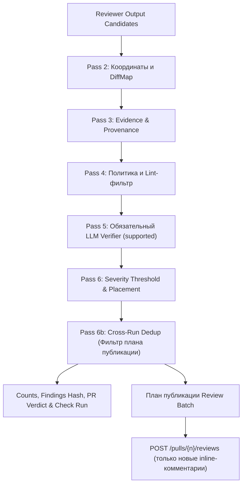

# INCREMENTAL_REVIEW_AND_LIMITS_SPEC — инкрементальный анализ (Re-review), разрешение устаревших замечаний, квоты и DoS-защита (команда 6)

| | |
|---|---|
| **Статус** | **Черновик Ч.1, PR #334** (Идентичность находок, подавление дубликатов и стратегия тредов) |
| **Владелец** | Техлид (роль 1) |
| **Область действия** | Идентичность замечания между прогонами (Finding Fingerprint), сопоставление со старыми коммитами, пересчет координат без привязки к абсолютным номерам строк (Line Offset Tracking), алгоритм межпрогонного подавления дубликатов в плане публикации (Cross-Run Dedup), стратегия классификации и разрешения устаревших/исправленных тредов на VCS (Outdated / Resolved Threads) через GraphQL `resolveReviewThread`, права GitHub App, исключение собственных событий бота по правилу Р-9, квотирование мутаций GitHub API. |
| **Связанные документы** | [`SYSTEM_DESIGN.md`](SYSTEM_DESIGN.md) (Р-5, Р-9, §8, §13 «Риск схлопывания»), [`CONTEXT_AND_VERIFICATION_SPEC.md`](CONTEXT_AND_VERIFICATION_SPEC.md) (§6.2, §10 «Write-back: неизменяемая публикация»), [`PIPELINE_SPEC.md`](PIPELINE_SPEC.md) (§1, §6, §8). |
| **Definition of Done (DoD Ч.1)** | 1. Ключ идентичности находки между Run не зависит от абсолютных номеров строк; формализованы поля из модели `Finding`, нормализация с сохранением отступов, позиционное сопоставление вхождений и каноническая сериализация.<br/>2. Спроектирован алгоритм подавления дубликатов как фильтр плана публикации (Pass 6b) по квитанциям `comments`: подавленный повтор сохраняет `drop_reason IS NULL`, получает `publication_action = 'suppressed_duplicate'`, учитывается в severity counts, вердикте и Check Run, но исключается из массива `comments[]` со ссылкой на существующий комментарий (`linked_comment_id`).<br/>3. Задана стратегия классификации тредов (оставить, закрыть через GraphQL `resolveReviewThread`, строгий приоритет человека); определены порядок предикатов, проверка полноты покрытия перед закрытием и правила для всех состояний.<br/>4. Сняты противоречия с неизменяемой публикацией (CVS §10), одним review batch (Р-5) и запретом компенсирующего удаления (SD §13).<br/>5. Спроектированы изменения схемы БД (Alembic), модель жизненного цикла треда и интеграция этапа чистки как фазы внутри состояния `publishing` перед T14.<br/>6. Составлена расширенная таблица сквозных сценариев для регресса QA с корректными значениями Check Run. |

---

## 1. Область действия, терминология и базовые инварианты

### 1.1. Терминология

- **Full PR Diff (`base_sha...head_sha`)**: Полный унифицированный дифф pull request относительно целевой базовой ветки. Все inline-комментарии в GitHub API адресуются исключительно по координатам полного диффа.
- **Commit Delta / Incremental Diff**: Разница коммитов между ревизией исходной публикации замечания (`anchor_head_sha`) и новой головой PR (`current_head_sha`), получаемая через `VcsProvider.compare_commits`.
- **Base Git Coordinate Translation (Смещение строк / Line Offset Tracking)**: Алгоритмический пересчет номеров строк открытых замечаний из координат исходной ревизии публикации в координаты новой ревизии с учетом смещений, вносимых добавленными и удаленными строками коммит-дельты. Исходные координаты в базе данных не перезаписываются (терминальные данные неизменяемы по SD §8.3); смещение рассчитывается динамически для каждого Run относительно `anchor_head_sha`.
- **Finding Fingerprint (Идентичность находки)**: Детерминированный хеш находки, не зависящий от абсолютного номера строки в файле и вычисляемый от канонического представления атрибутов проблемы и нормализованного кода под якорем.
- **Anchor Code Hash (`anchor_code_hash`)**: Нормализованный криптографический хеш текста блока кода под якорем замечания, очищенный от крайних пробелов и нормализованный по переводам строк с сохранением значимых синтаксических отступов.
- **Outdated Thread (Устаревший тред)**: Состояние треда на стороне VCS, когда строка или блок кода, к которому было привязано замечание, подверглись изменению в последующих коммитах. GitHub переводит тред в свернутое состояние `outdated` автоматически на уровне платформы; при этом тред остается открытым (`isResolved = false`) и требует явного закрытия при подтверждении исправления дефекта.
- **Resolved Finding / Thread (Разрешенная находка / Закрытый тред)**: Состояние замечания, когда в новой ревизии дефект устранен автором (код под якорем изменен, участок проанализирован с полным покрытием и дефект не обнаружен), либо файл с дефектом полностью удален из PR. На стороне GitHub тред переводится в закрытое состояние мутацией `resolveReviewThread`.
- **Persisting Finding (Сохраняющаяся находка)**: Находка из предыдущего ревью, проблемный код под якорем которой не изменялся (или сместился по строкам без изменения содержания), и дефект по-прежнему актуален. Повторно в inline-комментариях не публикуется, но учитывается в вердикте и Check Run.
- **Human-in-the-loop Thread**: Тред, в котором после комментария бота появился хотя бы один ответ человека (`__typename != "Bot"` и логин не совпадает с логином бота), либо который был закрыт или повторно открыт человеком вручную.

### 1.2. Базовые инварианты

1. **Zero-Spam (Никаких повторных комментариев на неизмененный код)**: Бот не создает повторный inline-комментарий для дефекта, который уже был опубликован в предыдущем Run и остался неисправленным. Существующий тред на VCS сохраняется.
2. **Опубликованное определяется строго по квитанциям (`comments`, remote IDs)**: Принадлежность замечания к опубликованным определяется наличием записи в таблице `comments` с `github_comment_id` для данного PR, а не статусом Run (`succeeded` / `cancelled`). Run, отмененный по T15 после выполнения POST-запроса, уже оставил комментарии на PR; они считаются опубликованными.
3. **Сохранность счетчиков и вердикта при дедупликации**: Подавление повторных находок является фильтром плана публикации, а не причиной отсева (drop reason). Сохраняющаяся находка сохраняет `drop_reason IS NULL`, получает `publication_action = 'suppressed_duplicate'`, связывается с существующей записью комментария (`linked_comment_id`) и в полном объеме учитывается в severity counts, вердикте PR и статусе Check Run. Неисправленный критический дефект не превращает вердикт в `clean`.
4. **Общие замечания (Body-only findings) и квитанции**:
   - Находки без inline-координат (general-only) и находки сверх inline cap публикуются в теле ревью. Их дедупликация ведется по `FindingFingerprint` (вычисляемому по тем же правилам). Прежние body-only находки читаются из `findings` предыдущих Run данного PR со статусом `published = true` и `inline_comment = false`. Повторные general-находки опускаются при формировании итогового тела рецензии.
   - Inline-находка без подтвержденной квитанции (`github_comment_id IS NULL`) не считается опубликованной. На `main` запись квитанций пакета inline-комментариев атомарна (`len(comment_ids) == len(inline)`); по этой причине подавленные дубли исключаются из массива `inline` до отправки, что гарантирует сохранение инварианта длин.
5. **Неизменяемость текста публикации (Immutable Payload)**: Закрытие треда на VCS через GraphQL `resolveReviewThread` меняет только состояние треда (`isResolved`), но не редактирует и не удаляет опубликованный текст комментария (`body`), сохраняя квитанции, аудит и payload digest по CVS §10.
6. **Human-in-the-loop Priority (Приоритет человека)**:
   - Если в треде бота ответил человек, бот не закрывает тред автоматически, даже если считает дефект устраненным. Тред передается на разрешение человеку (`HUMAN_DISCUSSION`).
   - Если человек закрыл тред вручную (`RESOLVED_BY_USER`), бот считает его закрытым и не переоткрывает.
   - Если человек снял resolve с треда, ранее закрытого ботом (в БД `RESOLVED_BY_BOT`, а на GitHub `isResolved == false`), тред переходит в `HUMAN_DISCUSSION` под управление человека; бот повторно его не закрывает.
   - В любом из этих состояний повторная публикация замечания с тем же `FindingFingerprint` подавляется, пока тред существует на PR.
7. **Игнорирование собственных событий (Правило Р-9)**: События `pull_request_review_thread.resolved` / `unresolved`, инициированные ботом, принимаются HTTP-маршрутом с кодом 202, сохраняются в квитанциях и отбрасываются в `webhook-worker` по правилу `sender.type == "Bot"` и совпадению `sender.login.casefold() == bot_login.casefold()` с присвоением статуса `ignored_irrelevant_event` (detail `action=<action> ignored_own_bot`). Полноценный разбор событий тредов подключается в задаче #321.
8. **Квотирование мутаций GitHub API**: Вторичные лимиты GitHub ограничивают трафик до 1 мутации в секунду, не более 80 content-generating запросов в минуту и 500 в час на установку. На один Run устанавливается лимит не более 30 вызовов мутации `resolveReviewThread` с паузой не менее 1.2 секунды между запросами. Оставшиеся к закрытию треды обрабатываются в последующих прогонах.
9. **Граница провайдеров VCS (GitLab)**: Прием вебхуков и запуск ревью для GitLab реализованы на `main` (#169), однако GitLab intake по умолчанию выключен. GitLab использует API discussions без квитанций `comments` с внешними thread ID. Для GitLab метод `get_review_threads` возвращает пустой список, `resolve_review_thread` возвращает `SUCCESS` (no-op), а реестр замечаний работает с пустым списком тредов. Повторы на GitLab на этапе MR update являются известным временным ограничением.

---

## 2. Идентичность находки между Run (Finding Fingerprint)

### 2.1. Проблема абсолютных номеров строк

Если идентифицировать замечание по кортежу `(file_path, line_number, rule_name)`, то любая правка выше по файлу (добавление строк, комментариев или импортов) сдвигает абсолютный номер строки дефекта на величину смещения. В результате:
- Прежнее замечание на строке N не сопоставится с дефектом на строке N + delta;
- Бот опубликует дубликат замечания на строке N + delta;
- Прежнее замечание на строке N будет ошибочно сочтено устраненным и закрыто (ложная чистка).

Межпрогонный ключ идентичности находки не должен зависеть от абсолютного номера строки в файле.

### 2.2. Формула Finding Fingerprint и поля модели Finding

Для каждого кандидата в находки вычисляется детерминированный ключ на основе реальных атрибутов модели `Finding` (`app/modules/reviews/infrastructure/models.py`):

1. **`file_path`**: Канонический относительный путь к файлу в репозитории (POSIX-формат, разделитель `/`, без ведущего слеша). При переименовании файла путь сопоставляется через `previous_filename` из ответа сравнения коммитов. Перед сравнением с реестром fingerprint ранее опубликованной строки пересчитывается с подстановкой нового пути файла.
2. **`side`**: Сторона диффа из enum `FindingSide` (`RIGHT` для добавленного/измененного кода, `LEFT` для удаленного кода; по умолчанию `RIGHT`).
3. **`category`**: Категория дефекта из enum `FindingCategory` (`security`, `correctness`, `performance`, `readability`).
4. **`rule_name`**: Имя или источник правила (`Finding.rule_name`, nullable string, допустимые значения: `.review/rules.md`, `AGENTS.md`, `service-defaults:<ID>` или null). Если правило не задано (`null`), в структуру подставляется пустая строка `""`.
5. **`anchor_code_hash`**: SHA-256 хеш нормализованного блока кода под якорем дефекта (см. §2.3).
6. **`normalized_claim`**: Нормализованный заголовок утверждения дефекта (`Finding.title`). Для согласованности используется канонический алгоритм из `findings_post_processor.py:364-365`: приведение к нижнему регистру, замена последовательностей не-буквенно-цифровых символов `[^a-z0-9]+` на одиночный пробел и `strip()`.
7. **`occurrence_index`**: Локальный индекс вхождения идентичного блока кода в файле. Для устранения сдвигов при вставке аналогичного блока выше по файлу индекс вхождения привязывается к ближайшему перенесенному диапазону координат (§2.4), а не к сырому порядковому номеру от начала файла.

**Каноническая сериализация и хеширование**:
Компоненты ключа упаковываются в канонический JSON-объект с сортировкой ключей, разделителями `separators=(',', ':')` и `ensure_ascii=False`, аналогично построению payload digest в CVS §10.1:

```json
{
  "anchor_code_hash": "a1b2c3d4...",
  "category": "security",
  "file_path": "app/auth.py",
  "normalized_claim": "unhandled bare except block",
  "occurrence_index": 0,
  "rule_name": ".review/rules.md",
  "side": "RIGHT"
}
```

```text
FindingFingerprint = SHA-256(canonical_json_utf8_bytes)
```

**Нестабильность формулировок модели (Graceful Matching)**:
Если LLM при повторном анализе перефразировала заголовок или опустила необязательное имя правила, применяется двухступенчатое сопоставление:
1. Точное совпадение по `FindingFingerprint`.
2. Запасное сопоставление (Fallback Match): если точного совпадения нет, но на том же якоре `(file_path, anchor_code_hash)` в реестре найден ровно один открытый тред с совпадающей категорией, он признается тем же замечанием. Если кандидатов несколько, fallback не применяется во избежание неоднозначности.

### 2.3. Нормализация блока кода якоря (`anchor_code_hash`)

Для корректной работы с языками с позиционным синтаксисом (Python, YAML) нормализация сохраняет отступы:
1. Замена всех вариантов переводов строк на канонический LF (`
` -> `
`).
2. Удаление хвостовых пробелов и табуляций в конце каждой строки (`rstrip()`). Ведущие пробелы (отступы) сохраняются.
3. Удаление пустых строк в начале и конце блока якоря `[line_start, line_end]`.
4. Преобразование нормализованной строки в UTF-8 байты и вычисление SHA-256: `anchor_code_hash = SHA-256(normalized_code_bytes)`.

### 2.4. Алгоритм отслеживания смещений строк (Line Offset Tracking)

Для сопоставления открытых комментариев с новой головой PR используется отслеживание смещений на базе унифицированного диффа дельты коммитов:

```text
ВХОД:
  - comment: ранее опубликованный комментарий с привязанными координатами
             (anchor_head_sha, file_path, line_start, line_end, anchor_code_hash)
  - delta_comparison: результат VcsProvider.compare_commits(anchor_head_sha, current_head_sha)

АЛГОРИТМ:
  1. Проверка доступности и полноты дельты:
     Если delta_comparison недоступен (ошибка вызова compare, delta_comparison.complete == False,
     число файлов >= 300, либо anchor_head_sha не является предком current_head_sha):
       -> Исход: UNKNOWN.
       -> Безопасное умолчание: тред оставляется открытым (LEAVE_ACTIVE).
       -> Мутация закрытия треда НЕ вызывается. Завершить алгоритм.

  2. Разрешение переименований файлов:
     Найти target_path для comment.file_path с учетом previous_filename в delta_comparison.files.
     Если файл удален в дельте (status == 'removed'):
       -> Исход: RESOLVED_BY_FILE_DELETION.
       -> Завершить алгоритм.

  3. Поиск секции (patch) для target_path в delta_comparison.files:
     Если файл отсутствует в списке файлов сравнения:
       -> Файл не изменялся между anchor_head_sha и current_head_sha.
       -> Исход: PERSISTING (код под якорем гарантированно не затронут).
       -> Завершить алгоритм.
     Если файл присутствует в списке, но patch is None (бинарный файл или превышен лимит diff):
       -> Исход: UNKNOWN (невозможно подтвердить сохранность/исправление кода).
       -> Безопасное умолчание: LEAVE_ACTIVE.
       -> Завершить алгоритм.

  4. Расчет смещения строк по hunks файла:
     delta_offset = 0
     is_anchor_modified = false
     old_target_line = comment.line_start
     end = comment.line_end if comment.line_end is not None else comment.line_start

     Для каждого hunk в patch файла:
       hunk_old_start = hunk.old_start
       hunk_old_count = hunk.old_count
       hunk_old_end = (hunk_old_start + hunk_old_count - 1) if hunk_old_count > 0 else hunk_old_start
       hunk_net_diff = hunk.new_count - hunk.old_count

       // Случай 1: Чистая вставка строк строго выше якоря (hunk_old_count == 0)
       Если hunk_old_count == 0:
         Если hunk_old_start < old_target_line:
           delta_offset += hunk_net_diff
         продолжить

       // Случай 2: Hunk целиком выше строки якоря
       Если old_target_line > hunk_old_end:
         delta_offset += hunk_net_diff
         продолжить

       // Случай 3: Hunk целиком ниже диапазона якоря
       Если end < hunk_old_start:
         продолжить

       // Случай 4: Якорь пересекается с hunk
       Если диапазон [comment.line_start, end] пересекается с hunk:
         Проверить, затронуты ли строки диапазона якоря изменениями ('-' или '+'):
         Если хотя бы одна строка диапазона изменена или удалена:
           is_anchor_modified = true
         Иначе (строки диапазона остались неизменным контекстом внутри hunk):
           delta_offset += (число '+' выше comment.line_start - число '-' выше comment.line_start)

  5. Валидация сохранности кода якоря:
     Если is_anchor_modified == false:
       new_start = comment.line_start + delta_offset
       new_end = end + delta_offset
       Прочитать блок строк [new_start, new_end] из дерева current_head_sha.
       Вычислить new_anchor_code_hash по правилам §2.3.
       Если new_anchor_code_hash == comment.anchor_code_hash:
         -> Исход: PERSISTING (строки сместились, код дефекта на месте).
            Исходные координаты в БД неизменны; смещение учитывается в памяти прогона.
       Иначе:
         -> is_anchor_modified = true

  6. Обработка изменения кода якоря:
     Если is_anchor_modified == true:
       -> Исход: ANCHOR_MODIFIED (требуется сопоставление с результатами ревью нового Run).
```

### 2.5. Модель данных и миграции схемы БД

Для поддержки идентичности находок и жизненного цикла тредов в схему данных вносятся следующие изменения через миграцию Alembic:

```sql
-- 1. Расширение таблицы findings (хранение ключей идентичности и связи с комментарием)
ALTER TABLE findings ADD COLUMN finding_fingerprint CHAR(64) NULL;
ALTER TABLE findings ADD COLUMN anchor_code_hash CHAR(64) NULL;
ALTER TABLE findings ADD COLUMN occurrence_index INTEGER NOT NULL DEFAULT 0;
ALTER TABLE findings ADD COLUMN linked_comment_id UUID NULL REFERENCES comments(id);
ALTER TABLE findings ADD COLUMN publication_action VARCHAR(32) NOT NULL DEFAULT 'publish_inline';

ALTER TABLE findings ADD CONSTRAINT ck_findings_publication_action
    CHECK (publication_action IN ('publish_inline', 'suppressed_duplicate', 'publish_body'));

CREATE INDEX ix_findings_fingerprint ON findings(finding_fingerprint);
CREATE INDEX ix_findings_linked_comment_id ON findings(linked_comment_id);

-- 2. Расширение таблицы comments (метаданные жизненного цикла треда VCS)
ALTER TABLE comments ADD COLUMN github_thread_id VARCHAR(64) NULL;
ALTER TABLE comments ADD COLUMN thread_status VARCHAR(32) NOT NULL DEFAULT 'ACTIVE';
ALTER TABLE comments ADD COLUMN resolved_at TIMESTAMP WITH TIME ZONE NULL;
ALTER TABLE comments ADD COLUMN resolved_by_commit VARCHAR(64) NULL;
ALTER TABLE comments ADD COLUMN resolved_by_actor VARCHAR(100) NULL;

ALTER TABLE comments ADD CONSTRAINT ck_comments_thread_status
    CHECK (thread_status IN ('ACTIVE', 'PERSISTING', 'HUMAN_DISCUSSION', 'RESOLVED_BY_USER', 'RESOLVED_BY_BOT', 'OUTDATED'));

CREATE INDEX ix_comments_thread_status ON comments(thread_status);
CREATE INDEX ix_comments_github_thread_id ON comments(github_thread_id);
```

**Единый словарь состояний треда (`thread_status`)**:
- `ACTIVE`: Замечание опубликовано, тред открыт на GitHub, дефект актуален.
- `PERSISTING`: Дефект подтвержден в последующих прогонах, код под якорем не менялся или сдвинулся по строкам, тред остается открытым на GitHub.
- `RESOLVED_BY_BOT`: Дефект устранен автором коммита (при подтвержденном полном анализе участка) или файл удален; тред закрыт ботом через GraphQL `resolveReviewThread`.
- `RESOLVED_BY_USER`: Тред был закрыт разработчиком вручную в интерфейсе GitHub.
- `OUTDATED`: Код под якорем изменен автором, тред на GitHub перешел в статус outdated. Если дефект мутировал, старый тред закрывается при публикации нового дефекта.
- `HUMAN_DISCUSSION`: В треде ответил человек либо человек отменил resolve бота. Бот уступает приоритет человеку и никогда не закрывает такой тред автоматически.

**Таблица соответствия: Исход §2.4 -> Действие §4.1 -> Статус БД**:

| Исход смещения (§2.4) | Проверка покрытия нового Run | Исход классификации (§4.1) | Действие на GitHub VCS | Результирующий `thread_status` |
|---|---|---|---|---|
| `RESOLVED_BY_FILE_DELETION` | Не требуется (файл удален) | `RESOLVED_BY_DELETION` | Закрыть тред (`resolveReviewThread`) | `RESOLVED_BY_BOT` |
| `ANCHOR_MODIFIED` | `coverage_complete == True`, дефектов нет | `RESOLVED_BY_FIX` | Закрыть тред (`resolveReviewThread`) | `RESOLVED_BY_BOT` |
| `ANCHOR_MODIFIED` | Покрытие неполное (skipped / truncated) | `LEAVE_ACTIVE` | NOOP (нельзя подтвердить фикс) | Сохраняет прежний статус |
| `ANCHOR_MODIFIED` | Дефект обнаружен на измененном коде | `OUTDATED_MUTATED` | Закрыть старый тред + опубликовать новый | Старый: `OUTDATED`, Новый: `ACTIVE` |
| `PERSISTING` | Любая | `LEAVE_ACTIVE` | NOOP (тред остается открытым) | `PERSISTING` (или `HUMAN_*` без понижения) |
| `UNKNOWN` | Любая | `LEAVE_ACTIVE` | NOOP (безопасное умолчание) | Сохраняет прежний статус |

**Разграничение ключей и целостность связей**:
1. Колонка `comments.findings_hash` хранит хеш всего набора находок прогона для верификации неизменяемости публикации (CVS §10), и **не является** ключом отдельной находки.
2. Ограничение `UNIQUE(finding_id)` в таблице `comments` связывает строку комментария с породившей ее находкой первоначального Run.
3. При сохранении дефекта в последующих Run повторная строка в `comments` не создается. Новая находка сохраняет `drop_reason IS NULL`, получает `publication_action = 'suppressed_duplicate'`, `inline_comment = false`, а ссылка на исходный комментарий фиксируется в колонке `findings.linked_comment_id = comments.id`.
4. **Обработка исторических строк (Legacy Rows)**: Для строк `comments`, созданных до миграции, колонка `finding_fingerprint` в исходной находке заполняется бэкфиллом. Если блоб отсутствует в кэше, используется сопоставление по `(file_path, category, normalized_claim)`. До завершения бэкфилла такие строки признаются активными legacy-комментариями и участвуют в дедупликации через fallback.

---

## 3. Алгоритм подавления дубликатов в плане публикации (Cross-Run Dedup)

### 3.1. Формирование реестра опубликованных замечаний PR

Реестр ранее опубликованных замечаний формируется по квитанциям публикации текущего PR независимо от итогового статуса Run:

```sql
SELECT c.id AS comment_id,
       c.github_comment_id,
       c.github_thread_id,
       c.thread_status,
       r.head_sha AS anchor_head_sha,
       f.id AS original_finding_id,
       f.finding_fingerprint,
       f.file_path,
       f.line_start,
       f.line_end,
       f.anchor_code_hash,
       f.title,
       f.category,
       f.severity
FROM comments c
JOIN findings f ON c.finding_id = f.id
JOIN runs r ON f.run_id = r.id
WHERE r.code_change_id = :current_code_change_id
  AND c.github_comment_id IS NOT NULL;
```

В дедупликации участвуют **все** опубликованные комментарии PR, включая треды в состояниях `HUMAN_DISCUSSION`, `RESOLVED_BY_USER` и `RESOLVED_BY_BOT`.

### 3.2. Место дедупликации в конвейере фильтрации (Pass 6b)

Межпрогонная дедупликация встраивается в конвейер фильтрации (`docs/CONTEXT_AND_VERIFICATION_SPEC.md` §6.2) как **Pass 6b (Cross-Run Dedup)** строго **до** заморозки плана публикации (`freeze_publication_plan`) и вычисления `findings_hash`:



**Правила обработки находок в плане публикации**:
1. Все подтвержденные верификатором кандидаты признаются итоговыми находками прогона (`drop_reason IS NULL`).
2. Для каждого кандидата с назначением `disposition = inline` выполняется поиск соответствия в реестре опубликованных замечаний PR по `FindingFingerprint` (или fallback-правилу §2.2).
3. **Подавленные дубли не сжигают inline cap**: Находки, признанные дубликатами, исключаются из подсчета лимита `inline_cap = 25`, освобождая слоты для новых уникальных находок.
4. **При совпадении с активным или обсуждаемым тредом (`ACTIVE`, `PERSISTING`, `HUMAN_DISCUSSION`)**:
   - Находка исключается из массива `comments[]` отправляемого review batch.
   - Находке присваивается `publication_action = 'suppressed_duplicate'`.
   - В модели данных выставляется `inline_comment = false` (чтобы `len(comment_ids) == len(inline)` сошлось при записи квитанций) и `published = true`.
   - Проставляется ссылка на существующий комментарий: `findings.linked_comment_id = registry.comment_id`.
   - Если статус в реестре был `ACTIVE`, он обновляется на `thread_status = 'PERSISTING'`. Если статус был `HUMAN_DISCUSSION` или `RESOLVED_BY_USER`, он сохраняется без понижения.
   - Находка в полном объеме участвует в расчете счетчиков серьезности, формировании вердикта PR (`critical` или `high` дают `blocking`, `medium` или `low` дают `attention`) и статуса Check Run.
5. **При совпадении с тредом, закрытым человеком (`RESOLVED_BY_USER`)**:
   - Находка исключается из отправляемого review batch (`publication_action = 'suppressed_duplicate'`).
   - Бот уважает решение пользователя и не открывает тред повторно.
6. **При совпадении с тредом, ранее закрытым ботом (`RESOLVED_BY_BOT`)**:
   - Если код под якорем не изменялся: тред остается закрытым, повторная публикация подавляется.
   - Если автор внес изменения, вернувшие дефект (регресс): старый тред считается архивным, находка включается в review batch как новое замечание (`publication_action = 'publish_inline'`, `inline_comment = true`). Если в реестре несколько записей с одинаковым fingerprint, побеждает самая свежая запись.
7. **При совпадении с тредом `OUTDATED`**:
   - Если код вернули к дефектному состоянию, создается новое замечание (`ACTIVE`).
8. **Удаленный комментарий на GitHub**:
   - Если тред отсутствует в карте GraphQL тредов GitHub, запись в БД помечается `NOT_FOUND`, подавление снимается, и замечание публикуется заново.
9. **При отсутствии совпадений в реестре**:
   - Находка признается новой, получает `publication_action = 'publish_inline'`, `inline_comment = true` и включается в массив `comments[]` для отправки в `POST /pulls/{n}/reviews`.
   - После успешного ответа GitHub создается запись в таблице `comments` со статусом `ACTIVE`.

---

## 4. Стратегия устаревших и решённых замечаний бота на VCS (Outdated & Resolved Threads)

### 4.1. Классификация исходов для ранее опубликованных замечаний

При получении нового коммита в PR для каждого ранее опубликованного замечания бота вычисляется один из исходов со строгим приоритетом предикатов:

| Порядок | Исход | Предикат условия | Действие в БД | Действие на GitHub VCS |
|---|---|---|---|---|
| 1 | **`HUMAN_TOUCHED`** | В треде есть ответ человека (`__typename != "Bot"` и логин не равен боту), либо тред закрыт/открыт человеком (`resolvedBy` не бот, либо снят resolve: в БД `RESOLVED_BY_BOT`, а на GitHub `isResolved == false`). | `thread_status = HUMAN_DISCUSSION` (или `RESOLVED_BY_USER`). | **NOOP**. Бот полностью уступает управление человеку. Мутации не вызываются. |
| 2 | **`RESOLVED_BY_DELETION`** | Файл, содержавший дефект, полностью удален в диффе дельты коммитов (`status == 'removed'`). | `thread_status = RESOLVED_BY_BOT`, `resolved_at = NOW()`, `resolved_by_commit = head_sha`, `resolved_by_actor = 'bot'`. | **Закрыть тред**: вызов GraphQL-мутации `resolveReviewThread`. |
| 3 | **`RESOLVED_BY_FIX`** | Код под якорем изменен автором (`is_anchor_modified == true`), **И** текущий Run выполнил полный анализ файла (`coverage_complete == True`, диапазон якоря входит в разобранный diff), и дефект на участке не обнаружен. | `thread_status = RESOLVED_BY_BOT`, `resolved_at = NOW()`, `resolved_by_commit = head_sha`, `resolved_by_actor = 'bot'`. | **Закрыть тред**: вызов GraphQL-мутации `resolveReviewThread`. |
| 4 | **`OUTDATED_MUTATED`** | Код под якорем изменен автором коммита, и новый прогон выявил на нем сохранившийся или видоизмененный дефект (диапазон новой находки пересекается с перенесенным диапазоном старой, файл и категория совпадают). | Прежний комментарий переводится в `thread_status = OUTDATED`. Новый дефект публикуется как `ACTIVE`. | **Закрыть старый тред** мутацией `resolveReviewThread` во избежание блокировки мержа под ruleset `required_review_thread_resolution`. Новый дефект публикуется новым тредом. Метод `minimizeComment` не применяется. |
| 5 | **`LEAVE_ACTIVE`** | Код под якорем не изменялся (или сместился по строкам без правки текста дефекта), либо анализ файла был неполным (`coverage_complete == False`, файл `too_large`, сгенерированный или исключенный). | `thread_status = PERSISTING`. Исходные координаты в БД неизменны. | **NOOP**. Тред остается открытым на GitHub. |
| 6 | **`REVIEWER_OMISSION`** | Код под якорем не изменялся в дельте коммитов, однако модель в новом Run не выдала замечание на этот участок. | `thread_status = PERSISTING`. | **NOOP**. Из-за стохастичности LLM замечание не считается устраненным без правок кода автора. Тред остается открытым. |

> [!WARNING]
> **Защита от ложной чистки (False Cleanup Prevention)**: Если файл или участок кода не был проанализирован моделью в текущем Run (summary-only прогон, частичный дифф, пропуск из-за prompt budget или verifier fallback), исход `RESOLVED_BY_FIX` категорически запрещен: тред переводится в `LEAVE_ACTIVE`. Ложное закрытие треда нарушает правила качества и снимает блокировку мержа.

### 4.2. Механизм разрешения тредов на GitHub: GraphQL `resolveReviewThread`

Для закрытия тредов на GitHub используется GraphQL API:

```graphql
mutation ResolveReviewThread($threadId: ID!) {
  resolveReviewThread(input: { threadId: $threadId }) {
    thread {
      id
      isResolved
      resolvedBy {
        login
      }
    }
  }
}
```

### 4.3. Сопоставление REST `comment_id` и GraphQL `threadId`

Пакетное чтение тредов PR выполняется в каждом GitHub-Run, у которого в реестре есть комментарии:

```graphql
query GetPullRequestReviewThreads($owner: String!, $repo: String!, $pr: Int!, $cursor: String) {
  repository(owner: $owner, name: $repo) {
    pullRequest(number: $pr) {
      reviewThreads(first: 100, after: $cursor) {
        pageInfo {
          hasNextPage
          endCursor
        }
        nodes {
          id
          isResolved
          resolvedBy {
            login
          }
          comments(first: 1) {
            nodes {
              fullDatabaseId
              author {
                login
                __typename
              }
            }
          }
          lastComments: comments(last: 5) {
            nodes {
              author {
                login
                __typename
              }
            }
          }
          totalCommentsCount: comments {
            totalCount
          }
        }
      }
    }
  }
}
```

**Правила сопоставления**:
1. Обход страниц выполняется в цикле, пока `pageInfo.hasNextPage` истинно.
2. Поле `fullDatabaseId` (строка BigInt) корневого комментария сравнивается со значением `comments.github_comment_id`. Если `fullDatabaseId` равно null, узел пропускается.
3. Проверка участия человека:
   - Если среди `lastComments` есть автор с `__typename != "Bot"` и нормализованный логин не равен логину бота (`login.casefold() != bot_slug.casefold()`), тред признается `HUMAN_DISCUSSION`.
   - Если `totalCommentsCount.totalCount > 6`, тред признается `HUMAN_DISCUSSION` без необходимости дочитывания промежуточных страниц.
   - Автор со значением `null` (удаленный аккаунт) признается человеком.
4. Определение собственного resolve бота: GraphQL возвращает логин без суффикса `[bot]` (например, `dmc268-t6-reviewer`), в то время как REST и slug содержат `[bot]`. При проверке суффикс `[bot]` отсекается, и сравнение проводится в нижнем регистре: `resolvedBy.login.casefold() == bot_slug.casefold()`.
5. Идентификатор `thread.id` сохраняется в колонке `comments.github_thread_id`.

### 4.4. Достаточность прав GitHub App и обработка отказов

Мутация `resolveReviewThread` требует права доступа `pull_requests: write`.
В `SYSTEM_DESIGN.md` §8.2 права зафиксированы: `pull_requests: write`, `checks: write`, `contents: read`.

**Обработка отказа по правам доступа (FORBIDDEN)**:
Если GitHub возвращает ошибку `FORBIDDEN` или `Resource not accessible by integration`:
- Фаза чистки немедленно прерывается для текущего Run, чтобы не расходовать время на заведомо неуспешные вызовы.
- В лог пишется предупреждение: `Rules thread resolution disabled: missing pull_requests:write permission`.
- Прогон Run **не завершается ошибкой** и сохраняет статус `succeeded`.

### 4.5. Интеграция этапа чистки в жизненный цикл Run

В соответствии с инвариантом D5 / Р-14, **набор состояний Run не изменяется** (`queued`, `running`, `publishing`, `succeeded`, `failed`, `cancelled`).
Чистка тредов является **внутренней фазой состояния `publishing`** и выполняется после успешной отправки review batch, но до финального перехода T14 в `succeeded`:

```text
ЖИЗНЕННЫЙ ЦИКЛ PUBLISHING:
  1. POST /pulls/{n}/reviews — отправка review batch с новыми inline-комментариями и сводкой.
  2. Запись квитанций в таблицу comments (атомарно, len(comment_ids) == len(inline)).
  3. Фаза чистки тредов (Thread Cleanup Phase):
     - Если провайдер не GitHub или нет кандидатов к закрытию -> перейти к шагу 4.
     - Проверить актуальность головы PR (origin checkpoint) и lease.
     - Для каждого треда-кандидата (до 30 вызовов):
       a. Перепроверить статус треда одиночным GraphQL-запросом node(id: $thread_id).
       b. Если человек оставил ответ или закрыл тред -> пропустить.
       c. Выполнить мутацию resolveReviewThread.
       d. В короткой транзакции обновить thread_status = 'RESOLVED_BY_BOT'.
       e. Выдержать паузу 1.2 секунды.
  4. Переход T14: перевести Run в состояние succeeded.
```

**Обработка гонки T15 (Head Superseded)**:
Если во время фазы чистки обнаруживается push новой головы PR (`head_sha` изменился):
- Фаза чистки немедленно прерывается.
- Run переводится в `cancelled` по правилу T15.

**Обработка Skipped Run**:
Для прогонов, завершившихся без анализа (`no_changes`, `all_changes_ignored`), фаза чистки не запускается; треды остаются в текущих состояниях.

### 4.6. Квотирование мутаций и вторичные лимиты

1. **Внутренний лимит**: Не более **30 вызовов** `resolveReviewThread` на один прогон Run.
2. **Интервал безопасности**: Пауза не менее **1.2 секунды** между вызовами.
3. **Очередность закрытия**: Сначала закрываются треды с наибольшей серьезностью исходного дефекта (`critical`, затем `high`, `medium`, `low`, `info`).
4. **Хвост мутаций (> 30 тредов)**: Если количество тредов к закрытию превышает 30, первые 30 закрываются в рамках текущего прогона, а остальные треды остаются открытыми и закрываются при последующих Run.
5. **Таблица ошибок GraphQL**:
   - `HTTP 403 / 429` (Secondary rate limit): Немедленное прекращение фазы чистки, оставшиеся треды остаются на следующий Run.
   - `HTTP 5xx / Timeout`: Прекращение фазы чистки, завершение прогона как `succeeded`.
   - `NOT_FOUND` (неверный node ID): Тред помечается `NOT_FOUND`, переход к следующему треду.

### 4.7. Игнорирование собственных событий бота (Правило Р-9)

События вебхуков `pull_request_review_thread.resolved` / `unresolved`, генерируемые мутациями бота, обрабатываются по `SYSTEM_DESIGN.md` §8.3:
1. HTTP-контроллер приема вебхуков сохраняет входящее событие, отвечает кодом 202 и ставит задачу в очередь `webhook-worker`.
2. Компонент `webhook-worker` проверяет отправителя: если `sender.type == "Bot"` и `sender.login.casefold() == bot_login.casefold()`, событие помечается как `ignored_irrelevant_event` с detail `action=<action> ignored_own_bot`. Разбор событий тредов для обратной связи подключается в задаче #321.

---

## 5. Сквозные сценарии для регрессионного тестирования QA

Матрица сценариев для сквозного тестирования функциональности (задачи #307, #322):

| ID | Сценарий | Исходное состояние (Head 1) | Изменение в коммите (Head 2) | Ожидаемые публикации на GitHub | Вердикт PR и Check Run | Состояние в БД (`comments` / `findings`) |
|---|---|---|---|---|---|---|
| **QA-REC-01** | **Неизмененный дефект (Идентичный повтор)** | Опубликован inline-комментарий к строке 42 `auth.py` (critical). | Добавлен `README.md`, файл `auth.py` не менялся. | **0 новых комментариев**. Тред на строке 42 остается открытым. | Verdict: `blocking`. Check Run: `completed / neutral` (заголовок `blocking`). | Находка: `drop_reason IS NULL`, `publication_action = 'suppressed_duplicate'`, `linked_comment_id` заполнен. Comment: `PERSISTING`. |
| **QA-REC-02** | **Смещение строк без изменения дефекта** | Опубликован inline-комментарий к строке 42 `auth.py` (high). | В начало `auth.py` добавлено 10 строк импортов. Код дефекта не менялся. | **0 новых комментариев**. Тред отображается на новой строке 52. | Verdict: `blocking`. Check Run: `completed / neutral` (заголовок `blocking`). | Находка: `drop_reason IS NULL`, `publication_action = 'suppressed_duplicate'`. Comment: `PERSISTING`. Исходные координаты в БД неизменны. |
| **QA-REC-03** | **Успешное исправление дефекта автором** | Опубликован inline-комментарий к строке 42 `auth.py`. | Автор переписал строку 42, исправив дефект. Анализ подтвердил отсутствие дефекта (`coverage_complete == True`). | **0 новых комментариев**. Тред закрыт мутацией `resolveReviewThread`. | Verdict: `clean` (при отсутствии других дефектов). Check Run: `completed / success` (заголовок `clean`). | Comment: `thread_status = RESOLVED_BY_BOT`, заполнены `resolved_at` и `resolved_by_commit = head_2`. |
| **QA-REC-04** | **Удаление файла с дефектом** | Опубликован inline-комментарий в `legacy_utils.py`. | Автор удалил файл `legacy_utils.py` целиком. | **0 новых комментариев**. Тред закрыт мутацией `resolveReviewThread`. | Verdict: `clean`. Check Run: `completed / success` (заголовок `clean`). | Comment: `thread_status = RESOLVED_BY_BOT`. |
| **QA-REC-05** | **Приоритет человека (Human reply)** | Опубликован inline-комментарий. Автор ответил в треде: *«Временный хак»*. | Автор запушил коммит с правкой якоря. | **Бот не закрывает тред**. Мутация `resolveReviewThread` не вызывается. На повторном пуше без правок якоря — **0 новых комментариев**. | Verdict: определяется наличием замечаний. | Comment: `thread_status = HUMAN_DISCUSSION`. Тред остается открытым под контролем участников команды. |
| **QA-REC-06** | **Тред закрыт пользователем вручную** | Опубликован inline-комментарий (medium). Автор нажал «Resolve conversation» в UI GitHub. | Автор запушил новый коммит. | **Никаких мутаций (NOOP)**. На повторном пуше без изменений — **0 новых комментариев**, бот не переоткрывает тред. | Verdict: `attention` (дефект сохраняется и учитывается по инварианту 3). Check Run: `completed / neutral`. | Comment: `thread_status = RESOLVED_BY_USER`. Находка: `publication_action = 'suppressed_duplicate'`. |
| **QA-REC-07** | **Появление аналогичного дефекта в новом месте** | В `auth.py` на строке 42 есть открытое замечание. | Автор скопировал уязвимый метод в `billing.py` на строку 15. | В `auth.py` тред остается открытым. В `billing.py` **публикуется новый inline-комментарий**. | Verdict: `blocking`. Check Run: `completed / neutral`. | Для `auth.py` — `PERSISTING`. Для `billing.py` — новая находка и новый comment со статусом `ACTIVE`. |
| **QA-REC-08** | **Повторяющийся код в одном файле** | В файле две одинаковые строки `except Exception: pass`. Замечание опубликовано на первой строке. | Выше первой строки вставлен такой же блок. | Позиционное сопоставление сопоставляет прежнее замечание со сдвинутым блоком; для нового блока публикуется комментарий. | Verdict: `blocking`. Check Run: `completed / neutral`. | Различаются по локальному индексу вхождения без ложного схлопывания. |
| **QA-REC-09** | **Дельта недоступна или force push** | Опубликован комментарий на строке 42. | Выполнен force-push, старая голова не является предком новой; `compare_commits` вернул ошибку. | **0 новых комментариев**. Безопасное умолчание: мутации закрытия не вызываются. | Verdict: по результатам нового прогона. | Прежний тред остается открытым (`LEAVE_ACTIVE`). |
| **QA-REC-10** | **Превышение лимита в 30 мутаций** | На PR исправлено 45 замечаний. | Автор запушил исправление всех 45 мест в одном коммите. | **30 тредов закрыты** с интервалом 1.2 с. Оставшиеся 15 тредов остаются открытыми до следующего Run. | Verdict: `clean` (все дефекты устранены). Check Run: `completed / success`. | Первые 30 comments переведены в `RESOLVED_BY_BOT`, оставшиеся 15 сохраняют прежний статус до следующего прогона. |
| **QA-REC-11** | **Ошибка GraphQL API при закрытии** | Тред намечен к закрытию. | GitHub API возвращает 403 Forbidden / Secondary Rate Limit на вызов мутации. | Мутации прекращаются. Прогон завершается штатно. | Verdict: `clean`. Check Run: `completed / success`. | Comment остается открытым, ошибка логируется, Run сохраняет статус `succeeded`. |
| **QA-REC-12** | **Гонка T15 во время чистки** | Выполняется последовательное закрытие тредов. | Автор запушил новую голову PR во время паузы между мутациями. | Фаза чистки немедленно прерывается. Мутации для устаревшей головы не отправляются. | Run переводится в `cancelled` по T15. | Недопустимые мутации на устаревшей голове предотвращены. |
| **QA-REC-13** | **Регресс после разрешения ботом** | Дефект был закрыт ботом (`RESOLVED_BY_BOT`). | Автор вернул дефектный код в следующем коммите. | **Публикуется новый комментарий**. Прежний закрытый тред остается в истории. | Verdict: `blocking`. Check Run: `completed / neutral`. | Прежний comment: `RESOLVED_BY_BOT`, новый comment: `ACTIVE`. |
| **QA-REC-14** | **Человек снял отметку разрешения (Un-resolve)** | Тред был закрыт ботом (`RESOLVED_BY_BOT`). | Разработчик нажал «Unresolve conversation» на GitHub. | **Бот не закрывает тред повторно**. Тред переходит под управление человека. | Verdict: по наличию дефекта. | Comment: `thread_status = HUMAN_DISCUSSION`. |
| **QA-REC-15** | **Переименование файла (Rename tracking)** | Опубликован комментарий в `src/old_name.py`. | Файл переименован в `src/new_name.py` без изменения дефекта. | **0 новых комментариев**. Тред отслеживается по новому пути. | Verdict: `blocking`. Check Run: `completed / neutral`. | Comment: `PERSISTING`. Fingerprint сопоставлен с учетом `previous_filename`. |
| **QA-REC-16** | **Неполный анализ файла (Coverage incomplete)** | Опубликован комментарий на строке 42. | Коммит изменил файл, но файл стал `too_large` или превышен бюджет. | **Мутация не вызывается**. Тред остается открытым. | Verdict: null (неполный анализ). | Comment: `LEAVE_ACTIVE` (защита от ложной чистки). |

---

## 6. Инкрементальный анализ при событии `synchronize` (Зарезервировано под Ч.2)

Спецификация стейт-машины инкрементального ревью, выбора базы разницы (`prev_head...current_head` против полного PR diff), условий полного отката (rebase / force-push / изменение правил), сохранения/отмены in-flight Run по T15 и формирования агрегированного вердикта PR выделена в **Часть 2 (Ч.2)** задачи [#306](https://github.com/larchanka-training/dmc-268-api-t6/issues/306) и оформляется отдельным PR.

---

## 7. Сводная таблица лимитов, DoS-защита и квоты (Зарезервировано под Ч.3)

Сводная таблица действующих лимитов системы, обработка чрезмерных диффов и сгенерированного кода, DoS-защита и квоты токенов/стоимости выделены в **Часть 3 (Ч.3)** задачи [#306](https://github.com/larchanka-training/dmc-268-api-t6/issues/306) и оформляются отдельным PR.
