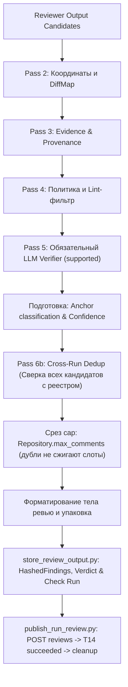
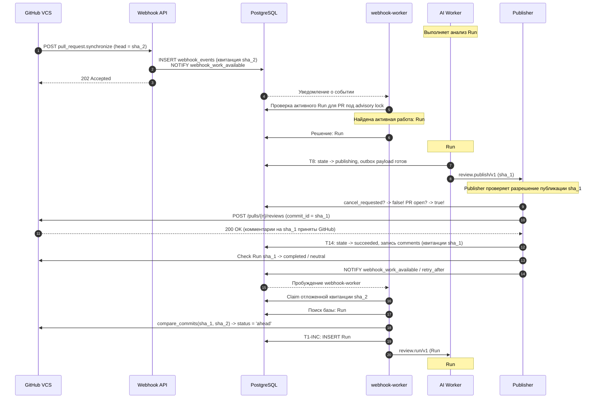
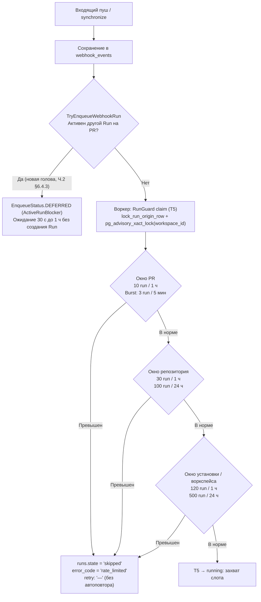

# INCREMENTAL_REVIEW_AND_LIMITS_SPEC — инкрементальный анализ (Re-review), разрешение устаревших замечаний, квоты и DoS-защита (команда 6)

| | |
|---|---|
| **Статус** | Ч.1: PR #334 (идентичность находок, дубликаты и треды); Ч.2: PR #415 (инкрементальный Run и лимиты дельты); Ч.3: PR #419 (лимиты PR, квоты и DoS-защита) |
| **Владелец** | Техлид (роль 1) |
| **Область действия** | Идентичность замечания между прогонами (Finding Fingerprint), сопоставление со старыми коммитами, пересчет координат без привязки к абсолютным номерам строк (Line Offset Tracking), алгоритм межпрогонного подавления дубликатов в плане публикации (Cross-Run Dedup), стратегия классификации и разрешения устаревших/исправленных тредов на VCS (Outdated / Resolved Threads) через GraphQL `resolveReviewThread`, права GitHub App, исключение собственных событий бота по правилу Р-9 (для событий тредов — цель FeedbackSignal после MVP, §4.7), квотирование мутаций GitHub API. Ч.2: судьба активного Run при `synchronize`, выбор базы и fallback, закреплённый scope дельты, coverage v2, наследование находок и вердикта, QA и лимиты инкремента (§6). Ч.3: защита от DoS и перерасхода токенов/квот, жесткие лимиты размера PR и файлов, скользящие окна вызовов на уровне PR, репозитория и воркспейса, квотирование песочницы правил (#311), обработка rate limiting и отказных сценариев (§7). |
| **Связанные документы** | [`SYSTEM_DESIGN.md`](SYSTEM_DESIGN.md) (Р-5, Р-9, §6.9, §8, §13 «Риск схлопывания»), [`CONTEXT_AND_VERIFICATION_SPEC.md`](CONTEXT_AND_VERIFICATION_SPEC.md) (§6.2, §10 «Write-back: неизменяемая публикация»), [`PIPELINE_SPEC.md`](PIPELINE_SPEC.md) (§1, §6, §8), `WEBHOOK_WORKER.md` (§6). |
| **Definition of Done (DoD Ч.1)** | 1. Ключ идентичности находки между Run не зависит от абсолютных номеров строк; формализованы поля из модели `Finding`, нормализация с сохранением отступов, позиционное сопоставление вхождений и каноническая сериализация.<br/>2. Спроектирован алгоритм подавления дубликатов как фильтр плана публикации (Pass 6b) по квитанциям `comments`: подавленный повтор сохраняет `drop_reason IS NULL`, получает `publication_action = 'suppressed_duplicate'`, учитывается в severity counts, вердикте и Check Run, но исключается из массива `comments[]` со ссылкой на существующий комментарий (`linked_comment_id`).<br/>3. Задана стратегия классификации тредов (оставить, закрыть через GraphQL `resolveReviewThread`, строгий приоритет человека); определены порядок предикатов, проверка полноты покрытия перед закрытием и правила для всех состояний.<br/>4. Сняты противоречия с неизменяемой публикацией (CVS §10), одним review batch (Р-5) и запретом компенсирующего удаления (SD §13).<br/>5. Спроектированы изменения схемы БД (Alembic), модель жизненного цикла треда и интеграция этапа чистки как best-effort шага publisher после T14 и обновления Check Run (§4.5).<br/>6. Составлена расширенная таблица сквозных сценариев для регресса QA с корректными значениями Check Run. |
| **Definition of Done (DoD Ч.2)** | Заданы переходы T1-INC/T4-INC/T8-INC/T14-INC и T15, пригодная база с проверкой coverage, все причины fallback и лимиты дельты; полный сохранённый diff и закреплённый scope дают один проверяемый coverage v2 без ложного `clean`; описаны ошибки целостности, наследование находок, Check Run и QA-INC-01–28 (§6). Согласованы контракты PIPELINE/CVS/SD и получено ревью исполнителей перед мержем. |
| **Definition of Done (DoD Ч.3)** | Заданы жесткие лимиты размера PR и файлов (100 000 строк суммарного диффа, 3 000 файлов, 1 000 000 байт на файл), скользящие окна Run (10/ч на PR, 120/ч на репозиторий, 300/ч на воркспейс; 3/15 мин на PR для rerun, 20/ч на репозиторий, 60/ч на воркспейс), изоляция песочницы правил (#311: 10/ч на пользователя, 20/ч на репозиторий), обработка T5 rate_limited, формат Check Run summary для failed и skipped, и QA-сценарии QA-LIM-01–28 (§7). |

---

## 1. Область действия, терминология и базовые инварианты

### 1.1. Терминология

- **Full PR Diff (`base_sha...head_sha`)**: Полный унифицированный дифф pull request относительно целевой базовой ветки. Все inline-комментарии в GitHub API адресуются исключительно по координатам полного диффа.
- **Commit Delta / Incremental Diff**: Разница коммитов между ревизией исходной публикации замечания (`anchor_head_sha`) и новой головой PR (`current_head_sha`), получаемая через `VcsProvider.compare_commits`.
- **Base Git Coordinate Translation (Смещение строк / Line Offset Tracking)**: Алгоритмический пересчет номеров строк открытых замечаний из координат исходной ревизии публикации в координаты новой ревизии с учетом смещений, вносимых добавленными и удаленными строками коммит-дельты. Исходные координаты в базе данных не перезаписываются (терминальные данные неизменяемы по SD §6.9); смещение рассчитывается динамически для каждого Run относительно `anchor_head_sha`.
- **Finding Fingerprint (Идентичность находки)**: Детерминированный хеш находки, не зависящий от абсолютного номера строки в файле и вычисляемый от канонического представления атрибутов проблемы и нормализованного кода под якорем.
- **Anchor Code Hash (`anchor_code_hash`)**: Нормализованный криптографический хеш текста блока кода под якорем замечания, очищенный от крайних пробелов и нормализованный по переводам строк с сохранением значимых синтаксических отступов.
- **Outdated Thread (Устаревший тред)**: Состояние треда на стороне VCS, когда строка или блок кода, к которому было привязано замечание, подверглись изменению в последующих коммитах. GitHub переводит тред в свернутое состояние `outdated` автоматически на уровне платформы; при этом тред остается открытым (`isResolved = false`) и требует явного закрытия при подтверждении исправления дефекта.
- **Resolved Finding / Thread (Разрешенная находка / Закрытый тред)**: Состояние замечания, когда в новой ревизии дефект устранен автором (код под якорем изменен, участок проанализирован с полным покрытием и дефект не обнаружен), либо файл с дефектом полностью удален из PR. На стороне GitHub тред переводится в закрытое состояние мутацией `resolveReviewThread`.
- **Persisting Finding (Сохраняющаяся находка)**: Находка из предыдущего ревью, проблемный код под якорем которой не изменялся (или сместился по строкам без изменения содержания), и дефект по-прежнему актуален. Повторно в inline-комментариях не публикуется, но учитывается в вердикте и Check Run.
- **Human-in-the-loop Thread**: Тред, в котором после комментария бота появился хотя бы один ответ человека (`__typename != "Bot"` и логин не совпадает с логином бота), либо который был закрыт или повторно открыт человеком вручную.

### 1.2. Базовые инварианты

1. **Zero-Spam (Никаких повторных комментариев на неизмененный код)**: Бот не создает повторный inline-комментарий для дефекта, который уже был опубликован в предыдущем Run и остался неисправленным. Существующий тред на VCS сохраняется.
2. **Опубликованное определяется строго по квитанциям (`comments`, remote IDs)**: Принадлежность inline-замечания к опубликованным определяется наличием записи в таблице `comments` с `github_comment_id` для данного PR, а не статусом Run (`succeeded` / `cancelled`). Run, отмененный по T15 после выполнения POST-запроса, уже оставил комментарии на PR; они считаются опубликованными (для body-only находок без записи в `comments` принадлежность определяется по признаку `published = true` последнего прошедшего T14 прогона согласно п. 4, `:38-39`).
3. **Сохранность счетчиков и вердикта при дедупликации**:
   - Подавление повторных находок является фильтром плана публикации, а не причиной отсева (drop reason).
   - Сохраняющаяся находка сохраняет `drop_reason IS NULL`, получает `publication_action = 'suppressed_duplicate'`, связывается с существующей записью комментария (`linked_comment_id`, либо `NULL` для body-only дубля) и помещается в новое поле dataclass `ProcessedReviewOutput.suppressed: tuple[ProcessedFinding, ...] = ()` (`findings_post_processor.py:96`, с расширением `Bucket = Literal["inline", "body_only", "suppressed", "dropped"]`). Потребители поля `suppressed`: набор `kept = (*inline, *body_only, *suppressed)` в `findings_post_processor.py:219` (`summary_from_result` `:227`, `_overview_block` `:434-445`) и `finalize_stored_review_body` (`:507`), расчёт `hashed_findings(processed)` в `store_review_output.py:110` (`(*processed.inline, *processed.body_only, *processed.suppressed)`), и сохранение строк `Finding` в `run_repository.py:881` (`records = (*processed.inline, *processed.body_only, *processed.suppressed, *processed.dropped)`).
   - **Разделение рендера списка и шапки тела ревью**: Секция списка дополнительных находок в теле ревью (`## Additional findings`) рендерит ТОЛЬКО находки `body_only`. При этом строки `**Verdict:**` и `**Risk summary:**` в шапке тела ревью (`_overview_block`) и `summary_from_result` строятся по полному набору `kept = (*inline, *body_only, *suppressed)`. Неисправленный критический дефект не превращает вердикт и шапку тела ревью в `clean`.
   - **Счётчики Check Run**: В `run_lifecycle_store.py:432-433` отчёт строится из БД по опубликованным находкам (`drop_reason IS NULL`): `inline_count` считает находки с `publication_action = 'publish_inline'`, `body_count` — с `publication_action = 'publish_body'`, `suppressed_count` — с `publication_action = 'suppressed_duplicate'` (подавленные дубли не включаются в `body_count`). В dataclass `CheckRunReport` (`check_runs.py:107`) добавляется поле `suppressed_count: int = 0`, а в текстовой сводке `check_run_view` выводится `подавлено дубликатов: {report.suppressed_count}`.
4. **Общие замечания (Body-only findings) и квитанции**:
   - Находки без inline-координат (general-only) и находки сверх inline cap (`Repository.max_comments`) публикуются в теле ревью.
   - Для поиска ранее опубликованных или уже подавленных в теле ревью замечаний используется отдельный запрос (§3.1) по последнему Run данного PR, прошедшему T14 (`succeeded`, либо `cancelled` по T15 после POST — инвариант 2, так как T14 в `run_lifecycle_store.py:620-628` ставит `published = true` и при отмене), с предикатом `f.published = true AND f.drop_reason IS NULL AND (f.publication_action = 'publish_body' OR (f.publication_action = 'suppressed_duplicate' AND f.linked_comment_id IS NULL))`.
   - Включение подавленных body-only дублей (`suppressed_duplicate` с `linked_comment_id IS NULL`) гарантирует, что в Run 3 находка, подавленная в Run 2, не будет опубликована заново (исключён повтор «через раз»). Повторное general-замечание с тем же fingerprint получает `publication_action = 'suppressed_duplicate'`, `linked_comment_id = NULL` и опускается из списка дефектов тела рецензии. Body-only находки с `anchor_code_hash = NULL` (general-only без привязки к блобу или при недоступном блобе) сопоставляются только по точному `FindingFingerprint` (с `"anchor_code_hash": null` в каноническом JSON) и в 1-to-1 fallback (§2.2) не участвуют.
   - Кандидат сверх cap `Repository.max_comments`, совпадающий с открытым inline-тредом в реестре, получает `publication_action = 'suppressed_duplicate'`, связывается с существующим тредом (`linked_comment_id = comment.id`) и не попадает в список тела ревью.
   - **Ограничение #298 ч.1 и требование к #321**: На `main` в `complete_publication` (`run_lifecycle_store.py:601-606`) при непустом `moved_to_body_finding_ids` или при `len(comment_ids) != len(inline)` записи `Comment` не создаются ни для перенесённых в тело находок, ни для оставшихся inline-находок пакета, реально опубликованных на GitHub; пока задача #298 ч.1 не реализована, обе эти группы не попадают в реестр `comments` и могут быть опубликованы повторно в следующем Run. Требование к реализации #321: в транзакции T14 `complete_publication` для находок из `moved_to_body_finding_ids` наряду с `inline_comment = false` и `published = true` обязательно выставляется `publication_action = 'publish_body'`, чтобы они удерживались запросом дедупликации body-only находок.
5. **Неизменяемость текста публикации (Immutable Payload)**: Закрытие треда на VCS через GraphQL `resolveReviewThread` меняет только состояние треда (`isResolved`), но не редактирует и не удаляет опубликованный текст комментария (`body`), сохраняя квитанции, аудит и payload digest по CVS §10.
6. **Human-in-the-loop Priority (Приоритет человека)**:
   - **Сквозное правило приоритета**: Состояния `HUMAN_TOUCHED` (`HUMAN_DISCUSSION`, `RESOLVED_BY_USER`) строго перекрывают любые действия бота; бот никогда не закрывает автоматически треды, которых касался человек.
   - Если в треде бота ответил человек, тред переходит в `HUMAN_DISCUSSION` под управление человека.
   - Если человек закрыл тред вручную (`RESOLVED_BY_USER`), бот считает его закрытым и не переоткрывает.
   - Если человек снял resolve с треда, ранее закрытого ботом (в БД `RESOLVED_BY_BOT`, а на GitHub `isResolved == false`), тред переходит в `HUMAN_DISCUSSION` под управление человека; бот повторно его не закрывает.
   - В любом из этих состояний повторная публикация замечания с тем же `FindingFingerprint` подавляется (`publication_action = 'suppressed_duplicate'`), пока тред существует на PR.
7. **Игнорирование собственных событий (Правило Р-9)**: События `pull_request_review_thread.resolved` / `unresolved`, инициированные ботом, в MVP не обрабатываются, так как приложение на них не подписано. В рамках будущей задачи сбора обратной связи `FeedbackSignal` (после MVP) вебхук-воркер будет отбрасывать события собственных мутаций бота по правилу `sender.type == "Bot"` и `_normalize_login(sender.login) == bot_key` с присвоением статуса `ignored_irrelevant_event` (detail `action=<action> ignored_own_bot`), предотвращая ложные сигналы обратной связи.
8. **Квотирование мутаций GitHub API**: Вторичные лимиты GitHub ограничивают трафик до 1 мутации в секунду, не более 80 content-generating запросов в минуту и 500 в час на установку. На один Run устанавливается квота не более 30 вызовов мутации `resolveReviewThread` с паузой не менее 1.2 секунды между запросами (общий бюджет фазы чистки 90 с). Счетчик квоты ведется на уровне Run. Оставшиеся к закрытию треды обрабатываются в последующих прогонах. При сбое процесса повторная доставка сообщения брокером RabbitMQ не повторяет закрытие тредов, так как Run уже зафиксирован в состоянии `succeeded`.
9. **Граница провайдеров VCS (GitLab)**: Прием вебхуков и запуск ревью для GitLab реализованы на `main` (#169), однако GitLab intake по умолчанию выключен. GitLab использует API discussions без квитанций `comments` с внешними thread ID. Для GitLab метод `get_review_threads` возвращает пустую страницу, `resolve_review_thread` возвращает `UNSUPPORTED`, а реестр замечаний работает с пустым списком тредов. Повторы на GitLab на этапе MR update являются известным временным ограничением.

---

## 2. Идентичность находки между Run (Finding Fingerprint)

### 2.1. Проблема абсолютных номеров строк

Если идентифицировать замечание по кортежу `(file_path, line_number, rule_name)`, то любая правка выше по файлу (добавление строк, комментариев или импортов) сдвигает абсолютный номер строки дефекта на величину смещения. В результате:
- Прежнее замечание на строке N не сопоставится с дефектом на строке N + delta;
- Бот опубликует дубликат замечания на строке N + delta;
- Прежнее замечание на строке N будет ошибочно сочтено устраненным и закрыто (ложная чистка).

Межпрогонный ключ идентичности находки не должен зависеть от абсолютного номера строки в файле.

### 2.2. Формула Finding Fingerprint и поля модели Finding

Для каждого кандидата в находки вычисляется детерминированный ключ на основе реальных атрибутов модели `Finding` (`app/modules/reviews/infrastructure/models.py`):

1. **`file_path`**: Канонический относительный путь к файлу в репозитории (POSIX-формат, разделитель `/`, без ведущего слеша). При переименовании файла путь сопоставляется через `previous_filename` из ответа сравнения коммитов. Перед сравнением с реестром fingerprint ранее опубликованной строки пересчитывается с подстановкой нового пути файла.
2. **`side`**: Сторона диффа из enum `FindingSide` (`RIGHT` для добавленного/измененного кода, `LEFT` для удаленного кода; по умолчанию `RIGHT`).
3. **`category`**: Категория дефекта из enum `FindingCategory` (`security`, `correctness`, `performance`, `readability`).
4. **`rule_name`**: Имя или источник правила (`Finding.rule_name`, nullable string, допустимые значения: `.review/rules.md`, `AGENTS.md`, `service-defaults:<ID>` или null). Если правило не задано (`null`), в структуру подставляется пустая строка `""`.
5. **`anchor_code_hash`**: SHA-256 хеш нормализованного блока кода под якорем дефекта (см. §2.3).
   - **Источник текста якоря**: Для inline-находок текст извлекается из `DiffFile.hunks[].rows[]` (`DiffRow.text` для строк с `kind ∈ {RowKind.CONTEXT, RowKind.ADDED}` и `new_line ∈ [line_start, line_end]`, `diff_map.py:82-107`); если диапазон `[line_start, line_end]` не целиком покрыт хунками, `anchor_code_hash = NULL`. Для `body_only` находок текст читается через `DiffFile.blob_sha` + `VcsProvider.get_blob` (`SYSTEM_DESIGN.md` §8.1) вне транзакций БД. Если текст недоступен (диапазон вне хунков, отсутствие `blob_sha` или ошибка `get_blob`), `anchor_code_hash = NULL`, и находка не участвует в 1-to-1 fallback (§2.2 п. 2) во избежание ложных совпадений.
6. **`normalized_claim`**: Нормализованный заголовок утверждения дефекта (`Finding.title`). Для поддержки многоязычного текста (включая русскоязычные правила и заголовки) используется Unicode regex с вызовом `strip()` после замены: `re.sub(r'[\W_]+', ' ', claim.lower()).strip()` (намеренно отличается от ASCII-only `FindingsPostProcessor._normalize_title`, так как `[^a-z0-9]+` схлопывает кириллический заголовок в пустую строку).
7. **`occurrence_index`**: Локальный индекс вхождения идентичного дефекта в файле. Индекс назначается детерминированным алгоритмом:
   - Кандидаты текущего прогона и строки комментариев реестра группируются по базовому ключу без индекса: `(file_path, side, category, rule_name, normalized_claim, anchor_code_hash)`.
   - Внутри каждой группы выполняется спаривание кандидатов со строками реестра один-к-одному:
     - Если дельта коммитов доступна: спаривание минимизирует расстояние до перенесенного диапазона `abs(candidate.line - transferred.new_start)`.
     - Если дельта коммитов неизвестна (`UNKNOWN`): спаривание выполняется один-к-одному по сортировке кандидатов и записей реестра по исходному `line_start`.
   - Спаренному кандидату присваивается `occurrence_index` спаренной строки реестра.
   - Непарные кандидаты получают уникальные возрастающие индексы: `max(occurrence_index in group) + i + 1` с шагом 1 (начиная с 0 при пустой группе). Это устраняет сдвиги и коллизии индексов при вставке нескольких аналогичных блоков кода.

**Каноническая сериализация и хеширование**:
Компоненты ключа упаковываются в канонический JSON-объект с сортировкой ключей, разделителями `separators=(',', ':')` и `ensure_ascii=False`, аналогично построению payload digest в CVS §10.1:

```json
{
  "anchor_code_hash": "a1b2c3d4...",
  "category": "security",
  "file_path": "app/auth.py",
  "normalized_claim": "unhandled bare except block",
  "occurrence_index": 0,
  "rule_name": ".review/rules.md",
  "side": "RIGHT"
}
```

```text
FindingFingerprint = SHA-256(canonical_json_utf8_bytes)
```

**Нестабильность формулировок модели (Graceful Matching)**:
Если LLM при повторном анализе перефразировала заголовок или опустила необязательное имя правила, применяется двухступенчатое сопоставление:
1. **Точное совпадение по `FindingFingerprint`**.
2. **Запасное сопоставление (Fallback Match)**: запускается строго **после** исчерпания точного сопоставления и только при соблюдении ВСЕХ следующих ограничителей:
   - `candidate.anchor_code_hash is not None` и `candidate.anchor_code_hash == comment.anchor_code_hash` (хэш кода якоря совпадает гарантированно);
   - Код под якорем НЕ был модифицирован (никогда не применяется к исходу `ANCHOR_MODIFIED`);
   - Для тредов в статусах `HUMAN_DISCUSSION` и `RESOLVED_BY_USER` fallback только подавляет повторную публикацию (`publication_action = 'suppressed_duplicate'`), а `thread_status` не меняется; для тредов в статусах `RESOLVED_BY_BOT` и `NOT_FOUND` fallback не применяется (QA-REC-13);
   - Запрещено, если статус дельты `UNKNOWN` (force push, ошибка сравнения, legacy `anchor_code_hash IS NULL`);
   - Взаимная однозначность: на перенесенном диапазоне `[new_start, new_end]` (§2.4) существует **ровно один** кандидат текущего Run и **ровно один** тред в реестре в статусе `ACTIVE`, `PERSISTING`, `HUMAN_DISCUSSION` или `RESOLVED_BY_USER` с совпадающей категорией и файлом. Если кандидатов или подходящих тредов больше одного, fallback не применяется (требуется точный `FindingFingerprint`), что предотвращает риск схлопывания дефектов (SD §13).

### 2.3. Нормализация блока кода якоря (`anchor_code_hash`)

Для корректной работы с языками с позиционным синтаксисом (Python, YAML) нормализация сохраняет отступы:
1. Замена всех вариантов переводов строк на канонический LF (`\r\n -> \n`, `\r -> \n`).
2. Удаление хвостовых пробелов и табуляций в конце каждой строки (`rstrip()`). Ведущие пробелы (отступы) сохраняются.
3. Удаление пустых строк в начале и конце блока якоря `[line_start, line_end]`.
4. Преобразование нормализованной строки в UTF-8 байты и вычисление SHA-256: `anchor_code_hash = SHA-256(normalized_code_bytes)`.

### 2.4. Алгоритм отслеживания смещений строк (Line Offset Tracking)

Для сопоставления открытых комментариев с новой головой PR используется отслеживание смещений на базе унифицированного диффа дельты коммитов:

```text
ВХОД:
  - comment: ранее опубликованный комментарий с привязанными координатами
             (anchor_head_sha, file_path, line_start, line_end, anchor_code_hash)
  - delta_comparison: результат VcsProvider.compare_commits(anchor_head_sha, current_head_sha)

АЛГОРИТМ:
  1. Проверка доступности и полноты дельты:
     Если delta_comparison недоступен (ошибка вызова compare, delta_comparison.is_complete == False,
     число файлов >= 300, либо not delta_comparison.is_ancestor, где is_ancestor означает status ∈ {"ahead", "identical"}):
       -> Исход: UNKNOWN.
       -> Безопасное умолчание: тред оставляется открытым (LEAVE_ACTIVE).
       -> Мутация закрытия треда НЕ вызывается. Завершить алгоритм.

  2. Разрешение переименований файлов:
     Найти target_path для comment.file_path с учетом previous_filename в delta_comparison.files.
     Если файл удален в дельте (status == 'removed'):
       -> Исход: RESOLVED_BY_FILE_DELETION.
       -> Завершить алгоритм.

  3. Поиск секции (patch) для target_path в delta_comparison.files:
     Если файл отсутствует в списке файлов сравнения:
       -> Файл не изменялся между anchor_head_sha и current_head_sha.
       -> Исход: PERSISTING (код под якорем гарантированно не затронут).
       -> Завершить алгоритм.
     Если файл присутствует в списке сравнения, но changes == 0 ∧ status == 'renamed' (на main PatchState.METADATA_ONLY: чистое метаданное переименование без изменения содержимого):
       -> Хунков нет, строки не смещались.
       -> Исход: PERSISTING (по новому пути target_path). Завершить алгоритм.
     Если файл присутствует в списке, но patch is None при changes > 0 (бинарный файл, усечение diff или превышение лимита):
       -> Исход: UNKNOWN (невозможно подтвердить сохранность/исправление кода).
       -> Безопасное умолчание: LEAVE_ACTIVE.
       -> Завершить алгоритм.
     Если файл был изменен в PR, но затем возвращен коммитом к состоянию base_sha (отсутствует в полном diff PR base_sha...head_sha при diff_map.file_list_complete == True; если diff_map.file_list_complete == False, возвращается исход UNKNOWN / LEAVE_ACTIVE):
       -> Код дефекта устранен возвратом к базовой ревизии.
       -> Исход: RESOLVED_BY_FILE_DELETION (тред закрывается resolveReviewThread во избежание вечной блокировки мержа). Завершить алгоритм.

  4. Расчет смещения строк по hunks файла:
     delta_offset = 0
     is_anchor_modified = false
     old_target_line = comment.line_start
     end = comment.line_end if comment.line_end is not None else comment.line_start

     Для каждого hunk в patch файла:
       hunk_old_start = hunk.old_start
       hunk_old_count = hunk.old_count
       hunk_old_end = (hunk_old_start + hunk_old_count - 1) if hunk_old_count > 0 else hunk_old_start
       hunk_net_diff = hunk.new_count - hunk.old_count

       // Случай 1: Чистая вставка строк строго выше якоря (hunk_old_count == 0)
       Если hunk_old_count == 0:
         Если hunk_old_start < old_target_line:
           delta_offset += hunk_net_diff
         продолжить

       // Случай 2: Hunk целиком выше строки якоря
       Если old_target_line > hunk_old_end:
         delta_offset += hunk_net_diff
         продолжить

       // Случай 3: Hunk целиком ниже диапазона якоря
       Если end < hunk_old_start:
         продолжить

       // Случай 4: Якорь пересекается с hunk
       Если диапазон [comment.line_start, end] пересекается с hunk:
         Проверить, затронуты ли строки диапазона якоря изменениями ('-' или '+'):
         Если хотя бы одна строка диапазона изменена или удалена:
           is_anchor_modified = true
         Иначе (строки диапазона остались неизменным контекстом внутри hunk):
           delta_offset += (число '+' выше comment.line_start - число '-' выше comment.line_start)

  5. Валидация сохранности кода якоря:
     Если comment.anchor_code_hash IS NULL (legacy-строка до миграции схемы):
       -> Исход: UNKNOWN.
       -> Безопасное умолчание: LEAVE_ACTIVE. Категорически запрещено классифицировать как ANCHOR_MODIFIED или RESOLVED_BY_FIX (закрытие возможно только при удалении или полном откате файла на шагах 2–3).
       -> Завершить алгоритм.

     Если is_anchor_modified == false:
       new_start = comment.line_start + delta_offset
       new_end = end + delta_offset
       Прочитать блок строк [new_start, new_end] из дерева current_head_sha.
       Вычислить new_anchor_code_hash по правилам §2.3.
       Если new_anchor_code_hash == comment.anchor_code_hash:
         -> Исход: PERSISTING (строки сместились, код дефекта на месте).
            Исходные координаты в БД неизменны; смещение учитывается в памяти прогона.
       Иначе:
         -> is_anchor_modified = true

  6. Обработка изменения кода якоря:
     Если is_anchor_modified == true:
       Вычислить перенесенный диапазон transferred_range = [comment.line_start + delta_offset, end + delta_offset],
       расширенный диапазоном хунка [hunk.new_start, hunk.new_start + hunk.new_count - 1], изменившего якорь.
       -> Исход: ANCHOR_MODIFIED с привязанным transferred_range (требуется сопоставление с кандидатами ревью нового Run).
```

### 2.5. Модель данных и миграции схемы БД

Для поддержки идентичности находок и жизненного цикла тредов в схему данных вносятся следующие изменения через миграцию Alembic:

```sql
-- 1. Расширение таблицы findings (хранение ключей идентичности и связи с комментарием)
ALTER TABLE findings ADD COLUMN finding_fingerprint CHAR(64) NULL;
ALTER TABLE findings ADD COLUMN anchor_code_hash CHAR(64) NULL;
ALTER TABLE findings ADD COLUMN occurrence_index INTEGER NOT NULL DEFAULT 0;
ALTER TABLE findings ADD COLUMN linked_comment_id UUID NULL REFERENCES comments(id);
ALTER TABLE findings ADD COLUMN publication_action VARCHAR(32) NOT NULL DEFAULT 'publish_inline';

ALTER TABLE findings ADD CONSTRAINT ck_findings_publication_action
    CHECK (publication_action IN ('publish_inline', 'publish_body', 'suppressed_duplicate', 'dropped'));

CREATE INDEX ix_findings_fingerprint ON findings(finding_fingerprint);
CREATE INDEX ix_findings_linked_comment_id ON findings(linked_comment_id);

-- 2. Расширение таблицы comments (метаданные жизненного цикла треда VCS и разметка кандидатов на чистку)
ALTER TABLE comments ADD COLUMN github_thread_id VARCHAR(64) NULL;
ALTER TABLE comments ADD COLUMN thread_status VARCHAR(32) NOT NULL DEFAULT 'ACTIVE';
ALTER TABLE comments ADD COLUMN resolved_at TIMESTAMP WITH TIME ZONE NULL;
ALTER TABLE comments ADD COLUMN resolved_by_commit VARCHAR(64) NULL;
ALTER TABLE comments ADD COLUMN resolved_by_actor VARCHAR(100) NULL;
ALTER TABLE comments ADD COLUMN last_seen_run_id UUID NULL REFERENCES runs(id);
ALTER TABLE comments ADD COLUMN pending_resolution_run_id UUID NULL REFERENCES runs(id);
ALTER TABLE comments ADD COLUMN pending_resolution_outcome VARCHAR(32) NULL;

ALTER TABLE comments ADD CONSTRAINT ck_comments_thread_status
    CHECK (thread_status IN ('ACTIVE', 'PERSISTING', 'HUMAN_DISCUSSION', 'RESOLVED_BY_USER', 'RESOLVED_BY_BOT', 'NOT_FOUND'));
ALTER TABLE comments ADD CONSTRAINT ck_comments_pending_resolution_outcome
    CHECK (pending_resolution_outcome IS NULL OR pending_resolution_outcome IN ('RESOLVED_BY_DELETION', 'RESOLVED_BY_FIX', 'RESOLVED_MUTATED'));

CREATE INDEX ix_comments_thread_status ON comments(thread_status);
CREATE INDEX ix_comments_github_thread_id ON comments(github_thread_id);
CREATE INDEX ix_comments_pending_resolution_run_id ON comments(pending_resolution_run_id);
```

**Единый словарь состояний треда (`thread_status`) и вспомогательных полей**:
- `ACTIVE`: Замечание опубликовано, тред открыт на GitHub, дефект актуален в первом прогоне публикации.
- `PERSISTING`: Дефект повторно подтвержден в последующем прогоне на неизмененном (или смещенном) коде, тред остается открытым на GitHub. **Единое правило перехода в `PERSISTING`**: транзакция T14 (`complete_publication`) переводит `ACTIVE -> PERSISTING` исключительно у того комментария, на который ссылается находка текущего Run с `publication_action = 'suppressed_duplicate'` (`findings.linked_comment_id = comments.id`); прочие статусы (`HUMAN_DISCUSSION`, `RESOLVED_BY_USER`, `RESOLVED_BY_BOT`, `NOT_FOUND`) не изменяются; сам по себе исход смещения §2.4 `PERSISTING` (при отсутствии совпавшей `suppressed_duplicate` находки в текущем Run) статус в БД не меняет.
- `RESOLVED_BY_BOT`: Дефект устранен автором коммита (при подтвержденном полном анализе участка и отсутствии любых отсеянных кандидатов), либо файл удален/откачен, либо дефект мутировал на измененном коде; тред закрыт ботом через GraphQL `resolveReviewThread` (`resolved_by_commit = head_sha`, `resolved_by_actor = bot_key`).
- `RESOLVED_BY_USER`: Тред был закрыт разработчиком вручную в интерфейсе GitHub.
- `HUMAN_DISCUSSION`: В треде ответил человек либо человек отменил resolve бота. Бот уступает приоритет человеку и никогда не закрывает такой тред автоматически.
- `NOT_FOUND`: Тред отсутствует на GitHub (удален пользователем или удалена ветка), обнаружено после полного безошибочного чтения карты тредов; либо узел GraphQL не найден при попытке мутации.
- `last_seen_run_id`: Обновляется в транзакции T14 (`complete_publication`) для комментариев, на которые ссылается `suppressed_duplicate` находка текущего Run; читается диагностикой аудита и UI/API истории прогонов PR для отображения последнего Run, подтвердившего актуальность треда.
- `pending_resolution_run_id`, `pending_resolution_outcome`: Хранилище кандидатов на закрытие (`comment.id`, `comment.github_thread_id`, исход из `'RESOLVED_BY_DELETION' | 'RESOLVED_BY_FIX' | 'RESOLVED_MUTATED'`). Записываются в `store_review_output.py` при сохранении плана публикации (в транзакции T8 `lock_for_publishing` / `store_review_output`, где в памяти доступны `RunCoverage.durable_reviewable_paths` и `checked_paths`). Эти поля **не входят** ни в диагностический `findings_hash`, ни в неизменяемый digest плана публикации T8 (`publication_key`, PIPELINE_SPEC §6), и читаются фазой чистки в `publish_run_review.py` после T14.

> [!IMPORTANT]
> **Сквозное правило приоритета человека**:
> Состояния `HUMAN_TOUCHED` (`HUMAN_DISCUSSION`, `RESOLVED_BY_USER`) строго перекрывают любые действия бота; бот никогда не закрывает автоматически треды, которых касался человек.

**Таблица соответствия: Исход §2.4 -> Действие §4.1 -> Статус БД**:

| Исход смещения (§2.4) | Проверка покрытия нового Run | Исход классификации (§4.1) | Действие на GitHub VCS | Результирующий `thread_status` |
|---|---|---|---|---|
| `RESOLVED_BY_FILE_DELETION` | Для `status == 'removed'` в дельте — не требуется; для возврата файла к `base_sha` (отсутствие в diff PR) — обязательно `file_list_complete == True` | `RESOLVED_BY_DELETION` | Закрыть тред (`resolveReviewThread`) | `RESOLVED_BY_BOT` (`resolved_by_actor = bot_key`) |
| `ANCHOR_MODIFIED` | Гейт покрытия читает финализированный `ProcessedReviewOutput.coverage` (после `finalize_run_coverage`, а не `context.coverage`): `coverage.status == 'complete' ∧ coverage.file_list_complete == True ∧ coverage.durable_reviewable_paths is not None ∧ target_path ∈ (coverage.durable_reviewable_paths ∩ checked_paths)`; на перенесенном участке дефектов и кандидатов с `drop_reason != 'contradicted'` нет (или хунк откачен к `base` при полном патче файла) ∧ **ни одна находка текущего Run не ссылается на этот комментарий (`linked_comment_id`); при наличии ссылки — `LEAVE_ACTIVE`** | `RESOLVED_BY_FIX` | Закрыть тред (`resolveReviewThread`) | `RESOLVED_BY_BOT` (`resolved_by_actor = bot_key`) |
| `ANCHOR_MODIFIED` | Гейт покрытия не выполнен (`coverage.status != 'complete'`, `file_list_complete == False`, `durable_reviewable_paths is None` или `target_path ∉ durable_reviewable_paths ∩ checked_paths`) или на перенесенном участке возник кандидат с `drop_reason != 'contradicted'` | `LEAVE_ACTIVE` | NOOP (нельзя подтвердить фикс) | Сохраняет прежний статус (`ACTIVE`/`PERSISTING`) |
| `ANCHOR_MODIFIED` | Дефект обнаружен на измененном коде ∧ **ни одна находка текущего Run не ссылается на этот комментарий (`linked_comment_id`); при наличии ссылки — `LEAVE_ACTIVE`** | `RESOLVED_MUTATED` | Закрыть старый тред + опубликовать новый | Старый: `RESOLVED_BY_BOT` (`resolved_by_actor = bot_key`), Новый: `ACTIVE` |
| `PERSISTING` | Любая | `LEAVE_ACTIVE` | NOOP (тред остается открытым) | Сохраняет прежний статус (T14 переводит `ACTIVE -> PERSISTING` только при наличии совпавшей `suppressed_duplicate` находки; `HUMAN_*` без понижения) |
| `UNKNOWN` (вкл. legacy NULL hash) | Любая | `LEAVE_ACTIVE` | NOOP (безопасное умолчание) | Сохраняет прежний статус (`ACTIVE`/`PERSISTING`) |

**Разграничение ключей и целостность связей**:
1. Колонка `comments.findings_hash` хранит хеш всего набора находок прогона как диагностическое поле (CVS §10.1, SD §6.9), и **не является** ключом отдельной находки.
2. Ограничение `UNIQUE(finding_id)` в таблице `comments` связывает строку комментария с породившей ее находкой первоначального Run.
3. При сохранении дефекта в последующих Run повторная строка в `comments` не создается. Новая находка сохраняет `drop_reason IS NULL`, получает `publication_action = 'suppressed_duplicate'`, `inline_comment = false`, а ссылка на исходный комментарий фиксируется в колонке `findings.linked_comment_id = comments.id`.
4. **Обработка исторических строк (Legacy Rows)**: Для строк `comments` и `findings`, созданных до миграции схемы, колонки `finding_fingerprint` и `anchor_code_hash` остаются `NULL` (бэкфилл не выполняется). Поскольку `anchor_code_hash IS NULL`, шаг 5 алгоритма §2.4 возвращает для них исход `UNKNOWN`, и в 1-to-1 fallback (§2.2) они не участвуют. Принятое ограничение выкатки: при первом прогоне после миграции для таких домиграционных замечаний возможна однократная повторная публикация. Legacy-треды защищены от ложной чистки по `RESOLVED_BY_FIX` (всегда остаются `LEAVE_ACTIVE`) и могут быть автоматически закрыты ботом только при полном удалении или откате файла на шагах 2–3 (`RESOLVED_BY_FILE_DELETION`).

---

## 3. Алгоритм подавления дубликатов в плане публикации (Cross-Run Dedup)

### 3.1. Формирование реестра опубликованных замечаний PR

Реестр ранее опубликованных замечаний формируется по квитанциям публикации текущего PR независимо от итогового статуса Run:

```sql
SELECT c.id AS comment_id,
       c.github_comment_id,
       c.github_thread_id,
       c.thread_status,
       c.created_at,
       r.head_sha AS anchor_head_sha,
       f.id AS original_finding_id,
       f.finding_fingerprint,
       f.file_path,
       f.side,
       f.rule_name,
       f.line_start,
       f.line_end,
       f.occurrence_index,
       f.anchor_code_hash,
       f.title,
       f.category,
       f.severity
FROM comments c
JOIN findings f ON c.finding_id = f.id
JOIN runs r ON f.run_id = r.id
WHERE r.code_change_id = :current_code_change_id
ORDER BY c.created_at DESC;
```

В дедупликации участвуют **все** опубликованные комментарии PR, включая треды в состояниях `HUMAN_DISCUSSION`, `RESOLVED_BY_USER` и `RESOLVED_BY_BOT`. Если в реестре `comments` у одного `finding_fingerprint` присутствует несколько строк (например, после перевода прежнего треда в `NOT_FOUND` или `RESOLVED_BY_BOT` и последующей повторной публикации), для сопоставления всегда выбирается самая свежая запись по `c.created_at DESC`.

Для дедупликации общих замечаний в теле ревью (`body_only`, у которых нет строк в `comments`) выполняется второй запрос по последнему Run данного PR, прошедшему T14 (`published = true`):

```sql
SELECT f.id AS original_finding_id,
       f.finding_fingerprint,
       f.file_path,
       f.side,
       f.rule_name,
       f.line_start,
       f.line_end,
       f.occurrence_index,
       f.anchor_code_hash,
       f.title,
       f.category,
       f.severity
FROM findings f
WHERE f.run_id = (
    SELECT r.id
    FROM runs r
    WHERE r.code_change_id = :current_code_change_id
      AND EXISTS (
          SELECT 1 FROM findings f2
          WHERE f2.run_id = r.id AND f2.published = true
      )
    ORDER BY r.finished_at DESC NULLS LAST, r.created_at DESC
    LIMIT 1
)
  AND f.published = true
  AND f.drop_reason IS NULL
  AND (
      f.publication_action = 'publish_body'
      OR (f.publication_action = 'suppressed_duplicate' AND f.linked_comment_id IS NULL)
  );
```

### 3.2. Место дедупликации в конвейере фильтрации (Pass 6b)

В `store_review_output.py:execute()` после чтения `context = await uow.reviews.get_post_processing_input(run_id)` (`:185`) и **до** вызова `processor.process()` (`:202`) выполняются строго в следующем порядке:
1. Сетевые шаги строго вне транзакций БД: синхронный вызов `sync_review_threads_state` (чтение страниц GraphQL и сборка `thread_map: ReviewThreadMap`, затем короткая транзакция обновления актуальных статусов тредов в `comments`) и расчёт исходов смещений `resolution_outcomes` (вызовы `compare_commits` и `get_blob`).
2. Чтение из БД реестра опубликованных комментариев (`registry`) и body-only находок последнего прошедшего T14 прогона (§3.1) — выполняется строго после шага 1, что гарантирует получение актуализированных значений `thread_status` (включая снятие отметки разрешения человеком по QA-REC-14, `:648`).

Межпрогонная дедупликация встраивается в `findings_post_processor.py:process()` как **Pass 6b (Cross-Run Dedup)** на реальном шве: строго ПОСЛЕ восстановления атрибуции `_repair_attribution` (которая может исправить `rule_name` и переместить inline в `body_only`) и строго ДО сортировки и среза cap `Repository.max_comments`. Входные параметры `process()` расширяются аргументами `registry`, `thread_map` и `resolution_outcomes`; результат возвращается в dataclass `ProcessedReviewOutput` (с новым полем `suppressed: tuple[ProcessedFinding, ...] = ()`). Потребителями результата выступают `store_review_output.py` (`hashed_findings`) и `run_repository.py:881` (запись строк `Finding` и разметка `pending_resolution_*`). Вспомогательный путь `PublishReviewOutput` / `mark_review_published` (`review_output.py:786`, `run_repository.py:904`) не используется основным воркером очереди `publish_run_review.py` (идущим через `complete_publication`), при этом `publication_action` сохраняется для всех находок ещё на шаге `store_review_output` до публикации:



**Таблица соответствия: Бакет находок -> Поля модели и публикация**:

| Бакет кандидата | `publication_action` | `inline_comment` | `linked_comment_id` | `published` (до T14 / после T14) | Входит в `hashed_findings` | Входит в тело ревью | Учет в Check Run |
|---|---|---|---|---|---|---|---|
| **`inline`** (новое замечание в пределах cap) | `'publish_inline'` | `true` | `NULL` | `false` / `true` | Да | Строка в списке — Нет (inline); `Verdict` и `Risk summary` тела — Да | `severity_counts`, `inline_count` |
| **`body_only`** (сверх cap, general, low confidence) | `'publish_body'` | `false` | `NULL` | `false` / `true` | Да | Строка в списке — Да; `Verdict` и `Risk summary` тела — Да | `severity_counts`, `body_count` |
| **`suppressed`** (inline-дубль активного/закрытого треда) | `'suppressed_duplicate'` | `false` | `UUID` комментария реестра | `false` / `true` | Да | Строка в списке — Нет; `Verdict` и `Risk summary` тела — Да | `severity_counts`, `suppressed_count` |
| **`suppressed`** (body-only дубль, §1.2 п.4) | `'suppressed_duplicate'` | `false` | `NULL` | `false` / `true` | Да | Строка в списке — Нет; `Verdict` и `Risk summary` тела — Да | `severity_counts`, `suppressed_count` |
| **`dropped`** (отсеян фильтрами 2–6) | `'dropped'` | `false` | `NULL` | `false` / `false` | Нет | Нет | `below_threshold_count` (если severity) |

**Правила обработки находок в плане публикации**:
1. Все подтвержденные верификатором кандидаты признаются итоговыми находками прогона (`drop_reason IS NULL`).
2. Для **всех** кандидатов (как потенциальных inline, так и body_only) выполняется поиск соответствия в реестре опубликованных замечаний PR по `FindingFingerprint` (или 1-to-1 fallback §2.2).
3. **Подавленные дубли не сжигают inline cap**: Находки, признанные `suppressed_duplicate`, исключаются из массива `inline_candidates` до среза cap, поэтому они не расходуют слоты настройки репозитория `Repository.max_comments` (по умолчанию 10, максимум 10), освобождая слоты для новых уникальных находок.
4. **При совпадении с активным или обсуждаемым тредом (`ACTIVE`, `PERSISTING`, `HUMAN_DISCUSSION`)**:
   - Находка исключается из массива `comments[]` отправляемого review batch.
   - Находке присваивается `publication_action = 'suppressed_duplicate'`, `inline_comment = false` (благодаря чему равенство `len(comment_ids) == len(inline)` строго соблюдается при записи квитанций).
   - Поле `published` остается `false` на этапе плана и выставляется в `true` атомарно в транзакции T14 `complete_publication`.
   - Проставляется ссылка на существующий комментарий: `findings.linked_comment_id = registry.comment_id`.
   - Если статус в реестре был `ACTIVE`, он обновляется на `thread_status = 'PERSISTING'` (пишет транзакция T14 `complete_publication`, §4.3 п.6). Если статус был `HUMAN_DISCUSSION` или `RESOLVED_BY_USER`, он сохраняется без понижения.
   - Находка в полном объеме входит в `hashed_findings`, участвует в расчете счетчиков серьезности и формировании вердикта PR (`critical` или `high` дают `blocking`, `medium` или `low` дают `attention`, а в Check Run выставляется `completed / neutral`).
5. **При совпадении с тредом, закрытым человеком (`RESOLVED_BY_USER`)**:
   - Находка исключается из review batch (`publication_action = 'suppressed_duplicate'`).
   - Бот уважает решение пользователя и не открывает тред повторно.
6. **При совпадении с тредом, ранее закрытым ботом (`RESOLVED_BY_BOT`)**:
   - Если в реестре несколько записей с одинаковым fingerprint, сопоставление выполняется с самой свежей записью (`ORDER BY comments.created_at DESC`).
   - Если автор внес изменения, вернувшие дефект (регресс на измененном коде): старый тред считается архивным, находка включается в review batch как новое замечание (`publication_action = 'publish_inline'`, `inline_comment = true`).
7. **При мутации дефекта на измененном коде**:
   - Если код под прежним тредом был изменен автором и дефект видоизменился (исход классификации сопоставлен с `ANCHOR_MODIFIED`, а находка на `transferred_range` не совпала по fingerprint и не подавлена по правилу 4): старый тред закрывается ботом мутацией `resolveReviewThread` (`thread_status = 'RESOLVED_BY_BOT'`, `resolved_by_commit = current_head_sha`, `resolved_by_actor = bot_key`), а новое замечание публикуется как отдельный тред (`publication_action = 'publish_inline'`, `thread_status = 'ACTIVE'`). Если fingerprint совпал (правка якоря только в хвостовых пробелах или переводах строк, перенос блока внутри того же файла), действует правило 4: находка подавляется, тред остается открытым (§4.1, правило 4 блока защиты от ложной чистки).
8. **Поведение при отсутствии треда на GitHub (`NOT_FOUND`)**:
   - Повторная публикация замечания при отсутствии треда на GitHub разрешена **исключительно** в том случае, если чтение карты тредов PR было **полным и безошибочным** по определению §4.3 п. 1 (`thread_map.is_complete == True`). Только при этом условии тред в реестре помечается `thread_status = 'NOT_FOUND'`, подавление снимается, и замечание публикуется заново как свежий тред (`publication_action = 'publish_inline'`). Строка в `NOT_FOUND` или `RESOLVED_BY_BOT` (правило 6) повторную публикацию не подавляет.
   - **Защита от массового спама при неполной карте**: Если чтение карты тредов завершилось ошибкой, таймаутом, усечением или вторичным лимитом rate limit (`thread_map.is_complete == False`), карта признается неполной. В этом случае статус `NOT_FOUND` не выставляется, правило 8 блокируется, и замечания продолжают подавляться по fingerprint из БД во избежание нарушения инварианта 1 (защита от повторной публикации уже откомментированных участков).
9. **При отсутствии совпадений в реестре**:
   - Находка признается новой, получает `publication_action = 'publish_inline'` (для inline) или `publication_action = 'publish_body'` (для body_only).
   - В пределах cap `inline`-находка получает `inline_comment = true` и включается в массив `comments[]` для отправки в review batch.

---

## 4. Стратегия устаревших и решённых замечаний бота на VCS (Outdated & Resolved Threads)

### 4.1. Классификация исходов для ранее опубликованных замечаний

При получении нового коммита в PR для каждого ранее опубликованного замечания бота вычисляется один из исходов со строгим приоритетом предикатов:

| Порядок | Исход | Предикат условия | Действие в БД | Действие на GitHub VCS |
|---|---|---|---|---|
| 1 | **`HUMAN_TOUCHED`** | В треде есть ответ человека (`thread.has_human_activity == True`: среди комментариев есть `author is None` либо `author.__typename != "Bot" ∧ _normalize_login(author.login) != bot_key`, либо `totalCommentsCount.totalCount > 6`), либо тред закрыт человеком (`isResolved ∧ resolvedBy != null ∧ _normalize_login(resolvedBy.login) != bot_key`), либо человек снял resolve (в БД `RESOLVED_BY_BOT`, а на GitHub `isResolved == false`). | `thread_status = HUMAN_DISCUSSION` (или `RESOLVED_BY_USER`). | **NOOP**. Бот полностью уступает управление человеку. Мутации не вызываются. |
| 2 | **`RESOLVED_BY_DELETION`** | Файл, содержавший дефект, полностью удален в дельте коммитов (`status == 'removed'`) либо возвращен коммитом к состоянию `base_sha` (отсутствует в полном diff PR при `file_list_complete == True`). | `thread_status = RESOLVED_BY_BOT`, `resolved_at = NOW(), resolved_by_commit = head_sha, resolved_by_actor = bot_key`. | **Закрыть тред**: вызов GraphQL-мутации `resolveReviewThread`. |
| 3 | **`RESOLVED_BY_FIX`** | `comment.anchor_code_hash IS NOT NULL` **И** `is_anchor_modified == true` (код изменен автором) **И** выполнен гейт покрытия прогона и файла по финализированному `ProcessedReviewOutput.coverage` (после `finalize_run_coverage`, а не предварительному `context.coverage`: `coverage.status == 'complete' ∧ coverage.file_list_complete == True ∧ coverage.durable_reviewable_paths is not None ∧ target_path ∈ (coverage.durable_reviewable_paths ∩ checked_paths)`; при `durable_reviewable_paths is None` гейт закрыт) **И** **ни одна находка текущего Run не ссылается на этот комментарий (`linked_comment_id`); при наличии ссылки переход блокируется, тред переводится в `LEAVE_ACTIVE`** **И** выполняется одна из двух веток по перенесенному диапазону `transferred_range`: **(Ветка А — диапазон пересекает хунк diff PR)** `transferred_range` пересекает разобранный хунк `DiffFile` текущего PR (`DiffFile.anchorable == True`) и на участке `transferred_range` (а для непозиционированных причин отсева вроде `unknown_path`, `ignored_file` — во всем файле) отсутствует ЛЮБОЙ кандидат с `drop_reason IS NOT NULL`, отличным от `contradicted`, и нет подтвержденных находок; либо **(Ветка Б — откат хунка к base)** `transferred_range` целиком лежит вне хунков `DiffFile` текущего PR (участок кода возвращен к `base_sha`) при `file_list_complete == True` и полном патче файла (`DiffFile.anchorable == True`, `patch_state == PatchState.COMPLETE`), где кандидатов быть не может. Классификация исходов выполняется строго после Pass 6. | `thread_status = RESOLVED_BY_BOT`, `resolved_at = NOW(), resolved_by_commit = head_sha, resolved_by_actor = bot_key`. | **Закрыть тред**: вызов GraphQL-мутации `resolveReviewThread`. |
| 4 | **`RESOLVED_MUTATED`** | Код под якорем изменен автором коммита, и новый прогон выявил на нем дефект (диапазон новой находки пересекается с перенесенным диапазоном `transferred_range`, файл и категория совпадают) ∧ **ни одна находка текущего Run не ссылается на этот комментарий (`linked_comment_id`); при наличии ссылки — `LEAVE_ACTIVE`**. | Прежний комментарий переводится в `thread_status = RESOLVED_BY_BOT` (`resolved_by_commit = current_head_sha`, `resolved_by_actor = bot_key`). Новый дефект публикуется как `ACTIVE`. | **Закрыть старый тред** мутацией `resolveReviewThread` во избежание блокировки мержа под ruleset `required_review_thread_resolution`. Новый дефект публикуется новым inline-тредом. |
| 5 | **`LEAVE_ACTIVE`** | Код под якорем не изменялся (включая стохастический пропуск модели при неизменном коде), либо `anchor_code_hash IS NULL` (legacy), либо гейт покрытия не выполнен (`coverage.status != 'complete'`, `file_list_complete == False`, `durable_reviewable_paths is None` или `target_path ∉ durable_reviewable_paths ∩ checked_paths`), либо на перенесенном участке обнаружен кандидат с `drop_reason != 'contradicted'`, либо хотя бы одна находка текущего Run ссылается на этот комментарий (`linked_comment_id == comment.id`). | Сохраняет прежний статус (T14 переводит `ACTIVE -> PERSISTING` только при наличии совпавшей `suppressed_duplicate` находки; `PERSISTING` / `HUMAN_*` без изменений). Исходные координаты в БД неизменны. | **NOOP**. Тред остается открытым на GitHub. |

> [!WARNING]
> **Защита от ложной чистки (False Cleanup Prevention)**:
> 1. Если `anchor_code_hash IS NULL` (строки до миграции схемы), исход `RESOLVED_BY_FIX` категорически запрещен: запись сохраняет статус `LEAVE_ACTIVE`.
> 2. Если гейт покрытия файла или прогона не выполнен (`coverage.status != 'complete'`, `coverage.file_list_complete == False`, `coverage.durable_reviewable_paths is None`, `target_path ∉ (coverage.durable_reviewable_paths ∩ checked_paths)` или diff файла неполный/усеченный), исход `RESOLVED_BY_FIX` запрещен. Принятое ограничение: требование run-level `coverage.status == 'complete'` означает, что наличие хотя бы одного файла со статусом `too_large` в прогоне переводит `coverage.status` в `'partial'` и откладывает автоматическое закрытие тредов по `RESOLVED_BY_FIX` во всех файлах до следующего полного прогона.
> 3. **Универсальное правило отсева**: Если на перенесенном участке `transferred_range` возник ЛЮБОЙ кандидат с `drop_reason IS NOT NULL` (будь то проходы 2–3: `anchor_not_visible`, `cross_hunk_range`, `evidence_*`, `line_absent`, `ignored_file`, `revision_mismatch`, `unknown_path`, либо проходы 4–6: `severity_threshold`, `lint_pattern`, `duplicate`, verifier `insufficient_context`), кроме явно отвергнутых верификатором как `contradicted`, дефект считается сохраняющимся: закрытие треда категорически запрещено, тред переводится в `LEAVE_ACTIVE`.
> 4. **Защита от закрытия треда при ссылающейся находке**: Если хотя бы одна подтвержденная или подавленная находка текущего Run ссылается на данный комментарий (`finding.linked_comment_id == comment.id`), переход в `RESOLVED_BY_FIX` или `RESOLVED_MUTATED` строго запрещен: тред переводится в `LEAVE_ACTIVE` и сохраняет открытое состояние.

### 4.2. Механизм разрешения тредов на GitHub: GraphQL `resolveReviewThread`

Для закрытия тредов на GitHub используется GraphQL API:

```graphql
mutation ResolveReviewThread($threadId: ID!) {
  resolveReviewThread(input: { threadId: $threadId }) {
    thread {
      id
      isResolved
      resolvedBy {
        login
      }
    }
  }
}
```

### 4.3. Сопоставление REST `comment_id` и GraphQL `threadId`

Пакетное чтение тредов PR выполняется в каждом GitHub-Run, у которого в реестре есть комментарии:

```graphql
query GetPullRequestReviewThreads($owner: String!, $repo: String!, $pr: Int!, $cursor: String) {
  repository(owner: $owner, name: $repo) {
    pullRequest(number: $pr) {
      reviewThreads(first: 100, after: $cursor) {
        pageInfo {
          hasNextPage
          endCursor
        }
        nodes {
          id
          isResolved
          resolvedBy {
            login
          }
          comments(first: 1) {
            nodes {
              fullDatabaseId
              author {
                login
                __typename
              }
            }
          }
          lastComments: comments(last: 5) {
            nodes {
              author {
                login
                __typename
              }
            }
          }
          totalCommentsCount: comments {
            totalCount
          }
        }
      }
    }
  }
}
```

**Правила сопоставления и нормализации**:
1. **Тип карты тредов, точка вызова и единое определение полноты (`ReviewThreadMap.is_complete`)**:
   Синхронный шаг `sync_review_threads_state` в `store_review_output.py` (вызывается на этапе `running` после `get_post_processing_input` и **до** `processor.process()`, сетевое чтение выполняется вне транзакций БД) обходит страницы `VcsProvider.get_review_threads` и собирает прикладную структуру:
   ```python
   @dataclass(frozen=True)
   class ReviewThreadMap:
       threads_by_first_comment_id: dict[int, ReviewThread]
       is_complete: bool
   ```
   Признак завершенности чтения `thread_map.is_complete` устанавливается в `True` тогда и только тогда, когда:
   - Успешно получен идентификатор бота `bot_key` из `VcsProvider.get_bot_key()` (`bot_key is not None`);
   - Успешно пройдены все страницы GraphQL (`hasNextPage == False`);
   - Зафиксировано 0 HTTP-ошибок (403/429/5xx) и 0 сетевых таймаутов;
   - Зафиксировано 0 ошибок в массиве `errors[]` ответа GraphQL (при непустом `errors[]` ответа GraphQL, в том числе при HTTP 200, адаптер поднимает исключение, `sync_review_threads_state` перехватывает его и ставит `thread_map.is_complete = False`, а частичный результат страниц не возвращает).
   Если `bot_key` не получен (`bot_key is None`), устанавливается `thread_map.is_complete = False`, и статусы в БД не модифицируются. Если узел комментария содержит `fullDatabaseId == null` (служебные комментарии PR), такой узел пропускается при сопоставлении с квитанциями, но это НЕ сбрасывает `thread_map.is_complete` в `False`.
2. **Единый идентификатор бота (`bot_key`)**:
   Идентификатор бота получается методом порта `VcsProvider.get_bot_key()` (`SYSTEM_DESIGN.md` §8.1), который выполняет запрос `GET /app` с App JWT (сборка JWT с `GITHUB_APP_ID` и `GITHUB_APP_PRIVATE_KEY` аналогична `_exchange` в `github_installation_tree_provider.py:153`, ключи переданы в `worker` и `publisher`, `worker.py:342-343`; результат кешируется в памяти процесса, fallback через `settings` не используется):
   ```python
   bot_key = app_slug.casefold()  # например, "dmc268-t6-reviewer"
   ```
   Для проверки принадлежности комментария или действия боту используется единая нормализация:
   ```python
   def _normalize_login(login: str | None) -> str:
       return "" if not login else login.removesuffix("[bot]").casefold()
   ```
   Для поля `resolvedBy` (в схеме GitHub GraphQL его тип всегда `User`) принадлежность действия боту проверяется по логину `_normalize_login(resolvedBy.login) == bot_key`; для автора комментария `comments.nodes[].author` (интерфейс `Actor`) учитывается GraphQL-тип `__typename`: ответ человека определяется условием `author.__typename != "Bot" and _normalize_login(author.login) != bot_key` (ответы других ботов, таких как Copilot или CI, не переводят тред в `HUMAN_DISCUSSION`).
3. **Сопоставление узлов тредов**:
   Связка треда с реестром `comments` строится по первому комментарию треда после приведения GraphQL `BigInt` к `int`: `int(thread.comments.nodes[0].fullDatabaseId) == comment.github_comment_id`.
4. **Участие человека и вычисление `ReviewThread.has_human_activity`**:
   - Адаптер GitHub при разборе ответа `get_review_threads` и `get_review_thread` (шаг 4b §4.5) с использованием `bot_key` из `get_bot_key()` вычисляет флаг `ReviewThread.has_human_activity: bool`: флаг равен `True`, если среди просмотренных комментариев треда есть комментарий с `(author is None) or (author.__typename != "Bot" and _normalize_login(author.login) != bot_key)`, либо `totalCommentsCount.totalCount > 6`.
   - Тред признается `HUMAN_DISCUSSION`, если `thread.has_human_activity == True` (или если человек отменил resolve бота).
   - Тред признается `RESOLVED_BY_USER`, если `thread.is_resolved == True`, `thread.resolved_by_login is not None` и `_normalize_login(thread.resolved_by_login) != bot_key`.
5. **Сверка состояния GitHub и БД («GitHub побеждает, БД — кэш», без понижения статусов человека)**:
   Синхронный шаг `sync_review_threads_state` в `store_review_output.py` в короткой транзакции БД до Pass 6b (с оптимистической блокировкой `WHERE id = :id AND thread_status = :read_status`) выполняет обновление:
   - Сохраняет `comments.github_thread_id = thread.id`;
   - Если в БД уже зафиксирован статус `HUMAN_DISCUSSION` или `RESOLVED_BY_USER`, статус НЕ может быть понижен автоматикой бота (переход в `NOT_FOUND` по п. ниже при фактическом удалении треда из полной карты понижением не считается и выполняется для любого статуса);
   - Если на GitHub тред закрыт ботом (`thread.is_resolved == True ∧ _normalize_login(thread.resolved_by_login) == bot_key`), а в БД не закрыт -> `thread_status = 'RESOLVED_BY_BOT'`, `resolved_by_actor = bot_key`;
   - Если на GitHub тред закрыт человеком -> `thread_status = 'RESOLVED_BY_USER'`;
   - Если на GitHub тред открыт (`thread.is_resolved == False`), а в БД числился `RESOLVED_BY_BOT` -> `thread_status = 'HUMAN_DISCUSSION'` (человек отменил resolve бота);
   - Если тред отсутствует в карте при `thread_map.is_complete == True` -> `thread_status = 'NOT_FOUND'`.
   - При `thread_map.is_complete == False` статусы в БД не меняются.
6. **Единая таблица писателей жизненного цикла треда (`comments`)**:
   Все обновления `thread_status` во всех трёх писателях выполняются с оптимистической блокировкой `WHERE id = :id AND thread_status = :read_status`:

   | Статус / Колонка | Писатель (модуль и шаг) | Условие записи |
   |---|---|---|
   | `ACTIVE` | `complete_publication` (T14, `run_lifecycle_store.py`) | При первичной вставке `INSERT INTO comments` (`DEFAULT 'ACTIVE'`). |
   | `PERSISTING` + `last_seen_run_id` | `complete_publication` (T14, `run_lifecycle_store.py`) | Для комментария со статусом `ACTIVE`, на который ссылается находка текущего Run с `publication_action = 'suppressed_duplicate'` (`linked_comment_id = comments.id`). |
   | `HUMAN_DISCUSSION`, `RESOLVED_BY_USER` | 1) `sync_review_threads_state` (`store_review_output.py` до Pass 6b)<br/>2) Фаза чистки, шаг 4b (`publish_run_review.py` при `get_review_thread`) | При обнаружении `has_human_activity == True`, закрытия пользователем или снятия пользователем resolve бота. |
   | `RESOLVED_BY_BOT` + `resolved_at`, `resolved_by_commit`, `resolved_by_actor = bot_key` | 1) `sync_review_threads_state` (`store_review_output.py` до Pass 6b)<br/>2) Фаза чистки, шаг 4d (`publish_run_review.py` после `resolveReviewThread`) | (1) На GitHub тред уже закрыт ботом, а в БД открыт; (2) Успешный вызов `resolveReviewThread` (`SUCCESS`). |
   | `NOT_FOUND` | 1) `sync_review_threads_state` (`store_review_output.py` до Pass 6b)<br/>2) Фаза чистки, шаг 4d (`publish_run_review.py` после `resolveReviewThread`) | (1) Тред отсутствует в полной карте (`thread_map.is_complete == True`); (2) Мутация `resolveReviewThread` вернула `NOT_FOUND`. |
   | `github_thread_id` | `sync_review_threads_state` (`store_review_output.py` до Pass 6b) | При сопоставлении `int(fullDatabaseId) == comment.github_comment_id`. |
   | `pending_resolution_run_id`, `pending_resolution_outcome` | `store_review_output` (T8, `store_review_output.py` / `run_repository.py`) | При сохранении плана публикации для тредов с исходами `RESOLVED_BY_DELETION`, `RESOLVED_BY_FIX`, `RESOLVED_MUTATED` (вне `findings_hash` и digest T8). |

### 4.4. Достаточность прав GitHub App и обработка отказов (OQ-9)

Ожидается, что для вызова мутации `resolveReviewThread` достаточно права `pull_requests: write`; это не подтверждено документацией GitHub, а в сообществе (GitHub Community Discussion #44650) отмечались прецеденты потребности в `contents: write` (OQ-9).
- **Открытый вопрос OQ-9**: Достаточность прав `pull_requests: write` проверяется живой пробой техлида на staging в тестовом PR до мержа PR Ч.2 #321.
- **Обработка отказа по правам доступа (`FORBIDDEN`)**:
  Если GitHub возвращает в ответе GraphQL `errors[].type == "FORBIDDEN"` или сообщение `"Resource not accessible by integration"` (либо HTTP 403 без признаков rate limit):
  - Фаза чистки немедленно прерывается для текущего Run без падения прогона;
  - Записывается диагностическая строка в таблицу `run_actions` (`docs/MONITORING.md:68`; имя `tool` фиксируется в `PIPELINE_SPEC.md` при реализации Ч.2 / #321);
  - В лог пишется предупреждение с текстом ошибки от GitHub: `_LOGGER.warning("Review thread resolution forbidden: %s (code %s)", error_message, error_code)`;
  - Прогон Run сохраняет штатный статус `succeeded`. Fallback по OQ-9: проведение security review для запроса `contents: write` либо постоянное отключение через конфигурационный флаг (no-op) или удаление вызова фазы чистки.

### 4.5. Интеграция этапа чистки в жизненный цикл Run

В соответствии с инвариантом D5 / Р-14, **набор состояний Run не изменяется** (`queued`, `running`, `publishing`, `succeeded`, `failed`, `cancelled`, `skipped`).
На `main` запись квитанций комментариев, простановка `published = true` и переход T14 в `succeeded` выполняются в единой атомарной транзакции `complete_publication` (`run_lifecycle_store.py:550-630`).
Чистка тредов выполняется компонентом `publish_run_review.py` как **best-effort шаг publisher ПОСЛЕ перехода T14 и обновления Check Run**:

```text
ЖИЗНЕННЫЙ ЦИКЛ PUBLISHER:
  1. POST /pulls/{n}/reviews — отправка review batch с новыми inline-комментариями и сводкой.
  2. Транзакция T14 complete_publication:
     - сохранение квитанций в таблицу comments (len(comment_ids) == len(inline));
     - findings.published = true для сохраненных находок;
     - переход Run.state = RunState.SUCCEEDED (или RunState.CANCELLED при T15);
     - обновление thread_status = 'PERSISTING' и last_seen_run_id для комментариев со статусом ACTIVE, на которые ссылаются suppressed_duplicate находки этого Run;
     - освобождение lease: run.lease_until = None.
  3. Обновление Check Run через REST в статус completed / neutral.
  4. Фаза чистки тредов publisher (Thread Cleanup Phase, best-effort):
     - Запуск ТОЛЬКО при Run.state == RunState.SUCCEEDED (run.state == 'succeeded'). Если публикация не состоялась или T14 упал -> завершить без чистки.
     - Список кандидатов к закрытию читается из таблицы comments по WHERE pending_resolution_run_id = :run_id AND thread_status IN ('ACTIVE', 'PERSISTING') AND github_thread_id IS NOT NULL (разметка сохранена на шаге T8 вне findings_hash и вне digest плана публикации T8).
     - Тайм-бюджет фазы чистки: 90 секунд на Run (до 30 вызовов с паузой >= 1.2 с).
     - Для каждого треда-кандидата (до 30 вызовов):
       a. Проверить актуальность источника и головы PR двойным гейтом: DB checkpoint uow.runs.provider_origin_active(run_id) (publish_run_review.py:578-583) ∧ GET /pulls/{n} через _ensure_current_head. При поступлении нового пуша -> немедленный break (Run остается succeeded, остаток чистки переносится на следующий Run).
       b. Перепроверить тред запросом get_review_thread(node_id). При исключении get_review_thread (ошибка сети или непустой errors[] GraphQL) тред пропускается без мутации. Если обнаружено участие человека (thread.has_human_activity == True или закрыт человеком) -> в короткой транзакции с WHERE id = :id AND thread_status = :read_status обновить статус на HUMAN_DISCUSSION (или RESOLVED_BY_USER) и пропустить мутацию.
       c. Выполнить мутацию resolveReviewThread.
       d. Разобрать ответ (ThreadResolutionResult.status):
          - FORBIDDEN (errors[].type == 'FORBIDDEN' / 'Resource not accessible by integration' или HTTP 403 без признаков rate limit) -> записать диагностику в run_actions и warning в лог, прервать фазу чистки;
          - RATE_LIMITED (HTTP 403/429 с Retry-After, X-RateLimit-Remaining: 0 или secondary rate limit) -> записать в run_actions и лог, прервать фазу чистки, остаток перенести на следующий Run;
          - TRANSIENT_ERROR (HTTP 5xx или сетевой таймаут) -> записать в run_actions и лог, прервать фазу чистки, остаток перенести на следующий Run;
          - NOT_FOUND -> в короткой транзакции обновить thread_status = 'NOT_FOUND' с WHERE id = :id AND thread_status = :read_status, продолжить;
          - SUCCESS -> в короткой транзакции обновить thread_status = 'RESOLVED_BY_BOT', resolved_at = NOW(), resolved_by_commit = head_sha, resolved_by_actor = bot_key с оптимистической блокировкой WHERE id = :id AND thread_status = :read_status.
       e. Выдержать паузу 1.2 секунды.
```

**Повторная доставка сообщения брокером RabbitMQ**:
Если publisher завершился аварийно после T14 до завершения чистки и RabbitMQ повторно доставил сообщение, повторный consumer проверяет состояние Run в БД: статус уже `succeeded` (`complete_publication` возвращает `None`), поэтому повторный POST ревью и чистка не выполняются, сообщение подтверждается (ack).

**Обработка Skipped Run**:
Для прогонов, завершившихся без анализа (`no_changes`, `all_changes_ignored`), фаза чистки не запускается; треды остаются в текущих состояниях.

### 4.6. Квотирование мутаций и вторичные лимиты

1. **Внутренний лимит**: Не более **30 вызовов** `resolveReviewThread` на один прогон Run.
2. **Интервал безопасности**: Пауза не менее **1.2 секунды** между вызовами.
3. **Очередность закрытия**: Сначала закрываются треды с наибольшей серьезностью исходного дефекта (`critical`, затем `high`, `medium`, `low`, `info`).
4. **Хвост мутаций (> 30 тредов)**: Если количество тредов к закрытию превышает 30, первые 30 закрываются в рамках текущего прогона, а остальные треды остаются открытыми и закрываются при последующих Run.
5. **Таблица ошибок GraphQL**:
   - `FORBIDDEN` (`errors[].type == "FORBIDDEN"` / `"Resource not accessible by integration"`): Немедленное прекращение фазы чистки, запись в `run_actions` и warning в лог, прогон остаётся `succeeded`.
   - `RATE_LIMITED` (`HTTP 403 / 429` с `Retry-After` / secondary rate limit): Немедленное прекращение фазы чистки, оставшиеся треды остаются на следующий Run.
   - `TRANSIENT_ERROR` (`HTTP 5xx / Timeout`): Прекращение фазы чистки, оставшиеся треды переносятся на следующий Run, прогон остаётся `succeeded`.
   - `NOT_FOUND` (неверный или удалённый node ID): Тред помечается `NOT_FOUND`, переход к следующему треду.

### 4.7. Игнорирование собственных событий бота (Правило Р-9) — Цель FeedbackSignal (после MVP)

События вебхуков `pull_request_review_thread.resolved` / `unresolved`, генерируемые мутациями бота, обрабатываются по `SYSTEM_DESIGN.md` §8.3:
1. HTTP-контроллер приема вебхуков сохраняет входящее событие, отвечает кодом 202 и ставит задачу в очередь `webhook-worker`.
2. Компонент `webhook-worker` проверяет отправителя: если `sender.type == "Bot"` и `_normalize_login(sender.login) == bot_key`, событие помечается как `ignored_irrelevant_event` с detail `action=<action> ignored_own_bot`. Разбор событий тредов планируется в задаче сбора обратной связи `FeedbackSignal` (после MVP).

---

## 5. Сквозные сценарии для регрессионного тестирования QA

Матрица сценариев для сквозного тестирования функциональности (задачи #307, #322):

| ID | Сценарий | Исходное состояние (Head 1) | Изменение в коммите (Head 2) | Ожидаемые публикации на GitHub | Вердикт PR и Check Run | Состояние в БД (`comments` / `findings`) |
|---|---|---|---|---|---|---|
| **QA-REC-01** | **Неизмененный дефект (Идентичный повтор)** | Опубликован inline-комментарий к строке 42 `auth.py` (critical). | Добавлен `README.md`, файл `auth.py` не менялся. | **0 новых комментариев**. Тред на строке 42 остается открытым. | Verdict: `blocking`. Check Run: `completed / neutral` (заголовок `blocking`). | Находка: `drop_reason IS NULL`, `publication_action = 'suppressed_duplicate'`, `linked_comment_id` заполнен. Comment: `thread_status = 'PERSISTING'`. |
| **QA-REC-02** | **Смещение строк без изменения дефекта** | Опубликован inline-комментарий к строке 42 `auth.py` (high). | В начало `auth.py` добавлено 10 строк импортов. Код дефекта не менялся. | **0 новых комментариев**. Тред отображается на новой строке 52. | Verdict: `blocking`. Check Run: `completed / neutral` (заголовок `blocking`). | Находка: `drop_reason IS NULL`, `publication_action = 'suppressed_duplicate'`. Comment: `thread_status = 'PERSISTING'`. Исходные координаты в БД неизменны. |
| **QA-REC-03** | **Успешное исправление дефекта автором** | Опубликован inline-комментарий к строке 42 `auth.py`. | Автор переписал строку 42, исправив дефект. Анализ подтвердил отсутствие дефекта (`coverage.status == 'complete' ∧ coverage.file_list_complete == True ∧ target_path ∈ (coverage.durable_reviewable_paths ∩ checked_paths)`, дефектов и отсеянных кандидатов с `drop_reason != 'contradicted'` нет). | **0 новых комментариев**. Тред закрыт мутацией `resolveReviewThread`. | Verdict: `clean` (при отсутствии других дефектов). Check Run: `completed / neutral` (заголовок `clean`). | Comment: `thread_status = 'RESOLVED_BY_BOT'`, заполнены `resolved_at`, `resolved_by_commit = head_2` и `resolved_by_actor = bot_key`. |
| **QA-REC-04** | **Удаление файла с дефектом** | Опубликован inline-комментарий в `legacy_utils.py`. | Автор удалил файл `legacy_utils.py` целиком (или возвратил к base). | **0 новых комментариев**. Тред закрыт мутацией `resolveReviewThread`. | Verdict: `clean`. Check Run: `completed / neutral` (заголовок `clean`). | Comment: `thread_status = 'RESOLVED_BY_BOT'`. |
| **QA-REC-05** | **Приоритет человека (Human reply)** | Опубликован inline-комментарий. Автор ответил в треде: *«Временный хак»*. | Автор запушил коммит с правкой якоря. | **Бот не закрывает тред**. Мутация `resolveReviewThread` не вызывается. На повторном пуше без правок якоря — **0 новых комментариев**. | Verdict: `attention` (или `blocking` по severity). Check Run: `completed / neutral`. | Comment: `thread_status = 'HUMAN_DISCUSSION'`. Тред остается открытым под контролем участников команды. |
| **QA-REC-06** | **Тред закрыт пользователем вручную** | Опубликован inline-комментарий (medium). Автор нажал «Resolve conversation» в UI GitHub. | Автор запушил новый коммит. | **Никаких мутаций (NOOP)**. На повторном пуше без изменений — **0 новых комментариев**, бот не переоткрывает тред. | Verdict: `attention` (дефект сохраняется и учитывается по инварианту 3). Check Run: `completed / neutral`. | Comment: `thread_status = 'RESOLVED_BY_USER'`. Находка: `publication_action = 'suppressed_duplicate'`. |
| **QA-REC-07** | **Появление аналогичного дефекта в новом месте** | В `auth.py` на строке 42 есть открытое замечание. | Автор скопировал уязвимый метод в `billing.py` на строку 15; дефект в `auth.py` найден повторно. | В `auth.py` тред остается открытым. В `billing.py` **публикуется новый inline-комментарий** (разные `file_path` дают разные `FindingFingerprint`). | Verdict: `blocking`. Check Run: `completed / neutral`. | В `auth.py` — `PERSISTING` (по `suppressed_duplicate` находке). В `billing.py` — новый `Comment` со статусом `ACTIVE`. |
| **QA-REC-08** | **Позиционное сопоставление одинаковых дефектов** | В файле два идентичных блока `except Exception: pass`. Замечание опубликовано на первой строке. | Выше первой строки вставлен такой же блок. | Позиционное спаривание по минимальному расстоянию к перенесенному диапазону сопоставляет прежнее замечание со сдвинутым блоком; для нового блока публикуется комментарий с новым `occurrence_index`. | Verdict: `blocking`. Check Run: `completed / neutral`. | Различаются двухшаговым сопоставлением `occurrence_index` без ложного схлопывания. |
| **QA-REC-09** | **Дельта недоступна или force push** | Опубликован комментарий на строке 42. | Выполнен force-push, старая голова не является предком новой; `compare_commits` вернул ошибку. | **0 новых комментариев**. Безопасное умолчание: мутации закрытия не вызываются. | Verdict: по результатам нового прогона. Check Run: `completed / neutral`. | Прежний тред сохраняет статус `ACTIVE` / `PERSISTING` (`LEAVE_ACTIVE`). |
| **QA-REC-10** | **Превышение лимита в 30 мутаций** | На PR исправлено 45 замечаний. | Автор запушил исправление всех 45 мест в одном коммите. | **30 тредов закрыты** с интервалом 1.2 с (бюджет 90 с). Оставшиеся 15 тредов остаются открытыми до следующего Run. | Verdict: `clean` (все дефекты устранены). Check Run: `completed / neutral`. | Первые 30 comments переведены в `RESOLVED_BY_BOT`, оставшиеся 15 сохраняют прежний статус до следующего прогона. |
| **QA-REC-11** | **Ошибка GraphQL API при закрытии** | Тред намечен к закрытию. | GitHub API возвращает `errors[].type == "FORBIDDEN"` (отказ прав) либо HTTP 403/429 с `Retry-After` (`RATE_LIMITED`). | Мутации прекращаются, событие фиксируется в `run_actions` и warning в логе. Прогон завершается штатно. | Verdict: `clean`. Check Run: `completed / neutral`. | Comment остается открытым (`ACTIVE`/`PERSISTING`), ошибка записана в `run_actions`, Run сохраняет статус `succeeded`. |
| **QA-REC-12** | **Новый пуш во время фазы чистки** | Выполняется последовательное закрытие тредов. | Автор запушил новую голову PR во время паузы между мутациями. | Фаза чистки немедленно прерывается. Мутации для устаревшей головы не отправляются. | Run сохраняет статус `succeeded` (T14 уже зафиксирован), оставшиеся треды переносятся на следующий Run. | Недопустимые мутации на устаревшей голове предотвращены, статус Run не ломается. |
| **QA-REC-13** | **Регресс после разрешения ботом** | Дефект был закрыт ботом (`RESOLVED_BY_BOT`). | Автор вернул дефектный код в следующем коммите. | **Публикуется новый комментарий**. Прежний закрытый тред остается в истории. | Verdict: `blocking`. Check Run: `completed / neutral`. | Прежний comment: `RESOLVED_BY_BOT`, новый comment: `ACTIVE`. |
| **QA-REC-14** | **Человек снял отметку разрешения (Un-resolve)** | Тред был закрыт ботом (`RESOLVED_BY_BOT`). | Разработчик нажал «Unresolve conversation» на GitHub. | **Бот не закрывает тред повторно**. Если дефект подтверждается в новом Run, повторный комментарий подавляется (`suppressed_duplicate`), чтобы не создавать дубликатов; тред остается под контролем человека. | Verdict: `blocking` (или `attention` по severity подтверждённого дефекта; `clean`, если дефект устранён). Check Run: `completed / neutral`. | Прежний comment: `thread_status = 'HUMAN_DISCUSSION'`. |
| **QA-REC-15** | **Переименование файла (Rename tracking)** | Опубликован комментарий в `src/old_name.py`. | Файл переименован в `src/new_name.py` без изменения дефекта. | **0 новых комментариев**. Тред отслеживается по новому пути. | Verdict: `blocking`. Check Run: `completed / neutral`. | Comment: `thread_status = 'PERSISTING'`. Fingerprint сопоставлен с учетом `previous_filename`. |
| **QA-REC-16** | **Неполный анализ файла (Coverage incomplete)** | Опубликован комментарий на строке 42 (`ACTIVE`). | Коммит изменил файл, но файл стал `too_large` или превышен бюджет (дефект не подтверждён). | **Мутация не вызывается**. Тред остается открытым. | Verdict: null (неполный анализ). Check Run: `completed / neutral`. | Comment: сохраняет прежний `thread_status = 'ACTIVE'` (исход `LEAVE_ACTIVE`, защита от ложной чистки; без `suppressed_duplicate` переход в `PERSISTING` не выполняется). |
| **QA-REC-17** | **Дедупликация body-only находки (Run 1 → 2 → 3)** | В Run 1 опубликована `body_only` находка (`publication_action = 'publish_body'`, `published = true`). | В Run 2 и Run 3 дефект сохраняется без изменений. | В Run 2 и Run 3 находка **не дублируется** в списке `## Additional findings` тела ревью (нет эффекта повтора «через раз» на Run 3). | Verdict и Risk summary тела ревью и Check Run (`completed / neutral`) учитывают дефект, `suppressed_count = 1`. | В Run 2 и Run 3 находка сохраняется с `publication_action = 'suppressed_duplicate'`, `linked_comment_id = NULL`, `published = true`. |
| **QA-REC-18** | **Отсев кандидата на изменённом якоре (`severity_threshold` / `anchor_not_visible`)** | Опубликован inline-комментарий на строке 42 (`high`). | Автор изменил строку 42; модель нашла дефект, но кандидат отсеян с `drop_reason = 'severity_threshold'` (или `anchor_not_visible`). | **Мутация `resolveReviewThread` не вызывается**. Тред остается открытым (`LEAVE_ACTIVE`). | Verdict: по подтверждённым находкам. Check Run: `completed / neutral`. | Comment сохраняет прежний открытый статус (`ACTIVE`/`PERSISTING`), защита от ложной чистки по правилу `drop_reason != 'contradicted'`. |
| **QA-REC-19** | **Откат хунка к `base` и мутация дефекта (`RESOLVED_MUTATED`)** | Опубликован inline-комментарий на строке 42. | (а) Автор откатил хунк к `base_sha` (`transferred_range` вне хунков полного diff PR при `file_list_complete == True` и `DiffFile.anchorable == True`); (б) Автор переписал строку 42 с новым дефектом той же категории. | В (а) тред закрывается `resolveReviewThread` (`RESOLVED_BY_FIX`). В (б) старый тред закрывается `resolveReviewThread`, а новый дефект публикуется новым inline-тредом (`RESOLVED_MUTATED`). | В (а) Verdict: `clean`. В (б) Verdict: `blocking` / `attention`. Check Run: `completed / neutral`. | В (а) Comment: `RESOLVED_BY_BOT`. В (б) старый Comment: `RESOLVED_BY_BOT`, новый Comment: `ACTIVE`. |
| **QA-REC-20** | **Legacy-строка (`anchor_code_hash IS NULL`) и `too_large` в соседнем файле** | Домиграционный комментарий с `anchor_code_hash IS NULL`; либо в PR соседний файл получил `too_large` (`coverage.status = 'partial'`). | Автор запушил новый коммит с правками. | Для legacy-строки шаг 5 возвращает `UNKNOWN` (`LEAVE_ACTIVE`), тред не закрывается по фиксу (возможен один повтор после выкатки; закрытие только при удалении файла). При `too_large` в соседнем файле закрытие по `RESOLVED_BY_FIX` откладывается во всех файлах. | Check Run: `completed / neutral`. | Legacy Comment и треды при `partial` coverage остаются открытыми (`LEAVE_ACTIVE`). |
| **QA-REC-21** | **Правка якоря только в хвостовых пробелах или переводах строк (Trailing whitespace / CRLF change on anchor)** | Опубликован inline-комментарий к строке 42 (`ACTIVE`). | Автор добавил хвостовые пробелы или сменил переводы строк на CRLF в якорной строке, отступы не менял: строка 42 есть в дельте коммитов (`is_anchor_modified = true`), дефект не исправлен, `anchor_code_hash` совпадает после нормализации §2.3. Модель находит дефект, Pass 6b подавляет его со ссылкой `linked_comment_id = comment.id`. | Тред **НЕ закрывается** (исход `LEAVE_ACTIVE`, так как текущий Run ссылается на комментарий через `linked_comment_id`). 0 новых комментариев. | Verdict: `blocking` (если critical/high). Check Run: `completed / neutral` (`suppressed_count = 1`). | Прежний комментарий переходит из `ACTIVE` в `thread_status = 'PERSISTING'` на T14, мутация `resolveReviewThread` не вызывается. |

---

## 6. Инкрементальный анализ при событии `synchronize` (Спецификация Ч.2)

### 6.1. Архитектурная концепция и базовые инварианты инкрементального ревью

#### 6.1.1. Проблематика полного ревью на каждый пуш
В исходной архитектуре (v1) каждое событие обновления pull request (`pull_request.synchronize`) приводило либо к отмене активного анализа, либо к перезапуску полного анализа всего pull request (`base_sha...head_sha`).
На реальных проектах с активной разработкой это вызывает критические проблемы:
1. **Катастрофическая задержка обратной связи (Time-to-Feedback, p95 latency):** При каждом промежуточном коммите (исправление опечатки, линтинг, доработка по замечанию) бот заново вычитывает сотни файлов и тысячи строк диффа. Время анализа вырастает до минут, а очередь воркеров блокируется.
2. **Экспоненциальный перерасход токенов LLM и бюджета (LLM Token Waste):** Анализ одного и того же неизменённого контекста повторно на каждом пуше существенно увеличивает затраты на инференс моделей (нарушение принципов экономии Р-8, замеры эффективности — §6.7.3).
3. **Голодание публикаций (Starvation / Push Races):** Если разработчик пушит несколько небольших коммитов подряд с интервалом в 1–2 минуты, каждый последующий пуш отменяет предыдущий Run (по правилу Р-2 / T6 / T15). В итоге ни один Run не успевает дойти до публикации, а разработчик остаётся без ревью до полного прекращения пушей.
4. **Утрата контекста исправлений:** Полное ревью не проводит детерминированной границы между тем, *что было* на предыдущей итерации, и тем, *что изменилось* в последнем коммите.

> [!NOTE]
> **Область действия (VCS scope):** Инкрементальный анализ (`is_incremental = true`), обновлённый переход T15 и T1-INC действуют **исключительно для GitHub**. Для GitLab и Bitbucket платформа сохраняет действующий контракт («отмена при сдвиге головы + полное ревью на новой голове»); при поступлении событий для GitLab/Bitbucket выполняется откат к полному ревью с `incremental_fallback_reason = 'vcs_unsupported'` (приём событий GitLab на `main` уже реализован по #169).

#### 6.1.2. Концепция инкрементального анализа
Цель инкрементального ревью (Re-review) — переход от полного анализа PR к изолированному анализу **коммит-дельты (Incremental Diff)**, вносимой новыми коммитами относительно последней надёжно зафиксированной базы (`diff_base_commit...current_head_sha`), с последующей алгоритмической агрегацией сохраняющихся и новых находок.


#### 6.1.3. Базовые инварианты инкрементального анализа (Ч.2)

1. **Инвариант 1 (Доведение активного Run до публикации — «Дефолт лектора»):**
   При получении события `pull_request.synchronize` с новой головой `head_sha_2`, если на PR уже выполняется прогон Run#1 (`head_sha_1`) в состоянии `running` **после сохранения закреплённого diff** или `publishing`, Run#1 не отменяется из-за нового head. Он доводится до стадии `publishing` и успешного завершения T14 (`succeeded`) с публикацией комментариев на GitHub и фиксацией квитанций в таблице `comments`. Run#2 на `head_sha_2` откладывается (`deferred_run_trigger`) и запускается после T14 как инкрементальный прогон, выбирая `head_sha_1` в качестве `diff_base_commit`.
   *Исключения:* Если Run#1 находится в очереди `queued` (независимо от `attempt`), он отменяется по T6 (`superseded`), а для `attempt ≥ 1` дополнительно отправляется сигнал отмены; проверка RunGuard при claim служит страховкой. Если новый head обнаружен после claim, но до сохранения diff, `running` отменяется как `superseded` по T11 до вызова LLM: `/pulls/{n}/files` уже не может дать снимок старой головы.

2. **Инвариант 2 (Материальность базы разницы по квитанциям `comments`):**
   Базой разницы (`diff_base_commit`) может выступать только коммит, для которого в базе данных имеются **подтверждённые внешние квитанции публикации**:
   - Либо подтверждённые записи в таблице `comments`, связанные с находками прогона (`EXISTS (SELECT 1 FROM comments c JOIN findings f ON f.id = c.finding_id WHERE f.run_id = r.id)`);
   - Либо подтверждённые body-only находки с `findings.run_id = r.id AND findings.published = true` (как в Ч.1 §3.1);
   - Либо подтверждённое успешное завершение прогона (`runs.state = 'succeeded'` через T14, включая прогоны с вердиктом `clean` без находок).
   Абстрактный коммит из Git или коммит отменённого/упавшего Run без квитанций не может служить базой разницы. Прогон, отменённый после POST без единой квитанции, базой не становится и уходит в полное ревью. При отсутствии квитанций выполняется безопасный фоллбек на полное ревью.

3. **Инвариант 3 (Агрегированная безопасность вердикта PR):**
   Вердикт инкрементального Run строится на основе **полного среза активных дефектов pull request**:
   $$F_{\text{active}} = (F_{\text{persisting}} \setminus F_{\text{resolved}}) \cup F_{\text{new}}$$
   где $F_{\text{resolved}}$ вычисляется по исходам Pass 6b текущего прогона (`RESOLVED_BY_FIX`, `RESOLVED_BY_DELETION`, `RESOLVED_MUTATED`), а бакеты находок строго соответствуют Ч.1 и `main` (`inline`, `body_only`, `suppressed`).
   Отсутствие замечаний в инкрементальном пуше (например, при правке опечатки в README) **не делает вердикт PR `clean`**, если в pull request сохраняются активные критические замечания (`critical` / `high`). GitHub Check Run отражает статус всего PR, предотвращая ложный мерж уязвимого кода.

4. **Инвариант 4 (Строгая изоляция скоупа дельты):**
   В инкрементальном Run на вход модели и анализатора передаются исключительно хунки коммит-дельты `diff_base_commit...current_head_sha` с каноническим окружающим контекстом (уровни `ContextLevel.L1` и `L2` по `review_context.py:104` и CVS §3.2 с окнами хунков до $\pm 30$ строк) и блоками кода активных замечаний в затронутых файлах. Любые кандидаты в находки, выходящие за пределы хунков инкрементальной дельты, отсекаются на проходах верификации с кодом `out_of_incremental_diff_scope`.

5. **Инвариант 5 (Безопасный откат к полному ревью / Fallback Safety):**
   При обнаружении расхождения истории Git (force push, rebase), слияния целевой ветки (`git merge main`), изменения снимка политик при `policy.load` (PIPELINE_SPEC §2: `policy_digest` или `rule_version_id` расходится с базовым прогоном) или превышения лимитов размера дельты (> 3000 строк) система детерминированно и прозрачно переключается в режим полного ревью (`is_incremental = false`) с обязательной записью причины в `incremental_fallback_reason`.

---

### 6.2. Расширение модели данных Run и DDL Alembic

#### 6.2.1. Новые поля таблицы `runs`

Для поддержки стейт-машины инкрементального ревью, отслеживания базы разницы и агрегации вердикта таблица `runs` расширяется следующими атрибутами:

| Поле | Тип | Nullable | Default | Описание |
|---|---|---|---|---|
| `is_incremental` | `BOOLEAN` | `NOT NULL` | `false` | Флаг режима анализа: `true` — инкрементальный анализ дельты коммитов; `false` — полный анализ PR (`base_sha...head_sha`). |
| `diff_base_commit` | `VARCHAR(64)` | `NULL` | `NULL` | Git SHA коммита, относительно которого вычислена дельта (`diff_base_commit...head_sha`). Заполнен строго при `is_incremental = true`. |
| `base_run_id` | `UUID` | `NULL` | `NULL` | Внешний ключ на `runs.id` предшествующего базового прогона, квитанции которого взяты за основу. `ON DELETE RESTRICT`. |
| `incremental_fallback_reason` | `VARCHAR(64)` | `NULL` | `NULL` | Код причины отказа от инкрементального анализа и выполнения полного ревью. Заполнен при `is_incremental = false` в случаях, когда запуск мог быть инкрементальным, но произошёл откат к полному ревью (включая `no_prior_published_run`, `manual_rerun`, `vcs_unsupported`). |
| `persisted_active_findings_count` | `INTEGER` | `NOT NULL` | `0` | Количество активных незакрытых замечаний из предшествующих прогонов, унаследованных и учтённых в вердикте текущего Run. |

Допустимые значения перечисления `incremental_fallback_reason`:
- `no_prior_published_run` — первый прогон на PR либо предшествующие прогоны завершились без опубликованных квитанций (формируется на шаге 2 алгоритма §6.5.1);
- `target_branch_changed` — сменилась целевая ветка PR (`runs.base_ref != base_run.base_ref`, шаг 2 алгоритма §6.5.1);
- `force_push_or_rebase` — коммит `diff_base_commit` не является прямым предком `head_sha` (`behind_by > 0`), история переписана либо коммит отсутствует в дереве VCS (404/422 от compare, шаг 3 алгоритма §6.5.1);
- `diff_truncated` — ответ VCS compare усечён GitHub при превышении лимита 300 файлов или 250 коммитов (`is_complete = false`, шаг 3 алгоритма §6.5.1);
- `target_branch_merged` — в ветку PR влита целевая базовая ветка (`git merge main`), дельта содержит merge-коммит с $\ge 2$ родителями (шаг 3b алгоритма §6.5.1);
- `policy_document_changed` — изменён снимок политик (`policy_digest` или `rule_version_id` расходится с `base_run` при проверке на стадии `policy.load` (PIPELINE_SPEC §2), шаг 4 алгоритма §6.5.1);
- `excessive_diff` — размер дельты коммитов превысил установленный лимит (> 3000 строк по сырому числу строк `compare_commits`, шаг 5 алгоритма §6.5.1);
- `manual_rerun` — ручной перезапуск через UI эндпоинт `POST /api/runs/{id}/rerun` (T3);
- `vcs_unsupported` — провайдер VCS (GitLab, Bitbucket) не поддерживает инкрементальный анализ (формируется на T1-INC);
- `base_coverage_unavailable` — coverage базового прогона очищен по retention (`data_purged_at IS NOT NULL`), отсутствует в `run_actions` (`context.build`) либо не проходит `_restore_run_coverage` (шаг 2b алгоритма §6.5.1 на T1-FULL или in-place fallback на стадии `policy.load` до `vcs.fetch_diff`).

#### 6.2.2. DDL миграции Alembic

```sql
-- Alembic migration: add incremental review columns and constraints to runs

ALTER TABLE runs
    ADD COLUMN is_incremental BOOLEAN NOT NULL DEFAULT false,
    ADD COLUMN diff_base_commit VARCHAR(64) NULL,
    ADD COLUMN base_run_id UUID NULL REFERENCES runs(id) ON DELETE RESTRICT,
    ADD COLUMN incremental_fallback_reason VARCHAR(64) NULL,
    ADD COLUMN persisted_active_findings_count INTEGER NOT NULL DEFAULT 0;

-- Инвариант консистентности базы инкрементального Run:
-- При is_incremental = true обязаны быть указаны diff_base_commit и base_run_id.
-- При is_incremental = false они обязаны быть NULL.
ALTER TABLE runs ADD CONSTRAINT ck_runs_incremental_base CHECK (
    (is_incremental = false AND diff_base_commit IS NULL AND base_run_id IS NULL)
    OR
    (is_incremental = true AND diff_base_commit IS NOT NULL AND base_run_id IS NOT NULL)
);

-- Инвариант причины фоллбека:
-- Причина фоллбека указывается только для полных прогонов.
ALTER TABLE runs ADD CONSTRAINT ck_runs_fallback_reason CHECK (
    (is_incremental = true AND incremental_fallback_reason IS NULL)
    OR
    (is_incremental = false)
);

ALTER TABLE runs ADD CONSTRAINT ck_runs_fallback_reason_values CHECK (
    incremental_fallback_reason IS NULL OR incremental_fallback_reason IN (
        'no_prior_published_run', 'target_branch_changed', 'force_push_or_rebase',
        'diff_truncated', 'target_branch_merged', 'policy_document_changed',
        'excessive_diff', 'manual_rerun', 'vcs_unsupported', 'base_coverage_unavailable'
    )
);

-- Индекс для быстрого поиска базы и выборки цепочки прогонов
CREATE INDEX ix_runs_base_run_id ON runs (base_run_id);
```

#### 6.2.3. Обновление доменных моделей и контрактов API

1. **SQLAlchemy модель (`app/modules/reviews/infrastructure/models.py`):**
   В класс `Run` добавляются поля `is_incremental`, `diff_base_commit`, `base_run_id`, `incremental_fallback_reason`, `persisted_active_findings_count`.
2. **DTO сущности и API (`contracts/openapi.yaml`):**
   В схемы `RunSession` и `RunDetail` добавляются:
   ```yaml
   isIncremental:
     type: boolean
     description: Признак инкрементального анализа дельты коммитов
   diffBaseCommit:
     type: string
     nullable: true
     description: Хеш базового коммита инкрементального ревью (40 hex)
   incrementalFallbackReason:
     type: string
     nullable: true
     enum: [no_prior_published_run, target_branch_changed, force_push_or_rebase, diff_truncated, target_branch_merged, policy_document_changed, excessive_diff, manual_rerun, vcs_unsupported, base_coverage_unavailable]
     description: Причина выполнения полного ревью вместо инкрементального
   persistedActiveFindingsCount:
     type: integer
     description: Число сохранённых активных дефектов из предыдущих прогонов
   ```

---

### 6.3. Стейт-машина инкрементального анализа и таблица переходов

Набор состояний прогона по Р-14 и D5 сохраняется неизменным:
`queued | running | publishing | succeeded | failed | cancelled | skipped`. Новых состояний Run не вводится.

#### 6.3.1. Таблица переходов инкрементального анализа (нотация PIPELINE_SPEC §1)

| # | Из → в | Триггер | Кто | Guard | Побочные эффекты: сообщение · check-run |
|---|---|---|---|---|---|
| **T1-INC** | `[*]` → `queued` | `pull_request.synchronize` / `reopened` / `check_suite.completed` на новый `head_sha` | `webhook-worker` | GitHub (при других VCS → T1-FULL `vcs_unsupported`) ∧ нет активного Run по PR (Р-2) ∧ найден предшествующий Run с подтверждёнными квитанциями публикации (`comments` через `findings`, `findings.published` или `succeeded`) ∧ у базы `data_purged_at IS NULL`, в `run_actions` (`context.build`) присутствует `coverage` и он проходит `_restore_run_coverage` (§6.5.1 Шаг 2b, иначе `base_coverage_unavailable`) ∧ `base_run.head_sha` является прямым предком `head_sha` (`behind_by == 0`, `status == 'ahead'`) ∧ дельта не содержит merge-коммитов с $\ge 2$ родителями (D-3) ∧ дельта $\le 3000$ сырых строк по `compare_commits` (вызов выполняется до DB-транзакции) | `INSERT runs` (`is_incremental = true`, `diff_base_commit = base_run.head_sha`, `base_run_id = base_run.id`, `attempt = 0`, `available_at = now`); публикация `review.run/v1` в RabbitMQ · check-run создаётся при claim (T4) |
| **T1-FULL** | `[*]` → `queued` | `pull_request.synchronize` / `reopened` / `check_suite.completed` на новый `head_sha` | `webhook-worker` | Нет активного Run по PR (Р-2) ∧ нарушено хотя бы одно условие инкремента (нет квитанций `no_prior_published_run`, `coverage` базы очищен/отсутствует/невалиден `base_coverage_unavailable`, force-push / rebase `force_push_or_rebase`, слияние main `target_branch_merged`, срез compare `diff_truncated`, дельта > 3000 строк `excessive_diff`, смена целевой ветки `target_branch_changed`, VCS не GitHub `vcs_unsupported`) | `INSERT runs` (`is_incremental = false`, `diff_base_commit = NULL`, `base_run_id = NULL`, `incremental_fallback_reason = <reason>`); публикация `review.run/v1` · check-run не создаётся |
| **T4-INC** | `queued` → `running` | Доставка `review.run/v1` | `worker` | `RunGuard`: `state = queued` ∧ `available_at ≤ now` ∧ ¬`cancel_requested` ∧ PR открыт (если при claim обнаружен устаревший `head_sha` — срабатывает T6-SYNC как страховка от гонки). Проверка снимка политик и доступности coverage базы с in-place деградацией (`policy_document_changed` или `base_coverage_unavailable`) выполняются на стадии `policy.load` (PIPELINE_SPEC §2) до `vcs.fetch_diff` и построения контекста отдельной короткой транзакцией: `is_incremental = false`, `diff_base_commit = NULL`, `base_run_id = NULL`, `persisted_active_findings_count = 0`, `incremental_fallback_reason = <reason>` без падения прогона | `attempt += 1`, `lease_until = now + 5 мин`, `worker_id`, `started_at` при первой попытке · check-run GitHub `in_progress` (без фиксации вида ревью в summary; окончательный вид и сводка формируются после `policy.load`) |
| **T6-SYNC** | `queued` → `cancelled` | Поступление нового `synchronize` (`head_sha_new`), когда в очереди находится Run на устаревший `head_sha_old` | `webhook-worker`, worker | `state = queued` независимо от `attempt` (для `attempt ≥ 1` дополнительно сигнал отмены; проверка RunGuard при claim — страховка на случай гонки со сдвигом головы) | `error_code = 'superseded'`; отмена не начатого прогона (при `attempt = 0`) экономит 100% LLM-токенов; для `attempt ≥ 1` экономит ресурсы повторных запусков LLM. Новый коммит `head_sha_new` становится кандидатом на постановку в очередь по T1-INC / T1-FULL · check-run не создавался (при attempt=0) либо закрывается сигналом (при attempt≥1) |
| **T8-INC** | `running` → `publishing` | Завершение фаз инкрементального анализа и Pass 6b | `worker` | ¬`cancel_requested` ∧ PR открыт ∧ сохранённый diff соответствует закреплённым `head_sha` и базе (при смене базы до сохранения diff — T10 `failed/pr_base_changed`; после сохранения diff Run доводится на своей базе) ∧ `FinalReviewResult` сформирован с агрегированным вердиктом PR. Для GitHub актуальность текущей головы не требуется; для GitLab/Bitbucket прежняя проверка сохраняется | Сохранение итогов, вердикта, immutable payload в outbox; `lease_until = now + 5 мин`; публикация `review.publish/v1` в RabbitMQ, ack `review.run` |
| **T14-INC** | `publishing` → `succeeded` | Подтверждённый POST ревью на GitHub | `publisher` | `cancel_requested = false` ∧ POST для закреплённого `commit_id` подтверждён GitHub | Сохранение квитанций `comments`, `findings.published = true`, `finished_at`. Check-run GitHub обновляется после коммита T14 в `completed / neutral` с заголовком AI-ревью. **Эффект пробуждения:** `publisher` пробуждает `webhook-worker` через сброс `retry_after = now()` и уведомление `NOTIFY webhook_work_available` |
| **T15-RESOLVED** | `publishing` → `cancelled` | Снятие противоречия T15: закрытие PR, явная отмена пользователем, отзыв прав или отказ GitHub принять закреплённый коммит (GitLab/Bitbucket — по-прежнему отмена по сдвигу головы, §6.4.3) | `publisher` | PR закрыт (`pr_closed`) ∨ явная отмена (`cancelled_by_user`) ∨ отзыв прав (`installation_unavailable` / `installation_replaced`) ∨ POST вернул 422 с диагностикой «commit_id not part of pull request» (`commit_not_found`); 422 с диагностикой координат остаётся ошибкой координат. **Поступление нового `synchronize` на GitHub НЕ вызывает T15!** | Уже созданные remote IDs сохраняются, повторный POST запрещён; ack; check-run GitHub `completed / cancelled` |

---

### 6.4. Судьба активного Run при synchronize: решение «доведение до публикации» и снятие противоречия с T15

#### 6.4.1. Анализ проблемы гонки пушей (Race Condition)
В распределённой системе неизбежна ситуация:
1. В момент времени $t_0$ автор пушит коммит $C_1$ (`head_sha_1`). Запускается Run#1.
2. Воркер берёт Run#1 в обработку (фазы fetch diff, L1–L4 context, вызов LLM Gateway, верификация).
3. В момент времени $t_1$ (через 40 секунд после старта Run#1, когда LLM уже потратила токены и вернула ответ) автор пушит коммит $C_2$ (`head_sha_2`).
4. На Webhook API приходит событие `pull_request.synchronize`.

В прежней редакции спецификации (SD §6.3, PIPELINE_SPEC §1 T15):
- `webhook-worker` выставлял `run#1.cancel_requested = true`.
- Воркер прерывал работу, или `publisher` в T15 видел, что `head_sha_1 != code_changes.head_sha`, и отменял публикацию по T15 (`superseded`).
- **Следствие:** Все потраченные деньги и токены на $C_1$ выброшены. Но главное — на GitHub не появилось ни одного комментария и в БД нет квитанций `comments`! Когда стартовал Run#2 на $C_2$, он не находил базы и был вынужден с нуля делать **полное ревью всего PR**, снова сжигая бюджет.

#### 6.4.2. Архитектурное решение «Доведение до публикации» (Дефолт лектора)
При поступлении события `pull_request.synchronize` судьба активного Run определяется строго по его текущему состоянию:



#### 6.4.3. Снятие противоречия с T15 (Разрешение публикации на устаревшей голове)
Чтобы исключить противоречие между доведением базового Run и проверками публикации в T15, фиксируется однозначный контракт:

1. **Разрешённость публикации коммита:**
   GitHub API ([POST /repos/{owner}/{repo}/pulls/{pull_number}/reviews](https://docs.github.com/rest/pulls/reviews#create-a-review-for-a-pull-request)) принимает параметр `commit_id`. Если `commit_id` указывает на более ранний коммит ветки PR (`sha_1`), GitHub **успешно публикует ревью и привязывает inline-комментарии к строкам этого коммита**. Они корректно отображаются в общем таймлайне PR.
2. **Точный предикат T15 в Publisher (`app/modules/reviews/application/publish_run_review.py`):**
   `publisher` переводит Run в T15 (`cancelled`) ИСКЛЮЧИТЕЛЬНО при выполнении любого из следующих условий:
   - В БД установлен флаг `cancel_requested == true` (что происходит при явной отмене через API `POST /api/runs/{id}/cancel` с кодом `cancelled_by_user`, закрытии PR с кодом `pr_closed`, замене установки с кодом `installation_replaced` или rebind, T6 в PIPELINE_SPEC);
   - Pull Request закрыт на стороне VCS (`pr_closed`);
   - Отозваны или перепривязаны права приложения (`installation_unavailable` / `installation_replaced`);
   - GitHub API при вызове `POST /pulls/{n}/reviews` возвращает `422 Unprocessable Entity` с диагностикой, что `commit_id` не входит в PR (наш внутренний `error_code = 'commit_not_found'`; ответ 422 с диагностикой координат остаётся `coordinates`, остальные 422 классифицируются отдельно). Проверка доступности SHA до POST не доказывает, что коммит входит в PR.
3. **Запрет ложной отмены по факту наличия нового коммита:**
   Простая проверка `head_sha != code_changes.head_sha` или `head_sha != pr.current_head_sha` **СТРОГО ЗАПРЕЩЕНА как условие перехода T15 для GitHub**. Наличие более нового коммита в PR означает лишь то, что текущий Run формирует базу для последующего инкрементального прогона.
4. **Пуш между GET и POST и фиксация квитанций T14:**
   Если автор запушил новый коммит в интервале между чтением контекста (GET) и отправкой ревью на GitHub (POST), подтверждённый ответ POST `201 Created` завершает прогон переходом **T14** в состояние `succeeded`:
   - Inline-комментарии публикуются на исходном закреплённом `commit_id` (`sha_1`), а полученные от GitHub remote IDs сохраняются в таблице `comments`;
   - Текущий Run переходит в `succeeded` с квитанциями публикации и становится легитимной базой для последующего инкрементального Run на новую голову PR;
   - Новая голова PR (`sha_2`) при этом **не объявляется проверенной** (Check Run текущего Run относится к `sha_1`), а ожидает собственный запуск через `webhook-worker` (T1-INC).
5. **Реестр швов кода, подлежащих модификации Инженером 3 (#306):**
   - Новый `error_code` `commit_not_found` (состояние `cancelled`, без retry, текст для автора PR — PIPELINE_SPEC §6: «GitHub не принял закреплённый коммит для PR»): добавить в `_ERROR_TEXTS` (`check_runs.py`); в `publish_run_review.py` сопоставить только `PublishError("stale_commit")` с диагностикой GitHub POST 422 «commit_id not part of pull request» с этим кодом вместо `superseded`. POST 422 с диагностикой координат остаётся `coordinates`, а предварительный GET коммита не заменяет ответ POST.
   - `cancellation_reason()` (`run_failures.py`, вызовы RunGuard, worker checkpoints и publisher): для GitHub сдвиг головы сам по себе не отменяет `running`/`publishing`; `queued` по-прежнему отменяется как `superseded`. Единственное исключение для `running` — пуш между claim и сохранением diff: старую голову уже нельзя прочитать через `/pulls/{n}/files`, поэтому Run отменяется как `superseded` до вызова LLM. Проверка `guard.head_current` при T8 (`store_review_output.py:250-256`, `run_repository.py:1035`) снимается только для GitHub после сохранения закреплённого diff; GitLab и Bitbucket сохраняют отмену по сдвигу головы. Смена базы до сохранения diff даёт `failed/pr_base_changed`, после сохранения diff Run доводится на своей базе.
   - Загрузка diff закреплённой головы и проверка сохранности ревизии (`vcs_diff.py` и `github_vcs.py`):
     - Полный diff остаётся на `/pulls/{n}/files` (до 3000 файлов с проверкой `meta.files_changed`); `compare_commits` не подменяет этот путь, так как его ответ ограничен 300 файлами и не содержит счётчика полноты полного PR. Общая для провайдеров проверка в `vcs_diff.py:205-206` после `get_pull_request(locator)` оставляет несовпадение locator как `ValueError`, сдвиг головы относительно `expected_head_sha` до чтения diff даёт `RunCancelled("superseded")`, смена базы — `failed/pr_base_changed`. GitLab/Bitbucket уже дают `superseded` в своих `get_diff`. Проверка головы не убирается: без неё патчи новой головы могли бы сохраниться под старой.
     - В `github_vcs.py:334-335` после пагинации `/pulls/{n}/files` повторно читается PR: сдвиг головы даёт `superseded`, смена базы — `pr_base_changed`. Сравниваются locator, head и base; изменение только заголовка, меток или draft не меняет diff и не даёт `ValueError` из-за прежнего сравнения всего `VcsPullRequest`. Только после этой проверки сохраняются diff и проверенный `meta.files_changed` как счётчик полноты снимка. Это исключение для `running` действует до сохранения diff и до вызова LLM.
     - `review_context_stage.py:570-603` (`context.build`): после чтения живого PR для GitHub снимается отказ `RunFailure("diff_fetch_failed")` только из-за нового head и создаётся закреплённое представление `replace(pull_request, base_sha=run.base_sha, head_sha=run.head_sha, meta=replace(pull_request.meta, files_changed=len(stored)))`. `get_merge_base`, `build_diff_map` (`diff_map.py:228`) и `self._head_sha` используют его. GitHub `get_diff` уже сверил `len(stored)` с `meta.files_changed` при чтении `/pulls/{n}/files`; проверка `not stored` на `:585` тоже использует сохранённый счётчик и для инкремента выполняется только после compare (пустой полный PR diff при непустом compare не означает `no_changes`). После сохранения diff текущая голова не отменяет Run.
     - Для инкрементального прогона (`is_incremental = true`) получение файлов и хунков дельты выполняется вызовом `vcs_provider.compare_commits(repo, run.diff_base_commit, run.head_sha)` вне транзакции БД (фаза `context.build`).
     - `store_review_output.py:250-256` (T8): после `lock_for_publishing` достаточно отсутствия `cancel_requested`, открытого PR и закреплённого diff; проверка «коммит существует в VCS» здесь не выполняется. Снимается только GitHub-требование `guard.head_current`; для GitLab/Bitbucket оно сохраняется. Принадлежность `commit_id` PR окончательно проверяет GitHub POST на T15.
     - Чтение дерева файлов на голове (`github_vcs.py:358`, `git/trees/{head_sha}`) выполняется по закреплённому commit SHA `expected_head_sha`.
   - Адаптер `VcsProvider.compare_commits` реализуется в `github_vcs.py` для выбора инкремента; его 404/422 относится к fallback `force_push_or_rebase`, а не к `commit_not_found` публикации. На T1 и повторно в `context.build` 404/422 compare или усечённый ответ до вызова LLM переключают Run на полное ревью (`force_push_or_rebase` / `diff_truncated`), 429/лимитный 403 и 5xx/transport дают retry. Этот путь обрабатывается отдельно от общего `app/modules/reviews/infrastructure/vcs_failures.py:classify_vcs_error`, который иначе превратил бы compare 404 в `github_forbidden`; отдельного `app/modules/reviews/domain/` на main нет.
   - Потребители координатного фильтра дельты: добавление обработки `out_of_incremental_diff_scope` в `diff_anchor.py:28` и `review_output.py:257`.
   - Summary-only по дельте коммитов (#365) и обработка пустой/исключённой дельты (D-13, D-14):
     - `RunDiffInput` / `RunVcsInput` (`process_run.py:68-94`) получают `runs.is_incremental` из `SqlAlchemyRunRepository` и передают его в оба вызова `StoreDiffSnapshot.execute` (`process_run.py:266`, `:304`); `RunVcsInput` и `get_run_vcs_input` дополнительно несут `runs.diff_base_commit` и `runs.base_run_id` для compare и запроса активной базы в `context.build`.
       Для инкрементального Run полный diff сохраняется для UI и координат, но порог 3000 строк всего PR не выставляет файлам `summary_only` и не обнуляет `review_patch` (`get_run_diff.py:116-123`).
       Иначе параметр `summary_only` (`findings_post_processor.py:200`) отбросит находки маленькой дельты как `insufficient_context` (`:229-233`) после уже оплаченного вызова модели.
       `review_context.py:578-588` и `review_context_stage.py:_summary_only_reason` также не применяют лимит строк всего PR к входу модели: дельта проверена на T1.
     - `review_context_stage.py` (`context.build`) сначала получает полный `stored` и полный `DiffMap` из `code_change_diffs` и применяет к нему `apply_ignore`. `compare_commits` даёт **только** пути и хунки коммит-дельты для входа модели; он не заменяет сохранённые строки и не задаёт digest полного снимка.
       Из пар `filename` / `previous_filename` compare однозначно сопоставляются строки полного снимка, закрепляются `delta_scope_paths` (включая старый путь rename), `delta_absent_paths` и координаты `delta_hunk_ranges` (`file_id`, side, start/end) в ответе `context.build` / `context_payloads.summary`.
       Digest scope покрывает оба списка, координаты, закреплённые head/base SHA и наличие patch по каждому пути; при восстановлении они проверяются вместе.
       Классификация D-13/D-14 использует сохранённый `omission_reason` из `vcs_diff.py:219-269` **и** наличие patch в compare, без повторного `get_blob`: у `ComparisonFile` нет `blob_sha`.
       Если compare содержит `new` с `previous_filename = old`, а полный diff содержит `added new`, новая строка сопоставлена: `old` — alias для переноса находки, не `delta_absent_paths` и не `RESOLVED_BY_FIX`. При отсутствии patch compare и без доказательства metadata-only этот файл идёт в D-13 (`missing_patch`), даже если полный снимок содержит patch; доказанный чистый rename остаётся `technical_only` по QA-INC-19. Пустой compare означает `no_changes`, даже если полный PR содержит файлы.
     - Для входа модели `review_context_stage.py` разбирает patch compare общим парсером хунков в **временную** проекцию `delta_hunks_by_file_id` по сопоставленным строкам. `BuildReviewContext.execute` (`review_context.py:496-535`) получает дополнительные `delta_scope_file_ids` и `delta_hunks_by_file_id`: итерирует только эти file ID и строит L1–L4 из хунков compare, а не из `diff_map.files[*].hunks` полного PR.
       После применения ignore и доказанных исключений D-14 разрешённый текстовый файл проверяем только если patch compare **и** `review_patch` полного снимка доступны; если отсутствует один из них, он получает scoped-причину `missing_patch`, модель не получает его текст и inline-якорь не создаётся.
       Для полного Run параметры отсутствуют и поведение прежнее.
       Текст временной проекции не сохраняется как второй `DiffMap`; в `context_payloads.summary` остаются только координаты `delta_hunk_ranges` для Pass 2, а полный `diff_digest`, coverage и UI diff не подменяются. `review_context.py:578-588` проверяет лимиты только scoped-входа.
     - `run_coverage.py:project_run_coverage` принимает тот же закреплённый scope, но строит coverage на **полных** `stored` и `DiffMap`: `diff_digest`, `snapshot_digest`, `total_files` и проверка полноты относятся к полному снимку.
       Файлы вне дельты получают отдельное доказанное исключение `outside_incremental_delta`, а не считаются просмотренными; `reviewed_files` и причины относятся к отобранным файлам. `delta_coverage_status` считается по ним; `base_coverage_status` берётся из проверенного сохранённого coverage `base_run_id` (v1 или v2). Итоговый `coverage.status` равен статусу дельты только при `base_coverage_status = complete`, иначе `partial`, и именно его читает `coverage_verdict`. При любом `base_coverage_status != complete` для итогового `partial` добавляется глобальная причина `base_coverage_incomplete` (в том числе при `delta_coverage_status = none` без файловых причин) (с текстом «часть файлов базового ревью не была проверена» в `coverage_schema.py:REASON_TEXT` и CVS §2.2/PS §6), учитываемая в `global_reasons`, а не в файловом partition.
       Версия хранится в `run_actions` (`context.build.response.coverage.version`) и в копии того же ответа `context_payloads.summary.coverage.version` (не в `context_payloads.schema_version`): полный Run пишет v1, только инкрементальный пишет v2; оба формата читаются.
       V2 хранит `base_run_id`, `base_snapshot_digest` (из проверенного coverage базы), оба статуса, scope и его digest; `coverage_schema.py:COVERAGE_EXCLUSION_CODES`, `valid_coverage_status` и `run_coverage.py:read_context_coverage_pins` / `restore_context_coverage` / `_restore_run_coverage` принимают v1 и v2 (включая `outside_incremental_delta` в v2), сверяют оба списка scope, диапазоны хунков, полный digest и допустимые исключения. В правилах конкретных швов для v2:
       - `valid_coverage_status` (`coverage_schema.py:106-133`) в v2 проверяет `delta_coverage_status` и инвариант partition (`reviewed + sum(reasons) + sum(exclusions) == total + global_reasons`), а итоговый `coverage.status` пересчитывается из `delta_coverage_status` и `base_coverage_status`; при любой неполной базе причина `base_coverage_incomplete` входит в `global_reasons` независимо от статуса дельты, чтобы итог `partial` никогда не имел пустых `reasons`;
       - для проверки ёмкости в `_restore_run_coverage` (`run_coverage.py:569-577`), где `_project_run_coverage` строит проекцию `available` без compare scope (и дала бы `0` для `outside_incremental_delta`), допустимый максимум для `outside_incremental_delta` равен числу строк полного снимка вне закреплённого scope дельты (до правил ignore/policy), а не `available.exclusion_counts.get('outside_incremental_delta', 0)`; для scoped `missing_patch`, когда compare не дал patch, а полный снимок дал, ёмкость равна `available.reason_counts["missing_patch"]` плюс число таких сопоставленных текстовых файлов с закреплённым доказательством отсутствия patch в compare (без двойного счёта); глобальная причина `base_coverage_incomplete` освобождена от файловой проверки ёмкости только при проверенном `base_coverage_status != complete`;
       - `RunCoverage.all_excluded` и `RunCoverage.technical_only` (`run_coverage.py:136-151`): `outside_incremental_delta` участвует в сумме exclusions для partition (`valid_coverage_status`), но **не входит** в `all_excluded` (который проверяется только по файлам дельты без нетронутых файлов базы) и не влияет на `technical_only` (который оценивается по `delta_coverage_status is NONE and bool(reasons)` для дельты);
       - `excluded_files` в `summary.done_well` (PIPELINE_SPEC §6 `:357`, CVS §2.2 `:164`) суммирует исключения только по файлам дельты (policy/binary/generated/empty) и **не включает** `outside_incremental_delta`, чтобы нетронутые файлы не попадали в «исключено файлов: N»;
      - `run_coverage.py:580-582`: равенство `unsupported_path` и `identity_unresolved` с `available.reason_counts` в v2 проверяется исключительно по файлам закреплённого scope дельты, а не по всему полному снимку (так как нетронутые файлы полного снимка получают доказанное исключение `outside_incremental_delta`); наличие нетронутого в дельте неподдерживаемого пути всего PR не приводит к падению в `snapshot_integrity_error`;
      - `run_coverage.py:594`: проверка `file_list_complete` с `diff_inventory_incomplete` в v2 относится исключительно к ответу compare дельты (`compare.is_complete`), а не к полному diff PR; неполнота инвентаря полного PR при доказанной полноте compare дельты не навязывает причину `diff_inventory_incomplete` дельте.
       При `context.build` проверенный `base_coverage_status` и `snapshot_digest` coverage базы закрепляются в coverage v2 текущего Run как `base_coverage_status` и `base_snapshot_digest` и входят в digest scope. Для v2 `get_post_processing_input` читает закреплённый coverage **текущего** Run, сверяет `base_run_id` с записью `runs`, формат закреплённого `base_snapshot_digest` и digest scope и повторно вычисляет итоговый `coverage.status` из закреплённых статусов базы и дельты; повторного чтения старого Run после LLM нет, поэтому очистка базы во время вызова модели не ломает текущий Run. `save_summary_only_stop` использует тот же итог. Несовпадение закреплённых полей, scope или digest **текущего** Run — ошибка целостности, не повод принять статус `complete`. Scoped `missing_patch` допускается также по сохранённому доказательству отсутствия patch в compare, даже если полный снимок имеет patch; проверка не подменяет его полным хунком. `ignored_files` в контексте не включает `outside_incremental_delta`: это нетронутые файлы, а не policy/binary/generated/empty исключения.
       В `context.build` неоднозначный путь compare или несовпадение закреплённых полей / scope / digest **текущего** Run вызывает `RunFailure("snapshot_integrity_error")` до LLM; обработчик исключений в `review_context_stage.py:711-723` обязан пропускать этот код наружу, а не превращать его в optional context error. Повторная проверка доступности и валидности coverage базового Run выполняется на стадии `policy.load` до `vcs.fetch_diff` и фиксации diff дельты: если база прошла `purge_expired_runs` между постановкой и захватом, либо `_restore_run_coverage` не может восстановить coverage базового прогона, воркер выполняет in-place деградацию на `policy.load` в полное ревью с `incremental_fallback_reason = 'base_coverage_unavailable'` (шаг 4 §6.5.1). На стадии `context.build` scope и diff дельты уже зафиксированы, поэтому переключение на полное ревью здесь невозможно и не требуется.
       После LLM `get_post_processing_input` поднимает типизированный `SnapshotIntegrityError` (объявлен рядом с портом `ReviewOutputRepository.get_post_processing_input` в `app/modules/reviews/application/review_output.py`) при ошибке проверки v2 (сохраняя `None` только для отсутствующего Run); `StoreReviewOutput.execute` перехватывает его и поднимает `RunFailure("snapshot_integrity_error")` до сохранения результата.
       Ни один из этих случаев не превращается в тихий `classification_unavailable` и не публикуется. В `_ERROR_TEXTS` (`check_runs.py`) добавляется текст PIPELINE_SPEC §6 для `snapshot_integrity_error`; Check Run: `completed / neutral`, заголовок «AI-ревью не выполнено», новые находки не публикуются; QA — §6.9.
       `get_post_processing_input` (`run_repository.py:840-945`) восстанавливает полный `DiffMap` и это coverage из полного снимка, ограничивает `checked_paths` закреплённой дельтой и использует сохранённые `delta_hunk_ranges` для Pass 2. Миграция `code_change_diffs` не нужна.
     - Для D-13 `review_context_stage.py:_summary_only_reason` выбирает по scoped-строкам только остаточный `no_reviewable_files` (текстовый файл с `missing_patch`), а не `diff_too_large` или `diff_inventory_incomplete` всего PR. `review_context.py:578-588` не отклоняет маленькую дельту из-за полного PR.
       Путь compare, отсутствующий в полном diff PR при доказанной полноте `/pulls/{n}/files` и **не сопоставленный** с его строкой через пару `filename` / `previous_filename`, означает возврат файла к базе: его нельзя отправлять модели или использовать как inline-якорь; это не `no_changes`. До `NoModelAnswer` детерминированное сопоставление старого/нового пути отмечает находки базы на нём как `RESOLVED_BY_FIX` (код PR на этом пути больше не отличается от базы) и передаёт исходы в `StoreReviewOutput.execute`. При неоднозначной идентичности пути Run завершается `snapshot_integrity_error` без публикации, а не удерживает ложный дефект.
       Если проверяемых хунков больше нет, `context.build` проверяет `delta_absent_paths` **до** `all_excluded` и напрямую возвращает `NoReviewableText` (исход `technical_only`, coverage `none`), даже если обычный предикат `coverage.technical_only` ложен из-за отсутствия строки полного diff. Так Run доходит до T14 и применяет `RESOLVED_BY_FIX`.
       `outside_incremental_delta` не входит в сумму исключений для `all_excluded`; только реальные файлы дельты с доказанными policy/binary/generated/empty исключениями дают `all_changes_ignored`.
     - Для D-14 новый метод `RunVcsRepository.count_active_base_findings(base_run_id)` (реализация в `SqlAlchemyRunRepository`, критерии активных опубликованных находок §6.8.1) заполняет `persisted_active_findings_count` до выбора исхода.
       `context.build` сначала получает compare и строит полный `DiffMap`, затем применяет scope и только потом выбирает `no_changes` / `all_changes_ignored`: ранний `RunSkipped` на `review_context_stage.py:585-590` переносится после этой сборки.
       В остальных точках `RunSkipped` (`:636-646`, `:733`) при ненулевом счётчике стадия вызывает `_commit_summary_only(reason=...)` и возвращает `SummaryOnlyReview` → `NoModelAnswer`; при нуле сохраняется T19 `skipped`.
     - `save_summary_only_stop` (`run_lifecycle_store.py:843-907`) перечитывает все строки Run и получает полный `DiffMap` с теми же digest и scope; `summarize` не получает короткий DiffMap при полном списке строк (`zip(..., strict=True)`). Для инкрементального Run `_mark_summary_only_rows` не обнуляет `review_patch` полного PR: причина хранится в `context_payloads.summary`, флаг summary-only выводится из проекции Run, не из новых колонок `runs`.
     - В **любом** пути `NoModelAnswer` инкрементального Run (`execute_review.py:279-283`), включая `technical_only` → `NoReviewableText`, `StoreReviewOutput.execute` получает активные находки базы через `get_post_processing_input` (`store_review_output.py:185`) и добавляет синтетические строки после отбрасывания кандидатов в `findings_post_processor.py:229-233`: они не проходят lint, дедупликацию и порог модели. Без анализа хунков $F_{\text{resolved}}$ пусто, кроме подтверждённых возвратов пути к базе по предыдущему пункту. Сохраняются `publication_action = 'suppressed_duplicate'`, `published = false` до T14, `linked_comment_id` для inline (NULL для publish_body), `drop_reason = NULL`.
     - `list_pulls.py:75` (`run_verdict`) убирает безусловное `or summary_only` и возвращает уже сохранённый `saved_result.verdict`, вычисленный через `coverage_verdict` в `StoreReviewOutput.execute`. У D-13 с чистой базой и частичным покрытием он `null`, с активными critical/high — `blocking`, medium/low — `attention`; новый параметр `is_incremental` не нужен.
     - `run_lifecycle_store.py:489` (`check_run_report`) не заменяет удержанный `saved_result.verdict` на `None` только из-за `summary_only` инкрементального Run; `check_runs.py:18-20`, `:161-165`, `:204-210` добавляет в `SUMMARY_ONLY_LINES` строки для `no_changes` («Построчное AI-ревью не выполнено: нет изменений в дельте») и `all_changes_ignored` («Построчное AI-ревью не выполнено: все файлы дельты исключены из проверки»). Заголовок остаётся «AI-ревью: только сводка», но summary показывает причину, строку статуса инкремента §6.8 и удержанный вердикт. `StoreReviewOutput.execute` передаёт тот же `blocking` в `review_event`: при включённой настройке допустим `REQUEST_CHANGES` и для summary-only инкремента.
     - Публичный контракт реализации #306: `contracts/openapi.yaml` описывает новые причины `summaryOnly` (`no_changes`, `all_changes_ignored`) и сочетание `summaryOnly = true` с непустым вердиктом; UI issue/PR должен обновить `RunHeader.tsx` (severity counts) и `runs.ts` (текст причины). Реализационный API PR связывает UI issue/PR по `docs/CONTRIBUTING.md` §8 до заявления готовности пользовательского поведения.
   - `cancel_for_pr` (`app/modules/reviews/infrastructure/github_pull_request_projection.py:264-265`, вызов из `project_github_pull_request.py:486-493`): при `synchronize` не выставлять `cancel_requested` выполняющимся Run (`running`/`publishing`).
   - `_ensure_current_head` (`app/modules/reviews/infrastructure/github_review_publication.py:162`, `:182-196`) не отклоняет более старый закреплённый head GitHub; `publish_run_review.py:534-538` различает GitHub POST 422 «commit_id not part of pull request» → `commit_not_found` и 422 с диагностикой координат → `coordinates`. Для GitLab/Bitbucket `stale_commit` при сдвиге головы по-прежнему означает `superseded`.
   - Преобразование деградации политики на стадии `policy.load` (PIPELINE_SPEC §2): воркер читает сохранённый снимок политики базового прогона из таблицы `run_policy_snapshots` (`policy_digest WHERE run_id = base_run_id` через `SqlAlchemyPolicySnapshotStore.get_snapshot(base_run_id)`); при расхождении с новым `snapshot.policy_digest` выполняется in-place UPDATE прогона в полное ревью (`incremental_fallback_reason = 'policy_document_changed'`).
   - Селекция агрегатов метрик за период (`app/modules/reviews/infrastructure/metrics_summary.py:193`, `:266`): добавить фильтр `publication_action != 'suppressed_duplicate'` для исключения дублирования унаследованных дефектов при каждом инкрементальном пуше (это также исключает дубли Ч.1 при периодических агрегациях, сохраняя точный срез последнего Run в `metrics_summary.py:150`).
   - предикат `DEFERRED` в `app/modules/reviews/application/try_enqueue_webhook_run.py:288-290`: «другая голова + активный Run → `deferred` независимо от `cancel_requested`».
   - уведомление диспетчера квитанций: после успешного коммита публикации (T14) publisher отправляет `pg_notify('webhook_work_available')` и сбрасывает `retry_after = now()` строго для ожидающих квитанций данного PR (`publish_run_review.py`).
   - гонка со сменой целевой ветки (D-9): если до сохранения diff изменилась целевая ветка PR, Run завершается с ошибкой `failed` (`pr_base_changed`), а следующий Run на новой целевой ветке запускает полное ревью с кодом `target_branch_changed`. Если целевая ветка изменилась после сохранения diff, текущий Run завершается на своей базе, а следующий запустит полное ревью.
5. **Список существующих тестов, закрепляющих отмену выполняющегося Run, обновляемых в реализации:**
   - `tests/test_webhook_run_trigger_postgres.py:487`
   - `tests/test_github_pr_projection.py:394`
   - `tests/test_github_webhook_delivery.py:2875`
   - `tests/test_publish_run_review.py:402`, `:644`
   - `tests/test_review_run_worker.py:346`

---

### 6.5. Определение базы разницы (Diff Base Selection)

#### 6.5.1. Алгоритм выбора базового коммита
Выбор базового коммита разницы выполняется по строгому алгоритму в момент постановки задачи в очередь (`webhook-worker`) и повторно верифицируется при захвате задачи воркером (`RunGuard` при T4):

```text
ВХОД:
  - code_change: текущий pull request
  - current_head_sha: целевой коммит нового запуска
  - repository_id: репозиторий

ШАГ 1: Поиск последнего пригодного прогона с подтверждёнными квитанциями публикации
  Выполнить запрос к PostgreSQL:
```
```sql
SELECT r.id, r.head_sha, r.rule_version_id, r.created_at, r.base_ref
FROM runs r
WHERE r.code_change_id = :code_change_id
  AND r.trigger != 'dry_run'
  AND (
    -- Условие 1: Наличие подтверждённых квитанций inline-комментариев через findings
    EXISTS (
      SELECT 1 FROM comments c
      JOIN findings f ON f.id = c.finding_id
      WHERE f.run_id = r.id
    )
    -- Условие 2: Наличие опубликованных body-only находок (Ч.1 §3.1)
    OR EXISTS (
      SELECT 1 FROM findings f
      WHERE f.run_id = r.id AND f.published
    )
    -- Условие 3: Либо подтверждённый POST (T14), в т.ч. clean без находок
    OR r.state = 'succeeded'
  )
ORDER BY r.created_at DESC
LIMIT 1;
```

```text
ШАГ 2: Оценка результата запроса и целевой ветки
  Если запись не найдена:
    -> Возврат: FALLBACK_TO_FULL_REVIEW (reason = 'no_prior_published_run')
    (будущий Run, ставший `succeeded` без POST, например `dry_run`, исключается по фильтру `trigger`)
  Если целевая ветка PR изменилась (runs.base_ref != base_run.base_ref):
    -> Возврат: FALLBACK_TO_FULL_REVIEW (reason = 'target_branch_changed')

ШАГ 2b: Проверка доступности и целостности coverage базового Run
  Источник coverage базы — таблица `run_actions` (`tool = 'context.build'`, строка для `run_id = base_run.id`; ответ читается из `RunAction.response` либо по `response_ref` из `RunActionResponseBody.body`, а НЕ из `context_payloads`, который удаляется политикой хранения).
  Проверяется:
  1. У `base_run` не наступила очистка текста: `base_run.data_purged_at IS NULL` (при очистке `purge_expired_runs` #548 поля `patch`/`review_patch` в `code_change_diffs` обнуляются, что делает пересчёт `snapshot_digest` в `_restore_run_coverage` невалидным).
  2. В `run_actions` (`tool = 'context.build'`) присутствует JSON `response.coverage` (у старых Run до внедрения coverage #213 это поле отсутствует).
  3. Вызов `_restore_run_coverage` для `base_run.id` успешно читает coverage (v1 или v2) и подтверждает его совпадение с сохранёнными строками `code_change_diffs`, `diff_digest` и `snapshot_digest` базы.
  Если любое из условий 1–3 нарушено (очищенная база, старый Run без coverage или битый coverage старого Run):
    -> Возврат: FALLBACK_TO_FULL_REVIEW (reason = 'base_coverage_unavailable')
    (предотвращает бесконечный цикл `failed/snapshot_integrity_error` на последующих пушах; код `snapshot_integrity_error` остаётся только для несовпадения закреплённых полей текущего Run).

ШАГ 3: Проверка непрерывности истории Git (Ancestry Check)
  - Если base_run.head_sha == current_head_sha:
    -> Повторный вызов на той же голове (идемпотентный NOOP по uq_runs_webhook_code_change_head, вызов compare не требуется).

  Вызвать `VcsProvider.compare_commits(repo, base_run.head_sha, current_head_sha)` (вызов выполняется до открытия DB-транзакции как в webhook-worker, так и в воркере):
  Контракт метода:
    async def compare_commits(self, repo: RepoRef, base_sha: str, head_sha: str) -> ComparisonResult:
      Сравнение коммитов дельты через GitHub REST API GET /repos/{owner}/{repo}/compare/{base}...{head}.
      Модель ComparisonResult и CommitInfo объявлены в docs/SYSTEM_DESIGN.md §8.1.
      Ошибки HTTP/transport классифицируются отдельно для compare до общего classify_vcs_error.

  - Если compare_commits получает 404 / 422 для сравниваемых коммитов:
    -> Возврат: FALLBACK_TO_FULL_REVIEW (reason = 'force_push_or_rebase')
  - Если compare_commits получает 429 или 403 с признаками лимита:
    -> Отложить обработку (retry_after с учётом заголовка Retry-After или лимита запросов GitHub).
  - Если compare_commits получает 5xx / транспортную ошибку:
    -> Повторить попытку обработки по стандартному циклу retry диспетчера.
  - Если compare_commits получает 401/403 без признаков лимита:
    -> Отказ доступа по provider-specific коду, не fallback истории.
  - Если is_complete == false (ответ compare усечён GitHub при превышении 300 файлов или 250 коммитов):
    -> Возврат: FALLBACK_TO_FULL_REVIEW (reason = 'diff_truncated')
  - Если behind_by > 0 (старая голова содержит коммиты, отсутствующие в новой) или status != 'ahead':
    -> Ветка была перебазирована или запушена с --force.
    -> Возврат: FALLBACK_TO_FULL_REVIEW (reason = 'force_push_or_rebase')

ШАГ 3b: Обнаружение слияния базовой ветки в PR (Target Branch Merged Check)
  Проверить список compare.commits:
  - Если среди коммитов дельты присутствует коммит с двумя и более родителями (`len(commit.parents) >= 2`, merge commit):
    -> Ветка PR вобрала слияние (merge commit).
    -> Возврат: FALLBACK_TO_FULL_REVIEW (reason = 'target_branch_merged')

ШАГ 4: Проверка снимка конфигурации, политик и доступности coverage базы (Policy & Base Coverage Check)
  Политика читается из доверенной базы (`policy_base_sha = Run.base_sha`).
  Проверка снимка политик и доступности coverage базы выполняется на стадии `policy.load` (PIPELINE_SPEC §2), когда Run находится в состоянии `running`:
  - Воркер загружает `policy_digest` базового прогона из таблицы `run_policy_snapshots` (`run_policy_snapshots.policy_digest WHERE run_id = base_run.id` через `SqlAlchemyPolicySnapshotStore.get_snapshot(base_run.id)`) и сверяет его, а также `runs.rule_version_id`, со сформированным снимком текущего прогона:
    - Если снимки расходятся:
      -> In-place деградация отдельной короткой транзакцией до `vcs.fetch_diff` / `context.build`:
         `runs.is_incremental = false`, `runs.diff_base_commit = NULL`, `runs.base_run_id = NULL`, `runs.persisted_active_findings_count = 0`, `runs.incremental_fallback_reason = 'policy_document_changed'` (без падения прогона, продолжение выполнения как полного анализа PR).
  - Воркер повторно проверяет доступность coverage базового прогона: если база прошла `purge_expired_runs` (`data_purged_at IS NOT NULL`) между постановкой в очередь и захватом, либо `_restore_run_coverage` не восстанавливает coverage базового Run:
    -> In-place деградация отдельной короткой транзакцией до `vcs.fetch_diff` / `context.build`:
       `runs.is_incremental = false`, `runs.diff_base_commit = NULL`, `runs.base_run_id = NULL`, `runs.persisted_active_findings_count = 0`, `runs.incremental_fallback_reason = 'base_coverage_unavailable'` (без падения прогона, продолжение выполнения как полного анализа PR).

ШАГ 5: Проверка лимита размера коммит-дельты (Diff Size Check)
  Рассчитать суммарное число изменённых строк в дельте (сырое число строк дельты из `compare_commits`):
  - Если total_lines > 3000 (внутренний лимит DMC):
    -> Возврат: FALLBACK_TO_FULL_REVIEW (reason = 'excessive_diff')

ШАГ 6: Успешное назначение базы
  -> Возврат: INCREMENTAL_RUN (
       diff_base_commit = base_run.head_sha,
       base_run_id = base_run.id
     )
  Таблица `code_change_diffs` по-прежнему хранит полный дифф PR на `head_sha` (для UI `/api/runs/{id}/diff`, восстановления DiffMap в `post_processing_diff_map.py` и расчета inline-координат по §1.1).
  Дельта коммитов передаётся как отдельный вход контекста модели (review context payload); Pass 2 сверяет координаты с DiffMap полного диффа и дополнительно валидирует попадание кандидатов в границы дельты (`out_of_incremental_diff_scope`).
```

---

### 6.6. Каталог развилок: Инкремент vs Полное ревью

Исчерпывающий реестр условий и развилок при принятии решения о виде прогона:

| # | Сценарий / Событие | Условие в Git / БД / Webhook | Исход | Значение полей в `runs` | Пояснение и обоснование |
|---|---|---|---|---|---|
| **D-1** | **Обычный push в ветку PR** | `base_run.head_sha` является прямым предком `current_head_sha` (`behind_by == 0`, `status == 'ahead'`), нет merge-коммитов, правила не менялись, строки дельты $\le 3000$. | **Инкрементальный анализ** | `is_incremental = true`<br/>`diff_base_commit = base.head`<br/>`base_run_id = base.id`<br/>`incremental_fallback_reason = NULL` | Штатный режим: анализируются только новые хунки, экономя токены и время. |
| **D-2** | **Force-push или Rebase ветки PR** | `behind_by > 0`, `status != 'ahead'` или 404/422 от compare. Старая голова не входит в линейную историю новой. | **Полное ревью** | `is_incremental = false`<br/>`diff_base_commit = NULL`<br/>`base_run_id = NULL`<br/>`incremental_fallback_reason = 'force_push_or_rebase'` | При переписывании истории координаты строк теряют смысл; старые комментарии становятся outdated. Необходима полная переоценка всего PR. |
| **D-3** | **Слияние базовой ветки в PR (`git merge main`)** | Дельта `base_run.head_sha...current_head_sha` содержит merge-коммит с $\ge 2$ родителями. | **Полное ревью** | `is_incremental = false`<br/>`diff_base_commit = NULL`<br/>`base_run_id = NULL`<br/>`incremental_fallback_reason = 'target_branch_merged'` | В инкрементальную дельту попадут сторонние строки из `main`. Полное ревью PR (`base_sha...current_head_sha`) чисто выделит авторский дифф. |
| **D-4** | **Смена снимка политик при `policy.load` (PIPELINE_SPEC §2)** | При загрузке политики на стадии `policy.load` (PIPELINE_SPEC §2) `policy_digest` или `rule_version_id` расходится со снимком базового прогона. | **Полное ревью (In-place fallback)** | `is_incremental = false`<br/>`diff_base_commit = NULL`<br/>`base_run_id = NULL`<br/>`incremental_fallback_reason = 'policy_document_changed'` | При изменении правил дефекты в неизменённом коде могут стать невалидными или потребовать новых правил; прогон деградирует в полный анализ PR. |
| **D-5** | **Переименование файла (Rename without changes)** | В дельте файл имеет статус `renamed`, содержимое не менялось или изменилось минимально ($< 50\%$). | **Инкрементальный анализ** | `is_incremental = true`<br/>`diff_base_commit = base.head`<br/>`base_run_id = base.id` | Сопоставление путей выполняется через `previous_filename` (Ч.1 §2.2). Тред переносится на новый путь без дубликатов. |
| **D-6** | **Переименование файла с масштабной правкой** | Переименование с глубокой модификацией кода ($> 50\%$) определяется Git как удаление старого файла и добавление нового. | **Инкрементальный анализ** | `is_incremental = true`<br/>`diff_base_commit = base.head`<br/>`base_run_id = base.id` | Обрабатывается в рамках инкрементальной дельты: старый тред закрывается по удалению файла (QA-REC-04), на новый файл генерируются новые замечания. |
| **D-7** | **Превышение лимита дельты (> 3000 строк) или усечение compare** | Количество изменённых строк в дельте (сырое число строк дельты из `compare_commits`) $> 3000$ (лимит DMC `excessive_diff`) либо `compare.is_complete == false` / >250 коммитов (лимит GitHub `diff_truncated`). | **Полное ревью** | `is_incremental = false`<br/>`diff_base_commit = NULL`<br/>`base_run_id = NULL`<br/>`incremental_fallback_reason = 'excessive_diff'` (или `'diff_truncated'`) | При чрезмерной дельте инкремент не даёт преимуществ; выполняется полное ревью всего PR по каталогу PIPELINE_SPEC §6. |
| **D-8** | **Ручной перезапуск из UI (`POST /api/runs/{id}/rerun`)** | Пользователь нажал кнопку перезапуска в интерфейсе (переход T3, `rerun_run.py`). | **Полное ревью** | `is_incremental = false`<br/>`diff_base_commit = NULL`<br/>`base_run_id = NULL`<br/>`incremental_fallback_reason = 'manual_rerun'` | Ручной запрос через T3 всегда создаёт полный прогон (`is_incremental = false`, `incremental_fallback_reason = 'manual_rerun'`), выражая явное намерение перепроверить весь PR. |
| **D-9** | **Смена целевой базовой ветки (`pull_request.edited`)** | В событии изменено поле `base.ref`. `edited` сам по себе Run не создаёт; при следующем запуске `runs.base_ref != base_run.base_ref`. | **Полное ревью** | `is_incremental = false`<br/>`diff_base_commit = NULL`<br/>`base_run_id = NULL`<br/>`incremental_fallback_reason = 'target_branch_changed'` | Смена целевой ветки полностью меняет базовый коммит `base_sha` и весь дифф PR. Инкремент не применим. |
| **D-10** | **Повторное открытие PR (`pull_request.reopened`)** | Закрытый ранее PR открыт заново. | **Инкрементальный анализ** (при наличии базы) | По §6.5.1 | Выбор базы следует общему алгоритму §6.5.1. Если прошлый успешный Run с квитанциями найден и целевая ветка не менялась (шаги 2, 3b) — выполняется инкрементальное ревью дельты. При смене целевой ветки выполняется полное ревью (`target_branch_changed`), а при отсутствии прошлого Run — полное ревью (`no_prior_published_run`). |
| **D-11** | **Авто-запуск по готовности CI (#293, Р-10)** | Приход `check_suite.completed (success)` или срабатывание sweep 2 мин без CI при включённом авто-режиме без лейбла `ai-review`. | **Инкрементальный анализ** (при наличии базы) | По §6.5.1 | Авто-запуск в режиме #293 использует общий пайплайн выбора базы разницы. |
| **D-12** | **Повторное событие на той же голове PR** | Повторная доставка вебхука `synchronize` / `check_suite` на уже обработанный `head_sha`. | **NOOP / Пропуск** | Запись `runs` не создаётся | Отсекается индексом `uq_runs_webhook_code_change_head` (`DuplicateReason.HEAD_ALREADY_REVIEWED`). |
| **D-13** | **Инкрементальный Run и summary-only (#365)** | В коммит-дельте есть текстовый файл, для которого VCS не вернул patch (`missing_patch`), поэтому остаётся `no_reviewable_files` по `_is_residual_no_reviewable_files`; лимиты >3000 строк и неполный compare отсекаются ранее на T1. | **Summary-only без вызова LLM** | `is_incremental = true`; причина `no_reviewable_files` в `context_payloads.summary`; активные находки базы сохраняются | Проверка выполняется по дельте, а не по полному diff PR. Check Run получает заголовок «AI-ревью: только сводка» и причину. Активные находки базы сохраняются в `findings` как `suppressed_duplicate`; при critical/high вердикт `blocking`, при medium/low — `attention`. Если база чистая, частичное покрытие без проверенного кода даёт вердикт `null`, а не `clean`. |
| **D-14** | **Пустая дельта или все изменения в дельте проигнорированы** | Compare возвращает пустую дельту (`no_changes`) либо все её файлы подпадают под встроенные coverage exclusions (`.lock`, `.min.js` как `GENERATED`, бинарные файлы и изображения) или `.reviewignore` (`all_changes_ignored`). | **Дифференцированный исход по наличию активных дефектов базы** | При активных дефектах базы: `is_incremental = true`, `state = succeeded`, причина `no_changes` или `all_changes_ignored` в `context_payloads.summary`; при 0 дефектов: `state = skipped`, `error_code = 'no_changes'` \| `'all_changes_ignored'` | При активных дефектах базы `_commit_summary_only` заменяет `RunSkipped`, находки сохраняются как `suppressed_duplicate`, вердикт остаётся `blocking`/`attention`, треды открыты. При чистой базе сохраняется T19 `skipped`, вердикт `null`, чистка тредов не запускается (§4.5). |
| **D-15** | **Coverage базового Run недоступен или очищен (#548)** | У базового Run `data_purged_at IS NOT NULL`, отсутствует coverage в `run_actions` (`context.build`) либо coverage не проходит `_restore_run_coverage`. | **Полное ревью** | `is_incremental = false`<br/>`diff_base_commit = NULL`<br/>`base_run_id = NULL`<br/>`incremental_fallback_reason = 'base_coverage_unavailable'` | Без валидного снимка покрытия базы невозможно рассчитать итоговое покрытие PR и провести отслеживание замечаний; прогон переводится в полное ревью всего PR (шаг 2b алгоритма §6.5.1 на T1-FULL либо in-place fallback на стадии `policy.load` до `vcs.fetch_diff`). |

---

### 6.7. Входные данные модели, ограничение скоупа анализа и учет затрат токенов (`usage_events`)

#### 6.7.1. Входной контекст модели при инкрементальном анализе
В инкрементальном режиме `is_incremental = true` формируется изолированный контекст, исключающий неизменённые части PR:
1. **Дифф дельты (Incremental Diff Hunks):**
   На вход модели передаются исключительно строки хунков коммит-дельты `diff_base_commit...current_head_sha`, полученные через вызов `VcsProvider.compare_commits`.
2. **Окружающий контекст (Surrounding Context):**
   Для каждой изменённой строки хунка передаётся окружающий контекст в пределах разрешённого уровня контекста (канонические уровни `ContextLevel.L1` и `L2` по `review_context.py:104` с ограничением окна строк хунка). Расширение до уровня файла (`L3`) или межфайловых определений и графа (`L4`) подчиняется каноническим правилам и лимитам бюджета токенов CVS §3.2.
3. **Контекст незакрытых замечаний в изменённых файлах:**
   Если инкрементальный пуш затронул файл, в котором есть открытые треды из реестра `comments`, в промпт верификатора (`verifier_prompt`) передаются утверждения (`claim`) и фрагменты кода этих замечаний. Это позволяет модели и верификатору явно определить, был ли дефект устранён новой правкой (`RESOLVED_BY_FIX`), остался неизменённым (`PERSISTING`) или мутировал (`RESOLVED_MUTATED`).
4. **Проверка лимитов summary-only (#365):**
   `StoreDiffSnapshot` сохраняет полный diff для UI без флага summary-only и без обнуления `review_patch` из-за размера полного PR. В `review_context_stage` и `review_context.py` инкрементальный Run не останавливается по `diff_too_large` или `diff_inventory_incomplete` полного PR: дельта уже проверена на T1. Если PR содержит 5000 строк, а новая дельта — 50 строк кода, модель получает эти 50 строк и её находки не отбрасываются как `insufficient_context`. Остаточный `no_reviewable_files` по дельте относится к текстовому файлу без patch (`missing_patch`); бинарные файлы, изображения, generated и ignored относятся к D-14.

#### 6.7.2. Отсечение находок вне дельты (CVS Pass 2 Координаты)
Для предотвращения галлюцинаций модели (попыток сгенерировать замечания на старый неизменённый код за пределами коммит-дельты) в пайплайн верификации [`CONTEXT_AND_VERIFICATION_SPEC.md`](CONTEXT_AND_VERIFICATION_SPEC.md) (Pass 2 Координаты) встраивается строгое правило:
```text
ЕСЛИ run.is_incremental == true:
  ДЛЯ КАЖДОГО кандидата в находки candidate:
    ЕСЛИ candidate.file_path отсутствует в файлах коммит-дельты diff_base_commit...current_head_sha
         ИЛИ candidate.side != 'RIGHT'
         ИЛИ диапазон [candidate.line_start, candidate.line_end] НЕ пересекается
              ни с одним хунком коммит-дельты по данному файлу:
      candidate.drop_reason = 'out_of_incremental_diff_scope'
      candidate.publication_action = 'dropped'
```
Кандидаты с `drop_reason = 'out_of_incremental_diff_scope'` не публикуются, не создают комментариев и не влияют на вердикт PR. Этот drop-код относится к кандидату модели; coverage exclusion `outside_incremental_delta` относится к файлу полного снимка, который не менялся в дельте.

#### 6.7.3. Учёт экономии токенов и биллинг в `usage_events` (Р-8)
Каждый вызов LLM Gateway в рамках Run логируется в неизменяемую таблицу `usage_events` стандартным писателем `SqlAlchemyUsageLedger.record` (Р-8):
- `provider`, `model`, `operation` ('review', 'conventions', 'verification', 'change_summary')
- `tokens_in`, `tokens_out`, `cache_read_tokens`, `cost_usd`

Оценка эффективности и экономии токенов инкрементального ревью рассчитывается аналитическим запросом через связь `usage_events` с таблицей `runs` по полю `is_incremental`:
```sql
SELECT
    r.is_incremental,
    COUNT(DISTINCT r.id) AS runs_count,
    SUM(u.tokens_in) AS total_tokens_in,
    SUM(u.tokens_out) AS total_tokens_out,
    SUM(u.cache_read_tokens) AS total_cache_read_tokens,
    SUM(u.cost_usd) AS total_cost_usd
FROM usage_events u
JOIN runs r ON r.id = u.run_id
WHERE r.code_change_id = :code_change_id
GROUP BY r.is_incremental;
```
Сравнение суммарного потребления полного прогона (baseline) и последующих инкрементальных прогонов на том же PR даёт фактическую экономию токенов и затрат без расширения схемы `usage_events`. Операция `change_summary` (агент «что изменилось», PS §1.2 / §4.5) логируется в `usage_events` наряду с остальными и входит в общий суммарный расход токенов и биллинг PR, однако при сопоставлении профиля экономии качества и ревью между полным и инкрементальным Run может анализироваться отдельно (через фильтрацию по `operation`), так как объём её вызова зависит от числа изменённых файлов дельты, а не от всей базы PR.

---

### 6.8. Формирование вердикта, Check Run и агрегация сохраняющихся дефектов

#### 6.8.1. Формула агрегации дефектов PR
Вердикт инкрементального прогона отражает **текущее интегральное качество всего pull request**, а не только отдельного коммита.
В фазе Pass 6b (`findings_post_processor.py:process`) выполняется сведение дефектов:

1. **Множество сохраняющихся открытых дефектов ($F_{\text{persisting}}$):**
   На вход Pass 6b (в дополнение к кандидатам модели и реестру `comments` с `github_comment_id`) передаются активные подтверждённые находки базового Run (`findings` с `publication_action IN ('publish_inline', 'publish_body', 'suppressed_duplicate') AND drop_reason IS NULL`). На их основе `process()` инстанциирует синтетические `ProcessedFinding` для сохранения в текущем Run:
   - Если дефект находится в файле, который **не изменялся** в дельте коммитов: он гарантированно сохраняется со статусом `PERSISTING` и персистируется в текущем Run строкой `findings` с `published = false` (до коммита T14), `publication_action = 'suppressed_duplicate'`, `linked_comment_id = (comments.id WHERE comments.finding_id = base.id для inline-комментариев; NULL для body-only находок publish_body, так как отдельного inline-комментария на GitHub не создавалось)`, `finding_fingerprint = base_finding.finding_fingerprint` и `drop_reason = NULL`.
   - Если дефект находится в файле, который **был изменён**, но код под якорем дефекта остался прежним (`anchor_code_hash` совпадает, смещение строк отслежено по §2.4): он сохраняется со статусом `PERSISTING` и персистируется аналогичной строкой `findings` со ссылкой на существующий комментарий (`linked_comment_id` из базовой находки либо NULL для body-only).
   - **Контракт сохраняемой строки `findings`:**
     - Обязательные NOT NULL колонки заполняются полностью: `file_path`, `line_start`, `side`, `confidence`, `severity`, `category`, `title`, `body` (с учётом трансляции диапазона строк по §2.4 при сдвигах в файле).
     - Значения `anchor_code_hash` и `occurrence_index` строго копируются из базовой находки для сохранения сопоставления body-only находок (Ч.1 §3.1).
     - Флаг `published = false` проставляется при первичной вставке в БД и выставляется в `published = true` строго на этапе T14 (`run_lifecycle_store.py:complete_publication`, строка 613, флаг выставляется на строке 682; метод `mark_review_published` находится в `run_repository.py:1002`) вместе с остальными строками. Это исключает попадание незавершённого или упавшего Run в качестве базы инкрементального анализа на шаге 1 алгоритма §6.5.1.
     - **Шов метрик за период:** Для исключения завышения периодических агрегатов метрик (`metrics_summary.py:193`, `:266`) в SQL-запросы подсчёта находок добавляется фильтр `publication_action != 'suppressed_duplicate'`. Это исключает повторное дублирование находок как для инкрементальных прогонов Ч.2, так и для собственных дублей Ч.1, сохраняя точный срез последнего Run в `metrics_summary.py:150`.
   - Находка входит в бакет `suppressed` текущего Run и учитывается в `kept` и counts (`summary_from_result`).
   - Ключ объединения — `finding_fingerprint`, что исключает повторный учёт при подавлении стохастического дубля от модели.
2. **Множество устранённых дефектов ($F_{\text{resolved}}$):**
   Замечания, для которых в текущем прогоне Pass 6b зафиксировал исходы `RESOLVED_BY_FIX` (QA-REC-03), `RESOLVED_BY_DELETION` (QA-REC-04) или `RESOLVED_MUTATED`, а также доказанные возвраты пути к базе из `delta_absent_paths` (детерминированный `RESOLVED_BY_FIX` до `NoModelAnswer`, §6.4.3). На момент вычисления вердикта (T8) статусы в таблице `comments` ещё не обновлены (чистка выполняется после T14), поэтому $F_{\text{resolved}}$ рассчитывается по сохранённым исходам текущего Run, а не по статусам `comments`. Они исключаются из активного вердикта и отправляются на закрытие мутацией `resolveReviewThread`.
3. **Множество новых подтверждённых дефектов ($F_{\text{new}}$):**
   Подтверждённые находки из инкрементальной дельты (бакеты `inline` и `body_only`).

Итоговое множество активных дефектов для вычисления вердикта:
$$F_{\text{active}} = (F_{\text{persisting}} \setminus F_{\text{resolved}}) \cup F_{\text{new}}$$

#### 6.8.2. Снятие противоречия с PIPELINE_SPEC §11 и CVS §8.1
В канонических спецификациях зафиксировано правило: *«Только supported findings определяют counts и verdict»*.
Для инкрементального анализа это правило уточняется следующим образом:
- **Единый контур supported findings:** В инкрементальном Run набор `supported` находок, передаваемый в расчёт вердикта (`summary_from_result` и `_overview_block`), состоит из `kept = (*inline, *body_only, *suppressed)`.
- **Наследование coverage:** `context.build` читает сохранённый coverage базового `base_run_id` (из `run_actions` `tool = 'context.build'`, v1 или v2), проверяет его и записывает `base_coverage_status` в `coverage.version = 2` текущего Run. `delta_coverage_status` считается только по дельте; `valid_coverage_status` проверяет `delta_coverage_status` и partition, а итоговый `coverage.status`, сохраняемый в том же JSON и читаемый `coverage_verdict`, равен `delta_coverage_status` лишь при `base_coverage_status = complete`; иначе он равен `partial` (при любой неполной базе в `reasons` добавляется глобальная причина `base_coverage_incomplete` с текстом из `REASON_TEXT` / CVS §2.2). Недоступный/очищенный по retention coverage базы переводит Run в полное ревью с `incremental_fallback_reason = 'base_coverage_unavailable'` (не застревает в `snapshot_integrity_error`, который остаётся только для несовпадения закреплённых полей **текущего** Run). Поэтому неполное покрытие базы не превращается в ложный `clean` после чистой дельты:
  - Вердикт становится `null` только если среди активных находок $F_{\text{active}}$ нет замечаний выше `info` (по канонической логике `coverage_verdict` в `verdict.py:62-65` и CVS §8.2);
  - Если есть активные находки уровня `medium` или `low` — вердикт остаётся `attention`;
  - Если есть хотя бы одна активная находка уровня `critical` или `high` — вердикт остаётся `blocking`.
- **Правило вердикта:**
  - Если в $F_{\text{active}}$ есть хотя бы одна находка уровня `critical` или `high` $\rightarrow$ `verdict = 'blocking'`.
  - Если есть находки уровня `medium` или `low` (и нет critical/high) $\rightarrow$ `verdict = 'attention'`.
  - Если в $F_{\text{active}}$ ровно 0 находок или присутствуют только находки уровня `info` $\rightarrow$ `verdict = 'clean'` (только при условии `coverage.status == 'complete'`).
- **Случай без модели (#365, D-13, D-14 и `technical_only`):** При отсутствии проверяемых файлов в дельте (D-13), пустой / исключённой дельте с активными дефектами базы (D-14) или технических изменениях (например, rename-only) инкрементальный Run идёт через `NoModelAnswer` (`execute_review.py:279-283`):
  - Вызовы LLM отсекаются (0 токенов модели);
  - `StoreReviewOutput.execute` сохраняет все активные замечания базы ($F_{\text{persisting}} \setminus F_{\text{resolved}}$) в `findings` (`publication_action = 'suppressed_duplicate'`, `published = false` до T14 `complete_publication`, `linked_comment_id` на существующие комментарии либо NULL для body-only);
  - Вердикт PR вычисляется по составу $F_{\text{active}}$ через `coverage_verdict` и сохраняется в `saved_result.verdict`: `blocking` при critical/high, `attention` при medium/low, `null` при чистой базе и частичном покрытии D-13;
  - Для D-13/D-14 Check Run получает заголовок «AI-ревью: только сводка» (по `check_runs.py:208`), каноническую причину из `SUMMARY_ONLY_LINES` и сводную строку инкремента §6.8. `technical_only` сохраняет канонический заголовок coverage `none` по PIPELINE_SPEC §7 и тот же удержанный вердикт PR.
- **Защита от ложного одобрения:** Если автор запушил коммит с правкой документации, не исправив критический баг в коде, вердикт инкрементального прогона остаётся `blocking`.

#### 6.8.3. Представление в GitHub Check Run
GitHub Check Run обновляется после коммита T14 (вызов GitHub API строго вне транзакции БД):
- `name`: `"AI Review"`
- `status`: `"completed"`
- `conclusion`: `"neutral"` (по канону PIPELINE_SPEC §7)
- `title`: `"AI-ревью: blocking"` (или `attention` / `clean` / при summary-only: `"AI-ревью: только сводка"`)
- `summary` выводится в строгом соответствии с шаблоном PIPELINE_SPEC §7 с указанием дельты и сохраняющихся находок:
  ```markdown
  AI-ревью: blocking
  Инкрементальное ревью (дельта a1b2c3d...f5e6d7c): 1 новое замечание, 2 сохраняющихся активных замечания PR (всего активных: 3)
  ```
  При срабатывании summary-only по дельте (#365, D-13, D-14) заголовок Check Run по `check_runs.py:208` — «AI-ревью: только сводка», а в `summary` выводятся точная причина из `SUMMARY_ONLY_LINES` (check_runs.py:19) и статус сохраняющихся замечаний. Канонический шаблон может также содержать строки `problem` и `done_well`:
  ```markdown
  Построчное AI-ревью не выполнено: нет проверяемых файлов
  Инкрементальное ревью (дельта a1b2c3d...f5e6d7c): 0 новых замечаний, 2 сохраняющихся активных замечания PR (всего активных: 2)
  ```

---

### 6.9. Сквозная матрица сценариев для регрессионного тестирования QA (QA-INC-01 — QA-INC-28)

| ID | Сценарий | Исходное состояние PR (Run 1) | Действие автора (Событие) | Вид Run 2 и База | Ожидаемые публикации на GitHub | Вердикт PR и Check Run | Состояние в БД (`runs`, `comments`, `findings`) |
|---|---|---|---|---|---|---|---|
| **QA-INC-01** | **Штатный инкрементальный пуш (Clean → Clean)** | Run 1 на `sha_1` завершён, вердикт `clean`, 0 замечаний; полный PR содержит несколько файлов. Опубликовано тело ревью. | Пуш коммита `sha_2` с новой функцией (чистый код). | **Инкрементальный Run** (`diff_base_commit = sha_1`, `base_run_id = Run 1.id`). | 0 inline-комментариев. Обновление тела ревью и Check Run. | Verdict: `clean`. Check Run: `completed / neutral` (`clean`). | Run 2: `is_incremental = true`, `persisted_active_findings_count = 0`; сохранённое coverage по полному `DiffMap` восстанавливается как `complete`, без `classification_unavailable`. |
| **QA-INC-02** | **Устранение критического дефекта в новом коммите** | Run 1 на `sha_1` завершён, опубликован inline-комментарий (critical) на строке 42 `auth.py`. Verdict: `blocking`. | Автор переписал строку 42, исправив уязвимость (`sha_2`). Pass 6b текущего Run фиксирует исход `RESOLVED_BY_FIX`. | **Инкрементальный Run** (`diff_base_commit = sha_1`). | **0 новых комментариев**. Тред на строке 42 закрыт мутацией `resolveReviewThread` (QA-REC-03) после T14. | Verdict: `clean` (при отсутствии других дефектов; $F_{\text{resolved}}$ вычтен на T8). Check Run: `completed / neutral` (`clean`). | Run 1 comment: `thread_status = 'RESOLVED_BY_BOT'`. Run 2: `is_incremental = true`, `persisted_active_findings_count = 0`. |
| **QA-INC-03** | **Событие `synchronize` во время активного `running` (Гонка пушей)** | Run 1 на `sha_1` находится в состоянии `running` (выполняется LLM-анализ). | Запушен коммит `sha_2`. Пришёл вебхук `synchronize`. | **Run 1 доводится до конца!** Затем Run 2 стартует инкрементально от `sha_1`. | Run 1 штатно публикует замечания на `sha_1`. Затем Run 2 публикует дельту на `sha_2`. | Run 1 -> `blocking` на `sha_1`. Затем Run 2 -> вердикт по `sha_2`. | Webhook квитанция `sha_2`: `deferred (active_run)`. После T14 Run 1 создаётся Run 2 с `diff_base_commit = sha_1`. |
| **QA-INC-04** | **Событие `synchronize` при Run в состоянии `queued`** | Run 1 на `sha_1` стоит в очереди `queued` (независимо от `attempt`). | Запушен коммит `sha_2`. Пришёл вебхук `synchronize`. | Run 1 **отменяется по T6** (`superseded`). Run 2 создаётся для `sha_2`. | 0 публикаций от Run 1. Публикация полного ревью от Run 2. | Run 1: `cancelled`. Run 2: вердикт по `sha_2`. | Run 1: `state = 'cancelled'`, `error_code = 'superseded'`. Run 2: `is_incremental = false` (нет базы с квитанциями). |
| **QA-INC-05** | **Force-push / Rebase (История переписана)** | Run 1 на `sha_1` завершён (`succeeded`), есть опубликованный тред. | Автор выполнил `git rebase` и `push --force` (`sha_rebased`). `compare_commits` показывает `behind_by > 0`. | **Откат к полному ревью (Fallback)** (`is_incremental = false`). | Полное ревью всего PR. Старый тред остаётся в статусе `ACTIVE`/`PERSISTING` (QA-REC-09). | Verdict: по полному анализу. Check Run: `completed / neutral`. | Run 2: `is_incremental = false`, `diff_base_commit = NULL`, `incremental_fallback_reason = 'force_push_or_rebase'`. |
| **QA-INC-06** | **Merge базовой ветки в PR (`git merge main`)** | Run 1 завершён на `sha_1`. | Автор выполнил `git merge main` (`sha_merge`). В дельте обнаружен коммит с 2 родителями. | **Откат к полному ревью (Fallback)** (`is_incremental = false`). | Публикация ревью по всему актуальному PR относительно нового `merge-base`. | Verdict: по полному анализу. Check Run: `completed / neutral`. | Run 2: `is_incremental = false`, `diff_base_commit = NULL`, `incremental_fallback_reason = 'target_branch_merged'`. |
| **QA-INC-07** | **Изменение снимка правил ревью на стадии `policy.load` (PIPELINE_SPEC §2)** | Run 1 завершён на `sha_1`. | Изменился `policy_digest` или `rule_version_id` базовой ветки. | **In-place деградация на `policy.load`** (`is_incremental = false`). | Полный пересчёт находок PR по новым правилам. | Verdict: по полному анализу. Check Run: `completed / neutral`. | Run 2: `is_incremental = false`, `diff_base_commit = NULL`, `persisted_active_findings_count = 0`, `incremental_fallback_reason = 'policy_document_changed'`. |
| **QA-INC-08** | **Переименование файла без изменения содержимого** | Опубликован комментарий в `src/old.py`. | Файл переименован в `src/new.py` без правки логики (`sha_renamed`). | **Инкрементальный Run** (`diff_base_commit = sha_1`). | **0 новых комментариев**. Тред отслеживается по новому пути `src/new.py` (QA-REC-15). | Verdict: `blocking` (дефект сохраняется). Check Run: `completed / neutral`. | Run 2: `is_incremental = true`, `persisted_active_findings_count = 1`. Тред: `thread_status = 'PERSISTING'`. |
| **QA-INC-09** | **Превышение лимита дельты (> 3000 строк)** | Run 1 завершён на `sha_1`. | Автор добавил файл на 4500 строк (`sha_big`). | **Откат к полному ревью (Fallback)** (`is_incremental = false`). | Полное ревью PR по каталогу PIPELINE_SPEC §6 (summary-only `diff_too_large` при превышении полного лимита PR). | Verdict: по полному анализу. Check Run: `completed / neutral`. | Run 2: `is_incremental = false`, `diff_base_commit = NULL`, `incremental_fallback_reason = 'excessive_diff'`. |
| **QA-INC-10** | **Инкрементальный Run с остаточным `no_reviewable_files` по дельте (D-13, #365)** | Run 1 завершён на `sha_1` с critical дефектом (verdict `blocking`). Общий PR diff 4000 строк. | Автор запушил `sha_2`: compare показывает текстовый файл дельты без patch (`missing_patch`), хотя полный снимок PR может содержать его `review_patch`; проверяемых хунков в дельте нет. | **Инкрементальный Run**, summary-only с причиной `no_reviewable_files` в `context_payloads.summary`. | **0 вызовов модели**. Сохраняется critical дефект из Run 1 (`publication_action = 'suppressed_duplicate'`). Check Run: заголовок «AI-ревью: только сводка» (причина в summary). | **Verdict: `blocking`** (удержан активным дефектом базы). Check Run: `completed / neutral`. | Run 2: `is_incremental = true`, `persisted_active_findings_count = 1`; summary-only выводится из сохранённого контекста, не из колонки `runs`. |
| **QA-INC-11** | **Ручной перезапуск из UI (`POST /api/runs/{id}/rerun`)** | Run 1 завершён инкрементально. | Пользователь нажал «Rerun review» в веб-интерфейсе (T3). | **Откат к полному ревью (Fallback)** (`is_incremental = false`). | Полная перепроверка всего PR. | Verdict: по полному анализу. Check Run: `completed / neutral`. | Run 3: `trigger = 'rerun'`, `is_incremental = false`, `incremental_fallback_reason = 'manual_rerun'`. |
| **QA-INC-12** | **Смена целевой ветки PR (`pull_request.edited`)** | Run 1 завершён для целевой ветки `develop`. | Автор сменил целевую ветку PR на `main`. | **Откат к полному ревью (Fallback)** (`is_incremental = false`). | Полное ревью PR относительно `main`. | Verdict: по полному анализу. Check Run: `completed / neutral`. | Run 2: `is_incremental = false`, `diff_base_commit = NULL`, `incremental_fallback_reason = 'target_branch_changed'`. |
| **QA-INC-13** | **Отсечение галлюцинации модели вне дельты** | Run 1 завершён на `sha_1`. | Коммит `sha_2` изменил только `utils.py`. Модель вернула дефект в неизменённом `auth.py`. | **Инкрементальный Run**. | Находка в `auth.py` **не публикуется** (отсечена на Pass 2 с `out_of_incremental_diff_scope`). | Verdict: по подтверждённым дефектам. Check Run: `completed / neutral`. | Находка: `drop_reason = 'out_of_incremental_diff_scope'`, `publication_action = 'dropped'`. |
| **QA-INC-14** | **Сохранение блокирующего вердикта при отсутствии новых замечаний** | В Run 1 открыт critical тред в `billing.py`. Verdict: `blocking`. | Автор запушил коммит `sha_2`, исправив опечатку в `README.md`. В дельте 0 замечаний. | **Инкрементальный Run**. | **0 новых комментариев**. Тред в `billing.py` остаётся открытым. | **Verdict: `blocking`** (защита от ложного `clean`!). Check Run: `completed / neutral` (`blocking`). | Run 2: `is_incremental = true`, `persisted_active_findings_count = 1`. |
| **QA-INC-15** | **Серия из трёх пушей подряд во время активного Run** | Run 1 на `sha_1` выполняется (`running`), закреплённый diff уже сохранён. | Автор пушит `sha_2` (вебхук получает `deferred active_run`), затем сразу `sha_3`. | **Run 1 доводится до конца!** Delivery `sha_2` переходит в `ineligible (stale_head)`, Run 2 запускается для `sha_3`. | Run 1 публикует замечания на `sha_1`. Затем Run 2 публикует дельту `sha_1...sha_3`. | Verdict: сначала по `sha_1`, затем по `sha_3`. Check Run: `completed / neutral`. | Run 2: `is_incremental = true`, `diff_base_commit = sha_1`, `head_sha = sha_3`. |
| **QA-INC-16** | **Пустая или исключённая дельта при активных замечаниях (D-14)** | Run 1 завершён на `sha_1` с critical дефектом (verdict `blocking`). | Пуш пустого коммита `sha_2` или правка только `.lock`, `.min.js` (GENERATED), бинарных файлов, изображений и файлов из `.reviewignore`. | **Инкрементальный Run** (`state = succeeded`), summary-only с причиной `no_changes` или `all_changes_ignored` в `context_payloads.summary`. | **0 новых комментариев**. Сохраняются открытые треды базы; чистка по §4 не закрывает их. | **Verdict: `blocking`** (удержан активным дефектом базы). Check Run: `completed / neutral`. | Run 2: `is_incremental = true`, `persisted_active_findings_count = 1`; summary-only выводится из сохранённого контекста, полный UI patch не обнуляется, `save_summary_only_stop` не получает короткий `DiffMap`. |
| **QA-INC-17** | **Пустая дельта или all_changes_ignored при чистой базе (0 дефектов) (D-14)** | Run 1 завершён на `sha_1` без дефектов (`clean`, 0 замечаний). | Пуш пустого коммита `sha_2` или файлов, исключённых по GENERATED / `.reviewignore`. | **Пропуск Run (T19)** (`state = skipped`). | **0 новых комментариев**. Чистка тредов не вызывается (§4.5). | **Verdict: `null`** (по канону main для skipped). Check Run: `completed / skipped`. | Run 2: `state = 'skipped'`, `error_code = 'no_changes'` \| `'all_changes_ignored'`, `persisted_active_findings_count = 0`. |
| **QA-INC-18** | **Пуш между claim и сохранением diff** | Run 1 на `sha_1` перешёл из `queued` в `running`, diff ещё не прочитан. | Автор пушит `sha_2` до `/pulls/{n}/files` или во время пагинации. | Run 1 отменяется как `superseded` до LLM; Run 2 после освобождения слота выбирает новую голову. | Run 1 ничего не публикует, вызовов модели нет. | Run 1: `cancelled`; Check Run: `completed / cancelled`. | Патчи `sha_2` не сохраняются под `Run 1.head_sha = sha_1`; при смене базы до сохранения diff — `failed/pr_base_changed`. |
| **QA-INC-19** | **Только доказанный rename без изменения текста при активном дефекте** | Run 1 на `sha_1` завершён с critical находкой в `src/old.py`, вердикт `blocking`. | Автор переименовывает файл в `src/new.py`; сохранённый VCS-снимок доказывает чистый metadata-only rename без текстовых изменений. | **Инкрементальный Run**, `technical_only` → `NoReviewableText` → `NoModelAnswer`; модель не вызывается. | Нового inline-комментария нет, существующий тред остаётся связан с перенесённой находкой. | Вердикт `blocking`, Check Run `completed / neutral` с заголовком coverage `none` («AI-ревью: нет доступных для анализа изменений»). | Run 2: `persisted_active_findings_count = 1`, находка в `src/new.py` сохранена как `suppressed_duplicate`, а не потеряна при техническом исходе. |
| **QA-INC-20** | **Файл дельты вернулся к базе PR** | Run 1 на `sha_1` завершён с critical находкой в `src/bug.py`. | Автор возвращает `src/bug.py` к содержимому базы; compare по `sha_1...sha_2` содержит путь, полный проверенный diff PR — нет. | **Инкрементальный Run**: `delta_absent_paths` содержит путь, `context.build` обходит `all_excluded` до обычного `coverage.technical_only`; при отсутствии других проверяемых хунков напрямую возвращает `NoReviewableText` → `NoModelAnswer` (исключение `outside_incremental_delta` не считается), без LLM. | Нового inline-комментария нет; старый тред закрывается после T14 по доказанному `RESOLVED_BY_FIX`. | `blocking` не удерживается; при coverage `none` вердикт `null`, Check Run `completed / neutral`, заголовок «AI-ревью: нет доступных для анализа изменений» (PS §7), не причина `all_changes_ignored`. | Scope digest содержит отсутствующий путь; находка базы не копируется как активная, а неоднозначная идентичность пути даёт `failed/snapshot_integrity_error` без публикации. |
| **QA-INC-21** | **Неполная база и чистая дельта** | Run 1 имеет `coverage.status = partial` из-за `missing_patch`, активных находок нет. | Run 2 проверяет маленькую дельту полностью, новых находок нет. | **Инкрементальный Run** с `coverage.version = 2`, `base_coverage_status = partial`, `delta_coverage_status = complete`. | Итоговый `coverage.status = partial` с глобальной причиной `base_coverage_incomplete`; старый пробел покрытия не исчезает. | Вердикт `null`, не ложный `clean`; Check Run `completed / neutral` с неполным покрытием и текстом `REASON_TEXT['base_coverage_incomplete']`. | `valid_coverage_status` проверяет `delta_coverage_status` и partition (с `base_coverage_incomplete` в `global_reasons`), а итоговый `coverage.status` пересчитывается как `partial`. |
| **QA-INC-22** | **Rename добавленного файла без compare patch не равен возврату к базе** | Run 1 добавил `src/old.py` и опубликовал critical находку. | Run 2 переименовал файл в `src/new.py` без изменения текста; compare даёт `new` с `previous_filename = old`, но без patch и без доказательства metadata-only; полный diff — `added new` с patch. | **Инкрементальный Run**: `new` сопоставлен с полным снимком, `old` — alias, `delta_absent_paths` пуст; scoped `missing_patch` ведёт в D-13 `no_reviewable_files` → `SummaryOnlyReview` → `NoModelAnswer`, coverage `partial`. | Находка переносится на `new` по §2.4 и остаётся активной; `RESOLVED_BY_FIX` не ставится, новых inline-комментариев нет. | Вердикт `blocking`, Check Run `completed / neutral`, заголовок «AI-ревью: только сводка», причина «нет проверяемых файлов» (PS §7). | Scope digest закрепляет пару путей; отсутствие `old` в полном diff не считается повреждением. `_restore_run_coverage` принимает scoped `missing_patch` по сохранённому доказательству отсутствия compare patch, даже если полный снимок имеет patch. |
| **QA-INC-23** | **Неоднозначный путь compare** | Run 1 имеет активную находку; полный diff содержит две потенциальные строки для пары rename/copy. | Compare на `sha_2` не даёт однозначно сопоставить `filename` / `previous_filename`. | `context.build` до LLM поднимает `RunFailure("snapshot_integrity_error")`. | Run `failed`, новые находки не публикуются, старый тред не меняется. | Check Run `completed / neutral`, «AI-ревью не выполнено» с текстом PS §6; автоматического retry нет. | Ошибка не превращается в `RESOLVED_BY_FIX` или `classification_unavailable`. |
| **QA-INC-24** | **Несовпадение сохранённого scope/digest текущего Run после LLM** | `context.build` сохранил корректный полный DiffMap и coverage v2. | Перед post-processing закреплённый scope или digest в `context_payloads.summary.coverage` не совпадает с сохранённым снимком текущего Run. | `get_post_processing_input` поднимает `SnapshotIntegrityError`; `StoreReviewOutput.execute` преобразует его в `RunFailure("snapshot_integrity_error")`. | Run `failed`, результат модели и новые находки не публикуются. | Check Run `completed / neutral`, «AI-ревью не выполнено» с текстом PS §6; автоматического retry нет. | `read_context_coverage_pins` и восстановление coverage не возвращают `None`/`classification_unavailable` при v2 mismatch. |
| **QA-INC-25** | **База очищена по сроку хранения (`data_purged_at` #548)** | Run 1 на `sha_1` завершён (`succeeded`), но `purge_expired_runs` выставил `data_purged_at IS NOT NULL`, обнулил `patch`/`review_patch` и удалил non-summary `context_payloads`. | Автор пушит новый коммит `sha_2` после длительного простоя PR. | **Откат к полному ревью (Fallback)** (`is_incremental = false`), т.к. §6.5.1 Шаг 2b на T1-FULL отклоняет базу, либо воркер выполняет in-place fallback на стадии `policy.load` до `vcs.fetch_diff`. | Полное ревью всего PR по актуальному diff (без петли `failed/snapshot_integrity_error` на каждом пуше). | Verdict: по полному анализу. Check Run: `completed / neutral`. | Run 2: `is_incremental = false`, `diff_base_commit = NULL`, `incremental_fallback_reason = 'base_coverage_unavailable'`. |
| **QA-INC-26** | **Старый базовый Run до внедрения coverage (#213)** | Run 1 завершён (`succeeded`) и имеет квитанции публикации, но создан до #213 (`run_actions` `context.build` не содержит `coverage`). | Автор пушит новый коммит `sha_2`. | **Откат к полному ревью (Fallback)** (`is_incremental = false`), Шаг 2b не находит `coverage` в `run_actions.context.build` базы. | Полное ревью всего PR по актуальному diff (последующий Run 2 сохранит валидный coverage и станет базой). | Verdict: по полному анализу. Check Run: `completed / neutral`. | Run 2: `is_incremental = false`, `diff_base_commit = NULL`, `incremental_fallback_reason = 'base_coverage_unavailable'`. |
| **QA-INC-27** | **Очистка базы во время вызова модели** | `context.build` проверил coverage базы и закрепил `base_coverage_status` и `base_snapshot_digest` в v2 текущего Run. | После отправки модели retention очищает старый базовый Run, но текущие `code_change_diffs` и `context.build.response` сохранны. | Post-processing восстанавливает текущий v2 и scope без повторного чтения старого Run. | Текущий Run публикуется по закреплённому покрытию; он не получает `snapshot_integrity_error` только из-за поздней очистки базы. | Вердикт по итоговому `coverage.status`, Check Run `completed / neutral`. | Изменение закреплённых полей текущего Run по-прежнему даёт `failed/snapshot_integrity_error` (QA-INC-24). |
| **QA-INC-28** | **Неполная база и дельта без проверяемого текста** | Run 1 имеет `coverage.status = partial` и активный critical дефект. | Run 2 получает пустой compare (`no_changes`), его `delta_coverage_status = none` без файловых причин. | Инкрементальный Run сохраняет итог `coverage.status = partial` и глобальную причину `base_coverage_incomplete` независимо от статуса дельты. | Находка базы сохраняется как `suppressed_duplicate`; Run не выдаёт ложный `clean` и не падает при восстановлении v2. | Вердикт `blocking`; Check Run по D-14: `completed / neutral`, заголовок «AI-ревью: только сводка», строка `no_changes`. | `_restore_run_coverage` допускает глобальную причину по проверенному `base_coverage_status != complete`, не сравнивает её с нулевой файловой ёмкостью `available.reason_counts`. |

---


---

---

## 7. Сводная таблица лимитов, DoS-защита и квоты (в скоупе Ч.3)

### 7.1. Архитектурная концепция, цели и классификация лимитов

Надёжность и отказоустойчивость сервиса AI-ревью в условиях непредсказуемой нагрузки, экстремальных пушей и потенциальных DoS-атак опираются на эшелонированную архитектуру защиты (**Defense-in-Depth**), распределённую по 5 уровням конвейера:

1. **L1: Network & Ingestion Gateway:** фильтрация вебхуков и внешних API-запросов по размеру полезной нагрузки и HMAC-подписи (`MAX_WEBHOOK_PAYLOAD_BYTES` / `MAX_BODY_BYTES` / `MAX_REQUEST_BODY_BYTES`) до парсинга JSON и выделения ресурсов.
2. **L2: VCS Ingestion & Pre-flight:** контроль числа изменённых файлов (`_MAX_FILES`), размера патча (`_MAX_PATCH_LINES`, `_MAX_PATCH_BYTES`), блобов (`MAX_BLOB_BYTES`), суммарного объёма диффа (`pr_diff_too_large`, цель Ч.3) и транспортных лимитов VCS. Изоляция от контекста модели файлов-гигантов и бинарных данных.
3. **L3: Content & Context Builder:** просеивание через фильтр игнорирования (`review-ignore` внутри `.review/rules.md`), отсечение lock-файлов (`_LOCK_FILES`), сгенерированного кода и артефактов сборки. Расчёт объёма разрешённых изменений и автоматическое переключение в режим «только сводка» (`summary_only`) с 0 вызовов модели при превышении `MAX_DIFF_LINES = 3000` (`app/modules/reviews/application/get_run_diff.py:17`, проверка `review_context.py:591`).
4. **L4: Model Engine & Verification:** жёсткие бюджеты входных токенов (`60 000` fast / `150 000` deep), лимиты расходов на прогон (`$0.50` fast / `$3.00` deep), таймауты вызовов (`90 с` / `300 с`) и ограничение числа вызовов LLM (до `4` вызовов на попытку, до `12` на Run при $\le 3$ попытках) по [PIPELINE_SPEC §4.5](PIPELINE_SPEC.md#45-лимиты-модели-токены-стоимость-вызовы).
5. **L5: Workspace Quotas & Billing Safety:** суточный лимит расходов воркспейса (`daily_budget_usd`), защита от случайного перерасхода (`budget_paused`), глобальный месячный бюджет организации (`LLM_MONTHLY_BUDGET_USD`) и неблокирующие алерты DevOps (`deploy/monitoring/`).

#### Классификация исходов срабатывания лимитов

| Исход | Уровень системы | Состояние Run | HTTP / Публикация VCS (GitHub · Bitbucket · GitLab) | Поведение системы |
|---|---|---|---|---|
| **Отказ на шлюзе / API (Gateway Rejection)** | L1 / Portal API | Run / симуляция не создаётся | HTTP `413 Payload Too Large` / `429 Too Many Requests` / `409 Conflict` | Запрос отвергается до создания задачи и постановки в RabbitMQ. |
| **Пропуск файла (`omissions`, целевое `file_omissions` #236)** | L2 / L3: Ingestion | `running` → продолжается | Файл исключается с причиной `OmissionReason`; остальной PR рецензируется | Файл не передаётся в контекст модели и кэш блобов (с учётом доработок Ч.3 AC43). |
| **Режим «только сводка» (`summary_only`)** | L3: Context Builder | `succeeded` (T14, `summaryOnly: true`) | GitHub: Check Run `completed / neutral`, title `"AI-ревью: только сводка"`, summary `SUMMARY_ONLY_LINES[reason]`; Bitbucket: `SUCCESSFUL`; GitLab: MR-заметка | При разрешённом диффе $> 3 000$ строк (`MAX_DIFF_LINES`) модель не вызывается (`0` вызовов LLM, `NoModelAnswer`, PR #365). |
| **Отказ прогона (Run Failure)** | L2 / L4: Ingestion / LLM | `failed` | GitHub: Check Run `completed / neutral`, title `"AI-ревью не выполнено"` (`conclusion: failure` не используется никогда), `summary` формируется в формате `` `<code>`: <текст каталога> `` (`check_runs.py:233-236`); Bitbucket: статус `STOPPED` (`AI review did not complete`); GitLab: без Check Run | Прогон прерывается с именованным кодом ошибки (`too_many_files`, `pr_diff_too_large`, `budget_exceeded`). |
| **Пропуск прогона (Run Skip)** | L5: Pre-flight / RunGuard | `skipped` | GitHub: Check Run `completed / skipped`, title `"AI-ревью пропущено"`, `summary` строго равен тексту каталога PIPELINE_SPEC §6 (без префикса кода; при `repo_disabled` не создаётся); Bitbucket: `STOPPED` (`AI review skipped`); GitLab: без Check Run | Прогон штатно пропускается (`rate_limited`, `budget_paused`, `repo_disabled`, `rule_not_matched`, `all_changes_ignored`, `no_changes`). |

---

### 7.2. Сводная таблица всех действующих лимитов и изменений Ч.3

Ниже строго разделены значения и исходы, **фактически действующие в `main` (`dmc-268-api-t6`)**, и целевые изменения Части 3 задачи [#306](https://github.com/larchanka-training/dmc-268-api-t6/issues/306) (включая координацию с [#311](https://github.com/larchanka-training/dmc-268-api-t6/issues/311)). Месячный бюджет из PR #412 уже влит в `main` (`70465b63`).

| Категория и уровень | Параметр и константа | Действующий предел в `main` | Источник в коде (`main`) | Исход в `main` | Цель Ч.3 и примечания |
|---|---|---|---|---|---|
| **HTTP API (L1)** | `MAX_REQUEST_BODY_BYTES` | **64 KiB** (`65 536` байт) | `app/common/infrastructure/request_body_limit.py` (SD §12, #530) | HTTP 413 по `ErrorResponse` до чтения в FastAPI | Действует в `main`. (Для симуляции правил #311 требуется целевое расширение middleware `request_body_limit` с лимитом `512 KiB` для маршрута симуляции, чтобы вместить `content` до 64 KiB вместе с `rulesMd`). |
| **Вебхук (L1)** | `MAX_WEBHOOK_PAYLOAD_BYTES` (GitHub) | **10 MiB** (`10 485 760` байт) | `app/main.py:486, :511, :520` | HTTP 413 | Действует в `main`. Отсекается до проверки подписи и JSON-парсера. |
| **Вебхук (L1)** | `MAX_BODY_BYTES` (Bitbucket) | **256 KiB** (`262 144` байт) | `app/modules/integrations/bitbucket/api/webhook.py:23, :38, :42` | HTTP 413 | Действует в `main`. Лимит шлюза Bitbucket. |
| **Вебхук (L1)** | `MAX_BODY_BYTES` (GitLab) | **10 MiB** (`10 485 760` байт) | `app/modules/integrations/gitlab/api/webhook.py:26, :50, :54` | HTTP 413 | Действует в `main`. Лимит шлюза GitLab. |
| **Размер PR (L2)** | `_MAX_FILES` (GitHub) | **3 000 файлов** | `app/modules/reviews/infrastructure/github_vcs.py:59, :294, :331` | `ValueError` → `classify_failure` (`run_failures.py:224`) → `internal_error` (`RETRYABLE_ERROR_CODES`, `run_failures.py:108`, 3 попытки впустую) | **Цель Ч.3:** `RunFailure("too_many_files")` → `failed/too_many_files` без повторов; GitHub Check Run `completed / neutral`. |
| **Размер PR (L2)** | `_MAX_FILES` (Bitbucket) | **200 файлов** | `app/modules/reviews/infrastructure/bitbucket_vcs.py:51, :433, :440, :456` | `failed/bitbucket_review_limit_exceeded` (non-retryable, PIPELINE_SPEC §6) | **Цель Ч.3:** для новых Run заменяется на единый `too_many_files` (`bitbucket_vcs.py`, `review_context_stage.py`); `bitbucket_review_limit_exceeded` остаётся только как legacy-алиас для исторических записей БД. |
| **Размер PR (L2)** | `_MAX_FILES` (GitLab) | **200 файлов** | `app/modules/reviews/infrastructure/gitlab_vcs.py:63, :82-85, :278, :346-350` | `_count()` бросает `_InvalidResponse` → `diff_fetch_failed` (3 попытки впустую) | **Цель Ч.3:** отдельная ветка переполнения (`> 200` / `"1000+"`) → `failed/too_many_files` без retry; битый ответ API остаётся `_InvalidResponse` → `diff_fetch_failed`. |
| **Дифф файла (L2)** | `_MAX_PATCH_LINES` | **20 000 строк** | `app/modules/reviews/application/vcs_diff.py:29, :290, :296` | `OmissionReason.TOO_LARGE` | Действует в `main`. Файл пропускается, остальной PR рецензируется. |
| **Дифф файла (L2)** | `_MAX_PATCH_BYTES` | **1 MiB** (`1 048 576` байт) | `app/modules/reviews/application/vcs_diff.py:30, :295`, `bitbucket_vcs.py:54` | `OmissionReason.TOO_LARGE` | Действует в `main`. Размер UTF-8 текста patch одного файла. |
| **Блоб файла (L2)** | `MAX_BLOB_BYTES` | **1 MiB** (`1 048 576` байт) | `vcs_diff.py:31, :259, :291`, `bitbucket_vcs.py:742`, `gitlab_vcs.py:507`, `github_vcs.py:477` | `OmissionReason.TOO_LARGE` (потоковое чтение `max_bytes=MAX_BLOB_BYTES` в BB/GL) | Действует в `main`; Ч.3 закрывает пробелы в кэшировании (`process_run.py`, AC43, §7.5.3). |
| **API VCS (L2)** | `_MAX_BLOB_RESPONSE_BYTES` | **1 500 000 байт** (~1.5 MB JSON) | `app/modules/reviews/infrastructure/github_vcs.py:62, :468` | `BlobTooLargeError` → `OmissionReason.TOO_LARGE` (`vcs_diff.py:229`) | Действует в `main`. 1 MiB base64 + JSON-конверт GitHub; обрывает чтение до раскодирования. |
| **API VCS (L2)** | `MAX_EMPTY_FILE_TREE_BYTES` | **1 500 000 байт** | `app/modules/reviews/infrastructure/github_vcs.py:63, :362` | Пропуск подтверждения (`incomplete` / `missing_patch`) | Действует в `main`. Не приводит к `failed` и не помечает файл как `ignored`. |
| **Бюджеты VCS (L2)** | `bitbucket_request_budget_exceeded` (`_MAX_REQUESTS`) | **800 HTTP-запросов** за попытку (до `400` на optional-контекст) | `app/modules/integrations/bitbucket/infrastructure/run_http.py:31, :36, :60, :164` | `failed/bitbucket_request_budget_exceeded` для обязательного чтения (без retry) | Действует в `main`. При нехватке резерва в необязательном L2/L3/RAG контексте ревью продолжается по diff. |
| **Бюджеты VCS (L2)** | `bitbucket_response_budget_exceeded` (`_TOTAL_BYTES`) | **32 MiB** (`33 554 432` байт) HTTP-ответов за попытку | `app/modules/integrations/bitbucket/infrastructure/run_http.py:30, :37-39, :58` | `failed/bitbucket_response_budget_exceeded` для обязательного чтения (без retry) | Действует в `main`. Резервирует 6 MiB + 128 KiB для обязательных финальных чтений. |
| **Типы файлов (L2)** | Lock-файлы (`_LOCK_FILES`) | **12 имён** (`package-lock.json`, `pnpm-lock.yaml`, `yarn.lock`, `bun.lock`, `bun.lockb`, `cargo.lock`, `gemfile.lock`, `poetry.lock`, `uv.lock`, `pipfile.lock`, `composer.lock`, `go.sum`) | `app/modules/reviews/application/vcs_diff.py:33-48, :330-340` | `OmissionReason.GENERATED` | Действует в `main`. Определяется до чтения блоба. |
| **Типы файлов (L2)** | Сгенерированный код | `dist/*` (1-й сегмент), `*.snap` (в `__snapshots__`), `*snapshot*` (в `migrations/`), `*.min.js`, `*.pb.go` | `app/modules/reviews/application/vcs_diff.py:330-340` | `OmissionReason.GENERATED` | Действует в `main`. Исключаются эвристикой пути (`is_generated_path`). |
| **Типы файлов (L2)** | Бинарные файлы (`is_binary_content`) | `\0` в первых `8 192` байтах (`8 KiB`) или magic bytes (PNG, JPEG, GIF, PDF, ZIP, ELF) | `app/modules/reviews/application/vcs_diff.py:343-347` | `OmissionReason.BINARY` | Действует в `main` при классификации; Ч.3 запрещает повторное скачивание/декодирование `"binary"` в `_store_vcs_blobs` и `_store_file_blobs` (§7.5.3). |
| **Правила ревью (L2)** | Размер `.review/rules.md` / `AGENTS.md` | **64 KiB** (`65 536` байт, с BOM) | `RULES_FORMAT_SPEC §3.3, §9`, `app/modules/reviews/application/policy_errors.py` | `failed/policy_document_too_large` (без retry) | Действует в `main`. |
| **Правила ревью (L2)** | `DEFAULT_MAX_POLICY_TOKENS` (сумма policy-блоков) | **12 000 токенов** | `policy_snapshot.py:22`, `prompt_budget.py:209-221` | `failed/policy_prompt_budget_exceeded` (без retry) | Действует в `main`. Отказ при невозможности вместить правила без усечения. |
| **Ignore-правила (L2)** | `MAX_PATTERN_LINES` / `MAX_PATTERN_BYTES` / `MAX_PATTERN_SEGMENTS` | **256 строк** / **256 байт** / **32 сегмента** | `app/modules/reviews/application/review_ignore.py:33-35, :158-163` | `failed/policy_ignore_limit_exceeded` (без retry) | Действует в `main`. Задаётся блоком `review-ignore` в `.review/rules.md` (`.reviewignore` нет). |
| **Ignore-автомат (L2)** | `MAX_TRANSITIONS_PER_PATH` / `MAX_TRANSITIONS_PER_RUN` | **8 000 000** на путь / **80 000 000** на Run | `app/modules/reviews/application/review_ignore.py:36-37, :353-372` | `failed/policy_match_budget_exceeded` (без retry) | Действует в `main`. Защита от ReDoS. |
| **Сводка PR (L3)** | `MAX_DIFF_LINES` (`summary_only`) | **3 000 строк** разрешённого диффа | `app/modules/reviews/application/get_run_diff.py:17`, проверка `review_context.py:591` | `succeeded`, `summaryOnly: true`, **0 вызовов LLM** (`NoModelAnswer`, PR #365) | Действует в `main` (`tests/test_summary_only_no_llm.py`). Check Run: `completed / neutral`, title `"AI-ревью: только сводка"`. |
| **Экстремальный PR (L2)** | Порог DoS диффа | **Отсутствует в `main`** (свыше 3 000 строк разрешённого диффа идёт `summary_only`) | Планируется в VCS ingestion адаптере до `StoreDiffSnapshot` (§7.5.2) | В `main`: `succeeded/summary_only` при $> 3 000$ строк (до лимита памяти/Bitbucket 32 MiB) | **Цель Ч.3:** суммарный дифф **$> 100 000$ строк** или **$> 20$ MiB** UTF-8 патча → `failed/pr_diff_too_large` без повторов; GitHub Check Run `completed / neutral` (осознанное уточнение относительно #213). |
| **Фрагмент L3 (L3)** | `FULL_FILE_MAX_LINES` / `FULL_FILE_MAX_TOKENS` | **1 500 строк** / **12 000 токенов** | `app/modules/reviews/application/review_context.py:91-92` | Переход к окну фрагмента вместо целого файла | Действует в `main`. |
| **Окрестность L3 (L3)** | `FRAGMENT_MAX_LINES` / `FRAGMENT_MAX_TOKENS` | **200 строк** / **2 000 токенов** | `app/modules/reviews/application/review_context.py:93-94` | Усечение фрагмента контекста | Действует в `main`. |
| **Контекст AST (L3)** | `AST_CONTEXT_MAX_TOKENS` | **8 000 токенов** | `app/modules/reviews/application/review_context.py:95, :702` | Отсечение хвостовых сигнатур AST | Действует в `main`. |
| **Файлы AST (L3)** | `MAX_AST_FILES` | **50 изменённых файлов** | `app/modules/reviews/application/review_context.py:97, :658, :684` | Приоритетный отбор без падения Run | Действует в `main`. |
| **Импорты AST (L3)** | `MAX_IMPORTED_FILES` | **20 импортированных файлов** | `app/modules/reviews/application/ast_resolution.py:34` | Остановка резолвинга импортов | Действует в `main`. |
| **Символы AST (L3)** | `MAX_IMPORTED_SYMBOLS_PER_FILE` / `RUN` | **10 на файл** / **100 на прогон** | `app/modules/reviews/application/ast_resolution.py:37-38` | Отсечение хвостовых символов | Действует в `main`. |
| **Парсер AST (L3)** | `MAX_SOURCE_BYTES` | **256 KiB** (`262 144` байт) | `app/modules/reviews/application/ast_symbols.py:16`, `context_sources.py:41`, `subprocess_source_parser.py:58` | `AstFailureReason.SOURCE_TOO_LARGE` (файл пропускается парсером) | Действует в `main`. |
| **Парсер AST (L3)** | `MAX_PARSER_MEMORY_BYTES` | **128 MiB** (`134 217 728` байт) | `app/modules/reviews/application/ast_symbols.py:19`, `ast_worker.py:54` | Прерывание процесса парсера | Действует в `main`. Защита от утечек памяти tree-sitter. |
| **Парсер AST (L3)** | `MAX_PARSE_CPU_SECONDS_PER_FILE` / `ATTEMPT` | **1.0 с на файл** / **5.0 с на попытку** | `app/modules/reviews/application/ast_symbols.py:17-18`, `ast_worker.py:67, :94` | Прерывание парсинга (`SIGXCPU`) без падения Run | Действует в `main`. |
| **RAG граф (L3)** | `RAG_CONTEXT_MAX_TOKENS` / `PLACE_MAX_TOKENS` / `MAX_RAG_*` | **4 000 токенов** / **2 000** на место / **20** чтений / **10** файлов / **3** места на файл | `review_context.py:96`, `rag_context.py:91-103` | Отсечение кандидатов (`rag_limit`) | Действует в `main`. |
| **Модель Fast (L4)** | Входные токены / Бюджет / Вызовы / Таймаут | **60 000 токенов** / **$0.50** / **4 вызова/попытку** (до `12`/Run) / таймаут **90 с** / дедлайн попытки **8 мин** | `app/modules/reviews/infrastructure/llm/settings.py:68-77`, `run_failures.py` | `llm_context_overflow` / `budget_exceeded` / `llm_timeout` / `deadline_exceeded` | Действует в `main`. См. `PIPELINE_SPEC §3, §4.5`. |
| **Модель Deep (L4)** | Входные токены / Бюджет / Вызовы / Таймаут | **150 000 токенов** / **$3.00** / **4 вызова/попытку** (до `12`/Run) / таймаут **300 с** / дедлайн попытки **10 мин** | `llm/settings.py:68-77`, `app/bootstrap/llm_gateway.py:168` (`SANDBOX_ENGINE_DEADLINE`) | `llm_context_overflow` / `budget_exceeded` / `llm_timeout` / `engine.fallback` | Действует в коде шлюза и дедлайнов; воркер `deep` относится к фазе 3 (SD §13). |
| **Кэш ответа LLM (L4)** | `ReviewResultCache` (`_MAX_VALUE_BYTES`) | **256 KiB** (`262 144` байт), TTL **7 дней** (`BLOB_CACHE_TTL`) | `review_result_cache.py:105-148`, `redis_review_result_cache.py:22-23` | Ответ $> 256$ KiB не кэшируется; при чтении — fail-open miss | Действует в `main` (#366). Ключ — SHA-256 от `rendered_messages`, куда не попадают бинарные и $> 1$ MiB блобы. |
| **Исключительность Run** | Активные Run на PR / Webhook на голову | **1 активный Run** (`queued`, `running`, `publishing`) на PR; **1 webhook Run** на `(code_change_id, head_sha)` | `uq_runs_one_active_per_code_change`, `uq_runs_webhook_code_change_head` (`reviews/infrastructure/models.py:208-220`) | Вебхук: `DEFERRED`/`DUPLICATE`; Rerun: HTTP 409 | Действует в `main`. Ч.2 §6.4 расширяет `DEFERRED` на любой новый `head_sha` без `cancel_requested`. |
| **Скользящие окна (L5)** | Окна запуска Run (PR / Repo / Workspace) | **Отсутствуют в `main`** | RunGuard T5 (`handle_review_run.py`, `PIPELINE_SPEC §1`) | В `main` RunGuard проверяет только `repo_disabled`, `rule_not_matched`, `budget_paused` | **Цель Ч.3 (§7.3):** PR **10/ч** (burst **3/5 мин**), Repo **30/ч** и **100/24ч**, Workspace **120/ч** и **500/24ч** → `skipped/rate_limited` без автоповтора. |
| **Частота Rerun (API)** | `POST /api/runs/{id}/rerun` | **Отсутствует в `main`** | `SqlAlchemyRerunStore.create_rerun` (`rerun_store.py`) | Проверяются authz, 409 active/closed, 422 candidate | **Цель Ч.3 (§7.4.1):** **3/15 мин** на PR и **10/ч** на пользователя (`triggered_by`) → `429 rerun_rate_limited` + `Retry-After` (до 409). |
| **Песочница (#311)** | `POST /api/repos/{id}/rules-simulations` | **Отсутствует в `main`** (эндпоинт и таблица реализуются в задаче #311) | Эндпоинт и таблица вводятся задачей [#311](https://github.com/larchanka-training/dmc-268-api-t6/issues/311) Ч.1–Ч.2 | Эндпоинт не зарегистрирован в `main` | **Цель #311 и Ч.3 (§7.4.2):** `content` **64 KiB** (`65 536` B), **1 активная** симуляция/пользователь (дедлайн **10 мин**), `409 budget_paused` ($< \$0.50$); скользящие окна **10/ч** на пользователя и **20/ч** на репозиторий → `429 simulation_rate_limited` + `Retry-After`. |
| **Индекс кода (RAG)** | `download_bytes` / `unpacked_bytes` / `archive_entries` | **100 MiB** / **1 GiB** / **100 000 записей** | ADR 0001 §7, `app/modules/code_index/domain/limits.py:20-23`, `code_index_worker.py:141-143` | `code_index_states.status = 'failed'`, `error_code = 'limit_exceeded:<field>'` | Действует в `main`. Ревью продолжается без RAG (`RagIndexStatus.FAILED`). |
| **Индекс кода (RAG)** | `read_bytes` / `parse_bytes` | **1 MiB** / **256 KiB** (`MAX_SOURCE_BYTES`) | `code_index/domain/limits.py:25-27`, `code_index_worker.py:144` | Отдельный файл пропускается без падения сборки | Действует в `main`. |
| **Индекс кода (RAG)** | `parsed_files` / `symbols` / `edges` | **20 000 файлов** / **500 000 символов** / **2 000 000 рёбер** | `code_index/domain/limits.py:28-30`, `code_index_worker.py:145-147` | `code_index_states.status = 'failed'`, `error_code = 'limit_exceeded:<field>'` | Действует в `main`. |
| **Индекс кода (RAG)** | `deadline_seconds` | **900 с** (15 минут) | `code_index/domain/limits.py:31`, `code_index_worker.py:137`, `models.py:41, :120` | `code_index_states.status = 'failed'`, `error_code = 'limit_exceeded:deadline'` | Действует в `main`. |
| **Индекс кода (RAG)** | `incremental_files` | **500 файлов** | `code_index/domain/limits.py:33`, `code_index_worker.py:148` | Переключение инкрементальной сборки в full-сборку | Действует в `main`. |
| **Индекс кода (RAG)** | Квоты хранения индекса | **512 MiB** (`536 870 912` B) на репозиторий / **2 GiB** (`2 147 483 648` B) на воркспейс | `code_index_worker.py:155-156`, `build_index.py:1202-1205`, `code_index/infrastructure/index_store.py:691-704` | При превышении при `claim` (или записи batch) сборка **отклоняется / переводится в `failed`** (`limit_exceeded:repository_storage` / `workspace_storage`); автоочистки старых снимков при переполнении нет | Действует в `main`. Удаление протухших индексов идёт отдельно по TTL 30 дней и purge-задачей. |
| **Индекс кода (RAG)** | Конкурентность и троттлинг | `max_concurrent = 2` на систему, `1` на установку, $\le 1$ full на commit, $\le 1$ full/24 ч по триггеру ревью | `code_index_worker.py:135-136`, `code_index/domain/review_trigger.py:19`, `index_store.py:705-710` | `ClaimRefusal.BUSY` / пропуск wake-up | Действует в `main`. |
| **Бюджет дня (L5)** | `workspaces.daily_budget_usd` (`FAST_RUN_COST_LIMIT`) | **0.00** (безлимит; при `> 0` пауза при остатке $< \$0.50$) | `workspaces/infrastructure/models.py:35`, `github_installation_links.py:136`, `handle_review_run.py:60, :434-439` | В `main` пауза пропускается при `0.00`; при заданном лимите — `skipped/budget_paused` (Check Run `completed / skipped`) | **Цель Ч.3 (§7.6):** дефолт `$15.00` (`DEFAULT_WORKSPACE_DAILY_BUDGET_USD`) для новых воркспейсов + операторский runbook для существующих; публичный PATCH API бюджета выделен в отдельную задачу после RBAC. |
| **Бюджет месяца (L5)** | `LLM_MONTHLY_BUDGET_USD` | Настраиваемая переменная деплоя + **80%** Warning / **100%** Critical | **Действует в `main` (PR #412 `70465b63`)**: `deploy/monitoring/deploy.sh:288-294, :553-559`, `deploy/monitoring/prometheus/rules/alerts.yml:203-245`, `queries.yml:88-93` | `LlmMonthlyBudgetWarning` (80%) и `LlmMonthlyBudgetExceeded` (100%) в Telegram; **не блокирует прогоны** | Действует в `main`. AC44: в v1 жёсткая месячная блокировка не вводится (отказы контролируются по суточному бюджету workspace). |

---

### 7.2.1. Реестр расхождений между кодовой базой `main` и целевой спецификацией

Сверка спецификаций с кодовой базой `main` фиксирует следующие реальные расхождения:

1. **GitHub PR > 3 000 файлов (`ValueError` → `internal_error` с 3 повторами):**
   - *Документ / Ожидание:* Доменный отказ прогона без повторов с `runs.error_code = 'too_many_files'`.
   - *Фактический код `main`:* Метод `github_vcs.py:59, :294, :331` выбрасывает `ValueError("GitHub pull request exceeds the 3000-file API cap")`. В `run_failures.py:224` обработчик `classify_failure` мапит `ValueError` в `internal_error`, входящий в `RETRYABLE_ERROR_CODES` (`run_failures.py:108`). В результате система тратит три попытки впустую.
   - *Решение Ч.3:* Генерация `RunFailure("too_many_files")`, включение в `KNOWN_ERROR_CODES` (вне `RETRYABLE_ERROR_CODES`), Check Run GitHub `completed / neutral` (title `"AI-ревью не выполнено"`, summary из PIPELINE_SPEC §6).
2. **Bitbucket PR > 200 файлов (`bitbucket_review_limit_exceeded` вместо единого кода):**
   - *Документ / Ожидание:* Единый доменный код `runs.error_code = 'too_many_files'` для всех провайдеров.
   - *Фактический код `main`:* В `bitbucket_vcs.py:456` поднимается `bitbucket_review_limit_exceeded` (зарегистрирован в `run_failures.py:128`, `check_runs.py:42`, `review_context_stage.py:719`).
   - *Решение Ч.3:* В новых прогонах код заменяется на `too_many_files` (`bitbucket_vcs.py:456`, `review_context_stage.py:719`), а `bitbucket_review_limit_exceeded` сохраняется в `KNOWN_ERROR_CODES`, `_ERROR_TEXTS` (`check_runs.py:42`) и PIPELINE_SPEC §6 исключительно как legacy-алиас для чтения и отображения исторических `runs.error_code`.
3. **GitLab PR > 200 файлов (`_InvalidResponse` → `diff_fetch_failed` с повторами):**
   - *Документ / Ожидание:* Неповторяемый доменный отказ `too_many_files`.
   - *Фактический код `main`:* `_count()` (`gitlab_vcs.py:82-85`) проверяет `re.fullmatch(r"[0-9]{1,3}", value)` и `maximum=200`, поэтому и реальное переполнение (`201`, `"1000+"`), и битый ответ API бросают `_InvalidResponse` → `diff_fetch_failed` с тремя повторами.
   - *Решение Ч.3:* В `gitlab_vcs.py` выделяется отдельная ветка переполнения (`changes_count > 200`, `"201+"` / `"1000+"` или `len(diffs) > 200` → `_FileLimitExceeded` → `RunFailure("too_many_files")` без повторов); повреждённые и нечисловые ответы API по-прежнему дают `_InvalidResponse` → `diff_fetch_failed`.
4. **Режим Summary-only и вызовы LLM (закрыто в `main` PR #365):**
   - *Ожидание / SD §13:* `> 3 000` строк (`MAX_DIFF_LINES`) → backend summary без вызовов LLM.
   - *Фактический код `main`:* После мержа PR #365 (`08942b14`, `PIPELINE_SPEC §2 :238-255`, `tests/test_summary_only_no_llm.py`) при превышении `MAX_DIFF_LINES = 3000` (`get_run_diff.py:17`, проверка `review_context.py:591`) воркер останавливается до RAG, conventions, ревью и verifier и завершает прогон `succeeded` (`summaryOnly: true`, `NoModelAnswer`) с **0 вызовов LLM**. Расхождение устранено в `main` (SD §13 уже совпадает с кодом).
5. **Дневной бюджет воркспейса по умолчанию (`0.00`, отсутствие RBAC и API управления):**
   - *Ожидание / AC45:* Новые воркспейсы защищены разумным суточным порогом, существующие рабочие окружения управляемы, но при этом не падают неожиданно при миграции.
   - *Фактический код `main`:* При создании GitHub-воркспейса задаётся `daily_budget_usd = Decimal("0")` (`github_installation_links.py:136`), что означает безлимитный режим (`handle_review_run.py:434-439`). Bitbucket/GitLab привязываются к существующим/созданным workspace без собственного дефолта. Ролевой модели пользователей и API-эндпоинта изменения бюджета нет (`SYSTEM_DESIGN.md:2175`).
   - *Статус Ч.3 (частично решается спекой Ч.3, остаток — отдельная задача):* Ч.3 задаёт системный дефолт `$15.00` (`DEFAULT_WORKSPACE_DAILY_BUDGET_USD`) для новых воркспейсов (включая Bitbucket/GitLab provisioning) и фиксирует операторский runbook (разовый SQL UPDATE для пилотных `0.00`-воркспейсов, без принудительного backfill в миграции схемы). Изменение лимита до внедрения ролевой модели выполняет оператор инфраструктуры; пользовательский эндпоинт `PATCH /api/workspaces/{workspace_id}/budget` определён целевым контрактом §7.6.1, но его реализация выделяется в отдельную последующую задачу после появления ролей.

---

### 7.3. Политика лимитов частоты запуска Run (Rate Limiting & Push Bursts)

Для предотвращения исчерпания пула очередей RabbitMQ, перегрузки воркеров и DoS-атак частыми пушами устанавливаются лимиты частоты на основе скользящих окон (**Sliding Windows**).

> **AC41 (исход «отложить, слить или пропустить» для всех трёх окон):** в версии v1 для всех трёх скользящих окон (PR, репозиторий, установка/воркспейс) принят единый исход — **пропустить (`skipped/rate_limited`)** без отложенного автоповтора; при этом быстрые серии пушей при уже активном прогоне предварительно откладываются и схлопываются до создания Run через механизм ожидания `DEFERRED` (§7.3.2).

#### 7.3.1. Параметры скользящих окон и точка проверки



1. **Параметры скользящих окон (`trigger IN ('webhook', 'manual')`):**
   * **Окно на Pull Request:** не более **10 прогонов за 1 час**; **Burst Protection:** не более **3 прогонов за 5 минут**.
   * **Окно на репозиторий:** не более **30 прогонов за 1 час**, не более **100 прогонов за 24 часа**.
   * **Окно на установку / воркспейс:** не более **120 прогонов за 1 час**, не более **500 прогонов за 24 часа**.
     - Единица тенанта (установка / воркспейс): все провайдеры (`GitHub installation`, `Bitbucket workspace`, `GitLab root group`) связаны через цепочку `code_changes -> repositories -> provider_installations.workspace_id` (`provider_installations.workspace_id` не-null во всех провайдерах).
   * **Триггеры `rerun` и `dry_run`:** ручной `POST /api/runs/{id}/rerun` (`trigger = 'rerun'`) **не блокируется и не учитывается** в этих T5-окнах пушей, поскольку ограничен собственными API-окнами (§7.4.1) — это позволяет разработчику принудительно перезапустить PR после `skipped/rate_limited`. Триггер `dry_run` зарезервирован в enum `RunTrigger` (`models.py:206`, сейчас не создаётся) и в окна T5 не входит.

2. **Точка проверки, хранилище, SQL JOIN и сериализация (`цель Ч.3`):**
   * Проверка выполняется в воркере очереди (`handle_review_run.py`) на переходе **RunGuard T5 (`queued -> running`)**.
   * **Проверка только первой попытки (`attempt = 0`):** проверка скользящих окон `rate_limited` выполняется строго при **первой попытке запуска (`attempt = 0`)**. Для повторных попыток (retry при сбоях сети/VCS/БД по переходам T9/T12 с `attempt ≥ 1`) проверка окон не выполняется (ретрай уже допущенного к исполнению Run не сбрасывается в `skipped/rate_limited` из-за появления других прогонов в окне).
   * В `HandleReviewRun._guard` (`handle_review_run.py:420-440`) проверка окон `rate_limited` идёт **после** `installation_unavailable`, `cancellation_reason`, `repo_disabled`, `rule_not_matched` и `budget_paused` (чтобы отсечённые по фильтру веток или паузе бюджета прогоны завершались по своей причине). Необходимые счётчики 6 окон передаются через расширение `RunGuardSnapshot`, заполняемое в транзакции `lock_for_claim`.
   * **SQL-подсчёт (по всем трём уровням за один проход со связкой JOIN через `code_changes -> repositories -> provider_installations`):**
     ```sql
     SELECT
         COUNT(*) FILTER (WHERE r.code_change_id = :code_change_id AND r.created_at > NOW() - INTERVAL '5 minutes')  AS pr_5m,
         COUNT(*) FILTER (WHERE r.code_change_id = :code_change_id AND r.created_at > NOW() - INTERVAL '1 hour')     AS pr_1h,
         COUNT(*) FILTER (WHERE cc.repository_id = :repository_id   AND r.created_at > NOW() - INTERVAL '1 hour')     AS repo_1h,
         COUNT(*) FILTER (WHERE cc.repository_id = :repository_id)                                                  AS repo_24h,
         COUNT(*) FILTER (WHERE r.created_at > NOW() - INTERVAL '1 hour')                                           AS ws_1h,
         COUNT(*)                                                                                                   AS ws_24h
     FROM runs r
     JOIN code_changes cc ON cc.id = r.code_change_id
     JOIN repositories repo ON repo.id = cc.repository_id
     JOIN provider_installations pi ON pi.id = repo.provider_installation_id
     WHERE pi.workspace_id = :workspace_id
       AND r.id <> :current_run_id
       AND r.started_at IS NOT NULL
       AND r.created_at > NOW() - INTERVAL '24 hours'
       AND r.trigger IN ('webhook', 'manual')
       AND r.state IN ('running', 'publishing', 'succeeded', 'failed');
     ```
     * **Унификация ключа воркспейса:** фильтрация идёт строго по `pi.workspace_id = :workspace_id` через `provider_installations` репозитория, что полностью совпадает с ключом блокировки `lock_for_claim` (`installation.workspace_id`).
     * **Исключение текущего Run и ещё не стартовавших Run:** условие `r.id <> :current_run_id` и фильтр `r.started_at IS NOT NULL` гарантируют, что в окне учитываются только реально допущенные к исполнению прогоны. Прогоны, находящиеся в очереди `queued` (включая пачки параллельных PR от Dependabot/Renovate или ожидающие ретрая), в подсчёт не входят и не блокируют допуск первых $N$ прогонов из пачки.
     * **Исключение `skipped`:** прогоны со статусом `skipped` (в т.ч. `rate_limited`, `budget_paused`) и `cancelled` в окно не входят, предотвращая самоблокировку окна отсечёнными пушами.
     * **Индексы БД:** запрос эффективно выполняется под `pg_advisory_xact_lock` с использованием существующих индексов `ix_runs_created_id (created_at, id)` и `ix_runs_code_change_created_id (code_change_id, created_at, id)` в `reviews/infrastructure/models.py:241-243`, а также `code_changes_repository_id_external_id_key` и `ix_provider_installations_workspace_id`; дублирующий частичный индекс на `runs` не создаётся.
   * **Атомарность (учёт реальных блокировок `main`):**
     - На `main` `lock_run_origin_row` (`app/modules/reviews/infrastructure/run_origin_locks.py:15-37`) берёт `ProviderInstallation` и `Repository` в режиме `FOR SHARE` (`read=True`), а `FOR UPDATE` — только на строку `Run`. Сама по себе блокировка `Run` сериализует лишь один PR, но **не** два разных PR одного репозитория/воркспейса.
     - Поэтому реализация Ч.3 при `claim` T5 в `lock_for_claim` сразу после `lock_run_origin_row` берёт транзакционную блокировку **`SELECT pg_advisory_xact_lock(hashtext('rate_limit:' || :workspace_id::text))`** до подсчёта `COUNT` и `UPDATE runs`. Поскольку в этот момент держится только эксклюзивная блокировка на один `Run.id` (и `FOR SHARE` на `ProviderInstallation`/`Repository`), все воркеры одного workspace строго сериализуются на короткий запрос без взаимных блокировок; альтернативно при намеренном отказе от workspace-lock допустим best-effort режим (возможный конкурентный перебор не более `N − 1` при `N` параллельных claim в одну миллисекунду), но целевым контрактом Ч.3 фиксируется строгая сериализация через `pg_advisory_xact_lock`.

3. **Честный `skipped` без автоповтора (No Auto-retry):**
   * При превышении любого из 6 счётчиков RunGuard атомарно переводит прогон в `runs.state = 'skipped'`, `error_code = 'rate_limited'`.
   * **Retry «—»:** автоматический повтор отсутствует. Индекс `uq_runs_webhook_code_change_head` уникален по `(code_change_id, head_sha)` при `trigger = 'webhook'`, поэтому второго webhook Run для той же головы не создаётся. Для запуска нужен **новый пуш в PR** или **ручной `rerun` из UI**.
   * **Публикация в VCS:**
     - **GitHub Check Run (`check_runs.py:253-259`):** `status: "completed"`, `conclusion: "skipped"`, фиксированный `title: "AI-ревью пропущено"`, `summary` строго равен тексту каталога PIPELINE_SPEC §6 (без префикса кода ошибки): *«Превышен лимит частоты запусков ревью. Требуется новый пуш в PR или ручной перезапуск из UI.»*
     - **Bitbucket:** Build Status `STOPPED` (`AI review skipped`, PIPELINE_SPEC §7.1).
     - **GitLab:** GitHub Check Run не создаётся.

#### 7.3.2. Обработка серий быстрых пушей (Push Bursts)

Частые пуши подряд обрабатываются через существующий конвейер доставки вебхуков и ожидания в `webhook_events` (`app/modules/integrations/webhooks/infrastructure/models.py:30`):

1. **Приём доставки:** вебхуки `push` / `synchronize` проверяются по HMAC, сохраняются как квитанции в `webhook_events` (отвечая 202 Accepted).
2. **Сериализация на PR:** use case `TryEnqueueWebhookRun` (`app/modules/reviews/application/try_enqueue_webhook_run.py`) сериализует постановку по PR через `lock_candidate` на строке `CodeChange`.
3. **Ожидание при активном прогоне (Ч.2 §6.4.3 п.4):**
   - Если базовый прогон $R_1$ на коммите $C_1$ уже находится в `running` или `publishing`, индекс `uq_runs_one_active_per_code_change` не позволяет создать `queued` Run для следующих пушей.
   - По целевому предикату Ч.2 `§6.4.3` п.4 (`try_enqueue_webhook_run.py:288-290`: новая голова при активном Run → `EnqueueStatus.DEFERRED` независимо от `cancel_requested`), доставки коммитов $C_2, C_3, C_4, C_5$ получают `EnqueueResult(EnqueueStatus.DEFERRED, reason=DuplicateReason.ACTIVE_RUN.value)` и откладываются в `receive_github_delivery.py` (`_RUN_TRIGGER_RETRY = 30 с`, `_RUN_TRIGGER_MAX_WAIT = 1 ч`, `app/modules/integrations/webhooks/application/receive_github_delivery.py:24, :28`) без создания записей в `runs`.
4. **Схлопывание промежуточных коммитов после T14:**
   - $R_1$ доводится до публикации на $C_1$ (T14 `succeeded`) и будит ожидающие квитанции (`retry_after = now()` + `NOTIFY webhook_work_available`).
   - При повторном запуске `TryEnqueueWebhookRun` промежуточные квитанции $C_2, C_3, C_4$ не совпадают с актуальным `head_sha` ($C_5$) и завершаются с результатом `EnqueueResult(EnqueueStatus.STALE, reason=STATE_CHANGED_REASON)` (`try_enqueue_webhook_run.py:70`).
   - Для актуальной головы $C_5$ создаётся **ровно один инкрементальный прогон $R_2$** с базой $C_1$ (`diff_base_commit = C_1`, `base_run_id = R_1.id`). Никаких фиктивных строк `runs` с `cancelled/superseded` для $C_2..C_4$ не создаётся.

#### 7.3.3. Взаимодействие с режимом автоматического ревью (#293)

В режиме автоматического ревью всех PR ([#293](https://github.com/larchanka-training/dmc-268-api-t6/issues/293)):
* Скользящие окна репозитория (`30/ч`, `100/24ч`) и воркспейса (`120/ч`, `500/24ч`) защищают воркеры при массовом открытии PR ботами (Dependabot / Renovate).
* Прогоны сверх окна получают `state = 'skipped'`, `error_code = 'rate_limited'` (`completed / skipped` в GitHub).
* Поскольку `trigger = 'rerun'` не блокируется окнами T5 пушей (§7.3.1), разработчик может принудительно запустить анализ отложенного PR кнопкой **Rerun** в UI в рамках пользовательской API-квоты (§7.4.1).

**Остаточный риск DoS отсечённых Run и защита мутаций GitHub:**
Поскольку `skipped/rate_limited` исключены из окон подсчёта (во избежание самоблокировки), частые пуши при отсутствии активного прогона могут порождать серию отсечённых записей `runs` и вызовов обновления Check Run (`_update_check_run` в `handle_review_run.py:393-397`), создавая нагрузку на GitHub API (лимит SD §8: $\le 1$ мутация в секунду).
В качестве защиты и фиксации компромисса:
1. При повторном отсечении по `rate_limited` на том же PR в пределах короткого окна (5 мин) Check Run на GitHub обновляется только при первой фиксации отсечения; повторные отсечённые прогоны на том же PR в том же 5-минутном окне завершаются в БД и очереди без дублирующих вызовов `_update_check_run`, предотвращая исчерпание installation-квоты GitHub.
2. В §7.3.3 этот фактор принимается как осознанный остаточный риск DoS вебхуков, купируемый на уровне инфраструктуры сетевым rate limiting (Nginx/Cloudflare) перед webhook-endpoint.

---

### 7.4. Лимиты частоты дорогих ручных действий

Дорогие ручные операции портала защищаются рейт-лимитингом на уровне HTTP API с возвратом кода `429 Too Many Requests` (`ErrorResponse`).

#### 7.4.1. Ручной перезапуск прогона (`POST /api/runs/{run_id}/rerun`)

Операция `rerun` выполняет полный анализ PR (Ч.2 §6.6 D-8) и расходует квоту модели (`trigger = 'rerun'`).
* **Лимиты частоты (`цель Ч.3`):**
  - Не более **3 перезапусков на один PR за 15 минут** (по `code_change_id`);
  - Не более **10 перезапусков на одного пользователя за 1 час** (по `runs.triggered_by`, `models.py:265`, `rerun_store.py:180`);
  - Не более **20 перезапусков на репозиторий за 1 час** и не более **60 перезапусков на воркспейс за 1 час** (потолок для защиты от распределённого DoS через множество пользователей или PR).
  - При `triggered_by IS NULL` (когда `_portal_login()` в `rerun_store.py:212-216` возвращает `None` при `_allow_unscoped`) пользовательское окно не рассчитывается, однако жестко применяются ограничения по PR (3/15 мин), репозиторию (20/ч) и воркспейсу (60/ч).
* **Хранилище, учитываемые записи, `Retry-After` и конкурентность:**
  - Подсчёт окон выполняется SQL-запросом по таблице `runs` (`trigger = 'rerun'`). В окно включаются все созданные `rerun`-прогоны за период (отказы API `409` / `422` / `429` строк в `runs` не создают и лимит не расходуют).
  - **Расчёт `Retry-After`:** вычисляется динамически в секундах до момента выхода самой старой записи из сработавшего окна: `GREATEST(1, CEIL(EXTRACT(EPOCH FROM (MIN(created_at) + window_interval - NOW()))))` (при превышении нескольких окон берётся максимум из сработавших значений).
  - **Сериализация:** окно по PR (`3/15 мин`) сериализуется эксклюзивной блокировкой строки `CodeChange` внутри `SqlAlchemyRerunStore.create_rerun`; окна репозитория/воркспейса и пользователя (`10/ч`) носят best-effort характер при одновременных запросах (либо сериализуются через `pg_advisory_xact_lock`).
* **Ответ при превышении и контракт OpenAPI (`цель Ч.3`):**
  - Операция `rerunRun` в [`contracts/openapi.yaml`](../contracts/openapi.yaml) (`:147-187`) дополняется ответом `"429"` с заголовком `Retry-After` и схемой `ErrorResponse` по образцу существующего ответа `BitbucketRateLimited` (`contracts/openapi.yaml:1232-1240`), без добавления нестандартных полей в JSON-тело:
  ```http
  HTTP/1.1 429 Too Many Requests
  Retry-After: 480
  Content-Type: application/json

  {
    "detail": "rerun_rate_limited"
  }
  ```
* **Порядок принятия решений в `SqlAlchemyRerunStore.create_rerun` (PIPELINE_SPEC §6.1):**
  1. Авторизация и проверка видимости исходного Run (`authorized_run` → 404).
  2. **Проверка лимита частоты перезапусков (`цель Ч.3`):** при превышении окон (3/15 мин на PR, 10/1 ч на пользователя, 20/ч на репозиторий, 60/ч на воркспейс) возвращается `HTTP 429` (`detail: "rerun_rate_limited"`, `Retry-After`) — проверяется **до** 409/422.
  3. **Проверка активного Run / закрытого PR:** при активном Run (`queued`, `running`, `publishing`) или закрытом PR → `HTTP 409`.
  4. **Проверка кандидата конфигурации:** нет активной версии правил/промпта → `HTTP 422`.
  5. **Проверка приостановки репозитория / доступности App:** → `HTTP 409`.
  6. **Иначе:** создаётся новый Run (`trigger = 'rerun'`) → **`HTTP 202 Accepted`**.

#### 7.4.2. Симуляция правил в песочнице (#311)

Эталонный контракт песочницы правил задаётся задачей [#311](https://github.com/larchanka-training/dmc-268-api-t6/issues/311) (решение техлида 09.11):
* Эндпоинты: `POST /api/repos/{repo_id}/rules-simulations` и `GET /api/rules-simulations/{simulation_id}`.
* Песочница проверяет **вставленный пользователем фрагмент кода или дифф (`content`) с переданными правилами (`rulesMd`) в отрыве от кодовой базы репозитория** (`{repo_id}` используется для проверки видимости/прав доступа и списания из суточного бюджета workspace). Запланированная операция `POST /api/rules/{rule_id}/preview` (`contracts/openapi.yaml`) к песочнице не относится.
* Базовые ограничения, устанавливаемые в `#311`:
  - **Размер вставки (`#311` Ч.1):** `content` ограничен **64 KiB (`65 536` UTF-8 байт)** → `HTTP 422` (`content_too_large`); `rulesMd` валидируется по `policy-limits/v1` (включая `12 000` токенов `counter/v2`) → `HTTP 422` (`rules_invalid`, диагностика `RULES_FORMAT_SPEC §9` без цитирования масок). Для приёма `content` (до 64 KiB) вместе с `rulesMd` и опциями в JSON-теле требуется целевое расширение `request_body_limit` с лимитом `512 KiB` для маршрута симуляции сверх общего лимита `64 KiB` (#530, требование к реализации #311).
  - **Параллелизм и автодедлайн (`#311` Ч.1):** не более **1 активной симуляции (`queued` / `running`) на пользователя** → `HTTP 409` (`active_simulation_exists` с полем **`id` активной симуляции** по контракту `#311`). Активные симуляции старше **10 минут** переводятся в `failed/deadline_exceeded` при опросе `GET` или очередном `POST`, чтобы пользователь не зависал в 409.
  - **Дневной бюджет (`#311` Ч.2):** списание стоимости LLM из `workspaces.daily_budget_usd`; при остатке $< \$0.50$ (`FAST_RUN_COST_LIMIT`) → `HTTP 409` (`budget_paused`).

**Дополнение Части 3 `#306` (добавляется в `#311` отдельной частью после мержа этого документа):**
1. **Частотные лимиты DoS:**
   - Не более **10 симуляций за 1 час на пользователя** (ключ — инициатор запроса в таблице симуляций `#311`);
   - Не более **20 симуляций за 1 час на репозиторий** (ключ — `repository_id`).
   - При превышении → `HTTP 429 Too Many Requests` с заголовком `Retry-After` (по `MIN(created_at)` в сработавшем окне) и телом `ErrorResponse`:
     ```http
     HTTP/1.1 429 Too Many Requests
     Retry-After: 360
     Content-Type: application/json

     {
       "detail": "simulation_rate_limited"
     }
     ```
2. **Точка подсчёта и неучёт отказов:** окна считаются SQL-запросом по столбцу `created_at` таблицы симуляций из `#311` Ч.1 (`rules_simulations`); отклонённые до постановки запросы (`422` / `409` / `429`) не создают строку симуляции и квоту скользящего окна не расходуют.
3. **Порядок проверок в `POST /api/repos/{repo_id}/rules-simulations`:**
   1. Авторизация и видимость репозитория (`authz` → `401` / `404`).
   2. Валидация параметров, `content` (64 KiB) и `rulesMd` (`policy-limits/v1`) → `422`.
   3. Проверка активной симуляции пользователя (с предварительным закрытием просроченных $> 10$ мин) → `409` (`id` активной симуляции).
   4. Проверка остатка суточного бюджета workspace ($< \$0.50$) → `409` (`budget_paused`).
   5. Проверка скользящих окон `10/ч` (пользователь) и `20/ч` (репозиторий) → `429` (`detail: "simulation_rate_limited"`, `Retry-After`).
   6. Создание записи симуляции и постановка в очередь → `202 Accepted`.

---

### 7.5. Защита от DoS размером (DoS Protection by Size)

#### 7.5.1. Критерии разделения: пропуск файла vs отказ всего PR

| Условие превышения | Область поражения | Исход для файла / PR | Код ошибки / Причина | Публикация в VCS (GitHub · Bitbucket · GitLab) |
|---|---|---|---|---|
| Патч файла $> 20 000$ строк (`_MAX_PATCH_LINES`) | Отдельный файл | Файл пропускается, PR продолжается | `OmissionReason.TOO_LARGE` | Файл в списке пропусков ревью; итог по PR не срывается. |
| Патч файла $> 1$ MiB (`_MAX_PATCH_BYTES`) | Отдельный файл | Файл пропускается, PR продолжается | `OmissionReason.TOO_LARGE` | Файл в списке пропусков ревью. |
| Блоб файла $> 1$ MiB (`MAX_BLOB_BYTES`) | Отдельный файл | Файл пропускается, PR продолжается | `OmissionReason.TOO_LARGE` | Файл в списке пропусков ревью. |
| Бинарный файл (`\0` в 8 KiB или magic bytes) | Отдельный файл | Файл пропускается, PR продолжается | `OmissionReason.BINARY` | Файл исключён из ревью. |
| Lock-файл (`_LOCK_FILES`) или generated-артефакт | Отдельный файл | Файл пропускается, PR продолжается | `OmissionReason.GENERATED` | Файл исключён из ревью. |
| Пустой добавленный файл (Git tree proof) | Отдельный файл | Файл пропускается, PR продолжается | `OmissionReason.EMPTY_FILE` | Файл исключён из ревью. |
| **Число файлов в PR $> 3 000$** (GitHub, `_MAX_FILES`) | **Весь PR целиком** | **Цель Ч.3:** `failed` без retry (на `main`: `ValueError` → `internal_error` ×3) | `runs.error_code = 'too_many_files'` | GitHub Check Run: `completed / neutral`, title `"AI-ревью не выполнено"`, `summary` в формате `` `too_many_files`: <текст каталога> `` (`check_runs.py:233-236`). |
| **Число файлов в PR $> 200$** (Bitbucket / GitLab, `_MAX_FILES`) | **Весь PR целиком** | **Цель Ч.3:** `failed` без retry (на `main`: BB `bitbucket_review_limit_exceeded`, GL `diff_fetch_failed` ×3) | `runs.error_code = 'too_many_files'` | Bitbucket: статус `STOPPED` (`AI review did not complete`); GitLab: без Check Run (итог в `runs` и UI). |
| **Суммарный дифф PR $> 100 000$ строк или $> 20$ MiB патча** | **Весь PR целиком** | **Цель Ч.3:** аварийная остановка при ingestion diff (`failed`, без retry) | `runs.error_code = 'pr_diff_too_large'` | GitHub Check Run: `completed / neutral`, title `"AI-ревью не выполнено"`, `summary` в формате `` `pr_diff_too_large`: <текст каталога> `` (`check_runs.py:233-236`); Bitbucket: `STOPPED`; GitLab: без Check Run. |
| **Размер HTTP / вебхука** ($> 64$ KiB API; $> 10$ MiB GH/GL; $> 256$ KiB BB) | **Сетевой шлюз** | **Отказ на входе (HTTP 413)** | HTTP 413 (`ErrorResponse`) | Check Run и статус VCS не создаются. |
| **Разрешённый дифф $> 3 000$ строк** (до $100 000$ строк / $20$ MiB PR) | **L3 Context** | **Summary-only режим (`succeeded`, 0 LLM)** | `summaryOnly: true` (`diff_too_large`) | GitHub Check Run: `completed / neutral`, title `"AI-ревью: только сводка"`, summary `SUMMARY_ONLY_LINES["diff_too_large"]`; Bitbucket: `SUCCESSFUL`; GitLab: MR summary note. |

#### 7.5.2. Политика обработки экстремальных диффов (`pr_diff_too_large`)

* **Точка проверки до полной загрузки и записи снимка (`цель Ч.3`):** проверка выполняется **инкрементально на уровне L2 VCS Ingestion во время чтения диффа адаптером** (`get_diff` / `fetch_diff` в `github_vcs.py`, `bitbucket_vcs.py`, `gitlab_vcs.py` или общей потоковой обёртке ingestion) **до окончания пагинации всех файлов PR и строго до `StoreDiffSnapshot`**. Как только накопительная сумма превышает любой из двух порогов, дальнейшие запросы страниц API прекращаются и поднимается неповторяемое `RunFailure("pr_diff_too_large")` — таким образом защищается именно оперативная память воркера, транзакция снимка и БД (поздняя проверка `ContextBuilder` на `review_context.py:591` для этого не подходит, так как срабатывает уже после полной загрузки и записи `StoreDiffSnapshot`).
* **Метрика подсчёта и взаимодействие с `ignore`, `TOO_LARGE` и #213:**
  - В L2 VCS Ingestion суммируются: (а) общее число изменённых строк `sum(file.changes)` и (б) суммарный объём UTF-8 байт поля `file.patch` **по всем полученным файлам PR на транспортном уровне — до применения правил `.review/rules.md` (`review-ignore`) и включая файлы, которые в дальнейшем получили бы пропуск `OmissionReason.TOO_LARGE`**.
  - Порог `MAX_DIFF_LINES = 3000` (`get_run_diff.py:17`, проверка `review_context.py:591`) остаётся уровнем L3 ПОСЛЕ `review-ignore` / `GENERATED` / `BINARY` для определения режима `summary_only` (с сохранением правила `PIPELINE_SPEC:279-281`, пока #107 не выделит `T` из счётчика 3 000).
  - **Осознанное продуктовое изменение относительно #213:** ранее PR объёмом 150 000 разрешённых строк доводился до `succeeded/summary_only` (`PIPELINE_SPEC:279-281`). Часть 3 `#306` осознанно вводит верхний отсекающий предел **`> 100 000` строк** или **`> 20 MiB` (`20 971 520` байт) патча** для защиты воркера и PostgreSQL (`code_change_diffs`, API `/diff`) от OOM при огромных вендорных/сгенерированных PR. Все PR от `3 001` разрешённых строк в пределах `100 000` строк PR и `20 MiB` патча сохраняют поведение `#213` (`succeeded/summary_only` с 0 вызовов модели).
  - **Смена исхода для PR с крупными сгенерированными/lock-файлами:** ранее PR, содержавший, например, 120 000 строк в lock-файлах или generated-артефактах и лишь 50 строк прикладного кода, после отсева L3 проходил на обычное LLM-ревью (или summary-only при >3000 разрешённых). Теперь проверка L2 ingestion выполняется по сырому диффу до ignore-правил, поэтому любой PR с >100 000 суммарных строк или >20 MiB патча немедленно завершается `failed/pr_diff_too_large` для предотвращения исчерпания памяти и зависания БД при выкачивании гигантских патчей.
  - **Обоснование порогов (`100 000` строк / `20 MiB`):** `20 MiB` сырого UTF-8 патча при парсинге строк (`parse_file_patch`), построении `DiffSnapshot` и сериализации в PG JSONB / API `/diff` занимает в Python-процессе порядка ~150–250 MiB с запасом для нескольких конкурентных задач воркера и сопоставим с общим транспортным потолком HTTP-ответов Bitbucket (`32 MiB`, `run_http.py:30`, который продолжает действовать на уровне HTTP-клиента Bitbucket и может сработать раньше `bitbucket_response_budget_exceeded`); `100 000` строк соответствует верхнему практическому потолку diff из ~1–2 тысяч крупных файлов без вырождения UI `/diff`.
* **Исход и Check Run:** `runs.state = 'failed'`, `runs.error_code = 'pr_diff_too_large'` (non-retryable); GitHub Check Run: `completed / neutral`, фиксированный `title: "AI-ревью не выполнено"`, `summary` в формате `` `pr_diff_too_large`: <текст каталога> `` (`check_runs.py:233-236`).

#### 7.5.3. Контракт изоляции оперативной памяти и кэша (AC43)

1. **Чтение из сети (`действует в main`):**
   - Для провайдеров без заранее гарантированного размера ответа (Bitbucket, GitLab) потоковое чтение ограничено **`max_bytes=MAX_BLOB_BYTES` (`1 048 576` байт, ровно без `+1`)** (`bitbucket_vcs.py:742`, `gitlab_vcs.py:507`). Для GitHub JSON-конверт ограничен `_MAX_BLOB_RESPONSE_BYTES = 1_500_000` (`github_vcs.py:62, :468`). При превышении чтение обрывается с `BlobTooLargeError` без вычитывания остатка в память.
   - Классификация `_known_omission` (`vcs_diff.py:282-304`) и проверка после чтения (`len(blob) > MAX_BLOB_BYTES`, `_is_binary(blob)`, `vcs_diff.py:259-262`) отсекают блобы $> 1$ MiB и бинарные файлы с записью только относительного пути и `OmissionReason.TOO_LARGE` / `BINARY`.
2. **Ограничения кэшей, парсера AST и RAG (`main` vs `цель Ч.3`):**
   - **AST (`действует в main`):** файлы $> \text{MAX\_SOURCE\_BYTES}$ (`256 KiB`, `ast_symbols.py:16`, `context_sources.py:41`) отсекаются до запуска tree-sitter.
   - **Кэш блобов в RAG (`действует в main`):** `rag_context.py:185-215` проверяет каждый прочитанный блоб (и даже cache hit) функцией `checked_source()` до записи `_put` → `blob_cache.put`.
   - **Кэш ответов LLM (`ReviewResultCache`, #366, `действует в main`):** `review_result_cache.py:105-148`, `redis_review_result_cache.py:22-23` хранит исключительно JSON-ответ модели ($\le 256$ KiB, TTL 7 дней); текст сырых блобов и патчей туда не пишется, а пропущенные по размеру или бинарности файлы не попадают в отрендеренные сообщения промпта (`rendered_messages`), и следовательно, не участвуют ни в ключе `SHA-256`, ни в значении кэша.
   - **Пробел 1 на `main` (`_store_vcs_blobs`, `process_run.py:438`) → `цель Ч.3`:** сейчас условие пропуска в `_store_vcs_blobs` проверяет только `file.omission_reason in {"too_large", "generated"}`. Файл с `omission_reason = "binary"` повторно запрашивается через `get_blob`, и если бинарный файл (например PDF/ZIP с magic bytes без `\0`) валиден как UTF-8, он проходит `blob.decode("utf-8")` (`:482`) и пишется в `blob_cache`. **Доработка Ч.3:** добавить `"binary"` в список пропуска `:438` (и проверять `is_binary_content(blob)` перед `decode("utf-8")` на `:481`), чтобы отсечённые бинарные блобы вообще не скачивались повторно и не декодировались.
   - **Пробел 2 на `main` (`_store_file_blobs`, `process_run.py:398-423`, legacy-путь ≤ v3) → `цель Ч.3`:** legacy-путь не проверяет `MAX_BLOB_BYTES` и `_is_binary` перед `blob_cache.put`. **Доработка Ч.3:** добавить те же проверки размера ($\le 1$ MiB), UTF-8 и `is_binary_content` до записи в `blob_cache`.

---

### 7.6. Квоты стоимости и Дневной бюджет Workspace

#### 7.6.1. Трёхуровневая модель контроля затрат

1. **Уровень 1: Бюджет одиночного прогона (`GatewayPolicy.run_cost_limit_usd`, `действует в main`):**
   * `fast`: максимум **$0.50** за Run (до 4 вызовов/попытку, до 12/Run); `deep`: максимум **$3.00** за Run (`llm/settings.py:74-77`). При исчерпании → `failed/budget_exceeded` (без retry).
2. **Уровень 2: Дневной лимит воркспейса (`workspaces.daily_budget_usd`):**
   * Колонка в БД: `workspaces.daily_budget_usd NUMERIC(12, 6)` (`app/modules/workspaces/infrastructure/models.py:35`).
   * **Политика дефолта (`main` vs `цель Ч.3`):**
     - На `main` новые воркспейсы при установке GitHub App создаются с `daily_budget_usd = Decimal("0")` (`github_installation_links.py:136`), что означает **безлимитный режим** (`handle_review_run.py:434-439`). Bitbucket и GitLab привязываются к существующим или новым воркспейсам без отдельного дефолта.
     - **Цель Ч.3:** вводится настройка конфигурации приложения `DEFAULT_WORKSPACE_DAILY_BUDGET_USD = Decimal("15.00")` (читается в `settings` при создании воркспейса в том числе для GitHub installation, Bitbucket и GitLab provisioning). Значение `0.00` сохраняется как явный признак отключения дневного лимита.
     - **Существующие воркспейсы (`0.00`) и runbook AC45:** Alembic-миграция схемы сохраняет историческое `0.00` без принудительного обрезания действующих прогонов. Для предотвращения ситуации, когда в пилотных/продовых воркспейсах с `0.00` правило `budget_paused` остаётся недостижимым (AC45), Ч.3 фиксирует **операторский runbook** (разовый SQL `UPDATE workspaces SET daily_budget_usd = 15.000000 WHERE daily_budget_usd = 0 AND ...` для согласованных пилотных/учебных тенантов при выкате релиза).
   * **Кто и через что меняет бюджет (AC45):**
     - В текущей архитектуре `main` отсутствует таблица ролей пользователей (`SYSTEM_DESIGN.md:2175`: *«Своей таблицы ролей нет»*), а `github_user_workspace_access` хранит только связку `(github_user_id, workspace_id)`. У `PATCH /api/repos/{repo_id}` используется `RepositoryUpdateDto` с `extra="forbid"` (`repositories/api/dtos.py:57-65`), и бюджет относится ко всему Workspace, а не к одному репозиторию.
     - Поэтому в **объёме Ч.3 / MVP до появления RBAC** изменение суточного лимита и точечное снятие паузы выполняет **оператор инфраструктуры / DevOps через DB runbook** (`UPDATE workspaces ...`).
     - **Целевой пользовательский API (выделяется в отдельную последующую задачу после введения ролевой модели воркспейса):**
       - Операция OpenAPI: `PATCH /api/workspaces/{workspace_id}/budget` (`portal-api`).
       - Схема запроса `WorkspaceBudgetUpdate { dailyBudgetUsd: number }` (`additionalProperties: false`; допустимо `$0.00` как безлимит либо `$0.50 .. $1000.00`, 6 знаков; верхний потолок `$1000.00` защищает от клиентских опечаток порядка >300 deep-прогонов/сутки, большие лимиты ставит оператор).
       - Схема ответа `WorkspaceBudget { workspaceId, dailyBudgetUsd, spentTodayUsd, paused }`.
       - Коды ответов: `401 Unauthorized`, `403 Forbidden` (пользователь не является владельцем/администратором воркспейса — роль вводится в той же задаче RBAC), `404 Not Found` (невидимый воркспейс по `AuthScope`), `422 Unprocessable Entity`.
   * **Проверка лимита в RunGuard (T5, `handle_review_run.py:434-439`, `действует в main` при `daily_budget_usd > 0`):**
     Расход за текущие сутки UTC читается из `usage_events`:
     ```sql
     SELECT COALESCE(SUM(cost_usd), 0)
     FROM usage_events
     WHERE workspace_id = :ws_id
       AND created_at >= date_trunc('day', NOW() AT TIME ZONE 'UTC');
     ```
     Если `daily_budget_usd > 0` и остаток `daily_budget_usd - spent_today_usd < FAST_RUN_COST_LIMIT` (`$0.50`):
     - Прогон переходит в `state = 'skipped'`, `error_code = 'budget_paused'`.
     - **Допустимый конкурентный перерасход:** поскольку текущие активные Run ещё не записали финальный расход в `usage_events`, а параллельные `claim` в T5 разных PR одного workspace проходят гейт независимо, допустимый перерасход составляет **до $N \times \text{run\_cap}$** ($N$ параллельных Run одного воркспейса × `$0.50` для `fast` или `$3.00` для `deep`).
     - **Публикация и наблюдаемость (VCS и метрики):**
       - GitHub Check Run: `status: "completed"`, `conclusion: "skipped"`, фиксированный `title: "AI-ревью пропущено"`, `summary` строго равен тексту каталога PIPELINE_SPEC §6 (`check_runs.py:88`): *«Дневной бюджет исчерпан, ревью на паузе.»* (Bitbucket: `STOPPED` `AI review skipped`; GitLab: без Check Run).
       - Флаг паузы для UI по каждому воркспейсу: **`paused: true`** в ответе `GET /api/metrics/summary` (`app/modules/reviews/application/get_metrics_summary.py:246-249`, `WorkspaceDailyBudget`).
       - Prometheus / Alertmanager: агрегированный счётчик пропусков за 15 мин **`dmc_runs_budget_paused_15m_runs`** (`deploy/monitoring/postgres-exporter/queries.yml:88-97`) запускает алерт **`ReviewRunsBudgetPaused`** (`deploy/monitoring/prometheus/rules/alerts.yml:236-244`).
   * **Сброс лимита и отсутствие автоповтора:** сброс суточного счётчика происходит автоматически в **00:00:00 UTC**. До полуночи паузу может снять оператор увеличением `daily_budget_usd`. Ранее отклонённые `skipped/budget_paused` прогоны **автоматически не перезапускаются** ни в 00:00 UTC, ни после повышения бюджета — для проверки нужен новый пуш в PR или ручной `Rerun` из UI.
3. **Уровень 3: Глобальный месячный бюджет организации (`LLM_MONTHLY_BUDGET_USD`, AC44, `действует в main` с PR #412 `70465b63`):**
   * Настраивается переменной развёртывания `LLM_MONTHLY_BUDGET_USD` в `deploy/monitoring/deploy.sh:288-294, :553-559` (пишется в node-exporter textfile `dmc_llm_monthly_budget_usd`).
   * **Решение по AC44 (нужен ли жёсткий месячный стоп):** в v1 жёсткая месячная блокировка прогонов **не вводится** — контроль прекращения запусков остаётся на уровне суточного бюджета конкретного workspace, чтобы активность одного клиента не останавливала всю платформу.
   * **Неблокирующие DevOps-алерты (`deploy/monitoring/prometheus/rules/alerts.yml:203-229`):** считают `100 * sum(dmc_llm_cost_month_usd) / (max(dmc_llm_monthly_budget_usd) > 0)` и отправляют уведомления в Telegram, не останавливая ревью:
     - `LlmMonthlyBudgetWarning` (`severity: warning`): при **$\ge 80\%$ и $< 100\%$** (`for: 5m`, `keep_firing_for: 5m`);
     - `LlmMonthlyBudgetExceeded` (`severity: critical`): при **$\ge 100\%$** (`keep_firing_for: 30m`).

---

### 7.7. Сквозная матрица сценариев для регрессионного тестирования QA (AC47)

Каждый лимит из §7.2–§7.6 покрыт парой проверок **«на границе»** и **«сверх границы»**. Указаны существующие проверенные тесты кодовой базы либо пометка **`новый тест`** (для контрактов Ч.3 / недостающих граничных кейсов).

| ID | Область проверки | Вход «на границе» / «сверх границы» | Ожидаемый исход системы и БД | VCS Check Run / HTTP / Статус | Ссылка на тест или план покрытия |
|---|---|---|---|---|---|
| **QA-LIM-01** | **HTTP API тело (`#530`)** | Ровно `65 536` байт (64 KiB) JSON vs `65 537` байт | 64 KiB доходит до use case; +1 B отвергается при чтении тела до auth/валидации | JSON до 64 KiB обработан; $>64$ KiB → `HTTP 413` (`ErrorResponse`) | покрыт `tests/test_request_body_limit.py::test_valid_json_of_exactly_64_kib_reaches_the_use_case`, `::test_oversized_body_gets_a_json_413_without_being_read_further` |
| **QA-LIM-02** | **Вебхук GitHub (`MAX_WEBHOOK_PAYLOAD_BYTES`)** | Ровно `10 MiB` (`10 485 760` B) vs `10 MiB + 1 B` | До лимита проверяется подпись и пишется `webhook_events`; сверх → 413 без квитанции | `202 Accepted` vs `HTTP 413` | `tests/test_github_webhook_endpoint.py::test_oversized_webhook_payload_returns_413_before_signature_validation` (сверх покрыт; ровно 10 MiB — `новый тест`) |
| **QA-LIM-03** | **Вебхук Bitbucket (`MAX_BODY_BYTES`)** | Ровно `256 KiB` (`262 144` B) vs `256 KiB + 1 B` | До 256 KiB валидируется HMAC; сверх → 413 до сохранения квитанции | `202 Accepted` vs `HTTP 413` | покрыт `tests/test_bitbucket_webhook_delivery.py::test_webhook_bounds_headers_and_payload_are_rejected_without_receipt` + граница `новый тест` |
| **QA-LIM-04** | **Вебхук GitLab (`MAX_BODY_BYTES`)** | Ровно `10 MiB` (`10 485 760` B) vs `10 MiB + 1 B` | До 10 MiB принимается; сверх → 413 без записи квитанции | `202 Accepted` vs `HTTP 413` | `tests/test_request_body_limit.py::test_webhooks_keep_their_own_limits` + граница/сверх `новый тест` |
| **QA-LIM-05** | **Файлы PR GitHub (`_MAX_FILES`)** | Ровно `3 000` файлов vs `3 001` файл | `3 000` обрабатываются (без запроса стр. 31); `3 001` → **Ч.3:** `failed/too_many_files` (в `main`: `ValueError` → `internal_error` ×3) | GitHub Check Run: `completed / neutral`, title `"AI-ревью не выполнено"` | граница/отказ провайдера покрыты `tests/test_github_vcs_provider.py::test_provider_accepts_exactly_3000_files_without_requesting_page_31`, `::test_provider_rejects_pr_exceeding_github_3000_file_cap`; Ч.3 `too_many_files` — `новый тест` |
| **QA-LIM-06** | **Файлы PR Bitbucket (`_MAX_FILES`)** | Ровно `200` файлов vs `201` файл | `200` читаются пагинацией; `201` → **Ч.3:** `failed/too_many_files` (в `main`: `bitbucket_review_limit_exceeded`) | Bitbucket status `STOPPED` (`AI review did not complete`); GitHub Check Run не вызывается | покрыт `tests/test_bitbucket_vcs.py::test_diffstat_pagination_counts_every_file_before_review`, `::test_declared_201_file_pr_fails_before_patch_reads`; Ч.3 `too_many_files` — `новый тест` |
| **QA-LIM-07** | **Файлы PR GitLab (`_MAX_FILES`)** | Ровно `200` файлов vs `201` файл / `"1000+"` | `200` обрабатываются; `> 200` / `"1000+"` → **Ч.3:** `failed/too_many_files` (без retry), а мусор в JSON остаётся `diff_fetch_failed` | `runs.state = 'failed'`, GitHub Check Run не создаётся | `tests/test_gitlab_vcs.py` (`новый тест` на ровно 200 и маппинг Ч.3 `too_many_files`) |
| **QA-LIM-08** | **Патч файла (`_MAX_PATCH_LINES`, `_MAX_PATCH_BYTES`)** | `20 000` строк / `1 048 576` B vs `20 001` строка / `1 048 577` B | На границе файл рецензируется; сверх границы файл получает `OmissionReason.TOO_LARGE`, Run `succeeded` | В теле ревью файл перечислен в omitted | `tests/test_vcs_diff.py::test_large_patch_and_non_utf8_text_without_patch_are_distinct_omissions` (+ точные границы `новый тест`) |
| **QA-LIM-09** | **Блоб файла (`MAX_BLOB_BYTES`, GH `_MAX_BLOB_RESPONSE_BYTES`, `MAX_EMPTY_FILE_TREE_BYTES`)** | Блоб `1 048 576` B vs `1 048 577` B; GH answer `1 500 000` B vs `1 500 001` B; tree `1 500 000` B vs `1 500 001` B | На границе блоб/tree приняты; сверх — `BlobTooLargeError` / `TOO_LARGE` / `incomplete` (без OOM, не в кэше); empty tree limit не роняет Run | PR продолжается с пропуском файла (`TOO_LARGE`/`missing_patch`) | покрыт `tests/test_github_vcs_provider.py::test_blob_retrieval_stops_before_consuming_an_oversized_response`, `::test_blob_declared_over_one_mebibyte_is_rejected_before_decoding`, `tests/test_rag_context.py::test_a_read_blob_gets_the_size_binary_and_utf8_checks` (+ потоковые BB/GL и tree границы — `новый тест`) |
| **QA-LIM-10** | **Бинарные файлы и потоковое/кэш-отсечение (AC43)** | `\0` на байте `8 192` vs на байте `8 193`; UTF-8 валидный PDF (magic bytes `%PDF-`) | Байты `<= 8 192` и magic bytes → `OmissionReason.BINARY`; `\0` на `8193`-м не отсекается `_is_binary` (`missing_patch` / UTF-8). Ч.3: `"binary"` не скачивается и не пишется в `blob_cache` | Файл пропущен (`BINARY`), в контексте и `blob_cache` отсутствует | `tests/test_rag_context.py::test_a_read_blob_gets_the_size_binary_and_utf8_checks`, `tests/test_vcs_diff.py` (+ `8192/8193` и Ч.3 `_store_vcs_blobs`/`_store_file_blobs` — `новый тест`) |
| **QA-LIM-11** | **Generated / Lock-файлы (`_LOCK_FILES`, `is_generated_path`)** | `uv.lock`, `dist/app.js`, `a.min.js` vs `src/dist/app.ts`, `main.ts` | Исключаемые пути получают `OmissionReason.GENERATED`; обычный код (`src/dist/`) рецензируется | В промпт не попадают | покрыт `tests/test_vcs_diff.py::test_generated_heuristics_narrowing` |
| **QA-LIM-12** | **HTTP-бюджеты Bitbucket (`_MAX_REQUESTS`, `_TOTAL_BYTES`)** | `800` запросов / `32 MiB` ответа vs `801`-й обязательный запрос / `32 MiB + 1 B` | На границе проходит; сверх на обязательном чтении → `failed/bitbucket_request_budget_exceeded` / `bitbucket_response_budget_exceeded` без retry | Bitbucket `STOPPED` | покрыт `tests/test_bitbucket_vcs.py::test_run_request_cap_fails_before_an_extra_http_call`, `::test_exhausted_total_budget_fails_instead_of_omitting_one_file` (+ точная граница `новый тест`) |
| **QA-LIM-13** | **Правила `.review/rules.md` и токены политики (`policy-limits/v1`)** | Документ `65 536` B vs `65 537` B; сумма блоков `12 000` ток. vs `12 001` ток. | До предела применяется; сверх → `failed/policy_document_too_large` / `failed/policy_prompt_budget_exceeded` (без retry) | GitHub Check Run: `completed / neutral`, title `"AI-ревью не выполнено"` | покрыт `tests/test_policy_documents.py::test_document_of_exactly_64_kib_is_accepted_and_one_more_byte_is_not`, `tests/test_policy_budget.py::test_default_policy_cap_accepts_exact_limit_and_rejects_one_over` |
| **QA-LIM-14** | **Ignore-фильтр и автомат (`review_ignore.py`)** | `256` строк / `256` B маска / `32` сегмента vs `257` / `33`; переходы $\le 8M / 80M$ vs $+1$ | На границе срабатывает фильтр; сверх → `policy_ignore_limit_exceeded` / `policy_match_budget_exceeded` | GitHub Check Run: `completed / neutral`, title `"AI-ревью не выполнено"` | покрыт `tests/test_review_ignore.py::test_limits_of_mask_count_length_and_segments`, `::test_exhausted_budget_stops_the_run`, `::test_exhausted_run_budget_names_the_run_counter` |
| **QA-LIM-15** | **Порог Summary-only (`MAX_DIFF_LINES`)** | Ровно `3 000` разрешённых строк vs `3 001` строка | `3 000` → обычное inline-ревью с LLM; `3 001` → `succeeded`, `summaryOnly: true`, **0 вызовов LLM** | Check Run: `completed / neutral`, title `"AI-ревью: только сводка"` | покрыт `tests/test_summary_only_no_llm.py::test_exactly_three_thousand_allowed_lines_still_calls_the_review_model`, `::test_three_thousand_one_allowed_lines_make_no_model_call` |
| **QA-LIM-16** | **Экстремальный дифф (`pr_diff_too_large`)** | PR `100 000` строк И `<= 20 MiB` патча vs `100 001` строка ИЛИ `20 MiB + 1 B` патча | На границе — `succeeded/summary_only` (0 LLM, #213); сверх (в т.ч. $>20$ MiB) — остановка на L2 ingestion до `StoreDiffSnapshot`: `failed/pr_diff_too_large` | Check Run: `completed / neutral`, title `"AI-ревью не выполнено"`, summary каталога | `новый тест` (Ч.3: оба условия — строки и `20 MiB` байт в VCS ingestion) |
| **QA-LIM-17** | **Контекст L3 & AST лимиты (`review_context.py`, `ast_*`)** | Файл `1 500` строк (`12 000` ток.) vs `1 501`; фрагмент `200` vs `201`; `50` файлов / `20` импортов / `10`/`100` символов; AST `8 000` ток.; файл `256 KiB` vs `+1 B`; `128 MiB` RAM; `1s/5s` CPU | На границе включается полностью; сверх — мягкое усечение, переход к окну, отсев файла/импорта или прерывание парсера без падения Run | `succeeded` с корректным покрытием | покрыт `tests/test_review_context.py` (`:679, :740, :756, :781`), `tests/test_ast_resolution.py` (`:1081, :1099`), `tests/test_ast_worker.py` (`:149`) |
| **QA-LIM-18** | **RAG-контекст слота и Кэш ответа LLM (`#366`)** | `20` чтений / `10` файлов / `3` места/файл / `2 000` ток. место / `4 000` ток. слот vs сверх; Кэш ответа `<= 256 KiB` vs `> 256 KiB` | Лишние кандидаты отсекаются (`rag_limit`); ответ LLM `> 256 KiB` не пишется в Redis; ключ misses при изменении ввода; пропущенные файлы не в ключе | `succeeded`; fail-open кэша | покрыт `tests/test_rag_context.py::test_hits_and_misses_both_count_and_the_21st_distinct_blob_is_rag_limit`, `tests/test_rag_context_slot.py`, `tests/test_review_result_cache.py::test_oversize_value_is_not_stored` |
| **QA-LIM-19** | **Лимиты LLM (L4): токены, стоимость, вызовы, таймаут/дедлайн** | Вход `60k`/`150k` vs `+1` (`llm_context_overflow`); цена `<= $0.50`/`$3.00` vs превышение (`budget_exceeded`); `4` вызова/попытку (`12`/Run) vs `5`-й; остаток до дедлайна (`8`/`10` мин) `>= 90/300 с` vs `<` | На границе вызов уходит; сверх — точный доменный код без утечки ключей, при дедлайне попытки — `deadline_exceeded` | `completed / neutral`, title `"AI-ревью не выполнено"` | покрыт `tests/test_llm_gateway.py` (`:1103, :1173, :1432, :1468, :1496, :1504, :1594, :1626, :1643`), `tests/test_review_run_worker.py` (`:421`) |
| **QA-LIM-20** | **Исключительность Run (`uq_runs_*`) и Push Burst (`QA-LIM-25`)** | 1 активный Run + вебхук того же head (`DUPLICATE`) vs другой head (`DEFERRED`, §6.4.3); 5 пушей за 20 с ($R_1$ на $C_1$ running, пуши $C_2..C_5$) | `DUPLICATE` не создаёт Run; $R_1$ завершается T14, $C_2..C_4$ → `EnqueueResult(STALE, STATE_CHANGED_REASON)`, ровно 1 инкрементальный $R_2$ на $C_5$, без `cancelled/superseded` промежуточных Run | Публикация $R_1$ на $C_1$, затем дельта $R_2$ на $C_5$ | `tests/test_webhook_run_trigger_postgres.py`, `tests/test_rerun_run_postgres.py` (+ Ч.2 §6.4 `DEFERRED` push burst — `новый тест` / обновление теста в #306) |
| **QA-LIM-21** | **Окна PR (`3/5 мин` burst и `10/1 ч`)** | Burst `3`-й за 5 мин vs `4`-й; окно PR `10`-й за 1 ч vs `11`-й (`id <> current_run_id`) | На границе (3-й, 10-й) → `running`; сверх (4-й, 11-й) → `skipped/rate_limited`, без автоповтора | GitHub Check Run: `completed / skipped`, title `"AI-ревью пропущено"`, summary = текст каталога `rate_limited` | `новый тест` (Ч.3: `handle_review_run.py` + PostgreSQL SQL query) |
| **QA-LIM-22** | **Окна репозитория (`30/ч`, `100/24ч`) и установки/воркспейса (`120/ч`, `500/24ч`)** | `30`-й/`100`-й на repo vs `31`-й/`101`-й; `120`-й/`500`-й на workspace vs `121`-й/`501`-й (плюс уже отсечённые `skipped` Run не уменьшают квоту; проверка `pg_advisory_xact_lock`) | На границе → `running`; сверх → `skipped/rate_limited`; предыдущие `skipped` в подсчёт не входят; `rerun` не блокируется окном T5 | GitHub Check Run: `completed / skipped`, title `"AI-ревью пропущено"` | `новый тест` (Ч.3: multi-PR PostgreSQL concurrency & SQL JOIN) |
| **QA-LIM-23** | **Rerun API (`3/15 мин` PR, `10/ч` пользователь) и приоритет 429 над 409** | `3`-й PR vs `4`-й; `10`-й на пользователя (`runs.triggered_by`) по разным PR vs `11`-й; `4`-й rerun на закрытом PR / активном Run | `3`-й PR и `10`-й user → `HTTP 202 Accepted` (`trigger = 'rerun'`); `4`-й / `11`-й (даже на закрытом PR!) → `HTTP 429` (`detail: "rerun_rate_limited"`, `Retry-After`) | Check `SqlAlchemyRerunStore.create_rerun` в API | `новый тест` (Ч.3: PR 3/15m, User 10/h `triggered_by`, 429 before 409) |
| **QA-LIM-24** | **Песочница правил (`#311` + Ч.3)** | Тело `POST /rules-simulations`: `<= 512 KiB` (цель `#311`) vs `512 KiB + 1 B` (`413`); `content` `65 536` vs `65 537` B (`422`); активная 1 vs 2 (`409` с `id` + автодедлайн `>10` мин); бюджет `$0.50` vs `$0.49` (`409`); частота `10`-я/польз. & `20`-я/repo vs `11`-я/`21`-я (`429`) | Границы → `202 Accepted`; сверх → соответствующие `413 request_body_too_large` / `422 content_too_large` / `409 active_simulation_exists` / `409 budget_paused` / `429 simulation_rate_limited` (`Retry-After`); отказы не засоряют окно | Порядок проверок authz → `413 body limit` (цель `#311`) → `422 schema` → `409 active` → `409 budget` → `429` | `новый тест` (Ч.1/Ч.2 в `#311` + рейт-лимит `#306` Ч.3 в последующем PR) |
| **QA-LIM-25** | **Дневной бюджет воркспейса (`budget_paused`) и сброс `00:00 UTC`** | Остаток ровно `$0.50` vs `$0.49`; `daily_budget_usd = 0.00` (безлимит); `23:59:59 UTC` (`paused`) vs `00:00:00 UTC` (новый пуш после сброса) | `$0.50` и `0.00` → `running`; `$0.49` → `skipped/budget_paused`, `paused = true` в `GET /api/metrics/summary`; прежний `skipped` сам не перезапускается в `00:00 UTC`, новый пуш/rerun запускается | GitHub Check Run: `completed / skipped`, title `"AI-ревью пропущено"`, summary = «Дневной бюджет исчерпан, ревью на паузе.» | покрыт `tests/test_review_run_worker.py::test_zero_daily_budget_means_no_limit`, `::test_skipped_attempt_finishes_the_run_as_skipped_with_its_reason`, `tests/test_metrics_summary.py` (`$0.50` exact boundary & `00:00 UTC` reset — `новый тест`) |
| **QA-LIM-26** | **Месячный бюджет & Алерты (`#412` в `main`)** | `79.9%` vs `80.0%` (`LlmMonthlyBudgetWarning`, 5m); `99.9%` vs `100.0%` (`LlmMonthlyBudgetExceeded`) | Warning на 80%, Critical на 100%; ревью **не** останавливаются при достижении 100% (`non-blocking`) | PromQL правила `deploy/monitoring/prometheus/rules/alerts.yml` | покрыто правилами PromQL в `deploy/monitoring/prometheus/rules/alerts.yml:203-229` (`интеграционный smoke мониторинга`) |
| **QA-LIM-27** | **Индекс кода RAG: лимиты архива, парсинга, графа и `deadline_seconds`** | `download_bytes = 100 MiB`, `unpacked_bytes = 1 GiB`, `archive_entries = 100 000`; `read = 1 MiB`, `parse = 256 KiB`; `files = 20k`, `symbols = 500k`, `edges = 2M`; `deadline = 899 с` vs `> 900 с`; `incremental_files = 500` vs `501` | На границе (в т.ч. `899 с`) индекс публикуется (`READY`); превышение по файлу (`read`/`parse`) — пропуск файла; превышение архива/графа/`>900 с` → `code_index_states.status = 'failed'`, `error_code = 'limit_exceeded:<field>'` | `RagIndex.status = FAILED`, `not_ready_reason = FAILED`; PR-ревью продолжается без RAG | покрыт `tests/test_code_index_tar_archive.py`, `tests/test_code_index_indexer_postgres.py::test_each_limit_fails_the_index_with_its_code`, `tests/test_rag_index_status.py` (`500/501` и `899 с` explicit boundary — `новый тест` / см. `test_code_index_lifecycle_postgres.py`) |
| **QA-LIM-28** | **Индекс кода RAG: квоты хранения, конкурентность и троттлинг** | `<= 512 MiB` repo / `<= 2 GiB` workspace vs `+1 B`; `2` сборки на систему / `1` на установку vs `3`-я / `2`-я; повторный `review_full` до/после `24 ч` | Сверх квоты хранения → `code_index_states.status = 'failed'`, `limit_exceeded:repository_storage` / `workspace_storage` (без очистки старых снимков); сверх лимита сборок → `ClaimRefusal.BUSY`; `review_full` реже `1/24 ч` | Защита диска и CPU воркеров индекса | покрыт `tests/test_code_index_store_admission_postgres.py::test_repository_quota_refuses_the_claim_and_fails_the_index`, `::test_workspace_quota_counts_other_builds_and_spares_another_workspace`, `::test_claim_is_busy_at_two_live_leases_or_one_per_installation`, `tests/test_code_index_review_trigger.py::test_a_review_full_waits_24h_and_never_repeats_a_target` |
