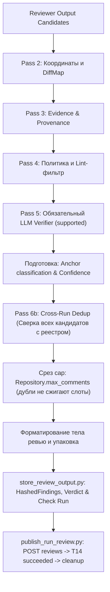
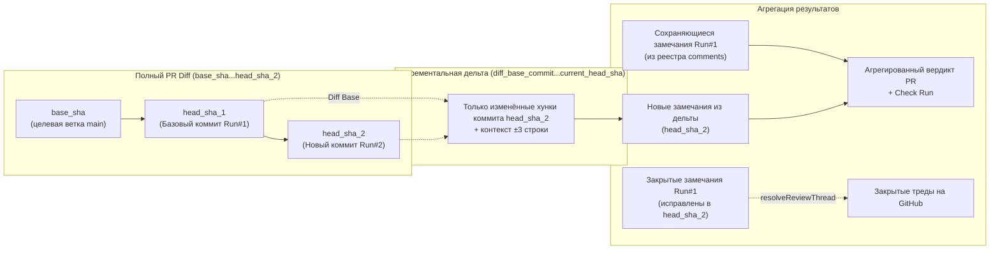
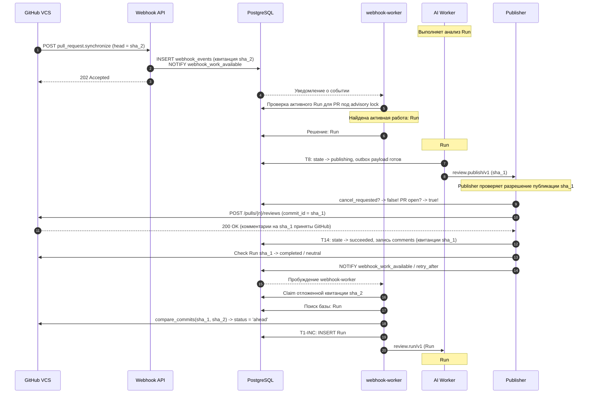
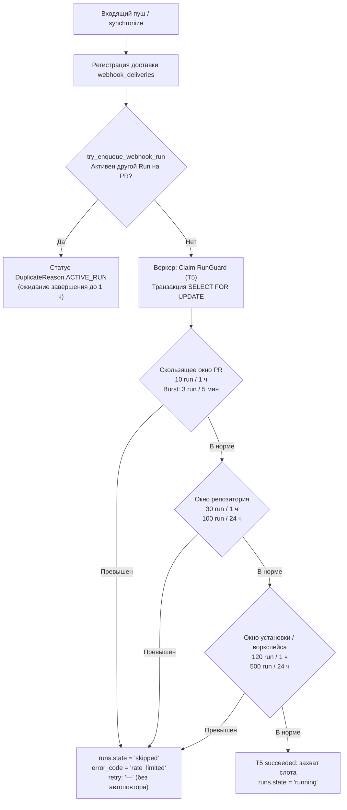

# INCREMENTAL_REVIEW_AND_LIMITS_SPEC — инкрементальный анализ (Re-review), разрешение устаревших замечаний, квоты и DoS-защита (команда 6)

| | |
|---|---|
| **Статус** | **Черновик Ч.1, PR #334** (Идентичность находок, подавление дубликатов и стратегия тредов) |
| **Владелец** | Техлид (роль 1) |
| **Область действия** | Идентичность замечания между прогонами (Finding Fingerprint), сопоставление со старыми коммитами, пересчет координат без привязки к абсолютным номерам строк (Line Offset Tracking), алгоритм межпрогонного подавления дубликатов в плане публикации (Cross-Run Dedup), стратегия классификации и разрешения устаревших/исправленных тредов на VCS (Outdated / Resolved Threads) через GraphQL `resolveReviewThread`, права GitHub App, исключение собственных событий бота по правилу Р-9 (для событий тредов — цель FeedbackSignal после MVP, §4.7), квотирование мутаций GitHub API. |
| **Связанные документы** | [`SYSTEM_DESIGN.md`](SYSTEM_DESIGN.md) (Р-5, Р-9, §6.9, §8, §13 «Риск схлопывания»), [`CONTEXT_AND_VERIFICATION_SPEC.md`](CONTEXT_AND_VERIFICATION_SPEC.md) (§6.2, §10 «Write-back: неизменяемая публикация»), [`PIPELINE_SPEC.md`](PIPELINE_SPEC.md) (§1, §6, §8), `WEBHOOK_WORKER.md` (§6). |
| **Definition of Done (DoD Ч.1)** | 1. Ключ идентичности находки между Run не зависит от абсолютных номеров строк; формализованы поля из модели `Finding`, нормализация с сохранением отступов, позиционное сопоставление вхождений и каноническая сериализация.<br/>2. Спроектирован алгоритм подавления дубликатов как фильтр плана публикации (Pass 6b) по квитанциям `comments`: подавленный повтор сохраняет `drop_reason IS NULL`, получает `publication_action = 'suppressed_duplicate'`, учитывается в severity counts, вердикте и Check Run, но исключается из массива `comments[]` со ссылкой на существующий комментарий (`linked_comment_id`).<br/>3. Задана стратегия классификации тредов (оставить, закрыть через GraphQL `resolveReviewThread`, строгий приоритет человека); определены порядок предикатов, проверка полноты покрытия перед закрытием и правила для всех состояний.<br/>4. Сняты противоречия с неизменяемой публикацией (CVS §10), одним review batch (Р-5) и запретом компенсирующего удаления (SD §13).<br/>5. Спроектированы изменения схемы БД (Alembic), модель жизненного цикла треда и интеграция этапа чистки как best-effort шага publisher после T14 и обновления Check Run (§4.5).<br/>6. Составлена расширенная таблица сквозных сценариев для регресса QA с корректными значениями Check Run. |

---

## 1. Область действия, терминология и базовые инварианты

### 1.1. Терминология

- **Full PR Diff (`base_sha...head_sha`)**: Полный унифицированный дифф pull request относительно целевой базовой ветки. Все inline-комментарии в GitHub API адресуются исключительно по координатам полного диффа.
- **Commit Delta / Incremental Diff**: Разница коммитов между ревизией исходной публикации замечания (`anchor_head_sha`) и новой головой PR (`current_head_sha`), получаемая через `VcsProvider.compare_commits`.
- **Base Git Coordinate Translation (Смещение строк / Line Offset Tracking)**: Алгоритмический пересчет номеров строк открытых замечаний из координат исходной ревизии публикации в координаты новой ревизии с учетом смещений, вносимых добавленными и удаленными строками коммит-дельты. Исходные координаты в базе данных не перезаписываются (терминальные данные неизменяемы по SD §6.9); смещение рассчитывается динамически для каждого Run относительно `anchor_head_sha`.
- **Finding Fingerprint (Идентичность находки)**: Детерминированный хеш находки, не зависящий от абсолютного номера строки в файле и вычисляемый от канонического представления атрибутов проблемы и нормализованного кода под якорем.
- **Anchor Code Hash (`anchor_code_hash`)**: Нормализованный криптографический хеш текста блока кода под якорем замечания, очищенный от крайних пробелов и нормализованный по переводам строк с сохранением значимых синтаксических отступов.
- **Outdated Thread (Устаревший тред)**: Состояние треда на стороне VCS, когда строка или блок кода, к которому было привязано замечание, подверглись изменению в последующих коммитах. GitHub переводит тред в свернутое состояние `outdated` автоматически на уровне платформы; при этом тред остается открытым (`isResolved = false`) и требует явного закрытия при подтверждении исправления дефекта.
- **Resolved Finding / Thread (Разрешенная находка / Закрытый тред)**: Состояние замечания, когда в новой ревизии дефект устранен автором (код под якорем изменен, участок проанализирован с полным покрытием и дефект не обнаружен), либо файл с дефектом полностью удален из PR. На стороне GitHub тред переводится в закрытое состояние мутацией `resolveReviewThread`.
- **Persisting Finding (Сохраняющаяся находка)**: Находка из предыдущего ревью, проблемный код под якорем которой не изменялся (или сместился по строкам без изменения содержания), и дефект по-прежнему актуален. Повторно в inline-комментариях не публикуется, но учитывается в вердикте и Check Run.
- **Human-in-the-loop Thread**: Тред, в котором после комментария бота появился хотя бы один ответ человека (`__typename != "Bot"` и логин не совпадает с логином бота), либо который был закрыт или повторно открыт человеком вручную.

### 1.2. Базовые инварианты

1. **Zero-Spam (Никаких повторных комментариев на неизмененный код)**: Бот не создает повторный inline-комментарий для дефекта, который уже был опубликован в предыдущем Run и остался неисправленным. Существующий тред на VCS сохраняется.
2. **Опубликованное определяется строго по квитанциям (`comments`, remote IDs)**: Принадлежность inline-замечания к опубликованным определяется наличием записи в таблице `comments` с `github_comment_id` для данного PR, а не статусом Run (`succeeded` / `cancelled`). Run, отмененный по T15 после выполнения POST-запроса, уже оставил комментарии на PR; они считаются опубликованными (для body-only находок без записи в `comments` принадлежность определяется по признаку `published = true` последнего прошедшего T14 прогона согласно п. 4, `:38-39`).
3. **Сохранность счетчиков и вердикта при дедупликации**:
   - Подавление повторных находок является фильтром плана публикации, а не причиной отсева (drop reason).
   - Сохраняющаяся находка сохраняет `drop_reason IS NULL`, получает `publication_action = 'suppressed_duplicate'`, связывается с существующей записью комментария (`linked_comment_id`, либо `NULL` для body-only дубля) и помещается в новое поле dataclass `ProcessedReviewOutput.suppressed: tuple[ProcessedFinding, ...] = ()` (`findings_post_processor.py:96`, с расширением `Bucket = Literal["inline", "body_only", "suppressed", "dropped"]`). Потребители поля `suppressed`: набор `kept = (*inline, *body_only, *suppressed)` в `findings_post_processor.py:219` (`summary_from_result` `:227`, `_overview_block` `:434-445`) и `finalize_stored_review_body` (`:507`), расчёт `hashed_findings(processed)` в `store_review_output.py:110` (`(*processed.inline, *processed.body_only, *processed.suppressed)`), и сохранение строк `Finding` в `run_repository.py:881` (`records = (*processed.inline, *processed.body_only, *processed.suppressed, *processed.dropped)`).
   - **Разделение рендера списка и шапки тела ревью**: Секция списка дополнительных находок в теле ревью (`## Additional findings`) рендерит ТОЛЬКО находки `body_only`. При этом строки `**Verdict:**` и `**Risk summary:**` в шапке тела ревью (`_overview_block`) и `summary_from_result` строятся по полному набору `kept = (*inline, *body_only, *suppressed)`. Неисправленный критический дефект не превращает вердикт и шапку тела ревью в `clean`.
   - **Счётчики Check Run**: В `run_lifecycle_store.py:432-433` отчёт строится из БД по опубликованным находкам (`drop_reason IS NULL`): `inline_count` считает находки с `publication_action = 'publish_inline'`, `body_count` — с `publication_action = 'publish_body'`, `suppressed_count` — с `publication_action = 'suppressed_duplicate'` (подавленные дубли не включаются в `body_count`). В dataclass `CheckRunReport` (`check_runs.py:107`) добавляется поле `suppressed_count: int = 0`, а в текстовой сводке `check_run_view` выводится `подавлено дубликатов: {report.suppressed_count}`.
4. **Общие замечания (Body-only findings) и квитанции**:
   - Находки без inline-координат (general-only) и находки сверх inline cap (`Repository.max_comments`) публикуются в теле ревью.
   - Для поиска ранее опубликованных или уже подавленных в теле ревью замечаний используется отдельный запрос (§3.1) по последнему Run данного PR, прошедшему T14 (`succeeded`, либо `cancelled` по T15 после POST — инвариант 2, так как T14 в `run_lifecycle_store.py:620-628` ставит `published = true` и при отмене), с предикатом `f.published = true AND f.drop_reason IS NULL AND (f.publication_action = 'publish_body' OR (f.publication_action = 'suppressed_duplicate' AND f.linked_comment_id IS NULL))`.
   - Включение подавленных body-only дублей (`suppressed_duplicate` с `linked_comment_id IS NULL`) гарантирует, что в Run 3 находка, подавленная в Run 2, не будет опубликована заново (исключён повтор «через раз»). Повторное general-замечание с тем же fingerprint получает `publication_action = 'suppressed_duplicate'`, `linked_comment_id = NULL` и опускается из списка дефектов тела рецензии. Body-only находки с `anchor_code_hash = NULL` (general-only без привязки к блобу или при недоступном блобе) сопоставляются только по точному `FindingFingerprint` (с `"anchor_code_hash": null` в каноническом JSON) и в 1-to-1 fallback (§2.2) не участвуют.
   - Кандидат сверх cap `Repository.max_comments`, совпадающий с открытым inline-тредом в реестре, получает `publication_action = 'suppressed_duplicate'`, связывается с существующим тредом (`linked_comment_id = comment.id`) и не попадает в список тела ревью.
   - **Ограничение #298 ч.1 и требование к #321**: На `main` в `complete_publication` (`run_lifecycle_store.py:601-606`) при непустом `moved_to_body_finding_ids` или при `len(comment_ids) != len(inline)` записи `Comment` не создаются ни для перенесённых в тело находок, ни для оставшихся inline-находок пакета, реально опубликованных на GitHub; пока задача #298 ч.1 не реализована, обе эти группы не попадают в реестр `comments` и могут быть опубликованы повторно в следующем Run. Требование к реализации #321: в транзакции T14 `complete_publication` для находок из `moved_to_body_finding_ids` наряду с `inline_comment = false` и `published = true` обязательно выставляется `publication_action = 'publish_body'`, чтобы они удерживались запросом дедупликации body-only находок.
5. **Неизменяемость текста публикации (Immutable Payload)**: Закрытие треда на VCS через GraphQL `resolveReviewThread` меняет только состояние треда (`isResolved`), но не редактирует и не удаляет опубликованный текст комментария (`body`), сохраняя квитанции, аудит и payload digest по CVS §10.
6. **Human-in-the-loop Priority (Приоритет человека)**:
   - **Сквозное правило приоритета**: Состояния `HUMAN_TOUCHED` (`HUMAN_DISCUSSION`, `RESOLVED_BY_USER`) строго перекрывают любые действия бота; бот никогда не закрывает автоматически треды, которых касался человек.
   - Если в треде бота ответил человек, тред переходит в `HUMAN_DISCUSSION` под управление человека.
   - Если человек закрыл тред вручную (`RESOLVED_BY_USER`), бот считает его закрытым и не переоткрывает.
   - Если человек снял resolve с треда, ранее закрытого ботом (в БД `RESOLVED_BY_BOT`, а на GitHub `isResolved == false`), тред переходит в `HUMAN_DISCUSSION` под управление человека; бот повторно его не закрывает.
   - В любом из этих состояний повторная публикация замечания с тем же `FindingFingerprint` подавляется (`publication_action = 'suppressed_duplicate'`), пока тред существует на PR.
7. **Игнорирование собственных событий (Правило Р-9)**: События `pull_request_review_thread.resolved` / `unresolved`, инициированные ботом, в MVP не обрабатываются, так как приложение на них не подписано. В рамках будущей задачи сбора обратной связи `FeedbackSignal` (после MVP) вебхук-воркер будет отбрасывать события собственных мутаций бота по правилу `sender.type == "Bot"` и `_normalize_login(sender.login) == bot_key` с присвоением статуса `ignored_irrelevant_event` (detail `action=<action> ignored_own_bot`), предотвращая ложные сигналы обратной связи.
8. **Квотирование мутаций GitHub API**: Вторичные лимиты GitHub ограничивают трафик до 1 мутации в секунду, не более 80 content-generating запросов в минуту и 500 в час на установку. На один Run устанавливается квота не более 30 вызовов мутации `resolveReviewThread` с паузой не менее 1.2 секунды между запросами (общий бюджет фазы чистки 90 с). Счетчик квоты ведется на уровне Run. Оставшиеся к закрытию треды обрабатываются в последующих прогонах. При сбое процесса повторная доставка сообщения брокером RabbitMQ не повторяет закрытие тредов, так как Run уже зафиксирован в состоянии `succeeded`.
9. **Граница провайдеров VCS (GitLab)**: Прием вебхуков и запуск ревью для GitLab реализованы на `main` (#169), однако GitLab intake по умолчанию выключен. GitLab использует API discussions без квитанций `comments` с внешними thread ID. Для GitLab метод `get_review_threads` возвращает пустую страницу, `resolve_review_thread` возвращает `UNSUPPORTED`, а реестр замечаний работает с пустым списком тредов. Повторы на GitLab на этапе MR update являются известным временным ограничением.

---

## 2. Идентичность находки между Run (Finding Fingerprint)

### 2.1. Проблема абсолютных номеров строк

Если идентифицировать замечание по кортежу `(file_path, line_number, rule_name)`, то любая правка выше по файлу (добавление строк, комментариев или импортов) сдвигает абсолютный номер строки дефекта на величину смещения. В результате:
- Прежнее замечание на строке N не сопоставится с дефектом на строке N + delta;
- Бот опубликует дубликат замечания на строке N + delta;
- Прежнее замечание на строке N будет ошибочно сочтено устраненным и закрыто (ложная чистка).

Межпрогонный ключ идентичности находки не должен зависеть от абсолютного номера строки в файле.

### 2.2. Формула Finding Fingerprint и поля модели Finding

Для каждого кандидата в находки вычисляется детерминированный ключ на основе реальных атрибутов модели `Finding` (`app/modules/reviews/infrastructure/models.py`):

1. **`file_path`**: Канонический относительный путь к файлу в репозитории (POSIX-формат, разделитель `/`, без ведущего слеша). При переименовании файла путь сопоставляется через `previous_filename` из ответа сравнения коммитов. Перед сравнением с реестром fingerprint ранее опубликованной строки пересчитывается с подстановкой нового пути файла.
2. **`side`**: Сторона диффа из enum `FindingSide` (`RIGHT` для добавленного/измененного кода, `LEFT` для удаленного кода; по умолчанию `RIGHT`).
3. **`category`**: Категория дефекта из enum `FindingCategory` (`security`, `correctness`, `performance`, `readability`).
4. **`rule_name`**: Имя или источник правила (`Finding.rule_name`, nullable string, допустимые значения: `.review/rules.md`, `AGENTS.md`, `service-defaults:<ID>` или null). Если правило не задано (`null`), в структуру подставляется пустая строка `""`.
5. **`anchor_code_hash`**: SHA-256 хеш нормализованного блока кода под якорем дефекта (см. §2.3).
   - **Источник текста якоря**: Для inline-находок текст извлекается из `DiffFile.hunks[].rows[]` (`DiffRow.text` для строк с `kind ∈ {RowKind.CONTEXT, RowKind.ADDED}` и `new_line ∈ [line_start, line_end]`, `diff_map.py:82-107`); если диапазон `[line_start, line_end]` не целиком покрыт хунками, `anchor_code_hash = NULL`. Для `body_only` находок текст читается через `DiffFile.blob_sha` + `VcsProvider.get_blob` (`SYSTEM_DESIGN.md` §8.1) вне транзакций БД. Если текст недоступен (диапазон вне хунков, отсутствие `blob_sha` или ошибка `get_blob`), `anchor_code_hash = NULL`, и находка не участвует в 1-to-1 fallback (§2.2 п. 2) во избежание ложных совпадений.
6. **`normalized_claim`**: Нормализованный заголовок утверждения дефекта (`Finding.title`). Для поддержки многоязычного текста (включая русскоязычные правила и заголовки) используется Unicode regex с вызовом `strip()` после замены: `re.sub(r'[\W_]+', ' ', claim.lower()).strip()` (намеренно отличается от ASCII-only `FindingsPostProcessor._normalize_title`, так как `[^a-z0-9]+` схлопывает кириллический заголовок в пустую строку).
7. **`occurrence_index`**: Локальный индекс вхождения идентичного дефекта в файле. Индекс назначается детерминированным алгоритмом:
   - Кандидаты текущего прогона и строки комментариев реестра группируются по базовому ключу без индекса: `(file_path, side, category, rule_name, normalized_claim, anchor_code_hash)`.
   - Внутри каждой группы выполняется спаривание кандидатов со строками реестра один-к-одному:
     - Если дельта коммитов доступна: спаривание минимизирует расстояние до перенесенного диапазона `abs(candidate.line - transferred.new_start)`.
     - Если дельта коммитов неизвестна (`UNKNOWN`): спаривание выполняется один-к-одному по сортировке кандидатов и записей реестра по исходному `line_start`.
   - Спаренному кандидату присваивается `occurrence_index` спаренной строки реестра.
   - Непарные кандидаты получают уникальные возрастающие индексы: `max(occurrence_index in group) + i + 1` с шагом 1 (начиная с 0 при пустой группе). Это устраняет сдвиги и коллизии индексов при вставке нескольких аналогичных блоков кода.

**Каноническая сериализация и хеширование**:
Компоненты ключа упаковываются в канонический JSON-объект с сортировкой ключей, разделителями `separators=(',', ':')` и `ensure_ascii=False`, аналогично построению payload digest в CVS §10.1:

```json
{
  "anchor_code_hash": "a1b2c3d4...",
  "category": "security",
  "file_path": "app/auth.py",
  "normalized_claim": "unhandled bare except block",
  "occurrence_index": 0,
  "rule_name": ".review/rules.md",
  "side": "RIGHT"
}
```

```text
FindingFingerprint = SHA-256(canonical_json_utf8_bytes)
```

**Нестабильность формулировок модели (Graceful Matching)**:
Если LLM при повторном анализе перефразировала заголовок или опустила необязательное имя правила, применяется двухступенчатое сопоставление:
1. **Точное совпадение по `FindingFingerprint`**.
2. **Запасное сопоставление (Fallback Match)**: запускается строго **после** исчерпания точного сопоставления и только при соблюдении ВСЕХ следующих ограничителей:
   - `candidate.anchor_code_hash is not None` и `candidate.anchor_code_hash == comment.anchor_code_hash` (хэш кода якоря совпадает гарантированно);
   - Код под якорем НЕ был модифицирован (никогда не применяется к исходу `ANCHOR_MODIFIED`);
   - Для тредов в статусах `HUMAN_DISCUSSION` и `RESOLVED_BY_USER` fallback только подавляет повторную публикацию (`publication_action = 'suppressed_duplicate'`), а `thread_status` не меняется; для тредов в статусах `RESOLVED_BY_BOT` и `NOT_FOUND` fallback не применяется (QA-REC-13);
   - Запрещено, если статус дельты `UNKNOWN` (force push, ошибка сравнения, legacy `anchor_code_hash IS NULL`);
   - Взаимная однозначность: на перенесенном диапазоне `[new_start, new_end]` (§2.4) существует **ровно один** кандидат текущего Run и **ровно один** тред в реестре в статусе `ACTIVE`, `PERSISTING`, `HUMAN_DISCUSSION` или `RESOLVED_BY_USER` с совпадающей категорией и файлом. Если кандидатов или подходящих тредов больше одного, fallback не применяется (требуется точный `FindingFingerprint`), что предотвращает риск схлопывания дефектов (SD §13).

### 2.3. Нормализация блока кода якоря (`anchor_code_hash`)

Для корректной работы с языками с позиционным синтаксисом (Python, YAML) нормализация сохраняет отступы:
1. Замена всех вариантов переводов строк на канонический LF (`\r\n -> \n`, `\r -> \n`).
2. Удаление хвостовых пробелов и табуляций в конце каждой строки (`rstrip()`). Ведущие пробелы (отступы) сохраняются.
3. Удаление пустых строк в начале и конце блока якоря `[line_start, line_end]`.
4. Преобразование нормализованной строки в UTF-8 байты и вычисление SHA-256: `anchor_code_hash = SHA-256(normalized_code_bytes)`.

### 2.4. Алгоритм отслеживания смещений строк (Line Offset Tracking)

Для сопоставления открытых комментариев с новой головой PR используется отслеживание смещений на базе унифицированного диффа дельты коммитов:

```text
ВХОД:
  - comment: ранее опубликованный комментарий с привязанными координатами
             (anchor_head_sha, file_path, line_start, line_end, anchor_code_hash)
  - delta_comparison: результат VcsProvider.compare_commits(anchor_head_sha, current_head_sha)

АЛГОРИТМ:
  1. Проверка доступности и полноты дельты:
     Если delta_comparison недоступен (ошибка вызова compare, delta_comparison.is_complete == False,
     число файлов >= 300, либо not delta_comparison.is_ancestor, где is_ancestor означает status ∈ {"ahead", "identical"}):
       -> Исход: UNKNOWN.
       -> Безопасное умолчание: тред оставляется открытым (LEAVE_ACTIVE).
       -> Мутация закрытия треда НЕ вызывается. Завершить алгоритм.

  2. Разрешение переименований файлов:
     Найти target_path для comment.file_path с учетом previous_filename в delta_comparison.files.
     Если файл удален в дельте (status == 'removed'):
       -> Исход: RESOLVED_BY_FILE_DELETION.
       -> Завершить алгоритм.

  3. Поиск секции (patch) для target_path в delta_comparison.files:
     Если файл отсутствует в списке файлов сравнения:
       -> Файл не изменялся между anchor_head_sha и current_head_sha.
       -> Исход: PERSISTING (код под якорем гарантированно не затронут).
       -> Завершить алгоритм.
     Если файл присутствует в списке сравнения, но changes == 0 ∧ status == 'renamed' (на main PatchState.METADATA_ONLY: чистое метаданное переименование без изменения содержимого):
       -> Хунков нет, строки не смещались.
       -> Исход: PERSISTING (по новому пути target_path). Завершить алгоритм.
     Если файл присутствует в списке, но patch is None при changes > 0 (бинарный файл, усечение diff или превышение лимита):
       -> Исход: UNKNOWN (невозможно подтвердить сохранность/исправление кода).
       -> Безопасное умолчание: LEAVE_ACTIVE.
       -> Завершить алгоритм.
     Если файл был изменен в PR, но затем возвращен коммитом к состоянию base_sha (отсутствует в полном diff PR base_sha...head_sha при diff_map.file_list_complete == True; если diff_map.file_list_complete == False, возвращается исход UNKNOWN / LEAVE_ACTIVE):
       -> Код дефекта устранен возвратом к базовой ревизии.
       -> Исход: RESOLVED_BY_FILE_DELETION (тред закрывается resolveReviewThread во избежание вечной блокировки мержа). Завершить алгоритм.

  4. Расчет смещения строк по hunks файла:
     delta_offset = 0
     is_anchor_modified = false
     old_target_line = comment.line_start
     end = comment.line_end if comment.line_end is not None else comment.line_start

     Для каждого hunk в patch файла:
       hunk_old_start = hunk.old_start
       hunk_old_count = hunk.old_count
       hunk_old_end = (hunk_old_start + hunk_old_count - 1) if hunk_old_count > 0 else hunk_old_start
       hunk_net_diff = hunk.new_count - hunk.old_count

       // Случай 1: Чистая вставка строк строго выше якоря (hunk_old_count == 0)
       Если hunk_old_count == 0:
         Если hunk_old_start < old_target_line:
           delta_offset += hunk_net_diff
         продолжить

       // Случай 2: Hunk целиком выше строки якоря
       Если old_target_line > hunk_old_end:
         delta_offset += hunk_net_diff
         продолжить

       // Случай 3: Hunk целиком ниже диапазона якоря
       Если end < hunk_old_start:
         продолжить

       // Случай 4: Якорь пересекается с hunk
       Если диапазон [comment.line_start, end] пересекается с hunk:
         Проверить, затронуты ли строки диапазона якоря изменениями ('-' или '+'):
         Если хотя бы одна строка диапазона изменена или удалена:
           is_anchor_modified = true
         Иначе (строки диапазона остались неизменным контекстом внутри hunk):
           delta_offset += (число '+' выше comment.line_start - число '-' выше comment.line_start)

  5. Валидация сохранности кода якоря:
     Если comment.anchor_code_hash IS NULL (legacy-строка до миграции схемы):
       -> Исход: UNKNOWN.
       -> Безопасное умолчание: LEAVE_ACTIVE. Категорически запрещено классифицировать как ANCHOR_MODIFIED или RESOLVED_BY_FIX (закрытие возможно только при удалении или полном откате файла на шагах 2–3).
       -> Завершить алгоритм.

     Если is_anchor_modified == false:
       new_start = comment.line_start + delta_offset
       new_end = end + delta_offset
       Прочитать блок строк [new_start, new_end] из дерева current_head_sha.
       Вычислить new_anchor_code_hash по правилам §2.3.
       Если new_anchor_code_hash == comment.anchor_code_hash:
         -> Исход: PERSISTING (строки сместились, код дефекта на месте).
            Исходные координаты в БД неизменны; смещение учитывается в памяти прогона.
       Иначе:
         -> is_anchor_modified = true

  6. Обработка изменения кода якоря:
     Если is_anchor_modified == true:
       Вычислить перенесенный диапазон transferred_range = [comment.line_start + delta_offset, end + delta_offset],
       расширенный диапазоном хунка [hunk.new_start, hunk.new_start + hunk.new_count - 1], изменившего якорь.
       -> Исход: ANCHOR_MODIFIED с привязанным transferred_range (требуется сопоставление с кандидатами ревью нового Run).
```

### 2.5. Модель данных и миграции схемы БД

Для поддержки идентичности находок и жизненного цикла тредов в схему данных вносятся следующие изменения через миграцию Alembic:

```sql
-- 1. Расширение таблицы findings (хранение ключей идентичности и связи с комментарием)
ALTER TABLE findings ADD COLUMN finding_fingerprint CHAR(64) NULL;
ALTER TABLE findings ADD COLUMN anchor_code_hash CHAR(64) NULL;
ALTER TABLE findings ADD COLUMN occurrence_index INTEGER NOT NULL DEFAULT 0;
ALTER TABLE findings ADD COLUMN linked_comment_id UUID NULL REFERENCES comments(id);
ALTER TABLE findings ADD COLUMN publication_action VARCHAR(32) NOT NULL DEFAULT 'publish_inline';

ALTER TABLE findings ADD CONSTRAINT ck_findings_publication_action
    CHECK (publication_action IN ('publish_inline', 'publish_body', 'suppressed_duplicate', 'dropped'));

CREATE INDEX ix_findings_fingerprint ON findings(finding_fingerprint);
CREATE INDEX ix_findings_linked_comment_id ON findings(linked_comment_id);

-- 2. Расширение таблицы comments (метаданные жизненного цикла треда VCS и разметка кандидатов на чистку)
ALTER TABLE comments ADD COLUMN github_thread_id VARCHAR(64) NULL;
ALTER TABLE comments ADD COLUMN thread_status VARCHAR(32) NOT NULL DEFAULT 'ACTIVE';
ALTER TABLE comments ADD COLUMN resolved_at TIMESTAMP WITH TIME ZONE NULL;
ALTER TABLE comments ADD COLUMN resolved_by_commit VARCHAR(64) NULL;
ALTER TABLE comments ADD COLUMN resolved_by_actor VARCHAR(100) NULL;
ALTER TABLE comments ADD COLUMN last_seen_run_id UUID NULL REFERENCES runs(id);
ALTER TABLE comments ADD COLUMN pending_resolution_run_id UUID NULL REFERENCES runs(id);
ALTER TABLE comments ADD COLUMN pending_resolution_outcome VARCHAR(32) NULL;

ALTER TABLE comments ADD CONSTRAINT ck_comments_thread_status
    CHECK (thread_status IN ('ACTIVE', 'PERSISTING', 'HUMAN_DISCUSSION', 'RESOLVED_BY_USER', 'RESOLVED_BY_BOT', 'NOT_FOUND'));
ALTER TABLE comments ADD CONSTRAINT ck_comments_pending_resolution_outcome
    CHECK (pending_resolution_outcome IS NULL OR pending_resolution_outcome IN ('RESOLVED_BY_DELETION', 'RESOLVED_BY_FIX', 'RESOLVED_MUTATED'));

CREATE INDEX ix_comments_thread_status ON comments(thread_status);
CREATE INDEX ix_comments_github_thread_id ON comments(github_thread_id);
CREATE INDEX ix_comments_pending_resolution_run_id ON comments(pending_resolution_run_id);
```

**Единый словарь состояний треда (`thread_status`) и вспомогательных полей**:
- `ACTIVE`: Замечание опубликовано, тред открыт на GitHub, дефект актуален в первом прогоне публикации.
- `PERSISTING`: Дефект повторно подтвержден в последующем прогоне на неизмененном (или смещенном) коде, тред остается открытым на GitHub. **Единое правило перехода в `PERSISTING`**: транзакция T14 (`complete_publication`) переводит `ACTIVE -> PERSISTING` исключительно у того комментария, на который ссылается находка текущего Run с `publication_action = 'suppressed_duplicate'` (`findings.linked_comment_id = comments.id`); прочие статусы (`HUMAN_DISCUSSION`, `RESOLVED_BY_USER`, `RESOLVED_BY_BOT`, `NOT_FOUND`) не изменяются; сам по себе исход смещения §2.4 `PERSISTING` (при отсутствии совпавшей `suppressed_duplicate` находки в текущем Run) статус в БД не меняет.
- `RESOLVED_BY_BOT`: Дефект устранен автором коммита (при подтвержденном полном анализе участка и отсутствии любых отсеянных кандидатов), либо файл удален/откачен, либо дефект мутировал на измененном коде; тред закрыт ботом через GraphQL `resolveReviewThread` (`resolved_by_commit = head_sha`, `resolved_by_actor = bot_key`).
- `RESOLVED_BY_USER`: Тред был закрыт разработчиком вручную в интерфейсе GitHub.
- `HUMAN_DISCUSSION`: В треде ответил человек либо человек отменил resolve бота. Бот уступает приоритет человеку и никогда не закрывает такой тред автоматически.
- `NOT_FOUND`: Тред отсутствует на GitHub (удален пользователем или удалена ветка), обнаружено после полного безошибочного чтения карты тредов; либо узел GraphQL не найден при попытке мутации.
- `last_seen_run_id`: Обновляется в транзакции T14 (`complete_publication`) для комментариев, на которые ссылается `suppressed_duplicate` находка текущего Run; читается диагностикой аудита и UI/API истории прогонов PR для отображения последнего Run, подтвердившего актуальность треда.
- `pending_resolution_run_id`, `pending_resolution_outcome`: Хранилище кандидатов на закрытие (`comment.id`, `comment.github_thread_id`, исход из `'RESOLVED_BY_DELETION' | 'RESOLVED_BY_FIX' | 'RESOLVED_MUTATED'`). Записываются в `store_review_output.py` при сохранении плана публикации (в транзакции T8 `lock_for_publishing` / `store_review_output`, где в памяти доступны `RunCoverage.durable_reviewable_paths` и `checked_paths`). Эти поля **не входят** ни в диагностический `findings_hash`, ни в неизменяемый digest плана публикации T8 (`publication_key`, PIPELINE_SPEC §6), и читаются фазой чистки в `publish_run_review.py` после T14.

> [!IMPORTANT]
> **Сквозное правило приоритета человека**:
> Состояния `HUMAN_TOUCHED` (`HUMAN_DISCUSSION`, `RESOLVED_BY_USER`) строго перекрывают любые действия бота; бот никогда не закрывает автоматически треды, которых касался человек.

**Таблица соответствия: Исход §2.4 -> Действие §4.1 -> Статус БД**:

| Исход смещения (§2.4) | Проверка покрытия нового Run | Исход классификации (§4.1) | Действие на GitHub VCS | Результирующий `thread_status` |
|---|---|---|---|---|
| `RESOLVED_BY_FILE_DELETION` | Для `status == 'removed'` в дельте — не требуется; для возврата файла к `base_sha` (отсутствие в diff PR) — обязательно `file_list_complete == True` | `RESOLVED_BY_DELETION` | Закрыть тред (`resolveReviewThread`) | `RESOLVED_BY_BOT` (`resolved_by_actor = bot_key`) |
| `ANCHOR_MODIFIED` | Гейт покрытия читает финализированный `ProcessedReviewOutput.coverage` (после `finalize_run_coverage`, а не `context.coverage`): `coverage.status == 'complete' ∧ coverage.file_list_complete == True ∧ coverage.durable_reviewable_paths is not None ∧ target_path ∈ (coverage.durable_reviewable_paths ∩ checked_paths)`; на перенесенном участке дефектов и кандидатов с `drop_reason != 'contradicted'` нет (или хунк откачен к `base` при полном патче файла) ∧ **ни одна находка текущего Run не ссылается на этот комментарий (`linked_comment_id`); при наличии ссылки — `LEAVE_ACTIVE`** | `RESOLVED_BY_FIX` | Закрыть тред (`resolveReviewThread`) | `RESOLVED_BY_BOT` (`resolved_by_actor = bot_key`) |
| `ANCHOR_MODIFIED` | Гейт покрытия не выполнен (`coverage.status != 'complete'`, `file_list_complete == False`, `durable_reviewable_paths is None` или `target_path ∉ durable_reviewable_paths ∩ checked_paths`) или на перенесенном участке возник кандидат с `drop_reason != 'contradicted'` | `LEAVE_ACTIVE` | NOOP (нельзя подтвердить фикс) | Сохраняет прежний статус (`ACTIVE`/`PERSISTING`) |
| `ANCHOR_MODIFIED` | Дефект обнаружен на измененном коде ∧ **ни одна находка текущего Run не ссылается на этот комментарий (`linked_comment_id`); при наличии ссылки — `LEAVE_ACTIVE`** | `RESOLVED_MUTATED` | Закрыть старый тред + опубликовать новый | Старый: `RESOLVED_BY_BOT` (`resolved_by_actor = bot_key`), Новый: `ACTIVE` |
| `PERSISTING` | Любая | `LEAVE_ACTIVE` | NOOP (тред остается открытым) | Сохраняет прежний статус (T14 переводит `ACTIVE -> PERSISTING` только при наличии совпавшей `suppressed_duplicate` находки; `HUMAN_*` без понижения) |
| `UNKNOWN` (вкл. legacy NULL hash) | Любая | `LEAVE_ACTIVE` | NOOP (безопасное умолчание) | Сохраняет прежний статус (`ACTIVE`/`PERSISTING`) |

**Разграничение ключей и целостность связей**:
1. Колонка `comments.findings_hash` хранит хеш всего набора находок прогона как диагностическое поле (CVS §10.1, SD §6.9), и **не является** ключом отдельной находки.
2. Ограничение `UNIQUE(finding_id)` в таблице `comments` связывает строку комментария с породившей ее находкой первоначального Run.
3. При сохранении дефекта в последующих Run повторная строка в `comments` не создается. Новая находка сохраняет `drop_reason IS NULL`, получает `publication_action = 'suppressed_duplicate'`, `inline_comment = false`, а ссылка на исходный комментарий фиксируется в колонке `findings.linked_comment_id = comments.id`.
4. **Обработка исторических строк (Legacy Rows)**: Для строк `comments` и `findings`, созданных до миграции схемы, колонки `finding_fingerprint` и `anchor_code_hash` остаются `NULL` (бэкфилл не выполняется). Поскольку `anchor_code_hash IS NULL`, шаг 5 алгоритма §2.4 возвращает для них исход `UNKNOWN`, и в 1-to-1 fallback (§2.2) они не участвуют. Принятое ограничение выкатки: при первом прогоне после миграции для таких домиграционных замечаний возможна однократная повторная публикация. Legacy-треды защищены от ложной чистки по `RESOLVED_BY_FIX` (всегда остаются `LEAVE_ACTIVE`) и могут быть автоматически закрыты ботом только при полном удалении или откате файла на шагах 2–3 (`RESOLVED_BY_FILE_DELETION`).

---

## 3. Алгоритм подавления дубликатов в плане публикации (Cross-Run Dedup)

### 3.1. Формирование реестра опубликованных замечаний PR

Реестр ранее опубликованных замечаний формируется по квитанциям публикации текущего PR независимо от итогового статуса Run:

```sql
SELECT c.id AS comment_id,
       c.github_comment_id,
       c.github_thread_id,
       c.thread_status,
       c.created_at,
       r.head_sha AS anchor_head_sha,
       f.id AS original_finding_id,
       f.finding_fingerprint,
       f.file_path,
       f.side,
       f.rule_name,
       f.line_start,
       f.line_end,
       f.occurrence_index,
       f.anchor_code_hash,
       f.title,
       f.category,
       f.severity
FROM comments c
JOIN findings f ON c.finding_id = f.id
JOIN runs r ON f.run_id = r.id
WHERE r.code_change_id = :current_code_change_id
ORDER BY c.created_at DESC;
```

В дедупликации участвуют **все** опубликованные комментарии PR, включая треды в состояниях `HUMAN_DISCUSSION`, `RESOLVED_BY_USER` и `RESOLVED_BY_BOT`. Если в реестре `comments` у одного `finding_fingerprint` присутствует несколько строк (например, после перевода прежнего треда в `NOT_FOUND` или `RESOLVED_BY_BOT` и последующей повторной публикации), для сопоставления всегда выбирается самая свежая запись по `c.created_at DESC`.

Для дедупликации общих замечаний в теле ревью (`body_only`, у которых нет строк в `comments`) выполняется второй запрос по последнему Run данного PR, прошедшему T14 (`published = true`):

```sql
SELECT f.id AS original_finding_id,
       f.finding_fingerprint,
       f.file_path,
       f.side,
       f.rule_name,
       f.line_start,
       f.line_end,
       f.occurrence_index,
       f.anchor_code_hash,
       f.title,
       f.category,
       f.severity
FROM findings f
WHERE f.run_id = (
    SELECT r.id
    FROM runs r
    WHERE r.code_change_id = :current_code_change_id
      AND EXISTS (
          SELECT 1 FROM findings f2
          WHERE f2.run_id = r.id AND f2.published = true
      )
    ORDER BY r.finished_at DESC NULLS LAST, r.created_at DESC
    LIMIT 1
)
  AND f.published = true
  AND f.drop_reason IS NULL
  AND (
      f.publication_action = 'publish_body'
      OR (f.publication_action = 'suppressed_duplicate' AND f.linked_comment_id IS NULL)
  );
```

### 3.2. Место дедупликации в конвейере фильтрации (Pass 6b)

В `store_review_output.py:execute()` после чтения `context = await uow.reviews.get_post_processing_input(run_id)` (`:185`) и **до** вызова `processor.process()` (`:202`) выполняются строго в следующем порядке:
1. Сетевые шаги строго вне транзакций БД: синхронный вызов `sync_review_threads_state` (чтение страниц GraphQL и сборка `thread_map: ReviewThreadMap`, затем короткая транзакция обновления актуальных статусов тредов в `comments`) и расчёт исходов смещений `resolution_outcomes` (вызовы `compare_commits` и `get_blob`).
2. Чтение из БД реестра опубликованных комментариев (`registry`) и body-only находок последнего прошедшего T14 прогона (§3.1) — выполняется строго после шага 1, что гарантирует получение актуализированных значений `thread_status` (включая снятие отметки разрешения человеком по QA-REC-14, `:648`).

Межпрогонная дедупликация встраивается в `findings_post_processor.py:process()` как **Pass 6b (Cross-Run Dedup)** на реальном шве: строго ПОСЛЕ восстановления атрибуции `_repair_attribution` (которая может исправить `rule_name` и переместить inline в `body_only`) и строго ДО сортировки и среза cap `Repository.max_comments`. Входные параметры `process()` расширяются аргументами `registry`, `thread_map` и `resolution_outcomes`; результат возвращается в dataclass `ProcessedReviewOutput` (с новым полем `suppressed: tuple[ProcessedFinding, ...] = ()`). Потребителями результата выступают `store_review_output.py` (`hashed_findings`) и `run_repository.py:881` (запись строк `Finding` и разметка `pending_resolution_*`). Вспомогательный путь `PublishReviewOutput` / `mark_review_published` (`review_output.py:786`, `run_repository.py:904`) не используется основным воркером очереди `publish_run_review.py` (идущим через `complete_publication`), при этом `publication_action` сохраняется для всех находок ещё на шаге `store_review_output` до публикации:



**Таблица соответствия: Бакет находок -> Поля модели и публикация**:

| Бакет кандидата | `publication_action` | `inline_comment` | `linked_comment_id` | `published` (до T14 / после T14) | Входит в `hashed_findings` | Входит в тело ревью | Учет в Check Run |
|---|---|---|---|---|---|---|---|
| **`inline`** (новое замечание в пределах cap) | `'publish_inline'` | `true` | `NULL` | `false` / `true` | Да | Строка в списке — Нет (inline); `Verdict` и `Risk summary` тела — Да | `severity_counts`, `inline_count` |
| **`body_only`** (сверх cap, general, low confidence) | `'publish_body'` | `false` | `NULL` | `false` / `true` | Да | Строка в списке — Да; `Verdict` и `Risk summary` тела — Да | `severity_counts`, `body_count` |
| **`suppressed`** (inline-дубль активного/закрытого треда) | `'suppressed_duplicate'` | `false` | `UUID` комментария реестра | `false` / `true` | Да | Строка в списке — Нет; `Verdict` и `Risk summary` тела — Да | `severity_counts`, `suppressed_count` |
| **`suppressed`** (body-only дубль, §1.2 п.4) | `'suppressed_duplicate'` | `false` | `NULL` | `false` / `true` | Да | Строка в списке — Нет; `Verdict` и `Risk summary` тела — Да | `severity_counts`, `suppressed_count` |
| **`dropped`** (отсеян фильтрами 2–6) | `'dropped'` | `false` | `NULL` | `false` / `false` | Нет | Нет | `below_threshold_count` (если severity) |

**Правила обработки находок в плане публикации**:
1. Все подтвержденные верификатором кандидаты признаются итоговыми находками прогона (`drop_reason IS NULL`).
2. Для **всех** кандидатов (как потенциальных inline, так и body_only) выполняется поиск соответствия в реестре опубликованных замечаний PR по `FindingFingerprint` (или 1-to-1 fallback §2.2).
3. **Подавленные дубли не сжигают inline cap**: Находки, признанные `suppressed_duplicate`, исключаются из массива `inline_candidates` до среза cap, поэтому они не расходуют слоты настройки репозитория `Repository.max_comments` (по умолчанию 10, максимум 10), освобождая слоты для новых уникальных находок.
4. **При совпадении с активным или обсуждаемым тредом (`ACTIVE`, `PERSISTING`, `HUMAN_DISCUSSION`)**:
   - Находка исключается из массива `comments[]` отправляемого review batch.
   - Находке присваивается `publication_action = 'suppressed_duplicate'`, `inline_comment = false` (благодаря чему равенство `len(comment_ids) == len(inline)` строго соблюдается при записи квитанций).
   - Поле `published` остается `false` на этапе плана и выставляется в `true` атомарно в транзакции T14 `complete_publication`.
   - Проставляется ссылка на существующий комментарий: `findings.linked_comment_id = registry.comment_id`.
   - Если статус в реестре был `ACTIVE`, он обновляется на `thread_status = 'PERSISTING'` (пишет транзакция T14 `complete_publication`, §4.3 п.6). Если статус был `HUMAN_DISCUSSION` или `RESOLVED_BY_USER`, он сохраняется без понижения.
   - Находка в полном объеме входит в `hashed_findings`, участвует в расчете счетчиков серьезности и формировании вердикта PR (`critical` или `high` дают `blocking`, `medium` или `low` дают `attention`, а в Check Run выставляется `completed / neutral`).
5. **При совпадении с тредом, закрытым человеком (`RESOLVED_BY_USER`)**:
   - Находка исключается из review batch (`publication_action = 'suppressed_duplicate'`).
   - Бот уважает решение пользователя и не открывает тред повторно.
6. **При совпадении с тредом, ранее закрытым ботом (`RESOLVED_BY_BOT`)**:
   - Если в реестре несколько записей с одинаковым fingerprint, сопоставление выполняется с самой свежей записью (`ORDER BY comments.created_at DESC`).
   - Если автор внес изменения, вернувшие дефект (регресс на измененном коде): старый тред считается архивным, находка включается в review batch как новое замечание (`publication_action = 'publish_inline'`, `inline_comment = true`).
7. **При мутации дефекта на измененном коде**:
   - Если код под прежним тредом был изменен автором и дефект видоизменился (исход классификации сопоставлен с `ANCHOR_MODIFIED`, а находка на `transferred_range` не совпала по fingerprint и не подавлена по правилу 4): старый тред закрывается ботом мутацией `resolveReviewThread` (`thread_status = 'RESOLVED_BY_BOT'`, `resolved_by_commit = current_head_sha`, `resolved_by_actor = bot_key`), а новое замечание публикуется как отдельный тред (`publication_action = 'publish_inline'`, `thread_status = 'ACTIVE'`). Если fingerprint совпал (правка якоря только в хвостовых пробелах или переводах строк, перенос блока внутри того же файла), действует правило 4: находка подавляется, тред остается открытым (§4.1, правило 4 блока защиты от ложной чистки).
8. **Поведение при отсутствии треда на GitHub (`NOT_FOUND`)**:
   - Повторная публикация замечания при отсутствии треда на GitHub разрешена **исключительно** в том случае, если чтение карты тредов PR было **полным и безошибочным** по определению §4.3 п. 1 (`thread_map.is_complete == True`). Только при этом условии тред в реестре помечается `thread_status = 'NOT_FOUND'`, подавление снимается, и замечание публикуется заново как свежий тред (`publication_action = 'publish_inline'`). Строка в `NOT_FOUND` или `RESOLVED_BY_BOT` (правило 6) повторную публикацию не подавляет.
   - **Защита от массового спама при неполной карте**: Если чтение карты тредов завершилось ошибкой, таймаутом, усечением или вторичным лимитом rate limit (`thread_map.is_complete == False`), карта признается неполной. В этом случае статус `NOT_FOUND` не выставляется, правило 8 блокируется, и замечания продолжают подавляться по fingerprint из БД во избежание нарушения инварианта 1 (защита от повторной публикации уже откомментированных участков).
9. **При отсутствии совпадений в реестре**:
   - Находка признается новой, получает `publication_action = 'publish_inline'` (для inline) или `publication_action = 'publish_body'` (для body_only).
   - В пределах cap `inline`-находка получает `inline_comment = true` и включается в массив `comments[]` для отправки в review batch.

---

## 4. Стратегия устаревших и решённых замечаний бота на VCS (Outdated & Resolved Threads)

### 4.1. Классификация исходов для ранее опубликованных замечаний

При получении нового коммита в PR для каждого ранее опубликованного замечания бота вычисляется один из исходов со строгим приоритетом предикатов:

| Порядок | Исход | Предикат условия | Действие в БД | Действие на GitHub VCS |
|---|---|---|---|---|
| 1 | **`HUMAN_TOUCHED`** | В треде есть ответ человека (`thread.has_human_activity == True`: среди комментариев есть `author is None` либо `author.__typename != "Bot" ∧ _normalize_login(author.login) != bot_key`, либо `totalCommentsCount.totalCount > 6`), либо тред закрыт человеком (`isResolved ∧ resolvedBy != null ∧ _normalize_login(resolvedBy.login) != bot_key`), либо человек снял resolve (в БД `RESOLVED_BY_BOT`, а на GitHub `isResolved == false`). | `thread_status = HUMAN_DISCUSSION` (или `RESOLVED_BY_USER`). | **NOOP**. Бот полностью уступает управление человеку. Мутации не вызываются. |
| 2 | **`RESOLVED_BY_DELETION`** | Файл, содержавший дефект, полностью удален в дельте коммитов (`status == 'removed'`) либо возвращен коммитом к состоянию `base_sha` (отсутствует в полном diff PR при `file_list_complete == True`). | `thread_status = RESOLVED_BY_BOT`, `resolved_at = NOW(), resolved_by_commit = head_sha, resolved_by_actor = bot_key`. | **Закрыть тред**: вызов GraphQL-мутации `resolveReviewThread`. |
| 3 | **`RESOLVED_BY_FIX`** | `comment.anchor_code_hash IS NOT NULL` **И** `is_anchor_modified == true` (код изменен автором) **И** выполнен гейт покрытия прогона и файла по финализированному `ProcessedReviewOutput.coverage` (после `finalize_run_coverage`, а не предварительному `context.coverage`: `coverage.status == 'complete' ∧ coverage.file_list_complete == True ∧ coverage.durable_reviewable_paths is not None ∧ target_path ∈ (coverage.durable_reviewable_paths ∩ checked_paths)`; при `durable_reviewable_paths is None` гейт закрыт) **И** **ни одна находка текущего Run не ссылается на этот комментарий (`linked_comment_id`); при наличии ссылки переход блокируется, тред переводится в `LEAVE_ACTIVE`** **И** выполняется одна из двух веток по перенесенному диапазону `transferred_range`: **(Ветка А — диапазон пересекает хунк diff PR)** `transferred_range` пересекает разобранный хунк `DiffFile` текущего PR (`DiffFile.anchorable == True`) и на участке `transferred_range` (а для непозиционированных причин отсева вроде `unknown_path`, `ignored_file` — во всем файле) отсутствует ЛЮБОЙ кандидат с `drop_reason IS NOT NULL`, отличным от `contradicted`, и нет подтвержденных находок; либо **(Ветка Б — откат хунка к base)** `transferred_range` целиком лежит вне хунков `DiffFile` текущего PR (участок кода возвращен к `base_sha`) при `file_list_complete == True` и полном патче файла (`DiffFile.anchorable == True`, `patch_state == PatchState.COMPLETE`), где кандидатов быть не может. Классификация исходов выполняется строго после Pass 6. | `thread_status = RESOLVED_BY_BOT`, `resolved_at = NOW(), resolved_by_commit = head_sha, resolved_by_actor = bot_key`. | **Закрыть тред**: вызов GraphQL-мутации `resolveReviewThread`. |
| 4 | **`RESOLVED_MUTATED`** | Код под якорем изменен автором коммита, и новый прогон выявил на нем дефект (диапазон новой находки пересекается с перенесенным диапазоном `transferred_range`, файл и категория совпадают) ∧ **ни одна находка текущего Run не ссылается на этот комментарий (`linked_comment_id`); при наличии ссылки — `LEAVE_ACTIVE`**. | Прежний комментарий переводится в `thread_status = RESOLVED_BY_BOT` (`resolved_by_commit = current_head_sha`, `resolved_by_actor = bot_key`). Новый дефект публикуется как `ACTIVE`. | **Закрыть старый тред** мутацией `resolveReviewThread` во избежание блокировки мержа под ruleset `required_review_thread_resolution`. Новый дефект публикуется новым inline-тредом. |
| 5 | **`LEAVE_ACTIVE`** | Код под якорем не изменялся (включая стохастический пропуск модели при неизменном коде), либо `anchor_code_hash IS NULL` (legacy), либо гейт покрытия не выполнен (`coverage.status != 'complete'`, `file_list_complete == False`, `durable_reviewable_paths is None` или `target_path ∉ durable_reviewable_paths ∩ checked_paths`), либо на перенесенном участке обнаружен кандидат с `drop_reason != 'contradicted'`, либо хотя бы одна находка текущего Run ссылается на этот комментарий (`linked_comment_id == comment.id`). | Сохраняет прежний статус (T14 переводит `ACTIVE -> PERSISTING` только при наличии совпавшей `suppressed_duplicate` находки; `PERSISTING` / `HUMAN_*` без изменений). Исходные координаты в БД неизменны. | **NOOP**. Тред остается открытым на GitHub. |

> [!WARNING]
> **Защита от ложной чистки (False Cleanup Prevention)**:
> 1. Если `anchor_code_hash IS NULL` (строки до миграции схемы), исход `RESOLVED_BY_FIX` категорически запрещен: запись сохраняет статус `LEAVE_ACTIVE`.
> 2. Если гейт покрытия файла или прогона не выполнен (`coverage.status != 'complete'`, `coverage.file_list_complete == False`, `coverage.durable_reviewable_paths is None`, `target_path ∉ (coverage.durable_reviewable_paths ∩ checked_paths)` или diff файла неполный/усеченный), исход `RESOLVED_BY_FIX` запрещен. Принятое ограничение: требование run-level `coverage.status == 'complete'` означает, что наличие хотя бы одного файла со статусом `too_large` в прогоне переводит `coverage.status` в `'partial'` и откладывает автоматическое закрытие тредов по `RESOLVED_BY_FIX` во всех файлах до следующего полного прогона.
> 3. **Универсальное правило отсева**: Если на перенесенном участке `transferred_range` возник ЛЮБОЙ кандидат с `drop_reason IS NOT NULL` (будь то проходы 2–3: `anchor_not_visible`, `cross_hunk_range`, `evidence_*`, `line_absent`, `ignored_file`, `revision_mismatch`, `unknown_path`, либо проходы 4–6: `severity_threshold`, `lint_pattern`, `duplicate`, verifier `insufficient_context`), кроме явно отвергнутых верификатором как `contradicted`, дефект считается сохраняющимся: закрытие треда категорически запрещено, тред переводится в `LEAVE_ACTIVE`.
> 4. **Защита от закрытия треда при ссылающейся находке**: Если хотя бы одна подтвержденная или подавленная находка текущего Run ссылается на данный комментарий (`finding.linked_comment_id == comment.id`), переход в `RESOLVED_BY_FIX` или `RESOLVED_MUTATED` строго запрещен: тред переводится в `LEAVE_ACTIVE` и сохраняет открытое состояние.

### 4.2. Механизм разрешения тредов на GitHub: GraphQL `resolveReviewThread`

Для закрытия тредов на GitHub используется GraphQL API:

```graphql
mutation ResolveReviewThread($threadId: ID!) {
  resolveReviewThread(input: { threadId: $threadId }) {
    thread {
      id
      isResolved
      resolvedBy {
        login
      }
    }
  }
}
```

### 4.3. Сопоставление REST `comment_id` и GraphQL `threadId`

Пакетное чтение тредов PR выполняется в каждом GitHub-Run, у которого в реестре есть комментарии:

```graphql
query GetPullRequestReviewThreads($owner: String!, $repo: String!, $pr: Int!, $cursor: String) {
  repository(owner: $owner, name: $repo) {
    pullRequest(number: $pr) {
      reviewThreads(first: 100, after: $cursor) {
        pageInfo {
          hasNextPage
          endCursor
        }
        nodes {
          id
          isResolved
          resolvedBy {
            login
          }
          comments(first: 1) {
            nodes {
              fullDatabaseId
              author {
                login
                __typename
              }
            }
          }
          lastComments: comments(last: 5) {
            nodes {
              author {
                login
                __typename
              }
            }
          }
          totalCommentsCount: comments {
            totalCount
          }
        }
      }
    }
  }
}
```

**Правила сопоставления и нормализации**:
1. **Тип карты тредов, точка вызова и единое определение полноты (`ReviewThreadMap.is_complete`)**:
   Синхронный шаг `sync_review_threads_state` в `store_review_output.py` (вызывается на этапе `running` после `get_post_processing_input` и **до** `processor.process()`, сетевое чтение выполняется вне транзакций БД) обходит страницы `VcsProvider.get_review_threads` и собирает прикладную структуру:
   ```python
   @dataclass(frozen=True)
   class ReviewThreadMap:
       threads_by_first_comment_id: dict[int, ReviewThread]
       is_complete: bool
   ```
   Признак завершенности чтения `thread_map.is_complete` устанавливается в `True` тогда и только тогда, когда:
   - Успешно получен идентификатор бота `bot_key` из `VcsProvider.get_bot_key()` (`bot_key is not None`);
   - Успешно пройдены все страницы GraphQL (`hasNextPage == False`);
   - Зафиксировано 0 HTTP-ошибок (403/429/5xx) и 0 сетевых таймаутов;
   - Зафиксировано 0 ошибок в массиве `errors[]` ответа GraphQL (при непустом `errors[]` ответа GraphQL, в том числе при HTTP 200, адаптер поднимает исключение, `sync_review_threads_state` перехватывает его и ставит `thread_map.is_complete = False`, а частичный результат страниц не возвращает).
   Если `bot_key` не получен (`bot_key is None`), устанавливается `thread_map.is_complete = False`, и статусы в БД не модифицируются. Если узел комментария содержит `fullDatabaseId == null` (служебные комментарии PR), такой узел пропускается при сопоставлении с квитанциями, но это НЕ сбрасывает `thread_map.is_complete` в `False`.
2. **Единый идентификатор бота (`bot_key`)**:
   Идентификатор бота получается методом порта `VcsProvider.get_bot_key()` (`SYSTEM_DESIGN.md` §8.1), который выполняет запрос `GET /app` с App JWT (сборка JWT с `GITHUB_APP_ID` и `GITHUB_APP_PRIVATE_KEY` аналогична `_exchange` в `github_installation_tree_provider.py:153`, ключи переданы в `worker` и `publisher`, `worker.py:342-343`; результат кешируется в памяти процесса, fallback через `settings` не используется):
   ```python
   bot_key = app_slug.casefold()  # например, "dmc268-t6-reviewer"
   ```
   Для проверки принадлежности комментария или действия боту используется единая нормализация:
   ```python
   def _normalize_login(login: str | None) -> str:
       return "" if not login else login.removesuffix("[bot]").casefold()
   ```
   Для поля `resolvedBy` (в схеме GitHub GraphQL его тип всегда `User`) принадлежность действия боту проверяется по логину `_normalize_login(resolvedBy.login) == bot_key`; для автора комментария `comments.nodes[].author` (интерфейс `Actor`) учитывается GraphQL-тип `__typename`: ответ человека определяется условием `author.__typename != "Bot" and _normalize_login(author.login) != bot_key` (ответы других ботов, таких как Copilot или CI, не переводят тред в `HUMAN_DISCUSSION`).
3. **Сопоставление узлов тредов**:
   Связка треда с реестром `comments` строится по первому комментарию треда после приведения GraphQL `BigInt` к `int`: `int(thread.comments.nodes[0].fullDatabaseId) == comment.github_comment_id`.
4. **Участие человека и вычисление `ReviewThread.has_human_activity`**:
   - Адаптер GitHub при разборе ответа `get_review_threads` и `get_review_thread` (шаг 4b §4.5) с использованием `bot_key` из `get_bot_key()` вычисляет флаг `ReviewThread.has_human_activity: bool`: флаг равен `True`, если среди просмотренных комментариев треда есть комментарий с `(author is None) or (author.__typename != "Bot" and _normalize_login(author.login) != bot_key)`, либо `totalCommentsCount.totalCount > 6`.
   - Тред признается `HUMAN_DISCUSSION`, если `thread.has_human_activity == True` (или если человек отменил resolve бота).
   - Тред признается `RESOLVED_BY_USER`, если `thread.is_resolved == True`, `thread.resolved_by_login is not None` и `_normalize_login(thread.resolved_by_login) != bot_key`.
5. **Сверка состояния GitHub и БД («GitHub побеждает, БД — кэш», без понижения статусов человека)**:
   Синхронный шаг `sync_review_threads_state` в `store_review_output.py` в короткой транзакции БД до Pass 6b (с оптимистической блокировкой `WHERE id = :id AND thread_status = :read_status`) выполняет обновление:
   - Сохраняет `comments.github_thread_id = thread.id`;
   - Если в БД уже зафиксирован статус `HUMAN_DISCUSSION` или `RESOLVED_BY_USER`, статус НЕ может быть понижен автоматикой бота (переход в `NOT_FOUND` по п. ниже при фактическом удалении треда из полной карты понижением не считается и выполняется для любого статуса);
   - Если на GitHub тред закрыт ботом (`thread.is_resolved == True ∧ _normalize_login(thread.resolved_by_login) == bot_key`), а в БД не закрыт -> `thread_status = 'RESOLVED_BY_BOT'`, `resolved_by_actor = bot_key`;
   - Если на GitHub тред закрыт человеком -> `thread_status = 'RESOLVED_BY_USER'`;
   - Если на GitHub тред открыт (`thread.is_resolved == False`), а в БД числился `RESOLVED_BY_BOT` -> `thread_status = 'HUMAN_DISCUSSION'` (человек отменил resolve бота);
   - Если тред отсутствует в карте при `thread_map.is_complete == True` -> `thread_status = 'NOT_FOUND'`.
   - При `thread_map.is_complete == False` статусы в БД не меняются.
6. **Единая таблица писателей жизненного цикла треда (`comments`)**:
   Все обновления `thread_status` во всех трёх писателях выполняются с оптимистической блокировкой `WHERE id = :id AND thread_status = :read_status`:

   | Статус / Колонка | Писатель (модуль и шаг) | Условие записи |
   |---|---|---|
   | `ACTIVE` | `complete_publication` (T14, `run_lifecycle_store.py`) | При первичной вставке `INSERT INTO comments` (`DEFAULT 'ACTIVE'`). |
   | `PERSISTING` + `last_seen_run_id` | `complete_publication` (T14, `run_lifecycle_store.py`) | Для комментария со статусом `ACTIVE`, на который ссылается находка текущего Run с `publication_action = 'suppressed_duplicate'` (`linked_comment_id = comments.id`). |
   | `HUMAN_DISCUSSION`, `RESOLVED_BY_USER` | 1) `sync_review_threads_state` (`store_review_output.py` до Pass 6b)<br/>2) Фаза чистки, шаг 4b (`publish_run_review.py` при `get_review_thread`) | При обнаружении `has_human_activity == True`, закрытия пользователем или снятия пользователем resolve бота. |
   | `RESOLVED_BY_BOT` + `resolved_at`, `resolved_by_commit`, `resolved_by_actor = bot_key` | 1) `sync_review_threads_state` (`store_review_output.py` до Pass 6b)<br/>2) Фаза чистки, шаг 4d (`publish_run_review.py` после `resolveReviewThread`) | (1) На GitHub тред уже закрыт ботом, а в БД открыт; (2) Успешный вызов `resolveReviewThread` (`SUCCESS`). |
   | `NOT_FOUND` | 1) `sync_review_threads_state` (`store_review_output.py` до Pass 6b)<br/>2) Фаза чистки, шаг 4d (`publish_run_review.py` после `resolveReviewThread`) | (1) Тред отсутствует в полной карте (`thread_map.is_complete == True`); (2) Мутация `resolveReviewThread` вернула `NOT_FOUND`. |
   | `github_thread_id` | `sync_review_threads_state` (`store_review_output.py` до Pass 6b) | При сопоставлении `int(fullDatabaseId) == comment.github_comment_id`. |
   | `pending_resolution_run_id`, `pending_resolution_outcome` | `store_review_output` (T8, `store_review_output.py` / `run_repository.py`) | При сохранении плана публикации для тредов с исходами `RESOLVED_BY_DELETION`, `RESOLVED_BY_FIX`, `RESOLVED_MUTATED` (вне `findings_hash` и digest T8). |

### 4.4. Достаточность прав GitHub App и обработка отказов (OQ-9)

Ожидается, что для вызова мутации `resolveReviewThread` достаточно права `pull_requests: write`; это не подтверждено документацией GitHub, а в сообществе (GitHub Community Discussion #44650) отмечались прецеденты потребности в `contents: write` (OQ-9).
- **Открытый вопрос OQ-9**: Достаточность прав `pull_requests: write` проверяется живой пробой техлида на staging в тестовом PR до мержа PR Ч.2 #321.
- **Обработка отказа по правам доступа (`FORBIDDEN`)**:
  Если GitHub возвращает в ответе GraphQL `errors[].type == "FORBIDDEN"` или сообщение `"Resource not accessible by integration"` (либо HTTP 403 без признаков rate limit):
  - Фаза чистки немедленно прерывается для текущего Run без падения прогона;
  - Записывается диагностическая строка в таблицу `run_actions` (`docs/MONITORING.md:68`; имя `tool` фиксируется в `PIPELINE_SPEC.md` при реализации Ч.2 / #321);
  - В лог пишется предупреждение с текстом ошибки от GitHub: `_LOGGER.warning("Review thread resolution forbidden: %s (code %s)", error_message, error_code)`;
  - Прогон Run сохраняет штатный статус `succeeded`. Fallback по OQ-9: проведение security review для запроса `contents: write` либо постоянное отключение через конфигурационный флаг (no-op) или удаление вызова фазы чистки.

### 4.5. Интеграция этапа чистки в жизненный цикл Run

В соответствии с инвариантом D5 / Р-14, **набор состояний Run не изменяется** (`queued`, `running`, `publishing`, `succeeded`, `failed`, `cancelled`, `skipped`).
На `main` запись квитанций комментариев, простановка `published = true` и переход T14 в `succeeded` выполняются в единой атомарной транзакции `complete_publication` (`run_lifecycle_store.py:550-630`).
Чистка тредов выполняется компонентом `publish_run_review.py` как **best-effort шаг publisher ПОСЛЕ перехода T14 и обновления Check Run**:

```text
ЖИЗНЕННЫЙ ЦИКЛ PUBLISHER:
  1. POST /pulls/{n}/reviews — отправка review batch с новыми inline-комментариями и сводкой.
  2. Транзакция T14 complete_publication:
     - сохранение квитанций в таблицу comments (len(comment_ids) == len(inline));
     - findings.published = true для сохраненных находок;
     - переход Run.state = RunState.SUCCEEDED (или RunState.CANCELLED при T15);
     - обновление thread_status = 'PERSISTING' и last_seen_run_id для комментариев со статусом ACTIVE, на которые ссылаются suppressed_duplicate находки этого Run;
     - освобождение lease: run.lease_until = None.
  3. Обновление Check Run через REST в статус completed / neutral.
  4. Фаза чистки тредов publisher (Thread Cleanup Phase, best-effort):
     - Запуск ТОЛЬКО при Run.state == RunState.SUCCEEDED (run.state == 'succeeded'). Если публикация не состоялась или T14 упал -> завершить без чистки.
     - Список кандидатов к закрытию читается из таблицы comments по WHERE pending_resolution_run_id = :run_id AND thread_status IN ('ACTIVE', 'PERSISTING') AND github_thread_id IS NOT NULL (разметка сохранена на шаге T8 вне findings_hash и вне digest плана публикации T8).
     - Тайм-бюджет фазы чистки: 90 секунд на Run (до 30 вызовов с паузой >= 1.2 с).
     - Для каждого треда-кандидата (до 30 вызовов):
       a. Проверить актуальность источника и головы PR двойным гейтом: DB checkpoint uow.runs.provider_origin_active(run_id) (publish_run_review.py:578-583) ∧ GET /pulls/{n} через _ensure_current_head. При поступлении нового пуша -> немедленный break (Run остается succeeded, остаток чистки переносится на следующий Run).
       b. Перепроверить тред запросом get_review_thread(node_id). При исключении get_review_thread (ошибка сети или непустой errors[] GraphQL) тред пропускается без мутации. Если обнаружено участие человека (thread.has_human_activity == True или закрыт человеком) -> в короткой транзакции с WHERE id = :id AND thread_status = :read_status обновить статус на HUMAN_DISCUSSION (или RESOLVED_BY_USER) и пропустить мутацию.
       c. Выполнить мутацию resolveReviewThread.
       d. Разобрать ответ (ThreadResolutionResult.status):
          - FORBIDDEN (errors[].type == 'FORBIDDEN' / 'Resource not accessible by integration' или HTTP 403 без признаков rate limit) -> записать диагностику в run_actions и warning в лог, прервать фазу чистки;
          - RATE_LIMITED (HTTP 403/429 с Retry-After, X-RateLimit-Remaining: 0 или secondary rate limit) -> записать в run_actions и лог, прервать фазу чистки, остаток перенести на следующий Run;
          - TRANSIENT_ERROR (HTTP 5xx или сетевой таймаут) -> записать в run_actions и лог, прервать фазу чистки, остаток перенести на следующий Run;
          - NOT_FOUND -> в короткой транзакции обновить thread_status = 'NOT_FOUND' с WHERE id = :id AND thread_status = :read_status, продолжить;
          - SUCCESS -> в короткой транзакции обновить thread_status = 'RESOLVED_BY_BOT', resolved_at = NOW(), resolved_by_commit = head_sha, resolved_by_actor = bot_key с оптимистической блокировкой WHERE id = :id AND thread_status = :read_status.
       e. Выдержать паузу 1.2 секунды.
```

**Повторная доставка сообщения брокером RabbitMQ**:
Если publisher завершился аварийно после T14 до завершения чистки и RabbitMQ повторно доставил сообщение, повторный consumer проверяет состояние Run в БД: статус уже `succeeded` (`complete_publication` возвращает `None`), поэтому повторный POST ревью и чистка не выполняются, сообщение подтверждается (ack).

**Обработка Skipped Run**:
Для прогонов, завершившихся без анализа (`no_changes`, `all_changes_ignored`), фаза чистки не запускается; треды остаются в текущих состояниях.

### 4.6. Квотирование мутаций и вторичные лимиты

1. **Внутренний лимит**: Не более **30 вызовов** `resolveReviewThread` на один прогон Run.
2. **Интервал безопасности**: Пауза не менее **1.2 секунды** между вызовами.
3. **Очередность закрытия**: Сначала закрываются треды с наибольшей серьезностью исходного дефекта (`critical`, затем `high`, `medium`, `low`, `info`).
4. **Хвост мутаций (> 30 тредов)**: Если количество тредов к закрытию превышает 30, первые 30 закрываются в рамках текущего прогона, а остальные треды остаются открытыми и закрываются при последующих Run.
5. **Таблица ошибок GraphQL**:
   - `FORBIDDEN` (`errors[].type == "FORBIDDEN"` / `"Resource not accessible by integration"`): Немедленное прекращение фазы чистки, запись в `run_actions` и warning в лог, прогон остаётся `succeeded`.
   - `RATE_LIMITED` (`HTTP 403 / 429` с `Retry-After` / secondary rate limit): Немедленное прекращение фазы чистки, оставшиеся треды остаются на следующий Run.
   - `TRANSIENT_ERROR` (`HTTP 5xx / Timeout`): Прекращение фазы чистки, оставшиеся треды переносятся на следующий Run, прогон остаётся `succeeded`.
   - `NOT_FOUND` (неверный или удалённый node ID): Тред помечается `NOT_FOUND`, переход к следующему треду.

### 4.7. Игнорирование собственных событий бота (Правило Р-9) — Цель FeedbackSignal (после MVP)

События вебхуков `pull_request_review_thread.resolved` / `unresolved`, генерируемые мутациями бота, обрабатываются по `SYSTEM_DESIGN.md` §8.3:
1. HTTP-контроллер приема вебхуков сохраняет входящее событие, отвечает кодом 202 и ставит задачу в очередь `webhook-worker`.
2. Компонент `webhook-worker` проверяет отправителя: если `sender.type == "Bot"` и `_normalize_login(sender.login) == bot_key`, событие помечается как `ignored_irrelevant_event` с detail `action=<action> ignored_own_bot`. Разбор событий тредов планируется в задаче сбора обратной связи `FeedbackSignal` (после MVP).

---

## 5. Сквозные сценарии для регрессионного тестирования QA

Матрица сценариев для сквозного тестирования функциональности (задачи #307, #322):

| ID | Сценарий | Исходное состояние (Head 1) | Изменение в коммите (Head 2) | Ожидаемые публикации на GitHub | Вердикт PR и Check Run | Состояние в БД (`comments` / `findings`) |
|---|---|---|---|---|---|---|
| **QA-REC-01** | **Неизмененный дефект (Идентичный повтор)** | Опубликован inline-комментарий к строке 42 `auth.py` (critical). | Добавлен `README.md`, файл `auth.py` не менялся. | **0 новых комментариев**. Тред на строке 42 остается открытым. | Verdict: `blocking`. Check Run: `completed / neutral` (заголовок `blocking`). | Находка: `drop_reason IS NULL`, `publication_action = 'suppressed_duplicate'`, `linked_comment_id` заполнен. Comment: `thread_status = 'PERSISTING'`. |
| **QA-REC-02** | **Смещение строк без изменения дефекта** | Опубликован inline-комментарий к строке 42 `auth.py` (high). | В начало `auth.py` добавлено 10 строк импортов. Код дефекта не менялся. | **0 новых комментариев**. Тред отображается на новой строке 52. | Verdict: `blocking`. Check Run: `completed / neutral` (заголовок `blocking`). | Находка: `drop_reason IS NULL`, `publication_action = 'suppressed_duplicate'`. Comment: `thread_status = 'PERSISTING'`. Исходные координаты в БД неизменны. |
| **QA-REC-03** | **Успешное исправление дефекта автором** | Опубликован inline-комментарий к строке 42 `auth.py`. | Автор переписал строку 42, исправив дефект. Анализ подтвердил отсутствие дефекта (`coverage.status == 'complete' ∧ coverage.file_list_complete == True ∧ target_path ∈ (coverage.durable_reviewable_paths ∩ checked_paths)`, дефектов и отсеянных кандидатов с `drop_reason != 'contradicted'` нет). | **0 новых комментариев**. Тред закрыт мутацией `resolveReviewThread`. | Verdict: `clean` (при отсутствии других дефектов). Check Run: `completed / neutral` (заголовок `clean`). | Comment: `thread_status = 'RESOLVED_BY_BOT'`, заполнены `resolved_at`, `resolved_by_commit = head_2` и `resolved_by_actor = bot_key`. |
| **QA-REC-04** | **Удаление файла с дефектом** | Опубликован inline-комментарий в `legacy_utils.py`. | Автор удалил файл `legacy_utils.py` целиком (или возвратил к base). | **0 новых комментариев**. Тред закрыт мутацией `resolveReviewThread`. | Verdict: `clean`. Check Run: `completed / neutral` (заголовок `clean`). | Comment: `thread_status = 'RESOLVED_BY_BOT'`. |
| **QA-REC-05** | **Приоритет человека (Human reply)** | Опубликован inline-комментарий. Автор ответил в треде: *«Временный хак»*. | Автор запушил коммит с правкой якоря. | **Бот не закрывает тред**. Мутация `resolveReviewThread` не вызывается. На повторном пуше без правок якоря — **0 новых комментариев**. | Verdict: `attention` (или `blocking` по severity). Check Run: `completed / neutral`. | Comment: `thread_status = 'HUMAN_DISCUSSION'`. Тред остается открытым под контролем участников команды. |
| **QA-REC-06** | **Тред закрыт пользователем вручную** | Опубликован inline-комментарий (medium). Автор нажал «Resolve conversation» в UI GitHub. | Автор запушил новый коммит. | **Никаких мутаций (NOOP)**. На повторном пуше без изменений — **0 новых комментариев**, бот не переоткрывает тред. | Verdict: `attention` (дефект сохраняется и учитывается по инварианту 3). Check Run: `completed / neutral`. | Comment: `thread_status = 'RESOLVED_BY_USER'`. Находка: `publication_action = 'suppressed_duplicate'`. |
| **QA-REC-07** | **Появление аналогичного дефекта в новом месте** | В `auth.py` на строке 42 есть открытое замечание. | Автор скопировал уязвимый метод в `billing.py` на строку 15; дефект в `auth.py` найден повторно. | В `auth.py` тред остается открытым. В `billing.py` **публикуется новый inline-комментарий** (разные `file_path` дают разные `FindingFingerprint`). | Verdict: `blocking`. Check Run: `completed / neutral`. | В `auth.py` — `PERSISTING` (по `suppressed_duplicate` находке). В `billing.py` — новый `Comment` со статусом `ACTIVE`. |
| **QA-REC-08** | **Позиционное сопоставление одинаковых дефектов** | В файле два идентичных блока `except Exception: pass`. Замечание опубликовано на первой строке. | Выше первой строки вставлен такой же блок. | Позиционное спаривание по минимальному расстоянию к перенесенному диапазону сопоставляет прежнее замечание со сдвинутым блоком; для нового блока публикуется комментарий с новым `occurrence_index`. | Verdict: `blocking`. Check Run: `completed / neutral`. | Различаются двухшаговым сопоставлением `occurrence_index` без ложного схлопывания. |
| **QA-REC-09** | **Дельта недоступна или force push** | Опубликован комментарий на строке 42. | Выполнен force-push, старая голова не является предком новой; `compare_commits` вернул ошибку. | **0 новых комментариев**. Безопасное умолчание: мутации закрытия не вызываются. | Verdict: по результатам нового прогона. Check Run: `completed / neutral`. | Прежний тред сохраняет статус `ACTIVE` / `PERSISTING` (`LEAVE_ACTIVE`). |
| **QA-REC-10** | **Превышение лимита в 30 мутаций** | На PR исправлено 45 замечаний. | Автор запушил исправление всех 45 мест в одном коммите. | **30 тредов закрыты** с интервалом 1.2 с (бюджет 90 с). Оставшиеся 15 тредов остаются открытыми до следующего Run. | Verdict: `clean` (все дефекты устранены). Check Run: `completed / neutral`. | Первые 30 comments переведены в `RESOLVED_BY_BOT`, оставшиеся 15 сохраняют прежний статус до следующего прогона. |
| **QA-REC-11** | **Ошибка GraphQL API при закрытии** | Тред намечен к закрытию. | GitHub API возвращает `errors[].type == "FORBIDDEN"` (отказ прав) либо HTTP 403/429 с `Retry-After` (`RATE_LIMITED`). | Мутации прекращаются, событие фиксируется в `run_actions` и warning в логе. Прогон завершается штатно. | Verdict: `clean`. Check Run: `completed / neutral`. | Comment остается открытым (`ACTIVE`/`PERSISTING`), ошибка записана в `run_actions`, Run сохраняет статус `succeeded`. |
| **QA-REC-12** | **Новый пуш во время фазы чистки** | Выполняется последовательное закрытие тредов. | Автор запушил новую голову PR во время паузы между мутациями. | Фаза чистки немедленно прерывается. Мутации для устаревшей головы не отправляются. | Run сохраняет статус `succeeded` (T14 уже зафиксирован), оставшиеся треды переносятся на следующий Run. | Недопустимые мутации на устаревшей голове предотвращены, статус Run не ломается. |
| **QA-REC-13** | **Регресс после разрешения ботом** | Дефект был закрыт ботом (`RESOLVED_BY_BOT`). | Автор вернул дефектный код в следующем коммите. | **Публикуется новый комментарий**. Прежний закрытый тред остается в истории. | Verdict: `blocking`. Check Run: `completed / neutral`. | Прежний comment: `RESOLVED_BY_BOT`, новый comment: `ACTIVE`. |
| **QA-REC-14** | **Человек снял отметку разрешения (Un-resolve)** | Тред был закрыт ботом (`RESOLVED_BY_BOT`). | Разработчик нажал «Unresolve conversation» на GitHub. | **Бот не закрывает тред повторно**. Если дефект подтверждается в новом Run, повторный комментарий подавляется (`suppressed_duplicate`), чтобы не создавать дубликатов; тред остается под контролем человека. | Verdict: `blocking` (или `attention` по severity подтверждённого дефекта; `clean`, если дефект устранён). Check Run: `completed / neutral`. | Прежний comment: `thread_status = 'HUMAN_DISCUSSION'`. |
| **QA-REC-15** | **Переименование файла (Rename tracking)** | Опубликован комментарий в `src/old_name.py`. | Файл переименован в `src/new_name.py` без изменения дефекта. | **0 новых комментариев**. Тред отслеживается по новому пути. | Verdict: `blocking`. Check Run: `completed / neutral`. | Comment: `thread_status = 'PERSISTING'`. Fingerprint сопоставлен с учетом `previous_filename`. |
| **QA-REC-16** | **Неполный анализ файла (Coverage incomplete)** | Опубликован комментарий на строке 42 (`ACTIVE`). | Коммит изменил файл, но файл стал `too_large` или превышен бюджет (дефект не подтверждён). | **Мутация не вызывается**. Тред остается открытым. | Verdict: null (неполный анализ). Check Run: `completed / neutral`. | Comment: сохраняет прежний `thread_status = 'ACTIVE'` (исход `LEAVE_ACTIVE`, защита от ложной чистки; без `suppressed_duplicate` переход в `PERSISTING` не выполняется). |
| **QA-REC-17** | **Дедупликация body-only находки (Run 1 → 2 → 3)** | В Run 1 опубликована `body_only` находка (`publication_action = 'publish_body'`, `published = true`). | В Run 2 и Run 3 дефект сохраняется без изменений. | В Run 2 и Run 3 находка **не дублируется** в списке `## Additional findings` тела ревью (нет эффекта повтора «через раз» на Run 3). | Verdict и Risk summary тела ревью и Check Run (`completed / neutral`) учитывают дефект, `suppressed_count = 1`. | В Run 2 и Run 3 находка сохраняется с `publication_action = 'suppressed_duplicate'`, `linked_comment_id = NULL`, `published = true`. |
| **QA-REC-18** | **Отсев кандидата на изменённом якоре (`severity_threshold` / `anchor_not_visible`)** | Опубликован inline-комментарий на строке 42 (`high`). | Автор изменил строку 42; модель нашла дефект, но кандидат отсеян с `drop_reason = 'severity_threshold'` (или `anchor_not_visible`). | **Мутация `resolveReviewThread` не вызывается**. Тред остается открытым (`LEAVE_ACTIVE`). | Verdict: по подтверждённым находкам. Check Run: `completed / neutral`. | Comment сохраняет прежний открытый статус (`ACTIVE`/`PERSISTING`), защита от ложной чистки по правилу `drop_reason != 'contradicted'`. |
| **QA-REC-19** | **Откат хунка к `base` и мутация дефекта (`RESOLVED_MUTATED`)** | Опубликован inline-комментарий на строке 42. | (а) Автор откатил хунк к `base_sha` (`transferred_range` вне хунков полного diff PR при `file_list_complete == True` и `DiffFile.anchorable == True`); (б) Автор переписал строку 42 с новым дефектом той же категории. | В (а) тред закрывается `resolveReviewThread` (`RESOLVED_BY_FIX`). В (б) старый тред закрывается `resolveReviewThread`, а новый дефект публикуется новым inline-тредом (`RESOLVED_MUTATED`). | В (а) Verdict: `clean`. В (б) Verdict: `blocking` / `attention`. Check Run: `completed / neutral`. | В (а) Comment: `RESOLVED_BY_BOT`. В (б) старый Comment: `RESOLVED_BY_BOT`, новый Comment: `ACTIVE`. |
| **QA-REC-20** | **Legacy-строка (`anchor_code_hash IS NULL`) и `too_large` в соседнем файле** | Домиграционный комментарий с `anchor_code_hash IS NULL`; либо в PR соседний файл получил `too_large` (`coverage.status = 'partial'`). | Автор запушил новый коммит с правками. | Для legacy-строки шаг 5 возвращает `UNKNOWN` (`LEAVE_ACTIVE`), тред не закрывается по фиксу (возможен один повтор после выкатки; закрытие только при удалении файла). При `too_large` в соседнем файле закрытие по `RESOLVED_BY_FIX` откладывается во всех файлах. | Check Run: `completed / neutral`. | Legacy Comment и треды при `partial` coverage остаются открытыми (`LEAVE_ACTIVE`). |
| **QA-REC-21** | **Правка якоря только в хвостовых пробелах или переводах строк (Trailing whitespace / CRLF change on anchor)** | Опубликован inline-комментарий к строке 42 (`ACTIVE`). | Автор добавил хвостовые пробелы или сменил переводы строк на CRLF в якорной строке, отступы не менял: строка 42 есть в дельте коммитов (`is_anchor_modified = true`), дефект не исправлен, `anchor_code_hash` совпадает после нормализации §2.3. Модель находит дефект, Pass 6b подавляет его со ссылкой `linked_comment_id = comment.id`. | Тред **НЕ закрывается** (исход `LEAVE_ACTIVE`, так как текущий Run ссылается на комментарий через `linked_comment_id`). 0 новых комментариев. | Verdict: `blocking` (если critical/high). Check Run: `completed / neutral` (`suppressed_count = 1`). | Прежний комментарий переходит из `ACTIVE` в `thread_status = 'PERSISTING'` на T14, мутация `resolveReviewThread` не вызывается. |

---

## 6. Инкрементальный анализ при событии `synchronize` (Спецификация Ч.2)

### 6.1. Архитектурная концепция и базовые инварианты инкрементального ревью

#### 6.1.1. Проблематика полного ревью на каждый пуш
В исходной архитектуре (v1) каждое событие обновления pull request (`pull_request.synchronize`) приводило либо к отмене активного анализа, либо к перезапуску полного анализа всего pull request (`base_sha...head_sha`).
На реальных проектах с активной разработкой это вызывает критические проблемы:
1. **Катастрофическая задержка обратной связи (Time-to-Feedback, p95 latency):** При каждом промежуточном коммите (исправление опечатки, линтинг, доработка по замечанию) бот заново вычитывает сотни файлов и тысячи строк диффа. Время анализа вырастает до минут, а очередь воркеров блокируется.
2. **Экспоненциальный перерасход токенов LLM и бюджета (LLM Token Waste):** Анализ одного и того же неизменённого контекста повторно на каждом пуше существенно увеличивает затраты на инференс моделей (нарушение принципов экономии Р-8, замеры эффективности — §6.7.3).
3. **Голодание публикаций (Starvation / Push Races):** Если разработчик пушит несколько небольших коммитов подряд с интервалом в 1–2 минуты, каждый последующий пуш отменяет предыдущий Run (по правилу Р-2 / T6 / T15). В итоге ни один Run не успевает дойти до публикации, а разработчик остаётся без ревью до полного прекращения пушей.
4. **Утрата контекста исправлений:** Полное ревью не проводит детерминированной границы между тем, *что было* на предыдущей итерации, и тем, *что изменилось* в последнем коммите.

> [!NOTE]
> **Область действия (VCS scope):** Инкрементальный анализ (`is_incremental = true`), обновлённый переход T15 и T1-INC действуют **исключительно для GitHub**. Для GitLab и Bitbucket платформа сохраняет действующий контракт («отмена при сдвиге головы + полное ревью на новой голове»); при поступлении событий для GitLab/Bitbucket выполняется откат к полному ревью с `incremental_fallback_reason = 'vcs_unsupported'` (приём событий GitLab на `main` уже реализован по #169).

#### 6.1.2. Концепция инкрементального анализа
Цель инкрементального ревью (Re-review) — переход от полного анализа PR к изолированному анализу **коммит-дельты (Incremental Diff)**, вносимой новыми коммитами относительно последней надёжно зафиксированной базы (`diff_base_commit...current_head_sha`), с последующей алгоритмической агрегацией сохраняющихся и новых находок.



#### 6.1.3. Базовые инварианты инкрементального анализа (Ч.2)

1. **Инвариант 1 (Доведение активного Run до публикации — «Дефолт лектора»):**
   При получении события `pull_request.synchronize` с новой головой `head_sha_2`, если на PR уже выполняется прогон Run#1 (`head_sha_1`) в состояниях `running` или `publishing`, **Run#1 НЕ отменяется**. Он доводится до стадии `publishing` и успешного завершения T14 (`succeeded`) с публикацией комментариев на GitHub и фиксацией квитанций в таблице `comments`. Run#2 на `head_sha_2` откладывается (`deferred_run_trigger`) и запускается сразу после T14 как инкрементальный прогон, выбирая `head_sha_1` в качестве `diff_base_commit`.
   *Исключение:* Если Run#1 находится в очереди `queued` (независимо от `attempt`), он немедленно отменяется по переходу T6 (`superseded`), а для `attempt ≥ 1` дополнительно отправляется сигнал отмены; проверка RunGuard при claim служит страховкой на случай гонки со сдвигом головы.

2. **Инвариант 2 (Материальность базы разницы по квитанциям `comments`):**
   Базой разницы (`diff_base_commit`) может выступать только коммит, для которого в базе данных имеются **подтверждённые внешние квитанции публикации**:
   - Либо подтверждённые записи в таблице `comments`, связанные с находками прогона (`EXISTS (SELECT 1 FROM comments c JOIN findings f ON f.id = c.finding_id WHERE f.run_id = r.id)`);
   - Либо подтверждённые body-only находки с `findings.run_id = r.id AND findings.published = true` (как в Ч.1 §3.1);
   - Либо подтверждённое успешное завершение прогона (`runs.state = 'succeeded'` через T14, включая прогоны с вердиктом `clean` без находок).
   Абстрактный коммит из Git или коммит отменённого/упавшего Run без квитанций не может служить базой разницы. Прогон, отменённый после POST без единой квитанции, базой не становится и уходит в полное ревью. При отсутствии квитанций выполняется безопасный фоллбек на полное ревью.

3. **Инвариант 3 (Агрегированная безопасность вердикта PR):**
   Вердикт инкрементального Run строится на основе **полного среза активных дефектов pull request**:
   $$F_{\text{active}} = (F_{\text{persisting}} \setminus F_{\text{resolved}}) \cup F_{\text{new}}$$
   где $F_{\text{resolved}}$ вычисляется по исходам Pass 6b текущего прогона (`RESOLVED_BY_FIX`, `RESOLVED_BY_DELETION`, `RESOLVED_MUTATED`), а бакеты находок строго соответствуют Ч.1 и `main` (`inline`, `body_only`, `suppressed`).
   Отсутствие замечаний в инкрементальном пуше (например, при правке опечатки в README) **не делает вердикт PR `clean`**, если в pull request сохраняются активные критические замечания (`critical` / `high`). GitHub Check Run отражает статус всего PR, предотвращая ложный мерж уязвимого кода.

4. **Инвариант 4 (Строгая изоляция скоупа дельты):**
   В инкрементальном Run на вход модели и анализатора передаются исключительно хунки коммит-дельты `diff_base_commit...current_head_sha` с фиксированным контекстом $\pm 3$ строки вокруг изменённых строк (параметр контекста `L2_INC` для режима `is_incremental = true`) и блоками кода активных замечаний в затронутых файлах. Любые кандидаты в находки, выходящие за пределы хунков инкрементальной дельты, отсекаются на проходах верификации с кодом `out_of_incremental_diff_scope`.

5. **Инвариант 5 (Безопасный откат к полному ревью / Fallback Safety):**
   При обнаружении расхождения истории Git (force push, rebase), слияния целевой ветки (`git merge main`), изменения снимка политик при `policy.load` (PIPELINE_SPEC §2: `policy_digest` или `rule_version_id` расходится с базовым прогоном) или превышения лимитов размера дельты (> 3000 строк) система детерминированно и прозрачно переключается в режим полного ревью (`is_incremental = false`) с обязательной записью причины в `incremental_fallback_reason`.

---

### 6.2. Расширение модели данных Run и DDL Alembic

#### 6.2.1. Новые поля таблицы `runs`

Для поддержки стейт-машины инкрементального ревью, отслеживания базы разницы и агрегации вердикта таблица `runs` расширяется следующими атрибутами:

| Поле | Тип | Nullable | Default | Описание |
|---|---|---|---|---|
| `is_incremental` | `BOOLEAN` | `NOT NULL` | `false` | Флаг режима анализа: `true` — инкрементальный анализ дельты коммитов; `false` — полный анализ PR (`base_sha...head_sha`). |
| `diff_base_commit` | `VARCHAR(64)` | `NULL` | `NULL` | Git SHA коммита, относительно которого вычислена дельта (`diff_base_commit...head_sha`). Заполнен строго при `is_incremental = true`. |
| `base_run_id` | `UUID` | `NULL` | `NULL` | Внешний ключ на `runs.id` предшествующего базового прогона, квитанции которого взяты за основу. `ON DELETE RESTRICT`. |
| `incremental_fallback_reason` | `VARCHAR(64)` | `NULL` | `NULL` | Код причины отказа от инкрементального анализа и выполнения полного ревью. Заполнен при `is_incremental = false` в случаях, когда запуск мог быть инкрементальным, но произошёл откат к полному ревью (включая `no_prior_published_run`, `manual_rerun`, `vcs_unsupported`). |
| `persisted_active_findings_count` | `INTEGER` | `NOT NULL` | `0` | Количество активных незакрытых замечаний из предшествующих прогонов, унаследованных и учтённых в вердикте текущего Run. |

Допустимые значения перечисления `incremental_fallback_reason`:
- `no_prior_published_run` — первый прогон на PR либо предшествующие прогоны завершились без опубликованных квитанций (формируется на шаге 2 алгоритма §6.5.1);
- `target_branch_changed` — сменилась целевая ветка PR (`runs.base_ref != base_run.base_ref`, шаг 2 алгоритма §6.5.1);
- `force_push_or_rebase` — коммит `diff_base_commit` не является прямым предком `head_sha` (`behind_by > 0`), история переписана либо коммит отсутствует в дереве VCS (404/422 от compare, шаг 3 алгоритма §6.5.1);
- `diff_truncated` — ответ VCS compare усечён GitHub при превышении лимита 300 файлов или 250 коммитов (`is_complete = false`, шаг 3 алгоритма §6.5.1);
- `target_branch_merged` — в ветку PR влита целевая базовая ветка (`git merge main`), дельта содержит merge-коммит с $\ge 2$ родителями (шаг 3b алгоритма §6.5.1);
- `policy_document_changed` — изменён снимок политик (`policy_digest` или `rule_version_id` расходится с `base_run` при проверке на стадии `policy.load` (PIPELINE_SPEC §2), шаг 4 алгоритма §6.5.1);
- `excessive_diff` — размер дельты коммитов превысил установленный лимит (> 3000 строк по сырому числу строк `compare_commits`, шаг 5 алгоритма §6.5.1);
- `manual_rerun` — ручной перезапуск через UI эндпоинт `POST /api/runs/{id}/rerun` (T3);
- `vcs_unsupported` — провайдер VCS (GitLab, Bitbucket) не поддерживает инкрементальный анализ (формируется на T1-INC).

#### 6.2.2. DDL миграции Alembic

```sql
-- Alembic migration: add incremental review columns and constraints to runs

ALTER TABLE runs
    ADD COLUMN is_incremental BOOLEAN NOT NULL DEFAULT false,
    ADD COLUMN diff_base_commit VARCHAR(64) NULL,
    ADD COLUMN base_run_id UUID NULL REFERENCES runs(id) ON DELETE RESTRICT,
    ADD COLUMN incremental_fallback_reason VARCHAR(64) NULL,
    ADD COLUMN persisted_active_findings_count INTEGER NOT NULL DEFAULT 0;

-- Инвариант консистентности базы инкрементального Run:
-- При is_incremental = true обязаны быть указаны diff_base_commit и base_run_id.
-- При is_incremental = false они обязаны быть NULL.
ALTER TABLE runs ADD CONSTRAINT ck_runs_incremental_base CHECK (
    (is_incremental = false AND diff_base_commit IS NULL AND base_run_id IS NULL)
    OR
    (is_incremental = true AND diff_base_commit IS NOT NULL AND base_run_id IS NOT NULL)
);

-- Инвариант причины фоллбека:
-- Причина фоллбека указывается только для полных прогонов.
ALTER TABLE runs ADD CONSTRAINT ck_runs_fallback_reason CHECK (
    (is_incremental = true AND incremental_fallback_reason IS NULL)
    OR
    (is_incremental = false)
);

-- Индекс для быстрого поиска базы и выборки цепочки прогонов
CREATE INDEX ix_runs_base_run_id ON runs (base_run_id);
```

#### 6.2.3. Обновление доменных моделей и контрактов API

1. **SQLAlchemy модель (`app/modules/reviews/infrastructure/models.py`):**
   В класс `Run` добавляются поля `is_incremental`, `diff_base_commit`, `base_run_id`, `incremental_fallback_reason`, `persisted_active_findings_count`.
2. **DTO сущности и API (`contracts/openapi.yaml`):**
   В схемы `RunSession` и `RunDetail` добавляются:
   ```yaml
   isIncremental:
     type: boolean
     description: Признак инкрементального анализа дельты коммитов
   diffBaseCommit:
     type: string
     nullable: true
     description: Хеш базового коммита инкрементального ревью (40 hex)
   incrementalFallbackReason:
     type: string
     nullable: true
     description: Причина выполнения полного ревью вместо инкрементального
   persistedActiveFindingsCount:
     type: integer
     description: Число сохранённых активных дефектов из предыдущих прогонов
   ```

---

### 6.3. Стейт-машина инкрементального анализа и таблица переходов

Набор состояний прогона по Р-14 и D5 сохраняется неизменным:
`queued | running | publishing | succeeded | failed | cancelled | skipped`. Новых состояний Run не вводится.

#### 6.3.1. Таблица переходов инкрементального анализа (нотация PIPELINE_SPEC §1)

| # | Из → в | Триггер | Кто | Guard | Побочные эффекты: сообщение · check-run |
|---|---|---|---|---|---|
| **T1-INC** | `[*]` → `queued` | `pull_request.synchronize` / `reopened` / `check_suite.completed` на новый `head_sha` | `webhook-worker` | GitHub (при других VCS → T1-FULL `vcs_unsupported`) ∧ нет активного Run по PR (Р-2) ∧ найден предшествующий Run с подтверждёнными квитанциями публикации (`comments` через `findings`, `findings.published` или `succeeded`) ∧ `base_run.head_sha` является прямым предком `head_sha` (`behind_by == 0`, `status == 'ahead'`) ∧ дельта не содержит merge-коммитов с $\ge 2$ родителями (D-3) ∧ дельта $\le 3000$ сырых строк по `compare_commits` (вызов выполняется до DB-транзакции) | `INSERT runs` (`is_incremental = true`, `diff_base_commit = base_run.head_sha`, `base_run_id = base_run.id`, `attempt = 0`, `available_at = now`); публикация `review.run/v1` в RabbitMQ · check-run создаётся при claim (T4) |
| **T1-FULL** | `[*]` → `queued` | `pull_request.synchronize` / `reopened` / `check_suite.completed` на новый `head_sha` | `webhook-worker` | Нет активного Run по PR (Р-2) ∧ нарушено хотя бы одно условие инкремента (нет квитанций `no_prior_published_run`, force-push / rebase `force_push_or_rebase`, слияние main `target_branch_merged`, срез compare `diff_truncated`, дельта > 3000 строк `excessive_diff`, смена целевой ветки `target_branch_changed`, VCS не GitHub `vcs_unsupported`) | `INSERT runs` (`is_incremental = false`, `diff_base_commit = NULL`, `base_run_id = NULL`, `incremental_fallback_reason = <reason>`); публикация `review.run/v1` · check-run не создаётся |
| **T4-INC** | `queued` → `running` | Доставка `review.run/v1` | `worker` | `RunGuard`: `state = queued` ∧ `available_at ≤ now` ∧ ¬`cancel_requested` ∧ PR открыт (если при claim обнаружен устаревший `head_sha` — срабатывает T6-SYNC как страховка от гонки). Проверка снимка политик и in-place деградация (`policy_document_changed`) выполняются на стадии `policy.load` (PIPELINE_SPEC §2) до построения контекста отдельной короткой транзакцией: `is_incremental = false`, `diff_base_commit = NULL`, `base_run_id = NULL`, `persisted_active_findings_count = 0`, `incremental_fallback_reason = 'policy_document_changed'` без падения прогона | `attempt += 1`, `lease_until = now + 5 мин`, `worker_id`, `started_at` при первой попытке · check-run GitHub `in_progress` (без фиксации вида ревью в summary; окончательный вид и сводка формируются после `policy.load`) |
| **T6-SYNC** | `queued` → `cancelled` | Поступление нового `synchronize` (`head_sha_new`), когда в очереди находится Run на устаревший `head_sha_old` | `webhook-worker`, worker | `state = queued` независимо от `attempt` (для `attempt ≥ 1` дополнительно сигнал отмены; проверка RunGuard при claim — страховка на случай гонки со сдвигом головы) | `error_code = 'superseded'`; отмена не начатого прогона (при `attempt = 0`) экономит 100% LLM-токенов; для `attempt ≥ 1` экономит ресурсы повторных запусков LLM. Новый коммит `head_sha_new` становится кандидатом на постановку в очередь по T1-INC / T1-FULL · check-run не создавался (при attempt=0) либо закрывается сигналом (при attempt≥1) |
| **T8-INC** | `running` → `publishing` | Завершение фаз инкрементального анализа и Pass 6b | `worker` | ¬`cancel_requested` ∧ PR открыт ∧ коммит `head_sha` существует в VCS (не 422 `commit_not_found`) ∧ целевая ветка `base_ref` неизменна (проверена до сохранения diff, при смене целевой ветки — переход в T10 `failed/pr_base_changed`) ∧ `FinalReviewResult` сформирован с агрегированным вердиктом PR | Сохранение итогов, вердикта, immutable payload в outbox; `lease_until = now + 5 мин`; публикация `review.publish/v1` в RabbitMQ, ack `review.run` |
| **T14-INC** | `publishing` → `succeeded` | Подтверждённый POST ревью на GitHub | `publisher` | `cancel_requested = false` ∧ коммит `head_sha` существует в PR | Сохранение квитанций `comments`, `findings.published = true`, `finished_at`. Check-run GitHub обновляется после коммита T14 в `completed / neutral` с заголовком AI-ревью. **Эффект пробуждения:** `publisher` пробуждает `webhook-worker` через сброс `retry_after = now()` и уведомление `NOTIFY webhook_work_available` |
| **T15-RESOLVED** | `publishing` → `cancelled` | Снятие противоречия T15: закрытие PR, явная отмена пользователем, отзыв прав или удаление коммита (GitHub; GitLab/Bitbucket — по-прежнему отмена по сдвигу головы, §6.4.3) | `publisher` | PR закрыт (`pr_closed`) ∨ явная отмена (`cancelled_by_user`) ∨ отзыв прав (`installation_unavailable` / `installation_replaced`) ∨ коммит удалён из истории VCS (`commit_not_found`, HTTP 422). **Поступление нового `synchronize` на GitHub НЕ вызывает T15!** | Уже созданные remote IDs сохраняются, повторный POST запрещён; ack; check-run GitHub `completed / cancelled` |

---

### 6.4. Судьба активного Run при synchronize: решение «доведение до публикации» и снятие противоречия с T15

#### 6.4.1. Анализ проблемы гонки пушей (Race Condition)
В распределённой системе неизбежна ситуация:
1. В момент времени $t_0$ автор пушит коммит $C_1$ (`head_sha_1`). Запускается Run#1.
2. Воркер берёт Run#1 в обработку (фазы fetch diff, L1–L4 context, вызов LLM Gateway, верификация).
3. В момент времени $t_1$ (через 40 секунд после старта Run#1, когда LLM уже потратила токены и вернула ответ) автор пушит коммит $C_2$ (`head_sha_2`).
4. На Webhook API приходит событие `pull_request.synchronize`.

В прежней редакции спецификации (SD §6.3, PIPELINE_SPEC §1 T15):
- `webhook-worker` выставлял `run#1.cancel_requested = true`.
- Воркер прерывал работу, или `publisher` в T15 видел, что `head_sha_1 != code_changes.head_sha`, и отменял публикацию по T15 (`superseded`).
- **Следствие:** Все потраченные деньги и токены на $C_1$ выброшены. Но главное — на GitHub не появилось ни одного комментария и в БД нет квитанций `comments`! Когда стартовал Run#2 на $C_2$, он не находил базы и был вынужден с нуля делать **полное ревью всего PR**, снова сжигая бюджет.

#### 6.4.2. Архитектурное решение «Доведение до публикации» (Дефолт лектора)
При поступлении события `pull_request.synchronize` судьба активного Run определяется строго по его текущему состоянию:



#### 6.4.3. Снятие противоречия с T15 (Разрешение публикации на устаревшей голове)
Чтобы исключить противоречие между доведением базового Run и проверками публикации в T15, фиксируется однозначный контракт:

1. **Разрешённость публикации коммита:**
   GitHub API ([POST /repos/{owner}/{repo}/pulls/{pull_number}/reviews](https://docs.github.com/rest/pulls/reviews#create-a-review-for-a-pull-request)) принимает параметр `commit_id`. Если `commit_id` указывает на более ранний коммит ветки PR (`sha_1`), GitHub **успешно публикует ревью и привязывает inline-комментарии к строкам этого коммита**. Они корректно отображаются в общем таймлайне PR.
2. **Точный предикат T15 в Publisher (`app/modules/reviews/application/publish_run_review.py`):**
   `publisher` переводит Run в T15 (`cancelled`) ИСКЛЮЧИТЕЛЬНО при выполнении любого из следующих условий:
   - В БД установлен флаг `cancel_requested == true` (что происходит при явной отмене через API `POST /api/runs/{id}/cancel` с кодом `cancelled_by_user`, закрытии PR с кодом `pr_closed` или замене установки с кодом `installation_replaced`);
   - Pull Request закрыт на стороне VCS (`pr_closed`);
   - Отозваны или перепривязаны права приложения (`installation_unavailable` / `installation_replaced`);
   - GitHub API при вызове `POST /pulls/{n}/reviews` возвращает ошибку `422 Unprocessable Entity` (наш код `commit_not_found` для 422 с диагностикой того, что коммит `sha_1` больше не принадлежит репозиторию / удалён через force-push).
3. **Запрет ложной отмены по факту наличия нового коммита:**
   Простая проверка `head_sha != code_changes.head_sha` или `head_sha != pr.current_head_sha` **СТРОГО ЗАПРЕЩЕНА как условие перехода T15 для GitHub**. Наличие более нового коммита в PR означает лишь то, что текущий Run формирует базу для последующего инкрементального прогона.
4. **Реестр швов кода, подлежащих модификации Инженером 3 (#306):**
   - Новый `error_code` `commit_not_found` (состояние `cancelled`, без retry, текст для автора PR — PIPELINE_SPEC §6: «Зафиксированный коммит не найден в репозитории (422)»; добавить в словарь `_ERROR_TEXTS` в `app/modules/reviews/application/check_runs.py:22-95` и в белый список `RunCancelled` в `app/modules/reviews/application/publish_run_review.py:509-513`, исключая ложную классификацию как `installation_unavailable`).
   - `cancellation_reason()` (`app/modules/reviews/application/run_failures.py:140-146`, вызовы в RunGuard `handle_review_run.py:201`, `:420-423`, `:446`, `:454`, `:537`, T4/T11; `llm_gateway.py:118`; сохранении результата `store_review_output.py:245`, T8; publisher `publish_run_review.py:402-405`, `:454-456`, T15; и `run_lifecycle_store.py:308-318`, `:319`, `:329`, `:425`, `:648`, `:684`): меняется ТОЛЬКО для GitHub (через параметры провайдера и состояния Run). Для Run в состояниях `running` и `publishing` сдвиг головы сам по себе не является причиной отмены; ветка `superseded` остаётся только для `queued`. Для GitLab и Bitbucket поведение не меняется — сохраняется отмена по сдвигу головы (§6.4.3).
   - Загрузка diff закреплённой головы и проверка сохранности ревизии (`vcs_diff.py` и `github_vcs.py`):
     - Воркер читает полный diff PR через `get_diff(pull_request, checkpoint)` (используя `GET /pulls/{n}/files` с пагинацией). Живой PR через `get_pull_request(locator)` опрашивается исключительно до сохранения diff (`fetch_diff`) для валидации базовой ветки: если `live_pr.base_sha != expected_base_sha`, до сохранения diff выбрасывается `RunFailure("pr_base_changed")` (исход Run — `failed/pr_base_changed`, PIPELINE_SPEC §6).
     - В `github_vcs.py:334-335`: перепроверка после пагинации сверяет базу `pull_request.base_sha == live_pr.base_sha`. Если за время пагинации сдвинулась голова (`live_pr.head_sha != pr.head_sha`), Run отменяется до сохранения diff с кодом `error_code = 'superseded'` (ресурсы LLM ещё не тратились, а для новой головы будет запущен её собственный Run). Это предотвращает как `internal_error` при несовпадении счётчиков, так и silent-привязку патчей новой головы к старому commit SHA.
     - В `vcs_diff.py:205-206` убирается проверка `pull_request.head_sha != expected_head_sha` для выполнения по закреплённому `expected_head_sha`.
     - `review_context_stage.py:570-572` (`context.build`): убирается проверка `head_sha != run.head_sha` — выполняющийся Run работает по сохранённому в `code_change_diffs` диффу закреплённой головы `run.head_sha` и не падает с `diff_fetch_failed` при сдвиге живой головы PR на GitHub.
     - `store_review_output.py:250-256` (T8): проверка после `lock_for_publishing` разрешает переход к публикации для закреплённого `run.head_sha` при отсутствии `cancel_requested` и наличии коммита в VCS (снимая жесткое требование `guard.head_current` для закреплённых прогонов).
     - Чтение дерева файлов на голове (`github_vcs.py:358`, `git/trees/{head_sha}`) выполняется по закреплённому commit SHA `expected_head_sha`.
   - Семейство исключений VCS и адаптер compare: введение `VcsError`, `VcsNotFoundError` (404/422 commit not found), `VcsRateLimitError` (403/429) в `app/modules/reviews/domain/vcs_errors.py` и реализация `VcsProvider.compare_commits` в `github_vcs.py`.
   - Потребители координатного фильтра дельты: добавление обработки `out_of_incremental_diff_scope` в `diff_anchor.py:28` и `review_output.py:257`.
   - Summary-only по дельте коммитов (#365):
     - `review_context_stage.py:742-770` (`_summary_only_reason`): для инкрементального Run лимиты (`no_reviewable_files`) рассчитываются по коммит-дельте, а не по полному diff PR.
     - `list_pulls.py:68-77` (`run_verdict`): при `summary_only = true` для инкрементального Run возвращается удержанный вердикт активных унаследованных находок базы (вместо безусловного `None`).
     - `check_runs.py:204-210`: ветка summary-only для инкрементального Run выводит строку §6.8 и сохраняет удержанный вердикт PR.
   - `cancel_for_pr` (`app/modules/reviews/infrastructure/github_pull_request_projection.py:264-265`, вызов из `project_github_pull_request.py:486-493`): при `synchronize` не выставлять `cancel_requested` выполняющимся Run (`running`/`publishing`).
   - `_ensure_current_head` (`app/modules/reviews/infrastructure/github_review_publication.py:162`, `:182-196`) и маппинг `stale_commit → superseded` (`publish_run_review.py:534`): отменять Run только при возврате ошибки 422 «коммит не найден» (`commit_not_found`).
   - Преобразование деградации политики на стадии `policy.load` (PIPELINE_SPEC §2): в `app/modules/reviews/application/review_context_stage.py:505` и `prepare_policy_snapshot.py:239` при изменении снимка политик выполнять in-place UPDATE прогона в полное ревью (`incremental_fallback_reason = 'policy_document_changed'`).
   - Селекция агрегатов метрик за период (`app/modules/reviews/infrastructure/metrics_summary.py:193`, `:266`): добавить фильтр `publication_action != 'suppressed_duplicate'` для исключения дублирования унаследованных дефектов при каждом инкрементальном пуше (это также исключает дубли Ч.1 при периодических агрегациях, сохраняя точный срез последнего Run в `metrics_summary.py:150`).
   - предикат `DEFERRED` в `app/modules/reviews/application/try_enqueue_webhook_run.py:288-290`: «другая голова + активный Run → `deferred` независимо от `cancel_requested`».
   - уведомление диспетчера квитанций: после успешного коммита публикации (T14) publisher отправляет `pg_notify('webhook_work_available')` и сбрасывает `retry_after = now()` строго для ожидающих квитанций данного PR (`publish_run_review.py`).
   - гонка со сменой целевой ветки (D-9): если до сохранения diff изменилась целевая ветка PR, Run завершается с ошибкой `failed` (`pr_base_changed`), а следующий Run на новой целевой ветке запускает полное ревью с кодом `target_branch_changed`.
5. **Список существующих тестов, закрепляющих отмену выполняющегося Run, обновляемых в реализации:**
   - `tests/test_webhook_run_trigger_postgres.py:487`
   - `tests/test_github_pr_projection.py:394`
   - `tests/test_github_webhook_delivery.py:2875`
   - `tests/test_publish_run_review.py:402`, `:644`
   - `tests/test_review_run_worker.py:346`

---

### 6.5. Определение базы разницы (Diff Base Selection)

#### 6.5.1. Алгоритм выбора базового коммита
Выбор базового коммита разницы выполняется по строгому алгоритму в момент постановки задачи в очередь (`webhook-worker`) и повторно верифицируется при захвате задачи воркером (`RunGuard` при T4):

```text
ВХОД:
  - code_change: текущий pull request
  - current_head_sha: целевой коммит нового запуска
  - repository_id: репозиторий

ШАГ 1: Поиск последнего пригодного прогона с подтверждёнными квитанциями публикации
  Выполнить запрос к PostgreSQL:
```
```sql
SELECT r.id, r.head_sha, r.rule_version_id, r.created_at, r.base_ref
FROM runs r
WHERE r.code_change_id = :code_change_id
  AND r.trigger != 'dry_run'
  AND (
    -- Условие 1: Наличие подтверждённых квитанций inline-комментариев через findings
    EXISTS (
      SELECT 1 FROM comments c
      JOIN findings f ON f.id = c.finding_id
      WHERE f.run_id = r.id
    )
    -- Условие 2: Наличие опубликованных body-only находок (Ч.1 §3.1)
    OR EXISTS (
      SELECT 1 FROM findings f
      WHERE f.run_id = r.id AND f.published
    )
    -- Условие 3: Либо подтверждённый POST (T14), в т.ч. clean без находок
    OR r.state = 'succeeded'
  )
ORDER BY r.created_at DESC
LIMIT 1;
```

```text
ШАГ 2: Оценка результата запроса и целевой ветки
  Если запись не найдена:
    -> Возврат: FALLBACK_TO_FULL_REVIEW (reason = 'no_prior_published_run')
    (будущий Run, ставший `succeeded` без POST, например `dry_run`, исключается по фильтру `trigger`)
  Если целевая ветка PR изменилась (runs.base_ref != base_run.base_ref):
    -> Возврат: FALLBACK_TO_FULL_REVIEW (reason = 'target_branch_changed')

ШАГ 3: Проверка непрерывности истории Git (Ancestry Check)
  - Если base_run.head_sha == current_head_sha:
    -> Повторный вызов на той же голове (идемпотентный NOOP по uq_runs_webhook_code_change_head, вызов compare не требуется).

  Вызвать `VcsProvider.compare_commits(repo, base_run.head_sha, current_head_sha)` (вызов выполняется до открытия DB-транзакции как в webhook-worker, так и в воркере):
  Контракт метода:
    async def compare_commits(self, repo: RepoRef, base_sha: str, head_sha: str) -> ComparisonResult:
      Сравнение коммитов дельты через GitHub REST API GET /repos/{owner}/{repo}/compare/{base}...{head}.
      Модель ComparisonResult и CommitInfo объявлены в docs/SYSTEM_DESIGN.md §8.1.
      Исключения: VcsNotFoundError (404/422 commit not found), VcsRateLimitError (403/429), VcsError.

  - Если compare_commits возвращает ошибку VcsNotFoundError (404 / 422):
    -> Возврат: FALLBACK_TO_FULL_REVIEW (reason = 'force_push_or_rebase')
  - Если compare_commits выбрасывает VcsRateLimitError (403 / 429):
    -> Отложить обработку (retry_after с учётом заголовка Retry-After или лимита запросов GitHub).
  - Если compare_commits выбрасывает VcsError (5xx / сетевая ошибка):
    -> Повторить попытку обработки по стандартному циклу retry диспетчера.
  - Если is_complete == false (ответ compare усечён GitHub при превышении 300 файлов или 250 коммитов):
    -> Возврат: FALLBACK_TO_FULL_REVIEW (reason = 'diff_truncated')
  - Если behind_by > 0 (старая голова содержит коммиты, отсутствующие в новой) или status != 'ahead':
    -> Ветка была перебазирована или запушена с --force.
    -> Возврат: FALLBACK_TO_FULL_REVIEW (reason = 'force_push_or_rebase')

ШАГ 3b: Обнаружение слияния базовой ветки в PR (Target Branch Merged Check)
  Проверить список compare.commits:
  - Если среди коммитов дельты присутствует коммит с двумя и более родителями (`len(commit.parents) >= 2`, merge commit):
    -> Ветка PR вобрала слияние (merge commit).
    -> Возврат: FALLBACK_TO_FULL_REVIEW (reason = 'target_branch_merged')

ШАГ 4: Проверка снимка конфигурации и политик (Policy Digest Check)
  Политика читается из доверенной базы (`policy_base_sha = Run.base_sha`).
  Проверка снимка политик выполняется на стадии `policy.load` (PIPELINE_SPEC §2), когда Run находится в состоянии `running`:
  - Воркер читает и сверяет `policy_digest` и `rule_version_id` со снимком базового прогона `base_run` (поля `runs.rule_version_id` и сохранённый снимок политик базового Run в PostgreSQL):
  - Если снимки расходятся:
    -> In-place деградация отдельной короткой транзакцией до `vcs.fetch_diff` / `context.build`:
       `runs.is_incremental = false`, `runs.diff_base_commit = NULL`, `runs.base_run_id = NULL`, `runs.persisted_active_findings_count = 0`, `runs.incremental_fallback_reason = 'policy_document_changed'` (без падения прогона, продолжение выполнения как полного анализа PR).

ШАГ 5: Проверка лимита размера коммит-дельты (Diff Size Check)
  Рассчитать суммарное число изменённых строк в дельте (сырое число строк дельты из `compare_commits`):
  - Если total_lines > 3000 (внутренний лимит DMC):
    -> Возврат: FALLBACK_TO_FULL_REVIEW (reason = 'excessive_diff')

ШАГ 6: Успешное назначение базы
  -> Возврат: INCREMENTAL_RUN (
       diff_base_commit = base_run.head_sha,
       base_run_id = base_run.id
     )
  Таблица `code_change_diffs` по-прежнему хранит полный дифф PR на `head_sha` (для UI `/api/runs/{id}/diff`, восстановления DiffMap в `post_processing_diff_map.py` и расчета inline-координат по §1.1).
  Дельта коммитов передаётся как отдельный вход контекста модели (review context payload); Pass 2 сверяет координаты с DiffMap полного диффа и дополнительно валидирует попадание кандидатов в границы дельты (`out_of_incremental_diff_scope`).
```

---

### 6.6. Каталог развилок: Инкремент vs Полное ревью

Исчерпывающий реестр условий и развилок при принятии решения о виде прогона:

| # | Сценарий / Событие | Условие в Git / БД / Webhook | Исход | Значение полей в `runs` | Пояснение и обоснование |
|---|---|---|---|---|---|
| **D-1** | **Обычный push в ветку PR** | `base_run.head_sha` является прямым предком `current_head_sha` (`behind_by == 0`, `status == 'ahead'`), нет merge-коммитов, правила не менялись, строки дельты $\le 3000$. | **Инкрементальный анализ** | `is_incremental = true`<br/>`diff_base_commit = base.head`<br/>`base_run_id = base.id`<br/>`fallback_reason = NULL` | Штатный режим: анализируются только новые хунки, экономя токены и время. |
| **D-2** | **Force-push или Rebase ветки PR** | `behind_by > 0`, `status != 'ahead'` или 404/422 от compare. Старая голова не входит в линейную историю новой. | **Полное ревью** | `is_incremental = false`<br/>`diff_base_commit = NULL`<br/>`base_run_id = NULL`<br/>`fallback_reason = 'force_push_or_rebase'` | При переписывании истории координаты строк теряют смысл; старые комментарии становятся outdated. Необходима полная переоценка всего PR. |
| **D-3** | **Слияние базовой ветки в PR (`git merge main`)** | Дельта `base_run.head_sha...current_head_sha` содержит merge-коммит с $\ge 2$ родителями. | **Полное ревью** | `is_incremental = false`<br/>`diff_base_commit = NULL`<br/>`base_run_id = NULL`<br/>`fallback_reason = 'target_branch_merged'` | В инкрементальную дельту попадут сторонние строки из `main`. Полное ревью PR (`base_sha...current_head_sha`) чисто выделит авторский дифф. |
| **D-4** | **Смена снимка политик при `policy.load` (PIPELINE_SPEC §2)** | При загрузке политики на стадии `policy.load` (PIPELINE_SPEC §2) `policy_digest` или `rule_version_id` расходится со снимком базового прогона. | **Полное ревью (In-place fallback)** | `is_incremental = false`<br/>`diff_base_commit = NULL`<br/>`base_run_id = NULL`<br/>`fallback_reason = 'policy_document_changed'` | При изменении правил дефекты в неизменённом коде могут стать невалидными или потребовать новых правил; прогон деградирует в полный анализ PR. |
| **D-5** | **Переименование файла (Rename without changes)** | В дельте файл имеет статус `renamed`, содержимое не менялось или изменилось минимально ($< 50\%$). | **Инкрементальный анализ** | `is_incremental = true`<br/>`diff_base_commit = base.head`<br/>`base_run_id = base.id` | Сопоставление путей выполняется через `previous_filename` (Ч.1 §2.2). Тред переносится на новый путь без дубликатов. |
| **D-6** | **Переименование файла с масштабной правкой** | Переименование с глубокой модификацией кода ($> 50\%$) определяется Git как удаление старого файла и добавление нового. | **Инкрементальный анализ** | `is_incremental = true`<br/>`diff_base_commit = base.head`<br/>`base_run_id = base.id` | Обрабатывается в рамках инкрементальной дельты: старый тред закрывается по удалению файла (QA-REC-04), на новый файл генерируются новые замечания. |
| **D-7** | **Превышение лимита дельты (> 3000 строк) или усечение compare** | Количество изменённых строк в дельте (сырое число строк дельты из `compare_commits`) $> 3000$ (лимит DMC `excessive_diff`) либо `compare.is_complete == false` / >250 коммитов (лимит GitHub `diff_truncated`). | **Полное ревью** | `is_incremental = false`<br/>`diff_base_commit = NULL`<br/>`base_run_id = NULL`<br/>`fallback_reason = 'excessive_diff'` (или `'diff_truncated'`) | При чрезмерной дельте инкремент не даёт преимуществ; выполняется полное ревью всего PR по каталогу PIPELINE_SPEC §6. |
| **D-8** | **Ручной перезапуск из UI (`POST /api/runs/{id}/rerun`)** | Пользователь нажал кнопку перезапуска в интерфейсе (переход T3, `rerun_run.py`). | **Полное ревью** | `is_incremental = false`<br/>`diff_base_commit = NULL`<br/>`base_run_id = NULL`<br/>`fallback_reason = 'manual_rerun'` | Ручной запрос через T3 всегда создаёт полный прогон (`is_incremental = false`, `incremental_fallback_reason = 'manual_rerun'`), выражая явное намерение перепроверить весь PR. |
| **D-9** | **Смена целевой базовой ветки (`pull_request.edited`)** | В событии изменено поле `base.ref`. `edited` сам по себе Run не создаёт; при следующем запуске `runs.base_ref != base_run.base_ref`. | **Полное ревью** | `is_incremental = false`<br/>`diff_base_commit = NULL`<br/>`base_run_id = NULL`<br/>`fallback_reason = 'target_branch_changed'` | Смена целевой ветки полностью меняет базовый коммит `base_sha` и весь дифф PR. Инкремент не применим. |
| **D-10** | **Повторное открытие PR (`pull_request.reopened`)** | Закрытый ранее PR открыт заново. | **Инкрементальный анализ** (при наличии базы) | По §6.5.1 | Выбор базы следует общему алгоритму §6.5.1. Если прошлый успешный Run с квитанциями найден и целевая ветка не менялась (шаги 2, 3b) — выполняется инкрементальное ревью дельты. При смене целевой ветки выполняется полное ревью (`target_branch_changed`), а при отсутствии прошлого Run — полное ревью (`no_prior_published_run`). |
| **D-11** | **Авто-запуск по готовности CI (#293, Р-10)** | Приход `check_suite.completed (success)` или срабатывание sweep 2 мин без CI при включённом авто-режиме без лейбла `ai-review`. | **Инкрементальный анализ** (при наличии базы) | По §6.5.1 | Авто-запуск в режиме #293 использует общий пайплайн выбора базы разницы. |
| **D-12** | **Повторное событие на той же голове PR** | Повторная доставка вебхука `synchronize` / `check_suite` на уже обработанный `head_sha`. | **NOOP / Пропуск** | Запись `runs` не создаётся | Отсекается индексом `uq_runs_webhook_code_change_head` (`DuplicateReason.HEAD_ALREADY_REVIEWED`). |
| **D-13** | **Инкрементальный Run и summary-only (#365)** | В коммит-дельте нет проверяемых файлов (`no_reviewable_files`, например, изменены только `.lock`, `.min.js` или документация при наличии кода в PR; лимиты строк $> 3000$ и неполного compare отсекаются ранее на T1 шагами 3 и 5 как `diff_truncated` и `excessive_diff`). | **Summary-only без вызова LLM с удержанием унаследованного вердикта** | `is_incremental = true`<br/>`summary_only = true`<br/>сохранение активных находок базы | Проверка лимитов выполняется по дельте, а не по полному diff PR. При срабатывании summary-only вызовы модели отсекаются, в check-run пишется постоянный заголовок «AI-ревью: только сводка», а причина указывается в summary. Все активные унаследованные замечания базы ($F_{\text{persisting}} \setminus F_{\text{resolved}}$) персистируются в `findings` (`publication_action = 'suppressed_duplicate'`), и вердикт удерживается по инварианту 3 (blocking при critical/high, attention при medium/low). В summary выводится причина summary-only дельты и строка инкремента (§6.8). |
| **D-14** | **Пустая дельта или все изменения в дельте проигнорированы** | Дельта коммитов не содержит проверяемых изменений (`no_changes`) либо все файлы дельты подпадают под `.reviewignore` (`all_changes_ignored`). | **Дифференцированный исход по наличию активных дефектов базы** | При активных дефектах базы: `is_incremental = true`, `summary_only = true`, `state = succeeded`; при 0 дефектов: `state = skipped` (`no_reviewable_files`) | Если в базовом Run были активные замечания: Run завершается `succeeded` (`summary_only = true`), активные замечания базы переносятся как `suppressed_duplicate`, удерживая вердикт PR (`blocking`/`attention`), в Check Run выводится сводка с активными замечаниями, и выполняется чистка тредов по правилам §4. Если в базовом Run было 0 замечаний (clean): Run переходит в `skipped` (`no_reviewable_files`), вердикт PR остаётся `null`/`neutral`, чистка тредов не запускается (§4.1). |

---

### 6.7. Входные данные модели, ограничение скоупа анализа и учет затрат токенов (`usage_events`)

#### 6.7.1. Входной контекст модели при инкрементальном анализе
В инкрементальном режиме `is_incremental = true` формируется изолированный контекст, исключающий неизменённые части PR:
1. **Дифф дельты (Incremental Diff Hunks):**
   На вход модели передаются исключительно строки хунков коммит-дельты `diff_base_commit...current_head_sha`, полученные через вызов `VcsProvider.compare_commits`.
2. **Окружающий контекст (Surrounding Context):**
   Для каждой изменённой строки хунка передаётся окружающий контекст в пределах разрешённого уровня контекста (канонические уровни `ContextLevel.L1` и `L2` по `review_context.py:104` с ограничением окна строк хунка). Расширение до уровня файла (`L3`) или межфайловых определений и графа (`L4`) подчиняется каноническим правилам и лимитам бюджета токенов CVS §3.2.
3. **Контекст незакрытых замечаний в изменённых файлах:**
   Если инкрементальный пуш затронул файл, в котором есть открытые треды из реестра `comments`, в промпт верификатора (`verifier_prompt`) передаются утверждения (`claim`) и фрагменты кода этих замечаний. Это позволяет модели и верификатору явно определить, был ли дефект устранён новой правкой (`RESOLVED_BY_FIX`), остался неизменённым (`PERSISTING`) или мутировал (`RESOLVED_MUTATED`).
4. **Проверка лимитов summary-only (#365):**
   На стадии `review_context_stage.py:673` (`_summary_only_reason` `:742-770`) условие отсутствия проверяемых файлов (`no_reviewable_files`) для инкрементального прогона (`is_incremental = true`) вычисляется **по коммит-дельте** (`diff_base_commit...head_sha`), а не по суммарному PR diff. Если PR содержит 5000 строк, а новая дельта — 50 строк проверяемого кода, инкрементальный Run успешно выполняется с вызовом модели по дельте. Если же в дельте нет проверяемых файлов (например, изменён только `.lock` или документация), Run переходит в summary-only с удержанием унаследованных дефектов базы.

#### 6.7.2. Отсечение находок вне дельты (CVS Pass 2 Координаты)
Для предотвращения галлюцинаций модели (попыток сгенерировать замечания на старый неизменённый код за пределами коммит-дельты) в пайплайн верификации [`CONTEXT_AND_VERIFICATION_SPEC.md`](CONTEXT_AND_VERIFICATION_SPEC.md) (Pass 2 Координаты) встраивается строгое правило:
```text
ЕСЛИ run.is_incremental == true:
  ДЛЯ КАЖДОГО кандидата в находки candidate:
    ЕСЛИ candidate.file_path отсутствует в файлах коммит-дельты diff_base_commit...current_head_sha
         ИЛИ candidate.side != 'RIGHT'
         ИЛИ диапазон [candidate.line_start, candidate.line_end] НЕ пересекается
              ни с одним хунком коммит-дельты по данному файлу:
      candidate.drop_reason = 'out_of_incremental_diff_scope'
      candidate.publication_action = 'dropped'
```
Кандидаты с `drop_reason = 'out_of_incremental_diff_scope'` не публикуются, не создают комментариев и не влияют на вердикт PR.

#### 6.7.3. Учёт экономии токенов и биллинг в `usage_events` (Р-8)
Каждый вызов LLM Gateway в рамках Run логируется в неизменяемую таблицу `usage_events` стандартным писателем `SqlAlchemyUsageLedger.record` (Р-8):
- `provider`, `model`, `operation` ('review', 'conventions', 'verification')
- `tokens_in`, `tokens_out`, `cache_read_tokens`, `cost_usd`

Оценка эффективности и экономии токенов инкрементального ревью рассчитывается аналитическим запросом через связь `usage_events` с таблицей `runs` по полю `is_incremental`:
```sql
SELECT
    r.is_incremental,
    COUNT(DISTINCT r.id) AS runs_count,
    SUM(u.tokens_in) AS total_tokens_in,
    SUM(u.tokens_out) AS total_tokens_out,
    SUM(u.cache_read_tokens) AS total_cache_read_tokens,
    SUM(u.cost_usd) AS total_cost_usd
FROM usage_events u
JOIN runs r ON r.id = u.run_id
WHERE r.code_change_id = :code_change_id
GROUP BY r.is_incremental;
```
Сравнение суммарного потребления полного прогона (baseline) и последующих инкрементальных прогонов на том же PR даёт фактическую экономию токенов и затрат без расширения схемы `usage_events`.

---

### 6.8. Формирование вердикта, Check Run и агрегация сохраняющихся дефектов

#### 6.8.1. Формула агрегации дефектов PR
Вердикт инкрементального прогона отражает **текущее интегральное качество всего pull request**, а не только отдельного коммита.
В фазе Pass 6b (`findings_post_processor.py:process`) выполняется сведение дефектов:

1. **Множество сохраняющихся открытых дефектов ($F_{\text{persisting}}$):**
   На вход Pass 6b (в дополнение к кандидатам модели и реестру `comments` с `github_comment_id`) передаются активные подтверждённые находки базового Run (`findings` с `publication_action IN ('publish_inline', 'publish_body', 'suppressed_duplicate') AND drop_reason IS NULL`). На их основе `process()` инстанциирует синтетические `ProcessedFinding` для сохранения в текущем Run:
   - Если дефект находится в файле, который **не изменялся** в дельте коммитов: он гарантированно сохраняется со статусом `PERSISTING` и персистируется в текущем Run строкой `findings` с `published = false` (до коммита T14), `publication_action = 'suppressed_duplicate'`, `linked_comment_id = (comments.id WHERE comments.finding_id = base.id для inline, либо base_finding.linked_comment_id для suppressed_duplicate)`, `finding_fingerprint = base_finding.finding_fingerprint` и `drop_reason = NULL`.
   - Если дефект находится в файле, который **был изменён**, но код под якорем дефекта остался прежним (`anchor_code_hash` совпадает, смещение строк отслежено по §2.4): он сохраняется со статусом `PERSISTING` и персистируется аналогичной строкой `findings` с `published = false` (до коммита T14), `publication_action = 'suppressed_duplicate'`, `linked_comment_id = (comments.id WHERE comments.finding_id = base.id для inline, либо base_finding.linked_comment_id для suppressed_duplicate)`, `finding_fingerprint = base_finding.finding_fingerprint` и `drop_reason = NULL`.
   - **Контракт сохраняемой строки `findings`:**
     - Обязательные NOT NULL колонки заполняются полностью: `file_path`, `line_start`, `side`, `confidence`, `severity`, `category`, `title`, `body` (с учётом трансляции диапазона строк по §2.4 при сдвигах в файле).
     - Значения `anchor_code_hash` и `occurrence_index` строго копируются из базовой находки для сохранения сопоставления body-only находок (Ч.1 §3.1).
     - Флаг `published = false` проставляется при первичной вставке в БД и выставляется в `published = true` строго на этапе T14 (`run_lifecycle_store.py:mark_review_published`) вместе с остальными строками. Это исключает попадание незавершённого или упавшего Run в качестве базы инкрементального анализа на шаге 1 алгоритма §6.5.1.
     - **Шов метрик за период:** Для исключения завышения периодических агрегатов метрик (`metrics_summary.py:193`, `:266`) в SQL-запросы подсчёта находок добавляется фильтр `publication_action != 'suppressed_duplicate'`. Это исключает повторное дублирование находок как для инкрементальных прогонов Ч.2, так и для собственных дублей Ч.1, сохраняя точный срез последнего Run в `metrics_summary.py:150`.
   - Находка входит в бакет `suppressed` текущего Run и учитывается в `kept` и counts (`summary_from_result`).
   - Ключ объединения — `finding_fingerprint`, что исключает повторный учёт при подавлении стохастического дубля от модели.
2. **Множество устранённых дефектов ($F_{\text{resolved}}$):**
   Замечания, для которых в текущем прогоне Pass 6b зафиксировал исходы `RESOLVED_BY_FIX` (QA-REC-03), `RESOLVED_BY_DELETION` (QA-REC-04) или `RESOLVED_MUTATED`. На момент вычисления вердикта (T8) статусы в таблице `comments` ещё не обновлены (чистка выполняется после T14), поэтому $F_{\text{resolved}}$ рассчитывается непосредственно по исходам верификации Pass 6b текущего Run, а не по статусам `comments`. Они исключаются из активного вердикта и отправляются на закрытие мутацией `resolveReviewThread`.
3. **Множество новых подтверждённых дефектов ($F_{\text{new}}$):**
   Подтверждённые находки из инкрементальной дельты (бакеты `inline` и `body_only`).

Итоговое множество активных дефектов для вычисления вердикта:
$$F_{\text{active}} = (F_{\text{persisting}} \setminus F_{\text{resolved}}) \cup F_{\text{new}}$$

#### 6.8.2. Снятие противоречия с PIPELINE_SPEC §11 и CVS §8.1
В канонических спецификациях зафиксировано правило: *«Только supported findings определяют counts и verdict»*.
Для инкрементального анализа это правило уточняется следующим образом:
- **Единый контур supported findings:** В инкрементальном Run набор `supported` находок, передаваемый в расчёт вердикта (`summary_from_result` и `_overview_block`), состоит из `kept = (*inline, *body_only, *suppressed)`.
- **Наследование coverage:** Если базовый прогон имел неполное покрытие (`coverage.status != 'complete'`, например `partial` из-за пропусков файлов или превышения лимитов), инкрементальный Run строго наследует статус `partial`, что запрещает ложный `clean` при отсутствии замечаний в дельте:
  - Вердикт становится `null` только если среди активных находок $F_{\text{active}}$ нет замечаний выше `info` (по канонической логике `coverage_verdict` в `verdict.py:60-63` и CVS §8.2);
  - Если есть активные находки уровня `medium` или `low` — вердикт остаётся `attention`;
  - Если есть хотя бы одна активная находка уровня `critical` или `high` — вердикт остаётся `blocking`.
- **Правило вердикта:**
  - Если в $F_{\text{active}}$ есть хотя бы одна находка уровня `critical` или `high` $\rightarrow$ `verdict = 'blocking'`.
  - Если есть находки уровня `medium` или `low` (и нет critical/high) $\rightarrow$ `verdict = 'attention'`.
  - Если в $F_{\text{active}}$ ровно 0 находок или присутствуют только находки уровня `info` $\rightarrow$ `verdict = 'clean'` (только при условии `coverage.status == 'complete'`).
- **Случай summary-only дельты (#365, D-13):** Если в дельте коммитов нет проверяемых файлов (`no_reviewable_files`), инкрементальный Run переходит в summary-only:
  - Вызовы LLM отсекаются (0 токенов модели);
  - Все активные замечания базы ($F_{\text{persisting}} \setminus F_{\text{resolved}}$) персистируются в `findings` (`publication_action = 'suppressed_duplicate'`);
  - Вердикт PR удерживается по составу $F_{\text{active}}$ (`blocking` при critical/high, `attention` при medium/low);
  - В Check Run пишется постоянный заголовок «AI-ревью: только сводка», а причина указывается в summary.
- **Защита от ложного одобрения:** Если автор запушил коммит с правкой документации, не исправив критический баг в коде, вердикт инкрементального прогона остаётся `blocking`.

#### 6.8.3. Представление в GitHub Check Run
GitHub Check Run обновляется после коммита T14 (вызов GitHub API строго вне транзакции БД):
- `name`: `"AI Review"`
- `status`: `"completed"`
- `conclusion`: `"neutral"` (по канону PIPELINE_SPEC §7)
- `title`: `"AI-ревью: blocking"` (или `attention` / `clean` / при summary-only: `"AI-ревью: только сводка"`)
- `summary` выводится в строгом соответствии с шаблоном PIPELINE_SPEC §7 с указанием дельты и сохраняющихся находок:
  ```markdown
  AI-ревью: blocking
  Инкрементальное ревью (дельта a1b2c3d...f5e6d7c): 1 новое замечание, 2 сохраняющихся активных замечания PR (всего активных: 3)
  ```
  При срабатывании summary-only по дельте (#365) в `summary` выводится причина summary-only для дельты и статус сохраняющихся замечаний:
  ```markdown
  AI-ревью: blocking
  Инкрементальное ревью (дельта a1b2c3d...f5e6d7c): 0 новых замечаний, 2 сохраняющихся активных замечания PR (всего активных: 2)
  Причина сводки: нет проверяемых файлов в дельте коммитов.
  ```

---

### 6.9. Сквозная матрица сценариев для регрессионного тестирования QA (QA-INC-01 — QA-INC-16)

| ID | Сценарий | Исходное состояние PR (Run 1) | Действие автора (Событие) | Вид Run 2 и База | Ожидаемые публикации на GitHub | Вердикт PR и Check Run | Состояние в БД (`runs`, `comments`, `findings`) |
|---|---|---|---|---|---|---|---|
| **QA-INC-01** | **Штатный инкрементальный пуш (Clean → Clean)** | Run 1 на `sha_1` завершён, вердикт `clean`, 0 замечаний. Опубликовано тело ревью. | Пуш коммита `sha_2` с новой функцией (чистый код). | **Инкрементальный Run** (`diff_base_commit = sha_1`, `base_run_id = Run 1.id`). | 0 inline-комментариев. Обновление тела ревью и Check Run. | Verdict: `clean`. Check Run: `completed / neutral` (`clean`). | Run 2: `is_incremental = true`, `persisted_active_findings_count = 0`. |
| **QA-INC-02** | **Устранение критического дефекта в новом коммите** | Run 1 на `sha_1` завершён, опубликован inline-комментарий (critical) на строке 42 `auth.py`. Verdict: `blocking`. | Автор переписал строку 42, исправив уязвимость (`sha_2`). Pass 6b текущего Run фиксирует исход `RESOLVED_BY_FIX`. | **Инкрементальный Run** (`diff_base_commit = sha_1`). | **0 новых комментариев**. Тред на строке 42 закрыт мутацией `resolveReviewThread` (QA-REC-03) после T14. | Verdict: `clean` (при отсутствии других дефектов; $F_{\text{resolved}}$ вычтен на T8). Check Run: `completed / neutral` (`clean`). | Run 1 comment: `thread_status = 'RESOLVED_BY_BOT'`. Run 2: `is_incremental = true`, `persisted_active_findings_count = 0`. |
| **QA-INC-03** | **Событие `synchronize` во время активного `running` (Гонка пушей)** | Run 1 на `sha_1` находится в состоянии `running` (выполняется LLM-анализ). | Запушен коммит `sha_2`. Пришёл вебхук `synchronize`. | **Run 1 доводится до конца!** Затем Run 2 стартует инкрементально от `sha_1`. | Run 1 штатно публикует замечания на `sha_1`. Затем Run 2 публикует дельту на `sha_2`. | Run 1 -> `blocking` на `sha_1`. Затем Run 2 -> вердикт по `sha_2`. | Webhook квитанция `sha_2`: `deferred (active_run)`. После T14 Run 1 создаётся Run 2 с `diff_base_commit = sha_1`. |
| **QA-INC-04** | **Событие `synchronize` при Run в состоянии `queued`** | Run 1 на `sha_1` стоит в очереди `queued` (независимо от `attempt`). | Запушен коммит `sha_2`. Пришёл вебхук `synchronize`. | Run 1 **отменяется по T6** (`superseded`). Run 2 создаётся для `sha_2`. | 0 публикаций от Run 1. Публикация полного ревью от Run 2. | Run 1: `cancelled`. Run 2: вердикт по `sha_2`. | Run 1: `state = 'cancelled'`, `error_code = 'superseded'`. Run 2: `is_incremental = false` (нет базы с квитанциями). |
| **QA-INC-05** | **Force-push / Rebase (История переписана)** | Run 1 на `sha_1` завершён (`succeeded`), есть опубликованный тред. | Автор выполнил `git rebase` и `push --force` (`sha_rebased`). `compare_commits` показывает `behind_by > 0`. | **Откат к полному ревью (Fallback)** (`is_incremental = false`). | Полное ревью всего PR. Старый тред остаётся в статусе `ACTIVE`/`PERSISTING` (QA-REC-09). | Verdict: по полному анализу. Check Run: `completed / neutral`. | Run 2: `is_incremental = false`, `diff_base_commit = NULL`, `incremental_fallback_reason = 'force_push_or_rebase'`. |
| **QA-INC-06** | **Merge базовой ветки в PR (`git merge main`)** | Run 1 завершён на `sha_1`. | Автор выполнил `git merge main` (`sha_merge`). В дельте обнаружен коммит с 2 родителями. | **Откат к полному ревью (Fallback)** (`is_incremental = false`). | Публикация ревью по всему актуальному PR относительно нового `merge-base`. | Verdict: по полному анализу. Check Run: `completed / neutral`. | Run 2: `is_incremental = false`, `diff_base_commit = NULL`, `incremental_fallback_reason = 'target_branch_merged'`. |
| **QA-INC-07** | **Изменение снимка правил ревью на стадии `policy.load` (PIPELINE_SPEC §2)** | Run 1 завершён на `sha_1`. | Изменился `policy_digest` или `rule_version_id` базовой ветки. | **In-place деградация на `policy.load`** (`is_incremental = false`). | Полный пересчёт находок PR по новым правилам. | Verdict: по полному анализу. Check Run: `completed / neutral`. | Run 2: `is_incremental = false`, `diff_base_commit = NULL`, `persisted_active_findings_count = 0`, `incremental_fallback_reason = 'policy_document_changed'`. |
| **QA-INC-08** | **Переименование файла без изменения содержимого** | Опубликован комментарий в `src/old.py`. | Файл переименован в `src/new.py` без правки логики (`sha_renamed`). | **Инкрементальный Run** (`diff_base_commit = sha_1`). | **0 новых комментариев**. Тред отслеживается по новому пути `src/new.py` (QA-REC-15). | Verdict: `blocking` (дефект сохраняется). Check Run: `completed / neutral`. | Run 2: `is_incremental = true`, `persisted_active_findings_count = 1`. Тред: `thread_status = 'PERSISTING'`. |
| **QA-INC-09** | **Превышение лимита дельты (> 3000 строк)** | Run 1 завершён на `sha_1`. | Автор добавил файл на 4500 строк (`sha_big`). | **Откат к полному ревью (Fallback)** (`is_incremental = false`). | Полное ревью PR по каталогу PIPELINE_SPEC §6 (summary-only `diff_too_large` при превышении полного лимита PR). | Verdict: по полному анализу. Check Run: `completed / neutral`. | Run 2: `is_incremental = false`, `diff_base_commit = NULL`, `incremental_fallback_reason = 'excessive_diff'`. |
| **QA-INC-10** | **Инкрементальный Run со срабатыванием summary-only по дельте (#365)** | Run 1 завершён на `sha_1` с critical дефектом (verdict `blocking`). Общий PR diff 4000 строк. | Автор запушил `sha_2` с дельтой 30 строк, но все изменённые файлы — `.lock` и `.min.js` (`no_reviewable_files`). | **Инкрементальный Run** (`is_incremental = true`, `summary_only = true`). | **0 вызовов модели**. Сохраняется critical дефект из Run 1 (`publication_action = 'suppressed_duplicate'`). Check Run: заголовок «AI-ревью: только сводка» (причина в summary). | **Verdict: `blocking`** (удержан активным дефектом базы!). Check Run: `completed / neutral` (`blocking`). | Run 2: `is_incremental = true`, `persisted_active_findings_count = 1`, `summary_only = true`. |
| **QA-INC-11** | **Ручной перезапуск из UI (`POST /api/runs/{id}/rerun`)** | Run 1 завершён инкрементально. | Пользователь нажал «Rerun review» в веб-интерфейсе (T3). | **Откат к полному ревью (Fallback)** (`is_incremental = false`). | Полная перепроверка всего PR. | Verdict: по полному анализу. Check Run: `completed / neutral`. | Run 3: `trigger = 'rerun'`, `is_incremental = false`, `incremental_fallback_reason = 'manual_rerun'`. |
| **QA-INC-12** | **Смена целевой ветки PR (`pull_request.edited`)** | Run 1 завершён для целевой ветки `develop`. | Автор сменил целевую ветку PR на `main`. | **Откат к полному ревью (Fallback)** (`is_incremental = false`). | Полное ревью PR относительно `main`. | Verdict: по полному анализу. Check Run: `completed / neutral`. | Run 2: `is_incremental = false`, `diff_base_commit = NULL`, `incremental_fallback_reason = 'target_branch_changed'`. |
| **QA-INC-13** | **Отсечение галлюцинации модели вне дельты** | Run 1 завершён на `sha_1`. | Коммит `sha_2` изменил только `utils.py`. Модель вернула дефект в неизменённом `auth.py`. | **Инкрементальный Run**. | Находка в `auth.py` **не публикуется** (отсечена на Pass 2 с `out_of_incremental_diff_scope`). | Verdict: по подтверждённым дефектам. Check Run: `completed / neutral`. | Находка: `drop_reason = 'out_of_incremental_diff_scope'`, `publication_action = 'dropped'`. |
| **QA-INC-14** | **Сохранение блокирующего вердикта при отсутствии новых замечаний** | В Run 1 открыт critical тред в `billing.py`. Verdict: `blocking`. | Автор запушил коммит `sha_2`, исправив опечатку в `README.md`. В дельте 0 замечаний. | **Инкрементальный Run**. | **0 новых комментариев**. Тред в `billing.py` остаётся открытым. | **Verdict: `blocking`** (защита от ложного `clean`!). Check Run: `completed / neutral` (`blocking`). | Run 2: `is_incremental = true`, `persisted_active_findings_count = 1`. |
| **QA-INC-15** | **Серия из трёх пушей подряд во время активного Run** | Run 1 на `sha_1` выполняется (`running`). | Автор пушит `sha_2` (вебхук получает `deferred active_run`), затем сразу `sha_3`. | **Run 1 доводится до конца!** Delivery `sha_2` переходит в `ineligible (stale_head)`, Run 2 запускается для `sha_3`. | Run 1 публикует замечания на `sha_1`. Затем Run 2 публикует дельту `sha_1...sha_3`. | Verdict: сначала по `sha_1`, затем по `sha_3`. Check Run: `completed / neutral`. | Run 2: `is_incremental = true`, `diff_base_commit = sha_1`, `head_sha = sha_3`. |
| **QA-INC-16** | **Пустая дельта или all_changes_ignored при наличии активных замечаний (D-14)** | Run 1 завершён на `sha_1` с critical дефектом (verdict `blocking`). | Пуш пустого коммита `sha_2` или правка только файлов из `.reviewignore`. | **Инкрементальный Run** (`summary_only = true`, `state = succeeded`). | **0 новых комментариев**. Чистка тредов по §4. | **Verdict: `blocking`** (удержан активным дефектом базы!). Check Run: `completed / neutral` (`blocking`). | Run 2: `is_incremental = true`, `persisted_active_findings_count = 1`, `summary_only = true`. |

---


---

---

## 7. Сводная таблица лимитов, DoS-защита и квоты (в скоупе Ч.3)

### 7.1. Архитектурная концепция, цели и классификация лимитов

Надёжность и отказоустойчивость сервиса AI-ревью в условиях непредсказуемой нагрузки, экстремальных пушей и потенциальных DoS-атак опираются на эшелонированную архитектуру защиты (**Defense-in-Depth**), распределённую по 5 уровням конвейера:

1. **L1: Network & Ingestion Gateway:** фильтрация вебхуков и внешних API-запросов по размеру полезной нагрузки и HMAC-подписи (`MAX_WEBHOOK_PAYLOAD_BYTES` / `MAX_BODY_BYTES`) до парсинга JSON и выделения ресурсов.
2. **L2: VCS Ingestion & Pre-flight:** контроль числа изменённых файлов (`_MAX_FILES`), размера патча (`_MAX_PATCH_LINES`, `_MAX_PATCH_BYTES`), блобов (`MAX_BLOB_BYTES`) и транспортных лимитов VCS. Изоляция от контекста модели файлов-гигантов и бинарных данных.
3. **L3: Content & Context Builder:** просеивание через фильтр игнорирования (`review-ignore` внутри `.review/rules.md`), отсечение lock-файлов (`_LOCK_FILES`), сгенерированного кода и артефактов сборки. Расчёт объёма разрешённых изменений и автоматическое переключение в режим «только сводка» (`summary_only`) при превышении `MAX_REVIEWABLE_LINES = 3000`.
4. **L4: Model Engine & Verification:** жёсткие бюджеты входных токенов (60k fast / 150k deep), лимиты расходов на прогон ($0.50 fast / $3.00 deep) и ограничение числа вызовов LLM (до 4 вызовов на попытку, до 12 на Run при $\le 3$ попытках) по [PIPELINE_SPEC §4.5](PIPELINE_SPEC.md#45-лимиты-модели-токены-стоимость-вызовы).
5. **L5: Workspace Quotas & Billing Safety:** суточный лимит расходов воркспейса (`daily_budget_usd`), защита от случайного перерасхода на стороне клиента (`budget_paused`), глобальный месячный бюджет организации (`LLM_MONTHLY_BUDGET_USD`, PR #412) и алерты DevOps.

#### Классификация исходов срабатывания лимитов

| Исход | Уровень системы | Состояние Run | HTTP-статус / GitHub Check Run | Поведение системы |
|---|---|---|---|---|
| **Отказ на шлюзе (Gateway Rejection)** | L1: HTTP API / Webhook | Run не создаётся | HTTP `413 Payload Too Large` / `429 Too Many Requests` | Запрос отвергается на границе сети. Никаких транзакций в БД и очередей RabbitMQ. |
| **Пропуск файла (`omissions`, целевое `file_omissions` #236)** | L2 / L3: Ingestion | `running` → продолжается | `neutral` (в теле ревью указывается список пропущенных файлов) | Файл исключается из рассмотрения с явной причиной (`OmissionReason`). Остальные файлы PR рецензируются. |
| **Режим «только сводка» (`summary_only`)** | L3: Context Builder | `succeeded` (T14) | `completed / neutral` (сводка PR без inline-комментариев) | При объёме диффа $>3000$ строк разрешённых изменений генерируется общее резюме изменений без построчных замечаний. |
| **Отказ прогона (Run Failure)** | L2 / L4: Ingestion / LLM | `failed` | `completed / neutral` (по канону PIPELINE_SPEC §7: бот не использует `conclusion: failure`) | Прогон прерывается с именованным кодом ошибки (`too_many_files`, `pr_diff_too_large`, `budget_exceeded`). |
| **Пропуск прогона (Run Skip)** | L1 / L5: Pre-flight / Budget | `skipped` | `completed / skipped` (информационное сообщение) | Прогон штатно пропускается (`rate_limited`, `budget_paused`, `repo_disabled`, `rule_not_matched`, `all_changes_ignored`, `no_changes`). |

---

### 7.2. Сводная таблица всех действующих лимитов и изменений Ч.3

В таблице собраны все лимиты системы: действующие значения в кодовой базе `main` (`dmc-268-api-t6`), места их определения, фактические исходы в `main` и целевые контракты, вводимые Частью 3 задачи [#306](https://github.com/larchanka-training/dmc-268-api-t6/issues/306) и PR #412.

| Категория и уровень | Параметр и константа | Действующий предел в main | Источник в коде (main) | Исход в main | Цель Ч.3 / #412 и примечания |
|---|---|---|---|---|---|
| **Вебхук (L1)** | `MAX_WEBHOOK_PAYLOAD_BYTES` (GitHub) | **10 MiB** (10 485 760 байт) | `app/main.py:434` | HTTP 413 `"payload too large"` (`app/main.py:460`) | Действует в `main`. Отсекается до вызова JSON-парсера. |
| **Вебхук (L1)** | `MAX_BODY_BYTES` (Bitbucket) | **256 KiB** (262 144 байт) | `app/modules/integrations/bitbucket/api/webhook.py:23` | HTTP 413 `bitbucket_webhook_payload_too_large` | Действует в `main`. Лимит шлюза Bitbucket. |
| **Вебхук (L1)** | `MAX_BODY_BYTES` (GitLab) | **10 MiB** (10 485 760 байт) | `app/modules/integrations/gitlab/api/webhook.py:26` | HTTP 413 `gitlab_webhook_payload_too_large` | Действует в `main`. Лимит шлюза GitLab. |
| **Размер PR (L2)** | `_MAX_FILES` (GitHub) | **300 файлов** | `app/modules/reviews/infrastructure/github_vcs.py:294, :331` | `ValueError` → `classify_failure` (`run_failures.py:224`) → `internal_error` (retryable ×3) | **Цель Ч.3:** `runs.state = failed`, `error_code = too_many_files` (не retryable; Check Run `completed / neutral`). |
| **Размер PR (L2)** | `_MAX_FILES` (Bitbucket) | **200 файлов** | `app/modules/reviews/infrastructure/bitbucket_vcs.py:465` | `runs.state = failed`, `error_code = bitbucket_review_limit_exceeded` (PIPELINE_SPEC `:646`) | **Цель Ч.3:** унификация под единый доменный код `too_many_files` на уровне маппинга отказов. |
| **Размер PR (L2)** | `_MAX_FILES` (GitLab) | **200 файлов** | `app/modules/reviews/infrastructure/gitlab_vcs.py:82-85` | `_count()` бросает `_InvalidResponse` → `diff_fetch_failed` (retryable ×3) | **Цель Ч.3:** классификация превышения 200 файлов как `too_many_files` без бессмысленных повторов. |
| **Дифф файла (L2)** | `_MAX_PATCH_LINES` | **20 000 строк** | `app/modules/reviews/application/vcs_diff.py:29` | `OmissionReason.TOO_LARGE` | Действует в `main`. Файл пропускается, остальной PR рецензируется. |
| **Дифф файла (L2)** | `_MAX_PATCH_BYTES` | **1 MiB** (1 048 576 байт) | `app/modules/reviews/application/vcs_diff.py:30` | `OmissionReason.TOO_LARGE` | Действует в `main`. Размер текста patch одного файла. |
| **Блоб файла (L2)** | `MAX_BLOB_BYTES` | **1 MiB** (1 048 576 байт) | `app/modules/reviews/application/vcs_diff.py:31` | `OmissionReason.TOO_LARGE` | Действует в `main`. Размер полного файла в VCS. Не пишется в `blob_cache`. |
| **API VCS (L2)** | `_MAX_BLOB_RESPONSE_BYTES` | **1.5 MiB** (1 500 000 байт) | `app/modules/reviews/infrastructure/github_vcs.py:62, :468` | `BlobTooLargeError` → `OmissionReason.TOO_LARGE` (`vcs_diff.py:229-230`) | Действует в `main`. 1 MiB base64 + JSON-конверт GitHub. |
| **API VCS (L2)** | `MAX_EMPTY_FILE_TREE_BYTES` | **1.5 MiB** (1 500 000 байт) | `app/modules/reviews/infrastructure/github_vcs.py:63` | `incomplete` metadata | Действует в `main`. Чтение дерева для подтверждения пустого файла. Не failed и не ignored. |
| **Бюджеты VCS (L2)**| `bitbucket_request_budget_exceeded` / `response_budget` | **32 MiB** суммарно за попытку | `bitbucket_vcs.py:132, :165`, PIPELINE_SPEC §6 | `failed` без retry | Действует в `main`. Лимит HTTP-трафика вызовов Bitbucket Cloud API. |
| **Типы файлов (L2)** | Lock-файлы (`_LOCK_FILES`) | **12 имён** (`package-lock.json`, `pnpm-lock.yaml`, `yarn.lock`, `bun.lock`, `bun.lockb`, `cargo.lock`, `gemfile.lock`, `poetry.lock`, `uv.lock`, `pipfile.lock`, `composer.lock`, `go.sum`) | `app/modules/reviews/application/vcs_diff.py:33-48, :330-340` | `OmissionReason.GENERATED` (в целевой модели #236 — `file_omissions`) | Действует в `main`. Отсекаются через `is_generated_path`. В модель не передаются. |
| **Типы файлов (L2)** | Сгенерированный код | `dist/*` (только 1-й сегмент пути), `*.snap` (в `__snapshots__`), `*snapshot*` (в `migrations/`), `*.min.js`, `*.pb.go` | `app/modules/reviews/application/vcs_diff.py:330-340` | `OmissionReason.GENERATED` | Действует в `main`. Пропускаются эвристикой путей. |
| **Типы файлов (L2)** | Бинарные файлы | Байт `\0` в первых 8 KiB либо magic bytes (PNG, JPEG, GIF, PDF, ZIP, ELF) | `app/modules/reviews/application/vcs_diff.py:343-348` | `OmissionReason.BINARY` | Действует в `main`. Никогда не декодируются в `utf-8` и не пишутся в `blob_cache`. |
| **Правила ревью (L2)**| Размер `.review/rules.md` | **64 KiB** (65 536 байт) | `RULES_FORMAT_SPEC §9`, `policy_document_too_large` | `runs.state = failed`, `policy_document_too_large` | Действует в `main`. Failed без retry. |
| **Правила ревью (L2)**| Бюджет токенов правил | **12 000 токенов** | `RULES_FORMAT_SPEC §9`, `policy_match_budget_exceeded` | `runs.state = failed`, `policy_match_budget_exceeded` | Действует в `main`. Failed без retry. |
| **Ignore-правила (L2)**| `MAX_PATTERN_LINES` / `MAX_PATTERN_BYTES` | **256 строк** / **256 байт на строку** | `app/modules/reviews/application/review_ignore.py:33-34` | `policy_ignore_limit_exceeded` (`policy_errors.py:22`) | Действует в `main`. Задаётся блоком `review-ignore` в `.review/rules.md`. (Файла `.reviewignore` в `main` нет). |
| **Ignore-автомат (L2)**| `MAX_TRANSITIONS_PER_PATH` / `PER_RUN` | **8 000 000** / **80 000 000 переходов** | `app/modules/reviews/application/review_ignore.py:36-37` | Прерывание сопоставления ignore-фильтра | Действует в `main`. Защита от зависания регулярных выражений (ReDoS). |
| **Сводка PR (L3)** | `MAX_REVIEWABLE_LINES` | **3 000 строк** разрешённого диффа | `app/modules/reviews/application/review_context.py:88, :579` | `runs.state = succeeded`, `summaryOnly: true` (T14) | В `main`: вызывает модель для шапки summary (`PIPELINE_SPEC:233`), findings получают `insufficient_context`. **Цель #107:** 0 вызовов LLM. Check Run: `completed / neutral`. |
| **Экстремальный PR (L3)**| Порог DoS диффа | **> 100 000 строк** или **> 20 MiB патча** | `review_context.py:579` | **Цель Ч.3:** `runs.state = failed`, `error_code = pr_diff_too_large` | Аварийный предохранитель памяти воркера от OOM. Check Run: `completed / neutral`. |
| **Фрагмент L3 (L3)**| `FULL_FILE_MAX_LINES` / `FULL_FILE_MAX_TOKENS` | **1 500 строк** / **12 000 токенов** | `app/modules/reviews/application/review_context.py:91-92` | Усечение контекста файла | Действует в `main`. Максимальный размер файла контекста L3. |
| **Окрестность (L3)**| `FRAGMENT_MAX_LINES` / `FRAGMENT_MAX_TOKENS` | **200 строк** / **2 000 токенов** | `app/modules/reviews/application/review_context.py:93-94` | Усечение фрагмента | Действует в `main`. Окно окрестности изменённых строк. |
| **Контекст AST (L3)**| `AST_CONTEXT_MAX_TOKENS` | **8 000 токенов** | `app/modules/reviews/application/review_context.py:95` | Отсечение избыточных символов | Действует в `main`. Суммарный лимит определений символов AST. |
| **Файлы AST (L3)** | `MAX_AST_FILES` | **50 файлов** | `app/modules/reviews/application/review_context.py:97` | Отбор по приоритету | Действует в `main`. Максимум изменённых файлов для AST-анализа. |
| **Импорты AST (L3)**| `MAX_IMPORTED_FILES` | **20 файлов** | `app/modules/reviews/application/ast_resolution.py:34` | Остановка резолвинга импортов | Действует в `main`. Максимум связанных внешних файлов. |
| **Символы AST (L3)**| `MAX_IMPORTED_SYMBOLS_PER_FILE` / `RUN` | **10 символов на файл** / **100 на прогон** | `app/modules/reviews/application/ast_resolution.py:37-38` | Отсечение хвостовых символов | Действует в `main`. Лимит глубины резолвинга символов. |
| **Парсер AST (L3)**| `MAX_SOURCE_BYTES` | **128 KiB** (131 072 байт) | `app/modules/reviews/application/ast_symbols.py:16` | `AstFailureReason.SOURCE_TOO_LARGE` (`ast_symbols.py:76`) | Действует в `main`. Исходный файл большего размера парсером пропускается. |
| **Парсер AST (L3)**| `MAX_PARSER_MEMORY_BYTES` | **128 MiB** (134 217 728 байт) | `app/modules/reviews/application/ast_symbols.py:19` | Прерывание процесса парсера | Действует в `main`. Защита от утечек памяти tree-sitter. |
| **Парсер AST (L3)**| `MAX_PARSE_CPU_SECONDS_PER_FILE` / `ATTEMPT` | **1.0 с на файл** / **5.0 с на попытку** | `app/modules/reviews/application/ast_symbols.py:17-18` | Таймаут AST-парсера | Действует в `main`. Защита от катастрофического бэктрекинга. |
| **RAG граф (L3)** | `RAG_CONTEXT_MAX_TOKENS` / `PLACE_MAX_TOKENS` | **4 000 токенов** / **2 000 токенов** | `app/modules/reviews/application/review_context.py:96`, `rag_context.py:101` | Отсечение кандидатов | Действует в `main`. До 20 чтений блобов, до 10 файлов, до 3 мест/файл. |
| **Модель Fast (L4)**| Входные токены / Бюджет / Вызовы | **60 000 токенов** / **$0.50** / **4 вызова на попытку** (до 12/Run) | `llm/settings.py:77`, `docs/PIPELINE_SPEC.md §4.5` | `budget_exceeded` / `llm_context_overflow` | Действует в `main`. Таймаут вызова 60 с (`llm/settings.py:68`), дедлайн попытки 8 мин (`run_failures.py:20`). |
| **Модель Deep (L4)**| Входные токены / Бюджет / Вызовы | **150 000 токенов** / **$3.00** / **4 вызова на попытку** (до 12/Run) | `llm/settings.py:77`, `docs/PIPELINE_SPEC.md §4.5` | `budget_exceeded` / `llm_context_overflow` | Действует в `main`. Таймаут вызова 300 с (`llm/settings.py:70`), дедлайн попытки 10 мин (`app/bootstrap/llm_gateway.py:164`). |
| **Дедлайн Run (L4)**| Дедлайн попытки прогона | **8 мин fast** (`run_failures.py:20`) / **10 мин deep** (`llm_gateway.py:164`) | `run_failures.py:20`, `app/bootstrap/llm_gateway.py:164` | `runs.state = failed`, `deadline_exceeded` | Действует в `main`. Дедлайн задан на каждую попытку прогона. |
| **Исключительность**| Число активных Run на PR | **Ровно 1 активный Run** (`queued`, `running`, `publishing`) | Правило Р-2, SD §6.3, индекс `uq_runs_one_active_per_code_change` (`reviews/infrastructure/models.py:201-206`) | Вебхук: `DuplicateReason.ACTIVE_RUN` (ждёт 30 с до 1 ч); Rerun: HTTP 409 | Действует в `main`. Защита от параллельных гонок публикации. |
| **Исключительность**| Вебхуки на одну голову | **Ровно 1 прогон на коммит-голову** | Уникальный индекс `uq_runs_webhook_code_change_head` | Игнорирование дубля вебхука | Действует в `main`. Идемпотентность доставки событий GitHub. |
| **Индекс кода (RAG)**| `download_bytes` | **100 MiB** (104 857 600 байт) | ADR 0001 §7, `app/modules/code_index/domain/limits.py:20` | `limit_exceeded:download_bytes` | Действует в `main`. Превышение размера тарбола репозитория. |
| **Индекс кода (RAG)**| `unpacked_bytes` | **1 024 MiB** (1 GiB) | `code_index/domain/limits.py:21` | `limit_exceeded:unpacked_bytes` | Действует в `main`. Защита от zip-бомб и рекурсивных архивов. |
| **Индекс кода (RAG)**| `archive_entries` | **100 000 записей** | `code_index/domain/limits.py:23` | `limit_exceeded:archive_entries` | Действует в `main`. Максимум файлов и pax-заголовков в архиве. |
| **Индекс кода (RAG)**| `read_bytes` / `parse_bytes` | **1 MiB** / **256 KiB** | `code_index/domain/limits.py:25-27` | Файл пропускается без падения индекса | Действует в `main`. Индивидуальные пороги индексации файлов. |
| **Индекс кода (RAG)**| `parsed_files` / `symbols` / `edges` | **20 000 файлов** / **500 000 символов** / **2 000 000 рёбер** | `code_index/domain/limits.py:28-30` | `limit_exceeded:<field>` | Действует в `main`. Потолок емкости графа на одну кодовую базу. |
| **Индекс кода (RAG)**| `deadline_seconds` | **900 с** (15 минут) | `code_index/domain/limits.py:31` | `code_index_jobs.error_code = 'limit_exceeded:deadline'` (`code_index/infrastructure/models.py:41, :113`) | Действует в `main`. Максимальная длительность сборки графа. |
| **Индекс кода (RAG)**| `incremental_files` | **500 файлов** | `code_index/domain/limits.py:33` | Переключение инкремента в full-сборку | Действует в `main`. Порог деградации инкрементального индекса. |
| **Индекс кода (RAG)**| Квота хранения индекса | **512 MiB на репозиторий** / **2 GiB на воркспейс** | ADR 0001 §7, `code_index_worker.py:144-145` | Очистка старых снимков или отказ сборки | Действует в `main`. Контроль дисковой квоты графовой базы. |
| **Индекс кода (RAG)**| Конкурентность и троттлинг | **Не более 2 параллельных сборок на систему** (`max_concurrent = 2`), $\le 1$ на установку, $\le 1$ full на коммит, $\le 1$ full в 24 ч | `code_index_worker.py:130-131`, `code_index/domain/review_trigger.py:19` | Откладывание / пропуск сборки | Действует в `main`. Защита воркеров индекса от перегрузки. |
| **Бюджет дня (L5)** | `daily_budget_usd` (Workspace) | **0.00** в `main` (лимит не задан / безлимит) | `workspaces/infrastructure/models.py:35`, `github_installation_links.py:136`, `handle_review_run.py:431` | `runs.state = skipped`, `budget_paused` | **Цель Ч.3:** ввод системного дефолта $15.00 (`DEFAULT_WORKSPACE_DAILY_BUDGET_USD`). При остатке $< $0.50 переход T5 в `skipped/budget_paused`. Check Run: `completed / skipped`. Сброс в 00:00 UTC. |
| **Бюджет месяца (L5)**| `LLM_MONTHLY_BUDGET_USD` | Отсутствует в `main` | Вводится открытым PR #412 (`deploy/monitoring/deploy.sh`) | Telegram-алерты Warning (80%) и Critical (100%) | **Цель #412:** наблюдаемый алерт мониторинга DevOps, не приостанавливает прогоны (non-blocking). |

---

### 7.2.1. Реестр расхождений между кодовой базой и документацией

Сверка спецификаций с фактической реализацией в кодовой базе `main` зафиксировала следующие реальные расхождения, которые разрешаются Частью 3 задачи [#306](https://github.com/larchanka-training/dmc-268-api-t6/issues/306):

1. **GitHub PR > 3000 файлов: `ValueError` и ложный `internal_error`:**
   - *Документ / Ожидание:* Отказ прогона с понятным доменным кодом `runs.error_code = 'too_many_files'`.
   - *Фактический код `main`:* Метод `github_vcs.py:294, :331` выбрасывает `ValueError("GitHub pull request exceeds the 3000-file API cap")`. В `run_failures.py:224` обработчик `classify_failure` классифицирует его как `internal_error`, который входит в `RETRYABLE_ERROR_CODES` (`run_failures.py:108`). В результате система совершает три повторные попытки впустую, сжигая ресурсы воркеров, а разработчик видит сообщение об инфраструктурном сбое.
   - *Решение Ч.3:* Генерация `RunFailure("too_many_files")`, включение кода в `KNOWN_ERROR_CODES`, исключение из `RETRYABLE_ERROR_CODES`, Check Run со статусом `completed / neutral` и понятным сообщением автору PR.
2. **Bitbucket PR > 200 файлов: вендор-специфичный код вместо общего:**
   - *Документ / Ожидание:* Единый доменный код `runs.error_code = 'too_many_files'`.
   - *Фактический код `main`:* В `bitbucket_vcs.py:465` выбрасывается `bitbucket_review_limit_exceeded` (PIPELINE_SPEC `:646`, `check_runs.py:33`).
   - *Решение Ч.3:* Вводится общий код `too_many_files`, унифицирующий все три VCS на уровне контракта пайплайна, сохраняя обратную совместимость с проверками `bitbucket_review_limit_exceeded`.
3. **GitLab PR > 200 файлов: сетевое исключение и бесполезные ретраи:**
   - *Документ / Ожидание:* Доменный отказ `too_many_files` без ретраев.
   - *Фактический код `main`:* Метод `_count()` (`gitlab_vcs.py:82-85`) при числе файлов $> 200$ (или ответе пагинации вида «1000+») выбрасывает внутреннее исключение `_InvalidResponse`, которое мапится в `diff_fetch_failed` с тремя повторными попытками.
   - *Решение Ч.3:* Адаптер `gitlab_vcs.py` классифицирует превышение лимита как `too_many_files` без повторов.
4. **Режим Summary-only и вызовы LLM:**
   - *Документ / Ожидание:* В `SYSTEM_DESIGN.md §13` («Лимиты контекста») было указано: *«порог >3 000 allowed changed lines после ignore → backend summary без LLM»*.
   - *Фактический код `main`:* При превышении 3 000 строк разрешённого диффа воркер переходит в `summary_only` (`review_context.py:579`, PIPELINE_SPEC `:233`), но по-прежнему выполняет вызов LLM для генерации шапки резюме изменений PR; при этом патчи не передаются в модель, а кандидаты в замечания отсеиваются с причиной `insufficient_context` (`PIPELINE_SPEC:245-246`). Полное отключение вызовов LLM («0 вызовов модели») запланировано как отдельная продуктовая оптимизация в рамках задачи [#107](https://github.com/larchanka-training/dmc-268-api-t6/issues/107).
   - *Решение Ч.3:* Документация синхронизирована с фактическим контрактом `main` (вызов модели только для высокоуровневой сводки без передачи diff-патчей), а «0 вызовов LLM» явно зафиксирован как целевое поведение #107.
5. **Дневной бюджет воркспейса по умолчанию (недостижимость `budget_paused`):**
   - *Документ / Ожидание:* Контроль суточного бюджета воркспейса с паузой при перерасходе.
   - *Фактический код `main`:* При установке GitHub App поле `workspaces.daily_budget_usd` создаётся со значением `0.00` (`github_installation_links.py:136`), что означает «безлимитный режим» (`handle_review_run.py:431`). Эндпоинт для изменения бюджета отсутствовал, делая статус `budget_paused` недостижимым.
   - *Решение Ч.3:* Вводится системная константа `DEFAULT_WORKSPACE_DAILY_BUDGET_USD = Decimal("15.00")` для новых воркспейсов, эндпоинт управления бюджетом и сохранение значения `0.00` как явного безлимитного режима.

---

### 7.3. Политика лимитов частоты запуска Run (Rate Limiting & Push Bursts)

Для предотвращения исчерпания пула очередей RabbitMQ, перегрузки воркеров и DoS-атак частыми пушами устанавливаются лимиты частоты на основе скользящих окон (**Sliding Windows**).

#### 7.3.1. Параметры скользящих окон и точка проверки



1. **Параметры скользящих окон:**
   * **Окно на один Pull Request:** не более **10 прогонов за 1 час**; защита от всплесков (**Burst Protection**): не более **3 прогонов за 5 минут**.
   * **Окно на репозиторий:** не более **30 прогонов за 1 час**, не более **100 прогонов за 24 часа**.
   * **Окно на установку / воркспейс:** не более **120 прогонов за 1 час**, не более **500 прогонов за 24 часа**.
     - Понятие установки провайдеров VCS: для GitHub — `installation_id`, для Bitbucket — `workspace`, для GitLab — корневая `group`. Все они отображаются на сущность `Workspace` в базе данных.

2. **Точка проверки, хранилище и атомарность:**
   * Проверка скользящих окон выполняется воркером очереди (`handle_review_run.py`) в момент захвата прогона **RunGuard (переход T5: `queued -> running`)**.
   * Подсчёт запусков ведётся прямым аналитическим запросом к таблице `runs`:
     ```sql
     SELECT COUNT(*) FROM runs
     WHERE code_change_id = :code_change_id
       AND trigger IN ('webhook', 'manual', 'rerun')
       AND created_at > NOW() - INTERVAL '1 hour'
       AND state IN ('queued', 'running', 'publishing', 'succeeded', 'failed');
     ```
   * **Атомарность:** проверка выполняется внутри короткой транзакции T5 под блокировкой строки Run (`SELECT FOR UPDATE`), что исключает гонки между параллельными воркерами.
   * **Состав окна:** в подсчёт включаются только прогоны, реально расходовавшие вычислительные ресурсы (в состояниях `queued`, `running`, `publishing`, `succeeded`, `failed`). Прогоны со статусом `skipped` (включая ранее отсечённые `rate_limited` и `budget_paused`) **не входят в подсчёт окна**, предотвращая вечную блокировку.

3. **Честный `skipped` без автоповтора (No Auto-retry):**
   * При превышении любого из окон RunGuard атомарно переводит прогон в состояние `runs.state = 'skipped'`, `error_code = 'rate_limited'`.
   * **Retry «—»:** автоматический повтор отсутствует. Индекс `uq_runs_webhook_code_change_head` уникален по `(code_change_id, head_sha)` при `trigger = 'webhook'`, поэтому повторный Run для того же коммита не ставится. Для запуска анализа требуется **новый пуш в PR** либо **ручной перезапуск из UI** после спада нагрузки.
   * **GitHub Check Run:** в строгом соответствии с PIPELINE_SPEC §7 выставляется:
     - `status`: `"completed"`
     - `conclusion`: `"skipped"`
     - `title`: `"AI-ревью пропущено: превышен лимит частоты"`
     - `summary`: текст из каталога PIPELINE_SPEC §6: *«Превышен лимит частоты запусков ревью. Следующий прогон запустится автоматически после спада нагрузки или при новом пуше.»*

#### 7.3.2. Обработка серий быстрых пушей (Push Bursts)

Частый сценарий разработки — быстрая серия коммитов подряд (например, несколько правок за 30 секунд).
Система обрабатывает такие серии через реальные механизмы очереди и доставки без фиктивных задержек диспетчера:

1. **Регистрация доставки:** каждый вебхук `push` / `synchronize` немедленно сохраняется в таблице `webhook_deliveries` со статусом `received` и подтверждается HTTP-ответом 202 Accepted.
2. **Сериализация на PR:** воркер `try_enqueue_webhook_run` сериализует обработку событий одного PR через блокировку строки `CodeChange` в БД.
3. **Ожидание при активном прогоне (Completion-first):**
   - Если прогон $R_1$ на коммите $C_1$ уже находится в состоянии `running` или `publishing`, индекс `uq_runs_one_active_per_code_change` запрещает создание второго активного Run.
   - Доставки последующих коммитов $C_2, C_3, C_4$ получают статус `DuplicateReason.ACTIVE_RUN` (`receive_github_delivery.py:24-25`) и ожидают завершения $R_1$ (с интервалом опроса 30 с до 1 ч).
   - В таблице `runs` **не создаются** конкурирующие записи со статусом `queued`!
4. **Схлопывание промежуточных коммитов после T14:**
   - Прогон $R_1$ завершается штатной публикацией на коммите $C_1$ (T14 `succeeded`).
   - При освобождении слота воркер анализирует накопившиеся доставки: промежуточные коммиты $C_2$ и $C_3$ помечаются как утратившие актуальность (`delivery.state = 'state_changed'`).
   - Для последнего коммита $C_4$ создаётся **ровно один инкрементальный прогон $R_2$** с базой сравнения $C_1$ (`diff_base_commit = C_1`, `base_run_id = R_1.id`, Ч.2 §6.4).
   - В таблице `runs` отсутствуют фиктивные строки `cancelled/superseded` для промежуточных коммитов $C_2, C_3$.

#### 7.3.3. Взаимодействие с режимом автоматического ревью (#293)

В режиме автоматического ревью всех входящих PR ([#293](https://github.com/larchanka-training/dmc-268-api-t6/issues/293)):
* Лимиты репозитория (30/ч) и воркспейса (120/ч) надёжно экранируют воркеры от перегрузки при массовом открытии PR ботами зависимостей (Dependabot / Renovate).
* Прогоны сверх лимита получают `state = 'skipped'`, `error_code = 'rate_limited'`, Check Run `completed / skipped`.
* Разработчик может принудительно запустить анализ пропущенного PR кнопкой «Rerun» в интерфейсе, так как ручной перезапуск имеет независимую квоту.

---

### 7.4. Лимиты частоты дорогих ручных действий

Дорогие ручные операции веб-интерфейса защищаются строгим рейт-лимитингом на уровне HTTP API с возвратом кода `429 Too Many Requests`.

#### 7.4.1. Ручной перезапуск прогона (`POST /api/runs/{run_id}/rerun`)

Операция rerun выполняет повторный анализ PR (полное ревью, Ч.2 §6.6 D-8) и расходует квоту модели.
* **Лимиты частоты:** не более **3 перезапусков на один PR за 15 минут**, не более **10 перезапусков на одного пользователя за 1 час**.
* **Ответ при превышении:** HTTP-статус `429 Too Many Requests`.
* **Формат ответа:** строго соответствует схеме `ErrorResponse` из `contracts/openapi.yaml:1141-1148` (`{detail: string}`, без нестандартных полей `error_code`/`retry_after` в JSON-теле):
  ```http
  HTTP/1.1 429 Too Many Requests
  Retry-After: 480
  Content-Type: application/json

  {
    "detail": "rerun_rate_limited"
  }
  ```
  Заголовок `Retry-After` динамически рассчитывается в секундах до момента освобождения ближайшего слота в сработавшем окне.
* **Порядок принятия решений в `SqlAlchemyRerunStore.create_rerun` (PIPELINE_SPEC §6.1):**
  1. Авторизация и проверка видимости исходного Run (`authorized_run`).
  2. **Проверка лимита частоты перезапусков:** при превышении окон (3/15 мин на PR или 10/1 ч на пользователя) немедленно возвращается HTTP 429 (`detail: "rerun_rate_limited"`).
  3. **Проверка активного Run / закрытого PR:** если у PR есть активный Run (`queued`, `running`, `publishing`) либо PR закрыт → HTTP 409 (`detail: "the pull request has an active run or is closed, or repository reviews are paused or unavailable"`).
  4. **Проверка кандидата конфигурации:** если отсутствует активная версия правил или промпта → HTTP 422 (`detail: "the repository has no active rule or prompt version"`).
  5. Если все проверки пройдены → создаётся новый Run с `trigger = 'rerun'`.

#### 7.4.2. Симуляция правил в песочнице (#311)

Песочница правил реализуется в рамках задачи [#311](https://github.com/larchanka-training/dmc-268-api-t6/issues/311) через асинхронные эндпоинты:
* `POST /api/repos/{repo_id}/rules-simulations` — постановка задачи симуляции черновика правил на кодовой базе репозитория;
* `GET /api/rules-simulations/{simulation_id}` — опрос статуса и результата симуляции.

Защитные ограничения песочницы:
1. **Размер черновика правил:** тело правил ограничено **64 KiB** (соответствует пределу `.review/rules.md`). При превышении → HTTP 422 (`detail: "policy_document_too_large"`).
2. **Ограничение параллелизма:** пользователю разрешена **не более чем одна активная симуляция** (`queued` / `running`). При попытке запуска второй симуляции возвращается HTTP 409 (`detail: "active_simulation_exists"`).
3. **Ограничение суточного бюджета воркспейса:** симуляция выполняет вызов LLM и списывает средства из дневного бюджета воркспейса. Если остаток бюджета меньше стоимости быстрого запуска ($< \$0.50$) → HTTP 409 (`detail: "budget_paused"`).
4. **Рейт-лимит частоты симуляций (защита от DoS):**
   - Не более **10 симуляций за 1 час на пользователя**;
   - Не более **20 симуляций за 1 час на репозиторий**.
   - При превышении возвращается HTTP 429 Too Many Requests по схеме `ErrorResponse`:
     ```http
     HTTP/1.1 429 Too Many Requests
     Retry-After: 360
     Content-Type: application/json

     {
       "detail": "simulation_rate_limited"
     }
     ```

---

### 7.5. Защита от DoS размером (DoS Protection by Size)

#### 7.5.1. Критерии разделения: пропуск файла vs отказ всего PR

| Условие превышения | Область поражения | Исход для файла / PR | Код ошибки / Причина | Check Run (`status / conclusion`) |
|---|---|---|---|---|
| Патч одного файла $> 20 000$ строк (`_MAX_PATCH_LINES`) | Отдельный файл | Файл пропускается, PR продолжается | `OmissionReason.TOO_LARGE` | `completed / neutral` (файл в списке пропусков) |
| Патч одного файла $> 1$ MiB (`_MAX_PATCH_BYTES`) | Отдельный файл | Файл пропускается, PR продолжается | `OmissionReason.TOO_LARGE` | `completed / neutral` (файл в списке пропусков) |
| Блоб файла $> 1$ MiB (`MAX_BLOB_BYTES`) | Отдельный файл | Файл пропускается, PR продолжается | `OmissionReason.TOO_LARGE` | `completed / neutral` (файл в списке пропусков) |
| Бинарный файл (байт `\0` в 8 KiB или magic bytes) | Отдельный файл | Файл пропускается, PR продолжается | `OmissionReason.BINARY` | `completed / neutral` (файл в списке пропусков) |
| Lock-файл из каталога `_LOCK_FILES` | Отдельный файл | Файл пропускается, PR продолжается | `OmissionReason.GENERATED` | `completed / neutral` (файл в списке пропусков) |
| Сгенерированный или минифицированный файл | Отдельный файл | Файл пропускается, PR продолжается | `OmissionReason.GENERATED` | `completed / neutral` (файл в списке пропусков) |
| Пустой добавленный файл | Отдельный файл | Файл пропускается, PR продолжается | `OmissionReason.EMPTY_FILE` | `completed / neutral` (файл в списке пропусков) |
| **Число файлов в PR $> 300$** (GitHub, `_MAX_FILES`) | **Весь PR целиком** | **Прогон прерывается (`failed`)** | `runs.error_code = 'too_many_files'` | **`completed / neutral`** (*«AI-ревью не выполнено: слишком много файлов»*) |
| **Число файлов в PR $> 200$** (Bitbucket/GitLab) | **Весь PR целиком** | **Прогон прерывается (`failed`)** | `runs.error_code = 'too_many_files'` | **`completed / neutral`** (*«AI-ревью не выполнено: слишком много файлов»*) |
| **Суммарный дифф $> 100 000$ строк или $> 20$ MiB** | **Весь PR целиком** | **Прогон прерывается (`failed`)** | `runs.error_code = 'pr_diff_too_large'` | **`completed / neutral`** (*«AI-ревью не выполнено: дифф PR слишком велик»*) |
| **Размер вебхука $> 10$ MiB** (GitHub/GitLab) / $> 256$ KiB (Bitbucket) | **Сетевой шлюз** | **Отказ шлюза (HTTP 413)** | `payload_too_large` | Check Run не создаётся (отказ на шлюзе) |
| **Разрешённый дифф от 3 000 до 100 000 строк** | **Моделирование** | **Summary-only режим (`succeeded`)** | Завершение T14 без построчных замечаний | `completed / neutral` (*«AI-ревью: только сводка»*) |

#### 7.5.2. Политика обработки экстремальных диффов (`pr_diff_too_large`)

* **Метрика и точка проверки:** суммарный объём изменений вычисляется в фазе Pass 2 при формировании `DiffMap` (`review_context.py:579`) как сумма строк изменений (`changes`) по всем файлам PR после применения ignore-фильтра и исключения сгенерированных/бинарных файлов.
* **Взаимодействие с режимом Summary-only (#213):**
  - Для pull request объёмом от 3 000 до 100 000 строк разрешённого диффа применяется стандартный режим `summary_only` (T14 `succeeded`, PIPELINE_SPEC §2, решение задачи [#213](https://github.com/larchanka-training/dmc-268-api-t6/issues/213)). В этом режиме формируется общая сводка изменений PR без inline-замечаний.
  - Порог **100 000 строк разрешённых изменений** (или **20 MiB** текста унифицированного патча) вводится как **аварийный защитный предохранитель** от катастрофического исчерпания памяти воркера (OOM) и деградации брокера сообщений при попытке сериализовать гигантский дифф.
  - При превышении этого порога прогон прерывается с доменным кодом `runs.error_code = 'pr_diff_too_large'` (`failed`, non-retryable). GitHub Check Run переводится в `completed / neutral` с текстом: *«Суммарный размер диффа PR превышает допустимый предел. Разбейте PR на меньшие части.»*
  - Для Bitbucket Cloud действует предшествующий транспортный лимит `bitbucket_response_budget_exceeded` (32 MiB суммарно на попытку).

#### 7.5.3. Контракт изоляции оперативной памяти и кэша (AC43)

Для предотвращения атак на память воркеров и загрязнения кэша устанавливаются строгие правила:
1. **Запрет декодирования и сохранения:** блобы файлов размером свыше 1 MiB (`MAX_BLOB_BYTES = 1_048_576`) и файлы, классифицированные как бинарные (по наличию `\0` в первых 8 KiB либо magic bytes):
   - **категорически запрещено декодировать в UTF-8 строки**;
   - **запрещено сохранять в кэш блобов** (`blob_cache`, `process_run.py:405, :478`);
   - **запрещено передавать в парсер символов AST** (`ast_symbols.py`);
   - **запрещено передавать в векторное хранилище и контекст RAG**.
   В контекст пайплайна передаётся исключительно относительный путь файла и статус пропуска (`OmissionReason.TOO_LARGE` или `OmissionReason.BINARY`).
2. **Потоковый контроль сетевого чтения:** для VCS-провайдеров, не передающих точный размер файла в заголовках до скачивания (GitLab/Bitbucket), чтение из сокета ограничивается потоковым лимитом `MAX_BLOB_BYTES + 1` байт. При превышении чтение немедленно прерывается с генерацией исключения `BlobTooLargeError`, а оставшаяся часть тела ответа провайдера сбрасывается без вычитывания в оперативную память.

---

### 7.6. Квоты стоимости и Дневной бюджет Workspace

#### 7.6.1. Трёхуровневая модель контроля затрат

1. **Уровень 1: Бюджет одиночного прогона (Run Cost Cap):**
   * Fast engine: максимум **$0.50** за прогон (до 4 вызовов LLM на попытку).
   * Deep engine: максимум **$3.00** за прогон (до 4 вызовов LLM на попытку, до 12 на Run).
   * Превышение: немедленная остановка прогона с кодом `runs.error_code = 'budget_exceeded'` (`failed`).
2. **Уровень 2: Дневной лимит воркспейса (Workspace Daily Budget):**
   * Колонка в базе данных: `workspaces.daily_budget_usd NUMERIC(12, 6)` (`app/modules/workspaces/infrastructure/models.py:35`).
   * **Политика по умолчанию:**
     - В кодовой базе `main` по умолчанию хранится значение `0.00`, что означает **безлимитный режим** (лимит не задан, проверка паузы пропускается, `handle_review_run.py:431-436`, `github_installation_links.py:136`).
     - В рамках Части 3 задачи #306 вводится системная настройка `DEFAULT_WORKSPACE_DAILY_BUDGET_USD = Decimal("15.00")`, применяемая к новым воркспейсам.
     - Для всех ранее созданных действующих воркспейсов сохраняется значение `0.00` (миграция схемы не выполняет деструктивного backfill исторических данных, гарантируя непрерывность работы существующих инсталляций).
   * **API и права управления бюджетом:**
     - Управление дневным лимитом осуществляется через эндпоинт `PATCH /api/repos/{repo_id}` (схема `RepositoryUpdate`, поле `daily_budget_usd`), либо через выделенный административный эндпоинт воркспейса `PATCH /api/workspaces/{workspace_id}/budget`.
     - **Авторизация:** изменение бюджета разрешено исключительно операторам платформы (`platform_admin` через сервисный токен) либо администраторам организации/репозитория GitHub (требуются права `admin` на связанную установку GitHub App).
     - **Валидация:** значение должно быть неотрицательным числом в диапазоне от `$0.00` до `$1000.00` с точностью до 6 знаков после запятой (`Numeric(12, 6)`). Ошибки: 401 Unauthorized, 403 Forbidden, 422 Unprocessable Entity.
   * **Проверка лимита в RunGuard (T5, `handle_review_run.py:433`):**
     Расход воркспейса за текущие сутки UTC вычисляется запросом к неизменяемой таблице `usage_events`:
     ```sql
     SELECT COALESCE(SUM(cost_usd), 0)
     FROM usage_events
     WHERE workspace_id = :ws_id
       AND created_at >= date_trunc('day', NOW() AT TIME ZONE 'UTC');
     ```
     Если `daily_budget_usd > 0` и остаток бюджета `daily_budget_usd - spent_today_usd < FAST_RUN_COST_LIMIT` ($0.50):
     - Прогон не запускается и переходит в `state = 'skipped'`, `error_code = 'budget_paused'`.
     - **Допустимый овердрафт:** поскольку проверка выполняется в момент claim (T5), параллельные прогоны одного воркспейса, захватившие слот одновременно, могут превысить бюджет максимум на стоимость одного прогона (до $0.50), что является штатным архитектурным компромиссом для предотвращения распределённых блокировок.
     - **Check Run:** выставляется `status: "completed"`, `conclusion: "skipped"`, заголовок: `AI-ревью пропущено: исчерпан дневной бюджет воркспейса`, текст из каталога PIPELINE_SPEC §6: *«Дневной бюджет исчерпан, ревью на паузе.»*
     - **Метрики:** выставляется флаг `dmc_runs_budget_paused_15m_runs` в Prometheus/API (`get_metrics_summary.py:237-238`).
   * **Сброс лимита:** происходит автоматически в **00:00:00 UTC** со сменой календарных суток. Принудительное возобновление ревью до 00:00 UTC возможно путём увеличения дневного лимита администратором через API.
3. **Уровень 3: Глобальный месячный бюджет организации (`LLM_MONTHLY_BUDGET_USD`):**
   * Вводится открытым PR [#412](https://github.com/larchanka-training/dmc-268-api-t6/pull/412) (задача [#308](https://github.com/larchanka-training/dmc-268-api-t6/issues/308)) как переменная окружения развёртывания (`deploy/monitoring/deploy.sh`).
   * **Неблокирующий характер:** данный алерт **не приостанавливает прогоны** («the alert pauses no reviews, they keep spending»), а служит сигналом для операторов инфраструктуры и DevOps.
   * Алерт отслеживается по метрике `dmc_llm_cost_month_usd` и отправляет уведомления в Telegram:
     - **Warning Alert (`LlmMonthlyBudgetWarning`):** при достижении **80%** месячного бюджета (`for: 5m`, `keep_firing_for: 5m`).
     - **Critical Alert (`LlmMonthlyBudgetExceeded`):** при достижении **100%** месячного бюджета (`keep_firing_for: 30m`).

---

### 7.7. Сквозная матрица сценариев для регрессионного тестирования QA (QA-LIM-01 — QA-LIM-35)

Матрица верификации для QA-инженеров покрывает граничные условия («на границе» и «сверх границы») каждого лимита из §7.2–§7.6 со ссылками на существующие тесты кодовой базы.

| ID | Область проверки | Входные данные (Граничное значение) | Ожидаемый исход системы | Ожидаемое состояние в БД (`runs` / `jobs`) | Публикация на GitHub / Check Run | Ссылка на тест кодовой базы |
|---|---|---|---|---|---|---|
| **QA-LIM-01** | **Файлы PR GitHub (граница)** | PR ровно на **300 файлов**. Разрешённый дифф $> 3000$ строк. | Анализ выполняется в режиме `summary_only` (T14). | `state = 'succeeded'`, `error_code = null`. | Check Run: `completed / neutral` (*«AI-ревью: только сводка»*). | `tests/test_vcs_diff.py` |
| **QA-LIM-02** | **Файлы PR GitHub (сверх лимита)** | PR ровно на **301 файл**. | Pre-flight отказ без вызовов LLM. | `state = 'failed'`, `error_code = 'too_many_files'`. | Check Run: `completed / neutral` (*«AI-ревью не выполнено: слишком много файлов»*). | `tests/test_github_vcs.py` |
| **QA-LIM-03** | **Файлы PR Bitbucket (граница)** | Bitbucket PR ровно на **200 файлов**. | Все файлы вычитываются пагинацией. | `state = 'succeeded'`. | Check Run: `completed / neutral`. | `tests/test_bitbucket_vcs.py` |
| **QA-LIM-04** | **Файлы PR Bitbucket (сверх лимита)**| Bitbucket PR ровно на **201 файл**. | Отказ пагинации Bitbucket Cloud. | `state = 'failed'`, `error_code = 'too_many_files'` (в main: `bitbucket_review_limit_exceeded`). | Check Run: `completed / neutral`. | `tests/test_bitbucket_vcs.py` |
| **QA-LIM-05** | **Файлы PR GitLab (граница)** | GitLab PR ровно на **200 файлов**. | Все файлы принимаются к обработке. | `state = 'succeeded'`. | Check Run: `completed / neutral`. | `tests/test_gitlab_vcs.py` |
| **QA-LIM-06** | **Файлы PR GitLab (сверх лимита)** | GitLab PR ровно на **201 файл** (или ответ «1000+»). | Отказ без повторных попыток. | `state = 'failed'`, `error_code = 'too_many_files'`. | Check Run: `completed / neutral`. | `tests/test_gitlab_vcs.py` |
| **QA-LIM-07** | **Патч файла (граница строк)** | PR с 1 файлом, патч ровно **20 000 строк** (`_MAX_PATCH_LINES`). | Файл принимается к анализу. | `state = 'succeeded'`. | Файл не попадает в список `omissions`. Рецензируется. | `tests/test_vcs_diff.py` |
| **QA-LIM-08** | **Патч файла (сверх строк)** | Файл с патчем **20 001 строка**. | Файл отсекается с `TOO_LARGE`. Остальной PR анализируется. | `state = 'succeeded'`. | В теле ревью: указан пропуск файла (`TOO_LARGE`). | `tests/test_vcs_diff.py` |
| **QA-LIM-09** | **Патч файла (граница байт)** | Файл с патчем ровно **1 048 576 байт** (1 MiB). | Файл принимается к анализу. | `state = 'succeeded'`. | Файл рецензируется без пропуска. | `tests/test_vcs_diff.py` |
| **QA-LIM-10** | **Патч файла (сверх байт)** | Файл с патчем **1 048 577 байт**. | Файл отсекается с `TOO_LARGE`. | `state = 'succeeded'`. | Пропуск файла с причиной `TOO_LARGE`. | `tests/test_vcs_diff.py` |
| **QA-LIM-11** | **Блоб файла (граница байт)** | Блоб файла ровно **1 048 576 байт** (1 MiB). | Блоб вычитывается и может кэшироваться. | `state = 'succeeded'`. | Файл доступен для L3 контекста. | `tests/test_vcs_diff.py` |
| **QA-LIM-12** | **Блоб файла (сверх байт)** | Блоб файла **1 048 577 байт** ($>1$ MiB). | Исключение из контекста, не пишется в `blob_cache`. | `state = 'succeeded'`. | Пропуск с причиной `OmissionReason.TOO_LARGE`. | `tests/test_vcs_diff.py` |
| **QA-LIM-13** | **Ответ блоба VCS (граница)** | Ответ GitHub API ровно **1 500 000 байт**. | Блоб успешно декодируется из base64. | `state = 'succeeded'`. | Файл рецензируется. | `tests/test_github_vcs.py` |
| **QA-LIM-14** | **Ответ блоба VCS (сверх)** | Ответ GitHub API **1 500 001 байт**. | Выброс `BlobTooLargeError` без OOM. | `state = 'succeeded'`. | Пропуск с причиной `OmissionReason.TOO_LARGE`. | `tests/test_github_vcs.py` |
| **QA-LIM-15** | **Бинарный файл (сигнатура)** | Файл `logo.png` с magic bytes `\x89PNG\r\n\x1a\n`. | Отсекается без вызова декодера UTF-8. | `state = 'succeeded'`. | Пропуск файла с причиной `OmissionReason.BINARY`. | `tests/test_vcs_diff.py` |
| **QA-LIM-16** | **Бинарный файл (нулевой байт)** | Файл `data.dat` с байтом `\0` в первых 8 KiB. | Отсекается эвристикой бинарности. | `state = 'succeeded'`. | Пропуск файла с причиной `OmissionReason.BINARY`. | `tests/test_vcs_diff.py` |
| **QA-LIM-17** | **Lock-файл (список `_LOCK_FILES`)**| Добавлен файл `uv.lock` на 15 000 строк. | Отсекается эвристикой `is_generated_path`. | `state = 'succeeded'`. | Пропуск файла с причиной `OmissionReason.GENERATED`. | `tests/test_vcs_diff.py` |
| **QA-LIM-18** | **Сгенерированный файл (`dist/`)**| Добавлен файл `dist/bundle.js`. | Отсекается как сгенерированный артефакт. | `state = 'succeeded'`. | Пропуск файла с причиной `OmissionReason.GENERATED`. | `tests/test_vcs_diff.py` |
| **QA-LIM-19** | **Размер правил (граница)** | Файл `.review/rules.md` ровно **65 536 байт** (64 KiB). | Снимок правил успешно валидируется. | `state = 'succeeded'`. | Правила применяются в прогоне. | `tests/test_policy_documents.py` |
| **QA-LIM-20** | **Размер правил (сверх лимита)**| Файл `.review/rules.md` **65 537 байт**. | Отказ на этапе сборки снимка правил. | `state = 'failed'`, `error_code = 'policy_document_too_large'`. | Check Run: `completed / neutral`. | `tests/test_policy_documents.py` |
| **QA-LIM-21** | **Порог Summary-only (граница)**| PR суммарно на **3 000 строк** разрешённого диффа. | Полноценный анализ с inline-замечаниями. | `state = 'succeeded'`, `summaryOnly: false`. | Check Run: `completed / neutral`. Публикация inline. | `tests/test_review_context.py` |
| **QA-LIM-22** | **Порог Summary-only (сверх)** | PR суммарно на **3 001 строку** разрешённого диффа. | Детерминированное переключение в `summary_only` (T14). | `state = 'succeeded'`, `summaryOnly: true`. | Check Run: `completed / neutral` (*«AI-ревью: только сводка»*). | `tests/test_review_context.py` |
| **QA-LIM-23** | **Экстремальный дифф PR (граница)**| PR суммарно на **100 000 строк** разрешённого диффа. | Анализ в режиме `summary_only`. | `state = 'succeeded'`, `summaryOnly: true`. | Check Run: `completed / neutral`. | `tests/test_review_context.py` |
| **QA-LIM-24** | **Экстремальный дифф PR (сверх DoS)**| PR суммарно на **100 001 строку** (или $>20$ MiB патча). | Аварийная остановка для защиты от OOM. | `state = 'failed'`, `error_code = 'pr_diff_too_large'`. | Check Run: `completed / neutral` (*«AI-ревью не выполнено: дифф PR слишком велик»*). | `tests/test_vcs_diff.py` |
| **QA-LIM-25** | **Push Burst (серия пушей)** | 5 пушей за 20 секунд в один PR. $R_1$ в состоянии `running`. | $R_1$ доводится до конца на $C_1$. Доставки $C_2-C_4$ получают `state_changed`. $R_2$ стартует на $C_5$. | $R_1$: `succeeded`. $R_2$: `is_incremental = true`, `diff_base_commit = C_1`. Промежуточных runs нет! | Публикация ревью $R_1$ на $C_1$, затем дельта $R_2$ на $C_5$. | `tests/test_webhook_run_trigger_postgres.py` |
| **QA-LIM-26** | **Burst Limit на PR (граница)** | 3-й пуш за 5 минут в один PR. | Прогон успешно запускается после завершения активного. | `state = 'running'` → `succeeded`. | Штатная публикация ревью. | `tests/test_webhook_run_trigger_postgres.py` |
| **QA-LIM-27** | **Burst Limit на PR (сверх)** | 4-й пуш за 5 минут в один PR. | RunGuard T5 отклоняет запуск без автоповтора. | `state = 'skipped'`, `error_code = 'rate_limited'`. | Check Run: `completed / skipped` (*«AI-ревью пропущено: превышен лимит частоты»*). | `tests/test_handle_review_run.py` |
| **QA-LIM-28** | **Окно PR (10/час, сверх)** | 11-й запуск за 1 час в один PR. | RunGuard T5 отклоняет запуск по скользящему окну. | `state = 'skipped'`, `error_code = 'rate_limited'`. | Check Run: `completed / skipped`. | `tests/test_handle_review_run.py` |
| **QA-LIM-29** | **Рейт-лимит Rerun API (граница)**| 3-й вызов `POST /api/runs/{id}/rerun` за 15 минут. | Перезапуск успешно принимается. | Создаётся Run с `trigger = 'rerun'`. | HTTP 201 Created. Запуск анализа. | `tests/test_rerun.py` |
| **QA-LIM-30** | **Рейт-лимит Rerun API (сверх)** | 4-й вызов `POST /api/runs/{id}/rerun` за 15 минут. | Сетевой шлюз блокирует вызов. | Новый Run не создаётся. | HTTP 429 Too Many Requests (`detail: "rerun_rate_limited"`, `Retry-After: <sec>`). | `tests/test_rerun.py` |
| **QA-LIM-31** | **Песочница правил (параллелизм)**| Запуск симуляции при уже выполняющейся (`running`). | Блокировка параллельного запуска. | Вторая симуляция не ставится в очередь. | HTTP 409 Conflict (`detail: "active_simulation_exists"`). | `tests/test_rules_simulation.py` |
| **QA-LIM-32** | **Дневной бюджет (граница допуска)**| Остаток бюджета воркспейса ровно **$0.50** (`= FAST_RUN_COST_LIMIT`). | Прогон допускается к выполнению. | `state = 'running'` → `succeeded`. | Штатная публикация ревью. | `tests/test_handle_review_run.py` |
| **QA-LIM-33** | **Дневной бюджет (исчерпание)**| Остаток бюджета воркспейса **$0.49** ($< \$0.50$). | RunGuard T5 ставит ревью на паузу. | `state = 'skipped'`, `error_code = 'budget_paused'`. | Check Run: `completed / skipped` (*«AI-ревью пропущено: исчерпан дневной бюджет воркспейса»*). | `tests/test_handle_review_run.py` |
| **QA-LIM-34** | **Дневной бюджет (безлимит)** | Воркспейс с `daily_budget_usd = 0.00`. Расход $> \$100.00$. | Прогоны не приостанавливаются. | `state = 'running'` → `succeeded`. | Штатное проведение ревью. | `tests/test_handle_review_run.py` |
| **QA-LIM-35** | **Дедлайн индекса кода RAG** | Сборка графа превысила **900 секунд** (15 минут). | Фоновый воркер прерывает сборку по дедлайну. | `code_index_jobs.status = 'failed'`, `error_code = 'limit_exceeded:deadline'`. | Ревью продолжается без RAG-контекста (`rag: not_ready`). | `tests/test_code_index_limits.py` |
