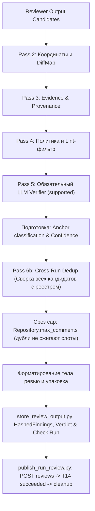

# INCREMENTAL_REVIEW_AND_LIMITS_SPEC — инкрементальный анализ (Re-review), разрешение устаревших замечаний, квоты и DoS-защита (команда 6)

| | |
|---|---|
| **Статус** | **Черновик Ч.1, PR #334** (Идентичность находок, подавление дубликатов и стратегия тредов) |
| **Владелец** | Техлид (роль 1) |
| **Область действия** | Идентичность замечания между прогонами (Finding Fingerprint), сопоставление со старыми коммитами, пересчет координат без привязки к абсолютным номерам строк (Line Offset Tracking), алгоритм межпрогонного подавления дубликатов в плане публикации (Cross-Run Dedup), стратегия классификации и разрешения устаревших/исправленных тредов на VCS (Outdated / Resolved Threads) через GraphQL `resolveReviewThread`, права GitHub App, исключение собственных событий бота по правилу Р-9, квотирование мутаций GitHub API. |
| **Связанные документы** | [`SYSTEM_DESIGN.md`](SYSTEM_DESIGN.md) (Р-5, Р-9, §6.9, §8, §13 «Риск схлопывания»), [`CONTEXT_AND_VERIFICATION_SPEC.md`](CONTEXT_AND_VERIFICATION_SPEC.md) (§6.2, §10 «Write-back: неизменяемая публикация»), [`PIPELINE_SPEC.md`](PIPELINE_SPEC.md) (§1, §6, §8), `WEBHOOK_WORKER.md` (§6). |
| **Definition of Done (DoD Ч.1)** | 1. Ключ идентичности находки между Run не зависит от абсолютных номеров строк; формализованы поля из модели `Finding`, нормализация с сохранением отступов, позиционное сопоставление вхождений и каноническая сериализация.<br/>2. Спроектирован алгоритм подавления дубликатов как фильтр плана публикации (Pass 6b) по квитанциям `comments`: подавленный повтор сохраняет `drop_reason IS NULL`, получает `publication_action = 'suppressed_duplicate'`, учитывается в severity counts, вердикте и Check Run, но исключается из массива `comments[]` со ссылкой на существующий комментарий (`linked_comment_id`).<br/>3. Задана стратегия классификации тредов (оставить, закрыть через GraphQL `resolveReviewThread`, строгий приоритет человека); определены порядок предикатов, проверка полноты покрытия перед закрытием и правила для всех состояний.<br/>4. Сняты противоречия с неизменяемой публикацией (CVS §10), одним review batch (Р-5) и запретом компенсирующего удаления (SD §13).<br/>5. Спроектированы изменения схемы БД (Alembic), модель жизненного цикла треда и интеграция этапа чистки как фазы внутри состояния `publishing` перед T14.<br/>6. Составлена расширенная таблица сквозных сценариев для регресса QA с корректными значениями Check Run. |

---

## 1. Область действия, терминология и базовые инварианты

### 1.1. Терминология

- **Full PR Diff (`base_sha...head_sha`)**: Полный унифицированный дифф pull request относительно целевой базовой ветки. Все inline-комментарии в GitHub API адресуются исключительно по координатам полного диффа.
- **Commit Delta / Incremental Diff**: Разница коммитов между ревизией исходной публикации замечания (`anchor_head_sha`) и новой головой PR (`current_head_sha`), получаемая через `VcsProvider.compare_commits`.
- **Base Git Coordinate Translation (Смещение строк / Line Offset Tracking)**: Алгоритмический пересчет номеров строк открытых замечаний из координат исходной ревизии публикации в координаты новой ревизии с учетом смещений, вносимых добавленными и удаленными строками коммит-дельты. Исходные координаты в базе данных не перезаписываются (терминальные данные неизменяемы по SD §6.9); смещение рассчитывается динамически для каждого Run относительно `anchor_head_sha`.
- **Finding Fingerprint (Идентичность находки)**: Детерминированный хеш находки, не зависящий от абсолютного номера строки в файле и вычисляемый от канонического представления атрибутов проблемы и нормализованного кода под якорем.
- **Anchor Code Hash (`anchor_code_hash`)**: Нормализованный криптографический хеш текста блока кода под якорем замечания, очищенный от крайних пробелов и нормализованный по переводам строк с сохранением значимых синтаксических отступов.
- **Outdated Thread (Устаревший тред)**: Состояние треда на стороне VCS, когда строка или блок кода, к которому было привязано замечание, подверглись изменению в последующих коммитах. GitHub переводит тред в свернутое состояние `outdated` автоматически на уровне платформы; при этом тред остается открытым (`isResolved = false`) и требует явного закрытия при подтверждении исправления дефекта.
- **Resolved Finding / Thread (Разрешенная находка / Закрытый тред)**: Состояние замечания, когда в новой ревизии дефект устранен автором (код под якорем изменен, участок проанализирован с полным покрытием и дефект не обнаружен), либо файл с дефектом полностью удален из PR. На стороне GitHub тред переводится в закрытое состояние мутацией `resolveReviewThread`.
- **Persisting Finding (Сохраняющаяся находка)**: Находка из предыдущего ревью, проблемный код под якорем которой не изменялся (или сместился по строкам без изменения содержания), и дефект по-прежнему актуален. Повторно в inline-комментариях не публикуется, но учитывается в вердикте и Check Run.
- **Human-in-the-loop Thread**: Тред, в котором после комментария бота появился хотя бы один ответ человека (`__typename != "Bot"` и логин не совпадает с логином бота), либо который был закрыт или повторно открыт человеком вручную.

### 1.2. Базовые инварианты

1. **Zero-Spam (Никаких повторных комментариев на неизмененный код)**: Бот не создает повторный inline-комментарий для дефекта, который уже был опубликован в предыдущем Run и остался неисправленным. Существующий тред на VCS сохраняется.
2. **Опубликованное определяется строго по квитанциям (`comments`, remote IDs)**: Принадлежность замечания к опубликованным определяется наличием записи в таблице `comments` с `github_comment_id` для данного PR, а не статусом Run (`succeeded` / `cancelled`). Run, отмененный по T15 после выполнения POST-запроса, уже оставил комментарии на PR; они считаются опубликованными.
3. **Сохранность счетчиков и вердикта при дедупликации**:
   - Подавление повторных находок является фильтром плана публикации, а не причиной отсева (drop reason).
   - Сохраняющаяся находка сохраняет `drop_reason IS NULL`, получает `publication_action = 'suppressed_duplicate'`, связывается с существующей записью комментария (`linked_comment_id`) и возвращается четвёртым элементом кортежа `ProcessedReviewOutput.suppressed`.
   - **Разделение рендера и вердикта**: Список дефектов в теле ревью рендерит ТОЛЬКО находки `body_only`. Вердикт и severity counters рассчитываются по полному набору актуальных дефектов (`inline + body_only + suppressed`). Неисправленный критический дефект не превращает вердикт в `clean`.
   - **Счётчики Check Run**: В check-run передаётся отдельный счётчик `suppressed_count = len(suppressed)`, а в текстовой сводке check-run выводится `подавлено дубликатов: N` (вместо ошибочного включения в счётчик «в теле ревью»).
4. **Общие замечания (Body-only findings) и квитанции**:
   - Находки без inline-координат (general-only) и находки сверх inline cap (`Repository.max_comments`) публикуются в теле ревью.
   - Для поиска ранее опубликованных замечаний в теле ревью предикат использует строго `published = true ∧ f.publication_action = 'publish_body'` (а не `inline_comment = false`, чтобы не захватывать подавленные дубликаты).
   - Дедупликация body-only находок действует относительно последнего успешного Run данного PR, дошедшего до T14 (`complete_publication`). Повторное general-замечание с тем же fingerprint получает `publication_action = 'suppressed_duplicate'`, `linked_comment_id = NULL` и опускается при формировании тела рецензии.
   - Кандидат сверх cap `Repository.max_comments`, совпадающий с открытым inline-тредом в реестре, получает `publication_action = 'suppressed_duplicate'`, связывается с существующим тредом (`linked_comment_id = comment.id`) и не попадает в тело ревью.
   - **Ограничение #298 ч.1**: Пока задача #298 ч.1 не реализована, для находок в ветке `moved_to_body_finding_ids` строки `Comment` на `main` не создаются. В `complete_publication` эти находки сохраняются со статусом `published = true` и `publication_action = 'publish_body'`. На `main` запись квитанций пакета inline-комментариев атомарна (`len(comment_ids) == len(inline)`); подавленные дубли исключаются из массива `inline` до отправки.
5. **Неизменяемость текста публикации (Immutable Payload)**: Закрытие треда на VCS через GraphQL `resolveReviewThread` меняет только состояние треда (`isResolved`), но не редактирует и не удаляет опубликованный текст комментария (`body`), сохраняя квитанции, аудит и payload digest по CVS §10.
6. **Human-in-the-loop Priority (Приоритет человека)**:
   - **Сквозное правило приоритета**: Состояния `HUMAN_TOUCHED` (`HUMAN_DISCUSSION`, `RESOLVED_BY_USER`) строго перекрывают любые действия бота; бот никогда не закрывает автоматически треды, которых касался человек.
   - Если в треде бота ответил человек, тред переходит в `HUMAN_DISCUSSION` под управление человека.
   - Если человек закрыл тред вручную (`RESOLVED_BY_USER`), бот считает его закрытым и не переоткрывает.
   - Если человек снял resolve с треда, ранее закрытого ботом (в БД `RESOLVED_BY_BOT`, а на GitHub `isResolved == false`), тред переходит в `HUMAN_DISCUSSION` под управление человека; бот повторно его не закрывает.
   - В любом из этих состояний повторная публикация замечания с тем же `FindingFingerprint` подавляется (`publication_action = 'suppressed_duplicate'`), пока тред существует на PR.
7. **Игнорирование собственных событий (Правило Р-9)**: События `pull_request_review_thread.resolved` / `unresolved`, инициированные ботом, в MVP не обрабатываются, так как приложение на них не подписано. В рамках будущей задачи сбора обратной связи `FeedbackSignal` (после MVP) вебхук-воркер будет отбрасывать события собственных мутаций бота по правилу `sender.type == "Bot"` и `_normalize_login(sender.login) == bot_key` с присвоением статуса `ignored_irrelevant_event` (detail `action=<action> ignored_own_bot`), предотвращая ложные сигналы обратной связи.
8. **Квотирование мутаций GitHub API**: Вторичные лимиты GitHub ограничивают трафик до 1 мутации в секунду, не более 80 content-generating запросов в минуту и 500 в час на установку. На один Run устанавливается квота не более 30 вызовов мутации `resolveReviewThread` с паузой не менее 1.2 секунды между запросами (общий бюджет фазы чистки 90 с). Счетчик квоты ведется на уровне Run. Оставшиеся к закрытию треды обрабатываются в последующих прогонах. При сбое процесса повторная доставка задачи брокером RabbitMQ (T17) не повторяет закрытие тредов, так как Run уже зафиксирован в состоянии `succeeded`.
9. **Граница провайдеров VCS (GitLab)**: Прием вебхуков и запуск ревью для GitLab реализованы на `main` (#169), однако GitLab intake по умолчанию выключен. GitLab использует API discussions без квитанций `comments` с внешними thread ID. Для GitLab метод `get_review_threads` возвращает пустую страницу, `resolve_review_thread` возвращает `UNSUPPORTED`, а реестр замечаний работает с пустым списком тредов. Повторы на GitLab на этапе MR update являются известным временным ограничением.

---

## 2. Идентичность находки между Run (Finding Fingerprint)

### 2.1. Проблема абсолютных номеров строк

Если идентифицировать замечание по кортежу `(file_path, line_number, rule_name)`, то любая правка выше по файлу (добавление строк, комментариев или импортов) сдвигает абсолютный номер строки дефекта на величину смещения. В результате:
- Прежнее замечание на строке N не сопоставится с дефектом на строке N + delta;
- Бот опубликует дубликат замечания на строке N + delta;
- Прежнее замечание на строке N будет ошибочно сочтено устраненным и закрыто (ложная чистка).

Межпрогонный ключ идентичности находки не должен зависеть от абсолютного номера строки в файле.

### 2.2. Формула Finding Fingerprint и поля модели Finding

Для каждого кандидата в находки вычисляется детерминированный ключ на основе реальных атрибутов модели `Finding` (`app/modules/reviews/infrastructure/models.py`):

1. **`file_path`**: Канонический относительный путь к файлу в репозитории (POSIX-формат, разделитель `/`, без ведущего слеша). При переименовании файла путь сопоставляется через `previous_filename` из ответа сравнения коммитов. Перед сравнением с реестром fingerprint ранее опубликованной строки пересчитывается с подстановкой нового пути файла.
2. **`side`**: Сторона диффа из enum `FindingSide` (`RIGHT` для добавленного/измененного кода, `LEFT` для удаленного кода; по умолчанию `RIGHT`).
3. **`category`**: Категория дефекта из enum `FindingCategory` (`security`, `correctness`, `performance`, `readability`).
4. **`rule_name`**: Имя или источник правила (`Finding.rule_name`, nullable string, допустимые значения: `.review/rules.md`, `AGENTS.md`, `service-defaults:<ID>` или null). Если правило не задано (`null`), в структуру подставляется пустая строка `""`.
5. **`anchor_code_hash`**: SHA-256 хеш нормализованного блока кода под якорем дефекта (см. §2.3).
   - **Источник текста якоря**: Для inline-находок текст извлекается из строк `head_lines` соответствующего хунка диффа (`DiffMap`). Для `body_only` находок текст читается из git blob на `head_sha` вне транзакций БД. Если текст недоступен (усечение диффа, ошибка blob), `anchor_code_hash = NULL`, и находка исключается из дедупликации по хэшу кода во избежание ложных совпадений.
6. **`normalized_claim`**: Нормализованный заголовок утверждения дефекта (`Finding.title`). Для поддержки многоязычного текста (включая русскоязычные правила и заголовки) используется Unicode regex: `re.sub(r'[\W_]+', ' ', claim.strip().lower())`.
7. **`occurrence_index`**: Локальный индекс вхождения идентичного дефекта в файле. Индекс назначается детерминированным алгоритмом:
   - Кандидаты текущего прогона и строки комментариев реестра группируются по базовому ключу без индекса: `(file_path, side, category, rule_name, normalized_claim, anchor_code_hash)`.
   - Внутри каждой группы выполняется спаривание кандидатов со строками реестра один-к-одному:
     - Если дельта коммитов доступна: спаривание минимизирует расстояние до перенесенного диапазона `abs(candidate.line - transferred.new_start)`.
     - Если дельта коммитов неизвестна (`UNKNOWN`): спаривание выполняется один-к-одному по сортировке кандидатов и записей реестра по исходному `line_start`.
   - Спаренному кандидату присваивается `occurrence_index` спаренной строки реестра.
   - Непарные кандидаты получают уникальные возрастающие индексы: `max(occurrence_index in group) + i + 1` с шагом 1 (начиная с 0 при пустой группе). Это устраняет сдвиги и коллизии индексов при вставке нескольких аналогичных блоков кода.

**Каноническая сериализация и хеширование**:
Компоненты ключа упаковываются в канонический JSON-объект с сортировкой ключей, разделителями `separators=(',', ':')` и `ensure_ascii=False`, аналогично построению payload digest в CVS §10.1:

```json
{
  "anchor_code_hash": "a1b2c3d4...",
  "category": "security",
  "file_path": "app/auth.py",
  "normalized_claim": "unhandled bare except block",
  "occurrence_index": 0,
  "rule_name": ".review/rules.md",
  "side": "RIGHT"
}
```

```text
FindingFingerprint = SHA-256(canonical_json_utf8_bytes)
```

**Нестабильность формулировок модели (Graceful Matching)**:
Если LLM при повторном анализе перефразировала заголовок или опустила необязательное имя правила, применяется двухступенчатое сопоставление:
1. **Точное совпадение по `FindingFingerprint`**.
2. **Запасное сопоставление (Fallback Match)**: запускается строго **после** исчерпания точного сопоставления и только при соблюдении ВСЕХ следующих ограничителей:
   - `candidate.anchor_code_hash == comment.anchor_code_hash` (хэш кода якоря совпадает гарантированно);
   - Код под якорем НЕ был модифицирован (никогда не применяется к исходу `ANCHOR_MODIFIED`);
   - Запрещено для тредов в статусах `HUMAN_*` (`HUMAN_DISCUSSION`, `RESOLVED_BY_USER`);
   - Запрещено, если статус дельты `UNKNOWN` (force push, ошибка сравнения);
   - Взаимная однозначность: на перенесенном диапазоне `[new_start, new_end]` (§2.4) существует **ровно один** кандидат текущего Run и **ровно один** открытый тред в реестре (`ACTIVE`, `PERSISTING`) с совпадающей категорией и файлом. Если кандидатов или открытых тредов больше одного, fallback не применяется (требуется точный `FindingFingerprint`), что предотвращает риск схлопывания дефектов (SD §13).

### 2.3. Нормализация блока кода якоря (`anchor_code_hash`)

Для корректной работы с языками с позиционным синтаксисом (Python, YAML) нормализация сохраняет отступы:
1. Замена всех вариантов переводов строк на канонический LF (`\r\n -> \n`, `\r -> \n`).
2. Удаление хвостовых пробелов и табуляций в конце каждой строки (`rstrip()`). Ведущие пробелы (отступы) сохраняются.
3. Удаление пустых строк в начале и конце блока якоря `[line_start, line_end]`.
4. Преобразование нормализованной строки в UTF-8 байты и вычисление SHA-256: `anchor_code_hash = SHA-256(normalized_code_bytes)`.

### 2.4. Алгоритм отслеживания смещений строк (Line Offset Tracking)

Для сопоставления открытых комментариев с новой головой PR используется отслеживание смещений на базе унифицированного диффа дельты коммитов:

```text
ВХОД:
  - comment: ранее опубликованный комментарий с привязанными координатами
             (anchor_head_sha, file_path, line_start, line_end, anchor_code_hash)
  - delta_comparison: результат VcsProvider.compare_commits(anchor_head_sha, current_head_sha)

АЛГОРИТМ:
  1. Проверка доступности и полноты дельты:
     Если delta_comparison недоступен (ошибка вызова compare, delta_comparison.complete == False,
     число файлов >= 300, либо anchor_head_sha не является предком current_head_sha):
       -> Исход: UNKNOWN.
       -> Безопасное умолчание: тред оставляется открытым (LEAVE_ACTIVE).
       -> Мутация закрытия треда НЕ вызывается. Завершить алгоритм.

  2. Разрешение переименований файлов:
     Найти target_path для comment.file_path с учетом previous_filename в delta_comparison.files.
     Если файл удален в дельте (status == 'removed'):
       -> Исход: RESOLVED_BY_FILE_DELETION.
       -> Завершить алгоритм.

  3. Поиск секции (patch) для target_path в delta_comparison.files:
     Если файл отсутствует в списке файлов сравнения:
       -> Файл не изменялся между anchor_head_sha и current_head_sha.
       -> Исход: PERSISTING (код под якорем гарантированно не затронут).
       -> Завершить алгоритм.
     Если файл присутствует в списке сравнения, но changes == 0 ∧ status == 'renamed' (на main PatchState.METADATA_ONLY: чистое метаданное переименование без изменения содержимого):
       -> Хунков нет, строки не смещались.
       -> Исход: PERSISTING (по новому пути target_path). Завершить алгоритм.
     Если файл присутствует в списке, но patch is None при changes > 0 (бинарный файл, усечение diff или превышение лимита):
       -> Исход: UNKNOWN (невозможно подтвердить сохранность/исправление кода).
       -> Безопасное умолчание: LEAVE_ACTIVE.
       -> Завершить алгоритм.
     Если файл был изменен в PR, но затем возвращен коммитом к состоянию base_sha (отсутствует в полном diff PR base_sha...head_sha):
       -> Код дефекта устранен возвратом к базовой ревизии.
       -> Исход: RESOLVED_BY_FILE_DELETION (тред закрывается resolveReviewThread во избежание вечной блокировки мержа). Завершить алгоритм.

  4. Расчет смещения строк по hunks файла:
     delta_offset = 0
     is_anchor_modified = false
     old_target_line = comment.line_start
     end = comment.line_end if comment.line_end is not None else comment.line_start

     Для каждого hunk в patch файла:
       hunk_old_start = hunk.old_start
       hunk_old_count = hunk.old_count
       hunk_old_end = (hunk_old_start + hunk_old_count - 1) if hunk_old_count > 0 else hunk_old_start
       hunk_net_diff = hunk.new_count - hunk.old_count

       // Случай 1: Чистая вставка строк строго выше якоря (hunk_old_count == 0)
       Если hunk_old_count == 0:
         Если hunk_old_start < old_target_line:
           delta_offset += hunk_net_diff
         продолжить

       // Случай 2: Hunk целиком выше строки якоря
       Если old_target_line > hunk_old_end:
         delta_offset += hunk_net_diff
         продолжить

       // Случай 3: Hunk целиком ниже диапазона якоря
       Если end < hunk_old_start:
         продолжить

       // Случай 4: Якорь пересекается с hunk
       Если диапазон [comment.line_start, end] пересекается с hunk:
         Проверить, затронуты ли строки диапазона якоря изменениями ('-' или '+'):
         Если хотя бы одна строка диапазона изменена или удалена:
           is_anchor_modified = true
         Иначе (строки диапазона остались неизменным контекстом внутри hunk):
           delta_offset += (число '+' выше comment.line_start - число '-' выше comment.line_start)

  5. Валидация сохранности кода якоря:
     Если comment.anchor_code_hash IS NULL (legacy-строка до миграции схемы):
       -> Вычислить delta_offset по хункам для позиционирования, но классифицировать исход как UNKNOWN.
       -> Безопасное умолчание: LEAVE_ACTIVE. Категорически запрещено классифицировать как ANCHOR_MODIFIED или RESOLVED_BY_FIX.
       -> Завершить алгоритм.

     Если is_anchor_modified == false:
       new_start = comment.line_start + delta_offset
       new_end = end + delta_offset
       Прочитать блок строк [new_start, new_end] из дерева current_head_sha.
       Вычислить new_anchor_code_hash по правилам §2.3.
       Если new_anchor_code_hash == comment.anchor_code_hash:
         -> Исход: PERSISTING (строки сместились, код дефекта на месте).
            Исходные координаты в БД неизменны; смещение учитывается в памяти прогона.
       Иначе:
         -> is_anchor_modified = true

  6. Обработка изменения кода якоря:
     Если is_anchor_modified == true:
       Вычислить перенесенный диапазон transferred_range = [comment.line_start + delta_offset, end + delta_offset],
       расширенный диапазоном хунка [hunk.new_start, hunk.new_start + hunk.new_count - 1], изменившего якорь.
       -> Исход: ANCHOR_MODIFIED с привязанным transferred_range (требуется сопоставление с кандидатами ревью нового Run).
```

### 2.5. Модель данных и миграции схемы БД

Для поддержки идентичности находок и жизненного цикла тредов в схему данных вносятся следующие изменения через миграцию Alembic:

```sql
-- 1. Расширение таблицы findings (хранение ключей идентичности и связи с комментарием)
ALTER TABLE findings ADD COLUMN finding_fingerprint CHAR(64) NULL;
ALTER TABLE findings ADD COLUMN anchor_code_hash CHAR(64) NULL;
ALTER TABLE findings ADD COLUMN occurrence_index INTEGER NOT NULL DEFAULT 0;
ALTER TABLE findings ADD COLUMN linked_comment_id UUID NULL REFERENCES comments(id);
ALTER TABLE findings ADD COLUMN publication_action VARCHAR(32) NOT NULL DEFAULT 'publish_inline';

ALTER TABLE findings ADD CONSTRAINT ck_findings_publication_action
    CHECK (publication_action IN ('publish_inline', 'publish_body', 'suppressed_duplicate', 'dropped'));

CREATE INDEX ix_findings_fingerprint ON findings(finding_fingerprint);
CREATE INDEX ix_findings_linked_comment_id ON findings(linked_comment_id);

-- 2. Расширение таблицы comments (метаданные жизненного цикла треда VCS)
ALTER TABLE comments ADD COLUMN github_thread_id VARCHAR(64) NULL;
ALTER TABLE comments ADD COLUMN thread_status VARCHAR(32) NOT NULL DEFAULT 'ACTIVE';
ALTER TABLE comments ADD COLUMN resolved_at TIMESTAMP WITH TIME ZONE NULL;
ALTER TABLE comments ADD COLUMN resolved_by_commit VARCHAR(64) NULL;
ALTER TABLE comments ADD COLUMN resolved_by_actor VARCHAR(100) NULL;
ALTER TABLE comments ADD COLUMN last_seen_run_id UUID NULL REFERENCES runs(id);

ALTER TABLE comments ADD CONSTRAINT ck_comments_thread_status
    CHECK (thread_status IN ('ACTIVE', 'PERSISTING', 'HUMAN_DISCUSSION', 'RESOLVED_BY_USER', 'RESOLVED_BY_BOT', 'NOT_FOUND'));

CREATE INDEX ix_comments_thread_status ON comments(thread_status);
CREATE INDEX ix_comments_github_thread_id ON comments(github_thread_id);
```

**Единый словарь состояний треда (`thread_status`)**:
- `ACTIVE`: Замечание опубликовано, тред открыт на GitHub, дефект актуален в первом прогоне публикации.
- `PERSISTING`: Дефект подтвержден в последующих прогонах на неизмененном (или смещенном) коде; тред переходит в `PERSISTING` по единому правилу жизненного цикла и остается открытым на GitHub.
- `RESOLVED_BY_BOT`: Дефект устранен автором коммита (при подтвержденном полном анализе участка и отсутствии любых отсеянных кандидатов), либо файл удален, либо дефект мутировал на измененном коде; тред закрыт ботом через GraphQL `resolveReviewThread` (`resolved_by_commit = head_sha`, `resolved_by_actor = bot_key`).
- `RESOLVED_BY_USER`: Тред был закрыт разработчиком вручную в интерфейсе GitHub.
- `HUMAN_DISCUSSION`: В треде ответил человек либо человек отменил resolve бота. Бот уступает приоритет человеку и никогда не закрывает такой тред автоматически.
- `NOT_FOUND`: Тред отсутствует на GitHub (удален пользователем или удалена ветка), обнаружено после полного безошибочного чтения карты тредов; либо узел GraphQL не найден при попытке мутации.

> [!IMPORTANT]
> **Сквозное правило приоритета человека**:
> Состояния `HUMAN_TOUCHED` (`HUMAN_DISCUSSION`, `RESOLVED_BY_USER`) строго перекрывают любые действия бота; бот никогда не закрывает автоматически треды, которых касался человек.

**Таблица соответствия: Исход §2.4 -> Действие §4.1 -> Статус БД**:

| Исход смещения (§2.4) | Проверка покрытия нового Run | Исход классификации (§4.1) | Действие на GitHub VCS | Результирующий `thread_status` |
|---|---|---|---|---|
| `RESOLVED_BY_FILE_DELETION` | Не требуется (файл удален или возвращен к base) | `RESOLVED_BY_DELETION` | Закрыть тред (`resolveReviewThread`) | `RESOLVED_BY_BOT` |
| `ANCHOR_MODIFIED` | `coverage.status == 'complete' ∧ file_list_complete == True`, дефектов и кандидатов с `drop_reason != 'contradicted'` нет | `RESOLVED_BY_FIX` | Закрыть тред (`resolveReviewThread`) | `RESOLVED_BY_BOT` (`resolved_by_actor = bot_key`) |
| `ANCHOR_MODIFIED` | Покрытие неполное (`coverage.status != 'complete'` или `file_list_complete == False`) или на перенесенном участке возник кандидат с `drop_reason != 'contradicted'` | `LEAVE_ACTIVE` | NOOP (нельзя подтвердить фикс) | Сохраняет прежний статус (`ACTIVE`/`PERSISTING`) |
| `ANCHOR_MODIFIED` | Дефект обнаружен на измененном коде | `RESOLVED_MUTATED` | Закрыть старый тред + опубликовать новый | Старый: `RESOLVED_BY_BOT` (`resolved_by_actor = bot_key`), Новый: `ACTIVE` |
| `PERSISTING` | Любая | `LEAVE_ACTIVE` | NOOP (тред остается открытым) | `PERSISTING` (или `HUMAN_*` без понижения) |
| `UNKNOWN` (вкл. legacy NULL hash) | Любая | `LEAVE_ACTIVE` | NOOP (безопасное умолчание) | Сохраняет прежний статус (`ACTIVE`/`PERSISTING`) |

**Разграничение ключей и целостность связей**:
1. Колонка `comments.findings_hash` хранит хеш всего набора находок прогона как диагностическое поле (CVS §10.1, SD §6.9), и **не является** ключом отдельной находки.
2. Ограничение `UNIQUE(finding_id)` в таблице `comments` связывает строку комментария с породившей ее находкой первоначального Run.
3. При сохранении дефекта в последующих Run повторная строка в `comments` не создается. Новая находка сохраняет `drop_reason IS NULL`, получает `publication_action = 'suppressed_duplicate'`, `inline_comment = false`, а ссылка на исходный комментарий фиксируется в колонке `findings.linked_comment_id = comments.id`.
4. **Обработка исторических строк (Legacy Rows)**: Для строк `comments`, созданных до миграции, колонка `finding_fingerprint` заполняется бэкфиллом. У строк до миграции `anchor_code_hash` равен NULL: классификатор смещения возвращает для них `UNKNOWN`, поэтому они всегда остаются `LEAVE_ACTIVE` и защищены от ложной чистки (никогда не закрываются автоматически по `RESOLVED_BY_FIX`). При дедупликации они участвуют по 1-to-1 fallback (§2.2).

---

## 3. Алгоритм подавления дубликатов в плане публикации (Cross-Run Dedup)

### 3.1. Формирование реестра опубликованных замечаний PR

Реестр ранее опубликованных замечаний формируется по квитанциям публикации текущего PR независимо от итогового статуса Run:

```sql
SELECT c.id AS comment_id,
       c.github_comment_id,
       c.github_thread_id,
       c.thread_status,
       c.created_at,
       r.head_sha AS anchor_head_sha,
       f.id AS original_finding_id,
       f.finding_fingerprint,
       f.file_path,
       f.side,
       f.rule_name,
       f.line_start,
       f.line_end,
       f.occurrence_index,
       f.anchor_code_hash,
       f.title,
       f.category,
       f.severity
FROM comments c
JOIN findings f ON c.finding_id = f.id
JOIN runs r ON f.run_id = r.id
WHERE r.code_change_id = :current_code_change_id
ORDER BY c.created_at DESC;
```

В дедупликации участвуют **все** опубликованные комментарии PR, включая треды в состояниях `HUMAN_DISCUSSION`, `RESOLVED_BY_USER` и `RESOLVED_BY_BOT`.

### 3.2. Место дедупликации в конвейере фильтрации (Pass 6b)

Межпрогонная дедупликация встраивается в `findings_post_processor.py:process()` как **Pass 6b (Cross-Run Dedup)** на реальном шве: строго ПОСЛЕ восстановления атрибуции `_repair_attribution` (которая может исправить `rule_name` и переместить inline в `body_only`) и строго ДО сортировки и среза cap `Repository.max_comments`. Входные параметры `process()` расширяются реестром `registry`, картой тредов `thread_map` и исходами смещений `resolution_outcomes`; потребителем результата `ProcessedReviewOutput` выступает `store_review_output.py`:



**Таблица соответствия: Бакет находок -> Поля модели и публикация**:

| Бакет кандидата | `publication_action` | `inline_comment` | `linked_comment_id` | `published` (до T14 / после T14) | Входит в `hashed_findings` | Входит в тело ревью | Учет в Check Run |
|---|---|---|---|---|---|---|---|
| **`inline`** (новое замечание в пределах cap) | `'publish_inline'` | `true` | `NULL` | `false` / `true` | Да | Нет (inline) | `severity_counts`, `inline_count` |
| **`body_only`** (сверх cap, general, low confidence) | `'publish_body'` | `false` | `NULL` | `false` / `true` | Да | Да (строки списка) | `severity_counts`, `body_count` |
| **`suppressed`** (дубликат активного/закрытого треда) | `'suppressed_duplicate'` | `false` | `UUID` комментария реестра | `false` / `true` | Да | Нет (не спамит в сводку) | `severity_counts` (в общем числе дефектов) |
| **`dropped`** (отсеян фильтрами 2–6) | `'dropped'` | `false` | `NULL` | `false` / `false` | Нет | Нет | `below_threshold_count` (если severity) |

**Правила обработки находок в плане публикации**:
1. Все подтвержденные верификатором кандидаты признаются итоговыми находками прогона (`drop_reason IS NULL`).
2. Для **всех** кандидатов (как потенциальных inline, так и body_only) выполняется поиск соответствия в реестре опубликованных замечаний PR по `FindingFingerprint` (или 1-to-1 fallback §2.2).
3. **Подавленные дубли не сжигают inline cap**: Находки, признанные `suppressed_duplicate`, исключаются из массива `inline_candidates` до среза cap, поэтому они не расходуют слоты настройки репозитория `Repository.max_comments` (по умолчанию 10, максимум 10), освобождая слоты для новых уникальных находок.
4. **При совпадении с активным или обсуждаемым тредом (`ACTIVE`, `PERSISTING`, `HUMAN_DISCUSSION`)**:
   - Находка исключается из массива `comments[]` отправляемого review batch.
   - Находке присваивается `publication_action = 'suppressed_duplicate'`, `inline_comment = false` (благодаря чему равенство `len(comment_ids) == len(inline)` строго соблюдается при записи квитанций).
   - Поле `published` остается `false` на этапе плана и выставляется в `true` атомарно в транзакции T14 `complete_publication`.
   - Проставляется ссылка на существующий комментарий: `findings.linked_comment_id = registry.comment_id`.
   - Если статус в реестре был `ACTIVE`, он обновляется на `thread_status = 'PERSISTING'`. Если статус был `HUMAN_DISCUSSION` или `RESOLVED_BY_USER`, он сохраняется без понижения.
   - Находка в полном объеме входит в `hashed_findings`, участвует в расчете счетчиков серьезности и формировании вердикта PR (`critical` или `high` дают `blocking`, `medium` или `low` дают `attention`, а в Check Run выставляется `completed / neutral`).
5. **При совпадении с тредом, закрытым человеком (`RESOLVED_BY_USER`)**:
   - Находка исключается из review batch (`publication_action = 'suppressed_duplicate'`).
   - Бот уважает решение пользователя и не открывает тред повторно.
6. **При совпадении с тредом, ранее закрытым ботом (`RESOLVED_BY_BOT`)**:
   - Если в реестре несколько записей с одинаковым fingerprint, сопоставление выполняется с самой свежей записью (`ORDER BY comments.created_at DESC`).
   - Если автор внес изменения, вернувшие дефект (регресс на измененном коде): старый тред считается архивным, находка включается в review batch как новое замечание (`publication_action = 'publish_inline'`, `inline_comment = true`).
7. **При мутации дефекта на измененном коде**:
   - Если код под прежним тредом был изменен автором и дефект сохранился или видоизменился (исход классификации сопоставлен с `ANCHOR_MODIFIED`): старый тред закрывается ботом мутацией `resolveReviewThread` (`thread_status = 'RESOLVED_BY_BOT'`, `resolved_by_commit = current_head_sha`, `resolved_by_actor = bot_key`), а новое замечание публикуется как отдельный тред (`publication_action = 'publish_inline'`, `thread_status = 'ACTIVE'`).
8. **Поведение при отсутствии треда на GitHub (`NOT_FOUND`)**:
   - Повторная публикация замечания при отсутствии треда на GitHub разрешена **исключительно** в том случае, если чтение карты тредов PR было **полным и безошибочным** по единому определению §4.3 (`thread_map.is_complete == True`: все страницы обойдены, `hasNextPage == False`, 0 HTTP-ошибок 403/429/5xx, 0 таймаутов, 0 `errors[]`). Только при этом условии тред в реестре помечается `thread_status = 'NOT_FOUND'`, подавление снимается, и замечание публикуется заново как свежий тред (`publication_action = 'publish_inline'`). Неактивный или не найденный тред не блокирует последующие находки.
   - **Защита от массового спама при неполной карте**: Если чтение карты тредов завершилось ошибкой, таймаутом, усечением или вторичным лимитом rate limit (`thread_map.is_complete == False`), карта признается неполной. В этом случае статус `NOT_FOUND` не выставляется, правило 8 блокируется, и замечания продолжают подавляться по fingerprint из БД во избежание нарушения инварианта 1 (защита от повторной публикации уже откомментированных участков).
9. **При отсутствии совпадений в реестре**:
   - Находка признается новой, получает `publication_action = 'publish_inline'` (для inline) или `publication_action = 'publish_body'` (для body_only).
   - В пределах cap `inline`-находка получает `inline_comment = true` и включается в массив `comments[]` для отправки в review batch.

---

## 4. Стратегия устаревших и решённых замечаний бота на VCS (Outdated & Resolved Threads)

### 4.1. Классификация исходов для ранее опубликованных замечаний

При получении нового коммита в PR для каждого ранее опубликованного замечания бота вычисляется один из исходов со строгим приоритетом предикатов:

| Порядок | Исход | Предикат условия | Действие в БД | Действие на GitHub VCS |
|---|---|---|---|---|
| 1 | **`HUMAN_TOUCHED`** | В треде есть ответ человека (`__typename != "Bot"` и логин не равен боту), либо тред закрыт человеком (`isResolved ∧ resolvedBy != null ∧ _normalize_login(resolvedBy.login) != bot_login`), либо человек снял resolve (в БД `RESOLVED_BY_BOT`, а на GitHub `isResolved == false`). | `thread_status = HUMAN_DISCUSSION` (или `RESOLVED_BY_USER`). | **NOOP**. Бот полностью уступает управление человеку. Мутации не вызываются. |
| 2 | **`RESOLVED_BY_DELETION`** | Файл, содержавший дефект, полностью удален в дельте коммитов (`status == 'removed'`) либо возвращен коммитом к состоянию `base_sha` (отсутствует в полном diff PR). | `thread_status = RESOLVED_BY_BOT`, `resolved_at = NOW(), resolved_by_commit = head_sha, resolved_by_actor = 'bot'`. | **Закрыть тред**: вызов GraphQL-мутации `resolveReviewThread`. |
| 3 | **`RESOLVED_BY_FIX`** | `comment.anchor_code_hash IS NOT NULL` **И** `is_anchor_modified == true` (код изменен автором) **И** полный анализ прогона и файла (`durable_reviewable_paths ∧ file_list_complete == True ∧ coverage.status == 'complete'`) **И** перенесенный диапазон якоря `transferred_range` входит в разобранный diff текущего PR (`head_sha`, а не старый диапазон) при `file_list_complete == True` **И** на участке `transferred_range` отсутствует ЛЮБОЙ кандидат с `drop_reason IS NOT NULL`, отличным от `contradicted` (а для причин отсева без точного позиционирования вроде `unknown_path`, `ignored_file` — во всем файле). Классификация исходов выполняется строго после Pass 6. | `thread_status = RESOLVED_BY_BOT`, `resolved_at = NOW(), resolved_by_commit = head_sha, resolved_by_actor = bot_key`. | **Закрыть тред**: вызов GraphQL-мутации `resolveReviewThread`. |
| 4 | **`RESOLVED_MUTATED`** | Код под якорем изменен автором коммита, и новый прогон выявил на нем дефект (диапазон новой находки пересекается с перенесенным диапазоном `transferred_range`, файл и категория совпадают). | Прежний комментарий переводится в `thread_status = RESOLVED_BY_BOT` (`resolved_by_commit = current_head_sha`, `resolved_by_actor = bot_key`). Новый дефект публикуется как `ACTIVE`. | **Закрыть старый тред** мутацией `resolveReviewThread` во избежание блокировки мержа под ruleset `required_review_thread_resolution`. Новый дефект публикуется новым inline-тредом. |
| 5 | **`LEAVE_ACTIVE`** | Код под якорем не изменялся (включая стохастический пропуск модели при неизменном коде), либо `anchor_code_hash IS NULL` (legacy), либо анализ файла был неполным (`coverage.status != 'complete'` или `file_list_complete == False`), либо на перенесенном участке обнаружен кандидат с `drop_reason != 'contradicted'`. | Сохраняет статус `PERSISTING` (при подтвержденном дефекте на неизмененном коде), либо прежний статус (`ACTIVE` / `HUMAN_*`). Исходные координаты в БД неизменны. | **NOOP**. Тред остается открытым на GitHub. |

> [!WARNING]
> **Защита от ложной чистки (False Cleanup Prevention)**:
> 1. Если `anchor_code_hash IS NULL` (строки до миграции схемы), исход `RESOLVED_BY_FIX` категорически запрещен: запись сохраняет статус `LEAVE_ACTIVE`.
> 2. Если файл или участок кода не был полностью проанализирован в текущем Run (`coverage.status != 'complete'` или `file_list_complete == False` или diff неполный/усеченный), исход `RESOLVED_BY_FIX` запрещен.
> 3. **Универсальное правило отсева**: Если на перенесенном участке `transferred_range` возник ЛЮБОЙ кандидат с `drop_reason IS NOT NULL` (будь то проходы 2–3: `anchor_not_visible`, `evidence_*`, `line_absent`, `ignored_file`, `revision_mismatch`, `unknown_path`, либо проходы 4–6: `severity_threshold`, `lint_pattern`, `duplicate`, verifier `insufficient_context`), кроме явно отвергнутых верификатором как `contradicted`, дефект считается сохраняющимся: закрытие треда категорически запрещено, тред переводится в `LEAVE_ACTIVE`.

### 4.2. Механизм разрешения тредов на GitHub: GraphQL `resolveReviewThread`

Для закрытия тредов на GitHub используется GraphQL API:

```graphql
mutation ResolveReviewThread($threadId: ID!) {
  resolveReviewThread(input: { threadId: $threadId }) {
    thread {
      id
      isResolved
      resolvedBy {
        login
      }
    }
  }
}
```

### 4.3. Сопоставление REST `comment_id` и GraphQL `threadId`

Пакетное чтение тредов PR выполняется в каждом GitHub-Run, у которого в реестре есть комментарии:

```graphql
query GetPullRequestReviewThreads($owner: String!, $repo: String!, $pr: Int!, $cursor: String) {
  repository(owner: $owner, name: $repo) {
    pullRequest(number: $pr) {
      reviewThreads(first: 100, after: $cursor) {
        pageInfo {
          hasNextPage
          endCursor
        }
        nodes {
          id
          isResolved
          resolvedBy {
            login
          }
          comments(first: 1) {
            nodes {
              fullDatabaseId
              author {
                login
                __typename
              }
            }
          }
          lastComments: comments(last: 5) {
            nodes {
              author {
                login
                __typename
              }
            }
          }
          totalCommentsCount: comments {
            totalCount
          }
        }
      }
    }
  }
}
```

**Правила сопоставления и нормализации**:
1. **Точка вызова и единое определение полноты карты (`ReviewThreadMap.is_complete`)**:
   Пакетное чтение карты тредов выполняется вне транзакций БД на этапе `running` **до** выполнения Pass 6b функцией `sync_review_threads_state`.
   Признак завершенности чтения `thread_map.is_complete` устанавливается в `True` тогда и только тогда, когда:
   - Успешно пройдены все страницы GraphQL (`hasNextPage == False`);
   - Зафиксировано 0 HTTP-ошибок (403/429/5xx) и 0 сетевых таймаутов;
   - Зафиксировано 0 ошибок в массиве `errors[]` ответа GraphQL.
   Если узел комментария содержит `fullDatabaseId == null` (служебные комментарии PR), такой узел пропускается при сопоставлении с квитанциями, но это НЕ сбрасывает `thread_map.is_complete` в `False`.
2. **Единый идентификатор бота (`bot_key`)**:
   Идентификатор бота получается запросом `GET /app` с App JWT (результат кешируется в памяти процесса; в качестве fallback используется `settings.GITHUB_APP_BOT_LOGIN`):
   ```python
   bot_key = app_slug.casefold()  # например, "dmc268-t6-reviewer"
   ```
   Для проверки принадлежности комментария или действия боту используется единая нормализация:
   ```python
   def _normalize_login(login: str | None) -> str:
       return "" if not login else login.removesuffix("[bot]").casefold()
   ```
   Сравнение выполняется как `_normalize_login(login) == bot_key` независимо от GraphQL-типа (`Bot` или `User`).
3. **Сопоставление узлов тредов**:
   Связка треда с реестром `comments` строится по первому комментарию треда: `thread.comments.nodes[0].fullDatabaseId == comment.github_comment_id`.
4. **Участие человека**:
   - Тред признается `HUMAN_DISCUSSION`, если среди комментариев есть автор с `_normalize_login(author.login) != bot_key`, либо `totalCommentsCount.totalCount > 6`, либо автор комментария равен `null` (удаленный аккаунт).
   - Тред признается `RESOLVED_BY_USER`, если `isResolved == true`, `resolvedBy != null` и `_normalize_login(resolvedBy.login) != bot_key`.
5. **Сверка состояния GitHub и БД («GitHub побеждает, БД — кэш», без понижения статусов человека)**:
   Фоновая задача `sync_review_threads_state` в короткой транзакции до Pass 6b выполняет обновление:
   - Сохраняет `comments.github_thread_id = thread.id`;
   - Если в БД уже зафиксирован статус `HUMAN_DISCUSSION` или `RESOLVED_BY_USER`, статус НЕ может быть понижен автоматикой бота;
   - Если на GitHub тред закрыт ботом (`isResolved == true ∧ _normalize_login(resolvedBy.login) == bot_key`), а в БД не закрыт -> `thread_status = 'RESOLVED_BY_BOT'`;
   - Если на GitHub тред закрыт человеком -> `thread_status = 'RESOLVED_BY_USER'`;
   - Если на GitHub тред открыт (`isResolved == false`), а в БД числился `RESOLVED_BY_BOT` -> `thread_status = 'HUMAN_DISCUSSION'` (человек отменил resolve бота);
   - Если тред отсутствует в карте при `thread_map.is_complete == True` -> `thread_status = 'NOT_FOUND'`.
   - При `thread_map.is_complete == False` статусы в БД не меняются.
6. **Разделение писателей жизненного цикла треда**:
   - `sync_review_threads_state` (фаза `running`): обновляет `github_thread_id`, статусы человека (`HUMAN_DISCUSSION`, `RESOLVED_BY_USER`) и `NOT_FOUND`;
   - Транзакция T14 `complete_publication`: переводит повторно подтвержденные дефекты в `thread_status = 'PERSISTING'` и обновляет `last_seen_run_id`;
   - Фаза чистки publisher: переводит закрытые треды в `thread_status = 'RESOLVED_BY_BOT'` с оптимистической блокировкой `WHERE id = :id AND thread_status = :read_status`.

### 4.4. Достаточность прав GitHub App и обработка отказов (OQ-9)

Мутация `resolveReviewThread` использует права `pull_requests: write`. В сообществе (GitHub Community Discussion #44650) отмечались прецеденты, когда для отдельных действий с тредами требовались права `contents: write`.
- **Открытый вопрос OQ-9**: Достаточность прав `pull_requests: write` проверяется живой пробой техлида на staging в тестовом PR до мержа реализации #321.
- **Обработка отказа по правам доступа (FORBIDDEN)**:
  Если GitHub возвращает ошибку `FORBIDDEN` или `Resource not accessible by integration`:
  - Фаза чистки немедленно прерывается для текущего Run без падения прогона;
  - Инкрементируется метрика `review_thread_cleanup_forbidden_total`;
  - В детали Check Run добавляется сообщение: *«Автоматическое закрытие исправленных тредов отключено из-за ограничений прав GitHub App»*;
  - В лог пишется предупреждение с текстом ошибки от GitHub: `_LOGGER.warning("Review thread resolution forbidden: %s (code %s)", error_message, error_code)`;
  - Прогон Run сохраняет штатный статус `succeeded`. Fallback по OQ-9: проведение security review для запроса `contents: write` либо постоянное отключение авторазрешения тредов (no-op).

### 4.5. Интеграция этапа чистки в жизненный цикл Run

В соответствии с инвариантом D5 / Р-14, **набор состояний Run не изменяется** (`queued`, `running`, `publishing`, `succeeded`, `failed`, `cancelled`, `skipped`).
На `main` запись квитанций комментариев, простановка `published = true` и переход T14 в `succeeded` выполняются в единой атомарной транзакции `complete_publication` (`run_lifecycle_store.py:550-630`).
Чистка тредов выполняется компонентом `publish_run_review.py` как **best-effort шаг publisher ПОСЛЕ перехода T14 и обновления Check Run**:

```text
ЖИЗНЕННЫЙ ЦИКЛ PUBLISHER:
  1. POST /pulls/{n}/reviews — отправка review batch с новыми inline-комментариями и сводкой.
  2. Транзакция T14 complete_publication:
     - сохранение квитанций в таблицу comments (len(comment_ids) == len(inline));
     - findings.published = true для сохраненных находок;
     - переход Run.state = succeeded (или cancelled при T15);
     - обновление thread_status = 'PERSISTING' и last_seen_run_id для подтвержденных дефектов;
     - освобождение lease: run.lease_until = None.
  3. Обновление Check Run через REST в статус completed (neutral / success).
  4. Фаза чистки тредов publisher (Thread Cleanup Phase, best-effort):
     - Запуск ТОЛЬКО при run.status == 'succeeded'. Если публикация не состоялась или T14 упал -> завершить без чистки.
     - Список кандидатов к закрытию берется из сохраненных указателей публикации run_review_pointers (вне findings_hash).
     - Тайм-бюджет фазы чистки: 90 секунд на Run (до 30 вызовов с паузой >= 1.2 с).
     - Для каждого треда-кандидата (до 30 вызовов):
       a. Проверить актуальность головы PR тройным гейтом: provider_origin_active ∧ DB checkpoint ∧ GET /pulls/{n} через _ensure_current_head. При поступлении нового пуша -> немедленный break (Run остается succeeded, остаток чистки переносится на следующий Run).
       b. Перепроверить тред запросом get_review_thread(node_id). Если человек ответил или закрыл -> пропустить.
       c. Выполнить мутацию resolveReviewThread.
       d. Разобрать ответ: HTTP-статус и массив errors[].
          - FORBIDDEN -> инкрементировать review_thread_cleanup_forbidden_total, прервать фазу чистки;
          - RATE_LIMITED (или HTTP 403/429) -> прервать фазу чистки, остаток перенести на следующий Run;
          - NOT_FOUND -> обновить thread_status = 'NOT_FOUND', продолжить;
          - SUCCESS -> в короткой транзакции обновить thread_status = 'RESOLVED_BY_BOT', resolved_at = NOW(), resolved_by_commit = head_sha, resolved_by_actor = bot_key с оптимистической блокировкой WHERE id = :id AND thread_status = :read_status.
       e. Выдержать паузу 1.2 секунды.
```

**Повторная доставка брокера (T17)**:
Если publisher завершился аварийно до завершения чистки и RabbitMQ повторно доставил сообщение по T17, повторный consumer проверяет состояние Run в БД: статус уже `succeeded` (`complete_publication` возвращает `None`), поэтому повторный POST ревью и чистка не выполняются, сообщение подтверждается (ack).

**Обработка Skipped Run**:
Для прогонов, завершившихся без анализа (`no_changes`, `all_changes_ignored`), фаза чистки не запускается; треды остаются в текущих состояниях.

### 4.6. Квотирование мутаций и вторичные лимиты

1. **Внутренний лимит**: Не более **30 вызовов** `resolveReviewThread` на один прогон Run.
2. **Интервал безопасности**: Пауза не менее **1.2 секунды** между вызовами.
3. **Очередность закрытия**: Сначала закрываются треды с наибольшей серьезностью исходного дефекта (`critical`, затем `high`, `medium`, `low`, `info`).
4. **Хвост мутаций (> 30 тредов)**: Если количество тредов к закрытию превышает 30, первые 30 закрываются в рамках текущего прогона, а остальные треды остаются открытыми и закрываются при последующих Run.
5. **Таблица ошибок GraphQL**:
   - `HTTP 403 / 429` (Secondary rate limit): Немедленное прекращение фазы чистки, оставшиеся треды остаются на следующий Run.
   - `HTTP 5xx / Timeout`: Прекращение фазы чистки, завершение прогона как `succeeded`.
   - `NOT_FOUND` (неверный node ID): Тред помечается `NOT_FOUND`, переход к следующему треду.

### 4.7. Игнорирование собственных событий бота (Правило Р-9) — Цель FeedbackSignal (после MVP)

События вебхуков `pull_request_review_thread.resolved` / `unresolved`, генерируемые мутациями бота, обрабатываются по `SYSTEM_DESIGN.md` §8.3:
1. HTTP-контроллер приема вебхуков сохраняет входящее событие, отвечает кодом 202 и ставит задачу в очередь `webhook-worker`.
2. Компонент `webhook-worker` проверяет отправителя: если `sender.type == "Bot"` и `_normalize_login(sender.login) == bot_key`, событие помечается как `ignored_irrelevant_event` с detail `action=<action> ignored_own_bot`. Разбор событий тредов планируется в задаче сбора обратной связи `FeedbackSignal` (после MVP).

---

## 5. Сквозные сценарии для регрессионного тестирования QA

Матрица сценариев для сквозного тестирования функциональности (задачи #307, #322):

| ID | Сценарий | Исходное состояние (Head 1) | Изменение в коммите (Head 2) | Ожидаемые публикации на GitHub | Вердикт PR и Check Run | Состояние в БД (`comments` / `findings`) |
|---|---|---|---|---|---|---|
| **QA-REC-01** | **Неизмененный дефект (Идентичный повтор)** | Опубликован inline-комментарий к строке 42 `auth.py` (critical). | Добавлен `README.md`, файл `auth.py` не менялся. | **0 новых комментариев**. Тред на строке 42 остается открытым. | Verdict: `blocking`. Check Run: `completed / neutral` (заголовок `blocking`). | Находка: `drop_reason IS NULL`, `publication_action = 'suppressed_duplicate'`, `linked_comment_id` заполнен. Comment: `thread_status = 'PERSISTING'`. |
| **QA-REC-02** | **Смещение строк без изменения дефекта** | Опубликован inline-комментарий к строке 42 `auth.py` (high). | В начало `auth.py` добавлено 10 строк импортов. Код дефекта не менялся. | **0 новых комментариев**. Тред отображается на новой строке 52. | Verdict: `blocking`. Check Run: `completed / neutral` (заголовок `blocking`). | Находка: `drop_reason IS NULL`, `publication_action = 'suppressed_duplicate'`. Comment: `thread_status = 'PERSISTING'`. Исходные координаты в БД неизменны. |
| **QA-REC-03** | **Успешное исправление дефекта автором** | Опубликован inline-комментарий к строке 42 `auth.py`. | Автор переписал строку 42, исправив дефект. Анализ подтвердил отсутствие дефекта (`coverage.status == 'complete' ∧ file_list_complete == True`, дефектов и отсеянных кандидатов с `drop_reason != 'contradicted'` нет). | **0 новых комментариев**. Тред закрыт мутацией `resolveReviewThread`. | Verdict: `clean` (при отсутствии других дефектов). Check Run: `completed / neutral` (заголовок `clean`). | Comment: `thread_status = 'RESOLVED_BY_BOT'`, заполнены `resolved_at`, `resolved_by_commit = head_2` и `resolved_by_actor = bot_key`. |
| **QA-REC-04** | **Удаление файла с дефектом** | Опубликован inline-комментарий в `legacy_utils.py`. | Автор удалил файл `legacy_utils.py` целиком (или возвратил к base). | **0 новых комментариев**. Тред закрыт мутацией `resolveReviewThread`. | Verdict: `clean`. Check Run: `completed / neutral` (заголовок `clean`). | Comment: `thread_status = 'RESOLVED_BY_BOT'`. |
| **QA-REC-05** | **Приоритет человека (Human reply)** | Опубликован inline-комментарий. Автор ответил в треде: *«Временный хак»*. | Автор запушил коммит с правкой якоря. | **Бот не закрывает тред**. Мутация `resolveReviewThread` не вызывается. На повторном пуше без правок якоря — **0 новых комментариев**. | Verdict: `attention` (или `blocking` по severity). Check Run: `completed / neutral`. | Comment: `thread_status = 'HUMAN_DISCUSSION'`. Тред остается открытым под контролем участников команды. |
| **QA-REC-06** | **Тред закрыт пользователем вручную** | Опубликован inline-комментарий (medium). Автор нажал «Resolve conversation» в UI GitHub. | Автор запушил новый коммит. | **Никаких мутаций (NOOP)**. На повторном пуше без изменений — **0 новых комментариев**, бот не переоткрывает тред. | Verdict: `attention` (дефект сохраняется и учитывается по инварианту 3). Check Run: `completed / neutral`. | Comment: `thread_status = 'RESOLVED_BY_USER'`. Находка: `publication_action = 'suppressed_duplicate'`. |
| **QA-REC-07** | **Появление аналогичного дефекта в новом месте** | В `auth.py` на строке 42 есть открытое замечание. | Автор скопировал уязвимый метод в `billing.py` на строку 15. | В `auth.py` тред остается открытым. В `billing.py` **публикуется новый inline-комментарий** (разные `file_path` дают разные `FindingFingerprint`). | Verdict: `blocking`. Check Run: `completed / neutral`. | В `auth.py` — `PERSISTING`. В `billing.py` — новый `Comment` со статусом `ACTIVE`. |
| **QA-REC-08** | **Позиционное сопоставление одинаковых дефектов** | В файле два идентичных блока `except Exception: pass`. Замечание опубликовано на первой строке. | Выше первой строки вставлен такой же блок. | Позиционное спаривание по минимальному расстоянию к перенесенному диапазону сопоставляет прежнее замечание со сдвинутым блоком; для нового блока публикуется комментарий с новым `occurrence_index`. | Verdict: `blocking`. Check Run: `completed / neutral`. | Различаются двухшаговым сопоставлением `occurrence_index` без ложного схлопывания. |
| **QA-REC-09** | **Дельта недоступна или force push** | Опубликован комментарий на строке 42. | Выполнен force-push, старая голова не является предком новой; `compare_commits` вернул ошибку. | **0 новых комментариев**. Безопасное умолчание: мутации закрытия не вызываются. | Verdict: по результатам нового прогона. Check Run: `completed / neutral`. | Прежний тред сохраняет статус `ACTIVE` / `PERSISTING` (`LEAVE_ACTIVE`). |
| **QA-REC-10** | **Превышение лимита в 30 мутаций** | На PR исправлено 45 замечаний. | Автор запушил исправление всех 45 мест в одном коммите. | **30 тредов закрыты** с интервалом 1.2 с (бюджет 90 с). Оставшиеся 15 тредов остаются открытыми до следующего Run. | Verdict: `clean` (все дефекты устранены). Check Run: `completed / neutral`. | Первые 30 comments переведены в `RESOLVED_BY_BOT`, оставшиеся 15 сохраняют прежний статус до следующего прогона. |
| **QA-REC-11** | **Ошибка GraphQL API при закрытии** | Тред намечен к закрытию. | GitHub API возвращает 403 Forbidden / Secondary Rate Limit на вызов мутации. | Мутации прекращаются, метрика `review_thread_cleanup_forbidden_total` инкрементируется при 403. Прогон завершается штатно. | Verdict: `clean`. Check Run: `completed / neutral`. | Comment остается открытым (`ACTIVE`/`PERSISTING`), ошибка логируется, Run сохраняет статус `succeeded`. |
| **QA-REC-12** | **Новый пуш во время фазы чистки** | Выполняется последовательное закрытие тредов. | Автор запушил новую голову PR во время паузы между мутациями. | Фаза чистки немедленно прерывается. Мутации для устаревшей головы не отправляются. | Run сохраняет статус `succeeded` (T14 уже зафиксирован), оставшиеся треды переносятся на следующий Run. | Недопустимые мутации на устаревшей голове предотвращены, статус Run не ломается. |
| **QA-REC-13** | **Регресс после разрешения ботом** | Дефект был закрыт ботом (`RESOLVED_BY_BOT`). | Автор вернул дефектный код в следующем коммите. | **Публикуется новый комментарий**. Прежний закрытый тред остается в истории. | Verdict: `blocking`. Check Run: `completed / neutral`. | Прежний comment: `RESOLVED_BY_BOT`, новый comment: `ACTIVE`. |
| **QA-REC-14** | **Человек снял отметку разрешения (Un-resolve)** | Тред был закрыт ботом (`RESOLVED_BY_BOT`). | Разработчик нажал «Unresolve conversation» на GitHub. | **Бот не закрывает тред повторно**. Если дефект подтверждается в новом Run, повторный комментарий подавляется (`suppressed_duplicate`), чтобы не создавать дубликатов; тред остается под контролем человека. | Verdict: по наличию дефекта. Check Run: `completed / neutral`. | Прежний comment: `thread_status = 'HUMAN_DISCUSSION'`. |
| **QA-REC-15** | **Переименование файла (Rename tracking)** | Опубликован комментарий в `src/old_name.py`. | Файл переименован в `src/new_name.py` без изменения дефекта. | **0 новых комментариев**. Тред отслеживается по новому пути. | Verdict: `blocking`. Check Run: `completed / neutral`. | Comment: `thread_status = 'PERSISTING'`. Fingerprint сопоставлен с учетом `previous_filename`. |
| **QA-REC-16** | **Неполный анализ файла (Coverage incomplete)** | Опубликован комментарий на строке 42. | Коммит изменил файл, но файл стал `too_large` или превышен бюджет. | **Мутация не вызывается**. Тред остается открытым. | Verdict: null (неполный анализ). Check Run: `completed / neutral`. | Comment: сохраняет `thread_status = 'PERSISTING'` (исход `LEAVE_ACTIVE`, защита от ложной чистки). |

---

## 6. Инкрементальный анализ при событии `synchronize` (Зарезервировано под Ч.2)

Спецификация стейт-машины инкрементального ревью, выбора базы разницы (`prev_head...current_head` против полного PR diff), условий полного отката (rebase / force-push / изменение правил), сохранения/отмены in-flight Run по T15 и формирования агрегированного вердикта PR выделена в **Часть 2 (Ч.2)** задачи [#306](https://github.com/larchanka-training/dmc-268-api-t6/issues/306) и оформляется отдельным PR.

---

## 7. Сводная таблица лимитов, DoS-защита и квоты (Зарезервировано под Ч.3)

Сводная таблица действующих лимитов системы, обработка чрезмерных диффов и сгенерированного кода, DoS-защита и квоты токенов/стоимости выделены в **Часть 3 (Ч.3)** задачи [#306](https://github.com/larchanka-training/dmc-268-api-t6/issues/306) и оформляются отдельным PR.
