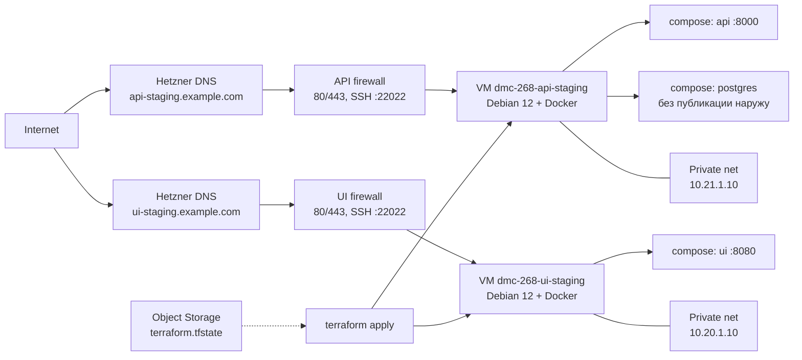

# Инфраструктура — API (команда 6)

| | |
|---|---|
| Статус | staging — курсовой VPS вне Terraform (§8); Hetzner + Terraform — задокументированная альтернатива |
| Владелец | инфраструктура (роль 3) |
| Связанные документы | [CICD.md](CICD.md), [SECRETS.md](SECRETS.md) |

В этом репозитории живёт **вся** инфраструктура staging: два независимых Terraform-стека для API и UI, а также edge-прокси курсового VPS. CI/CD приложений — в своих репозиториях (`dmc-268-api-t6`, `dmc-268-ui-t6`).

Сейчас выкат идёт на **курсовой VPS** (выдан курсом, не Terraform) — §8. Terraform-стеки остаются рабочей альтернативой: CI их проверяет (`terraform-fmt-validate`, `terraform-lint-security`) и выкатывает на Hetzner, как только задан `STAGING_HOST`; `terraform apply` для staging не делается.

| Стек | Каталог | Сеть | VM / каталог на сервере |
|---|---|---|---|
| API staging | `terraform/api-staging/` | `10.21.0.0/16` | `/opt/dmc-268-api` |
| UI staging | `terraform/ui-staging/` | `10.20.0.0/16` | `/opt/dmc-268-ui` |

На каждой VM — Docker и Compose. API-стенд: bootstrap-контейнер до первого выката, затем FastAPI, PostgreSQL, RabbitMQ и Redis (список сервисов — [CICD.md](CICD.md#3-образ-и-health-check)). UI-стенд: bootstrap nginx до первого выката, затем статический UI в nginx.

---

## 1. Архитектура



| Ресурс | Зачем один / как устроен |
|---|---|
| 2× `cx22` в `nbg1` | API и UI на отдельных VM: изоляция, независимый rollback |
| Private networks `10.21.0.0/16` и `10.20.0.0/16` | Разные CIDR для API и UI; статические private IP `10.21.1.10` и `10.20.1.10` |
| Firewall (на каждый стек) | Вход: ICMP, 80, 443; SSH только на `ssh_port` (по умолчанию `22022`) из `ssh_allowed_cidrs` (по умолчанию весь интернет, см. §4.1). Порт 22 закрыт, Postgres наружу не открыт |
| Primary IPv4/IPv6 | Адреса живут отдельно от VM: rebuild сервера не ломает DNS |
| SSH keys | Обязательный ключ CI; опционально ключ оператора |
| Cloud-init | Docker CE + Compose, каталог `/opt/dmc-268-api` или `/opt/dmc-268-ui`, bootstrap на `:80`, sshd на `ssh_port` только по ключу, fail2ban |
| DNS | Опциональная зона Hetzner Cloud + A/AAAA + reverse DNS (отдельные записи `api-staging` / `ui-staging`) |
| State | S3-совместимый backend в Hetzner Object Storage; отдельные ключи `api-staging/` и `ui-staging/` |

Отдельный bastion, load balancer и managed Postgres на staging не нужны.

---

## 2. Terraform

Два root-модуля в `terraform/api-staging/` и `terraform/ui-staging/`. CI делает `fmt` / `validate` / lint для **обоих**, но **не вызывает apply**.

| Файл (в каждом стеке) | Содержание |
|---|---|
| `versions.tf` | Terraform ≥ 1.10, provider `hcloud` ~> 1.54, backend `s3`, `.terraform.lock.hcl` в git |
| `providers.tf` | Токен: `var.hcloud_token` или `HCLOUD_TOKEN` |
| `variables.tf` / `outputs.tf` | Входы и выходы стенда |
| `network.tf` | Network + subnet |
| `firewall.tf` | Правила входа |
| `ssh.tf` | Ключи CI и оператора |
| `primary_ip.tf` | Стабильные публичные адреса |
| `server.tf` | VM + private NIC |
| `dns.tf` | Зона / lookup, A, AAAA, PTR |
| `templates/cloud-init.yaml.tftpl` | Docker, bootstrap, sshd drop-in и fail2ban |
| `environments/*.example` | Образцы tfvars и backend |

Отличия стеков: CIDR, имя VM, `image_repository`, health URL (`/healthcheck` vs `/health`), DNS record name.

---

## 3. Инструкция по запуску Terraform

CI проверяет `fmt` / `validate` / lint и **не вызывает apply**. Стенд поднимает оператор — **отдельно для каждого стека**.

### 3.1. Один раз: remote state

Hetzner не даёт Terraform Cloud. State — в **Object Storage** (S3 API). Bucket нельзя создать этим же root-модулем: backend читается до apply.

1. В консоли Hetzner создать bucket (например `dmc-268-tfstate`) и S3-ключи.
2. Скопировать `environments/staging.backend.hcl.example` → `environments/staging.backend.hcl` в нужном стеке (файл в gitignore).
3. Поправить `bucket` и `endpoints.s3` (`nbg1` / `fsn1` / `hel1`). Ключ state: `api-staging/terraform.tfstate` или `ui-staging/terraform.tfstate`. В backend включён `use_lockfile = true` (нативная блокировка S3, Terraform ≥ 1.10).

### 3.2. Apply (API staging)

```bash
export HCLOUD_TOKEN=...
export AWS_ACCESS_KEY_ID=...
export AWS_SECRET_ACCESS_KEY=...
export AWS_REQUEST_CHECKSUM_CALCULATION=when_required
export AWS_RESPONSE_CHECKSUM_VALIDATION=when_required

STACK=terraform/api-staging
cp ${STACK}/environments/staging.tfvars.example ${STACK}/environments/staging.tfvars
# заполнить ssh_public_key; при необходимости dns_zone (ssh_port и ssh_allowed_cidrs имеют defaults)

terraform -chdir=${STACK} init -backend-config=environments/staging.backend.hcl
terraform -chdir=${STACK} plan  -var-file=environments/staging.tfvars
terraform -chdir=${STACK} apply -var-file=environments/staging.tfvars
```

### 3.3. Apply (UI staging)

Те же переменные окружения. Каталог стека — `terraform/ui-staging/`:

```bash
STACK=terraform/ui-staging
cp ${STACK}/environments/staging.tfvars.example ${STACK}/environments/staging.tfvars

terraform -chdir=${STACK} init -backend-config=environments/staging.backend.hcl
terraform -chdir=${STACK} plan  -var-file=environments/staging.tfvars
terraform -chdir=${STACK} apply -var-file=environments/staging.tfvars
```

Дождаться cloud-init (Docker + bootstrap на `:80`). Полезные outputs:

```bash
terraform -chdir=${STACK} output ssh_host
terraform -chdir=${STACK} output ssh_port
terraform -chdir=${STACK} output health_url
terraform -chdir=${STACK} output staging_ipv4
```

- outputs `ssh_host` и `ssh_port` API-стека → GitHub variables `STAGING_HOST` и `STAGING_SSH_PORT` в репозитории **dmc-268-api-t6**
- SHA256 fingerprint хоста (`ssh-keyscan -p <ssh_port> -H <host> | ssh-keygen -lf - -E sha256`) → `STAGING_SSH_FINGERPRINT` в том же environment
- outputs `ssh_host` и `ssh_port` UI-стека → GitHub variables `STAGING_HOST` и `STAGING_SSH_PORT` в репозитории **dmc-268-ui-t6**. SSH-шаги UI-workflow должны передавать `port:`, иначе после apply `ui-staging` выкат UI не достучится до VM (порт 22 закрыт)

Дальше выкат — CICD.md в соответствующем репозитории. Секреты API — [SECRETS.md](SECRETS.md).

Проверка без backend (как в CI):

```bash
for stack in terraform/api-staging terraform/ui-staging; do
  terraform -chdir="${stack}" init -backend=false -input=false -lockfile=readonly
  terraform -chdir="${stack}" validate
done
```

---

## 4. Cloud-init и bootstrap

После первого boot (на каждой VM):

1. sshd переводится на `ssh_port` (drop-in `/etc/ssh/sshd_config.d/10-dmc-268.conf`, проверка `sshd -t` перед `systemctl restart ssh`), ставится и включается fail2ban.
2. Ставятся Docker CE, containerd, Compose plugin.
3. Создаётся `/opt/dmc-268-api` или `/opt/dmc-268-ui`.
4. Запускается `nginx:1.27-alpine` как bootstrap-контейнер на `:80`.

Пока CI не выкатил приложение, VM уже отвечает по HTTP. `deploy.sh` снимает bootstrap, чтобы порт 80 занял Compose.

`user_data` в lifecycle игнорируется: правка cloud-init не пересоздаёт VM.

### 4.1. SSH-доступ

Только для Terraform-хостов. На курсовом VPS (§8) sshd, порт и firewall не трогаем.

SSH открыт миру намеренно: у GitHub-hosted runners нет стабильных egress IP, allowlist по CIDR их не пропустит. Защита вместо allowlist:

| Мера | Как |
|---|---|
| Нестандартный порт | `ssh_port` (по умолчанию `22022`, диапазон 1025–32767); firewall открывает только его, порт 22 закрыт |
| Только ключи | `PasswordAuthentication no`, `KbdInteractiveAuthentication no`, `PermitRootLogin prohibit-password` (CI входит как `root` по ключу) |
| fail2ban | jail `sshd` в `/etc/fail2ban/jail.d/sshd.local`: `port = <ssh_port>`, `backend = systemd` (в Debian 12 нет `/var/log/auth.log`), `banaction = nftables-multiport` |

В GitHub Environment порт — variable `STAGING_SSH_PORT` (= output `ssh_port`). Сузить доступ можно через `ssh_allowed_cidrs`, но тогда выкат нужно вести с self-hosted runner с известным IP.

Если заблокирован свой IP:

```bash
fail2ban-client status sshd
fail2ban-client set sshd unbanip <IP>
```

Break-glass, если sshd не поднялся на новом порту или доступ по SSH потерян: Hetzner Cloud Console → сервер → **Rescue → Reset root password**, затем **Console** (VNC), исправить `/etc/ssh/sshd_config.d/10-dmc-268.conf`, `sshd -t && systemctl restart ssh`.

### 4.2. Переход существующей VM на новый SSH-порт

Из-за `ignore_changes = [user_data]` VM, созданная до появления `ssh_port`, продолжает слушать 22, а следующий `apply` переносит правило firewall на `ssh_port` — CI и оператор теряют доступ. Выберите один путь **до** `apply`:

1. **Пересоздать VM:** `terraform -chdir=${STACK} apply -replace=hcloud_server.staging -var-file=environments/staging.tfvars`. Primary IP сохраняется, host key меняется → обновить `STAGING_SSH_FINGERPRINT`. Диск VM (и том PostgreSQL на API-стенде) пересоздаётся.
2. **Без пересоздания:** по SSH на порт 22 положить на VM drop-in и jail из `templates/cloud-init.yaml.tftpl`, в drop-in временно добавить вторую строку `Port 22`, выполнить `apt-get install -y fail2ban nftables python3-systemd`, `sshd -t && systemctl restart ssh`, `systemctl restart fail2ban`. Затем `apply`, проверить вход на `ssh_port`, убрать `Port 22` и перезапустить ssh.

После перехода задать `STAGING_SSH_PORT` в GitHub Environment обоих репозиториев.

---

## 5. DNS

По умолчанию зона не создаётся (`dns_zone = ""`): стенд доступен по IPv4 из output `staging_ipv4`.

Чтобы включить DNS, в `staging.tfvars`:

```hcl
dns_zone        = "example.com"
create_dns_zone = true
dns_record_name = "api-staging"
```

Terraform создаст зону, записи `A`/`AAAA` на Primary IP и PTR. Делегируйте домен на `dns_nameservers`.

Если зона уже есть в проекте Hetzner:

```hcl
dns_zone        = "example.com"
create_dns_zone = false
```

`STAGING_HOST` в GitHub Environment — output `ssh_host` (FQDN или IPv4).

---

## 6. Variables и outputs

Обязательная variable: `ssh_public_key`. Остальное имеет defaults (`nbg1`, `cx22`, CIDR стека, `ssh_port = 22022`, `ssh_allowed_cidrs = ["0.0.0.0/0", "::/0"]`, …).

Полезные outputs: `staging_ipv4`, `staging_ipv6`, `staging_private_ip`, `dns_fqdn`, `dns_nameservers`, `health_url`, `ssh_host`, `ssh_port`, `server_id`, `network_id`, `firewall_id`.

Полный список — `variables.tf` и `outputs.tf` в каждом стеке.

---

## 7. Удаление инфраструктуры

Снимает VM, сеть, firewall, SSH-ключи, Primary IP, DNS-записи и зону, если её создавал этот модуль. Том PostgreSQL на диске VM уничтожается вместе с сервером.

```bash
export HCLOUD_TOKEN=...
export AWS_ACCESS_KEY_ID=...
export AWS_SECRET_ACCESS_KEY=...
export AWS_REQUEST_CHECKSUM_CALCULATION=when_required
export AWS_RESPONSE_CHECKSUM_VALIDATION=when_required

STACK=terraform/api-staging  # или terraform/ui-staging
terraform -chdir=${STACK} init -backend-config=environments/staging.backend.hcl
terraform -chdir=${STACK} destroy -var-file=environments/staging.tfvars
```

После destroy:

1. Bucket Object Storage и файл state **остаются**. Удалить bucket в консоли Hetzner, когда state больше не нужен.
2. Образы в GHCR (`:sha`, `:staging`, `:staging-previous`) Terraform не трогает — удалить в GitHub Packages при необходимости.
3. GitHub Environment `staging` (secrets/variables) сбросить или удалить, чтобы повторный workflow не ходил на несуществующий хост.
4. Если домен делегировали на `dns_nameservers`, снять NS у регистратора.

Не удаляйте VM руками в консоли, пока state жив: следующий `apply`/`destroy` разъедется с облаком.

---

## 8. Курсовой VPS

Выдан курсом, Terraform им не управляет. Один VPS на команду держит staging и prod API, UI и будущего webhook-сервиса; маршрутизация по hostname через edge-прокси ([CICD.md](CICD.md#8-курсовой-vps-и-edge-прокси)).

**Почему staging здесь, а не в Terraform** (решение техлида 27.09.2026, #35): стеки `terraform/` описывают Hetzner Cloud, а токена Hetzner (`HCLOUD_TOKEN`) у команды нет — курс выдал готовый VPS. Terraform не может управлять машиной, которую не создавал, а импорт чужого общего хоста дал бы state, расходящийся с реальностью при каждом изменении курса. Поэтому окружение staging — этот VPS, а стеки остаются альтернативой на случай своего проекта в Hetzner: CI продолжает их проверять, переключение — переменной `STAGING_HOST` ([CICD.md](CICD.md#81-две-цели)).

Сервисы API staging на VPS (compose project `dmc-268-api-staging`): `api`, разовый `bootstrap`, PostgreSQL 17, RabbitMQ 4 (брокер очереди, SD Р-1), Redis 8 (только кэш, SD §10, лимит памяти 128 MB) — образы запиннены по digest, версии в [CICD.md](CICD.md#3-образ-и-health-check); `worker` и `webhook-worker` — из того же образа, что `api`, со своим healthcheck по heartbeat-файлу ([CICD.md](CICD.md) §3). `worker` также потребляет `index.repo` (индексатор графа, #142, SD §7.4). Реплик `worker` задаёт `WORKER_REPLICAS` (1..5, по умолчанию 1, [CICD.md](CICD.md#3-образ-и-health-check)); память каждой реплики своя, суммарный расход растёт с N. Лимита памяти у него нет. Замер на staging 09.11.2026 (#308): три реплики, пять ревью песочницы (три параллельно), наблюдение 32 мин; вместо `docker stats` и `free -m` — cAdvisor (`container_memory_working_set_bytes`) и node-exporter (`MemAvailable`) через Grafana, SSH к VPS у команды нет. Реплика держит 99–106 МБ до ревью и до 129 МБ за окно (пик cgroup — 139 МБ), три вместе — до 353 МБ, CPU реплики — до 0,13 ядра; `MemAvailable` не ниже 4,5 ГБ из 8,3 ГБ, swap не используется. Пик одной реплики за неделю работы с одной репликой — 171,5 МБ. Для prod выбрано `WORKER_REPLICAS=2` (Environment `production`): два ревью идут параллельно, а худший случай — около 350 МБ на две реплики при запасе памяти больше 4 ГБ. Задание индекса держит в памяти архив (до 100 МиБ, `CODE_INDEX_MAX_DOWNLOAD_BYTES`), пачку разбираемых файлов (до 50 × 256 КиБ, около 12,5 МиБ) и карту записей архива, а подпроцессу парсера RLIMIT_AS разрешает 128 МиБ сверх его размера на старте. Это оценка, не граница. Измерено: тест большого архива (64 МиБ) — пик 179,5 МиБ RSS при 53 МиБ у pytest на крошечном архиве (разница — две копии входа самого теста), проходы по архиву — около 1,5 МиБ сверх буфера, простаивающий worker — около 110 МиБ на локальном стенде; пик фаз разбора и записи не измерялся. `CODE_INDEX_*` на staging остаются значениями по умолчанию: `worker.env` собирается из allowlist `deploy/scripts/env-file.sh`, и значение меняется только в `environment:` сервиса `worker` в `deploy/compose/staging.yml`. Объектного хранилища нет (#20, D1). Наружу через edge виден только `api`; оба воркера, PostgreSQL, RabbitMQ и Redis — во внутренней сети проекта без `ports:`.

| Параметр | Значение |
|---|---|
| ОС | Debian 13 (trixie) |
| SSH | порт 22, пользователь и пароль из organization secrets `VPS_DMC268_U` / `VPS_DMC268_P`, хост — `VPS_DMC268_IP_T6` |
| Docker | нет в исходном образе; ставит CI (`deploy/scripts/provision.sh`: `docker.io`, `docker-cli`, `docker-compose` из Debian, идемпотентно и с блокировкой для параллельных выкатов API и UI) |
| Входящий трафик | edge-прокси Caddy на 80/443 (`/opt/dmc-268-edge`, project `dmc-268-edge`), остальные сервисы — только в docker-сети `dmc268-edge` |
| Каталоги | `/opt/dmc-268-api-staging` (API staging), `/opt/dmc-268-api-prod` (API prod, [CICD.md](CICD.md) §8.1), `/opt/dmc-268-edge` (прокси); UI — свои каталоги |

Правила общего VPS:

- sshd, порт SSH, firewall и пользователей **не менять**: хост общий, доступ к нему у курса. Порт 22022, key-only и fail2ban (§4.1) относятся только к Terraform-хостам.
- Host-порты публикует только edge-прокси. Сервис подключается к `dmc268-edge` с alias `<service>-<env>`.
- Docker Engine сам меняет iptables на хосте: цепочки `DOCKER*`, NAT (MASQUERADE и DNAT для опубликованных портов 80/443) и политику `FORWARD` (DROP). Сейчас host-firewall на VPS нет. Любой будущий firewall (nftables, ufw) должен это учитывать: правила для опубликованных портов Docker обходят цепочку `INPUT`, а перезагрузка firewall со сбросом ruleset (`flush ruleset`) ломает сеть контейнеров до перезапуска Docker.
- Edge-прокси выкатывает только репозиторий API.

### 8.1. DNS

Все имена — A-записи на IPv4 VPS (`VPS_DMC268_IP_T6`), в зоне `APP_DOMAIN` (сейчас `dmc268-t6.axyi.ru`):

| Имя | Тип |
|---|---|
| `<APP_DOMAIN>`, `www` | A — публичный лендинг ([CICD.md](CICD.md) §8.2) |
| `staging`, `staging-www` | A — staging-лендинг |
| `api`, `staging-api` | A |
| `ui`, `staging-ui` | A |
| `webhook`, `staging-webhook` | A |
| `grafana` | A — Grafana стека мониторинга ([MONITORING.md](MONITORING.md)) |
| `status`, `staging-status` | A — публичная страница статуса ([MONITORING.md](MONITORING.md) §5) |
| `prometheus`, `victoria-metrics` | A — заведены, сайта в Caddyfile нет |

AAAA-записи добавлять только после проверки, что VPS принимает IPv6 на 443: иначе клиенты с IPv6 и выпуск сертификата по AAAA будут падать. Caddy выпускает сертификаты для всех имён из Caddyfile сразу после старта и сам их продлевает. Имя без A-записи сертификат не получит (Caddy повторяет попытки), остальные имена работают.

---

## 9. Бот ревью (#601)

Отдельный сервис на курсовом VPS: назначает ревьюеров на PR в `dmc-268-api-t6` и `dmc-268-ui-t6` от имени своего GitHub App и присылает в чат команды в Telegram сводку PR, которые ждут ревью. Код в `review_bot/` этого репозитория, свой `pyproject.toml`, `uv.lock` и `Dockerfile`; `app/` он не использует. Деплой и настройка: [CICD.md](CICD.md#9-бот-ревью-601).

| Параметр | Значение |
|---|---|
| Compose project | `dmc-268-review-bot`, каталог `/opt/dmc-268-review-bot`; со staging и prod не связан, своей сети и портов наружу нет |
| Контейнер | `bot`, образ собирается на хосте из `review_bot/` (`dmc-268-review-bot:local`), пользователь без root, файловая система read-only |
| Ресурсы | `mem_limit: 128m`, `cpus: 0.25` (VPS общий со staging и prod) |
| Состояние | SQLite в volume `dmc-268-review-bot_review-bot-data` (`/data/review-bot.sqlite3`) |
| Health check | heartbeat-файл `/tmp/review-bot.alive`, обновляется после каждого опроса; старше 5 минут: контейнер unhealthy |
| Логи | json-file, 3 файла по 10 МБ; `docker compose -p dmc-268-review-bot logs bot` |
| Исходящий трафик | `api.github.com`, `api.telegram.org` по HTTPS; входящего нет |

Как работает:

- Раз в минуту читает открытые PR обоих репозиториев (GitHub REST, токен установки App: JWT → installation token). Это 2 запроса в минуту, около 120 в час, плюс запрос ревью PR только при смене состояния ревьюера; лимит установки App 5000 запросов в час. Если хотя бы один репозиторий не прочитан, опрос пропускается целиком и снимок PR не меняется (вечерний дайджест в своём окне всё равно отправляется по последнему SQLite-снимку).
- PR не в draft, у которого нет запрошенных ревьюеров (и команд-ревьюеров), нет уже отревьюенных запросов после начала отслеживания и не было ревью до бота, получает ревьюера сразу: наименее загруженного участника команды (число открытых запросов ревью на нём в обоих репо), при равенстве по кругу; автор исключается. Если единственного ревьюера сняли без ревью, бот на следующем опросе запрашивает нового; PR, по которому уже есть ревью, он не трогает.
- Чей PR, решает список запрошенных ревьюеров в GitHub: добавленный вручную появляется в сводке, снятый пропадает. Ревьюер оставил ревью и его снова запросили: это новый раунд, PR снова в копилке с отметкой «раунд N».
- Копилка общая на чат: только PR, о которых в этом раунде ещё не писали. Сообщение уходит, когда в копилке 2+ PR и 30 минут не было новых, или самый старый ждёт 2 часа, или у PR метка `urgent` (на ближайшем опросе). Если сообщение превышает лимит Telegram (4096 символов), оно режется по блокам и строкам на несколько сообщений. Закрытый, смёрженный, вернувшийся в draft или уже отревьюенный PR из копилки выпадает.
- Вечерний дайджест в 18:00 по `Europe/Berlin` (первый опрос в течение часа после 18:00, раз в день): все ждущие PR, у ждущих дольше 10 часов указан возраст; без ждущих PR не отправляется.
- Команда `/mine` в чате команды отвечает списком PR на написавшем (Telegram-ник → GitHub-логин по составу команды).
- Отметка «сообщено» пишется в SQLite до отправки, поэтому после перезапуска PR не приходит повторно. Если Telegram отказал ответом 4xx (кроме 408), отметка снимается только у недоставленной части и она уходит на следующем опросе; при 5xx или обрыве связи отметка остаётся: лучше потерять сообщение, чем прислать дважды.
- Токены App и бота, id чата и состав команды приходят из secrets в `review-bot.env` (mode 600) и в логи не пишутся: в логе только номера PR, логины и счётчики.
