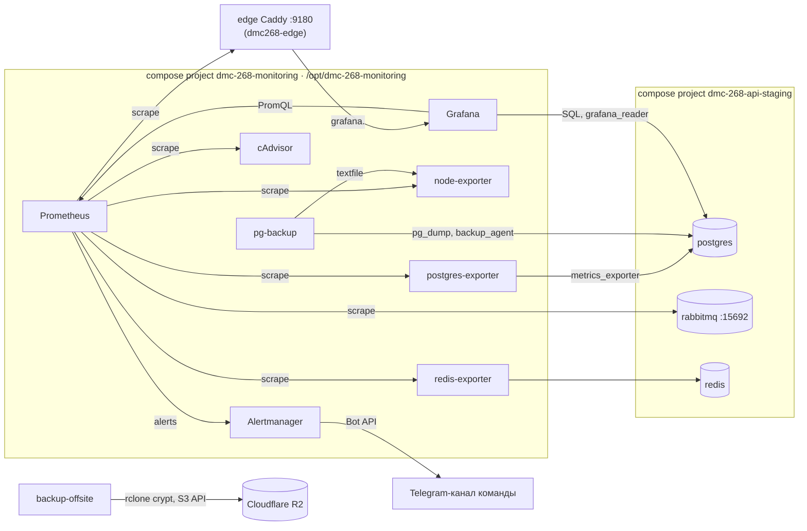

# Мониторинг и алерты — API (команда 6)

Стек мониторинга staging: метрики хоста, контейнеров, очередей, хранилищ и пайплайна ревью, дашборд Grafana, алерты в командный Telegram-канал и ежедневный бэкап PostgreSQL с проверкой восстановления (§9). Это self-hosted стек, который SD §13 («Наблюдаемость») выносит в отдельную задачу. Сквозной трейсинг (OpenTelemetry/Sentry) и JSON-логи с `run_id` — следующий шаг (§8).

## 1. Состав



| Сервис | Образ (по digest) | Лимит памяти | Что даёт |
|---|---|---|---|
| `prometheus` | `prom/prometheus:v3.15.0` | 512m | сбор каждые 30 с, хранение 15 дней / 2 GB, правила алертов |
| `alertmanager` | `prom/alertmanager:v0.34.1` | 64m | группировка, повтор раз в 4 ч, сообщение о resolve, доставка в Telegram |
| `grafana` | `grafana/grafana-oss:13.0.2` | 256m | дашборд `AI Code Reviewer — staging overview`, источники Prometheus и PostgreSQL |
| `node-exporter` | `prom/node-exporter:v1.12.1` | 64m | CPU, память, диск, load хоста; textfile-метрики хостовых задач |
| `cadvisor` | `gcr.io/cadvisor/cadvisor:v0.55.1` | 256m | CPU и память каждого контейнера (`api`, `worker`, `webhook-worker`, хранилища) |
| `postgres-exporter` | `quay.io/prometheuscommunity/postgres-exporter:v0.20.1` | 64m | `pg_up`, соединения, размер БД и метрики ревью (`queries.yml`, §4) |
| `redis-exporter` | `oliver006/redis_exporter:v1.94.0` | 32m | память, hit ratio, `redis_up` |
| `pg-backup` | `postgres:17.11-alpine` — тот же digest, что у `postgres` staging | 128m | ежедневный `pg_dump` с проверкой восстановления (§9) |

Длину очередей отдаёт сам RabbitMQ: плагин `rabbitmq_prometheus` включён в образе `rabbitmq:4.3.6-management-alpine`, порт 15692 внутри сети проекта. RPS и коды ответов отдаёт edge-прокси Caddy (`metrics { per_host }`, порт 9180 только в сети `dmc268-edge`, [CICD.md §8.2](CICD.md#82-edge-прокси)). Очередь ревью — RabbitMQ, не Redis: Redis только кэш (SD §10).

Стек — отдельный compose project. Он подключается к сети приложения `<project>_default` как к внешней и к `dmc268-edge`, но в жизненный цикл приложения не входит: его сбой не валит выкат и не запускает откат. Host-портов нет (на курсовом VPS их публикует только edge-прокси); в режиме ports (Terraform-хост) Grafana слушает только `127.0.0.1:3000`.

## 2. Definition of Done → где смотреть

| Требование | Панель дашборда | Источник |
|---|---|---|
| Latency LLM-запросов | `LLM call p95`, `LLM call latency` (p50/p95/max, 5 мин) | `run_actions` с `tool = 'llm.call'`: одна запись на фактический вызов провайдера, `duration_ms` (PIPELINE_SPEC §2). При промахе кэша conventions в выборку попадает и вызов conventions: вида вызова нет в колонках `run_actions`, доступных роли Grafana |
| Размер очередей | `Messages waiting in review queues`, `Review queues: ready messages`, `… in work and consumers` | `rabbitmq_detailed_queue_messages_ready/unacked/consumers{queue}` |
| RPS | `Requests per second`, `Requests per second by host` | `caddy_http_request_duration_seconds_count{host}` |
| Алерты об ошибках в командный канал | §5 | Prometheus → Alertmanager → Telegram |
| Время каждого шага пайплайна | `Phase duration p95`, `Phases over the range` | `run_actions.tool` + `duration_ms`: `vcs.fetch_diff`, `context.build`, `llm.call`, `review.postprocess`, `github.publish_review`, …. `context.build` в попытке, дошедшей до ревью, пишется дважды (сборка контекста по диффу и чтение входа промпта): счёт завышен, длительности смешивают два шага; `llm.call` смешивает conventions и ревью |
| CPU / RAM серверов и воркеров | `Host CPU`, `Host memory`, `Container CPU`, `Container memory` | node-exporter, cAdvisor (метка `container_label_com_docker_compose_service`) |

Ещё на дашборде: прогоны по итоговому состоянию, failed по `error_code`, стоимость и токены LLM в час (`usage_events`), доля 5xx и p95 ответа по хосту, соединения PostgreSQL, память и hit ratio Redis.

## 3. Доступ к данным приложения

Задержки шагов уже лежат в трейсе прогона (`run_actions`), поэтому дашборд и алерты читают PostgreSQL напрямую, без изменений в коде. Доступ — две роли, которые `deploy.sh` создаёт и пересобирает при каждом выкате:

| Роль | Кто | Права |
|---|---|---|
| `grafana_reader` | источник PostgreSQL в Grafana | `default_transaction_read_only`, `statement_timeout 30s`, `CONNECTION LIMIT 5`; `SELECT` только на колонки ниже |
| `metrics_exporter` | `postgres-exporter` | `pg_monitor`, `default_transaction_read_only`, `statement_timeout 15s`, `CONNECTION LIMIT 3`; те же колонки `runs` и `run_actions` |
| `backup_agent` | `pg-backup` | `pg_read_all_data` для `pg_dump` и `CREATEDB` для временной БД проверки; без суперпользователя и без записи в данные приложения |

| Таблица | Открытые колонки |
|---|---|
| `runs` | `id`, `state`, `trigger`, `engine`, `attempt`, `error_code`, `available_at`, `created_at`, `started_at`, `finished_at` |
| `run_actions` | `run_id`, `tool`, `started_at`, `duration_ms` |
| `usage_events` (только `grafana_reader`) | `provider`, `model`, `operation`, `tokens_in`, `tokens_out`, `cache_read_tokens`, `cost_usd`, `created_at` |

Тела запросов и ответов (`run_actions.request/response`), `review_body`, `error_message`, диффы, находки и комментарии закрыты: каждый выкат делает `REVOKE ALL ON ALL TABLES` и выдаёт заново ровно этот список. Так соблюдается требование SD §13 о данных клиента: стек не видит кода и текстов ревью.

Нагрузка: запросы ограничены окном времени, exporter опрашивается раз в минуту. У `run_actions` нет индекса по `started_at`; при 100 PR/день это тысячи строк в сутки, seq scan дешёвый. Если таблица вырастет до миллионов строк, нужен индекс `(tool, started_at)` отдельной миграцией.

## 4. Метрики ревью из PostgreSQL

`deploy/monitoring/postgres-exporter/queries.yml`:

| Метрика | Значение |
|---|---|
| `dmc_runs_finished_15m_runs{state}` | прогоны, завершившиеся за 15 мин, по состоянию |
| `dmc_runs_active_queued`, `…_in_progress`, `…_stale_queued` | незавершённые прогоны; `stale_queued` — `queued` дольше 10 мин после `available_at` (T18) |
| `dmc_llm_calls_15m_calls`, `…_p50_seconds`, `…_p95_seconds` | вызовы LLM за 15 мин и их длительность |

## 5. Алерты

Правила — `deploy/monitoring/prometheus/rules/alerts.yml`, unit-тесты — `tests/monitoring/alerts.test.yml`. Сообщение: статус, окружение, severity и по строке на алерт с его именем; только числа и имена — без содержимого ревью и секретов.

Два вида алертов. **Состояние** (диск, очередь без консьюмера, цель недоступна): напоминание раз в 4 ч, пока условие держится, и сообщение RESOLVED. **Событие** (метка `kind: event`: упавший прогон, новое сообщение в DLQ): уходит один раз и без RESOLVED — оно «закрывается» лишь потому, что выходит из 15-минутного окна. События за 90 с собираются в одно сообщение: прогон, исчерпавший попытки, — это и `failed`, и сообщение в `reviews.dlq` (PIPELINE_SPEC §4.4), и оба приходят вместе.

| Алерт | Условие | Severity |
|---|---|---|
| `TargetDown` | цель не отвечает 5 мин | critical |
| `PostgresDown` / `RedisDown` | `pg_up == 0` 2 мин / `redis_up == 0` 5 мин | critical / warning |
| `ApiHigh5xxRate` | > 5 % ответов 5xx на `staging-api`/`staging-ui` 5 мин (при > 0.05 rps). `staging-webhook` не входит: это заглушка 503 без сервиса, вебхуки GitHub принимает `staging-api` (CICD.md §8.2) | critical |
| `ReviewRunsFailed` | хотя бы один прогон `failed` за 15 мин; событие | warning |
| `ReviewDeadLetters` | новые сообщения в `reviews.dlq` за 15 мин; событие. Размер DLQ (хранение 7 дней) — на панели `Review queues: ready messages` | critical |
| `ReviewQueueBacklog` | > 20 готовых сообщений в `review.run.*`/`review.publish` 10 мин | warning |
| `ReviewQueueWithoutConsumer` | у `review.run.fast` или `review.publish` нет консьюмера 5 мин | critical |
| `ReviewRunsStuckInQueue` | есть `stale_queued` 5 мин | warning |
| `LlmLatencyHigh` | p95 LLM > 60 с при ≥ 3 вызовах, 10 мин (таймаут fast — 90 с) | warning |
| `HostMemoryLow` / `HostDiskFull` / `HostCpuHigh` | < 10 % памяти 10 мин / < 15 % диска 10 мин / > 90 % CPU 15 мин | critical / critical / warning |
| `ContainerOomKilled` | OOM-kill в контейнере compose за 10 мин | warning |
| `PostgresBackupStale` | последнему проверенному дампу больше 26 ч | critical |
| `PostgresBackupMissing` | heartbeat `pg-backup` старше 2 ч или его нет (сервис остановлен, удалён или не может писать). Файл метрик переживает контейнер, поэтому смотрим на возраст heartbeat, а не на отсутствие метрик | critical |
| `PostgresBackupFailed` | последняя попытка бэкапа упала | warning |
| `PostgresBackupOffsiteStale` | копия в бакет не обновлялась 3 ч (только при включённой выгрузке) | critical |
| `PostgresBackupOffsiteFailing` | все проходы выгрузки за час упали | warning |

**Подключение Telegram** (один раз):

1. Создать бота у `@BotFather`, добавить его в командный чат.
2. Узнать `chat_id`: написать в чат и открыть `https://api.telegram.org/bot<token>/getUpdates` (у группы id отрицательный, `-100…`).
3. В Environment `staging`: secret `ALERT_TELEGRAM_BOT_TOKEN`, variable `ALERT_TELEGRAM_CHAT_ID` ([SECRETS.md](SECRETS.md)).
4. Перезапустить `Deploy monitoring` (Re-run job) или дождаться пуша в `main`.

Без этих имён стек работает, алерты видны в Alertmanager, но никуда не уходят — `deploy.sh` пишет об этом в лог job. Задано только одно из двух — выкат падает до изменений на хосте.

## 6. Выкат

Job `Deploy monitoring` в `ci-cd.yml` запускается после успешного `Deploy staging` в своей группе concurrency `staging-monitoring` (не `staging-deploy`: там его ожидание отменяло бы `Promote staging tag` и наоборот; сбой мониторинга приложение не откатывает):

1. `scp` содержимого `deploy/monitoring` и `deploy/scripts/env-file.sh` в `/opt/dmc-268-monitoring`.
2. `deploy.sh`:
   - читает `<APP_DIR>/.env` приложения (пользователь и БД PostgreSQL, пароль Redis, режим edge/ports); проверяет сеть `<project>_default` и контейнер `postgres`;
   - проверяет настройки Telegram, потом генерирует один раз пароли стека (`.env` 0600);
   - создаёт и пересобирает роли PostgreSQL (§3);
   - пишет конфиг Alertmanager и файл токена, цель Caddy для Prometheus (только в режиме edge);
   - `docker compose -p dmc-268-monitoring up -d --wait`. Метка с хешем каталога конфигурации пересоздаёт сервис ровно тогда, когда его конфигурация изменилась;
   - синхронизирует пароль `admin` Grafana с `.env`.

Файлы на хосте: `.env` (0600), `alertmanager/alertmanager.yml`, `alertmanager/secrets/telegram_bot_token` (0400), `prometheus/targets/caddy.json`, `textfile/` (textfile-метрики node-exporter, пишут `pg-backup` и `backup-offsite`), дампы — `/var/backups/dmc-268/<project>/` (0700, §9). Тома: `prometheus-data`, `alertmanager-data`, `grafana-data`.

Откат приложения стек не трогает. Откатить сам мониторинг — перезапустить job `Deploy monitoring` на нужном коммите или выполнить `deploy.sh` из его checkout.

## 7. Доступ

| Цель | Grafana | Prometheus / Alertmanager |
|---|---|---|
| Курсовой VPS | `https://grafana.<APP_DOMAIN>/` (staging: `https://grafana.dmc268-t6.axyi.ru/`), пользователь `admin`, пароль — `GRAFANA_ADMIN_PASSWORD` из `/opt/dmc-268-monitoring/.env` | без внешнего доступа: `docker compose -p dmc-268-monitoring exec prometheus wget -qO- localhost:9090/api/v1/alerts` |
| Terraform-хост | SSH-туннель: `ssh -L 3000:127.0.0.1:3000 …`, затем `http://localhost:3000/` | то же |

Grafana — на своём хосте `grafana.<APP_DOMAIN>` (A-запись на VPS). Регистрация и анонимный доступ выключены, cookie `Secure`, `/metrics` Grafana (он без логина) edge отвечает 404 — Prometheus читает его внутри docker-сети, дашборды и источники данных доступны в UI только для чтения: изменения идут через PR в `deploy/monitoring/grafana`. Имена `prometheus.<APP_DOMAIN>` и `victoria-metrics.<APP_DOMAIN>` тоже указывают на VPS, но сайта в Caddyfile не получают: у Prometheus нет аутентификации, запросы к нему — через Explore в Grafana; VictoriaMetrics в стеке нет.

## 8. Ограничения и следующие шаги

| Что | Статус |
|---|---|
| Сквозной трейсинг (OpenTelemetry/Sentry), JSON-логи с `run_id` | отдельный PR после стабилизации пайплайна (договорённость команды). Нужен выбор бэкенда: Sentry SaaS (аккаунт и DSN), GlitchTip или Grafana Tempo; self-hosted Sentry на общий VPS не помещается |
| Redis | бэкапить нечего: на staging он без тома и без персистентности (`save ""`, `appendonly no`), это кэш (SD §10) |
| Метрики приложения (`/metrics` FastAPI, `X-RateLimit-Remaining` GitHub) | нужен код и зависимость; пока RPS и коды — с edge-прокси, пайплайн — из `run_actions` |
| prod | prod-выката нет; `environment` в метках — `staging` |
| cAdvisor | читает состояние Docker через `/var/run` (сокеты Docker и containerd), что равносильно root на хосте; сетей, кроме сети проекта, и портов у него нет |

## 9. Бэкапы PostgreSQL

Сервис `pg-backup` (`deploy/monitoring/backup/pg-backup.sh`) раз в 5 минут проверяет возраст последнего дампа и, если он старше суток, делает новый:

1. Проверка места: свободно на диске каталога бэкапов не меньше 2 × `pg_database_size` (дамп и временная БД; на VPS каталог и тома Docker на одном корневом разделе). Иначе попытка падает до записи чего-либо.
2. Снимок: транзакция `REPEATABLE READ` на исходной БД делает `pg_export_snapshot()` и в нём же снимает отпечаток — ревизию `alembic_version` и число строк каждой таблицы схемы `public`.
3. `pg_dump --format=custom --snapshot=<снимок>` от роли `backup_agent` во временный `*.partial`: дамп ровно того состояния, по которому снят отпечаток. Дамп сохраняет владельцев и права для настоящего восстановления.
4. Проверка восстановления: `pg_restore --no-owner --no-privileges` во временную БД `dmc_restore_check`, отпечаток восстановленной БД должен совпасть построчно. Запись или миграция во время дампа ложной ошибки не дают (обе стороны из одного снимка), а потерянная строка или таблица ловится. Проверено под постоянной записью: три бэкапа подряд, до 104 255 строк, все совпали.
5. Только после проверки — переименование в `<db>-<UTC>.dump` (0600) и удаление дампов старше 7 дней.
6. Метрики `dmc_pg_backup_*` → `textfile/pg_backup.prom`, heartbeat каждые 5 мин → `textfile/pg_backup_heartbeat.prom` → node-exporter → алерты §5 и строка `PostgreSQL backups` дашборда.

Упавшая попытка повторяется через час. Дамп, не прошедший проверку, не сохраняется.

| Параметр | Значение | Где менять |
|---|---|---|
| Период | 24 ч (`BACKUP_INTERVAL_SECONDS`) | `deploy/monitoring/compose.yml` |
| Хранение | 7 дней (`BACKUP_RETENTION_DAYS`) | там же |
| Каталог | `/var/backups/dmc-268/<project>/` на хосте, вне каталогов стеков | `BACKUP_DIR` для `deploy.sh` |
| Размер | ~110 КБ на staging (10.2026) | дашборд, `dmc_pg_backup_last_size_bytes` |

Бэкап вне расписания: `docker compose -p dmc-268-monitoring exec pg-backup sh /opt/pg-backup/pg-backup.sh once`.

**Восстановление** (проверено на дампе staging-схемы: та же ревизия, таблицы и данные, владелец `app`). Перед заменой рабочей БД — правила [CICD.md §5](CICD.md#5-rollback) «Действия при отказе»: окно обслуживания, остановка пишущих процессов, бэкап текущей БД.

```bash
cd /opt/dmc-268-api-staging
pg=$(docker compose -p dmc-268-api-staging ps -q postgres)
dump=/var/backups/dmc-268/dmc-268-api-staging/<выбранный>.dump

# 1. Проверить дамп в отдельной БД
docker exec "$pg" createdb -U app -O app restore_drill
docker exec -i "$pg" pg_restore -U app -d restore_drill --no-owner --role=app \
  --exit-on-error --single-transaction < "$dump"
docker exec "$pg" psql -U app -d restore_drill -Atc 'SELECT version_num FROM alembic_version'

# 2. Заменить рабочую БД (writers остановлены)
docker compose -p dmc-268-api-staging stop api worker webhook-worker
docker exec "$pg" psql -U app -d postgres -c 'DROP DATABASE app WITH (FORCE)'
docker exec "$pg" psql -U app -d postgres -c 'ALTER DATABASE restore_drill RENAME TO app'
docker compose -p dmc-268-api-staging start api worker webhook-worker
```

Образ приложения должен соответствовать восстановленной ревизии (CICD.md §5, «Допуск по ревизии БД»). Роли мониторинга и их права после переименования БД пересоздаст следующий `Deploy monitoring`.

### Копия вне VPS

Решение техлида от 17.10.2026 (#186): дампы дополнительно уходят в S3-совместимый бакет Cloudflare R2. Это исключение из D1 («объектного хранилища в MVP нет») только для бэкапов; приложение S3 по-прежнему не использует.

Сервис `backup-offsite` (`deploy/monitoring/backup/offsite.sh`, `compose.offsite.yml`, образ `rclone/rclone:1.75.2` по digest) каждые 15 минут:

1. `rclone copy` готовых `*.dump` в crypt-remote `secure:` поверх `store:<bucket>/postgres`. Шифрование (rclone crypt: XSalsa20-Poly1305, ключ из `BACKUP_ENCRYPTION_PASSPHRASE`) выполняется на VPS: в бакете только шифротекст `<dump>.bin`, без ключа его не прочитать. `--immutable` запрещает перезапись уже загруженного дампа.
2. `rclone delete --min-age 30d` — в бакете дампы хранятся 30 дней (на VPS — 7).
3. Метрики `dmc_pg_backup_offsite_*` → алерты выше и панель `Last off-host copy`.

Сбой копирования не доходит до удаления. Сервис создаётся, только когда заданы все пять имён ниже; заданы не все — выкат мониторинга падает до изменений на хосте; все пустые — сервис удаляется, дампы остаются только на VPS.

| Имя | Environment `staging` | Значение |
|---|---|---|
| `BACKUP_S3_ENDPOINT` | variable | `https://<ACCOUNT_ID>.r2.cloudflarestorage.com` (только `https`) |
| `BACKUP_S3_BUCKET` | variable | имя бакета |
| `BACKUP_S3_ACCESS_KEY_ID` | secret | Access Key ID R2-токена с правами Object Read & Write на этот бакет |
| `BACKUP_S3_SECRET_ACCESS_KEY` | secret | Secret Access Key того же токена |
| `BACKUP_ENCRYPTION_PASSPHRASE` | secret | одна строка ≥ 32 символов, например `openssl rand -base64 48`. Копия хранится у техлида вне GitHub: без неё бэкапы не расшифровать. Смена ключа — ниже |

На хосте ключ лежит в `.env` стека (0600) в форме `rclone obscure` и как SHA-256; в `rclone obscure` он передаётся через stdin. Obscure — не шифрование: `rclone reveal` возвращает исходный ключ, так что `.env` стека мониторинга равносилен самому ключу и защищается так же (права root на VPS = доступ к бэкапам в R2).

**Смена ключа.** Имена файлов не шифруются (`FILENAME_ENCRYPTION=off`): после смены ключа старые `*.dump.bin` по-прежнему видны `rclone ls` и удаляются по `--min-age 30d`, ошибок прохода нет. Новые копии шифруются новым ключом, старые читаются только прежним — его хранят ещё 30 дней, пока старые копии не удалятся. Проверено на `rclone/rclone:1.75.2`: копия под ключом A, затем ключ B — `ls` видит обе, `cat` старой под B даёт `bad password`, под A читается, `delete --min-age 30d` под B удаляет старую.

**Восстановление после потери VPS** (проверено с S3-совместимым сервером: скачанный и расшифрованный дамп восстановился с той же ревизией и таблицами; с неверным ключом rclone отказывает `bad password`). Нужны Docker, ключи бакета и ключ шифрования:

```bash
read -rs PASS; export OBSCURED="$(printf '%s' "$PASS" | docker run --rm -i --entrypoint rclone rclone/rclone:1.75.2 obscure -)"
rc() {
  docker run --rm -v "$PWD:/restore" -e RCLONE_CONFIG=/dev/null \
    -e RCLONE_CONFIG_STORE_TYPE=s3 -e RCLONE_CONFIG_STORE_PROVIDER=Cloudflare \
    -e RCLONE_CONFIG_STORE_ENDPOINT="$BACKUP_S3_ENDPOINT" \
    -e RCLONE_CONFIG_STORE_ACCESS_KEY_ID="$BACKUP_S3_ACCESS_KEY_ID" \
    -e RCLONE_CONFIG_STORE_SECRET_ACCESS_KEY="$BACKUP_S3_SECRET_ACCESS_KEY" \
    -e RCLONE_CONFIG_STORE_NO_CHECK_BUCKET=true \
    -e RCLONE_CONFIG_SECURE_TYPE=crypt -e RCLONE_CONFIG_SECURE_REMOTE="store:$BACKUP_S3_BUCKET/postgres" \
    -e RCLONE_CONFIG_SECURE_PASSWORD="$OBSCURED" -e RCLONE_CONFIG_SECURE_FILENAME_ENCRYPTION=off \
    rclone/rclone:1.75.2 "$@"
}
rc lsl secure:                                # дампы по датам
rc copy secure:<db>-<UTC>.dump /restore       # расшифрованный дамп в текущий каталог
```

Дальше — те же шаги `pg_restore`, что выше, на новом хосте после выката приложения.

Redis не бэкапится: на staging он без тома и без персистентности, это кэш (SD §10). Очереди RabbitMQ лежат в томе `rabbitmq-data`, а топологию при старте объявляет воркер; состояние прогонов восстанавливается из PostgreSQL реконсилером.

## 10. Проверка

```bash
scripts/validate_monitoring.sh   # promtool, amtool, compose config, JSON дашбордов (как в CI)
uv run pytest tests/test_deploy_monitoring.py
```

Локально против `docker compose` из корня репозитория: каталог с `.env` приложения, где `DEPLOY_MODE=ports`, и `API_DIR`, указывающий на него. Имя каталога должно совпадать с compose project приложения (сеть `<project>_default`). В Docker Desktop cAdvisor не видит сокеты через `/var/run`: для локального запуска добавьте override с `/var/run/docker.sock` и `/run/containerd/containerd.sock`.

```bash
API_DIR=/path/to/<project> deploy/monitoring/deploy.sh
```
