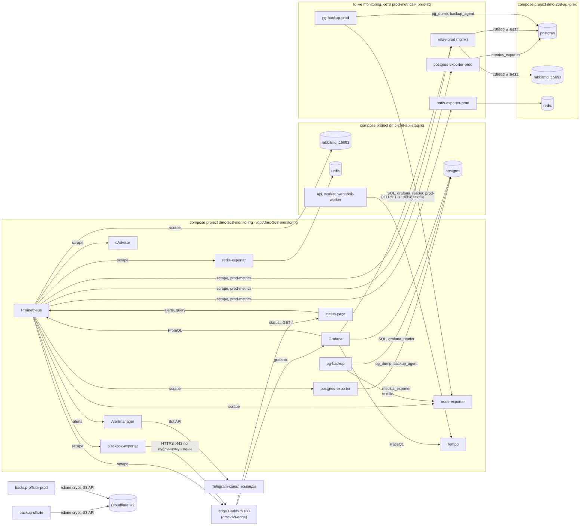

# Мониторинг и алерты — API (команда 6)

Стек мониторинга staging и prod: метрики хоста, контейнеров, очередей, хранилищ и пайплайна ревью, внешние пробы публичных имён и срок их сертификатов, дашборд Grafana, алерты в командный Telegram-канал и ежедневный бэкап PostgreSQL с проверкой восстановления (§9). Это self-hosted стек, который SD §13 («Наблюдаемость») выносит в отдельную задачу. Трейсы пайплайна (OpenTelemetry → Grafana Tempo) и JSON-логи с `run_id` — §11.

## 1. Состав



| Сервис | Образ (по digest) | Лимит памяти | Что даёт |
|---|---|---|---|
| `prometheus` | `prom/prometheus:v3.15.0` | 512m | сбор каждые 30 с, хранение 15 дней / 2 GB, правила алертов |
| `alertmanager` | `prom/alertmanager:v0.34.1` | 64m | группировка, повтор раз в 4 ч, сообщение о resolve, доставка в Telegram |
| `grafana` | `grafana/grafana-oss:13.0.2` | 256m | дашборд `AI Code Reviewer — overview` с переключателем `Environment` (§2), источники Prometheus и PostgreSQL (staging и prod) |
| `node-exporter` | `prom/node-exporter:v1.12.1` | 64m | CPU, память, диск, load хоста; textfile-метрики хостовых задач |
| `cadvisor` | `gcr.io/cadvisor/cadvisor:v0.55.1` | 256m | CPU, память и статус healthcheck каждого контейнера (`api`, `worker`, `webhook-worker`, хранилища) |
| `postgres-exporter` | `quay.io/prometheuscommunity/postgres-exporter:v0.20.1` | 64m | `pg_up`, соединения, размер БД и метрики ревью (`queries.yml`, §4) |
| `redis-exporter` | `oliver006/redis_exporter:v1.94.0` | 32m | память, hit ratio, `redis_up` |
| `blackbox-exporter` | `prom/blackbox-exporter:v0.29.1` | 32m | HTTPS-проба публичных имён раз в минуту и срок их сертификатов (`blackbox/blackbox.yml`, §5) |
| `pg-backup` | `postgres:17.11-alpine` — тот же digest, что у `postgres` staging | 128m | ежедневный `pg_dump` с проверкой восстановления (§9) |
| `status-page` | `python:3.13.18-alpine` | 32m | публичная страница статуса `status.<APP_DOMAIN>` и `staging-status.<APP_DOMAIN>`: читает Prometheus, сводит алерты в 4 компонента (§5); один файл `status/status_page.py` без зависимостей, nobody, read-only root |
| `tempo` | `grafana/tempo:2.10.10` | 256m | трейсы `api`, `worker`, `webhook-worker`: приём OTLP/HTTP на `:4318` внутри сети приложения, хранение 72 ч на локальном диске (§11) |
| `postgres-exporter-prod` | тот же образ и `queries.yml`, что у `postgres-exporter` | 64m | то же для БД prod, под ролью `metrics_exporter` prod (только с `PROD_API_DIR`, §6) |
| `redis-exporter-prod` | тот же образ, что у `redis-exporter` | 32m | то же для Redis prod |
| `relay-prod` | `nginx:1.30-alpine` по digest; конфиг `relay/nginx.conf` | 32m | TCP-ретранслятор: `:15692` → `rabbitmq:15692` (метрики для Prometheus) и `:5432` → `postgres:5432` (источник `PostgreSQL prod` в Grafana) |
| `pg-backup-prod` | тот же образ и тот же скрипт, что у `pg-backup` | 128m | ежедневный `pg_dump` БД prod с проверкой восстановления, под ролью `backup_agent` prod; только в сети prod (только с `PROD_API_DIR`, §9) |
| `backup-offsite-prod` | тот же образ `rclone`, что у `backup-offsite` | 128m | шифрованная копия дампов prod вне VPS в `store:<bucket>/postgres-prod` (только с prod и пятью `BACKUP_S3_*`, `compose.offsite-prod.yml`, §9) |

Сервисы `*-prod` описаны в `compose.prod.yml`, который `deploy.sh` подключает только с prod; без него `--remove-orphans` их убирает. `backup-offsite-prod` — в `compose.offsite-prod.yml`: он подключается, только когда есть и prod, и все пять `BACKUP_S3_*` (иначе `${PROD_BACKUP_DIR}` в файле остался бы без значения). Лимиты памяти — потолки: сумма около 1,6 GB; с тремя сканерами prod — около 1,75 GB; с `pg-backup-prod` — около 1,9 GB; с обеими копиями вне VPS (`backup-offsite` и `backup-offsite-prod`, по 128m) — около 2,1 GB при 8,3 GB RAM VPS (5,8 GB доступно на 02.11.2026).

Длину очередей отдаёт сам RabbitMQ: плагин `rabbitmq_prometheus` включён в образе `rabbitmq:4.3.6-management-alpine`, порт 15692 внутри сети проекта. RPS и коды ответов отдаёт edge-прокси Caddy (`metrics { per_host }`, порт 9180 только в сети `dmc268-edge`, [CICD.md §8.2](CICD.md#82-edge-прокси)). Очередь ревью — RabbitMQ, не Redis: Redis только кэш (SD §10).

Стек — отдельный compose project. Он подключается к сети приложения `<project>_default` как к внешней и к `dmc268-edge`, но в жизненный цикл приложения не входит: его сбой не валит выкат и не запускает откат. `status-page` — единственный сервис стека, до которого доходит интернет (через Caddy): он только в сети проекта (читает Prometheus) и в `dmc268-edge` с alias `status-staging`; сети приложения и его хранилищ у него нет. Host-портов нет (на курсовом VPS их публикует только edge-прокси); в режиме ports (Terraform-хост) Grafana слушает только `127.0.0.1:3000`.

**Prod и сети.** `check-isolation.sh` (его же запускает `Deploy prod`) считает нарушением контейнер сразу в двух сетях приложения, а хранилища prod не имеют права быть ни в какой сети, кроме своей. Prometheus и Grafana уже стоят в сети staging, поэтому в сеть prod они войти не могут. Вместо этого сканеры (`postgres-exporter-prod`, `redis-exporter-prod`, `relay-prod`) стоят в сети prod `<prod project>_default`, а до Prometheus и Grafana их доводят две внутренние сети (`internal: true`, наружу маршрута нет):

| Сеть | Кто в ней | Зачем |
|---|---|---|
| `prod-metrics` | `prometheus`, `postgres-exporter-prod`, `redis-exporter-prod`, `relay-prod` | скрейп экспортеров и RabbitMQ через ретранслятор |
| `prod-sql` | `grafana`, `relay-prod` | SQL-источник `PostgreSQL prod` через ретранслятор |

Grafana не входит в `prod-metrics`, Prometheus — в `prod-sql`, и ни один экспортер не делит сеть с Grafana: у экспортеров есть многоцелевые эндпоинты (`/probe` postgres-exporter, `/scrape` redis-exporter), и администратор Grafana, добавив источник данных на них, заставил бы экспортер подключаться к любому хосту сети prod. Ретранслятор — единственный контейнер во всех трёх сетях (prod, `prod-metrics`, `prod-sql`); он пересылает два фиксированных адреса и резолвит их при каждом соединении (resolver Docker), поэтому пересозданное хранилище prod находится без перезапуска. Ни в одной из двух сетей нет имени или алиаса `postgres`, `rabbitmq`, `redis`: эти имена по-прежнему разрешаются в хранилища staging. Grafana, достающая до `relay-prod:15692`, видит только метрики RabbitMQ.

**Остаточный путь, которого `check-isolation.sh` не видит.** Prometheus и Grafana — контейнеры проекта мониторинга, поэтому проверка допускает их рядом с хранилищами и не сообщает про `prod-metrics`/`prod-sql`. Через `prod-sql` остаётся путь Grafana → `relay-prod:5432` → PostgreSQL prod: ретранслятор не знает ролей, и по нему можно войти любой ролью, пароль которой известен. У Grafana есть только пароль `grafana_reader` (колоночные права, §3), но сам путь открыт. Закрыть его можно `pg_hba` на PostgreSQL prod, разрешив подключения только `grafana_reader` и `metrics_exporter`; он живёт в compose приложения, не в этом стеке, и в эту часть не входит.

## 2. Definition of Done → где смотреть

| Требование | Панель дашборда | Источник |
|---|---|---|
| Latency LLM-запросов | `LLM call p95`, `LLM call latency` (p50/p95/max, 5 мин) | `run_actions` с `tool = 'llm.call'`: одна запись на фактический вызов провайдера, `duration_ms` (PIPELINE_SPEC §2). При промахе кэша conventions в выборку попадает и вызов conventions: вида вызова нет в колонках `run_actions`, доступных роли Grafana |
| Размер очередей | `Messages waiting in review queues`, `Review queues: ready messages`, `… in work and consumers` | `rabbitmq_detailed_queue_messages_ready/unacked/consumers{queue}` |
| RPS | `Requests per second`, `Requests per second by host` | `caddy_http_request_duration_seconds_count{host, environment}`; включает пробы (§5): по запросу в минуту на каждое пробуемое имя — они же попадают в долю 5xx и p95 по хосту |
| Алерты об ошибках в командный канал | §5 | Prometheus → Alertmanager → Telegram |
| Время каждого шага пайплайна | `Phase duration p95`, `Phases over the range` | `run_actions.tool` + `duration_ms`: `vcs.fetch_diff`, `context.build`, `llm.call`, `review.postprocess`, `github.publish_review`, `gitlab.publish_review`, `bitbucket.publish_review`. `context.build` с #168 ч.6 пишется один раз за попытку (сборка контекста по диффу); попытки до выката, дошедшие до ревью, хранят две записи (ещё чтение входа промпта), поэтому на диапазоне через выкат счёт выше, а длительности смешивают два шага; `llm.call` смешивает conventions и ревью |
| Трейс прогона и ошибки (#395) | Explore → источник Tempo | span на доставку `review.run` и на каждую строку `run_actions`, поиск по `run_id` (§11) |
| CPU / RAM серверов и воркеров | `Host CPU`, `Host memory`, `Container CPU`, `Container memory` | node-exporter, cAdvisor (метка `container_label_com_docker_compose_service`) |
| Доступность публичных имён и срок TLS | строка `External probes`: `Public names: probe` (UP/DOWN по имени), `Certificate expires in` (дни, красный < 3, оранжевый < 14 — пороги алертов) | `probe_success{job="blackbox"}`, `probe_ssl_earliest_cert_expiry` (§5). В режиме ports проб нет, обе панели — «No data» |

**Окружение.** Переменная дашборда `Environment` (`staging` по умолчанию, `prod`) переключает все панели сразу: PromQL-панели фильтруются по метке `environment` выбранного окружения, SQL-панели читают источник PostgreSQL этого окружения (`postgres` или `postgres-prod`; значение переменной — uid источника). Не фильтруются панели хоста (`Host CPU`, `Host memory`, `Root filesystem used`) и `LLM spend this month` (бюджет общий); панели контейнеров показывают выбранное окружение и `shared` (контейнеры мониторинга и edge). Панели бэкапов у prod заполняет бэкап prod (§9); без prod-оверлея они пусты. Без prod-оверлея (Terraform-хост, §6) вариант `prod` выбрать можно, но источник не подключается и панели пусты.

Ещё на дашборде: прогоны по итоговому состоянию, failed по `error_code`, стоимость и токены LLM в час (`usage_events`), расход LLM за месяц и доля бюджета, доля 5xx и p95 ответа по хосту, соединения PostgreSQL, память и hit ratio Redis.

## 3. Доступ к данным приложения

Задержки шагов уже лежат в трейсе прогона (`run_actions`), поэтому дашборд и алерты читают PostgreSQL напрямую, без изменений в коде. Доступ — три роли, которые `deploy.sh` создаёт и пересобирает при каждом выкате. `grafana_reader` и `metrics_exporter` есть в БД staging и, с `PROD_API_DIR` (§6), в БД prod, с одинаковыми правами и своими паролями у каждой БД (`PROD_GRAFANA_DB_PASSWORD`, `PROD_PG_EXPORTER_PASSWORD` в `.env` стека); `backup_agent` тоже есть в обеих БД, с теми же правами и своими паролями (`PG_BACKUP_PASSWORD` и `PROD_PG_BACKUP_PASSWORD` в `.env` стека):

| Роль | Кто | Права |
|---|---|---|
| `grafana_reader` | источники PostgreSQL в Grafana: `PostgreSQL` (staging, `postgres:5432`) и `PostgreSQL prod` (`relay-prod:5432` через ретранслятор, §1) | `default_transaction_read_only`, `statement_timeout 30s`, `CONNECTION LIMIT 5`; `SELECT` только на колонки ниже |
| `metrics_exporter` | `postgres-exporter`, `postgres-exporter-prod` | `pg_monitor`, `default_transaction_read_only`, `statement_timeout 15s`, `CONNECTION LIMIT 3`; те же колонки `runs` и `run_actions`, из `usage_events` — только `cost_usd` и `created_at` |
| `backup_agent` | `pg-backup` (staging), `pg-backup-prod` (prod) | `pg_read_all_data` для `pg_dump` и `CREATEDB` для временной БД проверки; без суперпользователя и без записи в данные приложения |

| Таблица | Открытые колонки |
|---|---|
| `runs` | `id`, `state`, `trigger`, `engine`, `attempt`, `error_code`, `available_at`, `created_at`, `started_at`, `finished_at` |
| `run_actions` | `run_id`, `tool`, `started_at`, `duration_ms` |
| `usage_events` | `grafana_reader`: `provider`, `model`, `operation`, `tokens_in`, `tokens_out`, `cache_read_tokens`, `cost_usd`, `created_at`; `metrics_exporter`: только `cost_usd`, `created_at` |

Тела запросов и ответов (`run_actions.request/response`), `review_body`, `error_message`, диффы, находки и комментарии закрыты: каждый выкат делает `REVOKE ALL ON ALL TABLES` и выдаёт заново ровно этот список. Так соблюдается требование SD §13 о данных клиента: стек не видит кода и текстов ревью.

Нагрузка: запросы ограничены окном времени, exporter опрашивается раз в минуту. У `run_actions` нет индекса по `started_at`; при 100 PR/день это тысячи строк в сутки, seq scan дешёвый. Если таблица вырастет до миллионов строк, нужен индекс `(tool, started_at)` отдельной миграцией. Расход за месяц (§4) читает всю историю `usage_events` (около 50 мс на 200 тыс. строк): индекса по одному `created_at` нет, таблица не чистится; при её росте — BRIN- или btree-индекс по `created_at` отдельной миграцией.

## 4. Метрики ревью из PostgreSQL

`deploy/monitoring/postgres-exporter/queries.yml`:

| Метрика | Значение |
|---|---|
| `dmc_runs_finished_15m_runs{state}` | прогоны, завершившиеся за 15 мин, по состоянию |
| `dmc_runs_active_queued`, `…_in_progress`, `…_stale_queued` | незавершённые прогоны; `stale_queued` — `queued` дольше 10 мин после `available_at` (T18). Run, ждущий долгий `Retry-After`, попадает сюда до ближайшего прохода реконсилера, то есть до 5 мин ([PIPELINE_SPEC §4.2](PIPELINE_SPEC.md#42-задержки)) |
| `dmc_llm_calls_15m_calls`, `…_p50_seconds`, `…_p95_seconds` | вызовы LLM за 15 мин и их длительность |
| `dmc_llm_cost_month_usd` | расход LLM в USD по `usage_events` с 1-го числа месяца (UTC) |
| `dmc_runs_budget_paused_15m_runs` | прогоны, пропущенные с `budget_paused` за 15 мин |
| `dmc_llm_monthly_budget_usd` | не из `queries.yml`: месячный бюджет из `LLM_MONTHLY_BUDGET_USD`, textfile-метрика node-exporter `textfile/llm_budget.prom`, её пишет `deploy.sh` (§6) |

## 5. Алерты

Правила — `deploy/monitoring/prometheus/rules/alerts.yml`, unit-тесты — `tests/monitoring/alerts.test.yml`. Сообщение: статус, окружение, severity и по строке на алерт с его именем; только числа и имена — без содержимого ревью и секретов.

**Метка `environment`.** У каждой серии и каждого алерта она есть: `staging`, `prod` или `shared`. Её ставит не Prometheus целиком (`external_labels` нет), а цель или серия: хранилища staging — статическая метка job'а, хранилища prod — файлы `prometheus/targets/{postgres,redis,rabbitmq}-prod.json`, которые пишет `deploy.sh`; пробы — `environment` рядом с `host` в `probes.json`; серии cAdvisor — по compose project (`*-prod` → `prod`, `*-staging`, `dmc-268-api` и `dmc-268-ui` → `staging`, остальные — `shared`); серии Caddy — по `host` (`staging.`/`staging-…` → `staging`; `api.`, `ui.`, `webhook.` → `prod`; Grafana, апекс, `www.`, `_other` — `shared`); node-exporter, Prometheus, Alertmanager, Grafana и сам `up` Caddy — `shared`; textfile-серии `dmc_pg_backup_*` несут метку (`staging` или `prod`), которую пишет сам скрипт бэкапа (`BACKUP_ENVIRONMENT` сервиса; без неё или с чужим значением он не стартует), а job `node` с `honor_labels: true` её не трогает; серия без метки (старый файл до перезаписи) стала бы `shared`. Правила агрегируют `by (environment, …)`, поэтому авария в одном окружении не прячется за здоровым другим и приходит с его именем. Алерты бюджета LLM суммируют оба окружения (один ключ провайдера) и несут `environment: shared`. Alertmanager группирует по `alertname` и `environment`, а заголовок Telegram печатает окружение.

Два вида алертов. **Состояние** (диск, очередь без консьюмера, цель недоступна): напоминание раз в 4 ч, пока условие держится, и сообщение RESOLVED. **Событие** (метка `kind: event`: упавший прогон, новое сообщение в DLQ): уходит без RESOLVED — оно «закрывается» лишь потому, что выходит из 15-минутного окна (`ReviewRunsBudgetPaused` — через час после этого, ниже); если события идут подряд дольше 4 ч, напоминание приходит, как у состояния. События за 90 с собираются в одно сообщение: прогон, исчерпавший попытки, — это и `failed`, и сообщение в `reviews.dlq` (PIPELINE_SPEC §4.4), и оба приходят вместе.

| Алерт | Условие | Severity |
|---|---|---|
| `TargetDown` | цель не отвечает 5 мин | critical |
| `PostgresDown` / `RedisDown` | `pg_up == 0` 2 мин / `redis_up == 0` 5 мин | critical / warning |
| `ApiHigh5xxRate` | > 5 % ответов 5xx на `staging-api`/`staging-ui` и `api`/`ui` 5 мин (при > 0.05 rps), по окружению хоста. `staging-webhook` и `webhook` не входят: это заглушки 503 без сервиса, вебхуки GitHub принимает `api` (CICD.md §8.2) | critical |
| `PublicEndpointDown` | HTTPS-проба имени (метка `host`) не проходит 5 мин: нет соединения, ошибка TLS или итоговый ответ не 2xx, 4xx и заглушка 503 тоже. Трафик пользователей не нужен | critical |
| `WebhookWorkerDown` | в compose project `dmc-268-api*` (staging, prod, Terraform-хост) 5 мин `webhook-worker` unhealthy или не запущен при запущенном `postgres` | critical |
| `TlsCertificateExpiresSoon` / `TlsCertificateExpiring` | самому раннему сертификату имени осталось < 14 / < 3 дней, 10 мин | warning / critical |
| `ReviewRunsFailed` | хотя бы один прогон `failed` за 15 мин; событие | warning |
| `ReviewDeadLetters` | новые сообщения в `reviews.dlq` за 15 мин; событие. Размер DLQ (хранение 7 дней) — на панели `Review queues: ready messages` | critical |
| `ReviewQueueBacklog` | > 20 готовых сообщений в `review.run.*`/`review.publish` 10 мин | warning |
| `ReviewQueueWithoutConsumer` | у `review.run.fast` или `review.publish` нет консьюмера 5 мин | critical |
| `ReviewRunsStuckInQueue` | есть `stale_queued` 5 мин. Ожидание долгого `Retry-After` держит Run в `stale_queued` до 5 мин и может задеть это условие ([PIPELINE_SPEC §4.2](PIPELINE_SPEC.md#42-задержки)) | warning |
| `LlmLatencyHigh` | p95 LLM > 60 с при ≥ 3 вызовах, 10 мин (таймаут fast — 90 с) | warning |
| `LlmMonthlyBudgetWarning` | расход LLM за месяц ≥ 80 % и < 100 % бюджета `LLM_MONTHLY_BUDGET_USD`, 5 мин | warning |
| `LlmMonthlyBudgetExceeded` | расход LLM за месяц ≥ 100 % бюджета, без ожидания | critical |
| `ReviewRunsBudgetPaused` | хотя бы один прогон `skipped` с `budget_paused` за 15 мин; событие | warning |
| `HostMemoryLow` / `HostDiskFull` / `HostCpuHigh` | < 10 % памяти 10 мин / < 15 % диска 10 мин / > 90 % CPU 15 мин | critical / critical / warning |
| `ContainerOomKilled` | OOM-kill в контейнере compose за 10 мин | warning |
| `PostgresBackupStale` | последнему проверенному дампу больше 26 ч, по окружению | critical |
| `PostgresBackupMissing` | heartbeat `pg-backup` / `pg-backup-prod` старше 2 ч или его нет (сервис остановлен, удалён или не может писать). Файл метрик переживает контейнер, поэтому смотрим на возраст heartbeat. Отсутствие heartbeat staging — всегда алерт; prod — только когда хост мониторит prod (есть цель `postgres` с `environment="prod"`), иначе на хосте без prod (Terraform) алерт горел бы вечно | critical |
| `PostgresBackupFailed` | последняя попытка бэкапа упала, по окружению | warning |
| `PostgresBackupOffsiteStale` | копия в бакет не обновлялась 3 ч, по окружению (только при включённой выгрузке) | critical |
| `PostgresBackupOffsiteFailing` | все проходы выгрузки за час упали, по окружению | warning |

**Пробы.** Раз в минуту Prometheus (job `blackbox`, таймаут 20 с) просит `blackbox-exporter` (модуль `https_2xx`: только IPv4 и HTTPS, таймаут 15 с, редиректы проходятся) открыть `https://staging-api.<APP_DOMAIN>/healthcheck` и `https://staging-ui.<APP_DOMAIN>/health`. Prod-имена `https://api.<APP_DOMAIN>/healthcheck` и `https://ui.<APP_DOMAIN>/health` добавляет variable `PROBE_PROD_HOSTS` (§6), когда имя уже обслуживает prod: до выката оно отвечает заглушкой 503 и держало бы critical. Проба идёт как внешний клиент — публичный DNS, опубликованный порт 443 edge-прокси на том же VPS, сертификат и маршрут Caddy. Метка `host` — имя, как у `ApiHigh5xxRate`, `instance` — URL, `environment` — `staging` или `prod` по списку, из которого `deploy.sh` взял имя.

Inhibit-правил нет, и одна причина даёт несколько алертов: упавшее staging-имя при пользовательском трафике — `ApiHigh5xxRate` и `PublicEndpointDown` с тем же `host` (сами пробы, ~0.017 rps на имя, порог 0.05 rps не достают); упавший Caddy — `TargetDown{job="caddy"}` и `PublicEndpointDown` на каждое имя; ниже 3 дней — оба алерта сертификата. Упал сам экспортер — `TargetDown{job="blackbox"}`, а `PublicEndpointDown` молчит: серии проб устаревают.

**Сертификаты.** `probe_ssl_earliest_cert_expiry` — самый ранний срок среди сертификатов, которые отдаёт имя (лист и промежуточные); если в цепочке появится короткоживущий cross-sign, замена — `probe_ssl_last_chain_expiry_timestamp_seconds` (лучшая проверенная цепочка). Caddy продлевает при остатке около трети срока: 30 д из 90, ≈ 21 д из 64 (Let's Encrypt с февраля 2027), 15 д из 45 (с февраля 2028), так что warning значит «продление не удалось»; у 45-дневных запас над 14 д — сутки, пороги пересмотреть до февраля 2028. Срок виден, пока проба получает TLS-ответ (заглушка 503 его даёт). Правила читают его через `last_over_time(…[10m])`: проба без TLS-ответа короче 10 мин не перезапускает `for` и не гасит алерты, а дольше, в том числе на просроченном сертификате (рукопожатие рвётся), — гасит (RESOLVED, срок в сообщении может быть «-0.0 days»), и падение дальше несёт `PublicEndpointDown`. Имя, убранное из `PROBE_PROD_HOSTS`, держит свои алерты сертификата до 10 мин.

**`webhook-worker`.** Очереди у него нет (слушает `NOTIFY` PostgreSQL и только публикует), поэтому `WebhookWorkerDown` смотрит cAdvisor по compose project: `container_health_state` — Docker healthcheck по heartbeat-файлу (1 healthy, 0 starting или unhealthy, −1 без healthcheck — не алерт), или контейнера нет при запущенном `postgres` того же проекта. Остановка даёт алерт примерно через 6 мин: cAdvisor теряет контейнер сразу, серия устаревает на следующем скрейпе (`track_timestamps_staleness` у job `cadvisor`). Unhealthy — около 6 мин после отметки Docker, у простаивающего контейнера до 8 мин: cAdvisor обновляет статус раз в 30–60 с, у такого контейнера до 120 с. Сама отметка — около минуты после остановки heartbeat. Пересоздание при выкате короче 5 мин алерта не даёт, crash loop даёт, а медленный crash loop, где контейнер каждый раз успевает стать healthy, — нет: числа рестартов cAdvisor не отдаёт. Падение cAdvisor ложного алерта не даёт: все серии устаревают вместе, горит `TargetDown{job="cadvisor"}`. Проект целиком (вместе с `postgres`) здесь не алертит: для staging и prod это `PostgresDown`, `TargetDown` (экспортеры) и `PublicEndpointDown` с той же меткой `environment`.

**Плановая остановка.** Сервис, остановленный дольше 5 мин, даёт свой алерт (метка `environment` в `silence` нужна, чтобы не заглушить тот же алерт у prod): `webhook-worker` — `WebhookWorkerDown`, `api` — `PublicEndpointDown` для `staging-api.<APP_DOMAIN>` (staging: `staging-api.dmc268-t6.axyi.ru`), `worker` — `ReviewQueueWithoutConsumer`. Восстановление §9 и ручная остановка writers в [CICD.md](CICD.md) останавливают все три — на время работ алерты глушат; `silence add` печатает ID, снять раньше — `am silence expire <ID>`:

```bash
am() { docker compose -p dmc-268-monitoring exec -T alertmanager amtool --alertmanager.url=http://localhost:9093 "$@"; }
am silence add alertname=WebhookWorkerDown environment=staging container_label_com_docker_compose_project=dmc-268-api-staging --duration=1h --comment=restore
am silence add alertname=PublicEndpointDown environment=staging host=staging-api.dmc268-t6.axyi.ru --duration=1h --comment=restore
am silence add alertname=ReviewQueueWithoutConsumer environment=staging --duration=1h --comment=restore
```

**Бюджет LLM.** Алерты бюджета делят сумму `dmc_llm_cost_month_usd` по всем БД, которые опрашивает этот Prometheus (метка `environment` у алерта — `shared`), на `dmc_llm_monthly_budget_usd`; в сообщении — сумма в USD и доля бюджета, на дашборде — панель `LLM spend this month`. Порог — repository variable `LLM_MONTHLY_BUDGET_USD` (§6, [SECRETS.md](SECRETS.md)); новое значение действует после перезапуска `Deploy monitoring` или следующего выката из `main`. Не задана в CI, пуста или `0` — оба алерта молчат, в логе job `Deploy monitoring` строка `budget: LLM_MONTHLY_BUDGET_USD is not set; budget alerts are silent`. Это алерты состояния с `keep_firing_for`: у warning 5 мин, у critical 30 мин. Пропуск опросов короче этого срока алерт не гасит — critical переживает и простой или перезапуск postgres-exporter до 30 мин (о простое сообщает `TargetDown`, о недоступной БД — `PostgresDown`; если падает только запрос суммы, отдельного алерта нет), — а RESOLVED приходит примерно через этот срок после того, как условие перестало выполняться: например, 1-го числа (UTC), когда сумма обнуляется, или после повышения бюджета critical гаснет только через 30 мин. На 100 % critical приходит сразу, а warning остаётся активным ещё около 5 мин и присылает RESOLVED позже (inhibit-правил нет); с 30 мин он горел бы рядом с critical полчаса. Алерты не останавливают ревью. Сумма занижает счёт провайдера: `eval-live.yml` и `llm-live-run.yml` тратят тот же ключ `AI_DMC268_T6`, но в `usage_events` не пишут.

`ReviewRunsBudgetPaused` — не месячный бюджет, а дневной бюджет каждого Workspace (PIPELINE_SPEC §5.3, §6): приложение пропускает прогоны Workspace, у которого остаток дневного бюджета меньше лимита стоимости прогона fast ($0.50). Алерт считает такие прогоны и не называет Workspace: `workspace_id` экспортеру не выдан. Как событие он приходит без RESOLVED; `keep_firing_for: 1h` держит его активным ещё час после того, как окно 15 мин опустело, поэтому серия пропусков — одно сообщение, даже если пуши в такой Workspace приходят реже раза в 15 мин. Пока алерт активен, он повторяется раз в 4 ч и в каждом новом сообщении событий.

**Публичная страница статуса.** `https://status.<APP_DOMAIN>/` (секции prod и staging) и `https://staging-status.<APP_DOMAIN>/` (только staging), без логина (#309). Сервис `status-page` (`deploy/monitoring/status/status_page.py`, только stdlib) раз в 30 с читает Prometheus по сети проекта и сводит firing-алерты в четыре компонента по фиксированной таблице; публичный запрос до Prometheus не доходит, страница отдаёт последний снимок и сама обновляется раз в 30 с. Показываются только имя компонента, имя алерта, публичный текст из таблицы и время (UTC), метки и аннотации алертов — никогда: в них команды `docker compose`, URL и суммы в USD.

| Компонент | Алерты | Покрытие (есть данные) |
|---|---|---|
| API | `PublicEndpointDown` и `ApiHigh5xxRate` по роли `host` = `api`, `PostgresDown` | проба `probe_success` имени `staging-api.` / `api.` |
| UI | то же по роли `ui` | проба `staging-ui.` / `ui.` |
| Ревью PR | `ReviewQueueWithoutConsumer`, `ReviewRunsStuckInQueue`, `TargetDown` (job `rabbitmq`, `rabbitmq-queues`), `PostgresDown` | `rabbitmq_detailed_queue_consumers` очередей ревью |
| Приём вебхуков | `WebhookWorkerDown`, `PublicEndpointDown` роли `api` (приём идёт через API), `PostgresDown` | `container_last_seen` `postgres` проекта: пропажа `webhook-worker` — это алерт, а не «нет данных» |

Роль `host` — имя без префикса `staging-`: одна строка таблицы служит и `staging-api.`, и `api.`. Окружение firing-алерта решает первое подходящее правило: метка `host` (`staging-…` — staging, иначе prod); compose project (`…-prod` — prod, иначе staging); метка `environment` (`shared` — оба); иначе staging (серия без этих меток — по умолчанию staging). Состояние: есть firing-алерт компонента в окружении — «не работает с» (минимальный `activeAt`); иначе нет данных покрытия — «нет данных» (prod без своих серий: оверлей prod не подключён, `PROD_API_DIR` пуст); иначе «работает с» (последний firing-сэмпл за 7 дней, запрос `max_over_time(timestamp(ALERTS{…})[7d:1m])`, его проверяет `tests/monitoring/status.test.yml`; точность около минуты) или «сбоев за 7 дн. не было». Pending-алерты не считаются. Prometheus недоступен, ответ не разобран или снимок старше 2 мин — у всех «нет данных», а не «работает». Плановый silence страницу не меняет: компонент правда не работает. Тот же файл прогоняет под promtool восемь выражений наличия на сериях в форме main (`environment` от цели или relabeling): выражение окружения отвечает сериями только этого окружения, а `tests/test_status_page.py` сверяет их текст с литералами и с файлом.

Не показываются (список держит тест, новый алерт без решения краснит `tests/test_status_page.py`): `TargetDown` прочих job, `RedisDown`, алерты сертификатов, события (`ReviewRunsFailed`, `ReviewDeadLetters`, `ReviewRunsBudgetPaused`), деградация и расход (`ReviewQueueBacklog`, `LlmLatencyHigh`, `LlmMonthlyBudgetWarning`, `LlmMonthlyBudgetExceeded`: алерты бюджета ревью не останавливают), хост и контейнеры (`HostMemoryLow`, `HostDiskFull`, `HostCpuHigh`, `ContainerOomKilled`) и пять `PostgresBackup*`. Строки страницы несут `data-env`, `data-component`, `data-state` (`up`, `down`, `unknown`) и `data-alerts`: по ним acceptance (§10) проверяет страницу.

**Подключение Telegram** (один раз):

1. Создать бота у `@BotFather`, добавить его в командный чат.
2. Узнать `chat_id`: написать в чат и открыть `https://api.telegram.org/bot<token>/getUpdates` (у группы id отрицательный, `-100…`).
3. В Environment `staging`: secret `ALERT_TELEGRAM_BOT_TOKEN`, variable `ALERT_TELEGRAM_CHAT_ID` ([SECRETS.md](SECRETS.md)).
4. Перезапустить `Deploy monitoring` (Re-run job) или дождаться пуша в `main`.

Без этих имён стек работает, алерты видны в Alertmanager, но никуда не уходят — `deploy.sh` пишет об этом в лог job. Задано только одно из двух — выкат падает до изменений на хосте.

## 6. Выкат

Job `Deploy monitoring` в `ci-cd.yml` запускается после успешного `Deploy staging` в своей группе concurrency `staging-monitoring` (не `staging-deploy`: там он держал бы lock VPS на время своего выката и задерживал `Promote staging tag` и всех ждущих за ним; сбой мониторинга приложение не откатывает):

1. `scp` содержимого `deploy/monitoring`, `deploy/scripts/env-file.sh` и `deploy/scripts/check-isolation.sh` в `/opt/dmc-268-monitoring`.
2. `deploy.sh`:
   - читает `<APP_DIR>/.env` приложения (пользователь и БД PostgreSQL, пароль Redis, режим edge/ports); проверяет сеть `<project>_default` и контейнер `postgres`;
   - если задан `PROD_API_DIR` (см. ниже) — проверяет prod до любых изменений на хосте: `.env` приложения prod, сеть `<prod project>_default`, ровно один запущенный `postgres`, проект не совпадает со staging, `POSTGRES_USER` и `POSTGRES_DB` — строчные SQL-идентификаторы;
   - проверяет входы: в режиме edge `GRAFANA_ROOT_URL` и `APP_DOMAIN` (базовый домен проб, repository variable), всегда `PROBE_PROD_HOSTS` (variable Environment `staging`, по умолчанию пусто ([SECRETS.md](SECRETS.md)); prod-имена в пробах: `api`, `ui` или `api ui`; задана, даже пустой, — применяется и сохраняется в `.env` стека, не задана при ручном запуске — остаётся прежняя) и настройки Telegram. Неверное значение — выкат падает до изменений на хосте;
   - генерирует один раз пароли стека (`.env` 0600; с prod и `PROD_PG_BACKUP_PASSWORD`);
   - создаёт каталоги дампов `BACKUP_DIR` и, с prod, `PROD_BACKUP_DIR` (`/var/backups/dmc-268/<prod project>`, 0700, владелец пользователь `postgres` образа, 70:70);
   - создаёт и пересобирает роли PostgreSQL (§3) в БД staging и, с prod, в БД prod (`grafana_reader`, `metrics_exporter` и `backup_agent`, свои пароли у каждой БД);
   - пишет порог бюджета LLM (§5) из `LLM_MONTHLY_BUDGET_USD` в `textfile/llm_budget.prom` (0644). Пусто или `0` (в CI незаданная variable приходит пустой) — файл удаляется; не задана при ручном запуске — остаётся прежний; файла нет — строка в логе job. Не число долларов с не более чем двумя знаками после точки — выкат падает до изменений на хосте;
   - пишет конфиг Alertmanager и файл токена, цели Prometheus: Caddy, пробы и `*-prod.json` (без prod или в режиме ports — пустые списки);
   - `docker compose -p dmc-268-monitoring up -d --wait`, с `-f compose.prod.yml`, если prod задан, `-f compose.offsite.yml`, если заданы `BACKUP_S3_*`, и `-f compose.offsite-prod.yml`, если заданы и prod, и `BACKUP_S3_*`. Метка с хешем каталога конфигурации пересоздаёт сервис ровно тогда, когда его конфигурация изменилась;
   - синхронизирует пароль `admin` Grafana с `.env`;
   - с prod запускает `check-isolation.sh <prod project> <staging project>` (рядом со скриптом или в `../scripts`) и печатает его таблицу в лог. Код 1 (нарушение) валит выкат; код 2 или отсутствие скрипта — только предупреждение `isolation not checked`, как в `Deploy prod`.

**`PROD_API_DIR`** — каталог приложения prod (`/opt/dmc-268-api-prod`), тот же контракт, что у `PROBE_PROD_HOSTS`: задан — prod обязателен и должен работать, иначе выкат падает до изменений на хосте; пуст — prod не мониторится, списки целей пусты, оверлей не подключается (и `--remove-orphans` убирает сканеры); не задан при ручном запуске — берётся значение из `.env` стека. Job `Deploy monitoring` передаёт `/opt/dmc-268-api-prod` в режиме `course` и пустое значение в режиме `terraform` (prod есть только на курсовом VPS). Выкат красный, пока `postgres` prod не работает или идёт `Deploy prod` (другая группа concurrency): уже запущенный стек продолжает работать и алертить (`PostgresDown` с `environment=prod`), нужен повторный запуск. Ещё одна причина — миграция, добавившая колонку из grant-списков (§3): она доходит до staging раньше, поэтому grant в БД prod падает (`failed to grant the monitoring roles in the prod database`), пока `Deploy prod` не мигрирует prod. Роли staging к этому моменту уже выданы заново (идемпотентно), `.env` и compose стека не обновлены; после `Deploy prod` запустить `Deploy monitoring` ещё раз.

При `compose down` (откат prod, остановка) сервисы мониторинга на сети prod остаются подключёнными: compose печатает `Resource is still in use` для сети и завершается с кодом 0 (проверено локально: проект и внешний контейнер на его сети). Так же уже работает staging.

Каталоги `prometheus`, `grafana`, `postgres-exporter`, `backup`, `blackbox`, `relay`, `status` и шаблоны Alertmanager `deploy.sh` отдаёт на чтение nobody (755/644). Файлы на хосте: `.env` (0600; с prod в нём ещё `PROD_API_DIR`, `PROD_API_NETWORK`, `PROD_POSTGRES_DB`, `PROD_REDIS_PASSWORD`, `PROD_GRAFANA_DB_PASSWORD`, `PROD_PG_EXPORTER_PASSWORD`, `PROD_PG_BACKUP_PASSWORD`, `PROD_BACKUP_DIR`, `RELAY_CONFIG_DIGEST`), `alertmanager/alertmanager.yml`, `alertmanager/secrets/telegram_bot_token` (0400), `prometheus/targets/caddy.json`, `prometheus/targets/probes.json` и `prometheus/targets/{postgres,redis,rabbitmq}-prod.json` (их нет в репозитории: выкат, упавший до `deploy.sh`, оставляет прежние цели), `textfile/` (textfile-метрики node-exporter: `pg_backup.prom`, `pg_backup_heartbeat.prom`, `pg_backup_offsite.prom` пишут `pg-backup` и `backup-offsite`; `pg_backup_prod.prom`, `pg_backup_prod_heartbeat.prom`, `pg_backup_offsite_prod.prom` — их prod-двойники; порог бюджета `llm_budget.prom` — `deploy.sh`), дампы — `/var/backups/dmc-268/<project>/` и `/var/backups/dmc-268/<prod project>/` (0700, §9). Тома: `prometheus-data`, `alertmanager-data`, `grafana-data`, `tempo-data`.

Откат приложения стек не трогает. Откатить сам мониторинг — перезапустить job `Deploy monitoring` на нужном коммите или выполнить `deploy.sh` из его checkout.

## 7. Доступ

| Цель | Grafana | Prometheus / Alertmanager |
|---|---|---|
| Курсовой VPS | `https://grafana.<APP_DOMAIN>/` (staging: `https://grafana.dmc268-t6.axyi.ru/`), пользователь `admin`, пароль задаётся secret `GRAFANA_ADMIN_PASSWORD` Environment `staging`. GitHub его значение не показывает: копия — у того, кто задал secret (командный менеджер паролей или техлид). Потерян — перезаписать secret и перезапустить `Deploy monitoring`, либо прочитать `GRAFANA_ADMIN_PASSWORD` из `/opt/dmc-268-monitoring/.env` по SSH (так же, пока secret не задан) | без внешнего доступа: `docker compose -p dmc-268-monitoring exec prometheus wget -qO- localhost:9090/api/v1/alerts` |
| Terraform-хост | SSH-туннель: `ssh -L 3000:127.0.0.1:3000 …`, затем `http://localhost:3000/` | то же |

Grafana — на своём хосте `grafana.<APP_DOMAIN>` (A-запись на VPS). Регистрация и анонимный доступ выключены, cookie `Secure`, `/metrics` Grafana (он без логина) edge отвечает 404 — Prometheus читает его внутри docker-сети, дашборды и источники данных доступны в UI только для чтения: изменения идут через PR в `deploy/monitoring/grafana`. Публичная страница статуса — `status.<APP_DOMAIN>` (prod и staging) и `staging-status.<APP_DOMAIN>` (staging), без логина (§5): Caddy отдаёт только `GET` и `HEAD` на `/` и отвечает 404 на любой другой путь, поэтому ни путь Prometheus, Alertmanager или Grafana наружу не попадает. Имена `prometheus.<APP_DOMAIN>` и `victoria-metrics.<APP_DOMAIN>` тоже указывают на VPS, но сайта в Caddyfile не получают: у Prometheus нет аутентификации, запросы к нему — через Explore в Grafana; VictoriaMetrics в стеке нет.

## 8. Ограничения и следующие шаги

| Что | Статус |
|---|---|
| Сквозной трейсинг, трекинг ошибок, JSON-логи с `run_id` | сделано в #395: OpenTelemetry → Grafana Tempo, §11 |
| Redis | бэкапить нечего: на staging он без тома и без персистентности (`save ""`, `appendonly no`), это кэш (SD §10) |
| Метрики приложения (`/metrics` FastAPI, `X-RateLimit-Remaining` GitHub) | нужен код и зависимость; пока RPS и коды — с edge-прокси, пайплайн — из `run_actions` |
| prod | мониторится так же, как staging: хранилища скрейпят сканеры `*-prod` (§1), роли — §3, алерты и дашборд различают окружения (§5, §2). Бэкап БД prod и его копия вне VPS — §9. Чего нет: SLA и retention (часть 6); апекс и `www.` остаются `shared`, пока нет лендинга prod. Остаточный путь Grafana → `relay-prod:5432` → PostgreSQL prod и то, что `check-isolation.sh` его не видит, — §1 |
| Страница статуса | сервис выкатывает `Deploy monitoring`, маршрут Caddy — `deploy-staging` и `rollback.yml` (job `Deploy monitoring` edge не трогает, [CICD.md](CICD.md) §8.2): до `Deploy monitoring` `status.*` отвечает 502, откат staging на коммит до #309 убирает маршрут. Prod различим по `environment` серий (§1) и по `host` и compose project; без оверлея prod (`PROD_API_DIR` пуст) его компоненты — «нет данных». |
| Пробы публичных имён | идут с того же VPS: падение VPS целиком или его сети они не видят — вместе с ними молчит весь стек; нужен внешний пробник |
| cAdvisor | читает состояние Docker через `/var/run` (сокеты Docker и containerd), что равносильно root на хосте; сетей, кроме сети проекта, и портов у него нет |

## 9. Бэкапы PostgreSQL

Бэкап есть у каждого окружения: `pg-backup` (БД staging) и `pg-backup-prod` (БД prod, только с `PROD_API_DIR`). Оба запускают один скрипт `deploy/monitoring/backup/pg-backup.sh` и один образ; различает их переменная `BACKUP_ENVIRONMENT` (`staging` или `prod`, без неё или с другим значением скрипт не стартует, код 2): она становится меткой `environment` каждой метрики. Всё остальное у них отдельное:

| | staging | prod |
|---|---|---|
| Сервис дампа | `pg-backup` | `pg-backup-prod` |
| Сеть | сеть приложения staging | только сеть prod: `PGHOST=postgres` — это БД prod |
| Роль и пароль | `backup_agent`, `PG_BACKUP_PASSWORD` | `backup_agent` БД prod, `PROD_PG_BACKUP_PASSWORD` |
| Каталог дампов | `/var/backups/dmc-268/dmc-268-api-staging/` (`BACKUP_DIR`) | `/var/backups/dmc-268/dmc-268-api-prod/` (`PROD_BACKUP_DIR`) |
| Файлы метрик (`textfile/`) | `pg_backup.prom`, `pg_backup_heartbeat.prom`, `pg_backup_offsite.prom` | `pg_backup_prod.prom`, `pg_backup_prod_heartbeat.prom`, `pg_backup_offsite_prod.prom` |
| Сервис копии вне VPS | `backup-offsite` (`compose.offsite.yml`) | `backup-offsite-prod` (`compose.offsite-prod.yml`) |
| Путь в бакете | `store:<bucket>/postgres` | `store:<bucket>/postgres-prod` |

Каталоги дампов не должны совпадать и один не должен лежать внутри другого (пути сравниваются после нормализации): иначе сервисы считали и удаляли бы чужие дампы, а копии вне VPS смешались бы; `deploy.sh` в таком случае падает до изменений на хосте.

Файлы метрик у окружений разные: node-exporter читает все `*.prom` каталога, а два файла с одним именем перезаписали бы друг друга. Серии с одним именем из двух файлов он склеивает только при одинаковых `# HELP` и `# TYPE`, поэтому скрипт у обоих один (проверено локально на `prom/node-exporter:v1.12.1`: оба окружения в `/metrics`, `node_textfile_scrape_error 0`).

Сервис раз в 5 минут проверяет возраст последнего дампа и, если он старше суток, делает новый:

1. Проверка места: свободно на диске каталога бэкапов не меньше 2 × `pg_database_size` (дамп и временная БД; на VPS каталог и тома Docker на одном корневом разделе). Иначе попытка падает до записи чего-либо.
2. Снимок: транзакция `REPEATABLE READ` на исходной БД делает `pg_export_snapshot()` и в нём же снимает отпечаток — ревизию `alembic_version` и число строк каждой таблицы схемы `public`.
3. `pg_dump --format=custom --snapshot=<снимок>` от роли `backup_agent` во временный `*.partial`: дамп ровно того состояния, по которому снят отпечаток. Дамп сохраняет владельцев и права для настоящего восстановления.
4. Проверка восстановления: `pg_restore --no-owner --no-privileges` во временную БД `dmc_restore_check`, отпечаток восстановленной БД должен совпасть построчно. Запись или миграция во время дампа ложной ошибки не дают (обе стороны из одного снимка), а потерянная строка или таблица ловится. Проверено под постоянной записью: три бэкапа подряд, до 104 255 строк, все совпали.
5. Только после проверки — переименование в `<db>-<UTC>.dump` (0600) и удаление дампов старше 7 дней.
6. Метрики `dmc_pg_backup_*{environment="…"}` → `textfile/pg_backup.prom` (prod: `pg_backup_prod.prom`), heartbeat каждые 5 мин → `textfile/pg_backup_heartbeat.prom` (prod: `pg_backup_prod_heartbeat.prom`) → node-exporter → алерты §5 и строка `PostgreSQL backups` дашборда (переключатель `Environment`). При старте `pg-backup` и `backup-offsite` ставят свою метку в файле, записанном прежней версией без неё: панели staging не пустеют до следующей попытки, а немеченый файл не лежит рядом с меченым файлом prod (одно семейство метрик с двумя наборами меток).

Упавшая попытка повторяется через час. Дамп, не прошедший проверку, не сохраняется.

| Параметр | Значение | Где менять |
|---|---|---|
| Период | 24 ч (`BACKUP_INTERVAL_SECONDS`) | `deploy/monitoring/compose.yml` |
| Хранение | 7 дней (`BACKUP_RETENTION_DAYS`) | там же |
| Каталог | `/var/backups/dmc-268/<project>/` на хосте, вне каталогов стеков | `BACKUP_DIR` (staging) и `PROD_BACKUP_DIR` (prod) для `deploy.sh` |
| Размер | ~110 КБ на staging (10.2026); prod ещё не замерен | дашборд (переключатель `Environment`), `dmc_pg_backup_last_size_bytes` |

Бэкап вне расписания: `docker compose -p dmc-268-monitoring exec pg-backup sh /opt/pg-backup/pg-backup.sh once` (prod: сервис `pg-backup-prod`).

**Что бэкап prod делает с БД prod.** Роль `backup_agent` prod — те же права, что на staging: `pg_read_all_data`, `CREATEDB`, `CONNECTION LIMIT 3`, без суперпользователя и записи в данные. Проверка восстановления ежедневно создаёт и удаляет временную БД `dmc_restore_check` на самом сервере prod (нагрузка на CPU и диск порядка размера БД, сейчас секунды). Проверять восстановление на другом сервере скрипт не умеет по построению.

**Диск и память.** На хосте 68 из 105 GB свободно (02.11.2026), TSDB Prometheus 505 МБ. Каталоги дампов, тома Docker и TSDB делят один корневой раздел; страхуют проверка 2 × размер БД перед попыткой каждого сервиса, хранение 7 дней и алерт `HostDiskFull` (< 15 % свободно, оба окружения). Проверки сервисов друг о друге не знают: два дампа одновременно теоретически могут оба пройти проверку и не поместиться, раннее предупреждение — панель размера дампа по окружению. Лимиты памяти и суммы — §1.

**Версия `pg_dump`.** `pg-backup-prod` берёт образ из `staging.yml` на `main`, а сервер prod работает на образе последнего `Deploy prod`. После повышения версии PostgreSQL клиент старше сервера не сможет сделать дамп: попытка упадёт заметно (`PostgresBackupFailed` с `environment="prod"`), молча ничего не пропускается; образ `pg-backup` меняют вместе с версией PostgreSQL prod.

**Восстановление** (проверено на дампе staging-схемы: та же ревизия, таблицы и данные, владелец `app`). Перед заменой рабочей БД — правила [CICD.md §5](CICD.md#5-rollback) «Действия при отказе»: окно обслуживания, остановка пишущих процессов, бэкап текущей БД. Остановку дольше 5 мин заранее заглушить в Alertmanager (§5, «Плановая остановка»).

```bash
cd /opt/dmc-268-api-staging
pg=$(docker compose -p dmc-268-api-staging ps -q postgres)
dump=/var/backups/dmc-268/dmc-268-api-staging/<выбранный>.dump

# 1. Проверить дамп в отдельной БД
docker exec "$pg" createdb -U app -O app restore_drill
docker exec -i "$pg" pg_restore -U app -d restore_drill --no-owner --role=app \
  --exit-on-error --single-transaction < "$dump"
docker exec "$pg" psql -U app -d restore_drill -Atc 'SELECT version_num FROM alembic_version'

# 2. Заменить рабочую БД (writers остановлены)
docker compose -p dmc-268-api-staging stop api worker webhook-worker
docker exec "$pg" psql -U app -d postgres -c 'DROP DATABASE app WITH (FORCE)'
docker exec "$pg" psql -U app -d postgres -c 'ALTER DATABASE restore_drill RENAME TO app'
docker compose -p dmc-268-api-staging start api worker webhook-worker
```

Образ приложения должен соответствовать восстановленной ревизии (CICD.md §5, «Допуск по ревизии БД»). Роли мониторинга и их права после переименования БД пересоздаст следующий `Deploy monitoring`.

**Восстановление prod** — те же шаги и те же правила окна обслуживания, но проект `dmc-268-api-prod`, каталог `/var/backups/dmc-268/dmc-268-api-prod/` и контейнер `postgres` prod (пользователь и база — `POSTGRES_USER` и `POSTGRES_DB` из `/opt/dmc-268-api-prod/.env`, ниже по умолчанию `app`). Заменять БД prod только с явного разрешения техлида, пишущие процессы остановить заранее:

```bash
cd /opt/dmc-268-api-prod
pg=$(docker compose -p dmc-268-api-prod ps -q postgres)
dump=/var/backups/dmc-268/dmc-268-api-prod/<выбранный>.dump

# 1. Проверить дамп в отдельной БД
docker exec "$pg" createdb -U app -O app restore_drill
docker exec -i "$pg" pg_restore -U app -d restore_drill --no-owner --role=app \
  --exit-on-error --single-transaction < "$dump"
docker exec "$pg" psql -U app -d restore_drill -Atc 'SELECT version_num FROM alembic_version'

# 2. Заменить рабочую БД (writers остановлены)
docker compose -p dmc-268-api-prod stop api worker webhook-worker
docker exec "$pg" psql -U app -d postgres -c 'DROP DATABASE app WITH (FORCE)'
docker exec "$pg" psql -U app -d postgres -c 'ALTER DATABASE restore_drill RENAME TO app'
docker compose -p dmc-268-api-prod start api worker webhook-worker
```

Роли мониторинга и бэкапа (`grafana_reader`, `metrics_exporter`, `backup_agent`) и их права в восстановленной БД пересоздаст следующий `Deploy monitoring` (он требует работающий `postgres` prod).

### Копия вне VPS

Решение техлида от 17.10.2026 (#186): дампы дополнительно уходят в S3-совместимый бакет Cloudflare R2. Это исключение из D1 («объектного хранилища в MVP нет») только для бэкапов; приложение S3 по-прежнему не использует.

Сервис `backup-offsite` (`deploy/monitoring/backup/offsite.sh`, `compose.offsite.yml`, образ `rclone/rclone:1.75.2` по digest) каждые 15 минут; для prod есть двойник `backup-offsite-prod` (`compose.offsite-prod.yml`): тот же образ, бакет, ключи и ключ шифрования (отдельных secret или variable нет), но свой путь `store:<bucket>/postgres-prod`, каталог дампов prod только на чтение и свой файл метрик. Путь prod лежит рядом с `postgres`, а не внутри него: удаление по возрасту одного сервиса не достаёт копий другого, и каждый смонтировал только свой каталог. Шаги ниже — для одного сервиса:

1. `rclone copy` готовых `*.dump` в crypt-remote `secure:` поверх `store:<bucket>/postgres`. Шифрование (rclone crypt: XSalsa20-Poly1305, ключ из `BACKUP_ENCRYPTION_PASSPHRASE`) выполняется на VPS: в бакете только шифротекст `<dump>.bin`, без ключа его не прочитать. `--immutable` запрещает перезапись уже загруженного дампа.
2. `rclone delete --min-age 30d` — в бакете дампы хранятся 30 дней (на VPS — 7).
3. Метрики `dmc_pg_backup_offsite_*{environment="…"}` → алерты выше и панель `Last off-host copy`. Кроме времени успешного прохода сервис пишет `dmc_pg_backup_offsite_last_copied_dump_timestamp_seconds`: время (mtime) самого нового дампа, который существовал, когда успешный проход начался (его читают до `rclone copy`, а `mv` из `*.partial` сохраняет mtime). Без этого проход, прошедший, пока дамп ещё `*.partial`, ничего не скопировал бы и всё равно считался бы успешным.

Сбой копирования не доходит до удаления. Сервисы создаются, только когда заданы все пять имён ниже (копия prod — ещё и только с prod); заданы не все — выкат мониторинга падает до изменений на хосте; все пустые — сервисы удаляются, дампы остаются только на VPS. Тревоги «копия не настроена» нет ни у staging, ни у prod: отсутствие серии не алертит, `deploy.sh` пишет предупреждение, а для prod это показывает запрос 3 ниже.

**Один бакет и один набор ключей на оба окружения** — решение техлида (02.11.2026). Следствие, не смягчённое здесь: утёкший токен Environment `staging` открывает и копии prod, а ключ шифрования расшифровывает оба окружения. Каталог `textfile/` общий для обоих бэкапов и node-exporter (bind mount, не сеть): скомпрометированный контейнер бэкапа prod мог бы подделать метрики staging; доверие то же, что между сервисами staging и этим каталогом сегодня.

| Имя | Environment `staging` | Значение |
|---|---|---|
| `BACKUP_S3_ENDPOINT` | variable | `https://<ACCOUNT_ID>.r2.cloudflarestorage.com` (только `https`) |
| `BACKUP_S3_BUCKET` | variable | имя бакета |
| `BACKUP_S3_ACCESS_KEY_ID` | secret | Access Key ID R2-токена с правами Object Read & Write на этот бакет |
| `BACKUP_S3_SECRET_ACCESS_KEY` | secret | Secret Access Key того же токена |
| `BACKUP_ENCRYPTION_PASSPHRASE` | secret | одна строка ≥ 32 символов, например `openssl rand -base64 48`. Копия хранится у техлида вне GitHub: без неё бэкапы не расшифровать. Смена ключа — ниже |

На хосте ключ лежит в `.env` стека (0600) в форме `rclone obscure` и как SHA-256; в `rclone obscure` он передаётся через stdin. Obscure — не шифрование: `rclone reveal` возвращает исходный ключ, так что `.env` стека мониторинга равносилен самому ключу и защищается так же (права root на VPS = доступ к бэкапам в R2).

**Смена ключа.** Имена файлов не шифруются (`FILENAME_ENCRYPTION=off`): после смены ключа старые `*.dump.bin` по-прежнему видны `rclone ls` и удаляются по `--min-age 30d`, ошибок прохода нет. Новые копии шифруются новым ключом, старые читаются только прежним — его хранят ещё 30 дней, пока старые копии не удалятся. Проверено на `rclone/rclone:1.75.2`: копия под ключом A, затем ключ B — `ls` видит обе, `cat` старой под B даёт `bad password`, под A читается, `delete --min-age 30d` под B удаляет старую.

**Восстановление после потери VPS** (проверено с S3-совместимым сервером: скачанный и расшифрованный дамп восстановился с той же ревизией и таблицами; с неверным ключом rclone отказывает `bad password`). Нужны Docker, ключи бакета и ключ шифрования:

```bash
read -rs PASS; export OBSCURED="$(printf '%s' "$PASS" | docker run --rm -i --entrypoint rclone rclone/rclone:1.75.2 obscure -)"
rc() {
  docker run --rm -v "$PWD:/restore" -e RCLONE_CONFIG=/dev/null \
    -e RCLONE_CONFIG_STORE_TYPE=s3 -e RCLONE_CONFIG_STORE_PROVIDER=Cloudflare \
    -e RCLONE_CONFIG_STORE_ENDPOINT="$BACKUP_S3_ENDPOINT" \
    -e RCLONE_CONFIG_STORE_ACCESS_KEY_ID="$BACKUP_S3_ACCESS_KEY_ID" \
    -e RCLONE_CONFIG_STORE_SECRET_ACCESS_KEY="$BACKUP_S3_SECRET_ACCESS_KEY" \
    -e RCLONE_CONFIG_STORE_NO_CHECK_BUCKET=true \
    -e RCLONE_CONFIG_SECURE_TYPE=crypt -e RCLONE_CONFIG_SECURE_REMOTE="store:$BACKUP_S3_BUCKET/postgres" \
    -e RCLONE_CONFIG_SECURE_PASSWORD="$OBSCURED" -e RCLONE_CONFIG_SECURE_FILENAME_ENCRYPTION=off \
    rclone/rclone:1.75.2 "$@"
}
rc lsl secure:                                # дампы по датам
rc copy secure:<db>-<UTC>.dump /restore       # расшифрованный дамп в текущий каталог
```

Для дампа prod в `RCLONE_CONFIG_SECURE_REMOTE` вместо `/postgres` стоит `/postgres-prod`.

Дальше — те же шаги `pg_restore`, что выше, на новом хосте после выката приложения.

Redis не бэкапится ни на staging, ни на prod: он без тома и без персистентности, это кэш (SD §10). Очереди RabbitMQ лежат в томе `rabbitmq-data`, а топологию при старте объявляет воркер; состояние прогонов восстанавливается из PostgreSQL реконсилером.

### Проверить бэкап prod без SSH

Всё читается в Grafana → Explore → источник Prometheus (только чтение). Первый дамп `pg-backup-prod` делает сразу после старта, первый проход `backup-offsite-prod` может случиться раньше дампа и успешно ничего не скопировать, следующий — через 15 минут: после `Deploy monitoring` подождать около 20 минут.

1. `time() - dmc_pg_backup_last_success_timestamp_seconds{environment="prod"}` меньше `93600` (26 ч).
2. `dmc_pg_backup_last_run_success{environment="prod"}` равно `1`, `dmc_pg_backup_files{environment="prod"}` не меньше `1`, `dmc_pg_backup_last_size_bytes{environment="prod"}` больше `0`. Скрипт оставляет только дамп, прошедший проверку восстановления, поэтому 1 и 2 вместе означают «проверенный дамп есть».
3. `dmc_pg_backup_offsite_last_copied_dump_timestamp_seconds{environment="prod"} == dmc_pg_backup_last_success_timestamp_seconds{environment="prod"}` возвращает серию: последний успешный проход выгрузки покрыл именно самый новый проверенный дамп (`rclone copy` `*.dump` либо загружает его, либо проход падает), то есть он лежит в `store:<bucket>/postgres-prod`. Пустой результат при живой серии первого запроса — копия prod не настроена или ещё не прошла. Сам список бакета требует ключей R2 и доказательством не служит.
4. `dmc_pg_backup_heartbeat_timestamp_seconds{environment="prod"}` — минуты, а `ALERTS{alertname=~"PostgresBackup.*", environment="prod"}` пуст; те же запросы с `environment="staging"` по-прежнему возвращают данные.
5. Те же панели `PostgreSQL backups` при `Environment = prod`.

## 10. Проверка

Вынесено в [test-plan/monitoring-checks.md](test-plan/monitoring-checks.md#10-проверка) (#380).

## 11. Трейсы и логи

Задача #395 (часть 3 #186): трейс шагов Diff → Context → LLM → DB, трекинг ошибок с привязкой к `run_id` и JSON-логи (NFR SD §13).

### Выбор бэкенда

| Вариант | Память на VPS | Секреты | Итог |
|---|---|---|---|
| **OpenTelemetry + Grafana Tempo** | `mem_limit` 256m (в простое ~25 МБ), том `tempo-data` | нет: приём только внутри docker-сети | **выбран** |
| Sentry SaaS | 0 | DSN, аккаунт вне курса; трейс и ошибки уходят третьей стороне | нет |
| GlitchTip | ~512m+ (web, worker, своя PostgreSQL и Redis) | ключ, пароль БД | нет: дороже Tempo по памяти |
| self-hosted Sentry | 8+ ГБ | — | на общий VPS не помещается |

Причина: Tempo встаёт в уже выкаченный стек одним сервисом, Grafana показывает трейсы рядом с метриками, а данные прогона не покидают VPS. Версия 2.10.x, а не 3.x: Tempo 3.0 меняет архитектуру и формат конфига, переход — отдельной задачей. Стек с Tempo — ~1,6 ГБ лимитов (+128m у `backup-offsite`). Трекинг ошибок — это span'ы со статусом `error` и событием `exception`: тип и кадры стека, без текста сообщения (он может цитировать тело запроса и лежит в `runs.error_message`, закрытой от Grafana, §3). Группировки и уведомлений, как в Sentry, нет. Об ошибках в канал по-прежнему сообщают алерты §5 (`ReviewRunsFailed`, `ReviewDeadLetters`), а причину ищут по `run_id` в Tempo.

### Что пишет код

| Span | Где | Атрибуты |
|---|---|---|
| `review.run.<engine> publish`, `review.publish publish` (PRODUCER) | `AmqpQueuePublisher`: webhook-worker, API (rerun), реконсилер worker | `run_id`, `messaging.destination.name`; в заголовок сообщения идёт `traceparent` (W3C) |
| `review.run`, `review.publish` (CONSUMER) | `handle_run_delivery`, `handle_publish_delivery` в worker | `run_id`, `dmc.engine`, `dmc.trigger`, `dmc.attempt`, `dmc.outcome` (`ack` / `dead_letter`); исключение обработчика и dead letter — статус `error` |
| `<tool>` — `policy.load`, `vcs.fetch_diff`, `context.build`, `llm.call`, `review.postprocess`, `github.publish_review`, `gitlab.publish_review`, `bitbucket.publish_review` | `insert_run_action`: каждая строка `run_actions` | `run_id`, `dmc.tool`, `dmc.step.index`, `dmc.attempt`; начало и длительность — те же, что в строке; сбой шага (`response.error`) — статус `error` и `error.type` (`type` или `class` ошибки) |
| `<METHOD> <route>` (SERVER) | `TracingMiddleware` API, кроме `/healthcheck` | `http.request.method` (неизвестный метод — `_OTHER`), `http.route` (шаблон, не URL), `http.response.status_code`; 5xx и исключение — `error` |
| `webhook.replay`, `webhook.purge`, `webhook.revive`, `rules.refresh` | проходы `webhook-worker` | `dmc.provider` (кроме `rules.refresh`); сбой прохода — `error`. Публикации прогона из прохода — его дочерние span'ы |

**Ошибки.** Обработчик прогона не пробрасывает исключение пайплайна, а превращает его в `failed` или повтор. Поэтому ошибки на трейс попадают через лог: запись уровня ERROR с исключением (`SpanErrorHandler`, его ставит `configure_logging`) отмечает текущий span — `review.run` у worker, span запроса у API. `HandleReviewRun` пишет такую запись на каждую упавшую попытку (`Run <id> attempt failed: <error_code>`). Сбой без исключения (`deadline_exceeded` от watchdog) пишет запись с `extra={"error_type": ...}`, и span получает `error` с этим типом. Одно исключение даёт на span одно событие.

Diff → Context → LLM → DB на трейсе: `vcs.fetch_diff` → `context.build` → `llm.call` (каждый вызов провайдера) → `review.postprocess` (запись итога в PostgreSQL в той же транзакции, что и строка). Трейс webhook-worker или API и трейс worker — один: контекст переходит через RabbitMQ в `traceparent`, повтор после ошибки копирует заголовки сообщения.

**Граница данных** — та же, что у ролей мониторинга (§3). В span не попадают тела `run_actions.request` и `response`, `runs.review_body`, диффы, URL с query, SQL. Экспортёр (`RedactingSpanExporter`) перед отправкой оставляет только атрибуты из `ALLOWED_ATTRIBUTES` (`app/common/infrastructure/telemetry.py`), поэтому новый атрибут или библиотека границу не расширят. Описание статуса уходит, только если это одно слово в форме имени типа (`ValueError`, `deadline_exceeded`); `error.type` и `error_type` в логах берутся из имени класса или из `error_code` места вызова, проверяется только их форма. Исключение покидает процесс как типы и кадры стека (`safe_stack`): стек собирается по структуре исключения (`__cause__`, `__context__`, члены `ExceptionGroup`), а не фильтрацией текста, поэтому сообщение ошибки, строки pydantic `input_value` и многострочные сообщения не попадают ни в span, ни в лог. Стек, записанный не `mark_error` (например `record_exception` библиотеки), экспортёр отбрасывает. Автоинструментации httpx и SQLAlchemy нет. Проверяет `tests/test_telemetry.py`.

**Включение.** Export включён, только если задан `OTEL_EXPORTER_OTLP_ENDPOINT`. В `deploy/compose/staging.yml` у `api`, `worker` и `webhook-worker` это `http://tempo:4318`: Tempo в сети приложения (`API_NETWORK`), host-порта нет. Без переменной (или с пустой) OpenTelemetry остаётся no-op и ничего не отправляет. Если Tempo недоступен, теряются только span'ы: экспорт идёт фоном, таймаут 5 с, при остановке процесс ждёт не дольше него (SIGTERM у worker и webhook-worker завершает процесс штатно, очередь span'ов сбрасывается). Секретов нет. Адрес и имя окружения задаёт выкат (ниже).

- Читается только `OTEL_EXPORTER_OTLP_ENDPOINT` (путь `/v1/traces` дописывается, endpoint задаётся без него) и `OTEL_RESOURCE_ATTRIBUTES`. `OTEL_TRACES_EXPORTER` и `OTEL_EXPORTER_OTLP_TRACES_ENDPOINT` не поддерживаются: выключение — пустой endpoint.
- Первый выкат: `Deploy monitoring` идёт после `Deploy staging`, span'ы до подъёма Tempo теряются. После `Deploy monitoring` проверить `docker compose logs tempo` (uid 10001 на новом томе `tempo-data`).
- Порты Tempo: кроме приёма 4318 в `API_NETWORK` открыты query API 3200 (без аутентификации) и внутренние 9095 и 7946. Host-портов нет, но любой контейнер этой сети (postgres, rabbitmq, api) может читать трейсы через 3200.

### Как найти прогон

Grafana → Explore → источник **Tempo** → TraceQL:

```text
{ span.run_id = "<run_id>" }                       # трейс прогона: доставка и шаги
{ span.run_id = "<run_id>" && status = error }     # что упало
{ resource.service.name = "worker" && status = error }  # все ошибки worker
```

Трейсы хранятся 72 ч (`block_retention`). Метрик из трейсов (metrics-generator) нет: длительности шагов на дашборде по-прежнему из `run_actions` (§4).

### JSON-логи

`api`, `worker` и `webhook-worker` пишут в stderr одну JSON-строку на запись (`configure_logging`). Логи uvicorn идут через тот же обработчик.

```json
{"ts": "2026-11-01T17:08:35.221+00:00", "level": "ERROR", "service": "worker", "logger": "app.modules.reviews.infrastructure.amqp", "message": "Message … handling failed (attempt 1/5); it is redelivered", "run_id": "489809f4-…", "trace_id": "65c1eeeb…", "span_id": "f1010322…", "error_type": "RuntimeError", "exc_info": "Traceback (most recent call last):\n  File \"…/amqp.py\", line …, in handle_run_delivery\nRuntimeError"}
```

`run_id` есть у записей внутри доставки `review.run` и `review.publish` и внутри публикации в очередь (так он попадает и в логи `api` и `webhook-worker`). Вне них его передаёт место вызова: `extra={"run_id": ...}`. `trace_id` есть у записей внутри span'а, по нему из лога открывается трейс. Из `extra` в строку попадают только `run_id` и `error_type`: остальные поля могут нести тело запроса. У записи с исключением `exc_info` — только типы и кадры (`safe_stack`), без текста сообщений; текст ошибки прогона — в `runs.error_message`. INFO от `httpx` и `httpcore` (строка на каждый HTTP-вызов, с URL) выключены. Поиск по прогону:

```bash
docker compose -p dmc-268-api-staging logs worker --no-log-prefix | jq -c 'select(.run_id == "<run_id>")'
```

### Ограничения

- span шага пишется при вставке строки `run_actions`, до commit транзакции. Если транзакция откатится, в Tempo останется шаг, которого нет в `run_actions`.
- `webhook-worker` даёт span на проход, но не на каждую доставку внутри прохода: application-слой OpenTelemetry не импортирует. Ошибка отдельной доставки видна в JSON-логах и помечает span прохода; при нескольких ошибках за проход в `error.type` остаётся последняя.
- Значения задаёт выкат, не compose-файл: `OTEL_EXPORTER_OTLP_ENDPOINT` и `DEPLOY_ENVIRONMENT` (`deployment.environment.name`) лежат в `.env` стека. Staging берёт умолчания: `http://tempo:4318` и `staging`. Prod: окружение `prod`, экспорт выключен (пустой endpoint), пока у prod нет своего Tempo; тогда задать endpoint в `deploy-prod.yml`. Откат их не меняет.
