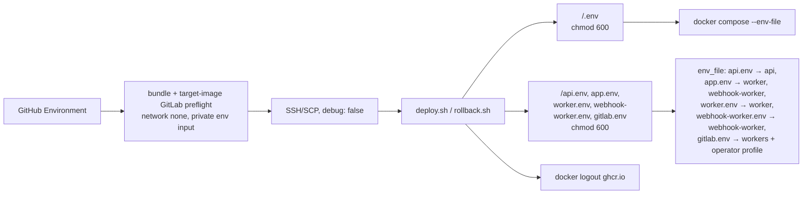

# Secrets — API (команда 6)

| | |
|---|---|
| Статус | перечень и правила обращения |
| Владелец | инфраструктура (роль 3) |
| Связанные документы | [CICD.md](CICD.md), [INFRASTRUCTURE.md](INFRASTRUCTURE.md) |

Секреты живут в GitHub (organization, repository, Environment `staging`) или в окружении оператора. В git, образ и логи CI они не попадают. Цель выката (курсовой VPS или Terraform-хост) выбирается автоматически — [CICD.md](CICD.md#8-курсовой-vps-и-edge-прокси).

---

## 1. Перечень

### Organization — курсовой VPS

Заданы курсом на уровне организации, одинаковы в репозиториях API и UI.

| Имя | Тип | Зачем |
|---|---|---|
| `VPS_DMC268_IP_T6` | variable | IPv4 курсового VPS, SSH на порт 22 |
| `VPS_DMC268_U` | secret | SSH-пользователь (`root`) |
| `VPS_DMC268_P` | secret | SSH-пароль; уходит только на VPS, никогда на Terraform-хост |
| `AI_DMC268_T6` | secret | LLM-ключ приложения (EUrouter): на staging — `LLM_API_KEYS` в контейнере `worker` (ниже); в CI — ещё ручные workflows `LLM live run` (`llm-live-run.yml`) и `Live corpus evaluation` (`eval-live.yml`), оба `workflow_dispatch`; required-проверки его не используют |
| `AI_DMC268_URL` | variable | endpoint LLM-провайдера: на staging — `LLM_BASE_URL` в контейнере `worker` |

### Repository — variables

| Variable | Обязателен | Пример |
|---|---|---|
| `STAGING_SSH_FINGERPRINT` | да, для обеих целей | `SHA256:…` host key VPS (`ssh-keyscan -p 22 <VPS_DMC268_IP_T6> \| ssh-keygen -lf - -E sha256`). Значение в Environment `staging` перекрывает repository. При переключении между курсовым VPS и Terraform-хостом fingerprint нужно обновить: у хостов разные ключи, и при несовпадении jobs с SSH падают (fail-closed) |
| `APP_DOMAIN` | да, для курсового VPS | `dmc268-t6.axyi.ru` — базовый домен маршрутов edge-прокси |
| `LLM_MODEL` | для ревью моделью | `mistral-small-4` (OQ-2, SD §15). Основная модель в repository variable; передаётся в `worker.env` (деплой) и читается ручным workflow `eval-live.yml` |
| `LLM_FALLBACK_MODEL` | нет | `mistral-small-3.2-24b` (OQ-2, SD §15). Значение передаётся в `worker.env` и в ручной workflow `eval-live.yml`. Чтобы отключить fallback, удалите variable (и переопределение в Environment `staging`, если оно есть): незаданная variable не попадает в `worker.env` |
| `LLM_VERIFIER_MODEL` | нет | Модель верификатора (#130); пусто — `LLM_MODEL`. Значение передаётся в `worker.env`; незаданная variable в `worker.env` не попадает, и верификатор идёт моделью ревью. Ручные `eval-live.yml` и `llm-live-run.yml` её не читают: у eval нет стадии верификатора |
| `LLM_VERIFIER_FALLBACK_MODEL` | нет | Fallback верификатора (#130); пусто — `LLM_FALLBACK_MODEL`. Передаётся в `worker.env` так же: незаданная variable туда не попадает |

Repository variable `LLM_EUR_TO_USD_RATE` удалена 06.10 после проверки нового пути на staging: worker и workflow `LLM live run` её не читают, в `worker.env` она не попадает; курс вручную обновлять не нужно.

### GitHub Environment `staging` — secrets

Доступ к машине, реестру и данным, а также секреты приложения.

| Secret | Обязателен | Куда уходит | Зачем |
|---|---|---|---|
| `STAGING_SSH_KEY` | да, для Terraform-хоста | SCP/SSH на VM | приватный ключ к `hcloud_ssh_key.ci` |
| `POSTGRES_PASSWORD` | нет | `<APP_DIR>/.env` на хосте | пароль PostgreSQL. Если не задан, `deploy.sh` генерирует его при первом выкате и хранит в `.env` (0600). После инициализации тома пароль не менять: Postgres его не перечитывает |

Секреты приложения. GitHub не принимает имена секретов и variables с префиксом `GITHUB_` (HTTP 422), поэтому секреты App заведены как `GH_*`, а в контейнере у них имена из `.env.example`. Сопоставление делает шаг «Bundle application secrets» в `deploy-staging`; тем же путём идут organization secret `AI_DMC268_T6`, organization variable `AI_DMC268_URL` и `vars.GH_APP_BOT_LOGIN`, `vars.PORTAL_URL`, `vars.LLM_MODEL`, `vars.LLM_FALLBACK_MODEL`, `vars.LLM_VERIFIER_MODEL`, `vars.LLM_VERIFIER_FALLBACK_MODEL`. Последние четыре задаются на уровне repository и могут быть переопределены в Environment `staging`. Незаданное значение в контейнер не попадает совсем, а не приходит пустой строкой.

**Ограничение на значения:** без одинарной кавычки `'` и без trailing backslash. Значения пишутся в env-файл в одинарных кавычках (§3, п. 5). В CI такие значения отклоняет шаг **Validate application bundle and GitLab configuration** до первого SCP/SSH: Deploy ещё не запускался, automatic rollback пропускается, job остаётся красным. Исправьте source config и повторите reviewed workflow. При ручном запуске `deploy.sh` проверяет те же ограничения до изменений приложения. На первом выкате после #35, пока в `.env` хоста нет `RABBITMQ_PASSWORD`, ручной `rollback.sh` без `DEPLOY_RUN` при откате на образ падает с `RABBITMQ_PASSWORD is required`. Завершающий перевод строки значения срезается; разбору PEM это безразлично.

Каждый контейнер получает только env-файлы своей роли (`deploy/scripts/env-file.sh`, `deploy/compose/staging.yml`):

| Env-файл на хосте | Переменные | Контейнеры |
|---|---|---|
| `api.env` | `GITHUB_WEBHOOK_SECRET`, `GITHUB_CLIENT_ID`, `GITHUB_CLIENT_SECRET`, `AUTH_JWT_PRIVATE_KEY`, `AUTH_JWT_PUBLIC_KEY`, `GITLAB_WEBHOOK_INTAKE_ENABLED` | `api` |
| `gitlab.env` | `GITLAB_CREDENTIAL_KEYS`, `GITLAB_ACTIVE_KEY_ID`, `GITLAB_ALLOWED_ORIGINS`, optional `GITLAB_PRIVATE_ORIGINS` | `worker`, `webhook-worker`, profile-only `gitlab-admin` |
| `app.env` | `GITHUB_APP_ID`, `GITHUB_APP_PRIVATE_KEY` | `worker`, `webhook-worker` |
| `worker.env` | `LLM_API_KEYS`, `LLM_BASE_URL`, `LLM_MODEL`, `LLM_FALLBACK_MODEL`, `LLM_VERIFIER_MODEL`, `LLM_VERIFIER_FALLBACK_MODEL`, `PORTAL_URL` (опциональные ключи — только при непустом значении) | `worker` |
| `webhook-worker.env` | `GITHUB_APP_BOT_LOGIN` | `webhook-worker` |

| Secret | Тип значения | Переменная в контейнере | Контейнеры | Зачем |
|---|---|---|---|---|
| `GH_APP_ID` | число | `GITHUB_APP_ID` | `worker`, `webhook-worker` | App ID staging App `dmc268-t6-reviewer` (#37) |
| `GH_APP_PRIVATE_KEY` | многострочный PEM | `GITHUB_APP_PRIVATE_KEY` | `worker`, `webhook-worker` | подпись JWT App для installation token. В `api` не уходит: процесс API его не читает, а PEM App не должен лежать в контейнере, смотрящем в интернет |
| `GH_WEBHOOK_SECRET` | строка | `GITHUB_WEBHOOK_SECRET` | `api` | проверка подписи вебхуков. Без него `POST /webhooks/github` отвечает 503; с ним API сохраняет квитанцию и отвечает 202, а разбирает квитанции контейнер `webhook-worker` (`app.webhook_worker`). Кроме выката, secret читает ручной workflow `webhook-ack-load.yml`, и только в шаге `Run webhook ACK load`: им подписываются нагрузочные `ping` ([CICD.md §2.2](CICD.md#22-нагрузка-на-ack-вебхука-staging-163)) |
| `GH_CLIENT_ID` | строка | `GITHUB_CLIENT_ID` | `api` | user authorization App (auth-api, #11); отличается от App ID |
| `GH_CLIENT_SECRET` | строка | `GITHUB_CLIENT_SECRET` | `api` | обмен OAuth-кода (auth-api, #11) |
| `AUTH_JWT_PRIVATE_KEY` | многострочный PEM (RSA) | `AUTH_JWT_PRIVATE_KEY` | `api` | подпись локального access JWT |
| `AUTH_JWT_PUBLIC_KEY` | многострочный PEM (RSA) | `AUTH_JWT_PUBLIC_KEY` | `api` | проверка access JWT |
| `GITLAB_CREDENTIAL_KEYS` | JSON object key-ID → base64 | `GITLAB_CREDENTIAL_KEYS` | оба workers и trusted `gitlab-admin` | шифрование installation PAT; [GitLab setup](#installed-gitlab--защищённая-конфигурация-и-управление-169) |
| `AI_DMC268_T6` (organization) | строка, ключи через запятую | `LLM_API_KEYS` | `worker` | ключи LLM-шлюза (§1, «LLM-шлюз») |
| `AI_DMC268_URL` (organization variable, берётся из `vars.`) | URL | `LLM_BASE_URL` | `worker` | endpoint LLM-шлюза |

`AUTH_JWT_ISSUER` (`dmc-268-api`) и `AUTH_JWT_AUDIENCE` (`dmc-268-ui`) — не секреты: они фиксированы в `deploy/compose/staging.yml`. Домен cookie refresh не настраивается: cookie host-only с `Path=/api/auth`, а UI и API работают с одного origin `staging-ui.<APP_DOMAIN>` (маршрут `/api/*` в `deploy/edge/Caddyfile`).

Пара ключей JWT создаётся один раз и заводится в Environment `staging`:

```bash
openssl genpkey -algorithm RSA -pkeyopt rsa_keygen_bits:2048 -out jwt.pem
openssl rsa -in jwt.pem -pubout -out jwt.pub
gh secret set AUTH_JWT_PRIVATE_KEY --env staging -R larchanka-training/dmc-268-api-t6 < jwt.pem
gh secret set AUTH_JWT_PUBLIC_KEY --env staging -R larchanka-training/dmc-268-api-t6 < jwt.pub
rm jwt.pem jwt.pub
```

Смена пары разлогинивает всех: ранее выданные access JWT перестают проверяться.

### Генерируются на хосте

В GitHub не заводятся. `deploy.sh` создаёт их при первом выкате (48 hex-символов), хранит в `<APP_DIR>/.env` (0600) и переиспользует при каждом выкате и откате.

| Имя | Куда уходит | Примечание |
|---|---|---|
| `RABBITMQ_PASSWORD` (пользователь `RABBITMQ_USER`, по умолчанию `app`) | контейнер `rabbitmq`; `RABBITMQ_URL` в `api`, `worker` и `webhook-worker` | RabbitMQ, как Postgres, применяет учётные данные только на пустом томе `rabbitmq-data`. Если том есть, а пароля в `.env` нет, `deploy.sh` отказывается генерировать новый |
| `REDIS_PASSWORD` | контейнер `redis`; `REDIS_URL` в `api`, `worker` и `webhook-worker` | Redis — кэш без тома (лимит 128 MB, `allkeys-lru`): новый пароль только сбрасывает кэш. Кэш по SD §10: `REDIS_URL` читают `worker` и `webhook-worker` (installation-токены GitHub App, в `worker` ещё кэш этапа контекста), `api` пока не читает |

`GITHUB_TOKEN` выдаёт Actions сам. В репозиторий его не кладут. Push в GHCR — `packages: write`; pull на staging — `packages: read`.

### GitHub Environment `staging` — variables

Публичные или низкорисковые значения. Их видно в логах — это нормально.

| Variable | Обязателен | Пример |
|---|---|---|
| `STAGING_HOST` | для Terraform-хоста | IPv4 или FQDN из Terraform output `ssh_host`; пусто → выкат на курсовой VPS |
| `STAGING_SSH_PORT` | для Terraform-хоста | `22022` — Terraform output `ssh_port`; без него jobs с SSH падают первым шагом |
| `STAGING_SSH_FINGERPRINT` | да | SHA256 host key fingerprint для `appleboy/scp-action` и `appleboy/ssh-action`, формат `SHA256:<43 символа base64>`. С пустым значением appleboy принимает любой host key, поэтому jobs с SSH падают первым шагом |
| `STAGING_SSH_USER` | для Terraform-хоста | `root` после cloud-init |
| `STAGING_HEALTH_URL` | нет | иначе `http://$STAGING_HOST/healthcheck` |
| `POSTGRES_USER` | нет | иначе `app` |
| `POSTGRES_DB` | нет | иначе `app` |
| `GH_APP_BOT_LOGIN` | обязателен для GitHub replay; частичный App config закрывает startup | `dmc268-t6-reviewer[bot]` — логин бота App. В контейнере `GITHUB_APP_BOT_LOGIN`, только у `webhook-worker` (`app/webhook_worker.py`). Префикс `GH_`, потому что GitHub не принимает `GITHUB_` и у variables; берётся из `vars.`, а не из `secrets.` |
| `PORTAL_URL` | для ссылки на Run в staging check-run | `https://staging-ui.dmc268-t6.axyi.ru` — публичный UI-origin. Читается из `vars.PORTAL_URL`, записывается только в `worker.env` → review-worker (`worker`); в `api` и `webhook-worker` не передаётся; [проверка и восстановление](#portal_url) |
| `LLM_MODEL` | нет, переопределение repository | `mistral-small-4` (OQ-2, SD §15). В контейнере только у `worker`; обычное значение задано на уровне repository |
| `LLM_FALLBACK_MODEL` | нет, переопределение repository | `mistral-small-3.2-24b`. Только `worker`. Чтобы отключить fallback, удалите repository variable и это переопределение: значение Environment перекрывает repository, а незаданная variable приходит в `vars` пустой строкой, и `LLM_FALLBACK_MODEL` не попадает в `worker.env` |
| `LLM_VERIFIER_MODEL` | нет, переопределение repository | Только `worker`; пусто — верификатор идёт моделью ревью (`LLM_MODEL`). Как у `LLM_FALLBACK_MODEL`: значение Environment перекрывает repository, незаданная variable не попадает в `worker.env` |
| `LLM_VERIFIER_FALLBACK_MODEL` | нет, переопределение repository | Только `worker`; пусто — fallback ревью (`LLM_FALLBACK_MODEL`). Правила те же |
| `GITLAB_ACTIVE_KEY_ID` | с GitLab runtime | ID активного ключа из secret `GITLAB_CREDENTIAL_KEYS`; только оба workers и operator |
| `GITLAB_ALLOWED_ORIGINS` | с GitLab runtime | raw JSON, например `["https://gitlab.com"]`; те же получатели |
| `GITLAB_PRIVATE_ORIGINS` | нет | raw JSON subset allowed; только для private-network origin, не для приватного проекта gitlab.com |
| `GITLAB_WEBHOOK_INTAKE_ENABLED` | нет, default off | `false` для начальной настройки; `true` только с полным валидным runtime; только `api` |

### PORTAL_URL

`PORTAL_URL` задан в Environment `staging` и прочитан обратно 10.10.2026:
`https://staging-ui.dmc268-t6.axyi.ru` (#111). Это адрес UI, не API health URL;
для Terraform-хоста с отдельным UI задайте его origin явно. Repository variable
может служить общим значением, Environment `staging` перекрывает её.
Если итоговое значение отсутствует или пустое, ключ не записывается в env-файлы:
worker стартует, но ссылки на Run нет ни в summary check-run, ни в `details_url`
— GitHub ведёт «View more details» на домашнюю страницу App. При заданном
значении ссылка — `{PORTAL_URL}/runs/{run_id}` (завершающий `/` базового URL
удаляется); она есть в summary итогов `succeeded` (включая partial и
summary-only) и `failed`, но не `cancelled` и `skipped`, и в `details_url` при
каждом создании и обновлении check-run, при любом итоге. Настройка применяется
при следующем штатном выкате; live-проверка свежего sandbox-прогона — [CICD.md §2.1](CICD.md#21-проверка-ссылки-на-run-111).

Непустой `PORTAL_URL` должен быть абсолютным базовым HTTP/HTTPS URL с непустым
хостом; явно заданный числовой порт — от 1 до 65535. Разрешены localhost, IPv4,
IPv6 в квадратных скобках и базовый путь (`https://ui.example/portal/` →
`https://ui.example/portal/runs/{run_id}`); percent-encoded путь сохраняется.
Регистр схемы не важен, исходное значение сохраняется, при построении ссылки
удаляются только завершающие `/`.

Относительный адрес, другая схема, пустой хост, userinfo (`user:password@`),
пробельные или непечатные символы (включая U+200B), обратный слэш, некорректные
скобки/порт, query/fragment (даже пустые `?` и `#`) останавливают worker при чтении
настроек с фиксированным `RuntimeError`, содержащим `PORTAL_URL`, без значения URL
и диагностики парсера с учётными данными. Это ограниченная синтаксическая
проверка базы ссылки, не проверка DNS, доступности или всей RFC-корректности
хоста/кодирования пути: например, двойная точка в хосте и печатная пунктуация
пути не проверяются отдельно.

Отказ старта worker срывает healthcheck `up --wait`; CI запускает авто-rollback
с тем же текущим `worker.env`. Если предыдущий релиз уже содержит валидатор
(выкат после первого с #214), откат падает на том же значении: шаг печатает
`rollback failed`, review-worker остаётся нездоровым. Если предыдущий релиз
старше #214, откат может пройти, но старый worker снова строит некорректные ссылки.

Для устойчивого восстановления исправьте effective `vars.PORTAL_URL`:
Environment `staging` перекрывает одноимённую repository variable. Повторите
штатный выкат: CI заново собирает application-secrets bundle и перезаписывает
`worker.env`. Правка только файла на хосте живёт до следующего CI-выката;
сохранение такого файла применимо к ручному `deploy.sh` без `APP_SECRETS_B64`,
а не заменяет исправление GitHub variable для CI.

### LLM-шлюз — переменные приложения (#33)

Читает `LlmSettings.from_env` (`app/modules/reviews/infrastructure/llm/settings.py`). Секрет здесь — только ключи; остальное — конфигурация. На staging `LLM_API_KEYS` (из organization secret `AI_DMC268_T6`), `LLM_BASE_URL` (из organization variable `AI_DMC268_URL`), `LLM_MODEL` и непустые `LLM_FALLBACK_MODEL`, `LLM_VERIFIER_MODEL`, `LLM_VERIFIER_FALLBACK_MODEL` (repository variables или переопределения Environment) приходят в `worker` через `worker.env` (§1, таблица env-файлов). Остальные `LLM_*` на staging берут дефолты, если они есть; переопределения с префиксами `LLM_VERIFIER_` и `LLM_VERIFIER_FALLBACK_` (`_API_KEYS`, `_BASE_URL` и остальные) на staging не передаются и наследуются по правилам ниже. Поэтому в паре годится только модель из `KNOWN_MODELS` с тем же endpoint, что у основной (ключи — из `LLM_API_KEYS`): неизвестной модели нужен `_CONTEXT_WINDOW`, известной на другом endpoint — `_API_KEYS` с префиксом пары, а выкат их не передаёт. Любое другое значение останавливает worker при старте (`LlmConfigError`): `up --wait` срывается, авто-rollback идёт с тем же `worker.env` и падает на том же значении (предыдущие релизы уже читают пару, #290) — исправьте или удалите variable и повторите выкат. Без пары верификатора верификатор идёт парой ревью.

| Переменная | Секрет | Обязательна | Значение |
|---|---|---|---|
| `LLM_API_KEYS` | **да** | для EUrouter | ключи через запятую; при 401/403/429 шлюз переходит к следующему (ротация вызовом не считается). Для self-hosted без авторизации — пусто |
| `LLM_MODEL` | нет | да | основная модель, `mistral-small-4` (OQ-2, SD §15) |
| `LLM_FALLBACK_MODEL` | нет | нет | fallback-модель, `mistral-small-3.2-24b`; пусто — без fallback |
| `LLM_FALLBACK_API_KEYS` | **да** | для известной fallback-модели на другом endpoint | ключи наследуются только вместе с endpoint: если fallback идёт на тот же base URL, что и основная, — `LLM_API_KEYS`; на другой хост ключи основной не уходят никогда |
| `LLM_VERIFIER_MODEL` | нет | нет | модель верификатора; пусто — `LLM_MODEL`. Переопределения с префиксом `LLM_VERIFIER_` (`_API_KEYS` — секрет, `_BASE_URL` и остальные) — по правилам `LLM_FALLBACK_*`, наследование от основной модели. На staging передаётся в `worker.env` (только непустое значение) |
| `LLM_VERIFIER_FALLBACK_MODEL` | нет | нет | fallback верификатора; пусто — `LLM_FALLBACK_MODEL`. Переопределения с префиксом `LLM_VERIFIER_FALLBACK_` (`_API_KEYS` — секрет) — по тем же правилам, наследование от модели верификатора, а без неё — от основной. На staging передаётся в `worker.env` (только непустое значение) |
| `LLM_BASE_URL`, `LLM_FALLBACK_BASE_URL` | нет | для неизвестной модели | OpenAI-совместимый endpoint; для моделей из `KNOWN_MODELS` — их собственный (`https://api.eurouter.ai/api/v1`), неизвестная fallback-модель без своего URL берёт URL основной. С ключами — только `https`, кроме локальных хостов: `localhost`, `127.0.0.1`, `::1`, `host.docker.internal`, `*.localhost`, `*.local`, `*.internal`. Compose-сервис (`http://ollama:11434/v1`) или адрес RFC 1918 по `http` работает только без ключей |
| `LLM_CONTEXT_WINDOW` (и `LLM_FALLBACK_CONTEXT_WINDOW`) | нет | для неизвестной модели | окно модели в токенах |
| `LLM_PROVIDER`, `LLM_MAX_OUTPUT_TOKENS`, `LLM_PRICE_INPUT_PER_MTOK`, `LLM_PRICE_OUTPUT_PER_MTOK`, `LLM_PRICE_CACHE_READ_PER_MTOK`, `LLM_EXTRA_BODY` (и те же `LLM_FALLBACK_*`) | нет | нет | дефолты: провайдер `self-hosted`, резерв на ответ 8000, цена 0, тело `{}`. **Цена 0 у удалённой модели — лимит стоимости прогона видит только `usage.cost` провайдера**; шлюз пишет предупреждение, для hosted-модели цены задавать обязательно. Метка провайдера идёт в `usage_events`, цены — USD за 1 млн токенов, `LLM_EXTRA_BODY` — доп. поля тела запроса (JSON). `LLM_EXTRA_BODY` переопределяет `temperature` и `max_tokens`, `null` убирает ключ — для reasoning-моделей, например `{"temperature": null, "max_tokens": null, "max_completion_tokens": 8000}`; `model`, `messages` и строгий `response_format` не переопределяются |
| `LLM_STRUCTURED_OUTPUT` | нет | нет | `json_schema` (по умолчанию). `prompt_json` — только локальные и self-hosted модели в dev и eval, требует `LLM_ALLOW_PROMPT_JSON=1`; на staging и prod не задаётся (D7) |

Для двух известных моделей на штатном EUrouter endpoint цены `KNOWN_MODELS` служат нижней USD-границей: основная — $0.56125 / $2.35725 / $0.56125, fallback — $0.2245 / $0.449 / $0.2245 за миллион входных / выходных / прочитанных из кэша токенов. Перед каждым вызовом известного EUrouter-маршрута шлюз получает курс ЕЦБ и берёт покомпонентный максимум этой границы, EUR-цены самой дорогой известной ветки × полученный курс и заданной через `LLM_PRICE_*` цены. Более низкая env-цена на штатном endpoint границу не уменьшает; для другого явно заданного endpoint применяется его цена. Эффективная цена используется перед вызовом для проверки бюджета и при консервативном учёте оплаченного ответа с непригодными данными о стоимости (SD §15, PIPELINE_SPEC §4.5).

Шлюз распознаёт эквивалентные записи штатного endpoint (регистр имени хоста, явный порт `:443`, завершающий `/`) одинаково для цены, метки провайдера и наследования ключей. Для известной модели имя хоста должно содержать только ASCII: Unicode-варианты точки могут быть преобразованы HTTP-клиентом в штатный EUrouter host уже после проверки цены. Другой путь или порт на хосте EUrouter для известной модели отклоняется при чтении настроек, чтобы не обходить ценовую границу. Разные хосты не наследуют ключи друг от друга. Если полученный курс настолько велик, что цена максимального вызова не представима с точностью 6 знаков, вызов завершается `llm_unavailable` до обращения к провайдеру.

**Источник и доступ.** Worker и ручной `LLM live run` читают один последний дневной курс USD за EUR из CSV ЕЦБ: [`EXR/D.USD.EUR.SP00.A`](https://data-api.ecb.europa.eu/service/data/EXR/D.USD.EUR.SP00.A) с `lastNObservations=1&format=csvdata`. Это количество USD за 1 EUR, его не инвертируют. Отдельный HTTP-клиент не передаёт ЕЦБ ключ LLM или заголовок Authorization; staging-worker нужен исходящий HTTPS (TCP 443) к `data-api.ecb.europa.eu`. В Compose worker использует обычную сеть проекта без `internal: true`; доступ с хоста и контейнера следует проверить после выката. Никакой ежедневной ручной правки курса нет.

**Кэш и инцидент.** В каждом процессе первый нуждающийся в курсе вызов загружает CSV с общим пределом 5 с; одновременные вызовы ждут один запрос. Успешный курс обновляется не чаще раза в час. После сбоя обновления следующий запрос — не раньше чем через 5 минут, если пригодный курс есть, и через 10 с (`COLD_FAILURE_BACKOFF_SECONDS`), если его нет, чтобы retry прогона через 30 с снова запросил ЕЦБ (PIPELINE_SPEC §4.5). После сбоя последний проверенный курс можно использовать только до 7 календарных дней от даты наблюдения по UTC; такой ответ помечается `stale_cache=true`, а лог содержит источник и дату без тела ответа или ключей. Дата получения не продлевает срок. Worker запускается и при недоступном ЕЦБ. Если пригодного курса нет, следующий вызов маршрута `api.eurouter.ai` завершается до LLM-запроса как retryable `llm_unavailable`, без стоимости этого вызова. Проверить DNS/HTTPS к ЕЦБ, дату наблюдения и предупреждение обновления кэша; вручную подставлять курс через env не следует. Для другого endpoint с оплаченным EUR-ответом курс запрашивается после ответа: если получить его не удалось, шлюз сохраняет сырой `llm.call` и известные токены, начисляет консервативную USD-оценку и завершает вызов `llm_invalid_output` без нового платного запроса. USD-стоимость проходит без пересчёта, а отсутствие `cost_currency` трактуется как USD с предупреждением (PIPELINE_SPEC §4.5).

**Проверка стоимости.** Каждый `llm.call`, использовавший курс, содержит `request.fx` с `source`, `observation_date`, `rate_usd_per_eur` и `stale_cache`; тот же набор виден для каждого вызова в JSON CLI и в GitHub Step Summary ручного `LLM live run`, включая сбой после оплаченного ответа. Сырой ответ провайдера хранится отдельно без изменения, а `usage_events.cost_usd` остаётся суммой в USD. Required CI работает без сети и ключей: HTTP ЕЦБ и LLM в тестах подменён; живую проверку выполняют вручную после выката.

Ключи не попадают в логи, тексты исключений, `run_actions` и `usage_events`: транспорт вычищает их из текстов ошибок провайдера, у `ModelProfile` ключи скрыты из `repr` — это проверяет `tests/test_llm_gateway.py::test_keys_never_reach_logs_exceptions_or_the_trace`. Required CI работает без сети и без LLM-ключей: все тесты шлюза идут на фейковом HTTP-транспорте; живой прогон — вручную (README, раздел «LLM gateway»).

### Installed GitLab — защищённая конфигурация и управление (#169)

`GitLabRuntimeSettings` используется trusted CLI, webhook replay и review worker.
Токен принадлежит connection, не процессу: process `GITLAB_TOKEN` и
`GITLAB_BASE_URL` не включают runtime и не являются fallback authority. API admission
нуждается только в БД и digest webhook secret; ключ расшифрования в API не требуется.

| Переменная | Кто читает | Контракт |
|---|---|---|
| `GITLAB_CREDENTIAL_KEYS` | CLI, webhook/review workers | секретный JSON object key-ID → canonical standard-base64 ключ ровно 32 байта; 1–32 ключа, без duplicate JSON keys |
| `GITLAB_ACTIVE_KEY_ID` | те же процессы | ID существующего ключа для новых ciphertext; ID 1–64 символа `[A-Za-z0-9][A-Za-z0-9._-]*` |
| `GITLAB_ALLOWED_ORIGINS` | те же процессы | JSON array из 1–32 различных точных canonical HTTPS origins, без path/query/userinfo/trailing slash и явного `:443` |
| `GITLAB_PRIVATE_ORIGINS` | те же процессы | optional JSON array (по умолчанию `[]`), subset allowed; private адрес/host требует явного exact opt-in |
| `SSL_CERT_FILE` | только локальная process composition | optional путь к PEM CA bundle; staging не передаёт эту переменную и не монтирует CA. Отдельный custom-CA deployment требует reviewed mount/wiring. Обычная TLS/hostname verification сохраняется |
| `GITLAB_WEBHOOK_INTAKE_ENABLED` | только API | unset/empty/`false` → off, `true` → admission on; пробелы по краям удаляются, регистр игнорируется; `0`, `1`, `yes`, `no` не принимаются |

Staging источники: `GITLAB_CREDENTIAL_KEYS` — **secret** Environment `staging`;
`GITLAB_ACTIVE_KEY_ID`, `GITLAB_ALLOWED_ORIGINS`, optional `GITLAB_PRIVATE_ORIGINS` и
`GITLAB_WEBHOOK_INTAKE_ENABLED` — одноимённые **variables**. В GitHub UI вводится
raw JSON: `{"key-id":"<base64>"}` или `["https://gitlab.com"]`, без внешних одинарных
кавычек из shell-примеров `.env.example`. Keyring получает только `gitlab.env`
(оба workers и operator); API получает только admission flag через `api.env`.
У bootstrap, БД, broker/cache и мониторинга keyring/PAT нет.

Первоначальная настройка: полный core, `GITLAB_WEBHOOK_INTAKE_ENABLED=false`, затем
согласованный onboarding ниже. `true` без полного валидного runtime отклоняется до
первого SCP/SSH изменения хоста. Без GitLab значений сохраняется GitHub-only default-off.
Пустой/незаданный GitHub source не включается в bundle; пустой optional private source
поэтому означает отсутствие поля. Непустой malformed JSON сохраняется и отклоняется.
Приватный проект на gitlab.com не требует `GITLAB_PRIVATE_ORIGINS`: этот список относится
к private-network адресу origin, который уже должен быть в allowed.

Любое nonempty значение core/private включает проверку runtime: нужны все три core
поля (`KEYS`, `ACTIVE_KEY_ID`, `ALLOWED_ORIGINS`). `PRIVATE_ORIGINS='[]'` без core —
partial config error. При полном core отсутствие private означает empty set, пустая
строка private невалидна, JSON `[]` валиден. `SSL_CERT_FILE` отдельно runtime не включает.
Невалидный полный config закрывает startup, не отключает GitLab молча. Все три GitHub
App поля webhook-worker задаются вместе или все отсутствуют; GitLab-only replay возможен
без GitHub App. Частичный GitHub config остаётся ошибкой. Database и broker обязательны.

Keyring создаётся один раз и сохраняется в защищённом secret manager отдельно от БД.
Для **первого** keyring на операторской рабочей станции с uv (не на deploy-хосте):

```bash
(
set -euo pipefail
set +o xtrace
KEYRING_FILE="$protected_keyring_file" KEYRING_KEY_ID=key-2026-10 uv run python - <<'PYTHON'
import base64
import json
import os
import secrets
fd = os.open(os.environ["KEYRING_FILE"], os.O_WRONLY | os.O_CREAT | os.O_EXCL, 0o600)
with os.fdopen(fd, "w") as output:
    json.dump({os.environ["KEYRING_KEY_ID"]: base64.b64encode(secrets.token_bytes(32)).decode()}, output)
    output.write("\n")
PYTHON
)
```

`protected_keyring_file` — новый путь в согласованном protected storage, не путь в Git.
`O_EXCL` запрещает перезапись существующего keyring; файл создаётся с 0600, ключ не
печатается. Сохраните его в secret manager и проверенном protected backup, затем
передайте содержимое без argv/output:

```bash
gh secret set GITLAB_CREDENTIAL_KEYS --env staging -R larchanka-training/dmc-268-api-t6 < "$protected_keyring_file"
```

Для существующего keyring не заменяйте весь набор свежим ключом: старые key ID нужны
для уже сохранённого ciphertext. `GITLAB_ACTIVE_KEY_ID` должен совпадать с существующим
ID. Пример raw JSON/config дан в `.env.example` только комментариями.
Не публикуйте значения keyring, PAT или webhook secret в Git, argv, chat, trace или логи.
Keyring хранится отдельно от БД и резервируется с ограниченным доступом. Хранилище
использует AES-GCM: GLC1 envelope, случайный 12-byte nonce, authentication tag и AAD
(purpose/version, installation UUID, workspace UUID, canonical origin, key ID).
Перенос ciphertext к другому tenant/origin/installation не даёт credential authority.
В БД webhook secret хранится digest, не plaintext.

Trusted operator использует reviewed deployed image и существующие разрешённые
workspace/project: CLI не создаёт workspace, PAT или защищённый secret-файл.
Нужны staging SSH/operator доступ, cached reviewed image (либо право pull) и PAT с реальным
доступом к API/комментариям выбранного GitLab project. Browser login сам их не выдаёт.
Для create подготовьте через secret manager owner-only файл `protected_secret_file` с JSON ровно
`token`, `webhook_secret` (secret 32–256 печатных ASCII-символов, token 1–4096).
Не создавайте JSON через литералы секретов в shell/history. CLI читает до 8192 bytes
strict UTF-8 JSON из pipe/FD и отказывается от echoed TTY.

На staging-хосте выберите фактический `APP_DIR` из [CICD §8.1](CICD.md#81-две-цели):
`/opt/dmc-268-api-staging` для VPS или `/opt/dmc-268-api` для Terraform. Выполняйте
в Bash; `COMPOSE_PROJECT` должен совпадать с deploy (по умолчанию basename каталога).
Нужные для выбранной операции пути `protected_*_file` уже предоставлены оператором;
команды их не создают. Logs, inspect и revoke не требуют create JSON или нового PAT;
rotate использует отдельный protected JSON только с новым `token`.
Если image удалён из cache, сначала выполните optional registry login ниже;
для cached reviewed image после deploy новый registry token не нужен.

Сначала отдельно соберите reusable prefix — этот блок не выполняет create/bind и
подходит для новой SSH Bash-сессии перед logs, inspect, rotate или revoke:

```bash
set +o xtrace
umask 077
unset operator
# source только helper code; credential .env/*.env никогда не source.
cd "${APP_DIR:?set the authorized staging APP_DIR}" &&
project="${COMPOSE_PROJECT:-$(basename "$PWD")}" &&
source ./env-file.sh &&
mode="$(read_compose_env_var DEPLOY_MODE .env)" &&
[[ "$mode" == edge || "$mode" == ports ]] &&
operator=(docker compose -p "$project" --env-file .env -f compose.yml \
  -f "compose.${mode}.yml" --profile gitlab-operator)
```

Продолжайте только после успешного prefix-блока. Ошибка `cd`, helper или режима
останавливает цепочку; `operator` заранее сброшен, чтобы не использовать старую цель.
`operator`, `project` и `mode` остаются в текущей Bash-сессии. Для существующей
installation не повторяйте create. После prefix **явно задайте записанный UUID** из
защищённой operator-записи этой установки, затем выполните свежий inspect:

```bash
unset installation_id generation
if read -r -p 'Записанный installation_id из operator record: ' installation_id &&
  [[ "$installation_id" =~ ^[[:xdigit:]]{8}-[[:xdigit:]]{4}-[[:xdigit:]]{4}-[[:xdigit:]]{4}-[[:xdigit:]]{12}$ ]]; then
  "${operator[@]}" run --rm --no-deps -T gitlab-admin inspect \
    --installation-id "$installation_id"
else
  unset installation_id
  printf '%s\n' 'GitLab installation UUID invalid; recovery stopped.' >&2
  false
fi
```

Продолжайте только после успеха и сверки `connection.installation_id`,
`connection.workspace_id`, `connection.instance_origin` с защищённой записью.
Берите `connection.generation` только из свежего inspect перед activate/rotate,
не из старой записи или унаследованной переменной. Команды list у CLI нет.
Для первоначального onboarding отдельно выполните create → bind → inspect:

```bash
"${operator[@]}" run --rm --no-deps -T gitlab-admin create \
  --workspace-id "$workspace_id" --installation-id "$installation_id" \
  --origin "$gitlab_origin" --secrets-fd 0 < "$protected_secret_file" &&
"${operator[@]}" run --rm --no-deps -T gitlab-admin bind-project \
  --installation-id "$installation_id" --project-id "$project_id" &&
"${operator[@]}" run --rm --no-deps -T gitlab-admin inspect \
  --installation-id "$installation_id"
```

Цепочка `&&` останавливается на первой ошибке, в том числе не запускает bind после
неуспешного create, и не закрывает интерактивную SSH-сессию. Продолжайте следующие
шаги только после успешного inspect; при ошибке устраните её и проверьте состояние.

`installation_id` — новый согласованный UUID; `workspace_id` — существующий workspace,
`project_id` — положительный числовой GitLab project ID из разрешённой настройки,
`gitlab_origin` — точный allowed HTTPS origin. Значения здесь — IDs/origin, не secrets.
`--no-deps` не пересоздаёт live зависимости; у operator нет ports и HTTP healthcheck.
Он получает только DB settings и `gitlab.env`, без GitHub/LLM credentials и очередей.
Обычный `compose up` этот profile не запускает. Используйте `-T` и **container FD 0**:
host `3<...` не пересылает descriptor 3 в контейнер. `--secrets-fd 3 3<...` допустим
только для локального процесса `uv run python -m app.gitlab_admin`, не для Compose run.
У operator `pull_policy: missing`: cached image после deploy используется без нового
registry login; live API/workers/bootstrap сохраняют свою `always` policy. Если image
удалён из cache, до команд выше нужен разрешённый pull приватного GHCR image. Только
для этого случая выполните временный login, используя предоставленный protected
read:packages token (не GitLab PAT):

```bash
operator_registry_config="$(mktemp -d)" &&
export DOCKER_CONFIG="$operator_registry_config" &&
trap 'docker logout ghcr.io >/dev/null 2>&1 || true; rm -rf "$operator_registry_config"' EXIT &&
if docker login ghcr.io --username "$registry_user" --password-stdin \
  >/dev/null 2>&1 < "$protected_registry_token_file"; then
  :
else
  printf '%s\n' 'GitLab operator registry login failed; setup stopped.' >&2
  false
fi
```

Блок возвращает ненулевой status при отказе login; статический diagnostic не
превращает ошибку в успех. Продолжайте setup только после успешного блока; при
отказе не запускайте зависимые команды, исправьте registry доступ, затем очистите
временный login командой в конце этого раздела. Интерактивная SSH-сессия остаётся открытой.
В Compose 2.19 `run` не имеет `--pull`; не добавляйте несуществующий flag.

Для разрешённой rotation существующей установки используйте prefix и UUID выше.
Protected JSON `protected_rotate_file` содержит только новый `token`. Сверьте identity
в новом inspect, затем введите generation из него; ошибка не запускает rotation:

```bash
unset generation
"${operator[@]}" run --rm --no-deps -T gitlab-admin inspect \
  --installation-id "${installation_id:?set the recorded installation UUID}" &&
if read -r -p 'connection.generation из этого inspect: ' generation &&
  [[ "$generation" =~ ^[1-9][0-9]*$ ]]; then
  "${operator[@]}" run --rm --no-deps -T gitlab-admin rotate-token \
    --installation-id "$installation_id" --expected-generation "$generation" \
    --secrets-fd 0 < "$protected_rotate_file"
else
  printf '%s\n' 'GitLab rotation generation invalid; rotation stopped.' >&2
  false
fi
```

Create authenticates перед записью и сохраняет generation=1, intake disabled. Bind
проверяет stored credential, canonical project и languages, связывает project только
с этой installation, создаёт недостающие default rules; требует active `review.system`
prompt. Повторный bind не дублирует repository/rules. При `prompt_not_seeded`
восстановите успешный reviewed deploy bootstrap (он запускает packaged seed); при
`rule_assets_invalid` восстановите packaged `review/rules` через корректный image. Bind и create не включают intake и не auto-link по webhook.
GitLab HTTP выполняется вне каждой DB transaction; после HTTP locked snapshot сравнивается
заново. Safe JSON результата не содержит token/ciphertext/digest/keyring.

Перед отдельным шагом activation оператор проверяет, что reviewed deployed version
включает GitLab intake #169 и публикацию #171 (PR229),
и получает разрешение на выборочную live-проверку. Этот документ не разрешает
production activation. В той же Bash-сессии получите **свежий** inspect, проверьте
`connection.installation_id`, `connection.workspace_id` и `connection.instance_origin`
против согласованных IDs/origin. Проверьте нужные `repositories[].project_id`,
`repositories[].enabled`, `repositories[].available`, `repositories[].rules_ready`
и top-level `prompt_ready`; paused sibling не обязан быть ready. Затем введите
положительное `connection.generation` именно из этого результата.
CLI не принимает supplied merged SHA или boolean обхода:

```bash
unset generation
"${operator[@]}" run --rm --no-deps -T gitlab-admin inspect \
  --installation-id "${installation_id:?set the recorded installation UUID}" &&
if read -r -p 'connection.generation из этого inspect: ' generation &&
  [[ "$generation" =~ ^[1-9][0-9]*$ ]]; then
  "${operator[@]}" run --rm --no-deps -T gitlab-admin activate \
    --installation-id "$installation_id" --expected-generation "$generation"
else
  printf '%s\n' 'GitLab activation generation invalid; activation stopped.' >&2
  false
fi
```

Пустой, нулевой или malformed generation даёт статический diagnostic и ненулевой
status без activate; SSH-сессия не закрывается. Исправьте ввод по свежему inspect,
не продолжайте при ошибке. Generation обязателен и положителен. Activate повторно
authenticates stored token и проверяет доступ к каждому binding вне transaction,
затем под locks сверяет весь snapshot.
Нужен хотя бы один enabled/available repository с `wait_for_ci=never`, active rules и
active `review.system` prompt; paused sibling не блокирует ready sibling, но identities
и API access всех bindings проверяются. Budget gate отсутствует. Команда меняет только
connection intake flag, не generation, rules, prompt или budgets; повтор с той же
generation всё равно проверяет provider. Activate не требует существования project hook.
API process flag независимо остаётся обязательным.

Rotate проверяет новый token на всех bindings и expected generation (если передана),
записывает новый encrypted credential active key и увеличивает generation. Активные
queued/running/publishing Runs исходной установки терминализируются `cancelled` с
`credential_rotated`, worker lease снимается, попытки сохраняются; дальнейшие provider
calls старой authority запрещены. Старые ключи сохраняйте, пока все их envelopes не
перезаписаны через supported rotation. Удаление key ID раньше срока закрывает decryption.

После onboarding впервые включите API admission через variable
`GITLAB_WEBHOOK_INTAKE_ENABLED=true` и обычный reviewed deploy, сохранив полный keyring.
Create/bind сами intake не включают; active connection и process admission нужны оба.
Если staging уже обслуживает другие активные подключения, не выключайте общий API flag
ради нового теста: новая installation остаётся disabled до собственного activate.

**Новый project webhook — после activation и process admission.**
В разрешённом GitLab project откройте
**Settings → Webhooks → Add new webhook** (нужен Maintainer/Owner):

1. URL: `https://<staging-api>/webhooks/gitlab/<installation_id>`, где host —
   фактический staging API из [CICD §8.1](CICD.md#81-две-цели), а UUID — тот же
   `installation_id`, который использован в create и подтверждён inspect.
   Endpoint должен иметь проверяемый TLS-сертификат; HTTP-only target сначала
   требует согласованной настройки HTTPS.
2. В **Secret token** передайте **тот же** `webhook_secret` из защищённого JSON
   create/secret manager. GitLab передаёт его в `X-Gitlab-Token`; не печатайте JSON
   или secret в терминал, argv, chat, Git или отчёт. Этот receiver проверяет secret
   token; новый **Signing token/HMAC** его не заменяет.
3. В **Trigger** оставьте только **Merge request events**, снимите остальные
   события; **Enable SSL verification** оставьте включённым. Сохраните hook без
   custom payload/template, custom headers или обхода canonical project/origin checks.
4. Проверьте возможности тестового GitLab. По [официальной истории delivery
   headers](https://docs.gitlab.com/user/project/integrations/webhooks/#delivery-headers),
   `Idempotency-Key` введён в 17.4, `webhook-id` — в 19.0; оба идентификатора
   стабильны при retry, а `webhook-id` равен `Idempotency-Key`. Receiver требует
   хотя бы один из них и равенство, если приходят оба. `X-Gitlab-Webhook-UUID` и
   `X-Gitlab-Event-UUID` не заменяют этот ключ. Отдельно зафиксируйте установленную
   версию и наблюдаемые headers на реальной доставке; ссылка подтверждает contract,
   а не возможности staging instance. При отсутствии поддержки остановите onboarding.

Названия полей, версии delivery headers и просмотр доставок —
[официальная документация GitLab Webhooks](https://docs.gitlab.com/user/project/integrations/webhooks/).
Настройка hook сама intake не включает. Нормальный порядок: create → bind → inspect →
отдельно разрешённый activate → process admission → новый hook → приёмочный MR.
Сохраните hook и проверьте enabled state до создания приёмочного MR; Test для нового
hook не требуется.

**Восстановление уже существующего hook — отдельный путь.** После устранения
причины отказа и успешных activation/process admission проверьте enabled state в
**Settings → Webhooks**: прежние 503 могли вызвать [автоотключение GitLab](https://docs.gitlab.com/user/project/integrations/webhooks/#auto-disabled-webhooks).
Для Temporarily disabled/Disabled hook **Test → Merge request events** с ответом
**2xx** [включает hook снова](https://docs.gitlab.com/user/project/integrations/webhooks/#re-enable-disabled-webhooks).
Проверьте Recent events и enabled state; при отказе остановитесь и исправьте причину.

Test использует **самый новый по времени создания MR** и action `open`; без MR он
завершается ошибкой — см. upstream [ProjectTestData.merge_requests_events_data](https://gitlab.com/gitlab-org/gitlab/-/blob/d993f849b41862881e4c4b2445f991fef0c67822/app/services/concerns/integrations/project_test_data.rb#L37-43).
[WebHookService.build_headers](https://gitlab.com/gitlab-org/gitlab/-/blob/d993f849b41862881e4c4b2445f991fef0c67822/app/services/web_hook_service.rb#L227-242)
передаёт обычные token/delivery headers. Если выбранный MR открыт и eligible, Test
может создать **настоящий Run, вызвать LLM и опубликовать review**, заняв этот head
для webhook-триггера. Выполняйте recovery Test **до создания приёмочного MR**, на
согласованном отдельном тестовом MR. Если приёмочный MR уже существует, после Test
сделайте новый push и принимайте **новый head**, измеряя все его Runs/publications.
Не исключайте диагностический Run из counts того же head: повторное событие может
получить `HEAD_ALREADY_REVIEWED` (PIPELINE_SPEC T1). Test не заменяет Resend исходной
доставки. Это проверка текущих upstream исходников; поведение установленной версии,
реальные headers и результаты остаются отдельным live gate.

**Приёмка реального MR.** После успешного activate, reviewed deploy с process
admission и enabled hook отправьте реальное MR-событие из разрешённого project.
GitLab события **open/update/reopen** для bound enabled/available project проходят
provider-specific eligibility: active connection, process admission, открытый MR,
текущий head и `wait_for_ci=never`. Метка `ai-review` применяется только к GitHub,
для GitLab она не нужна. Общий enqueue дополнительно требует **отсутствия активного
Run для этого MR (Р-2)** и отсутствия webhook Run для того же `(MR, head)` (PIPELINE_SPEC T1).
При `ActiveRunBlocker` результат `DEFERRED` возможен только для другого head с
запрошенной отменой активного Run; иначе — `DUPLICATE`. GitLab dispatch откладывает
receipt как `DEFERRED_RUN_TRIGGER` только для `DEFERRED`, поэтому не каждый конфликт
означает повтор позже. Уже обработанный head может дать `HEAD_ALREADY_REVIEWED`.
Дедупликация исходной доставки по stable key — отдельная проверка durable intake.

Для успешного выполнения отдельно проверьте operational readiness: active
rules/prompt и рабочие workers/LLM. Это условия готовности приёмки, отдельно от
provider predicates. Используйте изолированный разрешённый project с согласованными
тестовыми MR: любой eligible MR в нём может запустить review и расход LLM.
В **Settings → Webhooks →
Edit → Recent events → View details** сохраните безопасное evidence: время, URL с тем
же installation UUID, MR/project/head, stable delivery header, HTTP **202** и ответ
`{"status":"pending"}`. Повтор уже сохранённой доставки отвечает
`{"status":"duplicate"}`. Не копируйте `X-Gitlab-Token` или полный request с секретом.

Подтвердите matching receipt через существующий лог `webhook-worker`:

```bash
"${operator[@]}" logs --since 15m --no-color webhook-worker
```

Нужна строка `GitLab webhook delivery gitlab:<installation_id>:<sha256-key>
event=... status=... detail=...`, где suffix — SHA-256 от исходного UTF-8 значения
`webhook-id` (либо `Idempotency-Key`), а UUID совпадает с inspect и URL доставки.
Сохраняйте только соответствующие безопасные строки; нет matching receipt — intake
evidence неполно. CLI inspect показывает connection/bindings, не receipt или Runs;
matching receipt подтверждается приведённым логом, без изменения SQL.
HTTP 202 подтверждает durable intake, не `succeeded` Run и не публикацию.

Зафиксируйте фактические Run ID/status и **числа** Runs, inline discussions и summary
для того же MR/head в защищённом live acceptance evidence: ожидается ровно один
`succeeded` Run, одна summary и измеренное число ожидаемых inline findings.
Затем у **этой исходной доставки** выберите
**Recent events → View details → Resend Request**: GitLab сохраняет её payload и
`Idempotency-Key` ([GitLab](https://docs.gitlab.com/user/project/integrations/webhooks/#inspect-request-and-response-details));
после изменения URL GitLab не разрешает этот Resend. Не меняйте URL между исходной
доставкой и replay. Это документированный contract; фактические headers/payload и
результат replay на установленной версии ещё нужно подтвердить живой проверкой.
Проверьте неизменность URL/payload/stable key, 202 duplicate и те же буквальные
Run/publication counts без новых Runs/discussions/summary. Кнопка Test создаёт
тестовое событие и эту identical-delivery replay проверку не заменяет. Без доступа
к фактическим Run evidence live gate остаётся pending; одних логов intake недостаточно.

Отключение одной тестовой установки — revoke именно её UUID; не revoke-workspace и
не общий API flag, если ими пользуются другие подключения:

```bash
"${operator[@]}" run --rm --no-deps -T gitlab-admin revoke-installation \
  --installation-id "$installation_id"
"${operator[@]}" run --rm --no-deps -T gitlab-admin inspect \
  --installation-id "$installation_id"
```

Проверить `connection.revoked=true`, `connection.intake_enabled=false`. Revoke очищает stored credential,
увеличивает generation при изменении и отменяет активные Runs с `installation_revoked`;
повтор безопасен. До удаления hook повторите исходную доставку и подтвердите отказ
intake (401 вместо 202), отсутствие новых Runs/публикаций и отмену ранее активной
работы. Затем удалите **только этот project hook** через Settings → Webhooks и
проверьте прекращение новых доставок; другие installations/hooks не меняйте.
Для планового выключения intake **всей** среды задайте API variable
`false` и выполните deploy, сохранив keyring. Это не заменяет revoke отдельной установки
и не отменяет её уже запущенные Runs. Удаление ключей не является способом отключения.

При утрате keyring inspect/revoke требуют только `DATABASE_URL`, без PAT, GitLab HTTP,
decryption или CA. Compose всё равно требует присутствия env-файлов до запуска CLI.
Если файл отсутствует, `ensure_app_env_files "$PWD"` из уже загруженного helper создаёт
только отсутствующие пустые файлы с 0600 и сохраняет существующие значения; это позволяет
DB-only inspect/revoke с `--no-deps`, но **не** восстанавливает ключи и не делает workers
готовыми к работе. Не заменяйте сохранившийся keyring пустым файлом. Если ключ утрачён
без backup, ciphertext не восстановить: revoke и новый installation UUID/credential
через supported create/bind/inspect/activate; не правьте SQL/origin/rebind вручную.
Историю terminal Runs не переписывают.

Повторный deploy не создаёт connection и не меняет installation UUID, binding или PAT.
Ручной `deploy.sh` без `APP_SECRETS_B64` сохраняет текущие role files. CI всегда передаёт
bundle, в том числе пустой: удалённые/пустые source значения исчезают из новых файлов.
Manual/automatic rollback сохраняет **текущий** keyring/config и DB installation,
не восстанавливает secrets из истории образа. Target с #169 parsers, но без нового
helper поддерживается; неизвестный target с GitLab config отклоняется до live изменений.
Schema guard остаётся обязательным; при несовместимости выберите корректный forward
image или documented recovery, не выполняйте downgrade/обход ради GitLab.

При сохранении файлов manual deploy и rollback строго читают **оба** `api.env` и
`gitlab.env`, даже для GitHub-only среды: только generator format `NAME='value'`,
допускающий multiline value, с завершающим newline после каждой записи. Произвольный
shell syntax, unquoted values и отсутствие последнего newline не принимаются;
credential files никогда не `source`. Ошибки чтения/формата дают только статический
basename/category, например `GitLab configuration_invalid (gitlab.env: read_failed)`
или `GitLab configuration_invalid (api.env: format_invalid)`; другие ошибки — общий
safe отказ. Исправляйте источник через generator/защищённый configuration deploy,
не выводите содержимое файлов и не редактируйте secrets вручную на хосте.

SIGKILL/host crash может оставить копии role secrets в `${APP_DIR}/.stage.*` на
постоянном диске; следующий deploy/rollback не читает их и не очищает автоматически.
Перед rotation учтите такие копии вместе с protected backups; консервативная
процедура для одной подтверждённо abandoned директории —
[CICD: восстановление orphan stage](CICD.md#gitlab-orphan-stage).

Наличие wiring и localhost tests не доказывает живой GitLab MR. Для приёмки нужны
reviewed staging image/operator доступ, protected PAT/webhook secret, рабочие workers,
prompts/rules и LLM; результат — succeeded GitLab run, inline discussion(s), одна сводка,
identical-delivery replay без дублей и revoke. Старые датированные environment snapshots
ниже остаются историческими и не утверждают, что новая конфигурация уже развёрнута.
GitLab onboarding UI не добавлен: [UI #173](https://github.com/larchanka-training/dmc-268-ui-t6/issues/173)
— общий docs follow-up; GitLab-specific checklist находится в
[#169 comment](https://github.com/larchanka-training/dmc-268-api-t6/issues/169#issuecomment-6399969129).

После серии операторских команд очистите временный login:

```bash
if [[ -n "${operator_registry_config:-}" ]]; then
  docker logout ghcr.io >/dev/null 2>&1 || true
  rm -rf "$operator_registry_config"
  unset DOCKER_CONFIG operator_registry_config
  trap - EXIT
fi
```

### Мониторинг (`deploy/monitoring`, [MONITORING.md](MONITORING.md))

Стек мониторинга — отдельный compose project `dmc-268-monitoring` в `/opt/dmc-268-monitoring`; выкатывает его job `Deploy monitoring` (`deploy/monitoring/deploy.sh`).

| Имя | Тип и уровень | Куда уходит | Назначение |
|---|---|---|---|
| `ALERT_TELEGRAM_BOT_TOKEN` | secret, Environment `staging` | файл `alertmanager/secrets/telegram_bot_token` (0400, владелец `nobody`), Alertmanager читает его через `bot_token_file` | токен бота командного канала. В конфиг, `.env` и логи не попадает |
| `ALERT_TELEGRAM_CHAT_ID` | variable, Environment `staging` | `chat_id` в `alertmanager/alertmanager.yml` | числовой id чата (у группы — отрицательный). Задаются оба имени или ни одного: без них алерты видны в Alertmanager, но не доставляются |
| `GRAFANA_ADMIN_PASSWORD` | secret, Environment `staging`, необязательный; без него — генерируется на хосте | `.env` стека (0600), контейнер `grafana` | вход `admin` в Grafana. GitHub значение secret не показывает никому (ни в UI, ни через API): кто задаёт secret, кладёт копию в командный менеджер паролей или передаёт техлиду. Потеряно — перезаписать secret и перезапустить `Deploy monitoring`. Задан — каждый выкат ставит его через `grafana cli … --password-from-stdin` (в argv и лог не попадает); 16–128 печатных символов без пробелов, кавычек, `\`, `` ` `` и `#` (`$` в `.env` хранится как `$$`), например `openssl rand -base64 24`. Пустой — остаётся пароль из `.env` (сгенерированный один раз или прежний из secret): `ssh` на VPS, `grep GRAFANA_ADMIN_PASSWORD /opt/dmc-268-monitoring/.env` |
| `GRAFANA_DB_PASSWORD` | генерируется на хосте | `.env` стека; роль PostgreSQL `grafana_reader` | источник данных PostgreSQL в Grafana: только чтение и только колонки метаданных (§3 MONITORING.md) |
| `PG_EXPORTER_PASSWORD` | генерируется на хосте | `.env` стека; роль PostgreSQL `metrics_exporter` | `postgres-exporter`: `pg_monitor` и те же колонки |
| `PG_BACKUP_PASSWORD` | генерируется на хосте | `.env` стека; роль PostgreSQL `backup_agent` | `pg-backup`: `pg_read_all_data` для `pg_dump`, `CREATEDB` для БД проверки восстановления |
| `BACKUP_S3_ENDPOINT` | variable, Environment `staging` | `.env` стека, контейнер `backup-offsite` | endpoint S3 API бакета бэкапов: `https://<ACCOUNT_ID>.r2.cloudflarestorage.com` (Cloudflare R2, решение техлида 17.10.2026) |
| `BACKUP_S3_BUCKET` | variable, Environment `staging` | там же | имя бакета |
| `BACKUP_S3_ACCESS_KEY_ID` | secret, Environment `staging` | там же | Access Key ID R2-токена (Object Read & Write на один бакет) |
| `BACKUP_S3_SECRET_ACCESS_KEY` | secret, Environment `staging` | там же | Secret Access Key того же токена |
| `BACKUP_ENCRYPTION_PASSPHRASE` | secret, Environment `staging` | на хосте в `.env` стека в форме `rclone obscure` (обратима `rclone reveal`, `.env` равносилен ключу) и SHA-256 | ключ шифрования дампов (rclone crypt) до выгрузки. Копия — у техлида вне GitHub, без неё бэкапы не расшифровать. Пять имён `BACKUP_*` задаются вместе или не задаются вовсе ([MONITORING.md](MONITORING.md) §9) |
| `REDIS_PASSWORD` | копия из `<APP_DIR>/.env` | `.env` стека, контейнер `redis-exporter` | метрики Redis. Сменился пароль Redis — следующий выкат мониторинга (сразу после выката приложения) берёт новый |

Пароли ролей PostgreSQL передаются в `psql` через stdin, не через argv; вывод этого вызова подавлен, потому что `psql` повторил бы упавший оператор вместе с паролем.

### Только локально у оператора

CI **не** делает `terraform apply`. Эти значения в GitHub Actions не заводят.

| Secret | Зачем |
|---|---|
| `HCLOUD_TOKEN` | Hetzner Cloud API |
| `AWS_ACCESS_KEY_ID` / `AWS_SECRET_ACCESS_KEY` | Object Storage, remote state |
| приватный SSH-ключ оператора | ручной вход на VM |

---

## 2. Хранение в CI/CD

Для GitHub App callback сервису также нужны следующие переменные окружения. Их значения
задаются только в менеджере секретов или локальном `.env`; в репозиторий не записываются.

| Имя | Назначение |
|---|---|
| `GITHUB_CLIENT_ID` | Client ID GitHub App для обмена кода; отличается от `GITHUB_APP_ID` |
| `GITHUB_CLIENT_SECRET` | Client secret GitHub App для обмена кода |
| `AUTH_JWT_PRIVATE_KEY` | PEM RSA private key для подписи локального access JWT |
| `AUTH_JWT_PUBLIC_KEY` | Соответствующий PEM RSA public key для проверки JWT |
| `AUTH_JWT_ISSUER` | Фиксированное значение `iss` (`dmc-268-api`) |
| `AUTH_JWT_AUDIENCE` | Фиксированное значение `aud` (`dmc-268-ui`) |

OAuth-код и client secret отправляются в теле POST запроса к GitHub, а не в URL.
GitHub user access token используется только для чтения профиля и установок во время
callback; в PostgreSQL хранится только хеш локального refresh token.

1. Settings → Environments → **staging**.
2. Secrets: `STAGING_SSH_KEY` (только для Terraform-хоста), при желании `POSTGRES_PASSWORD`, секреты приложения из §1. Текущий deployment contract для GitHub передаёт `GH_APP_ID`, `GH_APP_PRIVATE_KEY` и variable `GH_APP_BOT_LOGIN` как полный App config в `webhook-worker`; частичный набор закрывает startup и `up --wait` приводит к rollback. Полное отсутствие App config теперь отключает GitHub replay, но не запрещает отдельно настроенный GitLab-only runtime. GitLab runtime provision идёт через отдельный `gitlab.env` и profile-only operator (см. §1); API admission по умолчанию выключен. `worker` без App ID и ключа стартует, GitHub sweep/publication отключены. Без секретов `api` (`GH_WEBHOOK_SECRET`, `GH_CLIENT_ID`, `GH_CLIENT_SECRET`, `AUTH_JWT_PRIVATE_KEY`, `AUTH_JWT_PUBLIC_KEY`) отключается соответствующая функция: без `GH_WEBHOOK_SECRET` `POST /webhooks/github` отвечает 503, без `GH_CLIENT_ID`, `GH_CLIENT_SECRET` или `AUTH_JWT_PRIVATE_KEY` вход отвечает 503, без `AUTH_JWT_PUBLIC_KEY` — каждый эндпоинт с авторизацией.
3. Variables: хост, SSH-порт, SHA256 SSH fingerprint, SSH-пользователь, логин бота App `GH_APP_BOT_LOGIN` (обязателен, п. 2), опционально health URL, имя БД и `PORTAL_URL` (ссылка на Run).

   Fingerprint после `terraform apply` (формат appleboy — строка `SHA256:…` из вывода):

   ```bash
   ssh-keyscan -p "${STAGING_SSH_PORT}" -H "${STAGING_HOST}" 2>/dev/null | ssh-keygen -lf - -E sha256
   ```
4. Protection rules: **Deployment branches and tags** → только `main`. Workflow Rollback и сам пропускает jobs вне `refs/heads/main`, но branch policy закрывает доступ к secrets environment для любого другого workflow и ветки.
   Required reviewers — решение при настройке environment. `deploy-staging`, `promote-staging` и `rollback` ссылаются на `staging`, поэтому каждый выкат запросит подтверждение дважды (deploy и promotion), а job, ожидающий подтверждения, возможно, держит группу `staging-deploy` и блокирует rollback (не проверено). Рекомендация для staging: без required reviewers; контроль — branch policy `main` и review PR.
5. Actions → General: **Allow GitHub Actions to create and approve pull requests** не нужен. Secret scanning и push protection — включить.

Jobs `deploy-staging`, `promote-staging`, `deploy-monitoring` (CI/CD), workflow Rollback и ручные workflow `webhook-ack-load.yml` и `monitoring-acceptance.yml` ссылаются на `environment: staging`. Без значений environment пайплайн не выкатит стенд. `promote-staging` нужен environment ради SSH-чтения `.deploy-state` (про required reviewers — п. 4).

SSH на Terraform-хосте открыт миру намеренно: у GitHub-hosted runners нет стабильных egress IP. Защита — нестандартный порт (`STAGING_SSH_PORT`), вход только по ключу и fail2ban; подробности и break-glass — [INFRASTRUCTURE.md](INFRASTRUCTURE.md#41-ssh-доступ). Курсовой VPS общий: там порт 22 и пароль, sshd и firewall не меняем.

`ACTIONS_STEP_DEBUG` / `ACTIONS_RUNNER_DEBUG` для environment `staging` не включать: отладочные логи могут повторить переданные на SSH переменные.

---

## 3. Передача на staging



1. Runner забирает secret/var только в job с `environment: staging`. Bundle маскируется;
   шаг **Validate application bundle and GitLab configuration** сначала проверяет
   representation всего application bundle, затем GitLab config в exact immutable target
   image с `--network none` **до первого SCP/SSH изменения хоста**. Protected временный
   env input содержит только GitLab payload, извлечённый из generated role files;
   значения и token не входят в Docker argv, registry auth идёт через stdin и temporary
   `DOCKER_CONFIG`. Временные файлы удаляются при успехе и отказе.
2. `appleboy/ssh-action` с `debug: false` передаёт в скрипт одноразовый `GITHUB_TOKEN`, бандл секретов приложения `APP_SECRETS_B64` (п. 5) и, если задан, `POSTGRES_PASSWORD`. SSH-пароль VPS передаётся только как `password` действия, в скрипт он не попадает.
3. `deploy.sh` пишет `.env` с `umask 077` и `chmod 600`; без `POSTGRES_PASSWORD` генерирует пароль один раз на свежем хосте и отказывается генерировать, если `.env` или том Postgres уже есть. Пароль в stdout не печатается.
4. Compose читает `.env` на VM. Postgres, RabbitMQ и Redis слушают только docker-сеть проекта, `ports:` у них нет.
5. Секреты приложения шаг «Bundle application secrets» собирает в одну строку `APP_SECRETS_B64`: base64 от строк `ИМЯ=<base64 значения>`, только для заданных секретов. Строка маскируется (`::add-mask::`) и уходит через `envs:` SSH-действия; многострочные PEM так не ломаются в SSH и shell. Generator пишет значения по allowlist в файлы получателей (§1, таблица env-файлов), в одинарных кавычках: Compose читает их буквально, без подстановки `$`. Имя вне allowlist, значение с `'` или с trailing backslash отклоняется уже в **Validate application bundle and GitLab configuration** до SCP/SSH. Deploy не запускался, automatic rollback пропускается; исправьте source config и повторите reviewed workflow. На хосте `write_app_env_files` (`env-file.sh`) повторяет generation в private staging directory и валидирует GitLab из generated role files в том же admitted image ID до замены role files, `.env`, state, switch marker и сервисов. Ручной deploy проверяет те же ограничения до live mutation (ограничение на значения — §1).
6. `GITHUB_TOKEN` нужен лишь для pull. Логин идёт во временный `DOCKER_CONFIG` (`mktemp -d`), а не в `/root/.docker/config.json`: выкаты API и UI под общим root не мешают друг другу. После последнего pull — `docker logout`, при выходе каталог удаляется; `unset GHCR_TOKEN`.

Rollback ничего из GitHub не шлёт повторно: пароли Postgres, RabbitMQ и Redis берёт из лежащего `.env`, а env-файлы секретов не трогает — откатанные контейнеры стартуют с теми же секретами. Секреты не привязаны к образу: откат образа не возвращает предыдущие значения секретов.

Это относится и к `PORTAL_URL`: workflow включает `vars.PORTAL_URL` в массив
`names` бандла `APP_SECRETS_B64`, а `WORKER_ENV_KEYS` в `env-file.sh` разрешает
его только для `worker.env`. Ручной и автоматический rollback сохраняют текущее
значение этого файла, даже если неуспешный выкат уже записал новый URL.

---

## 4. Git

В репозитории нет живых секретов. Игнор:

- `.env`, `*.tfvars`, `*.backend.hcl`, `*.tfstate*`
- ключи (`*.pem`, `id_rsa`, `id_ed25519`, `.aws/`)
- `credentials`, `credentials.json`

В git только `*.example`. Локально:

```bash
cp .env.example .env
cp terraform/api-staging/environments/staging.tfvars.example terraform/api-staging/environments/staging.tfvars
cp terraform/api-staging/environments/staging.backend.hcl.example terraform/api-staging/environments/staging.backend.hcl
```

PR и `main` гоняют Gitleaks (`--redact`) и Trivy scanner `secret`. Находка останавливает выкат.

---

## 5. Логи CI

| Мера | Как |
|---|---|
| Маскирование | GitHub скрывает значения `secrets.*` и `GITHUB_TOKEN` |
| Нет `set -x` | `set +o xtrace` в SSH-скрипте и на VM |
| Нет debug SSH | `debug: false` у appleboy |
| Нет echo пароля | image ref, контролируемая причина отказа и имена env без значений |
| Login в реестр | пароль в stdin, stdout login глушится |
| Gitleaks | `--redact`, чтобы находка не продублировала секрет |

Не делайте `echo "$POSTGRES_PASSWORD"`, `env`, `cat .env`, resolved `compose config` или полный
`docker inspect` в workflow: последние тоже содержат значения секретов.

После успешного application rollback общий `rollback.sh` выполняет `compose exec -T` с Python
в работающих `api`, `worker` и `webhook-worker`. Python читает `os.environ.keys()`, оставляет
ASCII-имена по `[A-Za-z_][A-Za-z0-9_]*` и печатает отсортированный JSON-список. Скрипт проверяет
точный формат до вывода и добавляет фиксированную метку сервиса. Значения не читаются: реальные
переводы строк PEM, `$` и обратные слэши не превращаются в строки лога. Имена с newline,
кавычками, дефисом или Unicode исключаются. `env | cut -d= -f1` для этого запрещён: строки
многострочного PEM без `=` он напечатает целиком.

Пример полного вывода из изолированной проверки: набор имён зависит от образа, роли и
заданных опциональных секретов и конфигурации. В этом примере verifier не задаёт используемые
на staging опциональные `GITHUB_CLIENT_ID`, `LLM_BASE_URL`, `LLM_MODEL`, `LLM_FALLBACK_MODEL`,
`LLM_VERIFIER_MODEL`, `LLM_VERIFIER_FALLBACK_MODEL` и `PORTAL_URL`:

```text
api environment keys: ["AUTH_JWT_AUDIENCE", "AUTH_JWT_ISSUER", "AUTH_JWT_PRIVATE_KEY", "AUTH_JWT_PUBLIC_KEY", "DATABASE_URL", "GITHUB_CLIENT_SECRET", "GITHUB_WEBHOOK_SECRET", "GPG_KEY", "HOME", "HOSTNAME", "LC_CTYPE", "PATH", "POSTGRES_DB", "POSTGRES_HOST", "POSTGRES_PASSWORD", "POSTGRES_PORT", "POSTGRES_USER", "PYTHONDONTWRITEBYTECODE", "PYTHONUNBUFFERED", "PYTHON_SHA256", "PYTHON_VERSION", "RABBITMQ_URL", "REDIS_URL", "UV_COMPILE_BYTECODE", "UV_LINK_MODE"]
worker environment keys: ["DATABASE_URL", "GITHUB_APP_ID", "GITHUB_APP_PRIVATE_KEY", "GPG_KEY", "HOME", "HOSTNAME", "LC_CTYPE", "LLM_API_KEYS", "PATH", "PYTHONDONTWRITEBYTECODE", "PYTHONUNBUFFERED", "PYTHON_SHA256", "PYTHON_VERSION", "RABBITMQ_URL", "REDIS_URL", "UV_COMPILE_BYTECODE", "UV_LINK_MODE", "WORKER_HEARTBEAT_FILE"]
webhook-worker environment keys: ["DATABASE_URL", "GITHUB_APP_BOT_LOGIN", "GITHUB_APP_ID", "GITHUB_APP_PRIVATE_KEY", "GPG_KEY", "HOME", "HOSTNAME", "LC_CTYPE", "PATH", "PYTHONDONTWRITEBYTECODE", "PYTHONUNBUFFERED", "PYTHON_SHA256", "PYTHON_VERSION", "RABBITMQ_URL", "REDIS_URL", "UV_COMPILE_BYTECODE", "UV_LINK_MODE", "WORKER_HEARTBEAT_FILE"]
```

В обоих режимах после здорового `up --wait` сначала записывается identity текущего релиза и
previous по manual/auto правилам, затем выполняется диагностика, затем печатается `rolled back`.
Отказ по ревизии, восстановление bootstrap nginx и auto-skip `release unchanged` не запускают
диагностику ([CICD §5 «Действия при отказе»](CICD.md#действия-при-отказе)). Диагностика
принимает только stdout с точным JSON-списком и нулевым кодом; stderr отбрасывается.
Недоступный сервис, ошибка exec и неожиданный/шумный stdout дают фиксированную
`rollback completion failed: <service> environment key diagnostics failed`; сырой stdout/stderr
не попадает в job. Identity здорового целевого релиза уже сохранена, job остаётся красным,
promotion не продолжается. Проверьте фактические образы и здоровье сервисов, устраните сбой exec
и повторите **только независимую диагностику** ниже ([CICD §5](CICD.md#5-rollback)).
Не перезапускайте `rollback.yml` или `rollback.sh`: manual rollback уже записал уходящий релиз
в previous, поэтому повторный откат без явной цели переключит стек обратно.

Для независимой диагностики на хосте задайте `APP_DIR`, `COMPOSE_PROJECT` и `DEPLOY_MODE`
из фактической конфигурации этого deployment (например, staging имеет свой APP_DIR и проект).
Используйте его `compose.yml`, `compose.edge.yml` или `compose.ports.yml` и `.env`;
не выбирайте другой проект и не печатайте содержимое `.env`. Запустите этот отдельный Bash-рецепт:

```bash
set +o xtrace
set -euo pipefail
: "${APP_DIR:?Set the actual host application directory}"
: "${COMPOSE_PROJECT:?Set the actual deployed Compose project}"
: "${DEPLOY_MODE:?Set the actual deployed mode: edge or ports}"
[[ "$DEPLOY_MODE" == edge || "$DEPLOY_MODE" == ports ]] || exit 1
unset IMAGE  # Compose reads the recorded release from this deployment's .env.
recovery_compose=(docker compose -p "$COMPOSE_PROJECT"
  -f "$APP_DIR/compose.yml" -f "$APP_DIR/compose.$DEPLOY_MODE.yml"
  --env-file "$APP_DIR/.env")
recovery_python='import json,os,re; print(json.dumps(sorted(k for k in os.environ.keys() if re.fullmatch(r"[A-Za-z_][A-Za-z0-9_]*", k))))'
recovery_pattern='^\[("[A-Za-z_][A-Za-z0-9_]*"(, "[A-Za-z_][A-Za-z0-9_]*")*)?\]$'
for recovery_role in api worker webhook-worker; do
  if ! recovery_output="$(
    "${recovery_compose[@]}" exec -T "$recovery_role" python -c "$recovery_python" 2>/dev/null
    recovery_status=$?
    printf '.'
    exit "$recovery_status"
  )"; then
    printf '%s\n' "$recovery_role environment key diagnostics failed" >&2
    exit 1
  fi
  [[ "$recovery_output" == *$'\n.' ]] || {
    printf '%s\n' "$recovery_role environment key diagnostics failed" >&2; exit 1;
  }
  recovery_keys="${recovery_output%$'\n.'}"
  [[ "$recovery_keys" =~ $recovery_pattern ]] || {
    printf '%s\n' "$recovery_role environment key diagnostics failed" >&2; exit 1;
  }
  printf '%s environment keys: %s\n' "$recovery_role" "$recovery_keys"
done
```

Рецепт выполняет только exec и печатает проверенные имена; он не меняет release metadata,
контейнеры или registry pointers и не возобновляет упавший workflow/promotion автоматически.

При admission вывод pull, выбранных полей image inspect и probe также захватывается или
подавляется: ошибки идентификации image ID/RepoDigest дают только контролируемую причину.
Списки registry digest и сырой Docker stderr не печатаются. Новое успешное состояние хранит
immutable release ref, а probe и up используют один проверенный image ID.

Регрессии выполняют настоящий Python payload с multiline PEM, canaries и hostile names в обоих
режимах, включая ошибки Docker exec. [Изолированный verifier](CICD.md#изолированная-проверка-двумя-образами)
проверил работающие контейнеры двух образов, exact key lists и отсутствие каждого синтетического
секрета/строки PEM во всём захваченном выводе. Его [redacted evidence](plans/110-verification.md)
содержит только имена, ID, ревизии и хеши; значения и private transcripts не сохраняются в git.

---

## 6. Permissions

Workflow по умолчанию: `contents: read`. Расширение точечное.

| Job / workflow | Permissions | Почему |
|---|---|---|
| `secret-scan`, terraform, docker build/scan | `contents: read` | только checkout |
| `push-image` | `contents: read`, `packages: write`, `actions: read` | push в GHCR; `actions: read` — скачать artifact образа, прошедшего Trivy |
| `deploy-staging` | `contents: read`, `packages: read` | pull образа на VM (одноразовый `GITHUB_TOKEN`) |
| `promote-staging` (CI/CD) | `contents: read`, `packages: write` | `:staging-previous` ← `:staging`, `:staging` ← проверенный digest после health check; по SSH только читает `.deploy-state`, токен на VM не передаётся |
| Rollback staging: `rollback` | `contents: read`, `packages: read` | pull образа на VM |
| Rollback staging: `promote-staging` | `contents: read`, `packages: write` | синхронизировать `:staging` с откатанным образом |

`security-events`, `id-token`, `pull-requests` не выдаются; `actions: read` есть только у `push-image`. `packages: write` — только у jobs `promote-staging`, на VM этот токен не уходит. `HCLOUD_TOKEN` в Actions нет — apply вне CI.
