# SYSTEM_DESIGN — AI Code Reviewer (команда 6)

| | |
|---|---|
| Статус | Базовый дизайн утверждён командой — PR #36 (#20); спецификации #107 утверждены: v1.0 — PR #108, v1.1 — PR #135, v1.2 — PR #157 |
| Владелец | техлид (роль 1) |
| Связанные документы | `BACKEND_ARCHITECTURE.md` (роль 6, ERD), [`PIPELINE_SPEC.md`](PIPELINE_SPEC.md) (жизненный цикл Run, retry, сбои), [`contracts/openapi.yaml`](../contracts/openapi.yaml) (HTTP API), [`FRONTEND_ARCHITECTURE.md`](https://github.com/larchanka-training/dmc-268-ui-t6/blob/main/docs/FRONTEND_ARCHITECTURE.md) (роль 5, Zod-контракты), [`TEST_PLAN.md`](TEST_PLAN.md) (роль 2, quality gates), инфраструктура (роль 3) |
| Нумерация решений | `Р-1…Р-16`; `Р-1…Р-9` — общие с [`TEST_PLAN.md`](TEST_PLAN.md), не менять |

**Продукт.** GitHub App, который ревьюит pull request с лейблом `ai-review`. После зелёного CI бот публикует одно ревью с inline-комментариями прямо в PR. Web UI показывает прогоны, трейс действий агента, метрики и расход.

**Целевой контракт #107.** Формат правил и границу доверия определяет
[RULES_FORMAT_SPEC.md](RULES_FORMAT_SPEC.md), контекст, проверку и VCS write-back —
[CONTEXT_AND_VERIFICATION_SPEC.md](CONTEXT_AND_VERIFICATION_SPEC.md). Ниже эти
решения внесены в соответствующие разделы. Новые схемы, таблицы, API/UI-поля и
runtime-профиль требуют отдельной реализации; существующие JSON Schema/OpenAPI
и код этим документационным изменением не обновлены. Исторические результаты
и явно отмеченные сведения о текущем runtime не подтверждают выполнение #107.

**Стек (зафиксирован).** Backend: Python 3.13, FastAPI, SQLAlchemy 2, Alembic, PostgreSQL 17, RabbitMQ, Redis, uv, ruff, mypy strict; объектного хранилища в MVP нет (S3 — после MVP, §10). Frontend: React 19, Vite 8, TypeScript 6, pnpm, Zustand + TanStack Query, Zod, Vitest 5. Инфра: Docker Compose; staging — курсовой VPS за edge-прокси Caddy (Terraform / Hetzner — альтернативная цель, [CICD.md](CICD.md) §8).

---

## 1. Решения

| # | Решение | Причина |
|---|---|---|
| Р-1 | Транспорт задач — **RabbitMQ** (durable, persistent, ack после фиксации состояния). **Источник истины — PostgreSQL**: брокер доставляет указатель на задачу, состояние живёт в БД | Микросервисы → общая БД как очередь становится антипаттерном; RabbitMQ даёт ack/DLQ/приоритеты; отмена и схлопывание не выражаются в брокере — поэтому состояние в БД |
| Р-2 | Один активный прогон на PR: ключ `(installation_id, repo_id, pr_number)`; новый пуш отменяет предыдущий прогон, побеждает последний `head_sha` | Иначе 10 пушей = 10 ревью и 10× цена. Разные PR, ветки, репозитории — параллельны |
| Р-3 | Два движка за одним контрактом `ReviewOutput` (§5): **DiffEngine** (без диска, ≤ 40 с) и **SandboxEngine** (контейнер, ≤ 10 мин). v1 = DiffEngine | Движок будет меняться; всё ниже контракта об этом не знает |
| Р-4 | Сандбокс: `--network=none`, без токенов внутри, клон монтирует контроллер снаружи | Промпт-инъекция в диффе — штатная ситуация |
| Р-5 | GitHub: **один** review batch на run. Идентичность включает run/head/diff/final result и digest точного payload; после неоднозначной отправки — recovery без слепого POST. В тело допускаются только подтверждённые находки с существующим показанным якорем (§8.4) | Повтор доставки не создаёт новое ревью и не присваивает результат другого run; `findings_hash` недостаточен |
| Р-6 | Неизменяемые `rule_version_id`, `prompt_version_id` и policy snapshot на run: оба base-документа, ignore, defaults, профили моделей/парсеров и checksums; настройки публикации severity_threshold/max_comments уже закреплены для новых legacy runs в Run и snapshot отдельно от policy_digest (#212, RFS §7). Retry использует те же pins; историческая NULL-пара читает текущие настройки Repository. Rerun закрепляет новую пару. Ревизия индекса RAG в снимок не входит: она только выбирает кандидатов, текст читается на ревизиях PR, показанное фиксирует manifest; новый блок контекста закрепляется новой версией промпта ([ADR 0001 §8.1](adr/0001-graph-rag-v1.md#81-правило-ревизий)) | Воспроизводимость правил, проверки и атрибуции |
| Р-7 | Арендатор = **Workspace** (роль 6), к которому привязана `ProviderInstallation`; права на репозитории — из провайдера, не из своей таблицы ролей | Своя модель ролей разъедется с GitHub |
| Р-8 | `usage_events` (токены, деньги, модель) — с первого вызова LLM, только вставка | Восстановить задним числом нельзя; основа для `CreditLedger` |
| Р-9 | Бот односторонний: публикует, на комментарии не отвечает; **обязательно** игнорирует собственные события | Скорость запуска; защита от цикла «бот → CI → бот» |
| Р-10 | Триггер — **конъюнкция двух событий в любом порядке**: на PR стоит лейбл `ai-review` ∧ CI успешен для текущего `head_sha`. Бота нельзя запросить ревьюером: GitHub отвечает 201 с пустым `requested_reviewers`, событие `review_requested` не приходит ([#37](https://github.com/larchanka-training/dmc-268-api-t6/issues/37#issuecomment-5874776355)). **После пуша — авто-повтор**, пока PR открыт и стоит лейбл (наш флаг `ai_review_labeled`): бот лейбл не снимает; флаг сверяется с текущими лейблами PR, поэтому его снимает `unlabeled` не от нашего бота, а закрытие PR флаг не трогает — новые Run для закрытого PR не создаются (решения техлида по #20, OQ-1, по #37 и #56). Условие «CI успешен» и sweep «2 мин без CI» — §6.1, [PIPELINE_SPEC](PIPELINE_SPEC.md) §8 | Решение мита; события независимы, порядок не гарантирован. Лейбл ставит только участник с правом triage и выше: внешний автор PR не запустит ревью и не потратит бюджет LLM |
| Р-11 | Провайдер VCS — за портом `VcsProvider`. GitHub, установленный GitLab и Bitbucket Cloud имеют отдельные пути приёма, анализа и публикации; GitLab intake по умолчанию выключен, а Bitbucket live-приёмка #333 остаётся отдельным гейтом (§8.1) | Bitbucket привязывается по UUID репозитория и portal workspace, подписывает repository webhook отдельным секретом; нативная REST-suggestion ещё не подтверждена на реальном PR |
| Р-12 | Один monorepo и пять независимо собираемых сервисов (`portal-api`, `auth-api`, `webhook-api`, `worker`, `publisher`) с собственными зависимостями; у роли `webhook-api` второй процесс — `webhook-worker` (тот же образ, `python -m app.webhook_worker`, §4) | Изоляция релизов и зависимостей без потери единого lock-файла и локального окружения |
| Р-13 | **RAG v1 — граф символов репозитория с указателями** ([ADR 0001](adr/0001-graph-rag-v1.md)). Worker получает контекст через порт `ContextProvider`: детерминированный сборщик L0–L4 и `RagContextProvider`, возвращающий тот же `ContextPayload`; в коде провайдер реализован слотом RAG сборки `BuildReviewContext`, кандидатов которого выбирает `ReverseEdgeSelector`. Индекс RAG v1 хранит по репозиторию определения, ссылки и импорты символов и рёбра между ними с указателями — путь, диапазон строк, `blob_sha`, `indexed_commit_sha`; без embeddings и без текста кода. Индексируются только репозитории с включённым тумблером RAG (по умолчанию выключен). v2 (векторный поиск, embeddings) — только после гейта eval #146 | Граф даёт то, чего нет у L4: обратные рёбра — кто импортирует или использует изменённый символ. Нет затрат и рисков embeddings/vector DB, код клиента сверх 7-дневного кэша не хранится; LLM, post-processing и публикация не меняются. Решение #19 «RAG не в MVP» пересмотрено эпиком #139 |
| Р-14 | Успешный прогон — статус **`succeeded`** везде: домен (`RunState.SUCCEEDED`), PG enum `run_state`, API, Zod фронтенда. Полный набор: `queued\|running\|publishing\|succeeded\|failed\|cancelled\|skipped` (§6.4); `completed` — только события и статусы GitHub (`check_suite`, `check_run`, `workflow_run`) | Одно имя от БД до UI без маппинга; код и миграция уже используют `succeeded` и `publishing` |
| Р-15 | Снимок диффа run хранится в **PostgreSQL** с ключом `(run_id, filename)` и отдельной неизменяемой `DiffMap`. Исходный доступный `patch` сохраняется для UI; `review_patch=null` для ignored и summary-only. Порог >3 000 добавленных/удалённых строк считается **после ignore** (§9); удаление каскадом с Workspace | UI сохраняет исходный diff; ограничения входа модели не стирают снимок и не смешивают разные runs одного head |
| Р-16 | Непустой набор кандидатов профиля #107 проходит отдельный обязательный verifier до порога severity и публикации (CVS §7) | Детерминированные фильтры не оценивают смысл; self-check reviewer и выборочная проверка не дают отдельной проверки всего набора. Цена — вызов, задержка, бюджет и false negatives; независимая оценка — CVS §11 |

---

## 2. Границы ответственности

| Слой | Отвечает | Не отвечает |
|---|---|---|
| **Frontend** (`dmc-268-ui-t6`) | Экраны: обзор + лента прогонов, карточка прогона с диффом и инлайн-комментариями, инспектор трейса (`RunSession → RunAction`), репозитории и правила, метрики. Клиентское состояние (Zustand), серверный кэш (TanStack Query) | Не считает метрики, не парсит дифф вручную (сырой unified-diff `RawFileDiff` разбирает библиотека — `react-diff-view` / `gitdiff-parser` — за адаптером), не знает про провайдеров |
| **Backend** (`dmc-268-api-t6`) | Приём вебхуков, триггер, очередь, состояние прогонов, сборка контекста, индекс графа символов репозиториев с включённым RAG (Р-13), вызов LLM, постобработка находок, публикация, метрики, авторизация, кэш | Не хранит код клиентов сверх сроков §10 (кэш блобов — 7 дней, снимки диффов и контексты — до удаления Workspace; индекс RAG — только производные метаданные кода без текста, до 30 дней с `last_used_at` (чтение при ревью и постановка full)); не принимает решений о качестве кода — это LLM |
| **LLM-сервисы** | Общие конвенции по base; review → кандидаты; отдельный обязательный verifier → решения по каждому оставшемуся кандидату | Не ходят в GitHub, не имеют токенов; backend применяет технические фильтры и публикует только `supported` |

---

## 3. C4 — уровень 1: контекст

> Нотация C4, рендер через `flowchart`: родной `C4Context`/`C4Container` в Mermaid накладывает подписи рёбер друг на друга.

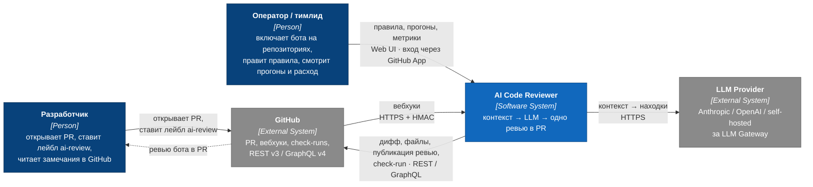

---

## 4. C4 — уровень 2: контейнеры

Диаграмма фиксирует целевую границу системы; развёртывание сервисов, включая одноразовый
`migrator`, — в §14.

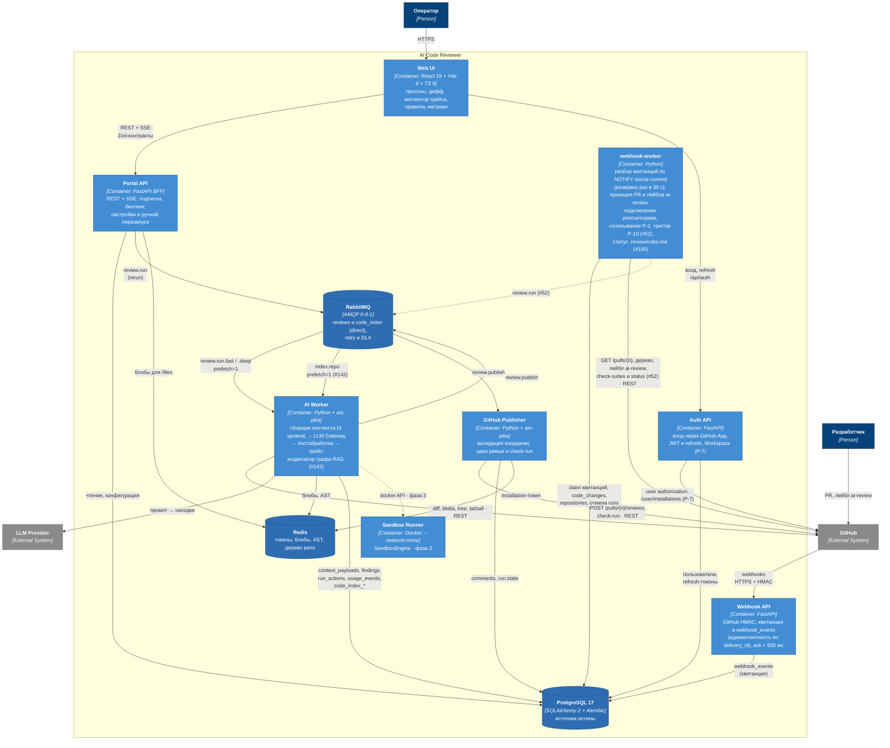

**Один monorepo, пять сервисов** (Р-12): `services/portal-api`, `services/auth-api`,
`services/webhook-api`, `services/worker`, `services/publisher`. Каждый собирается своим
Dockerfile и запускается отдельным контейнером; у роли `webhook-api` второй процесс из того же
образа — `webhook-worker` (`python -m app.webhook_worker`, ниже). PostgreSQL, RabbitMQ и Redis —
общая инфраструктура на переходном этапе. Объектного хранилища в MVP нет: всё, что §10 раньше
относил к S3, лежит в PostgreSQL (D1 по #20). Отдельного Event Collector нет:
`usage_events` пишет worker (LLM Gateway), метрики §12 строятся по ним.

Import path един для всех сервисов: процесс стартует из `services/<name>/app/main.py` —
HTTP-сервисы командой `uvicorn app.main:app`, consumers `worker` и `publisher` командой
`python -m app.main`; `app.main` только импортирует тонкий entrypoint
`app.entrypoints.<entry>` (`portal`, `auth`, `webhook`, `worker`, `publisher`).

Workspace-пакет `database-migrator` запускается Compose-сервисом `migrator` и не
входит в runtime-набор: это одноразовый job из profile `tools`, который применяется
до запуска сервисов и обращается только к PostgreSQL.

Диаграмма и раскладка выше — целевые. До разделения на сервисы (#16; скорее всего после
этого спринта, отдельным рефакторингом) `portal-api`, `auth-api` и `webhook-api` —
логические роли: их маршруты живут в одном FastAPI-приложении `app/main.py`, а `worker`
(в MVP — вместе с consumer `review.publish`, §7.1, и индексатором графа, consumer
`index.repo`, §7.4) запускается отдельным процессом из того же образа. Отдельным процессом
из того же образа запускается и `webhook-worker`
(`python -m app.webhook_worker`, Compose profile `webhooks`): он разбирает квитанции,
которые маршрут `webhook-api` записал в `webhook_events`, создаёт Run и публикует их в очередь
ревью, поэтому требует PostgreSQL и RabbitMQ (`RABBITMQ_URL`). Для GitHub replay
дополнительно нужны GitHub App ID, приватный ключ и логин бота; GitLab-only replay
использует полный GitLab runtime config без GitHub App —
[WEBHOOK_WORKER.md](WEBHOOK_WORKER.md).
Он просыпается по `NOTIFY webhook_work_available`: сохранение новой квитанции, повторная
активация отложенных квитанций при OAuth и запрос статуса правил (#150) отправляют его в своей
транзакции, PostgreSQL доставляет
его после commit; обход раз в 30 с остаётся резервным
([WEBHOOK_WORKER.md](WEBHOOK_WORKER.md#how-the-worker-handles-deliveries)).

---

## 5. C4 — уровень 3: компоненты AI Worker

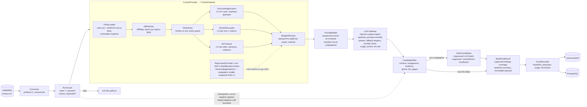

Целевой ответ движка — **`ReviewOutput v2`**: до 10 кандидатов, прежние координаты
`path/start_line/line` с внутренней стороной `RIGHT`, обязательные `evidence_refs`
и атрибуция по RULES_FORMAT_SPEC. Список содержит 1–8 refs, каждый указывает на
показанный диапазон кода/сигнатуры из manifest принятого reviewer-call; metadata,
конвенции и предыдущий ответ доказательством не служат. Verifier имеет отдельную схему решений по
backend-generated `candidate_id` и не переписывает finding/suggestion.

Текущая [`review-output.schema.json`](../review/schemas/review-output.schema.json)
и Pydantic `ReviewOutput` — **legacy v1** до отдельной реализации v2; нынешние
проверки совпадения схем не подтверждают новый контракт. Сводка старой формы ниже
дополнена проектным `evidence_refs`; точный контракт v2 —
[CONTEXT_AND_VERIFICATION_SPEC §6–8](CONTEXT_AND_VERIFICATION_SPEC.md#6-кандидаты-и-детерминированные-проходы):

```python
class ReviewFinding:          # элемент ReviewOutput.findings
    path: str                 # якорь (D6): path / start_line / line
    start_line: int | None    # null — одна строка; иначе start_line < line
    line: int                 # строка новой версии файла
    severity: Literal["critical", "high", "medium", "low", "info"]
    category: Literal["security", "correctness", "performance", "readability"]
    title: str                # ≤ 80 символов, одна строка
    body: str                 # markdown, ≤ 1200 символов
    suggestion: str | None    # готовая замена строк start_line..line → ```suggestion
    confidence: float         # 0..1
    rule_name: str | None     # .review/rules.md | AGENTS.md | service-defaults:<ID> | null
    evidence_refs: list       # v2: 1–8 {block_id, start_line, end_line}, все строки показаны
```

`side` и SHA в v2 не генерирует модель: `RIGHT` и `Run.head_sha` закрепляет backend.
LEFT требует отдельной сквозной v3, а deletion-only без реального RIGHT-якоря
даёт `left_anchor_unsupported` и partial coverage. Публичный контракт — сохранённый
`FinalReviewResult`: только supported findings, coverage, verdict и backend summary.
Пустой итог при partial/none не означает `clean`; raw summary не публикуется.

**LLM Gateway** (#33) сохраняет общий OpenAI-совместимый адаптер, ротацию ключей,
usage ledger и ограниченное восстановление. Целевой профиль: основная
`mistral-small-4`, fallback `mistral-small-3.2-24b`, отдельный verifier prompt,
strict schema, `temperature=0`, tools выключены, выход verifier ≤8 000 токенов.
Пригодность профиля verifier требует отдельного baseline; старые D7-прогоны её
не подтверждают. Четыре generation-вызова на попытку и 12 на run общие для
conventions/review/verifier/repair/fallback. До повторного вызова резервируются
слоты, стоимость и время ещё не начатых обязательных стадий; резерв verifier
освобождается только для пустого набора после детерминированных фильтров.
На cache miss штатно C → R → V и один recovery; на hit R → V и два recovery.
Сбой verifier не разрешает публикацию кандидатов. Возможный generation при
transport retry учитывается консервативно; только доказанный отказ авторизации
не расходует generation slot. Последний guard и manifest строятся **после**
сокращений gateway, отдельно для repair/fallback. Документы политики не усекаются.
Все LLM/VCS HTTP — вне DB-транзакции; usage записывается отдельной короткой
транзакцией после provider call (PIPELINE_SPEC §4.5).

Fast deadline — 8 мин от claim, один LLM call ≤90 с. До reviewer остаётся время
для его вызова, verifier и 10 с локального завершения; до verifier — один call
и 10 с. Recovery сохраняет downstream reserve, иначе `verification_deadline_exceeded`.
Deep передаёт кандидаты verifier за ≥100 с до своего deadline либо переходит в fast
с общими лимитами расходов/вызовов. После accepted review сохраняются кандидаты
и manifest checkpoint: retry продолжает проверку того же набора. Accepted verifier
и final result фиксируются атомарно до outbox; повтор публикации не запускает LLM.

Verifier отвечает ровно по всем переданным ID, без неизвестных/пропущенных/повторных:
`supported|contradicted|insufficient_context`, короткая причина, refs собственного
manifest и requirement refs при атрибуции правила. Невалидный ответ целиком уходит
в ограниченный recovery; удобное подмножество решений не принимается. Недостаток
контекста отличается от опровержения. Contradicted не публикуется; insufficient
не публикуется и отмечает partial. Неверная suggestion отклоняет кандидата целиком.

---

## 6. Потоки данных

### 6.1 Триггер (Р-10): два события в любом порядке

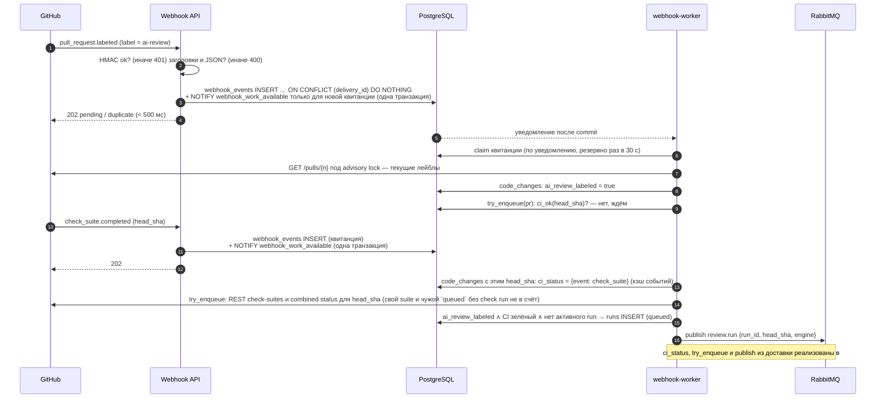

Ответ 202 подтверждает только приём: HMAC и одна вставка квитанции в `webhook_events`, без REST-вызовов; проекцию события и `try_enqueue` выполняет `webhook-worker` после ответа ([WEBHOOK_WORKER.md](WEBHOOK_WORKER.md); `try_enqueue` из доставки реализован в #52). `try_enqueue` — одна функция, вызывается из обоих обработчиков и из sweep; условие проверяется по состоянию, а не по тому, какое событие пришло последним. «CI зелёный» (дефолт по #20): все check suites для `head_sha`, **кроме suite самого App** (`app.id`) и чужих suites в `queued` без единого check run (`latest_check_runs_count = 0`, решение #72 ниже), завершены с `success` / `neutral` / `skipped`, а combined status коммита — `success` или статусов нет; проверяется REST-запросами check-suites и status внутри `try_enqueue`. Свой suite исключён: GitHub создаёт его для App с `checks: write`, а завершает его только наш check-run (§8.3) — иначе условие ждало бы само себя. Если у репозитория нет CI (`wait_for_ci = auto` и ни одного чужого check suite, кроме `queued` без check run, или статуса для `head_sha` за 2 минуты) — прогон стартует по одному лейблу. Это правило реализует sweep раз в 30 с в leader-цикле `worker` (лидер через `pg_advisory_lock`, дефолт по #20): он вызывает тот же `try_enqueue`; реконсилер (раз в 5 мин, §6.4) его не заменяет. После пуша — авто-повтор, пока стоит лейбл `ai-review` (флаг `ai_review_labeled`, Р-10). Полное условие, `wait_for_ci` и жизненный цикл флага — [PIPELINE_SPEC](PIPELINE_SPEC.md) §8.

**Фильтр веток [техлид, 14.10.2026, #149].** `try_enqueue` и sweep фильтр веток репозитория (`branchFilter`, §12) не проверяют: Run создаётся по условию Р-10, а фильтр проверяет RunGuard при каждом claim, в том числе у rerun (§6.7; PIPELINE_SPEC T5). С фильтром сравнивается целевая ветка PR `run.base_ref or pr.target_branch` — то же выражение, что уже использует claim (`lock_for_claim`). Пустой список (по умолчанию) подходит под любую ветку. Синтаксис шаблона: `*` — любые символы, кроме `/`; `**` — любые символы, включая `/`; остальные символы буквальны; правила валидации — §12. Run, целевая ветка которого не подходит ни под один шаблон, завершается `skipped` с `error_code = rule_not_matched`, check-run создаётся сразу `completed/skipped` с текстом причины (PIPELINE_SPEC §6, §7). Фильтр читается при claim, поэтому его изменение действует и на уже поставленные в очередь Run. Уникальный индекс `uq_runs_webhook_code_change_head` (`(code_change_id, head_sha) WHERE trigger = 'webhook'`, в любом состоянии) не даёт создать второй Run от вебхука на тот же head, поэтому head, уже пропущенный с `rule_not_matched`, после изменения фильтра заново не ревьюится: его ревьюит rerun (§6.7) или новый push. **Известный пробел, в #149 не исправляется:** смена целевой ветки PR (`pull_request.edited`, §8.2) отбор заново не запускает, а `Run.base_ref` сохраняет прежнюю ветку.

Проекция события одного PR сериализуется session advisory lock
`SqlAlchemyPullRequestProjectionLock` на AUTOCOMMIT-соединении. Ожидание захвата
ограничено `lock_timeout = 10s`. Таймаут dispatch квитанции — 240 с
(`ReceiveGitHubDelivery`, `_DISPATCH_TIMEOUT_SECONDS`): после него `asyncio.wait_for`
запускает отмену dispatch и ждёт её завершения. Lock освобождается в `finally`
при cleanup; ожидание отмены и DB unlock может увеличить фактическое удержание
сверх 240 с. Это таймаут dispatch, а не жёсткий предел времени удержания lock.
Сохранение проекции — отдельная короткая транзакция, GitHub-вызов её не охватывает
([WEBHOOK_WORKER.md](WEBHOOK_WORKER.md)).

**Чужой check suite `queued` без check run (решение #72).** Такой suite (`status = queued` ∧ `latest_check_runs_count = 0`) не блокирует условие «CI зелёный» и не считается признаком «CI есть» [техлид, #72]. GitHub на каждый push создаёт suite для каждой App с `checks: write`; если App не создаёт в нём check run, suite остаётся `queued` и никогда не пришлёт `completed`. Ни одно событие тогда не запустит повторную проверку (повтор идёт от `check_suite.completed`, `workflow_run.completed` и `status`), и PR завис бы навсегда. Признак приходит в том же ответе check-suites, отдельный запрос не нужен; решение по-прежнему принимается по состоянию, без таймеров. `in_progress` и `completed` учитываются всегда, при любом числе check run (`completed` — по `conclusion`), а `queued` хотя бы с одним check run блокирует, как раньше: гейт не ослаблен для чужого CI, который уже работает. Отвергнуты два варианта. (а) Оставить гейт как есть и записать «одна reviewer App на репозиторий» как условие среды: любое стороннее приложение с `checks: write`, не создающее запусков, блокировало бы ревью навсегда — это ограничение продукта, а не сред. (б) Игнорировать suites без запусков старше порога: порог требует повторной проверки по таймеру, а sweep её не делает — он берёт только PR в `auto` с пустым `ci_status` и исключает PR после первого отказа, кроме временного `deferred` (PIPELINE_SPEC §8.3), так что пришлось бы менять зону #38. Условие «одна reviewer App на репозиторий» снято лишь для второй App, которая ещё не создала check run: её suite не блокирует запуск. Вторая App, у которой check run идёт (`in_progress`) или завершился `cancelled` (это вне `success|neutral|skipped`), по-прежнему блокирует гейт другой App на этом `head_sha`; это ограничение не меняется. **Остаточный риск:** ревью может стартовать раньше времени, если suite настоящего CI ещё без запусков (на песочнице `a6819f9f` — около 13 с, под нагрузкой GitHub — минуты), а другой чужой CI или статус коммита на том же `head_sha` уже зелёный. Если CI один, `always` ждёт `completed`, а `auto` ждёт `completed`, только если к первой проверке sweep не раньше чем через 2 минуты после постановки лейбла или пуша в suite этого CI уже есть хотя бы один check run. **Остаточный риск при одном CI и `auto`** [техлид, #80]: исключение #72 действует и на единственный настоящий CI. Если его suite и к этой проверке остаётся `queued` без запусков, гейт не видит ни чужих suites, ни статусов, то есть считает, что CI нет, и sweep «2 мин без CI» (PIPELINE_SPEC §8.3) запускает ревью до CI. Второго прогона `check_suite.completed` этого CI уже не создаст: Run с `trigger = webhook` для `(PR, head_sha)` есть (PIPELINE_SPEC §8.1). Ревью после CI на этом `head_sha` тогда возможно только через rerun (T3, PIPELINE_SPEC §1; CI он не проверяет, поэтому его запускают после завершения CI) или с новым пушем (PIPELINE_SPEC §8.2). При `always` гейт в том же случае отвечает `waiting_for_ci` и ждёт `completed`. **Защитное правило: нет счётчика — suite блокирует** [техлид, #80]. Исключение #72 срабатывает только при `latest_check_runs_count = 0` в ответе check-suites. Если поля в ответе нет, считается, что запуски могут быть: разбор ответа (`app/modules/reviews/infrastructure/github_ci.py`) и `CheckSuite` гейта (`app/modules/reviews/application/determine_ci_eligibility.py`) подставляют 1, и чужой suite в `queued` блокирует условие «CI зелёный» (`ci_blocked`), как до #72: PR ждёт `completed` этого suite, а не получает ревью раньше CI. Цена правила: если GitHub не пришлёт поле для suite, в котором запуски так и не появятся, такой suite блокирует, как до #72, и PR с ним снова зависает. Правило защитное, его не убирают; `in_progress` и `completed` учитываются при любом числе check run, и это правило не ослабляет для них гейт.

### 6.2 Прогон: быстрый путь

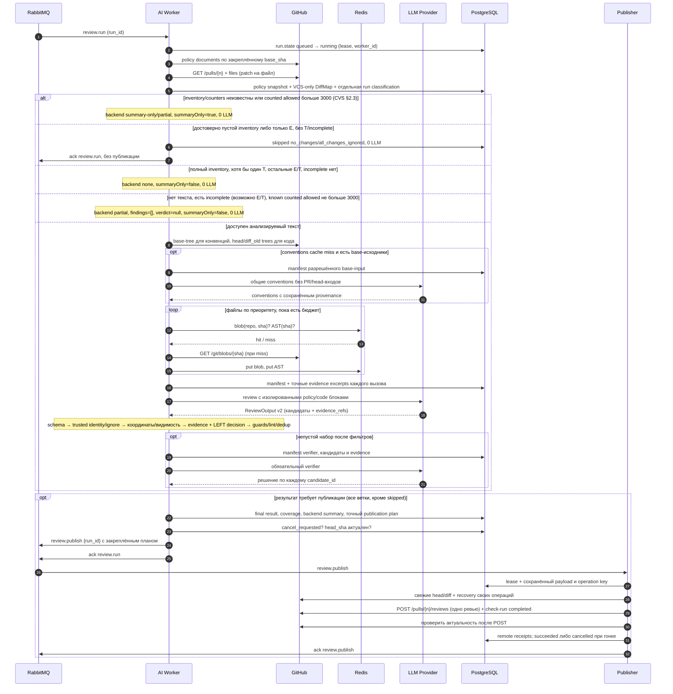

### 6.3 Схлопывание (Р-2): пуш во время прогона

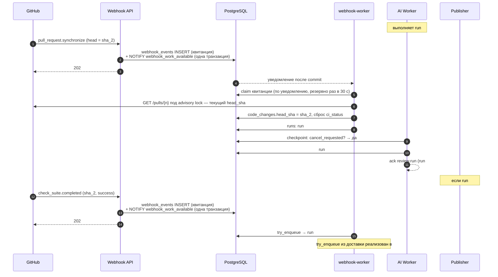

Сообщение run#1 в RabbitMQ удалить нельзя — поэтому решение всегда принимается по состоянию в БД (`RunGuard`), а брокер только доставляет.

### 6.4 Состояния Run

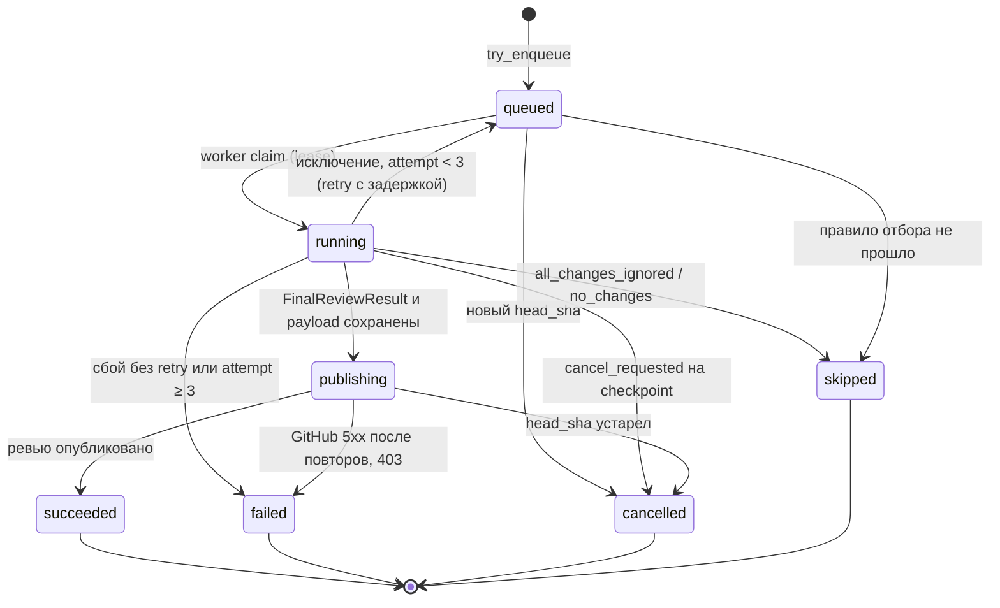

Реконсилер (в `portal-api`, раз в 5 мин, лидер через `pg_advisory_lock`): `running` с истёкшим `lease_until` → `queued` + повторная публикация сообщения (при `attempt ≥ 3` — `failed`, `lease_expired`); `queued` старше 10 мин без сообщения → повторная публикация.

Источник по переходам (триггеры, guard'ы и побочные эффекты T1–T19), lease (5 мин, heartbeat 60 с), таймаутам и retry — [PIPELINE_SPEC](PIPELINE_SPEC.md) §1, §3, §4; при расхождении по жизненному циклу прав он.

### 6.5 Вход и сессия (D4)

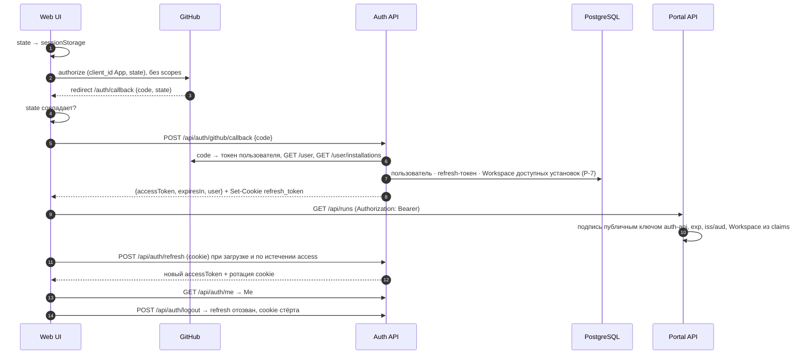

Сроки токенов, cookie, claims и граница Workspace — §12; пути и схемы — `contracts/openapi.yaml`.

### 6.6 Чтение в UI и SSE

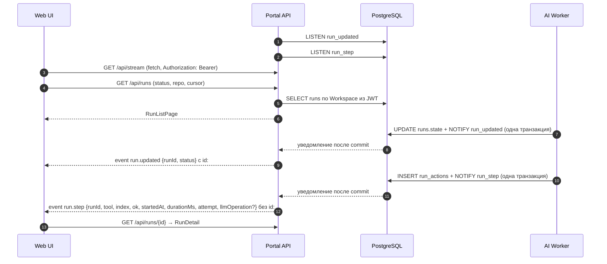

Каждая смена статуса Run шлёт `NOTIFY run_updated` в своей транзакции (D12 — дефолт по #20; payload и отправители — PIPELINE_SPEC §1): уведомление приходит только после commit, и UI не видит незафиксированных состояний. Вставка `run_actions` в той же транзакции шлёт `NOTIFY run_step`; наружу это `run.step` без строки `id:`, и повтор `Last-Event-ID` шаги не переигрывает. Поток читается через `fetch` с Bearer — `EventSource` заголовки не передаёт. Мост LISTEN/NOTIFY → SSE — #34; канал шага — #97.

### 6.7 Перезапуск

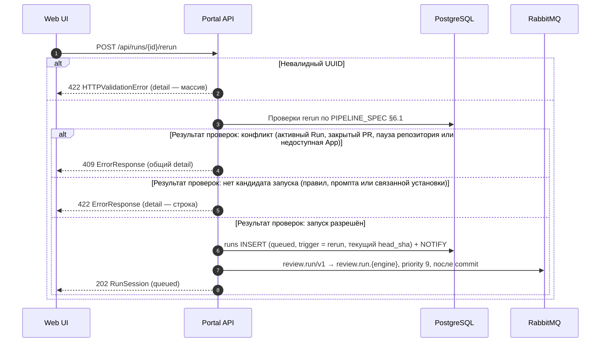

Четыре причины 409 — активный Run, закрытый PR, пауза ревью репозитория и
недоступная GitHub App — возвращают один `detail`:
`the pull request has an active run or is closed, or repository reviews are paused or unavailable`.
Машиночитаемого кода причины нет. Порядок проверок `409`/`422`, различие
отсутствующей и недоступной установки и точное тело строкового 422 заданы в
[PIPELINE_SPEC §6.1](PIPELINE_SPEC.md#61-http-отказы-rerun); диаграмма перечисляет
исходы, а порядок определяется этим разделом. Оба тела 422 описаны в
[OpenAPI](../contracts/openapi.yaml).

Флаг `ai_review_labeled` и CI не проверяются; дальше — как §6.2 (PIPELINE_SPEC T3). Фильтр веток репозитория при создании rerun тоже не проверяется и 409 не вызывает: как у Run от вебхука, его проверяет RunGuard при claim (§6.1), и rerun на неподходящую целевую ветку завершается `skipped/rule_not_matched` (PIPELINE_SPEC T5).

### 6.8 Retry и DLQ

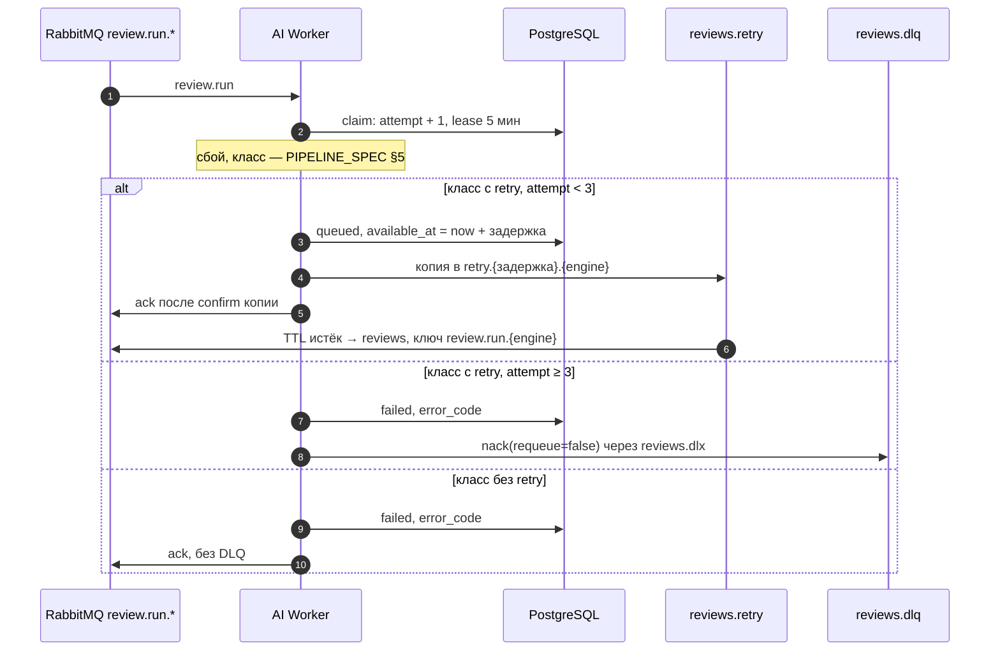

Доменный счётчик — `runs.attempt` (инкремент при claim в PostgreSQL), `x-death` — только диагностика. Отдельный счётчик `x-attempt` в AMQP считает любые исключения, вылетевшие из обработчика, в обеих очередях (`review.run.*` и `review.publish`); гибель процесса не считается (§7.3). Задержки 30 с → 2 мин (при rate limit — не меньше 2 мин); после 3 попыток — `failed` и копия в `reviews.dlq`; классы без retry (невалидный вывод модели, переполнение контекста, бюджет, дедлайн) ведут в `failed` сразу, без DLQ. Автор PR видит check-run `neutral` «AI-ревью не выполнено», ревью нет. Политика целиком — PIPELINE_SPEC §4–§7.

### 6.9 Подключение репозиториев: установка GitHub App (D10)

**Контракт переустановки App [техлид, 10.10.2026, #113].** После удаления и
новой установки сохраняются UUID Repository и Workspace, бюджет Workspace,
история PR/Run с findings/actions/diff/context/cache, все настройки, версии и
активные правила, конвенции и ручная пауза только для того же подтверждённого
числового `account.id` владельца установки и точного внешнего repo ID, доступ к
которому пользователь заново подтвердил OAuth. Числовой ID аккаунта старой
установки должен быть сохранён из аутентифицированного GitHub listing до удаления;
числовой ID аккаунта новой установки должен присутствовать в этом свежем полном
user-token listing. ID OAuth-пользователя, прежнее знание аккаунта новой установки
из чужой сверки и изменяемые login/full name не доказывают владельца.
Индекс графа RAG v1 (ADR 0001 §4) в перечень сохраняемого не входит (`cache` его не
включает) и при переустановке не переносится (#143): `installation.deleted` и
`installation_repositories.removed` логически очищают индекс затронутых репозиториев
в транзакции доставки, строки удаляет leader-задача сборки мусора (§10). Очистка
сохраняет первую причину, отличную от `ttl`: живой индекс получает `purge_reason =
removed`, у уже очищенного `disabled` или `removed` остаётся, а `ttl` заменяется. После OAuth-rebind (#113) или повторного
`installation_repositories.added` та же строка `repository_id` сохраняет `rag_enabled`, но с
пустым индексом; при включённом флаге leader-задача сходимости (§11) заново включает его —
новое поколение с маркером пробуждения, и задание строит full (#143). При
переносе в другой аккаунт и в остальных случаях чистой цели появляется новый
`repository_id` с флагом по умолчанию (выключен) и без индекса.

Новая установка получает собственную строку ProviderInstallation и внешний ID;
старые ID не перезаписываются. Перенос FK только подтверждённых репозиториев и
выдача новых грантов подтверждающему пользователю атомарны. Workspace повторно
используется лишь при однозначной принадлежности тому же аккаунту: учитываются
все известные удалённые установки аккаунта, включая пустые Workspace. Источник
должен иметь долговечный маркер удаления всей установки; удаление отдельного
репозитория этого не доказывает. Невыбранные репозитории остаются архивом без
доступа. `created`/`added`, refresh, старый JWT и совпадение repo ID сами по себе
доступ не возвращают: до OAuth списки `/api/repos` и `/api/runs` скрывают архив,
detail и mutation отвечают 404. Другие пользователи подтверждают свои repo-гранты
отдельно. Старый ещё действующий JWT подтверждающего пользователя может читать
историю после появления его новых грантов в том же Workspace.

При переносе в другой аккаунт создаётся новый Repository с настройками и правилами
по умолчанию и включённым предпочтением; история, бюджет, правила, конвенции и
пауза источника не копируются. Целевой Workspace может уже существовать. Login-only
legacy, неоднозначные источники/Workspace и коллизия с уже существующим целевым
Repository также не объединяются с архивом. Свежий OAuth может установить числовой
ID только для той же ещё доступной установки; идентичность уже удалённого
legacy-архива не угадывается. Если первый OAuth новой установки прошёл, пока
источник ещё считался действующим, новая установка остаётся в чистом Workspace
навсегда: поздняя проекция удаления и повторный OAuth не переносят туда архив,
историю, настройки или паузу. Уже созданная чистая цель не объединяется неявно.

Если у цели и однозначного удалённого архива того же числового аккаунта общий
Workspace, положительная проекция `created`/`added` или sync для архивного внешнего
repo ID откладывает upsert до свежего OAuth, подтверждающего именно этот ID. Она
не создаёт чистый Repository, правила по умолчанию или личные гранты. Исключение:
уже сохранённый личный грант новой установки на точный repo ID разрешает принять
чистую цель, если свежий OAuth snapshot не дал числового account ID и поэтому
не разрешил перенос истории (даже если ранее известный account ID совпадает).
Этот грант не доказывает lineage и не разрешает объединять архив. Это сохраняет
архив до подтверждения репозитория следующим пользователем организации или после
добавления в настройках App. Решение об отсрочке и запись сериализуются в одной
короткой транзакции под блокировками аккаунта и установок.

`Repository.enabled` хранит предпочтение пользователя, `installation_available` —
доступность App. Эффективный API `enabled` и разрешение запускать ревью равны их AND.
PATCH меняет лишь предпочтение; removal/deleted снимают доступность и гранты,
created/added восстанавливают доступность после авторизованного связывания,
сохраняя паузу и правила. Legacy `enabled=false` остаётся false: прежнюю причину
выключения восстановить нельзя, после подтверждения пользователь может явно
включить ревью. Видимость определяется Workspace/repo-грантами независимо от паузы.

**Автоматическое ревью [техлид, 14.10.2026, #149].** Переключатель автоматического
ревью в UI — это `enabled`, отдельной колонки нет: UI читает и пишет `enabled`.
PATCH `enabled` сохраняет только предпочтение, `GET` отдаёт эффективное
`enabled AND installation_available`, как после #132. Обязательное поле только для
чтения `installationAvailable` в `Repository` (§12) отличает паузу пользователя
(`enabled=false`, `installationAvailable=true`) от недоступной установки
(`installationAvailable=false`). Лейбл `ai-review` по-прежнему нужен на каждом PR
(Р-10). При `enabled=false` всё как раньше: проекция PR, precheck, replay, sweep и
RunGuard останавливаются; HTTP-отказы rerun определены в
[PIPELINE_SPEC §6.1](PIPELINE_SPEC.md#61-http-отказы-rerun).

**Тумблер RAG [техлид, 16.10.2026, #145].** `Repository.rag_enabled` хранит
предпочтение пользователя для графа RAG v1 ([ADR 0001](adr/0001-graph-rag-v1.md));
по умолчанию false — и у репозиториев, существовавших до ревизии `20261016_0033`, и у
новых. Онбординг (`installation.created`, `installation_repositories.added`, sync
установки) эту колонку не пишет: RAG он не включает и включённый не сбрасывает;
переустановка (#132) переносит строку вместе с предпочтением. Как и у `enabled`,
`GET` отдаёт эффективное `ragEnabled = rag_enabled AND installation_available`, PATCH
меняет только предпочтение. Статус индекса `ragIndex` (§11, §12) выводится из
эффективного значения и строки `code_index_states` и не хранится. `ragEnabled=false`
в теле PATCH логически очищает индекс (`purge_reason = disabled`) в той же транзакции,
что и смену настройки, и у недоступного репозитория тоже (#143); ответ — чтение после
очистки. PATCH без `ragEnabled` индекс не трогает, повторное выключение ничего не
меняет. `ragEnabled=true` в теле PATCH, если и после записи эффективное значение true
(репозиторий доступен), в той же транзакции вызывает `enable` через порт
`CodeIndexEnabler` (#143): нет строки состояния — она создаётся с поколением 1, очищенная
(в том числе по TTL) получает новое поколение; в обоих случаях ставится маркер
пробуждения (§7.4), и задание строит full, а до публикации статус — `empty`. Живой и
`failed` индекс включение не трогает: `failed` повторяют выключением и включением.
Ответ — чтение после включения.

Старые квитанции и tombstones остаются у исходной установки: старое removal не
отзывает новый доступ, а положительные события удалённой установки не оживляют её.
`deleted_at` навсегда запрещает оживление той же физической установки, в том числе
свежим OAuth. Удаление отдельного repo не устанавливает этот маркер и допускает
новое подтверждение более свежим OAuth после отметки отзыва.

`Run.origin_provider_installation_id` неизменно хранит исходную физическую
установку. Миграция заполняет старую историю до переноса FK; оставшиеся NULL
фиксируются до rebind. В момент rebind queued/running/publishing Runs исходной
установки отменяются с `installation_replaced` под блокировками до переноса FK.
Старые queued/retrying сообщения при отсутствии действующего origin завершаются
`cancelled/installation_unavailable`; running/publishing работа тоже отменяется,
включая retry и реконсилер после истечения lease. Реконсилер завершает такую работу
без публикации нового указателя и без GitHub/LLM. Пользовательская пауза остаётся
`skipped/repo_disabled`. Terminal redelivery не вызывает check-run. NULL, отсутствующий, удалённый и не
совпадающий с текущей Repository origin закрывают provider-доступ без угадывания
по текущему FK. Runtime использует `installation_unavailable`, а storage fence
отклоняет не-RUNNING producer через `run_inactive`. Причины отмены
`installation_replaced` и `installation_unavailable` доступны в существующем
публичном `errorCode` (`/api/runs`), каталог и тексты UI — PIPELINE_SPEC §6; новые
поля публичной и очередной схемы не добавляются.

Проверки в закрытой UOW предшествуют получению installation-токена и каждому
следующему GitHub HTTP-запросу: details/tree/labels, PR/CI страницы,
VCS/stream, policy/AST context tree и blob, check-run и публикация с повторными
запросами. LLM проверяет origin перед каждым фактическим POST, включая смену ключа, retry/fallback/JSON repair и
ожидание FX/ledger; после финальной проверки должно оставаться время полного call
timeout. Кэшированный locator не заменяет проверку. Только уже начатый внешний
запрос может закончиться: его оплаченный LLM usage и append-only audit сохраняются. Если успешный review POST
вернул ID перед снятием origin, `github.publish_review` сохраняет этот ID даже без
следующего GET комментариев. Если origin неактивен при `complete_publication`,
storage fence отменяет Run и не обновляет findings/comments.

**Принятое ограничение квитанции (#113).** Если checkpoint после успешного review
POST обнаружит недоступность origin до GET комментариев, квитанция содержит
`review_id` и пустой `comment_ids`: пустой список здесь не отличает неизвестные
комментарии от их отсутствия. Новый HTTP-запрос не начинается, пока origin
недоступен. При редкой гонке remove → re-add той же Repository до
`complete_publication` origin снова может быть активен: Run может завершиться `succeeded`,
findings получат `published=true`, но локальные строки `Comment` не появятся, хотя
inline-комментарии на GitHub могут существовать. Поэтому локальный список
комментариев не гарантирует полноту внешнего ревью в этом окне. Это принятое
ограничение; различение неизвестных/пустых comment IDs и расширение контракта
идентичности квитанции не входят в этот PR.

Существующие terminal Run state/payload, findings/comments/diff/context не
переписываются; обычные diff/context записи, policy documents и policy snapshots
требуют активного origin и RUNNING под атомарными блокировками. История и cache-only
file/action routes по-прежнему авторизуются по текущей Repository и грантам; новый rerun использует новый origin.

Выбор источника, создание установки и перенос сериализуются транзакционной
блокировкой аккаунта PostgreSQL, затем блокировками установок в стабильном порядке.
Provider-записи сохраняют порядок исходная установка → Repository/PR → Run.
Provider fences берут `FOR SHARE` установки и Repository: параллельные readers и
FK `KEY SHARE` совместимы, retirement/rebind блокируются. Запись Run остаётся
эксклюзивной.
Поколения OAuth и timestamps отзыва сохраняются; tombstones целевой установки
проверяются перед переносом, чтобы старый snapshot не восстановил доступ.
GitHub/LLM calls остаются вне DB-транзакций. Миграции добавляют nullable positive
BIGINT `account_external_id`, `deleted_at`, доступность и внутренний Run origin без
угадывания по login; существующее пользовательское `enabled` сохраняется. Ручной
downgrade до целевой ревизии откатывает **все ревизии выше целевой** в цепочке
Alembic; состав отката определяет `alembic history`, а не даты в id ревизий. Поэтому
downgrade **до `20261012_0030`** откатывает не только `20261010_0030` и
`20261010_0029` (#132), но и все более поздние ревизии; сейчас это `20261014_0031`,
`20261015_0032`, `20261016_0033`, `20261017_0034`, `20261018_0035`, `20261019_0036`,
`20261020_0037`, `20261023_0038`, `20261024_0038`, `20261024_0039`, `20261025_0040`, `20261026_0041`, `20261026_0042` и `20261026_0043`: теряются `branch_filter` и `severity_threshold`,
таблицы индекса графа `code_index_*` с их ENUM, флаг `rag_enabled`, состояние индексатора
в `code_index_states` (ветка, digest исключений, учёт байтов), сохранённые статусы правил
`repository_rules_status`, висящие запросы пробуждения индекса
(`code_index_states.wake_requested_at`) и троттлинг full по запросу ревью
(`review_full_requested_at`, `review_full_requested_sha`), а CHECK `ck_runs_trigger` на
`runs.trigger` только снимается.
Ревизия `20261024_0038` удаляет четыре колонки публикации
`runs.severity_threshold`, `runs.max_comments`, `run_policy_snapshots.severity_threshold`
и `run_policy_snapshots.max_comments`, а также CHECK `ck_runs_publication_settings`
и `ck_run_policy_snapshots_publication_settings`. Enum `severity_threshold` Repository
при откате этой ревизии остаётся. Повторный upgrade `20261024_0038` создаёт NULL-пары
без backfill: такие Run и retry читают текущие настройки Repository, утраченные pins
не восстанавливаются. Ревизия `20261024_0039` дополнительно удаляет nullable FK-колонки
`runs.conventions_prompt_version_id` и `runs.verifier_prompt_version_id` на
`prompt_versions`; повторный upgrade возвращает их NULL без восстановления Run prompt pins.
Готовые snapshot и сохранённые в них prompt bindings при откате `20261024_0039`
не удаляются и не переписываются. Откат `20261025_0040` удаляет таблицу
`context_manifests` вместе с manifest identity и блоками; повторный upgrade
возвращает пустую таблицу без восстановления этих данных. Откат `20261026_0043` переписывает сохранённый
omission_reason empty_file→missing_patch, затем возвращает CHECK без empty_file;
повторный upgrade не восстанавливает утраченный proof marker.
Недоступный репозиторий после отката не оживает (доступность сворачивается в `enabled AND
installation_available`: `enabled=true` при `installation_available=false` становится
`enabled=false`), а повторный upgrade возвращает схему со значениями по умолчанию
(`branch_filter = '{}'`, `severity_threshold = 'all'`, `rag_enabled = false`, пустой
индекс графа) и backfill, но не восстанавливает удалённые данные и настройки и исходное
пользовательское `enabled`; будущая переустановка такого архива без account evidence
создаёт чистую цель. Потери каждой ревизии — в таблице «Потери при downgrade»
([CICD](CICD.md), §3), единственном полном перечне; здесь только сводка.

Более глубокий downgrade **до `20261007_0028`** дополнительно откатывает `20261012_0030` и
`20261011_0029` (policy/context #136, те же две нижние строки таблицы).
Откат образа сам по себе не выполняет downgrade схемы; восстановление удалённых
данных требует проверенного backup ([CICD](CICD.md), §5). Уже удалённая
legacy-установка 168453694 из #106
не имеет подтверждённого числового ID: история приёмки #57 этим изменением не
восстанавливается. Backfill квитанций и расширение контракта не входят в #113.

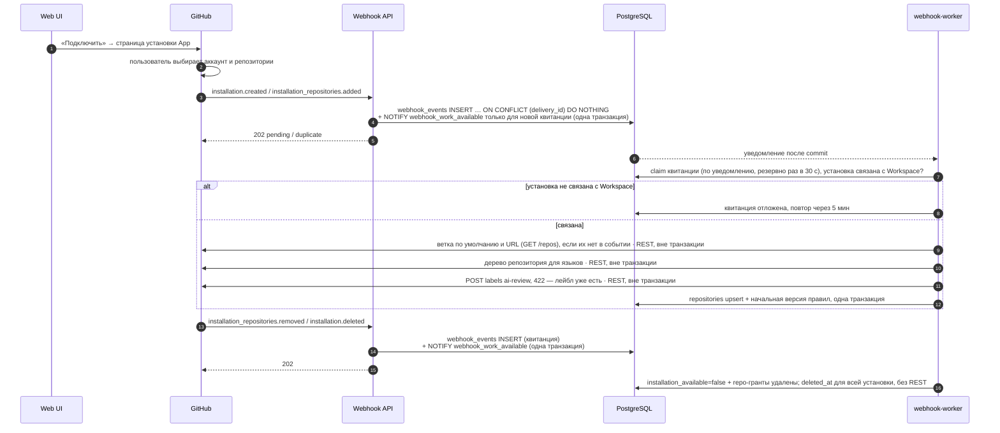

Репозиторий подключается установкой App: `POST /api/repos` нет (D10), кнопка «Подключить» ведёт на установку App. После изменения выбранных в GitHub репозиториев пользователь нажимает «Обновить доступ»: повторный OAuth-вход без logout возвращает на `/repositories`. `ExchangeGitHubCode` вызывает `LinkGitHubInstallations`: по пользовательскому токену читает установки и их репозитории, связывает новые установки с Workspace, сохраняет актуальные пользовательские гранты и пробуждает отложенные квитанции: `NOTIFY webhook_work_available` уходит в той же транзакции и доставляется после commit ([WEBHOOK_WORKER.md](WEBHOOK_WORKER.md#how-the-worker-handles-deliveries)). Это добавляет новую установку и новый репозиторий прежней установки, сохраняя по-прежнему разрешённые гранты. Refresh читает локальную идентичность; запросов к GitHub и обновления списка разрешённых репозиториев он не делает. Поэтому добавленный доступ появляется после повторного OAuth и проекции репозитория вебхуком, а не от одного refresh.

Отзыв доступа пользователя на стороне GitHub (без удаления репозитория из установки App) обнаруживается при следующем успешном OAuth-входе, в том числе через «Обновить доступ». До этой сверки прежние локальные гранты сохраняются: refresh читает локальную идентичность и не проверяет права в GitHub. Без повторного OAuth сессия ограничена абсолютным сроком refresh-семьи — 30 дней от входа; последний выпущенный access JWT может действовать ещё до 15 минут после этого срока ([§12](#12-контракт-api--ui)). Это принятая задержка отзыва пользовательского доступа [техлид, 07.10.2026, #101]; отзыв через события установки App описан ниже.

`installation_repositories.removed` удаляет гранты всех пользователей для перечисленных внешних repo ID в этой установке; `installation.deleted` удаляет все repo-гранты установки даже при пустом списке репозиториев в payload. Проекция снимает `installation_available`, сохраняет предпочтение `enabled`, удаляет гранты и фиксирует маркер эффекта по `delivery_id` в одной транзакции. Маркер не позволяет повтору той же доставки снять доступ, восстановленный свежим OAuth после частичного repo-removal, даже если финализация квитанции не удалась. Полное удаление навсегда закрывает ту же физическую установку; при reinstall с новым внешним ID маркеры источника не воздействуют на перенесённый Repository. Маркеры старше 30 дней удаляются только после удаления соответствующей квитанции (подробнее — [Retention в WEBHOOK_WORKER](WEBHOOK_WORKER.md#how-the-worker-handles-deliveries)). После commit проекции scoped-запросы закрывают доступ и со старым JWT, без ожидания refresh или его 15-минутного access TTL. До обработки квитанции сохраняется задержка очереди/повторов. Пользовательский `PATCH enabled=false` только выключает ревью: гранты и видимость репозитория сохраняются; `enabled` не является проверкой авторизации.

Удаление установки не удаляет Workspace, связь установки с ним и доступ пользователя к Workspace. До следующей OAuth-сверки удалённая установка остаётся пустой связью в `/api/auth/me`, а ID Workspace попадает и в свежий JWT при refresh. Доступ к её репозиториям уже отозван после commit проекции: наличие Workspace в JWT не заменяет repo-грант. Следующая OAuth-сверка удаляет пользовательский доступ к Workspace, если GitHub больше не возвращает соответствующую установку.

Успешная проекция `installation.created` или `installation_repositories.added` устанавливает `installation_available=true` только для действующей связанной установки. Предпочтение `enabled` существующего Repository и его ручная пауза сохраняются, в том числе после replay и пробуждения квитанции. У нового Repository предпочтение по умолчанию true. Доступ определяется актуальными личными repo-грантами после OAuth; доступность App не заменяет их.

Гонка removal с OAuth защищена блокировкой установки и отметкой отзыва `GitHubInstallationAccessRevocation`: снимок, начатый до отзыва или одновременно с ним, не восстанавливает соответствующие repo-гранты. Отметка привязана к установке и внешнему repo ID (ID `0` означает всю установку); для частичного repo-removal более свежий OAuth-снимок может вновь подтвердить доступ у GitHub; для полной установки дополнительный `deleted_at` постоянен и запрещает её возрождение независимо от свежести снимка. Поколение пользовательского снимка отдельно не позволяет более старому callback перезаписать новый. Сетевые вызовы происходят вне DB-транзакций.

На `main` доставка для установки без Workspace подтверждается ответом 202, а `webhook-worker` откладывает её квитанцию: три попытки разбора с интервалом 5 мин, затем она ждёт, пока установку не свяжут с Workspace. События установки (`installation`, `installation_repositories`) уже связанной установки `webhook-worker` также возобновляет на каждом ежечасном проходе, если квитанция отложена не менее 45 мин назад и получена не более 7 дней назад, — то есть примерно раз в час. При подключении репозитория App создаёт в нём лейбл `ai-review` — триггер Р-10: `webhook-worker` вызывает `POST /repos/{owner}/{repo}/labels` вне транзакции; эндпоинт относится к правам Issues, поэтому у App есть `issues: write` (добавлено 03.10.2026 по #37). Ответ 422 (лейбл уже есть) — успех; другая ошибка логируется и подключение не отменяет [дефолт], кроме сбоя токена установки: он касается всей установки, поэтому этот репозиторий в попытке не сохраняется, ещё не начатые репозитории события пропускаются, уже начатые запросы могут закончиться, а прочитанные репозитории сохраняются только после повторной проверки действующей установки в транзакции записи; затем доставка откладывается (GitHub не ответил на запрос токена) или проваливается (некорректный ответ или ключ App, которым нельзя подписать), а повтор переигрывает событие целиком (WEBHOOK_WORKER.md, «Installation token failures»). Лейбл, удалённый мейнтейнером, вернётся только при повторном подключении репозитория (OQ-8).

**Статус правил при подключении [техлид, 18.10.2026, #150].** Транзакция синхронизации, которая сохраняет подключённый репозиторий, ставит и запрос на чтение его `.review/rules.md`: маркер в строке `repository_rules_status` и `NOTIFY webhook_work_available` в том же commit. `webhook-worker` читает файл default branch вне транзакции и сохраняет результат, в том числе `missing`, если файла достоверно нет; до этого `GET /api/repos/{id}/rules-status` отвечает `pending`. Процесс `api` VCS не читает: ключа App у него нет ([SECRETS.md](SECRETS.md)). Повторные чтения — по `push` в default branch (§8.2) и по GET, если результат старше 10 минут или последняя ошибка временная; механизм и состояния ответа — RULES_FORMAT_SPEC §10.1.

---

## 7. Очередь: RabbitMQ

### 7.1 Топология

| Exchange | Тип | Routing key | Очередь | Потребитель | Свойства |
|---|---|---|---|---|---|
| `reviews` | direct | `review.run.fast` | `review.run.fast` | AI Worker (fast pool) | durable, `x-max-priority=10`, DLX → `reviews.dlx` |
| `reviews` | direct | `review.run.deep` | `review.run.deep` | AI Worker (deep pool), фаза 3: до неё очередь только объявляется, потребителя нет (#52) | то же; отдельный пул — чтобы сандбокс не блокировал быстрые |
| `reviews` | direct | `review.publish` | `review.publish` | GitHub Publisher (в MVP — consumer в процессе worker) | durable, DLX |
| `reviews.retry` | direct | `retry.{30s,2m,10m}.{fast,deep}` | с тем же именем | — | `x-message-ttl`, `x-dead-letter-exchange=reviews`, `x-dead-letter-routing-key=review.run.{engine}` (отложенный повтор без плагина; PIPELINE_SPEC §4.3) |
| `reviews.dlx` | fanout | — | `reviews.dlq` | оператор | хранение 7 дней |
| `code_index` | direct | `index.repo` | `index.repo` | индексатор графа RAG — consumer в процессе worker (#142, §7.4) | durable, без приоритетов, DLX → `code_index.dlx` |
| `code_index.retry` | direct | `index.repo.retry.{30s,2m,10m}` | с тем же именем | — | `x-message-ttl` из тех же задержек, `x-dead-letter-exchange=code_index`, `x-dead-letter-routing-key=index.repo` (PIPELINE_SPEC §4.3) |
| `code_index.dlx` | fanout | — | `code_index.dlq` | оператор | хранение 7 дней |

Параметры: сообщения `delivery_mode=2`, publisher confirms включены, `prefetch_count=1` на run-очередях (задачи длинные и неравные), ack **только после** фиксации состояния в PostgreSQL, `consumer_timeout=45min` (попытка в `running` — не дольше 28 мин с учётом lease и реконсилера, PIPELINE_SPEC §3). Retry, lease и таймауты — PIPELINE_SPEC §3–§4. У `index.repo` (#142) тоже `prefetch_count=1`: ack — после задания индекса, дедлайн которого (не больше 1500 с) ниже `consumer_timeout`; исходы, задержки и кто объявляет топологию `code_index` — §7.4, PIPELINE_SPEC §4.6.

Пока отдельного сервиса `publisher` нет, очередь `review.publish` потребляет отдельный
consumer в worker. Текущий wire envelope — `review.publish/v1`; новый профиль
разрешает его `run_id` в сохранённый publication plan. `findings_hash` остаётся
legacy/диагностическим полем и не определяет идентичность нового write-back (§8.4).

### 7.2 Форматы сообщений

Сообщение — **указатель**, не данные: без диффов, без payload'ов. Всё, что нужно воркеру, он читает из БД и GitHub по идентификаторам. Так сообщение остаётся < 1 КБ, а состояние — единым.

Форма сообщений — JSON Schema, пример — строгая JSON-фикстура; фикстуры и отказ на мутациях проверяет `tests/test_contract_schemas.py`.

| Сообщение | Схема · фикстура | Кто → кому | Поля |
|---|---|---|---|
| `review.run/v1` | [`contracts/schemas/review.run.v1.schema.json`](../contracts/schemas/review.run.v1.schema.json) · [`contracts/examples/review.run.v1.json`](../contracts/examples/review.run.v1.json) | webhook-worker (#52), Portal API (rerun, реконсилер), worker (sweep) → AI Worker | `schema`, `message_id` (= `run_id`, ключ идемпотентности), `run_id`, `workspace_id`, `installation_id`, `repo {id, provider, external_id, full_name}`, `pr {number, head_sha, base_sha, base_ref}`, `engine`, `rule_version_id`, `prompt_version_id`, `trigger`, `attempt`, `requested_at` |
| `review.publish/v1` | [`contracts/schemas/review.publish.v1.schema.json`](../contracts/schemas/review.publish.v1.schema.json) · [`contracts/examples/review.publish.v1.json`](../contracts/examples/review.publish.v1.json) | AI Worker, реконсилер → GitHub Publisher (в MVP — consumer в worker) | Текущий envelope: `schema`, `message_id`, `run_id`, `head_sha`, `findings_hash`, `review_event`; в новом профиле authoritative payload/identity загружаются по run_id, не восстанавливаются из текущей конфигурации |
| `index.repo/v1` | [`contracts/schemas/index.repo.v1.schema.json`](../contracts/schemas/index.repo.v1.schema.json) · [`contracts/examples/index.repo.v1.json`](../contracts/examples/index.repo.v1.json) | worker: leader-рассылка пробуждений по маркерам триггеров #143 (§7.4) и повторное пробуждение задания → индексатор графа в worker (#142) | `schema`, `message_id` (UUIDv5 от `repository_id:generation:requested_at`, свой у каждого пробуждения, §7.4), `repository_id`, `generation` (≥ 1), `attempt` (1–3), `requested_at`; коммита в сообщении нет — задание само читает HEAD default branch |

ID — UUID без префиксов, как в БД; `findings_hash` — 64 hex; приоритет (rerun — 9) — свойство AMQP, а не поле. Отличия от прежних примеров этого раздела — PIPELINE_SPEC §12.

Правила: заголовок `schema` версионируется, потребитель отвергает в DLQ незнакомую мажорную версию и сообщение, не прошедшее схему; `message_id` = детерминированный id из БД, повторная доставка безопасна; доменные попытки считает счётчик `runs.attempt` (инкремент при claim), `x-death` — только диагностика; отдельный заголовок `x-attempt` считает любые исключения, вылетевшие из обработчика, в обеих очередях (`review.run.*` и `review.publish`), гибель процесса не считается (§7.3); исчерпание трёх доменных попыток переводит Run в `failed` с `error_code`, а исчерпание трёх неожиданных ошибок отправляет сообщение в `reviews.dlq` без гарантии изменения состояния Run (PIPELINE_SPEC §4).

### 7.3 Реализация (#34): отступления

Этот раздел фиксирует существующий runtime. С #130 F2 он двухпутный: путь выбирает
закреплённый за run `review.system`; Bitbucket run закрепляет общую активную версию `review.system`
так же, как GitHub/GitLab, если репозиторий не переопределил review prompt.
После #350 активен общий v5; ранее закреплённые v4 сохраняют свой prompt. Оба идут
snapshot-путём, run на v3 или ниже остаётся на legacy-пути. Run на v4 или v5 на legacy-путь не откатывается: без
пригодного снимка политики или с провайдером вне `SNAPSHOT_REVIEW_PROVIDERS`
(GitHub, GitLab и Bitbucket Cloud) он падает с `policy_snapshot_integrity_error` до любого вызова
модели. В частности, публикация raw summary ниже — legacy, а не разрешённый
вариант целевых контрактов §5, §9–11.

- `consumer_timeout=45min` не задаётся аргументом очереди: RabbitMQ 4 отклоняет `x-consumer-timeout` для classic-очереди (`PRECONDITION_FAILED`). Это настройка брокера (`consumer_timeout` в `rabbitmq.conf`, по умолчанию 30 мин). Попытка в `running` занимает не больше 18 мин (PIPELINE_SPEC §3), поэтому дефолта хватает; значение 45 мин задаётся конфигурацией брокера при деплое (#35).
- `budget_paused` (PIPELINE_SPEC §5.3): `workspaces.daily_budget_usd = 0` означает «лимит не задан», проверка остатка идёт только при положительном лимите. Остаток считается по `usage_events.cost_usd` за текущие сутки UTC.
- `rule_not_matched`: порт `RunSelectionRule` реализует фильтр веток репозитория (§6.1, #149). `SqlAlchemyBranchSelectionRule` (`reviews/infrastructure`) читает `run.base_ref`, `code_changes.target_branch` и `repositories.branch_filter` в собственной короткой сессии; RunGuard вызывает порт до транзакции claim. Пустой фильтр подходит под любую ветку; при отсутствующей строке правило отвечает `True` и оставляет решение RunGuard. Worker подключает правило параметром `selection=` в `app/worker.py`.
- Идемпотентность публикации (Р-5): в тело ревью добавляется скрытый маркер `<!-- ai-review findings_hash=... -->`. Перед `POST /pulls/{n}/reviews` publisher ищет ревью с этим маркером и при находке не публикует повторно.
- Check-run называется `AI Review`, ссылка на прогон строится из `PORTAL_URL` (`{PORTAL_URL}/runs/{run_id}`): в summary — у `succeeded` (включая partial и summary-only) и `failed`, в `details_url` — при каждом создании и обновлении check-run, при любом итоге; без `PORTAL_URL` нет ни ссылки, ни `details_url`, и GitHub показывает домашнюю страницу App (PIPELINE_SPEC §7).
- Без `GITHUB_APP_ID` и `GITHUB_APP_PRIVATE_KEY` worker стартует, но diff получить не может: доставленный `review.run/v1` завершает Run как `failed` / `github_forbidden` без retry.
- Rerun (T3) пишет Run с `message_published_at = null` и снимает пометку после confirm, но в replay лидер-цикла worker не попадает: выборка outbox из #11 рассчитана на Run с `trigger = webhook` и лейблом `ai-review`. Неотправленный rerun переотправляет реконсилер (T18, через 10 мин).
- Ответ `review.postprocess` дополнительно хранит `summary` из `ReviewOutput`: `llm.review_output` больше 1 МиБ усекается (D1), а run detail берёт сводку из маленького `review.postprocess`.
- Все адаптеры, функции авторизации и фабрики с параметром `scope: AuthScope | None` обязаны работать fail-closed: создание или вызов без `AuthScope` вызывает `ValueError`, если доверенный внутренний вызывающий код явно не передал `allow_unscoped=True`. Актуальные примеры адаптеров: [`SqlAlchemyRunRepository`](../app/modules/reviews/infrastructure/run_repository.py), [`SqlAlchemyCancelRunUnitOfWork`](../app/modules/reviews/infrastructure/run_repository.py), [`SqlAlchemyRerunStore`](../app/modules/reviews/infrastructure/rerun_store.py), [`SqlAlchemyRerunUnitOfWork`](../app/modules/reviews/infrastructure/rerun_store.py), [`SqlAlchemyPullRequestQueries`](../app/modules/reviews/infrastructure/pull_request_queries.py), [`SqlAlchemyRepositorySettingsStore`](../app/modules/repositories/infrastructure/repository_settings.py) и [`SqlAlchemyRepositorySettingsUnitOfWork`](../app/modules/repositories/infrastructure/repository_settings.py). Функция авторизации [`authorized_run`](../app/modules/reviews/infrastructure/run_repository.py) проверяет scope напрямую; фабрика [`ReviewsApiResources.run_repository`](../app/bootstrap/reviews_api.py) делегирует защищённому конструктору репозитория. Отсутствие scope само по себе не разрешает обход. Scoped rerun использует тот же DB-предикат видимости, что чтение Run.
- `POST /api/runs/{id}/rerun` допускает 422 с массивом `detail` при невалидном UUID и со строковым `detail` при отсутствии кандидата запуска (в частности, активной версии правил или промпта). Причины 409 и порядок решений — [PIPELINE_SPEC §6.1](PIPELINE_SPEC.md#61-http-отказы-rerun).
- `GET /api/runs/{id}` отдаёт `RunDetail`; `author`, `headRef` и `baseRef` в `PullRequestRef` заполняются только в нём, список `GET /api/runs` отдаёт `RunSession` без них. Zod-схема UI допускает оба ответа: с ui#59 (`4369e02`) эти поля `nullable().optional()`; снимок Zod-схем ui (`tests/fixtures/ui_zod_contracts.json`) сверяется со спекой поле в поле, порядок перегенерации — PIPELINE_SPEC §16; коммит ui, с которого он снят, — в `provenance.commit` и `UI_CONTRACT_COMMIT`.
- Worker собирает LLM Gateway (#33) один раз на процесс, а модели ревью и конвенций на каждую попытку с её `RunCallContext` (дедлайн, номер попытки, версии). AGENTS.md, дерево и файлы для конвенций читаются на `base_sha` (файлы — через blob) на обоих путях с #136, метаданные PR берутся у провайдера. Legacy-путь (run на `review.system` v3 или ниже): ключ кэша конвенций — (repository_id, agents_md_sha, prompt_version_id, policy_key = ignore key попытки; NULL у run без снимка), контекст стадии `context.build` попадает только в трассу, её бюджет считается по 4 символа на токен. Snapshot-путь (run на v4 или v5): тот же base-вход, `policy_key` — digest `repo-conventions-v2` (§10), блоки L2–L4 стадии идут в prompt как `<context_excerpts>`, стадия считает токены закреплённым в снимке counter (`counter/v2`, 3 символа на токен), после ревью работает verifier, а вызовы конвенций и ревью оставляют следующим стадиям резерв слотов и времени (CONTEXT_AND_VERIFICATION_SPEC §7.3–7.4). Без `LLM_MODEL` worker стартует с предупреждением, а Run завершается `failed` / `llm_unavailable` с сообщением о том, что шлюз не настроен (#52). `llm_unavailable` ретраится (`RETRYABLE_ERROR_CODES`), поэтому Run проходит все три попытки, и сообщение видно в `runs.error_message` только после третьей. Локальные модели: таймаут вызова fast фиксирован, 90 с (`GatewayPolicy.call_timeout_s`, из env не задаётся), и reasoning-модели на локальном железе в него обычно не укладываются; LM Studio с gpt-oss отвечает 400 на строгую схему (`json_schema`), ему нужны `LLM_STRUCTURED_OUTPUT=prompt_json` и `LLM_ALLOW_PROMPT_JSON=1` (README, «LLM gateway»).
- Перед `POST /pulls/{n}/reviews` publisher сверяет голову PR в GitHub: push, который webhook-worker ещё не записал в PostgreSQL, превращает публикацию в `cancelled` / `superseded` (T15), а не в ревью на старый коммит (#52).
- `deep` (SandboxEngine) относится к фазе 3: `PATCH /api/repos/{id}` принимает только `fast`, реконсилер не публикует в `review.run.deep`, очередь только объявляется (#52).
- **Лимит повторов AMQP и маршрутизация в DLQ при неожиданных ошибках (#54).** Очереди `review.run.*` объявлены как классические очереди RabbitMQ из-за несовместимости `x-max-priority` с кворум-очередями брокера. Classic-очереди RabbitMQ не выставляют заголовок `x-delivery-count`. Доменные повторы отслеживаются через `runs.attempt` в PostgreSQL и проявляются в AMQP через `x-death` после возвращения из exchange `reviews.retry` и очередей задержки `retry.{30s,2m,10m}.{fast,deep}` (§6.8, §7.2). Для защиты от необработанных исключений потребителя вводится второй, отдельный счётчик повторов через заголовок `x-attempt`: он считает любые исключения, вылетевшие из обработчика, в обеих очередях (`review.run.*` и `review.publish`); гибель процесса не считается. При возникновении исключения обработчик воркера выполняет confirmed-перепубликацию копии сообщения с инкрементированным заголовком `x-attempt: attempts` через exchange `reviews` с последующим подтверждением `ack()` исходной доставки. Если перепубликация завершается ошибкой (сбой соединения или брокера), воркер перехватывает исключение и выполняет fallback на `nack(requeue=True)`. Заголовок `x-death` отложенных очередей не расходует бюджет неожиданных сбоев. Некорректные или повреждённые заголовки попыток логируются с уровнем `WARNING` и fallback на 1. При достижении порога `MAX_UNEXPECTED_RETRIES = 3` сообщение маршрутизируется в `reviews.dlq` через `nack(requeue=False)`, в лог пишется `ERROR` с полным `exc_info=True`, а локальный кэш попыток процесса очищается. Локальное fallback-состояние ограничено 1024 записями (`MAX_LOCAL_RETRY_ENTRIES`) с TTL 300 с от последнего сохранения (`LOCAL_RETRY_TTL_SECONDS`); истёкшие записи удаляются лениво при следующем обращении retry к состоянию, при заполнении вытесняются старейшие. Успешная confirmed-перепубликация и ack оригинала очищают локальную запись; ошибка publish или ack сохраняет ограниченный fallback. Между процессами счётчик переносит заголовок `x-attempt`. Без `message_id` локальный ключ — стабильный SHA-256 routing key и тела сообщения. Остаточные риски: 1) внезапная гибель процесса (SIGKILL, OOM-killer) не считается счётчиком, так как обработчик не успевает выполнить перепубликацию до падения процесса; 2) если копия опубликована, а `ack` оригинала упал, в очереди окажутся и оригинал, и копия; это безопасно благодаря идемпотентности обработчиков (Р-5, §7.2).

### 7.4 Очередь index.repo (#142)

Индексатор графа RAG (Р-13, [ADR 0001 §6](adr/0001-graph-rag-v1.md)) — отдельный consumer
`index.repo` в процессе `worker`, рядом с consumers ревью. У него свои каналы, свой
`SubprocessSourceParser` и свой HTTP-клиент GitHub, поэтому ревью не ждут задания индекса
([code_index_worker.py](../app/bootstrap/code_index_worker.py)). Топологию `code_index`
(§7.1) worker объявляет при старте на своём confirm-канале, отдельно от топологии ревью
([code_index/infrastructure/amqp.py](../app/modules/code_index/infrastructure/amqp.py));
без `GITHUB_APP_ID` и `GITHUB_APP_PRIVATE_KEY` он только объявляет её и очередь не
потребляет. Пробуждения по триггерам публикует только leader worker (#143); своё
повторное пробуждение задание по-прежнему публикует само. Триггеры — мерж PR и
push в default branch (`webhook-worker`, §8.2), включение тумблера (API, §6.9), leader-задачи
сходимости и сверки с HEAD (§11) — пишут цель и маркер `code_index_states.wake_requested_at`
в своей короткой транзакции: outbox на строке состояния. Проверка индекса ревью (#144,
[§10](#review-full-throttle)) пишет тот же маркер, но без цели. Leader-задача рассылки после их
коммита будит задание через порт `IndexWakeups` (`AmqpIndexWakeups` на confirm-канале
consumer), вне транзакции, и снимает маркер compare-and-set по прочитанному времени: маркер,
поставленный за это время, переживает снятие и уходит следующим проходом. Неудачное
пробуждение останавливает проход, и маркеры остаются. Строку под живым lease рассылка
пропускает: задание само сверит цель, когда закончит (ниже). API, `webhook-worker` и ревью в AMQP
не публикуют; без GitHub App нет ни consumer, ни рассылки, и маркеры ждут.

`index.repo/v1` только будит задание репозитория: цель — HEAD default branch, которую
задание читает при старте, поэтому задания одного репозитория сливаются. `message_id` —
UUIDv5 от `repository_id:generation:requested_at` (текст `requested_at` из сообщения) в
пространстве имён `MESSAGE_ID_NAMESPACE`: свой у каждого пробуждения. Копия при повторе
сохраняет `message_id` и `requested_at`, меняется только `attempt`.

Исход задания определяет действие с доставкой. Копия публикуется с publisher confirm, и
только потом подтверждается оригинал. Неподтверждённая копия (например, удалена
retry-очередь) оставляет оригинал брокеру (`nack(requeue=True)`) после паузы
неожиданной ошибки. Неподтверждённые копии и исключения обработчика считает один счётчик,
max(`x-attempt`, локальный) + 1, и в `code_index.dlq` уходит третий неудачный проход, не
обязательно третья неподтверждённая копия: после двух исключений — уже первая. Каждый
проход заново запускает задание. Исключение из обработки одной доставки (сбой ack, nack
или публикации, например канал заменён переподключением за время задания, или ошибка
самого обработчика) consumer индекса логирует с одним `message_id` и берёт следующую
доставку, не останавливая consumer-ы ревью. Оставшуюся неподтверждённой доставку он
отправляет `nack(requeue=False)` в `code_index.dlq`: иначе на открытом канале consumer с
`prefetch_count=1` встал бы, а requeue мог бы крутиться. На закрытом канале этот nack
тоже падает, сбой логируется, и брокер вернёт доставку; задание идемпотентно.

| Исход | Действие |
|---|---|
| тело не JSON или не проходит схему, чужой `schema`, `message_id` не выводится из полей | `nack(requeue=False)` → `code_index.dlq`, задание не запускается |
| PUBLISHED, UNCHANGED, EMPTY, STALE, FAILED (лимит, небезопасный архив, квота хранения), RELEASED (отказ доступа или политики, код в `last_error_code`; сверка с HEAD повторяет его только на новом HEAD, ветке или версиях, а временный сбой чтения политики `policy_fetch_transient` или `policy_rate_limited` — каждый проход, §11), LEASE_LOST | ack, без retry и DLQ |
| REWAKE (soft cutoff очистки, промах CAS публикации) | ack: задание само уже разбудило репозиторий новым сообщением с attempt 1 |
| BUSY (лимит параллельности при claim) | копия в `index.repo.retry.30s` с тем же `attempt`, ack; не nack-requeue, который крутился бы, пока лимит занят |
| LEASED | ack. Если доставка повторная (`redelivered`: держатель lease погиб вместе с ней), уже ждёт lease (заголовок `x-lease-wait`) или несёт `x-attempt` ≥ 1 (любая копия со счётчиком: после исключения или отложенная BUSY/TRANSIENT-копия такой доставки; задание могло не освободить lease), — копия в `index.repo.retry.10m` с `x-lease-wait` + 1, пока ожидания не перекроют lease: ⌈`CODE_INDEX_LEASE_SECONDS` / TTL очереди 10m (600 с)⌉ раз (2 при 1200 с, 3 при 1560 с). Бюджет ожиданий — на всё сообщение: BUSY- и TRANSIENT-копии переносят потраченный `x-lease-wait` без + 1; бесконечное значение заголовка считается последним ожиданием |
| TRANSIENT (`vcs_unavailable`, `vcs_rate_limited`) | копия с `attempt` + 1: после попытки 1 — 30 с, после 2 — 2 мин; лимит или `Retry-After` — не меньше 2 мин, `Retry-After` больше 2 мин — 10 мин. На попытке 3 — ack: `last_error_code` уже записан, последняя публикация остаётся |
| исключение обработчика | перепубликация с `x-attempt` в `code_index` с тем же routing key, как у ревью (§7.3); третье → `code_index.dlq`. Отложенные копии (BUSY, TRANSIENT, LEASED) несут текущий счётчик в `x-attempt` без + 1: откладывание — не ошибка. Записи индекса в общем локальном счётчике живут `CODE_INDEX_LEASE_SECONDS`, но не меньше 300 с (задание кончается раньше своего lease), записи ревью — 300 с, и истёкшая запись при чтении не считается. Счётчик накапливается за всю жизнь сообщения, раз откладывания его сохраняют: три исключения в любом месте цепочки откладываний отправляют сообщение в `code_index.dlq`. Задание, закончившееся неожиданным исключением (не отменой), снимает lease и пишет в `last_error_code` мягкий код `internal_error` на каждой попытке, где оно ещё держит lease (best effort: если снятие lease не удалось, код не пишется), а не только на той, что уходит в DLQ: строка возвращается в `ready`/`empty`, `error_code` не пишется (`internal_error` — не код `failed` индекса; с кодом Run (PIPELINE_SPEC §6) совпадает только имя, ADR §10), метрики задания записываются, следующая публикация код сбрасывает, а любой исход без публикации (UNCHANGED, EMPTY, REWAKE) и отменённое задание — нет (известный предел). Отменённое задание снимает lease без кода: доставку вернёт брокер |

Цель, сдвинутую за время задания (`target_commit_sha` отличается от снимка claim), задание
тоже будит само после PUBLISHED, UNCHANGED, EMPTY и RELEASED; consumer второй раз не будит.

Параллельность ограничивает claim в PostgreSQL: `CODE_INDEX_MAX_CONCURRENT` (2) на весь
деплой и `CODE_INDEX_MAX_CONCURRENT_PER_INSTALLATION` (1) на установку; процесс берёт одну
доставку за раз. Installation-токен каждое задание получает своим провайдером с кэшем на
это задание: попытка после 401 берёт новый токен, а общий кэш процесса (и Redis, #62)
индексатор не использует. Сверка с HEAD (§11) берёт один кэш на свой проход: её чтения
многих репозиториев одной установки обменивают один токен. Переменные `CODE_INDEX_*` и значения по умолчанию —
`.env.example`, задержки и лимиты — PIPELINE_SPEC §4.6.


<a id="index-row-contract"></a>

#### Канонический контракт строк индекса (#207, handoff для #144)

Этот раздел задаёт смысл сохранённых файлов, символов, рёбер и записей импортов.
Full и incremental на одной ревизии дают одинаковые нормализованные множества строк;
ретривер #144 использует этот контракт вместе с правилами ревизий CVS §3.5.

- **Источник файлов.** Набор путей и `blob_sha` исходников берётся из GitHub archive
  на `index_commit_sha`. `export-ignore` исключает пути из архива, `export-subst`
  меняет его байты: граф отражает архив, и blob hash архивного содержимого может
  отличаться от OID исходного Git blob. Исходники, скрытые из архива, не индексируются.
  Единственное исключение — политика: оригинальный `.review/rules.md` всегда читается
  из Git tree/blob той же закреплённой ревизии, даже если документ есть в архиве.
- **Python/TypeScript.** `uses_imported` хранит `(target_path, exported_name)`, а
  `code_index_symbols` — объявленные имена, в том числе qualified names. Для TS
  `export default function Named()` ребро имеет имя `default`, символ — `Named`;
  для `export { x as y }` ребро хранит `y`, символ — `x`. Анонимный default-символ
  получает имя `default`. Ретривер сопоставляет экспорт с объявлением через
  `facts.exports` целевого файла, заново извлечённые на нужной ревизии по CVS §3.5;
  равенство `target_name` и имени символа не гарантируется. Barrel re-export не обходится.
- **Go.** `ImportRecord.target_path` — каталог пакета; `""` означает корень модуля.
  Ребро `imports` указывает на каждый member-файл пакета. `uses_imported` указывает
  на единственный member, объявляющий экспортируемое имя. Ноль либо несколько
  объявляющих файлов не дают ребра на имя; запись импорта и рёбра `imports` сохраняются.
- **Только модуль.** Wildcard import, Python `import a.b` и использование затенённого
  alias не дают предположительного `uses_imported`: сохраняются запись импорта и
  подтверждённое `imports`. Если различение символа и подмодуля требует чтения
  `__init__.py`, но он недоступен, остаётся только исходное модульное ребро. Вызовы
  через receiver, barrel re-export и динамические связи по имени не создают
  спекулятивных именных рёбер; имя атрибута Python не является чтением имени, и
  `repository.save()` при `from .store import save` не даёт `uses_imported` на `save`.
  Разрешённый явный alias импорта сам по себе допустим.
- **Неразрешённые импорты.** Записи сохраняют исходные `ImportResolution`:
  `unsupported`, `ambiguous`, `dynamic`, `excluded`, `external`, `missing`.
  Эти исходы не дают графовых рёбер; отсутствие ребра не означает удаление записи.
  `defines` представлен строкой символа, отдельного ребра `defines` в хранилище нет.

**Авторитетная политика и стоимость чтения.** После UNCHANGED-проверки индексатор
читает нерекурсивное полное корневое Git tree по commit SHA,
затем `.review` по tree OID и `rules.md` по blob OID. Root `AGENTS.md` не читается.
Только полные листинги этих деревьев доказывают отсутствие документа: архив с
`export-ignore` этого не доказывает. Типы, лимит 65 536 байт и нормализация совпадают
с review loader (RFS §3); 404, усечённый или неоднозначный листинг дерева, недоступный blob или недопустимый
документ дают RELEASED/`policy_*` без новой публикации и без пустой fallback-политики.
Последняя публикация сохраняется. Эти запросы идут вне DB-транзакций и внутри дедлайна.

| Политика на закреплённом commit | Дополнительные запросы | Full, всего | Incremental, всего |
|---|---|---:|---:|
| `.review` отсутствует в полном root tree | 1 tree | 5 | 6 |
| `.review` есть, `rules.md` отсутствует в полном tree | 2 tree | 6 | 7 |
| `rules.md` — обычный blob, включая скрытый из архива | 2 tree + 1 blob | 7 | 8 |

UNCHANGED остаётся **2** запросами HEAD. В таблице учтены API и codeload, исключён
обмен installation token; retries отсутствуют. Неудачные запросы тоже входят в
`github_request_count`; ранний отказ политики не загружает архив. Дополнительные
1–3 запроса делят installation-бюджет 5 000/час с ревью. Единый авторитетный путь
выбран также ради паритета при `export-subst`, без отдельной archive fallback-ветки.
`index-exclusions/v2` входит в `limits_profile_version`: публикация v1 перестраивается
в full даже на том же commit; изменившийся digest пользовательских масок тоже
требует full. Миграция схемы, новый trigger и изменение retrieval scope не нужны.

---

## 8. Взаимодействие с VCS

### 8.1 Порт `VcsProvider` (Р-11)

```python
class VcsProvider(Protocol):
    def verify_webhook(self, headers: Mapping[str, str], body: bytes) -> WebhookEvent: ...
    async def get_pull_request(self, repo: RepoRef, number: int) -> PullRequest: ...
    async def get_diff(self, repo: RepoRef, number: int) -> list[RawFilePatch]: ...   # unified diff на файл
    async def get_blob(self, repo: RepoRef, blob_sha: str) -> bytes: ...
    async def get_tree(self, repo: RepoRef, ref: str) -> list[TreeEntry]: ...
    async def get_ci_status(self, repo: RepoRef, sha: str) -> CiStatus: ...
    async def upsert_check_run(self, repo: RepoRef, sha: str, status: CheckRun) -> str: ...
    async def post_review(self, repo: RepoRef, number: int, review: ReviewPayload) -> str: ...
    async def list_feedback(self, repo: RepoRef, number: int) -> list[FeedbackSignal]: ...   # после MVP
```

GitHub поддерживает вебхуки, diff, блобы, check-run и `post_review`. Установленный
GitLab поддерживает durable MR receipts, проекцию, очередь, fast-анализ и discussions
через отдельные адаптеры (§8.4); GitHub check-run для GitLab не вызывается.
Bitbucket Cloud использует отдельный UUID-bound adapter для PR, diff, source,
inline comments и commit statuses; детали и live-гейт — [задача #333](https://github.com/larchanka-training/dmc-268-api-t6/issues/333) и [TEST_PLAN](TEST_PLAN.md#bitbucket-cloud-acceptance-333).
Минимальная совместимая версия GitLab — 17.4.

GitLab HTTP admission включается отдельно через `GITLAB_WEBHOOK_INTAKE_ENABLED`
(по умолчанию false), а каждый connection — через проверяемый `gitlab_admin activate`
с обязательной ожидаемой generation (SECRETS). Internet-facing API использует только
БД и digest webhook secret; keyring и PAT для admission не нужны. Replay и review
workers используют полный защищённый runtime config и исходный stored credential.

`POST /webhooks/gitlab/{installationId}` проверяет `X-Gitlab-Token` по digest именно
этой физической установки, ограничивает поток 10 МиБ и принимает строгий UTF-8 JSON.
`webhook-id` (либо `Idempotency-Key`) обязателен; конфликт заголовков/повторного payload
отклоняется. `X-Gitlab-Event-UUID` и `X-Gitlab-Webhook-UUID` не заменяют delivery key.
Receipt namespace включает provider и immutable installation UUID. Ответ 202 означает
commit receipt, включая точный повтор; 400 — невалидный запрос, 401 — неверная
авторизация, 413 — размер, 503 — выключенный/недоступный admission. GitLab HTTP в
receiver отсутствует. Вебхук не создаёт installation или binding.

MR open/update/reopen читают текущее состояние, сериализуют проекцию и допускают
запуск только bound enabled/available репозитория с `wait_for_ci=never`, активными
rules/prompt и неизменным head. Close/merge отменяет активную работу. GitLab CI,
no-CI sweep, deep/Sandbox и Graph/RAG для GitLab не поддерживаются; GitHub CI,
sweep, index и cache сохраняют прежнее поведение.

Diff закреплён за сохранённой версией MR с точными head/start/base и target/source
project IDs. Fork получает policy/conventions из TARGET/START, контекст из SOURCE/HEAD,
старую сторону из merge-base. Полнота file inventory/counts и bounded pagination
проверяется; overflow, усечение, недоступный fork и несовместимые refs не превращаются
в полный diff. Tree/blob reads используют immutable SHA/OID и проверяют маршрут;
кэш не заменяет checkpoint или authority. Policy, ignore, context и shared LLM/accounting
проходят обычный pipeline. Доли языков нормируются по байтам распознанных языков;
неизвестные расширения не входят в знаменатель, нулевой размер не создаёт долю.

#171 включён через merge 05a96bc4 и rebase на main 063496ec; текущая интеграция
проходит отдельное ревью. Synthetic/component proof не является live MR/run/discussion/
redelivery acceptance. Intake остаётся default-off; production rollout не следует из
наличия кода или локальных фикстур.

### 8.2 GitHub: события и права

| Событие | Действия | Что делаем |
|---|---|---|
| `pull_request` | `opened`, `reopened`, `synchronize`, `edited` | upsert `code_changes`; `synchronize` → сброс `ci_status`, `cancel_requested` активного Run |
| `pull_request` | `labeled` / `unlabeled` | `ai_review_labeled = true/false`, только если `label.name == "ai-review"`; события самого бота отбрасывает Р-9 (§8.3); на `closed` и `reopened` флаг сверяется с текущими лейблами PR (PIPELINE_SPEC §8.2) |
| `pull_request` | `closed` | отмена активного Run; при `merged = true` и `base.ref`, равном `repository.default_branch` из payload, — запрос обновления индекса до `merge_commit_sha` (без него — только маркер пробуждения, §7.4) до раннего выхода проекции, то есть и у репозитория с приостановленными ревью; статус доставки не меняется, в detail добавляется `index=requested`; сбой запроса пишется в лог и доставку не роняет — проекция уже закоммичена, индекс догонит сверка с HEAD (§11); вызова GitHub нет (#143) |
| `check_suite`, `workflow_run` | `completed` | для открытых PR с этим `head_sha` `check_suite` пишет `ci_status = {"event": "check_suite"}` (кэш для sweep, PIPELINE_SPEC §8.3), `workflow_run` `ci_status` не пишет → `try_enqueue`; «зелёный» = все suites для sha, **кроме suite самого App** и чужих `queued` suites без check run, завершены с `success` / `neutral` / `skipped` — проверяется REST-запросом в `try_enqueue` (§6.1) |
| `status` | — | для репозиториев со сторонним CI через commit status; `ci_status = {"event": "status"}` (кэш) → `try_enqueue`; combined status `success` или пусто — часть условия «CI зелёный» |
| `pull_request_review_thread` | `resolved`, `unresolved` | **после MVP**: `feedback_signals` |
| `installation`, `installation_repositories` | `created`, `deleted`, `added`, `removed` | синхронизация `repositories`; при подключении — создание лейбла `ai-review` и запрос чтения `.review/rules.md` (§6.9); `deleted` и `removed` логически очищают индекс, а повторное подключение при включённом RAG заново включает его через leader-задачу сходимости (§6.9, §11; #143) |
| `push` | — | только в default branch (`ref = refs/heads/<repository.default_branch>`): запрос перечитать `.review/rules.md` для статуса правил (#150, RULES_FORMAT_SPEC §10.1); другие ветки и теги отбрасываются. Файл меняют коммитом или merge в репозитории, а не в портале, поэтому без этого события сервис узнал бы об изменении только при следующем перечитывании. Тот же push в default branch запрашивает обновление индекса до `after` (#143, сверх Scope #143), независимо от статуса правил; статус доставки один, в detail добавляется `index=requested`. Push, удаливший ветку (`deleted` или нулевой `after`), обновления не запрашивает |

Права App (repository): `pull_requests: write`, `checks: write`, `contents: read`, `metadata: read`, `issues: write` (создание лейбла `ai-review`, §6.9), `actions: read` (событие `workflow_run`), `statuses: read` (событие `status` и combined status в PIPELINE_SPEC §8.1). Подписка App на событие Push (Permissions & events → Subscribe to events) нужна статусу правил (#150) и обновлению индекса по push (#143) и включается вручную: это обязательный шаг настройки каждой App (staging, dev, sandbox), код его не делает. Без подписки триггер молча не срабатывает, и изменение `.review/rules.md` видно только по GET после порога в 10 минут (RULES_FORMAT_SPEC §10.1). Новых прав подписка не требует, файл читается с `contents: read`. Бот **не** имеет `contents: write`. Прав организации и аккаунта нет. События `labeled` / `unlabeled` приходят в подписке `pull_request`, поэтому триггер Р-10 новых прав не требует; лейбл `ai-review` App создаёт сам при подключении репозитория (§6.9), `POST /repos/{owner}/{repo}/labels` требует `issues: write`, а не `pull_requests: write` ([GitHub Docs](https://docs.github.com/en/rest/authentication/permissions-required-for-github-apps), OQ-8). Регистрация App и полный список настроек — #37.

### 8.3 Правила работы с API

| Правило | Как |
|---|---|
| Ответ на вебхук < 500 мс | Проверка размера тела запроса (лимит 413 при превышении `MAX_WEBHOOK_PAYLOAD_BYTES = 10 MB` потоково до вычисления хэша, #54), затем проверка HMAC (`X-Hub-Signature-256`, `hmac.compare_digest`), заголовков и JSON, одна вставка квитанции в `webhook_events` — всё; никакой работы в обработчике: REST-вызовы и проекция — в `webhook-worker` после ответа (§6.1) |
| Идемпотентность | `webhook_events.delivery_id UNIQUE` (`X-GitHub-Delivery`); GitHub **не** ретраит доставки сам — приёмник обязан быть доступен |
| Игнор собственных событий (Р-9) | Маршрут по `sender` не фильтрует: квитанция сохраняется, ответ — 202. `webhook-worker` пропускает событие лейбла `ai-review` (`labeled` / `unlabeled`), если `sender.type == "Bot"` ∧ `sender.login` совпадает с `GITHUB_APP_BOT_LOGIN` без учёта регистра, и помечает квитанцию разобранной (`projected_at`). В событиях бота `sender` — пользователь `<slug>[bot]`, и его id не равен App ID (staging: App ID `5111033`, `dmc268-t6-reviewer[bot]` — `335108304`, #37). App ID остаётся в `iss` App JWT и в исключении своего check suite по `app.id` (PIPELINE_SPEC §8.1) |
| Installation-токен | живёт 1 ч; Redis `token:{installation_id}`, общий для `worker` и `webhook-worker`, TTL до `expires_at` минус 60 с; найденный в Redis токен имеет приоритет; ошибка чтения или отсутствие ключа (вытеснение, отклонённая запись) допускают локальную копию только до `expires_at` минус 60 с; без локальной копии или при достижении этой границы — cache miss; без `REDIS_URL` — в памяти процесса с той же границей срока; private key App — только в env `webhook-worker`/`worker`/`publisher` |
| Rate limit | 5000 req/ч на installation; `X-RateLimit-Remaining` в метрики; `403/429` + `Retry-After` — повторы по PIPELINE_SPEC §5.2; вторичные лимиты — не более 1 мутации/сек |
| Дифф | `GET /pulls/{n}/files` с полной пагинацией и сверкой версии; для кандидатов empty_file (поддерживаемый канонический путь, added, previous_filename=None, нулевые additions/deletions/changes, точный empty blob SHA, size=None/0, исходный patch=None/пустая строка) — максимум один optional recursive tree read на fetched head_sha, cap 1 500 000 response bytes, unique exact path+SHA/type=blob/mode=100644\|100755/size None\|0 и nontruncated listing; без кандидатов ноль запросов, для доказанных кандидатов ноль добавленных blob-байт. Ошибка/cap/невалидный proof оставляют missing_patch/incomplete, отмена/дедлайн распространяются; отсутствие/усечение patch не считается нулевым diff. `DiffMap` различает complete/missing/truncated/malformed/binary/unsupported/metadata_only |
| Файлы | Точный путь разрешается в дереве закреплённой ревизии, затем `GET /git/blobs/{sha}`; policy — base, RIGHT — head, LEFT — подтверждённый diff_old. Кэш 7 дней; текущая ветка не заменяет недоступный снимок |
| Дерево | `GET /git/trees/{revision_sha}?recursive=1`; усечённый ответ не доказывает отсутствие пути. Требуется полный целевой обход; policy guard повторяется на каждом использовании |
| Публикация (Р-5) | Один `POST /pulls/{n}/reviews` с сохранённым payload: `commit_id=head_sha`, `event`, `body`, `comments[{path,line,side:"RIGHT",start_line?,start_side?,body}]`. Диапазон должен целиком входить в один hunk одной стороны. В body — только supported general-only и находки сверх inline cap, без применяемой suggestion |
| Check-run | `in_progress` при claim; `neutral` для succeeded/failed, `skipped` для исключённого scope, `cancelled` для отмены. `blocking`/`attention` определяются supported severity; `clean` допустим только при complete coverage. Partial/none без значимых findings и summary-only имеют `verdict=null` и явное сообщение о неполноте; API, review и check-run читают один сохранённый final result |
| Обратная связь | **после MVP** (`FeedbackSignal`): `pull_request_review_thread.resolved` — вебхук; реакции — poll `GET /pulls/comments/{id}/reactions` раз в час по комментариям бота за 7 дней |

### 8.4 Координаты, GitLab и надёжная публикация (#107)

`DiffMap/v1` хранит old/new path, blob/revision, provider diff refs и hunks с
обеими однобазовыми координатами. В `@@ -A[,B] +C[,D] @@` пропущенный count = 1,
явный 0 остаётся пустым диапазоном; context двигает оба курсора, `-` только old,
`+` только new, `No newline` не создаёт строку. Счётчики и все строки диапазона
проверяются; mapping не ищет похожую строку и не использует GitHub `position`.
DiffMap описывает доступный diff, а видимость каждой evidence-строки отдельно
подтверждается manifest фактически отправленного вызова. Вне hunk general-only
допустим лишь для существующего полностью показанного RIGHT-диапазона; ложный
якорь отбрасывается, а не превращается в общий комментарий.

GitHub требует `start_side` вместе с многострочным `start_line`. LEFT проектируется
в v3 и не получает suggestion.

Общий origin fence (§6.9) защищает записи diff/context, policy documents и policy
snapshots: нужны активный исходный origin и RUNNING, проверенные атомарно в короткой
транзакции. Перед installation-токеном и каждым policy/AST context tree/blob
HTTP-запросом повторяется checkpoint claimed Run; кэшированный locator или дерево
не заменяет разрешение. GitHub/LLM calls выполняются вне DB-транзакций. Существующие
terminal payload и append-only audit сохраняются по правилам §6.9.

Публикация обсуждений реализована для GitHub, GitLab (#97) и Bitbucket Cloud
(#333); installed GitLab intake и fast pipeline описаны в §8.1. Bitbucket
публикует inline-комментарии и одну сводку через PR comments с устойчивыми
маркерами Run. Блок `suggestion` в тексте Bitbucket-комментария пока даёт
ручной патч, а не доказанную применяемую через UI подсказку; её native API
возможность остаётся в живой приёмке #333. Изменения #171 включены: DiffMap задаёт
диапазоны/rename/context позиции, placement хранится для каждого finding, а перед
каждым POST проверяется текущий head; installed HTTP сохраняет исходную authority.

Каждый installed Run сохраняет исходный `origin_provider_installation_id`. NULL,
revoked/replaced origin или несовпадение текущей физической установки закрывает
provider-доступ. Публикация сравнивает исходные workspace/installation/repository/
code-change/head и immutable payload до изменения Run/findings/уведомления; pointer
устаревшего head/hash не терминализирует более новый результат. Текущие close/head/
user-cancel проверки выполняются после identity fence.

GitLab пишет discussions через `GitLabMergeRequestDiscussionGateway`: `PRIVATE-TOKEN`
получается из encrypted credential исходного connection, а HTTPS origin — из его
сохранённого канонического instance origin. Process PAT/base URL fallback отсутствует.
Одна publication attempt закрепляет credential generation, HTTP client и bounded
ledger на retries 2/8/30 с и marker replay; перед каждым запросом повторяется исходный
checkpoint. Поворот credential/revoke останавливает прежнюю работу. Версия diff — строка `GET /api/v4/projects/{id}/merge_requests/{iid}/versions`,
у которой `head_commit_sha` равен голове прогона. У строки versions имена
`base_commit_sha`, `start_commit_sha` и `head_commit_sha`; в payload позиции те же
значения уходят как `base_sha`, `start_sha` и `head_sha`, и `head_sha` не копируется
в `base_sha` или `start_sha`. Если такой версии нет, прогон становится
`cancelled` / `superseded`. GitLab отдаёт текущую версию первой и сохраняет
предыдущие следом. Перед **каждым** POST discussion шлюз сравнивает
`head_commit_sha` **первой** версии списка с головой прогона. Совпадение только с более
поздней строкой списка не разрешает публикацию: прогон становится `cancelled` /
`superseded`, и POST не выполняется. Строка с головой прогона задаёт SHA позиции.
Inline: `position.position_type=text`, `new_path` — путь находки; при rename
`old_path` берётся из DiffMap. На context-строках добавляется `old_line`; диапазон
задаёт `line_range` с `line_code`, `type` (`new` для added, `old` иначе) и номерами
строк по CONTEXT §9.5. Сводка — одно discussion без `position`.
Маркеры, дословно:

- сводка: `<!-- ai-review findings_hash={hash} summary -->`
- inline: `<!-- ai-review findings_hash={hash} inline={path}:{line} finding={id} -->`

`{id}` — первые 16 hex-символов SHA-256 от `comment_body(title, body, suggestion)`
(без GitLab-специфичного `suggestion:-N+0`). Две находки на одной строке с разным
текстом получают разные маркеры. Перед циклом inline шлюз ищет маркер сводки: уже
опубликованная сводка этого `findings_hash` завершает публикацию без новых POST;
размещение inline vs тело восстанавливается по inline-маркерам в discussions.

Перед созданием список discussions читается с пагинацией. Усечённый или битый
список — повторяемая ошибка, а не «ничего не опубликовано». Тот же `findings_hash`
не создаёт вторую сводку и вторую копию inline. Идентификаторы discussion в
`comments` не пишутся (`comment_ids` пустой): повтор узнаёт публикацию по маркеру,
а не по `github_comment_id`. Отказ позиции — HTTP 400 или 422, в тексте которого по
границам слова есть `line_code`, `line`, `position` или `diff refs`. Отдельное слово
`diff` и `deadline` таким отказом не являются. После такого отказа шлюз ещё раз читает versions
и снова сравнивает первую версию с головой прогона. Если за время публикации голова
сменилась, прогон становится
`cancelled` / `superseded`, даже когда более старая версия всё ещё содержит эту
голову. Пока первая версия — голова прогона, в тело сводки один раз попадают только
те inline, которые эта попытка ещё не опубликовала. Второй coordinates в той же
попытке после body-only fallback → `gitlab_publish_failed`. Прочие сбои:
`gitlab_forbidden` (401, 403, 404, 409, 422 **без** признаков position в теле,
исчерпание пагинации discussions) или `gitlab_publish_failed` (transport, 5xx, 429,
400 **без** position после retry ×3). HTTP 400/422 **с** признаками position —
coordinates error и один body-only fallback (строка выше), а не `gitlab_forbidden`;
422 без position — сразу `gitlab_forbidden`, без retry.
Коды `github_*` для GitLab не используются, и шлюз
check-run GitHub для такого прогона не вызывается. Запись трейса —
`gitlab.publish_review`.

[CONTEXT_AND_VERIFICATION_SPEC](CONTEXT_AND_VERIFICATION_SPEC.md) §9.5 задаёт
`line_code` и `line_range` для inline GitLab; §10 описывает `publication_key` и
отдельный receipt каждой операции — последнее этот адаптер пока не реализует.
Абзацы ниже — целевая модель #107 для ключей и recovery, а не дословный контракт
текущего POST-цикла.

Перед `publishing` сохраняются final result и каждый точный payload. Ключ публикации
включает provider/repository/PR, run_id, head_sha, diff_snapshot_id и final result
digest; ключ операции — также ordinal и payload digest. Backend-marker включает
run/head/op/payload. Recovery проверяет ожидаемого bot/app, PR/MR, все эти поля
и точный payload с полной пагинацией; одного findings_hash или marker недостаточно.
Новый run того же head получает новый ключ; повтор доставки не вызывает LLM снова.

Перед каждым новым POST проверяются отмена, открытость PR/MR, актуальные head/diff
и уже опубликованные операции. После POST сохраняются remote IDs и явное
соответствие findings/comments, затем повторно читается актуальность. При гонке
с push публикация остаётся связанной с исходным head, IDs не теряются, run становится
cancelled; удаление/dismiss для сокрытия гонки не выполняется. HTTP находится вне
транзакций, lease и фиксация результатов — в коротких транзакциях.

Timeout или неоднозначный 5xx после возможной отправки означает `outcome_unknown`:
восстановление по журналу/маркеру, без слепого повторного POST. Если исход неизвестен
после бюджета восстановления, `failed/publication_outcome_unknown` блокирует
автоматическую повторную отправку. Только явный отказ координат при актуальном
diff допускает один сохранённый body-only вариант тех же supported findings;
произвольный 400/422, ошибка доступа, stale diff или unknown outcome его не разрешают.
GitLab хранит receipt каждой discussion отдельно и не повторяет успешные операции.

### 8.5 Bitbucket Cloud (#333)

Browser connection принадлежит portal workspace и хранит immutable Bitbucket
workspace/repository UUID, зашифрованный API token и отдельный webhook secret
каждого репозитория. API проверяет scope чтения выбранного PR при подключении и
ротации. Входящий repository webhook проверяет HMAC исходных байтов и binding/
webhook generation, затем сохраняет durable receipt; worker проецирует текущий
PR/head только после HTTP 202. `repo:push` переоценивает открытые PR, а события
`pullrequest:fulfilled`/`pullrequest:rejected` закрывают их работу. Подробные
форматы ответа и ошибки — [BITBUCKET_WEBHOOK.md](BITBUCKET_WEBHOOK.md).

Review worker читает pinned source/diff/policy по UUID-bound адаптеру, с полными
40-символьными SHA. Bitbucket индекс RAG доступен только при эффективном тумблере,
готовом/отставшем индексе и закреплённом snapshot-промпте с секцией retrieved;
с #350 это общий `review.system:v5`. Снимок индекса через `/src`
ограничен 160 записями дерева, 160 каталогами, глубиной 16, пятью страницами на
каталог и 160 запросами на сборку; превышение бюджета запросов даёт
`limit_exceeded:provider_requests`, а превышение структуры —
`limit_exceeded:archive_entries`. Raw файлы не скачиваются после preflight отказа.
При доказанном полном diffstat инкрементальная сборка читает полное дерево путей,
но загружает только изменённые файлы, затронутых импортёров, Go/Python target
facts и `go.mod`; полный rebuild остаётся для неполного diffstat или смены профиля.
Для Bitbucket `wait_for_ci=auto|always` не поддерживается: изменения этих
настроек API отклоняет, а webhook eligibility безопасно пропускает не-`never`
наследованные настройки. `review_event` не посылает отдельного approve/request
changes действия: публикация состоит из inline comments и одной сводки;
многострочный patch пока только текст для ручного применения.

Статус прогона записывается как commit status на head исходной ветки под
`AI-REVIEW-<30 hex>`; `queued`/`running`/`publishing` → `INPROGRESS`, `succeeded`
→ `SUCCESSFUL`, `failed`/`cancelled`/`skipped` → `STOPPED` (§7.1 PIPELINE_SPEC).
Журнал желаемого статуса переживает сбой между фиксацией Run и HTTP-записью;
повторная публикация комментариев сверяет маркеры на всех страницах и не
дублирует уже подтверждённые findings. Поведение fork, merge checks и native
suggestion остаётся предметом disposable live-приёмки #333. Вводить UI #195
следует только после мержа и выката аддитивного API #340 с обязательным
`provider` в ответах существующих GitHub/GitLab маршрутов.

---

## 9. Сборщик контекста: 4 уровня

Цель — обеспечить проверяемое происхождение каждого показанного фрагмента в
пределах бюджета. Контекст фиксирует `policy_base_sha=Run.base_sha`, `head_sha`
и отдельный подтверждённый `diff_old_sha`: base политики может отличаться от
старой стороны patch. Manifest каждого вызова содержит `levels_present` и точные
показанные диапазоны; одного максимального `level_used` недостаточно для вывода
о видимости кода. Нормативная детализация — CONTEXT_AND_VERIFICATION_SPEC §2–5.

### Граница MVP и будущего RAG

Worker зависит от `ContextProvider`, возвращающего контекст по закреплённым
policy/diff snapshots. В целевом детерминированном профиле используются L0–L4,
`IgnorePolicy`, `DiffMap`, `BudgetAllocator` и manifest. Сначала валидируются
пути и изолируются `unsupported_path`/`identity_unresolved` (для rename/copy —
всё изменение и aliases), затем маски/generated → доказанные binary/empty_file → остальные
технические пропуски по каноническому порядку CVS §2.2/§9.2, до
сборки, подсчёта порога и любых conventions-вызовов. Невозможность изоляции —
`snapshot_integrity_error`, утечка источника в prompt — `policy_context_violation`.
Имя и содержимое изолированного источника не передаются ни одному LLM-вызову.
Недоступный patch разрешённого файла отражает неполноту, кроме полного независимого proof empty_file по CVS §9.2; identity/path validation всегда раньше исключений.

**RAG v1 — граф символов** (Р-13, [ADR 0001](adr/0001-graph-rag-v1.md#2-решение--граф-символов-с-указателями)): embedding-модели, vector DB и текста кода в индексе нет. Для репозиториев с включённым тумблером RAG фоновый индексатор (потребитель очереди `index.repo`) строит по разрешённому дереву HEAD default branch граф определений, импортов и рёбер `imports`/`defines`/`uses_imported` с указателями — путь, диапазон строк, `blob_sha`, `indexed_commit_sha`. `RagContextProvider` (в коде — слот RAG сборки `BuildReviewContext`, кандидатов которого выбирает `ReverseEdgeSelector`) добавляет кандидатов **после Diff/AST-анализа (L4) и до L2/L3 в `BudgetAllocator`**: файлы с подтверждённым обратным ребром к изменённому символу или модулю и битые ссылки на удалённый экспорт, на один обратный шаг сверх L4. Индекс только выбирает кандидатов: текст читается на ревизии PR (`head_sha` для RIGHT, `diff_old_sha` для LEFT), каждое ребро заново разрешается резолвером AST v1 на этой ревизии, неподтверждённый или отсутствующий кандидат уходит в omissions ([ADR 0001 §8](adr/0001-graph-rag-v1.md#8-использование-при-ревью)). Кандидаты проходят те же ignore, allowlist путей, лимиты размера и токенов, записываются в trace с причиной выбора и в итоге дают тот же `ContextPayload`. Поэтому LLM Gateway, постобработка, хранение результатов и Publisher от способа retrieval не зависят. Тумблер выключен или индекс не готов — ревью идёт без RAG. Векторный поиск (v2) — только после гейта eval #146.

### L0 — политика, метаданные и конвенции

Только `.review/rules.md` и корневой `AGENTS.md` читаются целиком из
`policy_base_sha`. Обычный Markdown не компилируется в правила; заголовки Security,
Performance, Style рекомендованы. Единственное машинное расширение — top-level
fenced `review-ignore` в `.review/rules.md`. Лимиты: 64 KiB на документ, 12 000
rendered tokens суммарно, 256 масок; профиль CommonMark/matcher закреплён в снимке.
Ошибки чтения, формата или переполнение не подменяются отсутствующим/усечённым
файлом. Изменения этих документов в head являются кодом diff, не действующей политикой.

Приоритет конкретного противоречия: обязательные ограничения сервиса → rules →
AGENTS → наблюдаемые конвенции/код → версионированные defaults. Источники из
репозитория сохраняют роль недоверенных данных; им нельзя менять schema, evidence,
verifier, инструменты или адресата публикации. Defaults не отключаются языком репозитория,
отсутствием секции или несовпадением structured priority rule. Backend передаёт
отдельные типизированные/экранированные блоки, проверяет provenance до каждого
вызова и не исполняет команды/ссылки документов; keyword-фильтр не заменяет эту
границу. Авторы base rules и корневого AGENTS могут явно ослабить дефолты, включая SEC1/COR1;
наблюдаемые конвенции уровня 4 не отменяют SEC1/COR1 (RFS §2).
Семантическую применимость правил независимо оценивают review и verifier.

Ignore исключает файл из всех L1–L4, trees/lists, retrieval и conventions-входов;
старый и новый путь rename/copy проверяются вместе, deny-set не даёт вернуть файл
через импорт под новым именем. В модельных списках исключённые пути заменяются
счётчиком. Только два действующих base policy-документа читаются в своей policy-роли
независимо от масок; их code-копия такого исключения не получает.

```python
class PrMeta(BaseModel):
    title: str; body: str | None; author: str; branch: str; base_ref: str
    labels: list[str]; files_changed: int; additions: int; deletions: int
    is_draft: bool; is_fork: bool

class RepoConventions(BaseModel):         # шаг «конвенции репозитория» (роль 7)
    key_patterns: list[str]               # наблюдения только по разрешённой base-выборке
    recommendations: list[str]
    languages: dict[str, int]             # состав отфильтрованного base-tree, не текущего PR
```

Policy documents хранятся отдельно от производных конвенций. На cache miss выбираются
до 10 source-файлов из base в лексикографическом порядке пути, суммарно ≤128 KiB,
≤300 начальных строк каждого. Title/body PR, head-tree и head-код в общий вызов
запрещены; отдельного PR-specific conventions call v1 нет. Как построено: до 100
изменённых путей PR идут в `<changed_files>` (модель объясняет по ним конвенции),
но в ключ кэша не входят (CONTEXT_AND_VERIFICATION_SPEC §4.2). Нет
исходников — `conventions_not_applicable` без вызова; сбой непустого вызова после
разрешённого recovery даёт failed/retry по классу ошибки, не пустые конвенции (§5).

### L1 — Diff разрешённых изменений

**Порог — >3 000 добавленных и удалённых строк после ignore**; ровно 3 000 допускает
обычную сборку. 4 000 исключённых + 50 разрешённых строк дают анализ 50 строк.
Все изменения доказанно исключены (маски/built-in generated/binary/empty_file), без технических
пропусков → `running → skipped/all_changes_ignored`; достоверно пустой diff →
`no_changes`. В обоих случаях LLM calls=0, verdict=null, check-run skipped.

Каноническая таблица исходов —
[CVS §2.2](CONTEXT_AND_VERIFICATION_SPEC.md#22-порядок-операций), классификация — CVS §9.2.
Доказанные binary и empty_file по bounded evidence CVS §9.2 — встроенные исключения:
binary-only/empty-only → skipped, binary/empty_file + проверенный код могут дать
complete/clean. Empty proof не обещает отсутствие package/import-дефектов. Технические пропуски T
(`unsupported_path`, `identity_unresolved`, `too_large`, `unsupported_change`)
из CVS §2.2 не являются ignored и не входят в excluded_files. При полном inventory и **хотя бы одном T**, если
остальные изменения только E/T, backend формирует none, verdict=null, 0 LLM,
publishing → succeeded/neutral. С анализируемым текстом T даёт partial либо
summary-only по оставшемуся scope; T не увеличивают пороговый счётчик 3 000 строк.
Исходные counters остаются в диагностике (неизвестные null). Маски/generated
побеждают binary/too_large, но не недостоверную идентичность. Submodule и
доказанный чистый rename/mode-only без поддерживаемого анализа — unsupported_change, T.
При полном inventory, известных relevant counters ≤3 000 и только incomplete
с возможными E/T, без анализируемого текста — backend partial, summaryOnly=false,
findings=[], verdict=null; 0 LLM, затем succeeded/neutral. Анализируемый текст — разрешённые hunks вне E/T, включая сохранившиеся
hunks truncated в L1: обычное review/partial, blocking возможен; без hunks —
no-text ветка. Relevant counters — additions/deletions вне E/T, включая
incomplete; raw counters E/T — диагностика (пустой counted scope=0).
Оба триггера CVS §2.3
проверяются раньше: unknown inventory/counters или >3 000 counted allowed строк
(включая известные 4 000 missing-patch-only) дают summary-only. Все backend-ветки
обходят conventions/context/reviewer/verifier и сохраняют pins и below-threshold count=0.
Классификация run сохраняется и для skipped до раннего выхода.
Заголовок none — «AI-ревью: нет доступных для анализа изменений», не failed.
Обычный missing patch не позволяет выбрать none; различие с source_too_large — CVS §9.2.

Неизвестные relevant counters вне E/T (включая incomplete) либо неполный
inventory дают `summary_only/diff_inventory_incomplete`.
Summary-only строит backend по разрешённой статистике **без LLM**, L1–L4 и inline:
`succeeded`, coverage partial, verdict=null, check-run neutral. Исходный доступный
`patch` сохраняется для UI, очищается только `review_patch`; роль code не может
вернуть запрещённый patch через другой источник. Snapshot использует
`(run_id, filename)`; повтор попытки читает тот же снимок, rerun получает новый.

Ниже — обзор внутренних типов сборщика, не разрешение сериализовать объект целиком
в LLM. Prompt получает только прошедший guard `review_patch` и разрешённые блоки.
UI получает `RawFileDiff {filename,patch}`, где patch — исходный raw_patch (§12),
и строит клиентские FileDiff/DiffLine библиотекой за адаптером.

```python
class DiffLine(BaseModel):
    type: Literal["context", "added", "removed"]
    old_line: int | None; new_line: int | None; content: str

class Hunk(BaseModel):
    header: str                           # "@@ -12,7 +12,9 @@ def foo"
    old_start: int; old_lines: int; new_start: int; new_lines: int
    lines: list[DiffLine]

class FileDiff(BaseModel):
    path: str; old_path: str | None
    status: Literal["added", "modified", "removed", "renamed", "copied", "changed", "unchanged"]
    language: str | None                  # по расширению
    blob_sha: str | None                  # новая версия (None для removed)
    hunks: list[Hunk]
    raw_patch: str | None                 # исходный доступный UI patch
    review_patch: str | None              # null для ignored/summary-only
    patch_state: str                      # complete/missing/truncated/malformed/binary/unsupported/metadata_only
    diff_snapshot_id: str                 # revisions и hunks с обеими координатами — в DiffMap
    is_binary: bool; is_generated: bool; is_too_large: bool  # raw VCS diagnostics
    tokens_est: int
```

Отдельная immutable классификация принадлежит run, не VCS DiffMap (цель #107):

```python
class FileOmission(BaseModel):
    reason: str                          # канонический код CVS §9.2
    classification: Literal["excluded", "technical", "incomplete"] = Field(alias="class")

class RunDiffClassification(BaseModel):
    run_id: str
    diff_snapshot_id: str
    file_omissions: dict[str, FileOmission]  # file_id → reason + class
```

`file_omissions[file_id].reason` и Python-атрибут .classification определяют
coverage и ранний исход; `class` — только wire alias поля `classification`;
raw flags/patch_state остаются диагностикой. Ignore и эта классификация не входят
в VCS DiffMap/digest. Raw metadata_only при changes=0 не доказывает pure rename либо empty_file.
Optional `VcsFile.git_mode` — свежий факт GitHub-адаптера, не новый обязательный
метод VcsProvider. Empty-file proof требует added с поддерживаемым каноническим
путём и исходным patch=None/пустой строкой (при reload также точная сохранённая
пустая обёртка `diff --git` / `---` / `+++` того же пути без иных строк),
отсутствующего предыдущего пути (`previous_filename is None`, логический `old_path=null`),
нулевых трёх counters, точного empty blob SHA, независимого regular mode и
непротиворечивого размера; unique exact tree matching/cap/cost — §8.3 и CVS §9.2.
Один SHA, symlink/gitlink, ошибочный/дублированный/усечённый tree не доказательство.
Сохранённый validated empty_file marker переживает retry; reload проверяет
status/path/SHA/counters/patch и `previous_filename is None`; added с предыдущим
путём не получает E даже при empty SHA/regular mode. Legacy missing_patch по SHA
не повышается.
Только доказанный чистый rename/mode-only — unsupported_change/T; без proof —
missing_patch/incomplete. Binary — E только по bounded evidence CVS §9.2:
NUL в patch, достоверный факт адаптера либо NUL в первых 8 KiB / magic blob.
Непрочитанный oversized blob становится too_large до blob-based proof; удаление
без нового blob и независимого доказательства — missing_patch. Известный blob
>1 048 576 байт не читается: binary cap не повышается, base/prefix/range reads
не добавляются. Это проектный tradeoff, не универсальная причина публичного
too_large; источник лимита в snapshots не сохранён. Для rename/mode-only,
deleted/oversized binary новых metadata/blob/compare-запросов нет. При partial
пустые/info findings дают null, supported blocking/attention сохраняются.

Канонические тексты причин #213 для summary/body/check-run (без завершающей
точки; оформление сводки может добавить счётчик, разделитель и точку):

| Случай | Полный текст причины |
| --- | --- |
| Доказанный pure rename, unsupported_change | Семантика переноса файла (включая импорты) не анализируется |
| Rename без no-text proof, missing_patch | Отсутствующий patch не подтверждает неизменность содержимого переноса |
| Доказанный mode-only, unsupported_change | Изменения прав доступа/типа файла не анализируются |
| Mode-change metadata без mode-only proof, missing_patch | Отсутствующий patch не подтверждает изменение только прав доступа/типа файла |
| Удаление без независимого binary proof | Удалённое содержимое недоступно для подтверждения binary |
| too_large без сохранённого точного источника лимита | Превышен лимит размера, содержимое не проверено |
| Квалифицированный кандидат empty-added без принятого ordinary-file proof | Нет подтверждения обычного пустого файла |
| Фактически отправленный changed patch опущен или усечён, review_input_incomplete | модель получила не весь patch |
| Технический drop unknown_path | не удалось сопоставить замечание с доступным diff |

Общие тексты причин (точные значения `REASON_TEXT`; специализированные случаи
выше имеют приоритет, счётчики и завершающая точка добавляются при оформлении):

| Код | Общий текст причины |
| --- | --- |
| classification_unavailable | нет достоверного сохранённого покрытия |
| diff_inventory_incomplete | список изменённых файлов неполон |
| missing_patch | Отсутствует подтверждённый patch |
| unsupported_change | семантика изменения метаданных не анализируется |
| too_large | Превышен лимит размера, содержимое не проверено |
| unsupported_path | неподдерживаемый путь |
| identity_unresolved | не установлена идентичность файла |
| patch_truncated | patch неполон |
| patch_malformed | patch повреждён |
| patch_unsupported | формат patch не поддерживается |
| summary_only | краткий обзор без проверки всех строк |
| review_input_incomplete | модель получила не весь patch |
| unknown_path | не удалось сопоставить замечание с доступным diff |

Метки оформления сводки и списка причин (не коды причин):

| Условие | Точная метка |
| --- | --- |
| coverage=partial | Проверка неполная |
| coverage=none | Текстовые изменения не проверены |
| Остаток причин после пяти отображённых, n — их количество | Ещё причин: {n} |
| Строчная метка verdict при partial без supported риска | проверка неполная |
| summary.done_well; reviewed_files — проверенные текстовые файлы, excluded_files — сумма exclusions | Проанализировано файлов с текстовыми изменениями: {reviewed_files}; исключено файлов: {excluded_files}. |
| Число проверенных текстовых файлов в partial/none overview | **Проверено файлов с текстовыми изменениями:** {reviewed_files} |
| summary.problem при наличии findings; n — число оставшихся findings | Подтверждено замечаний: {n} |
| Строка coverage в partial/none overview; summary_problem включает точку | **Coverage:** {status} — {summary_problem} |

Текст «Нет подтверждения обычного пустого файла» выбирается только по
доверенным backend-фактам квалифицированного кандидата: поддерживаемый
канонический путь, status=added, `previous_filename is None` (логический
`old_path=null`), additions=deletions=changes=0, точный Git empty-blob SHA и
size=None/0. Исходный patch равен None или пустой строке; при reload допустима
также точная сохранённая пустая обёртка `diff --git` / `---` / `+++` того же пути
без иных строк. При этом принятого ordinary-file proof нет. Один added, пустые
counters либо raw metadata_only недостаточны. Предыдущий путь, неподдерживаемый
путь, неизвестные/ненулевые counters, неверный/неизвестный SHA, конфликт размера
или иной patch не получают empty-текст: действует соответствующая общая причина,
для обычного added без patch — «Отсутствует подтверждённый patch».
У GitLab в этом потоке нет независимого tree-доказательства обычного файла:
пустое добавление остаётся `missing_patch`/partial, даже при empty SHA и size=0.
Квалификация переносится из durable фактов, не из model JSON. Новые сохранённые
coverage с более чем 20 причинами могут содержать внутренний optional
`reason_variant_counts`: не более шести фиксированных семантических ключей и
числа, без путей. Это сохраняет канонический текст за окном первых 20
диагностических путей без раскрытия новых имён. Restore проверяет суммы по
reason_counts и доверенную snapshot capacity; legacy без агрегата не получает
выдуманной квалификации за окном. Поле не добавляется в публичный DTO/LLM schema.
Отсутствие proof не утверждает, что файл действительно обычный и пустой.
Для исключения E=empty_file нужен независимый полный nontruncated tree на
закреплённом head: уникальное точное совпадение path+SHA, type=blob,
mode=100644/100755 и size=None/0; предел ответа — 1 500 000 сырых байт.
Для too_large снимок не хранит источник лимита (blob bytes, patch bytes или
строки), поэтому публичный текст нейтрален и не приписывает всем случаям binary/1 MiB.

Текущий built-in фильтр generated — `_is_generated` в
[`vcs_diff.py`](../app/modules/reviews/application/vcs_diff.py): регистр пути игнорируется;
имя файла входит в `_LOCK_FILES` (`package-lock.json`, `pnpm-lock.yaml`, `yarn.lock`,
`bun.lock`, `bun.lockb`, `cargo.lock`, `gemfile.lock`, `poetry.lock`, `uv.lock`,
`pipfile.lock`, `composer.lock`, `go.sum`), либо заканчивается на `.min.js`/`.pb.go`,
либо путь начинается с корневого `dist/`, либо `.snap` лежит под `__snapshots__/`,
либо имя содержит `snapshot` под каталогом `migrations/`. Эти файлы исключаются из
входа модели с причиной `generated` (TC-07). Локали автоматически не исключаются;
`review-ignore` добавляется отдельным слоем целевого профиля и не заменяет built-ins.
Семь значений status соответствуют `FileStatus` в `prompt_builder.py` и CHECK
снимков диффа (миграция 0026).

### L2 — Surrounding (по умолчанию для всех source-файлов)

```python
class LineRange(BaseModel):
    start: int; end: int                  # исходные строки закреплённой revision/side
    lines: list[str]
    reason: Literal["hunk_window", "enclosing_symbol"]

class Surrounding(BaseModel):
    path: str; revision: str; side: str
    ranges: list[LineRange]               # окна ±N вокруг ханков, пересечения слиты
    window: int                           # N, по умолчанию 30
```

По умолчанию окно ±30. При наличии AST выбирается минимальный объемлющий символ,
только если целиком помещается в лимит фрагмента ≤200 строк/2 000 токенов;
иначе остаётся обычное окно. Частичный символ не маркируется полным. RIGHT читается
на head, LEFT только на diff_old; диапазоны разных ревизий не объединяются.

### L3 — Whole File (по бюджету, топ-K файлов)

```python
class WholeFile(BaseModel):
    path: str; blob_sha: str; language: str | None
    content: str; loc: int; tokens_est: int
    truncated: bool                       # для полного L3 всегда false; усечение — отдельный L2 excerpt
```

Условия: файл — source, `loc ≤ 1500` и `tokens_est ≤ 12 000`; иначе L2 с окном
до ±80 и общим лимитом фрагмента. Тесты/конфиги получают L3 только когда все
разрешённые изменения относятся к ним. L3 заменяет дублирующие RIGHT-окна L2,
но сохраняет L1 provenance и старые строки patch.

### L4 — AST / Imports (source-файлы языков с парсером)

AST v1: tree-sitter для Python (`.py/.pyi`), TypeScript/TSX (`.ts/.tsx`),
JavaScript/JSX (`.js/.jsx/.mjs/.cjs`) и Go (`.go`). Для TypeScript/TSX применяются
отдельные grammars; JavaScript grammar включает JSX. Остальные языки сохраняют
L1–L3. Версии runtime/grammar/query/resolver
закрепляются в `ast_profile_version` и lockfile при реализации. В пределах run разбираются AST
разрешённых изменённых файлов и одной степени непосредственно используемых импортов.
RIGHT разрешается по head-tree, LEFT — по diff_old-tree; политика всегда из base.
Вставка между символами — module-level change, не произвольно соседняя функция.

```python
class ImportRef(BaseModel):
    module: str; names: list[str]
    resolved_path: str | None
    resolution: str                       # resolved/external/ambiguous/dynamic/excluded/unsupported/missing
    resolution_profile_version: str

class Symbol(BaseModel):
    name: str | None                     # null для анонимного default export
    kind: Literal["function", "method", "class", "variable", "type"]
    declaration_kind: str | None         # исходная форма: const, struct, interface и т. п.
    path: str; revision: str; blob_sha: str; start_line: int; end_line: int
    signature_ranges: list; docstring_ranges: list  # точные исходные диапазоны
    signature: str                        # "def foo(a: int, *, b: str = '') -> Result"
    docstring: str | None

class SymbolContext(BaseModel):
    path: str
    imports: list[ImportRef]
    changed_symbols: list[Symbol]         # символы, чьи диапазоны пересекают ханки
    referenced_symbols: list[Symbol]      # определения того, что вызывается из изменённого кода (из других файлов)
    exported_symbols: list[str]           # что этот файл отдаёт наружу — для оценки радиуса поражения
```

Python v1 разрешает явные относительные и однозначные абсолютные imports из root/src;
TypeScript/TSX и JavaScript/JSX — однозначные относительные статические ES imports.
Для JS разрешение ведёт к прямому export объявления или локального binding;
CommonJS и `.cjs` как цель импорта не разрешаются, хотя локальный AST `.cjs` доступен.
Aliases, dynamic imports, package exports и цепочки barrel re-export не
разворачиваются; смешанное TS↔JS и TS extension substitution не угадываются.
Для JS извлекаются также именованные arrow/function bindings, для Go — функции,
методы, типы struct/interface и package-level const/var. Типы имеют `kind=type`,
константы — `kind=variable`; исходная форма хранится отдельно.

Go v1 разрешает только qualified exported declarations из пакетов одного
локального module по корневому `go.mod` той же ревизии. Имя import по умолчанию
берётся из package clause, не из имени каталога. Нужен полный ограниченный inventory
непосредственных `.go` файлов пакета без `*_test.go`, `_*.go`, `.*.go`. Исключённый
или неполный набор не даёт `resolved`. Build constraints, GOOS/GOARCH-суффиксы,
cgo, `go.work`/`replace`/nested modules и dot imports в v1 не разрешаются;
изменённые файлы сохраняют доступный локальный AST и L1–L3. Поиск по соседним
файлам исходного пакета и вывод типа receiver не выполняются. Полные правила,
источники и причины fallback — CONTEXT_AND_VERIFICATION_SPEC §3.3.

Внешние зависимости не скачиваются, `npm`/`go list` и проектный код не запускаются.
Stub не считается runtime-телом. `referenced_symbols`
показывает сигнатуру/docstring, что не доказывает поведение непоказанного тела.

Лимиты: blob ≤256 KiB с UTF-8, parser ≤1 с CPU/файл и ≤5 с/попытку, 128 MiB памяти;
≤50 изменённых +20 импортированных/служебных файлов, включая прочитанные Go package
members и `go.mod`; ≤10 imported symbols/файл и ≤100/run;
L4 ≤8 000 токенов, фрагмент ≤200 строк/2 000 токенов. Парсер — отдельный процесс
без исполнения репозитория, с минимальным окружением без секретов сервиса, лимитами
памяти и CPU и без core dump; сетевой изоляции ОС нет, «без сети» — свойство кода
парсера (CONTEXT_AND_VERIFICATION_SPEC §3.4).
Timeout, неоднозначность, ERROR/MISSING дают точные L1/L2 вместо
догадок, с причиной неполноты. Если отсутствующее расширение необходимо для
кандидата, verifier возвращает insufficient_context и coverage становится partial.
Само отсутствие AST для языка не означает failed. Отказ обязательного diff/VCS
снимка не маскируется AST fallback. Координаты tree-sitter переводятся из byte/row
в исходные однобазовые строки с учётом exclusive end.

### Сборка и бюджет

```python
class FileContext(BaseModel):
    diff: FileDiff
    surrounding: Surrounding | None
    whole_file: WholeFile | None
    symbols: SymbolContext | None
    levels_present: list[int]             # manifest фиксирует реальный набор уровней
    priority: float                       # для инспектора: почему этот файл получил больше

class RetrievedBlock(BaseModel):          # RAG v1: неизменённый код кандидата графа (CVS §3.5)
    block_id: str                         # "RAG:<path>:<a>-<b>,…" в payload; промпт, manifest и evidence snapshot-пути — "RAG:<revision[:12]>:<sha256(block_id)[:16]>" (CVS §3.5)
    level: Literal["RAG"]                 # после L4, до L2/L3
    source: SourceRef                     # role retrieved_excerpt; revision, blob_sha и side — сторона PR (head_sha/RIGHT, diff_old_sha/LEFT); path, ranges; reason — rag_reverse_edge | rag_broken_reference
    representation: Literal["exact_lines", "signature"]  # объявление целиком или импорт и сигнатура; LEFT — всегда signature
    text: str                             # в trace не пишется
    tokens: int
    edge_kind: Literal["imports", "uses_imported"]  # метаданные выбора
    index_commit_sha: str                 # публикация индекса, по которой выбран кандидат; никогда не ревизия текста
    definitions: list[SourceRef]          # место битой ссылки: источники прочитанных им определений LEFT, входит с ними или не входит (CVS §3.5); иначе пуст

class ContextPayload(BaseModel):          # сущность роли 6
    run_id: str
    policy_snapshot_id: str; diff_snapshot_id: str
    pr: PrMeta
    conventions: RepoConventions
    files: list[FileContext]
    retrieved: list[RetrievedBlock]       # RAG v1: блоки кандидатов графа на ревизии PR; пуст без RAG
    omitted_files: list[str]              # только разрешённые непоместившиеся пути
    excluded_files_count: int             # исключённые пути модели не перечисляются
    budget: dict                          # {"limit": 60000, "used": 48210, "engine": "fast"}
```

Алгоритм `BudgetAllocator` (детерминированный):

1. Приоритет = `source/other(1.0) | test(0.6) | config(0.4)` × `ln(additions + deletions + 1)` × `1.5` при совпадении хотя бы одного **структурированного** priority rule, иначе ×1.0. Совпадения не перемножаются; tie-break — canonical path по Unicode code points. Свободный Markdown не преобразуется в маски и не меняет вес.

   Для glob с `{a,b}` раскрытие ограничено 256 единицами работы (рассмотренный кандидат или созданная альтернатива). Если хотя бы один include/exclude pattern правила превышает лимит, всё правило для данного пути считается неприменимым: множитель `1.5` не даётся, остаётся базовый вес типа файла. Превышение лимита у exclude также не может ошибочно повысить приоритет файла. О каждом таком правиле backend пишет WARNING `Custom rule '<name>' is ignored for file priority: a brace glob exceeds 256 expansion units`: по одной строке на правило за одну подгонку контекста под бюджет, то есть только когда prompt не помещается в лимит и приоритеты файлов действительно считаются.
2. L1 разрешённых файлов получает первый бюджет. Сохраняются целые hunks, затем явно усечённый префикс последнего hunk с исходными координатами; пропуски отражаются в manifest/coverage. Полная доступная DiffMap не переписывается под prompt.
3. L4 `changed_symbols` + `referenced_symbols` всем source-файлам с парсером (дёшево: сигнатуры).
4. RAG v1 (только при включённом тумблере, индексе `ready` или `stale` и закреплённой версии промпта с секцией retrieved, `review.system` v5) — кандидаты графа в слоте `min(4 000, остаток после L1 и L4)` токенов: не больше 200 целей графа, 20 чтений блобов (из них не больше 10 извлечений базы для битых ссылок), 10 файлов-кандидатов с местами и 3 мест на файл за run; тексты и факты, которые уже загрузил L4, чтениями RAG не считаются. Приоритет внутри слота: битая ссылка на удалённый экспорт > вызывающие изменённого экспортируемого символа > импортёры изменённого модуля. Блоки идут в `retrieved` и входят в `tokens_used`, `levels_present` и `tokens_by_role`; место битой ссылки входит со своими определениями LEFT или не входит. При нехватке RAG вытесняет только L2 и L3; L1 и L4 не вытесняются. Кандидаты и места сверх лимитов — omission `rag_limit`; сбой слота оставляет его пустым и L1–L4, L2 и L3 не меняет ([ADR 0001 §9](adr/0001-graph-rag-v1.md#9-бюджет-manifest-ignore-и-инъекции); правила счёта — CVS §3.5).
5. L2 всем source-файлам по приоритету.
6. L3 — сверху вниз по приоритету, пока `used ≤ limit`.
7. После последнего сокращения и escaping — policy/provenance guard, затем manifest отдельного фактического review/conventions/verifier/repair/fallback call. Manifest содержит source roles, snapshot, SHA, origin paths, side, точные shown ranges, hashes и omissions; точные evidence excerpts сохраняются в PG. Ссылки результата разрешаются только по manifest его принятого вызова, не родительского ответа.

Лимит всего входа с system/schema/framing: fast ≤60 000, deep ≤150 000 и не больше
окна конкретной модели минус output reserve. Полные policy/defaults/system и
обязательные verifier-кандидаты резервируются первыми; policy overflow — ошибка,
не усечение. PR body ≤4 000 токенов, конвенции ≤4 000, trees/lists ≤2 000.
Commit messages (#82) — первые 20 в API-order по ≤500 Unicode-символов,
всего ≤10 000 до XML escaping; их фактический rendered token-size входит в
общий бюджет L0 (CVS §4.1), это не evidence и не вход общих conventions. Сокращения
маркируются. Непоказанная строка не становится evidence через одну лишь DiffMap.
Обычный stdout содержит только IDs/digests/счётчики, не клиентский код.

Глубокий путь (фаза 3) может собирать дополнения через инструменты сандбокса,
но сохраняет те же snapshots, ignore/provenance guards, manifest и обязательный
verifier. Исчерпание бюджета не разрешает публикацию незавершённых кандидатов.

---

## 10. Стратегия кэширования контекстов

| Что | Ключ | Где | TTL / инвалидация | Зачем |
|---|---|---|---|---|
| Installation-токен | `installation_id` | Redis | до `expires_at` минус 60 с | лимит 1 ч у GitHub |
| Блоб файла | `(repo_id, blob_sha)` | Redis ≤ 256 КБ, иначе PostgreSQL (`cached_file_blobs`) | 7 дней; содержимое неизменяемо по sha | один и тот же файл в серии пушей |
| AST-факты файла | `(repository_id, blob_sha, language, grammar_version, query_version)` | Redis | 7 дней; без run-specific разрешения | повторный guard перед использованием |
| Разрешённые импорты | `(repository_id, revision_tree_sha, importer_blob_sha, resolver_version)` | Redis | ≤7 дней; повторный policy guard | не смешивать head/diff_old или разрешения разных runs |
| Дерево репозитория | `(repository_id, revision_sha)` | Redis | 1 ч; фильтрация перед каждым использованием | base-конвенции и правильная сторона импортов |
| `RepoConventions` | Полный digest base-input/provenance, политика и версии (ниже) | PostgreSQL + Redis | immutable для ключа; TTL не заменяет provenance | старый head-influenced cache не переиспользуется |
| Снимок диффа run (Р-15) | `(run_id, filename)` + diff_snapshot_id | PG: исходный доступный UI patch отдельно от review_patch/DiffMap | до удаления Workspace (каскад) | собственный снимок каждого run |
| Контекст и доказательства | `call_id`/manifest_id + workspace-scoped content digest | PG: manifest и deduplicated точные excerpts; полный rendered prompt не обязателен | до удаления Workspace | аудит не зависит от TTL Redis |
| Результат прогона | `run_id UNIQUE` + final result digest и snapshot bindings | PostgreSQL | immutable после publishing | retry доставки читает сохранённый итог; между head/run результаты не переносятся |
| Промпт у провайдера | стабильные версионированные блоки с раздельными source roles | prompt caching провайдера | зависит от provider profile | кэш не повышает доверие документа/конвенций |
| Индекс графа RAG v1 (Р-13) | `repository_id` на каждой строке; символ — `(repository_id, path, qualified_name, kind, disambiguator)` | PostgreSQL, модуль `code_index`: `code_index_states`, файлы, символы, рёбра, записи импортов | `CODE_INDEX_TTL_DAYS` (30) дней с `last_used_at` (сдвигают чтение готового или отставшего индекса при ревью, не чаще раза в час, и постановка full; троттлинг full по запросу ревью — ниже), очищает leader-задача с перепроверкой под `FOR UPDATE` любой живой индекс, кроме `failed` (#143, ниже); немедленно нечитаем после `installation_repositories.removed`, `installation.deleted`, выключения тумблера; физическое удаление — сборкой мусора, цель — в пределах 1 ч (ниже) | обратные рёбра для кандидатов RAG; текст читается из кэша блобов на ревизии PR |

Ключ `repo-conventions-v2` включает repository_id, policy_base_sha, digest всех
окончательных rendered messages и показанного base-tree, каждую source entry
`path/blob_sha/shown_ranges/excerpt_sha256`, policy/ignore digests, matcher,
defaults/conventions-prompt checksums, model/output-schema/selector/truncator/
tokenizer profiles (точная формула — CONTEXT_AND_VERIFICATION_SPEC §4.2).
Как построено (отклонение по решению техлида 25.10.2026, TL-7 в
`docs/plans/130-snapshot-path-plan.md`): digest `repo-conventions-v2` в
`repo_conventions.policy_key` snapshot-пути покрывает namespace, ignore key
попытки (вместе с путями rename/copy, которые она скрыла), digest текстов rules.md
и AGENTS.md, `defaults_checksum`, id и checksum закреплённого conventions prompt и
версию counter; repository_id, `agents_md_sha` и строка prompt остаются отдельными
колонками ключа. policy_base_sha, digest сообщений, base-tree и source entries,
версии selector/truncator в ключ не входят. Legacy-путь ключует по ignore key
попытки, поэтому его записи snapshot-путь не переиспользует.
Manifest и фактическая модель/маршрут сохраняются вместе с выводом. Одних SHA
AGENTS или выбранных файлов недостаточно. Legacy cache без base-only provenance
даёт cache miss; происхождение задним числом не выдумывается. При гонке побеждает
первая успешно сохранённая валидная запись. Собранный контекст v1 не кэшируется.

Что **не** кэшируем: блобы клиента дольше 7 дней; текст кода, сигнатуры и
docstrings в индексе RAG; ответы LLM между разными head/run по одному
diff/findings hash; ничего в сандбоксе. Снимки политики/diff, manifests, excerpts
и результаты — данные аудита run до удаления Workspace.

**Индекс RAG v1 — производные метаданные кода** ([ADR 0001 §4](adr/0001-graph-rag-v1.md#4-хранение-очистка-и-изоляция)):
пути, квалифицированные имена, виды символов, диапазоны строк, `blob_sha` и commit
sha, рёбра; тела, литералы, комментарии и docstrings не хранятся. Индекс хранит
**только указатели, без сигнатур**: сигнатура — фрагмент кода клиента, а индекс
живёт до 30 дней с `last_used_at` (чтение при ревью и постановка full), тогда как код клиента допустим лишь в кэше
блобов до 7 дней; кроме того, сигнатура кандидата всё равно заново извлекается из
blob ревизии PR, и сохранённая копия с default branch в prompt не попала бы.
Правило 7 дней не меняется: текст для RAG читается из того же кэша блобов.
Удаление двухфазное: в транзакции вызывающего (вместе с отметкой доставки вебхука
или сменой настроек) поколение индекса повышается, статус становится `empty`, а
публикация снимается — все строки сразу нечитаемы; физический DELETE строк
прежнего поколения (по `repository_id`) выполняет порциями leader-задача сборки
мусора (цель — в пределах часа, ниже), чтобы транзакция вебхука не держала долгую
блокировку. FK `ON DELETE CASCADE`
— только страховка. Методов repositories индекса без `repository_id` нет.

TTL-очистка (#143) берёт любой живой индекс — без `purge_reason` и не `failed` — с
`last_used_at` старше `CODE_INDEX_TTL_DAYS` дней и перед очисткой перепроверяет
условие под `FOR UPDATE`, поэтому при нескольких репликах индекс очищается один раз.
Это ADR 0001 §4 и отступление от буквы AC6 #143 («выключенных репозиториев»). `failed`
в TTL не попадает: его строки уже удалила сборка мусора, а очистка превратила бы его в
`empty` и открыла повторный full, который запрещает ADR §7. Ревью (#144) сдвигает
`last_used_at`, когда застаёт индекс `ready` или `stale`, даже если RAG затем пропущен по
`prompt_version`, и когда ставит full живому `empty` — в обоих случаях не чаще раза в час
(сам full и запись троттлинга этим правилом не ограничены; `enable` после TTL пишет
`last_used_at` сам); сама сборка срок не продлевает. Поэтому TTL очищает индекс,
который `CODE_INDEX_TTL_DAYS` дней не читало ни одно ревью; вернёт его следующее ревью
(`enable`: поколение +1 и full, с троттлингом ниже) или повторное включение тумблера (§6.9).

<a id="review-full-throttle"></a>

Full по запросу ревью ([ADR 0001 §6.1](adr/0001-graph-rag-v1.md#61-триггеры-и-готовность),
#144) ограничивает троттлинг в двух колонках строки `code_index_states` (§11):
`review_full_requested_at` — когда ревью последний раз поставило full,
`review_full_requested_sha` — `target_commit_sha` строки в тот момент (NULL, если цели
нет). Ревью ставит full — живому `empty` маркером пробуждения, индексу после TTL-очистки
через `enable` — только если `review_full_requested_at` NULL или не моложе 24 ч **и** цель
строки NULL или отличается от `review_full_requested_sha`: повтор в пределах 24 ч не
ставится, после 24 ч та же цель отклоняется, а новая проходит. После очистки цели нет, и
действует только предел 24 ч; обе колонки `purge` сохраняет, как и `last_used_at`, поэтому
предел переживает TTL-очистку. Ревью сборку не ждёт и в AMQP не публикует. Тумблер RAG и
провайдера оно сначала читает без блокировки: при выключенном RAG (и у GitLab) ревью
выходит сразу, не блокируя строку `repositories` и не читая состояние индекса; при
включённом берёт строку `repositories` `FOR SHARE` и перечитывает условие отдельным
запросом, поэтому выключение тумблера в полёте либо видно, либо ждёт ревью. Писателя
строки `repositories` ревью ждёт не дольше 2 с (`SET LOCAL lock_timeout` в транзакции
проверки): по таймауту проверка падает, `context.rag` пишет `{error}`, и ревью идёт без
RAG, не дожидаясь дедлайна попытки. Строку состояния оно сначала читает без блокировки и
решает по ней, что писать: если писать нечего, отвечает по этому чтению и строку не
блокирует; иначе берёт её `FOR UPDATE SKIP LOCKED` и решает заново по заблокированной
строке, а строку под чужой блокировкой только читает и ничего не пишет; пока сборка
держит живой lease (`lease_expires_at` позже момента
проверки), маркер не ставит — ни обновления, ни full, — а `last_used_at` у `ready` и
`stale` сдвигает по правилу часа; цель не пишет никогда (`request_build` без цели) — её задают мерж,
push и сверка с HEAD, а задание будит leader-рассылка маркеров (§7.4).

Переменные leader-задач (все необязательны, значение вне границ не даёт worker
стартовать, строки — в `.env.example`):

| Переменная | По умолчанию | Смысл |
|---|---|---|
| `CODE_INDEX_TTL_DAYS` | 30 | срок с `last_used_at`, от 1 до 3650 дней |
| `CODE_INDEX_TTL_INTERVAL_SECONDS` | 3600 | как часто leader ищет индексы для TTL-очистки, не реже раза в сутки (до 86400) |
| `CODE_INDEX_GC_INTERVAL_SECONDS` | 300 | как часто запускается сборка мусора, до 1800: она идёт каждый интервал и продолжается на следующих тиках лидера, пока не вычистит всё; цель — физическое удаление в пределах часа |
| `CODE_INDEX_GC_BATCH_ROWS` | 10000 | строк в одной порции DELETE, до 100000; каждая порция — своя транзакция |
| `CODE_INDEX_RECONCILE_INTERVAL_SECONDS` | 600 | как часто leader сверяет живые индексы с HEAD default branch (§11), не реже раза в сутки (до 86400); только с GitHub App |
| `CODE_INDEX_RECONCILE_BATCH` | 50 | репозиториев за один проход сверки, до 500; полный проход продолжается со следующего репозитория на следующем тике, пока не дойдёт до конца |

Тела ответов инструментов больше 64 КБ лежат в отдельной таблице PostgreSQL, на строку которой указывает `RunAction.response_ref` (PIPELINE_SPEC §2; таблица и миграция — #34); payload вебхуков — JSONB в `webhook_events` (колонка `payload_s3_ref TEXT nullable` сохранена в таблице с CHECK-ограничением `payload IS NOT NULL OR payload_s3_ref IS NOT NULL` для будущего выноса в S3, миграция 20260928_0012). Это строки PostgreSQL: тела ответов инструментов хранятся до удаления Workspace и удаляются каскадом вместе со снимками, manifests, evidence и `RunAction`. Квитанции `webhook_events` (`WebhookEvent`) живут короче: завершённые (спроецированные, упавшие или отложенные навсегда) удаляются через 30 дней после завершения, чистку раз в час запускает `webhook-worker` ([WEBHOOK_WORKER.md](WEBHOOK_WORKER.md), Retention).

**Объектное хранилище (S3) — после MVP** (D1 по #20): MinIO community архивирован, его образы удалены с Docker Hub 11.09.2026. Обязательные excerpts/manifests #107 уже проектируются в PG и не ждут S3. Когда S3 вернётся для крупных объектов, use case удаления Workspace должен удалять их по ссылкам до каскада — S3 каскадов не знает.

---

## 11. Данные (согласование с ERD роли 6)

#213 добавляет CHECK-only миграцию `20261026_0043_empty_file_omission_reason.py`
после merged `20261026_0042` (GitLab connections), `20261026_0041`
(GitLab ownership keys) и `20261025_0040` (context manifests #130 F1), который следует за
`20261024_0039` (prompt pins #130 D) и
`20261024_0038` (publication settings #212), для существующего omission_reason: validated `empty_file` допускается без новой
таблицы/колонки git_mode. Downgrade переписывает empty_file→missing_patch перед
восстановлением CHECK. Будущие run_diff_maps/classification/final_review_results
ниже не становятся существующими таблицами из-за этой миграции.

В #213 ограниченная внутренняя coverage хранится в существующих snapshots и JSON
`context.build`/`review.postprocess`, с привязкой к head, raw DiffMap digest и
snapshot digest; списки ограничены 20 безопасными элементами при точных counts.
Точный fully reviewed count опирается на полный доверенный набор changed patches,
а не на первые 20 элементов диагностики: повторный пропуск уже непроверенного
файла не уменьшает count снова. Этот внутренний набор не сериализуется;
диагностические списки остаются bounded, ignored имена не раскрываются.

Внутренний `checked_paths` #170 — пути с сохранённым review_patch != null
(пустая строка тоже входит). Этот набор обозначает доступные текстовые входы,
а не доказывает fully reviewed coverage #213: её точный счётчик берётся из
доверенного покрытия после fit. При partial путь доступного входа может быть
перечислен, хотя fully reviewed count равен 0; coverage остаётся partial, а
при пустых/info findings verdict=null. Supported blocking/attention сохраняются.
Для списка путей overview сначала проверяется канонический поддерживаемый путь.
При classification_unavailable либо наличии ignored exclusions все имена
консервативно скрываются; иначе packer #170 выводит целые пути в бюджете 4 000
Unicode-символов и строку «… и ещё N файл/файла/файлов». Это отдельный бюджет:
ограничение 20 элементов относится к coverage diagnostics, а не к body path list.
Перепаковка через run_url/overflow footer сохраняет backend summary, coverage и
severity threshold; она не возвращает raw model summary и не делает partial clean.

Закреплённый policy_base_sha (= Run.base_sha) не заменяется живым base; фактический diff_old_sha
хранится отдельно и не подменяется policy_base_sha. Контекст и restore используют
одну достоверную durable identity; восстановление — application-решение над
реальными сохранёнными входами, без фиктивных provider locator/meta.
Выбирается новейшая context.build с явной coverage classification; последующие
prompt-only записи (их писали только попытки до #168 ч.6) её не заслоняют, невалидная
новая classification не
возвращает старый clean. Referenced response body принадлежит тому же run.

Итог учитывает точный контекст после ignore и единственного fit_review_context
в GatewayReviewModel перед отправкой провайдеру. Omitted или prefix-truncated
разрешённый changed patch даёт
review_input_incomplete/partial; такой файл исключается из fully reviewed count.
Потеря только вспомогательного контекста не означает пропуск changed patch.
Потеря changed patch на внутренней границе модели учитывается, даже если
внешний контекст не изменился. Эти доверенные факты сохраняются через обе
ветки возврата reflection до финализации и публикации без расширения
LLM ReviewOutput. Технический drop unknown_path
также понижает coverage до partial; lint/duplicate/severity drops сами по себе
этого не делают. Остальные reflection coordinate drops, evidence_not_shown и
verifier insufficient_context остаются за lifecycle #107/#130; их общее влияние
на coverage не объявляется реализованным в #213.

После #130 F1 worker собирает Reflection Pass; F2 seed активировал
`review.system:v4`, а после #350 новые runs закрепляют общий v5. Snapshot-путь выбирается по
закреплённому v4 или v5; runs с v3 или ниже, созданные до F2 seed либо с pins до 0039,
сохраняют legacy-путь без verifier. Адаптер ревью
выполняет fit/guard/manifest один раз: snapshot-ответ `ReviewReply` несёт
фактический fitted context и manifest принятого вызова, legacy — mapping.
В обоих ответах факт потери changed patch передаётся доверенным внутренним
carrier, сохраняется после unwrap и обеих веток Reflection Pass; JSON/schema
ответа модели не расширяются. Остальные технические drops из целевого lifecycle
#107/#130 не объявляются реализованными этим стыком.
Coverage понижается до summary/effort/verdict/body и сохранения
postprocess outcome. Supported blocking/attention сохраняются при partial;
пустые/info findings дают null. Complete допускается только без причин неполноты;
оба читателя сохранённого результата/coverage проверяют этот инвариант.

Старый action без достоверной classification использует unavailable/partial
fallback: counts-only, без имён потенциально ignored файлов. Валидные ignored
классификации также раскрывают только counts. Inline legacy без coverage
получает unavailable/partial, не complete/clean. Прямой legacy-вызов
FindingsPostProcessor.process с coverage=None также получает
classification_unavailable/partial до summary/body, без clean по отсутствию данных.
Повреждённый сохранённый JSON даёт warning с run_id без raw JSON, путей или
секретов; ожидаемое отсутствие записи само по себе не предупреждение. Оба
читателя используют общий валидатор status/count invariants; restore считает
snapshot digest один раз. StoreReviewOutput явно отклоняет отсутствующий backend
summary до записи/commit/очереди, независимо от Python -O.
Для none тело review и check-run
одинаково сообщают «нет доступных для анализа изменений».

В публичных detail/latest-run для всех состояний кроме SUCCEEDED summary=None и
saved_result=None; fallback не синтезируется заранее, latest-run batch читает
результаты только succeeded. Это gate публичного caller, не общего loader:
внутренний PUBLISHING recovery может читать доверенный finalized result для
сохранения исходных event/body/verdict. Существующие nullable поля API не меняются.
Для исторического succeeded без достоверного результата API может показать
fallback/null, тогда как ранее опубликованное GitHub-тело остаётся прежним;
историческая перепубликация не выполняется.

Нового публичного coverage DTO, LLM-полей, result_id или таблиц результата нет.
Полный #107, общий run-owned file_omissions #130/#168 и zero-LLM lifecycle
summary-only/no-text partial остаются целевыми, а не активированными #213.
Zero-LLM lifecycle none активен на snapshot path с #130 F5; legacy (≤ v3) для того же
inventory по-прежнему вызывает модель.
Текущий summary-only может вызывать модель, но все его findings отбрасываются
как insufficient_context: нет inline, blocking/attention или дефектов из них;
coverage partial, verdict null. Обещание zero-LLM относится к будущему lifecycle.


Базовые сущности — из `BACKEND_ARCHITECTURE.md`; здесь поля целевого дизайна.
Дополнения #107 ниже — требования к будущим миграциям и API, не описание уже
существующих таблиц, кроме уже созданных `run_policy_documents` и `run_policy_snapshots`
(ревизия `20261011_0029`), `repo_conventions.policy_key` (`20261012_0030`) и
`context_manifests` (`20261025_0040`); `context_evidence_blobs` и остальные дополнения
остаются целями. Строки #141, напротив, описывают таблицы индекса графа,
созданные ревизией `20261015_0032`. Полные структуры — RULES_FORMAT_SPEC §7–8 и
CONTEXT_AND_VERIFICATION_SPEC §5–8, §10.

| Сущность (роль 6) | Требуемые поля |
|---|---|
| `Workspace` | арендатор (Р-7); дневной бюджет |
| `ProviderInstallation` | `provider`, неизменяемый `external_id`, nullable positive BIGINT `account_external_id`, постоянный `deleted_at`, `metadata` (JSON); токены App в БД не сохраняются (installation-токен — только кэш Redis, §8.3); шифрование в MVP не заявлено — OQ-7 |
| `RepositoryRulesStatus` (#150) | одна строка на `repository_id` (FK с каскадом): `status` (`present\|missing\|invalid\|unavailable`, NULL — запрос без ответа), `branch`, `sha`, `text`, `checksum` (SHA-256 raw bytes), `ignore_masks`, `diagnostics` (§9 RULES_FORMAT_SPEC), `defaults_version`, `checked_at`; маркер запроса `refresh_requested_at` и аренда `refresh_claimed_until` (RULES_FORMAT_SPEC §10.1) |
| `Repository` | `enabled` (предпочтение), `installation_available` (доступность App), их AND в API и review eligibility; `default_engine`, `wait_for_ci: auto\|always\|never`, `review_event`, `max_comments`; `branch_filter` (массив строк, NOT NULL, по умолчанию `{}` — все ветки, §6.1), `severity_threshold` (PG enum `severity_threshold`: `all\|warning\|critical`, NOT NULL, по умолчанию `all`, PIPELINE_SPEC §9, §11); `rag_enabled` (предпочтение RAG, BOOLEAN NOT NULL, по умолчанию false, #145; в API — AND с `installation_available`, §6.9) |
| `CodeChange` (PR) | `number`, `head_sha`, `base_sha`, `ai_review_labeled` (стоит лейбл `ai-review`, Р-10), `ci_status` (jsonb-кэш текущего head: `{"event": "check_suite"}` или `{"event": "status"}`, маркер sweep `{"sweep": "excluded"}`, пусто `{}`; сбрасывается при смене head или состояния лейбла, PIPELINE_SPEC §8.3, [WEBHOOK_WORKER.md](WEBHOOK_WORKER.md)), `state` |
| `Run` | `origin_provider_installation_id` (неизменяемая исходная физическая установка; NULL закрывает provider-доступ), `head_sha`, `base_sha`, `state` (§6.4), `engine`, `rule_version_id`, `prompt_version_id`, `attempt`, `available_at`, `lease_until`, `cancel_requested`, `worker_id`, `trigger`, `error_code`, `error_message`; дополнительно закреплённые policy/diff/profile/result bindings. `summaryOnly` — явный итог режима, не вывод из `patch=null`; #212: nullable `severity_threshold` и `max_comments` закрепляются из Repository в транзакции создания, retry сохраняет пару, rerun получает текущую. Историческая NULL-пара без backfill читает Repository при обработке; CHECK разрешает NULL-пару либо два значения с cap > 0. #130 D: nullable FK `conventions_prompt_version_id` и `verifier_prompt_version_id` на `prompt_versions` закрепляются при создании (`20261024_0039`); отсутствующая активная версия и исторический pin остаются NULL без backfill. Execution profile фиксируется первым snapshot (принятое отклонение) |
| `RepoConventions` (`repo_conventions`) | кэш конвенций репозитория; уникальный ключ `uq_repo_conventions_snapshot` по `(repository_id, agents_md_sha, prompt_version_id, policy_key)` с NULLS NOT DISTINCT; `policy_key` (nullable, миграция `20261012_0030`) — ignore key попытки на legacy-пути (NULL без snapshot) и digest `repo-conventions-v2` на snapshot-пути (§10, CONTEXT_AND_VERIFICATION_SPEC §4.2) |
| Контекст | §9; manifest каждого фактического call, source roles/revisions/ranges/hashes и PG evidence excerpts (§10); summary не заменяет доказательства |
| `Finding` | итоговая проекция supported кандидатов для API; `file_path`, `line_start=start_line ?? line`, `line_end=line`, `side=RIGHT` v2, run/candidate bindings и размещение. Diagnostic drops хранятся отдельно; revision разрешается по закреплённому run/manifest |
| `Comment` | `finding_id`, remote review/comment/discussion IDs, связь с publication item/operation key; `findings_hash` только диагностика |
| `CreditLedger` | потребитель `usage_events`, не источник |
| **Добавить:** `WebhookEvent` | `delivery_id UNIQUE`, `event`, `action`, `payload` (JSONB в PostgreSQL), `payload_s3_ref` (TEXT nullable, CHECK `payload IS NOT NULL OR payload_s3_ref IS NOT NULL` для будущего S3-оффлоада), `received_at` |
| **Добавить:** `RuleVersion`, `PromptVersion` | неизменяемые (Р-6) |
| **Добавить:** `UsageEvent` | `run_id` (NOT NULL, FK `runs`: подставного run нет, #145), `model`, `tokens_in/out`, `cache_read_tokens`, `cost_usd` — только вставка (Р-8) |
| **Добавить:** `RunAction` | `run_id`, `index`, `tool` (каталог — PIPELINE_SPEC §2), `request jsonb`, `response jsonb?` (≤ 64 КБ) или `response_ref` (> 64 КБ — id строки отдельной таблицы PG, PIPELINE_SPEC §2), `started_at`, `duration_ms` — Zod `RunAction` фронта |
| Снимок диффа (Р-15) | ключ `(run_id, filename)`; исходный доступный `patch`, отдельно `review_patch`, patch_state и rename/copy provenance; `run_diff_maps` хранит immutable VCS-only revisions/provider refs/hunks/digest; отдельно run-owned immutable RunDiffClassification/file_omissions до любого выхода, включая skipped (CVS §9.2): reason + Python classification, wire alias class; классификация не входит в VCS digest |
| **#107:** `run_policy_snapshots`, `run_policy_documents` (существуют, миграция `20261011_0029`) | один immutable snapshot на run: документы/absence, checksums, ignore и версии профилей; до него staging `run_policy_documents` с уникальным `(run_id, path)` хранит прочитанные документы и факты отсутствия (RULES_FORMAT_SPEC §7.2); severity_threshold/max_comments уже хранятся nullable колонками (#212, миграция `20261024_0038`) и копируются из Run; они не входят в policy_digest, schema_version=1 и conventions key не меняются. Retry их не заменяет; историческая NULL-пара сохраняет live fallback. Prompt bindings читаются по трём ID Run (#130 D), включая сохранённые NULL без active lookups; execution profile фиксирует первый snapshot |
| **#107:** `context_manifests` (существует, миграция `20261025_0040`, #130 F1) | manifest по call_id — источник refs accepted call: FK `runs` и `run_policy_snapshots`, stage, recovery kind, digests и блоки, индекс `(run_id, attempt)`; строка пишется до вызова |
| **#107:** `context_evidence_blobs` | цель, таблицы нет: workspace-scoped dedup точных excerpts |
| **#107:** `review_candidates`, `verification_results` | исходный v2 finding, candidate_id/digest, решения фильтров; решение verifier по каждому переданному ID и resolved refs |
| **#107:** `final_review_results` | run_id UNIQUE, версия, supported findings после порога, counts, coverage, verdict, backend summary, severity_threshold/max_comments, below_severity_threshold_count и result_digest с этими настройками; immutable после publishing |
| **#107:** `publication_plans/items` | точные payloads, keys/ordinals, отдельные body-only variants, receipts и состояние доставки; явный finding → remote comment mapping |
| **#141:** `code_index_states` | одна строка на репозиторий: `repository_id` (PK, FK `repositories` `ON DELETE CASCADE`); `generation` и номера публикаций `reserved_publication`, `published_publication`, `floor_publication` (BIGINT, по умолчанию 0); `status` (PG enum `code_index_status`: `empty\|building\|ready\|failed`, по умолчанию `empty`), `purge_reason` (`ttl\|removed\|disabled`, только при `empty`), `error_code` (задан ровно при `failed`), `last_error_code`; `indexed_commit_sha`, `target_commit_sha`, `published_at`, `last_used_at`; lease — `lease_token` и `lease_expires_at` (оба заданы или оба NULL); счётчики `file_count`, `symbol_count`, `edge_count` (считает публикация); версии `extractor_version`, `resolver_version`, `parser_profile_version`, `limits_profile_version`; `downloaded_bytes`, `build_duration_ms`, `github_request_count`; `created_at`, `updated_at`. **#142** (миграция `20261017_0034`): профиль публикации дополняют `indexed_default_branch` и `exclusions_digest` (`IgnorePolicy.digest` файла `.review/rules.md`); CHECK `profile_complete` — заданы все шесть колонок профиля или ни одна, миграция обнуляет версии существующих строк, и их следующая сборка — full. Квоты хранения ADR §7 считают оценки `stored_bytes` (видимые строки публикации) и `pending_bytes` (строки попытки под lease; CHECK `pending_leased` — без lease 0), BIGINT ≥ 0 (CHECK `bytes`), по умолчанию 0: строка графа — 160 байт плюс UTF-8 байты её текстовых колонок с весом 1 + число индексов с колонкой, включая PK; это оценка, а не размер на диске. CHECK `failed_code`: `failed` — только с `archive_unsafe` или `limit_exceeded:*`. Частичный индекс `ix_code_index_states_live_lease` (`repository_id`, `lease_token IS NOT NULL`) — для подсчёта живых lease при захвате. **#143** (миграция `20261020_0037`): маркер пробуждения `wake_requested_at` — outbox пробуждений индексатора (§7.4); CHECK `ck_code_index_states_wake_live` — маркер только у живого индекса (без `purge_reason` и не `failed`); частичный индекс `ix_code_index_states_wake_requested` (`wake_requested_at IS NOT NULL`) — для рассылки пробуждений. **#144** (миграция `20261023_0038`): троттлинг full по запросу ревью ([§10](#review-full-throttle)) — `review_full_requested_at` (timestamptz, когда ревью последний раз поставило full) и `review_full_requested_sha` (VARCHAR(64), `target_commit_sha` строки в тот момент), обе nullable, `purge` их сохраняет; CHECK `ck_code_index_states_review_full_sha_at` — `review_full_requested_sha IS NULL OR review_full_requested_at IS NOT NULL`: sha только вместе со временем, запрос при цели NULL пишет одно время |
| **#141:** `code_index_files`, `code_index_symbols`, `code_index_edges`, `code_index_imports` | строки графа без суррогатных id: натуральный PK — `(repository_id, generation, valid_from, path)` плюс ключ строки, nullable `valid_to` закрывает строку более поздней публикацией. Файл — `blob_sha`. Символ — ключ `qualified_name`, `kind` (`code_index_symbol_kind` из `SymbolKind`), `disambiguator` (порядковый номер среди дублей; у единственного объявления — 0: в ADR §3 он «пуст», но колонка NOT NULL и входит в PK), `start_line ≥ 1`, `end_line ≥ start_line`; `defines` (ADR §3) — сама строка символа, не ребро. Ребро — ключ `kind` (`imports\|uses_imported`), `target_path`, `target_name` (`''` ровно у `imports`), индекс `ix_code_index_edges_target`. Запись импорта — ключ `specifier`, `resolution` (`code_index_import_resolution` из `ImportResolution`, в том числе неразрешённые исходы), nullable `target_path`, индекс `ix_code_index_imports_target`. Текста кода, сигнатур и embeddings нет. **#143** (миграция `20261020_0037`): частичный индекс `ix_code_index_files_closed` (`repository_id`, `valid_to IS NOT NULL`) — проба закрытых строк, по которой leader перечисляет репозитории с мусором |
| **После MVP:** `FeedbackSignal` | `finding_id`, `kind: resolved\|line_changed\|reaction`, `value`, `at` |

В MVP всё хранится в PostgreSQL (D1): raw prompt целиком не обязателен, но точные
excerpts и manifests обязательны для нового профиля. Ответы инструментов до 64 КБ —
в `run_actions.response`, больше — по `response_ref`. Данные доступны только
Workspace и удаляются вместе с ним (§10); завершённые webhook-квитанции — через
30 дней. Legacy terminal runs получают `verification_mode=legacy`, `coverage=null`
в compatibility-проекции, без выдуманных evidence и подтверждения verifier. Начатые
legacy runs завершаются своим профилем; новый включается целиком после миграций
storage/API/UI, без смешивания версий внутри run.

Индекс графа (#141, [ADR 0001 §4](adr/0001-graph-rag-v1.md#4-хранение-очистка-и-изоляция))
привязан к репозиторию, а не к Workspace: `workspace_id` в его таблицах нет, каждая
строка несёт `repository_id NOT NULL` с FK `ON DELETE CASCADE`, а каждый метод порта
`CodeIndexStore` принимает `repository_id` первым. Строки попытки пишутся невидимыми
(`valid_from` — номер её публикации) и открываются compare-and-set публикации
([ADR 0001 §6.2](adr/0001-graph-rag-v1.md#62-fencing)). Чтение видит только строки
текущего `generation` с `valid_from` в `[floor_publication, published_publication]`
и `valid_to` NULL или больше `published_publication`, и только при `status = ready`.
Очистка явная и двухфазная. Логическая — `purge` в транзакции вызывающего: `generation`
растёт, статус `empty`, `purge_reason` записан, публикация, lease, commit sha, коды
ошибок, версии, счётчики и маркер пробуждения сброшены (`reserved_publication`,
`last_used_at` и троттлинг full по запросу ревью `review_full_requested_at`,
`review_full_requested_sha` сохраняются) — строки сразу
нечитаемы. Повторный `purge` не меняет поколение и остальные поля; только причину `ttl`
заменяет `removed` или `disabled`. Строка состояния удаляется только
каскадом: иначе повторное включение снова началось бы с поколения 1 и задача прежнего
поколения прошла бы сверку. Включение (`enable`): нет строки состояния — она создаётся
с поколением 1; очищенная строка — поколение +1 и `purge_reason` сброшен, в обоих случаях
с маркером пробуждения (§7.4); не очищенная —
без изменений (повторное включение не стирает `ready`-индекс). Выключение тумблера — это
`purge` с `disabled`, поэтому для существующей строки включение после выключения
всегда поднимает поколение ([ADR 0001 §6.1](adr/0001-graph-rag-v1.md#61-триггеры-и-готовность)). Физическая — `collect_garbage` порциями:
строки прежних поколений, неопубликованных попыток (кроме номера текущего lease) и
вытесненные строки, последние — не раньше чем через 10 мин после публикации.
Leader-задачи индекса (#143, переменные — §10) — сходимость, рассылка пробуждений, сборка
мусора, TTL и сверка с HEAD, в этом порядке, — работают в
`WorkerProcess.leader_tick` после sweep и replay outbox, в том числе когда те подняли
`Exception` (оно пробрасывается после задач индекса); отмена тика их пропускает. У
каждой задачи свой интервал по монотонным часам, вместе они делят около 10 с на тик.
Пока задаче не хватило времени, она запускается снова на следующем тике, и интервал
отсчитывается от запуска, который закончил работу. Задачу, которая работает на 5 с
дольше отведённого, прерывает таймаут, и транзакция её текущей порции откатывается;
ошибка или таймаут одной пишется в лог и не останавливает остальные. После ошибки или
таймаута интервал отсчитывается от этого запуска; только сверка после таймаута снова
запускается на следующем тике (ниже). Сборка мусора или TTL, ждущие блокировку, иначе
прерывались бы таймаутом на каждом тике и отнимали бюджет у задач после них. Кандидатов перечисляет порт
`CodeIndexMaintenance`; сборка мусора идёт по репозиториям по кругу: отзывает истёкший
lease, затем удаляет порции до первой неполной. Сходимость идёт не чаще раза в 60 с,
поэтому повторное включение ждёт её до минуты: заново
включает индекс репозитория с эффективным RAG на GitHub-установке, у которого нет строки
состояния или она очищена по `removed` либо `disabled` (не `ttl`), и очищает живой индекс
репозитория, где RAG выключен (`disabled`) или доступ потерян (`removed`); каждого
кандидата она перепроверяет под `FOR SHARE` строки `repositories` в его транзакции, поэтому
параллельное выключение тумблера индекс не воскрешает. Сверка с HEAD — раз в
`CODE_INDEX_RECONCILE_INTERVAL_SECONDS`, по `CODE_INDEX_RECONCILE_BATCH` живых, не `failed`
индексов репозиториев с эффективным RAG на GitHub-установке за проход: HEAD читается вне транзакции, цель переписывается на живой HEAD, а
маркер ставится, если ветка или commit отличаются от проиндексированных, публикации нет
или версии строки, перечитанной под блокировкой, устарели. Исключение — терминальный
отказ (`last_error_code`, кроме временных `vcs_unavailable`, `vcs_rate_limited` и сбоев
чтения `.review/rules.md` `policy_fetch_transient`, `policy_rate_limited`): он
маркера не получает, пока HEAD равен цели строки до перезаписи, версии публикации
актуальны, а её ветка не задана или совпадает с живой, поэтому его повторяют новый commit,
смена ветки или версий и выключение с включением тумблера, а временный код сверка
повторяет каждый проход. Новая цель снимает отказ: запись другого commit в цель — триггером
мержа или push либо перезаписью сверки — очищает `last_error_code`, ведь отказ относился к
прежней цели, и сверка видит новый HEAD как обычное расхождение, даже если пробуждение
триггера потерялось; запись той же цели код сохраняет. Маркер, который триггер поставил
после чтения списка, сохраняет цель триггера. Rate limit пропускает установку до
`Retry-After`, отказ доступа и пустой репозиторий — только репозиторий, без записи. Сверка
идёт последней и берёт только то, что осталось от общего бюджета тика: новый репозиторий
она не начинает, если осталось меньше 2 с, а проход, прерванный бюджетом или таймаутом,
держит её интервал открытым. Ошибка одного кандидата сходимости или сверки пишется в лог и не останавливает
проход; курсор сверки уже стоит за кандидатом, поэтому упавший или прерванный таймаутом
повторяется только на следующем проходе, а проход после таймаута продолжается на следующем
тике со следующего кандидата и не застревает на медленном репозитории. Рассылка идёт каждый тик сразу после сходимости,
поэтому маркеры сходимости уходят в том же тике, а маркеры сверки — на следующем (§7.4).
Сборка мусора идёт раньше TTL: у физического удаления цель — в пределах часа (§10), а
30-дневный срок TTL задержку терпит, поэтому очередь TTL-очистки не отнимает у неё бюджет
тика. Сверке и рассылке нужен GitHub App, без
него они выключены; остальным не нужен. Каскад FK при удалении репозитория — только
страховка.

Статус индекса, который видят API и ревью (#145), не хранится: его выводит
`rag_index(...)` модуля `code_index` из эффективного тумблера (§6.9) и строки
состояния. Выключенный тумблер — `disabled`; нет строки — `empty`; `ready` с заданным
`target_commit_sha`, отличным от `indexed_commit_sha`, — `stale`; остальные статусы
строки — как есть. Код ошибки ответа — `error_code` при `failed`, иначе
`last_error_code`. Commit, время публикации и счётчики файлов и символов видимой
публикации показываются только для `ready` и `stale`, иначе null и 0; текста кода нет.
`disabled` выходит за список статусов ADR (отступление от буквы AC3 #145); пустой
репозиторий — `ready` с `fileCount = 0`. `ready`/`stale` пригодны для ревью, у
`empty`/`building`/`failed` есть причина неготовности для `rag: not_ready` (#144).
`target_commit_sha` пишут триггеры и сверка с HEAD (#143), поэтому `stale` возникает:
`ready`, пока задание не опубликовало новую цель, а после доставок в обратном порядке —
пока сверка не вернёт цель к HEAD.
Итог задачи индексации пишется без новых колонок — статусом, `error_code` и
`last_error_code` (`mark_failed`/`release`, сброс `last_error_code` публикацией —
#142). Каждая задача, получившая lease (кроме LEASE_LOST), записывает метрики
(`github_request_count` — историческое имя, также считает Bitbucket HTTP-запросы,
`downloaded_bytes`, `build_duration_ms`) своего прогона;
отказ по квоте при claim, где lease не выдаётся, тоже пишет нули, потому что задача не
делала запросов к GitHub. Неожиданное исключение задачи пишет в `last_error_code`
мягкий код `internal_error`, не в `error_code`; отмена кода не пишет (#145).

---

## 12. Контракт API ↔ UI

#213 использует существующие nullable verdict/summary поля с bounded internal
coverage в JSON; публичные coverage/resultVersion/verificationMode ниже остаются
будущим расширением #107 с отдельной активацией API/UI.

Zod-схемы фронта (роль 5) и бэкенд описывают одни и те же DTO. `RunSession` — API-представление сущности `Run` (§11; в задании — `ReviewJob`): одна сущность, не отдельная таблица.

**Источник истины — [`contracts/openapi.yaml`](../contracts/openapi.yaml)** (OpenAPI 3.1): пути, параметры, схемы, коды ответа и ошибки. `x-service` на операции называет сервис, `x-status: planned` + `x-issue` помечают ещё не реализованное. Совпадение с FastAPI и ответами проверяет `tests/test_openapi_contract.py`, с Zod — `test_component_schemas_mirror_the_ui_zod_contract` там же (13 общих DTO поле в поле) и `tests/test_ui_zod_contracts.py` (ответы API по JSON Schema Zod). Ниже — только сводка.

**Планируемое расширение #107:** RunDetail/RunSession/latestRun получают coverage,
resultVersion и verificationMode из сохранённого final result. Эти поля ещё нужно
одновременно добавить в OpenAPI, backend и UI; существующие схемы остаются
источником истины текущего wire-протокола. Coverage нового результата —
`complete|partial|none` с причинами и известными счётчиками; неизвестное число —
null, не 0. У legacy coverage=null. `blocking` = supported critical/high,
`attention` = supported medium/low; только info/пусто дают `clean` лишь при complete,
иначе verdict=null. Coverage=none возникает при полном inventory, хотя бы одном
техническом пропуске и остальных записях только T/E (§9, CVS §2.2). До succeeded и при failed/skipped/cancelled verdict также null.
API, VCS и check-run показывают один backend summary из supported findings и scope;
raw модельная похвала/неподтверждённые дефекты в публичную сводку не переносятся.

Провод — **camelCase** (Ф-10): `defaultEngine`, `waitForCi`, `maxComments`, `reviewEvent`, `branchFilter`, `severityThreshold`, `installationAvailable`, `ragEnabled`, `ragIndex`; snake_case — только в БД (и во внутренних сообщениях очереди, §7.2). Префикс `/api` без версии.

| Группа | Операции | Сервис | Главное |
|---|---|---|---|
| Прогоны | `GET /api/runs`, `GET /api/runs/{id}`, `…/diff`, `…/files`, `…/comments`, `…/actions`, `…/actions/{index}/response` | `portal-api` | `RunListPage {items,nextCursor}`, семь состояний Р-14; detail = RunSession + verdict/summary/severityCounts/findings/budget и планируемые поля coverage/version выше. `/diff` сохраняет исходный доступный UI patch при ignored/summary-only; `patch=null` означает отсутствие исходного patch, не отсутствие AI-проверки. `/files` старше TTL → `404`/`410`; большие action bodies — через response endpoint |
| Действия с прогоном | `POST /api/runs/{id}/rerun`, `POST /api/runs/{id}/cancel` | `portal-api` | rerun — новый Run `queued`, `202`; отказы `409`/`422` — [§6.7](#67-перезапуск) и [PIPELINE_SPEC §6.1](PIPELINE_SPEC.md#61-http-отказы-rerun); cancel идемпотентен |
| Поток | `GET /api/stream` | `portal-api` | SSE `run.updated {runId, status}` (кадр с `id:`, повтор по `Last-Event-ID`) и `run.step {runId, tool, index, ok, startedAt, durationMs, attempt, llmOperation?}` (`llmOperation` только для `tool=llm.call` с operation `conventions` или `review`; без `id:`, шаги не переигрываются); один поток на вкладку, `fetch` с Bearer; между процессами — PG `LISTEN/NOTIFY` каналов `run_updated` и `run_step` (D12 — дефолт по #20, §6.6, PIPELINE_SPEC §1) |
| Репозитории | `GET /api/repos`, `GET/PATCH /api/repos/{id}`, `GET /api/repos/{id}/pulls` | `portal-api` | подключение — установкой App (§6.9): `POST /api/repos` и PATCH коллекции нет (D10); `GET /api/repos` → `Repository[]`; PATCH — `enabled`, `defaultEngine`, `waitForCi` (`auto\|always\|never`), `maxComments` (1..10), `reviewEvent` (`COMMENT\|REQUEST_CHANGES`), `branchFilter` (до 20 шаблонов по 1–255 символов, `[]` очищает), `severityThreshold` (`all\|warning\|critical`), `ragEnabled`; `Repository` дополнительно отдаёт только для чтения `installationAvailable` (§6.9) и `ragIndex` (§11), в теле PATCH они → `422`; pulls → `{items: PullRequestSummary[], nextCursor}` с `latestRun {id, status, verdict}` (D11 — дефолт по #20) |
| Правила | `GET /api/repos/{id}/rules-status` | `portal-api` | статус `.review/rules.md` default branch (#150): `present \| missing \| invalid \| unavailable \| pending` по полю `status`, общие `branch`, `path`, `sha`, `checkedAt`; видимость как у `GET /api/repos/{id}` (чужой Workspace → `404`). Ответ — сохранённое чтение `webhook-worker`, GET лишь ставит перечитывание (старше 10 мин или временная ошибка); при `installationAvailable: false` сразу `unavailable` с `policy_access_denied`; RULES_FORMAT_SPEC §10.1. Read-only effective snapshot эндпоинт не отдаёт (вне объёма #150). `GET/POST /api/repos/{id}/rules` и `POST /api/rules/{id}/preview` остаются `planned` и помечены заменёнными по RULES_FORMAT_SPEC §10 |
| Метрики | `GET /api/metrics/summary` | `portal-api` | после MVP (`x-note` в спеке) |
| Вход и сессия | `POST /api/auth/github/callback`, `POST /api/auth/refresh`, `GET /api/auth/me`, `POST /api/auth/logout` | `auth-api` | ниже; поток — §6.5 |

**Настройки ревью репозитория [техлид, 14.10.2026, #149].** В `Repository` обязательны
`branchFilter` (`string[]`), `severityThreshold` (схема `SeverityThreshold`:
`all | warning | critical`) и `installationAvailable` (boolean, только чтение);
по умолчанию `branchFilter = []` (все ветки, §6.1) и `severityThreshold = all`
(PIPELINE_SPEC §11). В `RepositoryUpdate` оба записываемых поля необязательны;
схема закрыта (`additionalProperties: false`), поэтому `installationAvailable` в теле
PATCH даёт 422. Шаблон `branchFilter` (синтаксис — §6.1) отклоняется с 422, если
он пуст, длиннее 255 символов или содержит пробельные, управляющие символы
либо непарные surrogate; содержит три `*` подряд или больше; содержит любой из `? [ ] { } ! \ ~ ^ :`;
содержит `..` или `//` либо его сегмент начинается с `.`; начинается с `/` или `-`
либо заканчивается на `/`, `.` или `.lock`; равен `@`. Список — не больше 20
шаблонов, без повторов. Zod-схема UI делает три поля ответа обязательными, поэтому
API с ними выкатывается раньше, чем мёржится соответствующий PR UI.

Для Bitbucket Cloud `waitForCi` поддерживает только `never`, а `reviewEvent` —
только `COMMENT`. Попытка установить `auto`/`always` или `REQUEST_CHANGES`
через `PATCH /api/repos/{id}` возвращает 422 с массивом `detail`, где элемент
имеет `loc: ["body", "waitForCi"]` и `msg: "bitbucket_wait_for_ci_unsupported"`
либо `loc: ["body", "reviewEvent"]` и
`msg: "bitbucket_review_event_unsupported"`; `type` равен `value_error`.
Для GitHub и GitLab эти настройки сохраняют прежнюю семантику.
Bitbucket connect и connection-item ответы ограничивают `workspaceSlug` и
`repositorySlug` длиной 1–128 символов, включая вложенные элементы списка;
discovery имеет отдельную схему. Bitbucket-ошибки 422 скрывают входной секрет
и контекст валидации; для остальных маршрутов GitHub/GitLab сохраняется
стандартное тело FastAPI с `msg`, `input` и `ctx`, когда эти поля есть.
`GET /api/repos/{id}/rules-status` и его описание OpenAPI относятся ко всем
трём провайдерам, без умолчания `github` при отсутствии имени провайдера.

**Тумблер и статус RAG [техлид, 16.10.2026, #145].** В `Repository` обязательны
`ragEnabled` (boolean, эффективное значение, §6.9) и `ragIndex` (схема `RagIndex`,
только чтение, закрыта): `status` (схема `RagIndexStatus`:
`disabled | empty | building | ready | stale | failed`, порядок контракта),
`indexedCommitSha`, `indexedAt` (string или null), `fileCount`, `symbolCount`
(integer ≥ 0) и `lastErrorCode` (string или null); правила вывода — §11. В
`RepositoryUpdate` `ragEnabled` необязателен; `null` в нём и `ragIndex` в теле PATCH
дают 422. Zod-схемы UI — ui#109 (снимок `tests/fixtures/ui_zod_contracts.json`;
коммит ui, с которого он снят, — в `provenance.commit` и `UI_CONTRACT_COMMIT`); поля
ответа там обязательны, поэтому API с ними выкатывается раньше мёржа PR UI.
Для Bitbucket `Repository.enabled=false` оставляет review выключенным, но
подписанный `repo:push` по default branch всё равно запрашивает обновление
индекса, если `rag_enabled=true`, installation доступна и webhook binding
подтверждён. Проверки tenant, UUID и поколения binding при этом сохраняются.

**Контракт авторизации** (D4 — решение техлида по #20; хранение access в памяти, подпись в `auth-api` с проверкой публичным ключом и граница Workspace — дефолт по #20):

- **Вход** — GitHub App user authorization, без OAuth scopes. `state` генерирует SPA и хранит в `sessionStorage`; GitHub возвращает на SPA `/auth/callback`, SPA сверяет `state` и отправляет `POST /api/auth/github/callback {code}` → `AuthSession {accessToken, tokenType: "Bearer", expiresIn, user}` + cookie refresh.
- **Access** — JWT на 15 мин в заголовке `Authorization: Bearer` на всех `/api/*`, кроме callback, refresh и logout; SPA держит его в памяти, не в `localStorage`. Runtime OpenAPI (`/openapi.json`, `build_openapi` в `app/main.py`) ставит `bearerAuth` и ответы 401/503 по зависимостям роута, а не по префиксу `/api/`: операцию помечает `get_auth_scope` в дереве зависимостей, включая зависимости роутера и вложенные; публичный роут под `/api/` требований авторизации в документе не получает (`tests/test_runtime_openapi.py`).
- **Refresh** — ротируемый с абсолютным сроком семьи 30 дней от входа, cookie `refresh_token`: `HttpOnly; Secure; SameSite=Strict; Path=/api/auth`. `POST /api/auth/refresh` выдаёт новый access и новую cookie, `POST /api/auth/logout` отзывает refresh и стирает cookie. При загрузке SPA восстанавливает сессию: refresh, затем `GET /api/auth/me` (`Me` = `User` + `workspaces [{id, name, installationId}]`).
  - Обычная ротация и grace не продлевают семью. Эффективный deadline равен `min(family.expires_at, family.created_at + 30 дней)`, в том числе у старых семей, которым прежняя реализация продлевала `expires_at`; новая сессия получает этот deadline. При `now >= deadline`, истёкшей сессии или её отзыве refresh возвращает 401 до проверки grace. Новый OAuth-вход создаёт новую семью.
  - **Grace 15 секунд (#54):** ранее ротированный токен допускает повторный выпуск в пределах 15 секунд включительно. Под блокировкой семьи считаются неотозванные сессии с `created_at >= session.rotated_at`, исключая исходную сессию. `MAX_GRACE_REFRESH_SESSIONS = 5`: первичная ротация плюс до четырёх дополнительных выпусков; это верхняя граница, поскольку другие ротации в том же окне тоже расходуют лимит. Повтор после окна или при уже достигнутом лимите фиксирует отзыв всей семьи и возвращает 401.
  - Grace снижает число конфликтов параллельных запросов, но расширяет replay-окно: украденный ротированный токен внутри этих 15 секунд может получить параллельную живую цепочку. Абсолютный deadline сохраняется и для неё. Сервер не отличает такой повтор от легитимной вкладки.
  - **Принятое ограничение [техлид, #101]:** при одновременном восстановлении 6+ вкладок с одним refresh возможны отзыв семьи и разлогинивание; пользователь входит заново. Оставляем лимит 5. Его повышение лишь сдвинет границу и расширит replay-возможности; межвкладочная координация через Web Locks API возможна в будущем, текущая реализация её не обещает.
- **Claims** — `sub` (пользователь), id доступных Workspace, `iat` / `exp`, `iss` / `aud`. Подписывает `auth-api`; `portal-api` проверяет подпись публичным ключом `auth-api`, `exp`, `iss` и `aud`.
- **Граница Workspace (Р-7)** — `auth-api` при входе получает установки пользователя (`GET /user/installations`) и кладёт в токен только их Workspace; `portal-api` фильтрует каждый `/api/*` по этому claim. Пустой список Workspace — валидный claim (решение техлида 28.09.2026): `auth-api` выдаёт токен с `workspaces: []`, `portal-api` отвечает пустыми списками, UI показывает «Подключить»; 401 — только если claim Workspace нет или он битый. Своей таблицы ролей нет.
- **Scoped-доступ к данным** — `get_auth_scope` из `app.bootstrap.portal_auth` проверяет RS256 Bearer, а `repository_access_predicate(scope)` из `app.modules.workspaces.infrastructure.repository_access` пересекает Workspace claims с текущими `GitHubUserWorkspaceAccess` и `GitHubUserRepositoryAccess`, сверяя установку и внешний repo ID. Одного Workspace-гранта недостаточно. Предикат применяется до limit/cursor, чтения detail или изменения; чужой detail/mutation возвращает 404. Portal использует scoped FastAPI dependency `get_run_repository` либо явно переданный `AuthScope`. `ReviewsApiResources.run_repository()` без scope вызывает `ValueError`; обход для доверенного worker допустим только с явным `allow_unscoped=True`. `GET /api/auth/me` использует ту же Bearer-проверку; callback, refresh и logout имеют отдельные механизмы авторизации. SSE разрешает каждое выдаваемое событие через scoped-запрос, поэтому отзыв прекращает последующие события.
- **SSE** — `fetch`-стрим с тем же Bearer (`EventSource` заголовки не передаёт). Для поддержания соединения через промежуточные прокси-серверы (Caddy/nginx) сервер каждые 15 с отправляет комментарий `: keepalive\n\n` (`KEEPALIVE_INTERVAL_SECONDS = 15.0`). При наступлении срока истечения access JWT (`exp` из `AuthScope`) соединение автоматически закрывается сервером, побуждая клиент обновить токен и переподключиться.

---

## 13. Нефункциональные требования

| Область | Требование | Источник |
|---|---|---|
| Ack вебхука | p95 < 500 мс (внутренняя цель 200 мс) | [TEST_PLAN 2.2](TEST_PLAN.md#22-webhook-и-триггер-р-9-р-10) |
| DiffEngine | p95 ≤ 40 с чистого времени движка | [TEST_PLAN §5](TEST_PLAN.md#5-критерии-приёмки-и-отчётность) |
| Время до ревью (fast) | p50 ≤ 90 с, p95 ≤ 4 мин от выполнения триггера (очередь + движок + публикация) | этот документ |
| SandboxEngine (фаза 3; до неё API принимает только `fast`, #52) | жёсткий таймаут 10 мин, затем тот же Run продолжается как fast (действие `engine.fallback` в трейсе) — это не `failed` | Р-3, PIPELINE_SPEC §5.3 |
| Лимиты контекста | fast ≤60 000 входных токенов, deep ≤150 000 и окно модели минус output reserve; L3 ≤12 000; AST/resolver ≤50 изменённых +20 импортированных/служебных файлов; RAG ≤4 000 токенов, ≤20 чтений блобов, ≤10 файлов-кандидатов и ≤3 мест на файл за run. Порог >3 000 allowed changed lines после ignore → backend summary без LLM; UI patch сохраняется. Лимиты индексации RAG (архив, файлы, символы, рёбра, deadline, квоты хранения, параллелизм) — [ADR 0001 §7](adr/0001-graph-rag-v1.md#7-лимиты-индексации) | §9 |
| Выход | ≤10 кандидатов v2 с evidence_refs, ≤10 inline по настройке; supported сверх inline cap — в body. На `main` (#170) тело review — summary, overview и supported general findings — укладывается в 4 000 Unicode-символов; исключение — сводка длиннее бюджета без general-only пунктов, тогда тело не усекается ([PIPELINE_SPEC §5.2](PIPELINE_SPEC.md#52-сбои-github)). Целевая модель #107 — компактная backend `summary_text` ≤4 000, general findings сверх сводки. До первого POST выбранного варианта все payload сверяются с лимитами закреплённого профиля VCS-адаптера (явные единица и предел); превышение → `failed/publication_payload_too_large`, без усечения findings. `suggestion_unrenderable` позволяет убрать лишь применяемый блок. v2/verifier schemas требуют отдельной реализации | Р-5, §5; CONTEXT_AND_VERIFICATION_SPEC §8.2, §9.3, §10.1 |
| Пропускная способность v1 | 100 PR/день, 5 параллельных прогонов; масштаб — реплики `worker` | |
| Надёжность | ни одна задача не теряется: persistent-сообщения + состояние в PG + реконсилер 5 мин; приёмник вебхуков — отдельный процесс (GitHub не ретраит) | |
| Схлопывание | Перед каждым POST проверяются актуальные head/diff и отмена; при расхождении cancelled/superseded. После POST повторно проверяется актуальность, remote IDs сохраняются даже при cancelled. Окно GET–POST остаётся; нового head такое ревью не подтверждает | §8.4, TEST_PLAN §5 |
| Стоимость | fast $0.50, deep $3 на все попытки; до вызова учитываются usage + его оценка + резерв обязательных downstream стадий. Общие 4 вызова/попытку, 12/run, ≤3 попыток. Без завершённого verifier/final result публикация запрещена в обоих движках; verifier budget/deadline exhaustion → failed. Дневной бюджет Workspace → fast, затем skipped. Блоки RAG — обычный контекст prompt: входят в оценку входа до вызова, их токены и стоимость пишутся в `usage_events` своего run, дневной бюджет и лимит run считают их как прежде; доля RAG — `tokens_by_role` в `context.build` (роль `retrieved_excerpt`, #145) | Р-8, §5, PIPELINE_SPEC §4.5, [ADR 0001 §11](adr/0001-graph-rag-v1.md#11-учёт-расхода) |
| Качество | Ориентиры Precision ≥85 %, Critical Recall ≥75 %, Hallucination <3 %. Raw review и final pipeline измеряются раздельно по независимой ручной разметке; verifier rejection/unsupported acceptance, insufficient/partial/failure и стоимость требуют собственного baseline | TEST_PLAN §3, §5 |
| Безопасность | HMAC на вебхуках; секреты только через env из CI (роль 3); токены GitHub и LLM не попадают в сандбокс; сандбокс `--network=none`, non-root, read-only rootfs; PG/RabbitMQ/Redis — только внутренняя сеть | [TEST_PLAN 2.2](TEST_PLAN.md#22-webhook-и-триггер-р-9-р-10), [2.4](TEST_PLAN.md#24-sandboxengine-р-4-фаза-3), [2.6](TEST_PLAN.md#26-инфраструктура-и-безопасность) |
| Данные клиента | блобы ≤ 7 дней в кэше; диффы, контексты и тела ответов инструментов — до удаления Workspace, payload вебхуков — 30 дней после завершения квитанции; индекс RAG — производные метаданные кода без текста и сигнатур (ключ `repository_id`), 30 дней с `last_used_at` (чтение при ревью и постановка full продлевают TTL, incremental — нет; запись не чаще раза в час); после `installation_repositories.removed`, `installation.deleted` и выключения тумблера сразу нечитаем, физически удаляется сборкой мусора, цель — в пределах часа; архив дерева при индексации разбирается в памяти и не хранится сверх задачи; ни один прогон не логирует содержимое файлов в stdout | §10, [ADR 0001 §4](adr/0001-graph-rag-v1.md#4-хранение-очистка-и-изоляция) |
| Наблюдаемость | структурированные логи (JSON) с `run_id` во всех контейнерах; метрики: глубина очередей, длительность по этапам, `X-RateLimit-Remaining`, стоимость; self-hosted стек — отдельная задача | |

**Риск схлопывания.** Реализованная в #52 проверка head перед POST сохраняется;
целевой #107 добавляет идентичность diff и проверку актуальности после POST (§8.4).
GitHub не предоставляет атомарного сравнения head с созданием review: в окне GET–POST
может произойти push. Поэтому post-check не удаляет и не dismiss-ит публикацию:
он сохраняет remote IDs и отмечает run cancelled при устаревании, не объявляя
новый head проверенным. Историческое решение 05.10.2026 не делать post-GET заменено
этим правилом; запрет компенсирующего удаления/редактирования сохраняется.

---

## 14. Развёртывание v1

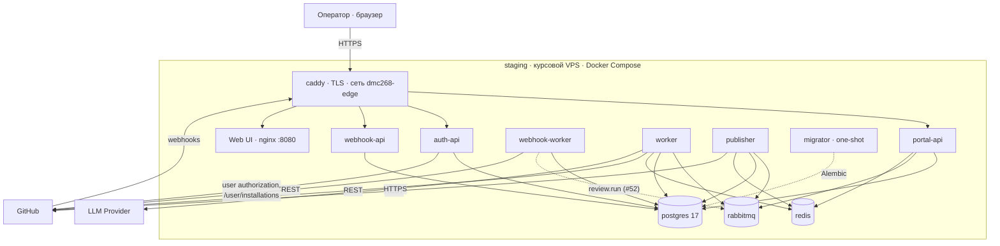

Внешние порты — только у edge-прокси Caddy: 443 (80 — редирект на HTTPS). HTTP-сервисы и Web UI подключаются к docker-сети `dmc268-edge` по alias, без host-портов; Web UI — nginx-контейнер из репозитория UI (alias `ui-staging`, порт 8080). Маршруты edge-прокси текущего staging и альтернативная цель выката (Hetzner VM из Terraform роли 3, без edge-прокси) — [CICD.md](CICD.md) §8. Диаграмма — целевая раскладка Р-12, объектного хранилища в ней нет (§10). До разделения на сервисы (#16; скорее всего после этого спринта, отдельным рефакторингом) маршруты `portal-api`, `auth-api` и `webhook-api` живут в одном приложении `api`, а `worker` — отдельный процесс из того же образа (§4); сегодня на staging (`deploy/compose/staging.yml`) работают `api`, `worker` (очереди ревью, LLM), `webhook-worker` (разбор квитанций вебхуков; роль `webhook-api` на стороне обработки), разовый `bootstrap` (роль `migrator`), `postgres` 17, `rabbitmq` 4 и `redis` 8 — все, кроме `api`, только во внутренней сети, без `ports:`. Роль `publisher` выполняет `worker` (очередь `review.publish`). Он же потребляет `index.repo` (индексатор графа, §7.4); лимита памяти у него нет. Задание индекса держит в памяти архив (до 100 МиБ, `CODE_INDEX_MAX_DOWNLOAD_BYTES`), пачку разбираемых файлов (до 50 × 256 КиБ, около 12,5 МиБ) и карту записей архива, а подпроцессу парсера RLIMIT_AS разрешает 128 МиБ сверх его размера на старте. Это оценка, не граница. Измерено: тест большого архива (64 МиБ) — пик 179,5 МиБ RSS при 53 МиБ у pytest на крошечном архиве (разница — две копии входа самого теста), проходы по архиву — около 1,5 МиБ сверх буфера, простаивающий worker — около 110 МиБ на локальном стенде; пик фаз разбора и записи не измерялся. Воркеры без HTTP-порта сообщают о здоровье heartbeat-файлом, и `up --wait` выката ждёт их так же, как `api` ([CICD.md](CICD.md) §3). Edge-прокси знает только upstream `api-staging`: туда идут хост API и `/api/*` хоста UI, включая `/api/auth/*`. Маршрут на `auth-api` и переименование `api` → `portal-api` добавляются в CICD.md §8 вместе с разделением. Сандбокс (фаза 3) — отдельная VM с Docker-сокетом, недоступным из `portal-api`, `auth-api` и `webhook-api`.

**Один origin** (решение техлида по #20, 28.09): браузер обращается к `/api/*` на хосте UI — edge-прокси или nginx UI проксирует эти пути в API (для SSE без буферизации), поэтому CORS не нужен, а refresh-cookie `Path=/api/auth` (§12) работает в пределах одного origin. Хост API остаётся для healthcheck и вебхуков GitHub. Настроено в #35 маршрутом `handle /api/*` edge-прокси (`deploy/edge/Caddyfile`); Caddy отдаёт `text/event-stream` без буферизации.

---

## 15. Открытые вопросы для команды

| # | Вопрос | Предложение | Кто решает |
|---|---|---|---|
| OQ-1 | После первого ревью GitHub снимает бота из requested reviewers. Повторный пуш: ревьюим автоматически или ждём повторного назначения? | **закрыт**, вопрос потерял смысл: бота нельзя запросить ревьюером, триггер — лейбл `ai-review`, бот его не снимает ([#37](https://github.com/larchanka-training/dmc-268-api-t6/issues/37#issuecomment-5874776355), Р-10). После пуша — автоматически, пока PR открыт и лейбл стоит (решение техлида по #20). Определение «CI зелёный» и sweep «2 мин без CI» — дефолт по #20 (§6.1, PIPELINE_SPEC §8) | продукт / мит |
| OQ-2 | Модель для DiffEngine и размер бюджета | **закрыт [#46](https://github.com/larchanka-training/dmc-268-api-t6/issues/46)** (решение техлида, 05.10.2026): основная — `mistral-small-4`, fallback — `mistral-small-3.2-24b`; проверка по требованиям D7 и расчёт — таблица ниже. `gpt-4.1-mini` (выбор #33) из пары убран: провайдер недоступен аккаунту — HTTP 400 «No providers available for model 'gpt-4.1-mini' with given preferences» остаётся и при наличии кредитов, и без `response_format` ([run 37298451583](https://github.com/larchanka-training/dmc-268-api-t6/actions/runs/37298451583)), то есть это не отказ strict-режима; причина неизвестна: правил маршрутизации на организации и ключе нет (подтвердил куратор, 05.10.2026), а preferences шлюз не передаёт. Strict `json_schema` у обеих моделей подтверждён на обслуживших маршрутах (Mistral AI; OVHcloud и Scaleway — таблица ниже) workflow `LLM live run` на ветке `fix/46-oq2-live-run` @ `c3811b7`: в [run 37304578603](https://github.com/larchanka-training/dmc-268-api-t6/actions/runs/37304578603) оба шага — `calls == [primary]`. Из трёх прогонов с дефолтами ([37304499334](https://github.com/larchanka-training/dmc-268-api-t6/actions/runs/37304499334), [37304578603](https://github.com/larchanka-training/dmc-268-api-t6/actions/runs/37304578603), [37304646906](https://github.com/larchanka-training/dmc-268-api-t6/actions/runs/37304646906)) зелёный по обоим шагам — 1 из 3. Первый ответ валиден у `mistral-small-4` в 2 из 3 на ветке и в 4 из 7 по всем прогонам #46, где она основная; у `mistral-small-3.2-24b` — в 2 из 3 на ветке и в 2 из 4 всего; каждый repair дал валидный ответ. Причина repair в артефактах ветки не сохраняется: в пробах с выгрузкой сырого ответа это была только семантика PIPELINE_SPEC §9 — `start_line == line` у `mistral-small-4`, `summary.problem` из двух предложений у `mistral-small-3.2-24b`; в run 37304646906 итоговые находки содержат `start_line: null`, что согласуется с `start_line == line`. Буквальный D7 и отдельная оговорка о semantic repair по #46 определены ниже. Бюджет — лимиты §13 без изменений; дизайн модель-агностичен: модель меняется конфигурацией шлюза (`LLM_MODEL`, `LLM_FALLBACK_MODEL`; пара verifier — `LLM_VERIFIER_MODEL`, `LLM_VERIFIER_FALLBACK_MODEL`, без них — те же `LLM_MODEL` и `LLM_FALLBACK_MODEL`) | #46 |
| OQ-3 | `review_event` по умолчанию: `COMMENT` или `REQUEST_CHANGES` при critical? | **закрыт** решением по #20: `COMMENT` по умолчанию, поле `reviewEvent` у репозитория; `REQUEST_CHANGES` — только при `reviewEvent = REQUEST_CHANGES` и вердикте `blocking` (PIPELINE_SPEC §11) | продукт |
| OQ-4 | Раскладка `.agents/` vs `docs/agents/` | **закрыт** решением роли 7 в [dmc-268-ui-t6#32](https://github.com/larchanka-training/dmc-268-ui-t6/issues/32): `.agents/` — источник истины, `.claude/{skills,agents}` — симлинки на него | роль 7 + техлид |
| OQ-5 | Event Collector как отдельный процесс — с какого порога | **закрыт Р-12**: отдельного collector нет, `usage_events` пишет worker | техлид |
| OQ-6 | Стековые PR (B на основе A): пуш в A меняет дифф B, событие приходит только по A | не решаем в v1, фиксируем как известный пробел | — |
| OQ-7 | Шифрование `ProviderInstallation` at rest | в MVP не заявлено: токены App не сохраняются, в `metadata` — только JSON-описание установки; вернуться, если в `metadata` появятся секреты | техлид + роль 6 |
| OQ-8 | Кто создаёт лейбл `ai-review` в подключённом репозитории | **закрыт** решением техлида: лейбл создаёт App при подключении репозитория (`installation.created`, `installation_repositories.added`, §6.9), ответ 422 на существующий лейбл — успех. `POST /repos/{owner}/{repo}/labels` требует `issues: write`, а не `pull_requests: write`: право добавлено App 03.10.2026 по #37 (§8.2, [GitHub Docs](https://docs.github.com/en/rest/authentication/permissions-required-for-github-apps)). Ограничение: лейбл, удалённый мейнтейнером, вернётся только при повторном подключении репозитория | техлид; реализация — #11 |

**Граница исторических свидетельств.** Прогоны, цены и описание текущего cache
ниже относятся к legacy review/conventions профилю #46/#53. Они сохраняются для
аудита, не подтверждают v2 evidence schema, base-only provenance или mandatory
verifier #107. В новом профиле четыре слота делятся также с verifier и резервируются
по §5; legacy схема «четыре для conventions/review» не применяется.

**Строгий D7 и оговорка #46.** Строгий результат D7 для одного проверяемого задания означает, что шлюз отправил `response_format: json_schema` с `strict: true`, первый ответ прошёл соответствующий валидатор и трейс содержит ровно `calls == [primary]`: без repair, retry или fallback. Это свидетельство относится только к фактически обслужившему маршруту провайдера. В #46 техлид отдельно принял выбор пары, когда один repair после принятой strict-схемы исправлял только семантическое правило PIPELINE_SPEC §9; такие случаи показываются отдельно как доля `N из M` и не выдаются за буквальный одновызовный D7. После мержа #46 [run 37342619900](https://github.com/larchanka-training/dmc-268-api-t6/actions/runs/37342619900) на `main` дал `calls == [primary]` в обоих review-шагах; `validate_findings.py` подтвердил `OK ReviewOutput 1 items` и `OK ReviewOutput 3 items`. Этот run ещё не содержал шагов конвенций.

**Production `commit_messages` ([#82](https://github.com/larchanka-training/dmc-268-api-t6/issues/82)).** `GitHubRunSource.get_pull_request_meta` делегирует чтение `HttpGitHubVcsProvider` через узкий порт commit metadata. Провайдер читает `GET /repos/{owner}/{repo}/pulls/{n}/commits` с валидированным именем репозитория: не более двух числовых страниц (`per_page=10`, `page=1`, затем `page=2`), первые 20 сообщений в порядке API. Короткая или пустая страница завершает чтение. URL из `Link` не используются для запросов. Признак `next` последней страницы или полная вторая страница задаёт `commit_messages_incomplete`; `PromptBuilder` добавляет `[Additional commits may be omitted]`, не придумывая число пропущенных коммитов. Короткая полная по данным API вторая страница снимает ранний `next`; пустая последняя страница с `next` сохраняет маркер без сообщений.

Общая application-функция ограничивает сообщение 500 Unicode-символами, включая многоточие; сохраняется не более 10 000 символов текста (20 × 500) до XML-экранирования. После экранирования блок `<commit_messages>` в отрендеренном user message (`base_user`) занимает до 50 396 символов, из них 50 000 — экранированный текст; подгонка промпта считает именно отрендеренную длину. Эта граница не включает маркеры `[N more commits omitted]` и `[Additional commits may be omitted]`: каждый добавляет ещё одну строку `<commit>…</commit>`. Commit pages и blobs используют общий capped reader. Каждая commit page ограничена 1 MiB до строгого Pydantic-разбора. `Accept-Encoding: identity` и отказ от другого encoding до чтения предотвращают распаковку сверх байтового потолка. Пустая строка сообщения допустима. Невалидный JSON, более 10 записей, неверная структура, размер, encoding и HTTP-сбои дают retryable `commit_messages_fetch_failed`; 404 и nonlimited 403 сохраняют `github_forbidden`; `Retry-After` в секундах или HTTP-date даёт задержку, а 403/429 без читаемого `Retry-After` и `X-RateLimit-Remaining: 0`, но с вторичным лимитом в теле (читается не больше 4 KiB) — 60 с (PIPELINE_SPEC §5.2). Безопасный check-run сообщает «Не удалось получить сообщения коммитов PR из GitHub.»

Перед получением токена и каждым запросом checkpoint проверяет исходную установку Run; её отзыв между страницами прекращает дальнейшую работу с токенами и HTTP. Чтения Run завершают короткую транзакцию до GitHub-вызова. Рендерер сохраняет XML-экранирование, Unicode-предел 20 × 500 и прежний `[N more commits omitted]` для известных дополнительных сообщений в длинном in-memory кортеже; complete empty list не добавляет блок.

В оценке sidecar `review/eval/pr-commit-messages.json` хранит реальные API-order префиксы PR, чьи проверенные до/после чтения heads совпадают с `source.revision`: CLEAN-03, LOG-03, SEC-04 — по одному сообщению; RES-03, SYN-04 — по 20 с признаком хвоста. Остальные 19 synthetic-кейсов имеют пустую историю. Schema parsing отделён от corpus identity binding; весь sidecar, canonical cohort и выбранные активные real-привязки проверяются до LLM-вызова и staging. Custom synthetic subsets поддерживаются; новый real-кейс требует curator identity/prefix evidence. Live/replay не запрашивают GitHub. В static provenance входят модули, которые формируют промпт, запрос, захваченный ответ или его разбор в eval, общий модуль лимитов префикса `commit_prefix_limits.py`, sidecar и прочитанные canonical `case.json`. Production-чтение коммитов (`github_vcs.py`, `github_run_source.py`, `vcs_failures.py`) eval не импортирует, и с #177 оно не пинится: паритет лимитов держит общий модуль, обоснование — [README корпуса](../test-prs-dataset/README.md#frozen-commit-context-82). Корпус, patch/pre-image/truth не меняются.

[Run 38468081001, attempt 1](https://github.com/larchanka-training/dmc-268-api-t6/actions/runs/38468081001) от 2026-10-13 использовал прежние одиночные source-revision snapshots; его raw-first метрики и original digests сохраняются как историческое свидетельство в [README корпуса](../test-prs-dataset/README.md#recorded-mistral-baseline--2026-10-13) и [TEST_PLAN §3.2.1](TEST_PLAN.md#321-зафиксированный-raw-baseline-82-2026-10-13). Историческая PR-prefix съёмка [run 38560319651, attempt 1](https://github.com/larchanka-training/dmc-268-api-t6/actions/runs/38560319651) от 2026-10-14 сохраняет original raw bytes/digests и метрики в [README корпуса](../test-prs-dataset/README.md#recorded-mistral-baseline--2026-10-14) и [TEST_PLAN §3.2.2](TEST_PLAN.md#322-зафиксированный-pr-prefix-raw-baseline-82-2026-10-14). Исторический baseline — [run 38701845865, attempt 1](https://github.com/larchanka-training/dmc-268-api-t6/actions/runs/38701845865) от 2026-10-15 на frozen source SHA `a1cc6229c6a6fdba65ecb640c60ca823e262a6aa`, после rebase на main с merged #149 (pinned parser/schema), primary `mistral-small-4`. Все 24 первых raw ответа с прежними проверенными PR-префиксами и manifest импортированы вместе byte-for-byte, без смешивания captures и подмены поздними repair/fallback ответами; prompt/corpus/truth не менялись. Final corpus — 24/24; два offline replay дали byte-identical JSON с `warnings=[]`, без static/corpus drift; redacted offline совпал с live safe report. Измерены validity 7/24, TP/FP/FN 2/2/17, precision 2/4, recall 2/19, critical recall 2/5, verdict agreement 5/24. Provenance и полные raw-first метрики — [README корпуса](../test-prs-dataset/README.md#recorded-mistral-baseline--2026-10-15) и [TEST_PLAN §3.2.3](TEST_PLAN.md#323-зафиксированный-post-rebase-raw-baseline-82-2026-10-15); это не доказательство причинного улучшения или качества final pipeline.

**Аудит формата первого ответа (#178, 20.10.2026).** Офлайн-разбор неизменённых
ответов baseline 15.10 подтверждает 17 невалидных кейсов: 15 кейсов / 33 находки
без обязательного префикса атрибуции, 9 кейсов / 22 диапазона `start_line == line`
(обратных диапазонов нет) и два кейса с нарушением порядка severity/confidence
(RES-03, RES-05). Причины пересекаются; полная матрица 17 кейсов и суммы по
`rule_name` — [README корпуса](../test-prs-dataset/README.md#first-answer-format-audit-and-current-gateway-acceptance-178).
Имена правил существуют в default backend/frontend наборах, но это само по себе
не доказывает применимость правила или семантическую истинность находки.

Для исторической съёмки 15.10 strict raw-first validity — **7/24**: независимый
`review/scripts/validate_findings.py` проверяет первый сырой ответ до любой
нормализации, repair/fallback, lint-фильтрации, anchoring и verifier; знаменатель
включает все 24 активных кейса. TP/FP/FN **2/2/17**, critical recall **2/5** и
verdict agreement **5/24** относятся к тем же историческим ответам. `warnings=[]`
выше — свидетельство на дереве старой съёмки. После #177 pre-refresh replay на
candidate `47f9add` предупреждал `Static input path set changed; refresh the complete baseline`.
Этот аудит не менял raw bytes или digests; новая полная съёмка описана ниже.

Текущий production-путь уже отличается от строгой сырой метрики:
`llm/answers.py::validate_review_answer` после JSON/schema-проверки превращает
равный диапазон в `start_line: null` и сортирует findings по severity, затем
confidence, до typed validation. `ReviewFinding` проверяет диапазоны и заголовки,
`ReviewOutput` — порядок; legacy-префикс атрибуции они не проверяют. Офлайн
пропуск тех же ответов через gateway validator даёт **24/24 normalized
acceptance**, что не заменяет **7/24 raw-first validity**. Downstream
`FindingsPostProcessor._repair_attribution` сбрасывает неверную legacy-атрибуцию,
а не делает платный repair-вызов. Поэтому 17 сырых ошибок не доказывают 17
production repair-вызовов; экономия стоимости и задержки этим аудитом не измерена.

Согласованный подход #178 — новая неизменяемая **`review.system.v3` только для
legacy-контракта**. V2 и его golden-фикстура остаются byte-for-byte; существующая
нормализация сохраняется, валидаторы не ослабляются. V3 показывает построение
полного префикса с точным именем
применимого custom rule и кратким пересказом проверки, обычную находку с
`rule_name: null`, `start_line: null` для одной строки, строго более ранний start
для диапазона и итоговый порядок severity/confidence. Backend не придумывает
пересказ правила: это создало бы неподтверждённую provenance и не улучшило бы
соблюдение формата самой моделью. Цель — строгий первый сырой формат и явная
атрибуция модели; production repair/latency/cost требуют отдельного измерения.
Переход #130 на snapshot/evidence_refs без старого префикса требует отдельного
порядка версий. Отдельно разрешённая полная съёмка 24 ответов выполнена ниже;
съёмки не смешивались.

**Исторический raw baseline #178 (20.10.2026).**
[Run 39443263258, attempt 1](https://github.com/larchanka-training/dmc-268-api-t6/actions/runs/39443263258)
на source `47f9add7c4df2b7c32db0091d39296cdd2e4810c` снял все 24 первых ответа с
`review.system.v3` (SHA-256 `eb851e7fc2329eb7bdff015ec0fda945c46111ec5c884934ed6f6d6803883452`),
primary `mistral-small-4` / fallback `mistral-small-3.2-24b`, engine fast.
После remote verification candidate пользователь явно разрешил «сделай 1 прогон»
при nominal USD 12 / 24 кейса / raw export; выполнен ровно один workflow.
#177 часть 2 и #133 вошли в source; пользователь осознанно выбрал запуск до
pending pinned-изменений #230/#229/#227. Их последующий merge может дать drift;
повторный платный прогон не разрешён автоматически.

Все 24 raw ответа и manifest импортированы вместе byte-for-byte после safe/raw
hash/size audit; manifest SHA-256
`1a6a2c6aea7bdea6026c592ef9e59c62823aefec7eac0279f125ff09d0e161a2`.
46 pins, static digest
`sha256-v1:387834e02e34318527ee2c48e25e2fb63743b65a6b33a5739c25c7b877d8ca3a`,
corpus/truth без изменений. Capture publishable, 24 first calls answer/primary,
24 gateway accepted, paid-metadata errors отсутствуют. Final corpus validation
24/24; два local replay byte-identical с `warnings=[]`, redacted offline report
byte-identical live safe report. Required CI replay **на main после merge ещё
ожидается** и локальными проверками не заменяется.

Измерены strict raw validity **10/24** против 7/24, TP/FP/FN **3/5/16** против
2/2/17, precision **3/8 (37.5%)** против 2/4, recall **3/19** против 2/19,
critical recall **2/5** без изменения, verdict agreement **4/24** против 5/24.
Результат смешанный: FP выросли, precision и verdict agreement снизились.
Остаются 14 невалидных первых ответов: 12 кейсов/27 attribution omissions,
4 кейса/14 equal ranges, один ordering case (причины пересекаются).
Полные метрики, case IDs и provenance — [README корпуса](../test-prs-dataset/README.md#recorded-mistral-baseline--2026-10-20)
и [TEST_PLAN §3.2.4](TEST_PLAN.md#324-зафиксированный-v3-raw-baseline-178-2026-10-20).
Весь cohort сохранён без retry/cherry-picking; причинное/семантическое улучшение,
качество verifier/final pipeline, repair/latency/cost savings не установлены.
Configured цены/лимиты совпадают с предыдущими; actual spend, billed tokens и
баланс artifacts не сообщают.

**Текущий raw baseline `review.system.v5` (28.10.2026, #144, #130 R15).**
[Run 40774280790, attempt 1](https://github.com/larchanka-training/dmc-268-api-t6/actions/runs/40774280790)
на source `973218054ef2c9a32f1e75a955284323196ffafd` снял все 24 первых ответа с v5,
плечо `none`, без RAG (#146) и verifier (#217); один разрешённый техлидом платный
прогон. Replay `warnings=[]`: validity **21/24**, TP/FP/FN **5/13/14**, critical recall
**4/5**, verdict agreement **9/24**. Контракт ответа сменился с v1 на v2 (без префикса
атрибуции), поэтому сравнение с v3 не прямое. Полные метрики и provenance —
[README корпуса](../test-prs-dataset/README.md#recorded-mistral-baseline--2026-10-28)
и [TEST_PLAN §3.2.5](TEST_PLAN.md#325-зафиксированный-v5-raw-baseline-144-2026-10-28).

**Закрытие OQ-2: проверка по D7.** Значения — каталог EUrouter (`GET https://api.eurouter.ai/api/v1/models` и `/endpoints`) на 05.10.2026; цены — за 1 млн токенов, по эндпоинтам и в их валюте. `KNOWN_MODELS` хранит в USD нижнюю границу цены самой дорогой известной ветки: Regolo для основной, GreenPT для fallback, с историческим курсом 1.1225. На известном EUrouter endpoint эффективная цена — покомпонентный максимум каталожной USD-границы, EUR-цены самой дорогой ветки × полученный перед вызовом курс ЕЦБ и значения из env; меньшее значение env границу не ослабляет. Для другого endpoint явно заданная цена env применяется без этой границы.

| Требование D7 | `mistral-small-4` (основная) | `mistral-small-3.2-24b` (fallback) |
|---|---|---|
| Strict structured output | шлюз шлёт `json_schema` со `strict: true` и схемой `review-output.schema.json` (без `$`-аннотаций); принял маршрут Mistral AI (`response.provider = mistral`) — workflow `LLM live run`, [run 37304578603](https://github.com/larchanka-training/dmc-268-api-t6/actions/runs/37304578603). Regolo и AKI.IO вызовов не обслуживали — не проверены | приняли маршруты Scaleway ([run 37304578603](https://github.com/larchanka-training/dmc-268-api-t6/actions/runs/37304578603)) и OVHcloud ([run 37304499334](https://github.com/larchanka-training/dmc-268-api-t6/actions/runs/37304499334)); GreenPT не проверен |
| Контекст ≥ 60 000 | 262 144 | 128 000 у Scaleway и GreenPT, 131 072 у OVHcloud; в `KNOWN_MODELS` — 128 000 |
| Цена вход / выход / чтение кэша | Mistral AI $0.165 / $0.66 / $0.0165; Regolo €0.50 / €2.10; AKI.IO €0.20 / €0.60. Нижняя граница `KNOWN_MODELS` для Regolo при 1.1225: $0.56125 / $2.35725 / $0.56125; неизвестная цена кэша считается полной ценой входа | OVHcloud €0.09 / €0.28; Scaleway €0.15 / €0.35; GreenPT €0.20 / €0.40. Нижняя граница `KNOWN_MODELS` для GreenPT при 1.1225: $0.2245 / $0.449 / $0.2245; неизвестная цена кэша считается полной ценой входа |
| Максимум одного вызова fast (52 000 вход + 8 000 выход) | Mistral AI $0.0139; Regolo €0.0428 = $0.048043 при 1.1225, $0.047953 при 1.1204 и $0.051360 при 1.20; AKI.IO €0.0152 = $0.0171 при 1.1225 | OVHcloud €0.0069 = $0.0078; Scaleway €0.0106 = $0.0119; GreenPT €0.0136 = $0.015266 при 1.1225, $0.015237 при 1.1204 и $0.016320 при 1.20 |
| Лимит прогона fast $0.50 | 4 вызова общие для конвенций и ревью в каждой попытке; за 3 попытки возможны 12 основных вызовов. 12 максимальных вызовов Regolo стоят €0.5136 ≈ $0.5765 при 1.1225; порог $0.50 — около 0.9735 USD/EUR, поэтому они не могут все пройти предварительную проверку лимита | Иллюстрация 9 основных Regolo + 3 fallback GreenPT: €0.426 ≈ $0.4782 при 1.1225; эта смесь пересекает $0.50 при курсе около 1.1737 USD/EUR. Это не гарантированный состав вызовов |

Курс 1.1225 USD/EUR в таблице — историческая оценка EUrouter для сравнения цен #46, не курс рантайма. Число 1.1204 за 05.10.2026 — также исторический пример [справочного курса ЕЦБ](https://www.lb.lt/en/daily-euro-foreign-exchange-reference-rates-published-by-the-european-central-bank), а не конфигурация staging. Текущий курс шлюз получает из CSV серии [`EXR/D.USD.EUR.SP00.A`](https://data-api.ecb.europa.eu/service/data/EXR/D.USD.EUR.SP00.A) с `lastNObservations=1&format=csvdata` и не инвертирует; env-переменная `LLM_EUR_TO_USD_RATE` больше не читается и не передаётся в worker или ручной workflow. Встроенного курса нет.

При курсе 1.1204 эффективная предварительная оценка сохраняет историческую USD-границу ($0.048043 за максимальный основной вызов и $0.015266 за fallback); при курсе выше 1.1225 она растёт вместе с EUR-ценой. Та же эффективная цена используется для консервативного учёта оплаченного ответа с непригодными данными о стоимости. Граница покрывает опубликованные цены маршрутов при полученном курсе и оценочных токенах, но не будущую смену цен и не ошибку эвристического подсчёта токенов; фактическую допустимую стоимость шлюз записывает по ответу провайдера в USD (§4.5).

Курс хранится в одном кэше на процесс: первый вызов маршрута `api.eurouter.ai` получает его до проверки бюджета и до запроса LLM, параллельные вызовы ждут тот же запрос. Успешная загрузка обновляется через час; после сбоя следующая попытка не раньше 5 минут, если пригодный курс есть, а без него — через 10 с (`COLD_FAILURE_BACKOFF_SECONDS`), раньше первого retry прогона (PIPELINE_SPEC §4.5). Последнее проверенное наблюдение годится не более 7 календарных дней по UTC, при использовании после неудачного обновления в трейсе стоит `stale_cache=true`. Worker при недоступном ЕЦБ стартует, но без пригодного курса известный маршрут останавливается до платного LLM-вызова с retryable `llm_unavailable`, нулём новых вызовов и нулевой стоимостью этого вызова. Другой endpoint при оплаченном EUR-ответе получает курс после ответа; если он недоступен, шлюз сохраняет исходный ответ и токены, начисляет консервативную USD-оценку и завершает вызов `llm_invalid_output` без нового запроса. Для известного маршрута один снимок курса используется для предварительной цены, перевода оплаченного EUR и `llm.call.request.fx` (`source`, `observation_date`, `rate_usd_per_eur`, `stale_cache`); он же виден по вызовам в JSON CLI и GitHub Step Summary. ECB HTTP и LLM HTTP выполняются вне транзакции БД (PIPELINE_SPEC §4.5).

Выбор: обе модели — одного вендора (Mistral), но хостинг-провайдеры не пересекаются (`mistral-small-4` — Mistral AI, Regolo, AKI.IO; `mistral-small-3.2-24b` — OVHcloud, Scaleway, GreenPT), так что сбой одного провайдера не выбивает обе; общий вендор принят, находки fallback слабее. Обе с EU-резидентностью данных через EUrouter. Остальные кандидаты отклонены по прогонам-пробам на временной ветке `chore/46-live-run-probe` (не мержится): `qwen3-coder-30b-a3b` — валидный ответ без находок (пропускает обе high из `findings.sample.json`); `deepseek-v4-flash-0731` — нарушения PIPELINE_SPEC §9 (`start_line == line`, порядок находок), repair тоже невалиден; `gemma-4` — таймаут 90 с на первом вызове; `minimax-m3` — HTTP 400 на `json_schema`; `qwen3.6-35b` — лучшие находки, но около 3 000 reasoning-токенов и 77–92 с на вызов (таймауты), а оба способа отключить reasoning в теле запроса (`reasoning.enabled`, `chat_template_kwargs.enable_thinking`) игнорируются. У обеих выбранных reasoning не обязателен (`reasoning.mandatory = false`), шлюз его не включает, поэтому ответ укладывается в таймаут 90 с. Шлюз проверяет сумму `usage_events.cost_usd` и консервативную оценку следующего вызова до запроса (PIPELINE_SPEC §4.5); когда сумма превысит $0.50, следующий вызов не производится.

До #53 ручной workflow `LLM live run` (`.github/workflows/llm-live-run.yml`, `workflow_dispatch`, секрет организации `AI_DMC268_T6`) проверял два review-сценария: основная модель с fallback и fallback как основная. В #53 добавлены два сценария `RepoConventionsDraft`; для каждого из четырёх шагов summary теперь показывает провайдера, фактическую модель, последовательность вызовов, курс ЕЦБ по каждому вызову, токены, стоимость в USD, время, результат валидатора и буквальный D7. D7 подтверждается только при успешной валидации первого ответа и `calls == [primary]`; repair, retry или fallback его не подтверждают. Живой результат для conventions получен на ветке PR #65 (задача #53) до мержа: [run 37586973849](https://github.com/larchanka-training/dmc-268-api-t6/actions/runs/37586973849) (`feat/53-llm-eval-gateway-project` @ `44f797a` — голова ветки до rebase, 07.10.2026; шлюз, промпты, валидатор и workflow совпадают с `main` после мержа) дал в обоих шагах conventions `calls == [primary]` и `OK RepoConventionsDraft 3 items`: `mistral-small-4` на маршруте Mistral AI (`mistral/mistral-small-4`), `mistral-small-3.2-24b` на Scaleway (`scaleway/mistral-small-3.2-24b`), то есть буквальный D7 в 1 из 1 у каждой модели. Сам run красный из-за review-шага «fallback как основная»: `llm_invalid_output` после `[primary, repair]` (`done_well` — семантика, не отказ схемы); review-шаг основной модели дал `calls == [primary]` и `OK ReviewOutput 1 items`. Файл workflow должен быть на `main`, но `gh workflow run llm-live-run.yml --ref <ветка>` запускает версию workflow и кода из ветки, поэтому проверка до мержа #53 возможна на ветке PR; `-f model=` принимает только модели из `KNOWN_MODELS`. Пара подтверждена review-прогонами #46 и [run 37342619900](https://github.com/larchanka-training/dmc-268-api-t6/actions/runs/37342619900) на `main` (оба review-ответа валидны при `calls == [primary]`); ни один из них не проверял conventions. Strict относится только к фактически обслужившему маршруту: шлюз не шлёт `require_parameters`, а `response_format` в каталоге не доказывает поддержку `json_schema` (`minimax-m3`, PIPELINE_SPEC §9). Если маршрут отвергнет схему (HTTP 400 на `response_format`), это hotfix по OQ-2: другая пара моделей или tool calling. Отдельный живой conventions-прогон на обеих моделях — run 37586973849 выше; в шагах conventions semantic repair не понадобился. Тот же вызов `RepoConventionsDraft` через шлюз worker делает перед ревью, когда для репозитория, ревизии `AGENTS.md` и версии промпта нет кэша конвенций (`app/modules/reviews/application/process_run.py`, поиск и промах кэша — `app/modules/reviews/application/conventions.py:203-221`), но последовательность вызовов staging-ревью не видна из GitHub (только в трейсе run на staging), поэтому как свидетельство D7 здесь не учитывается. `review.conventions.v2.md` описывает маркеры `[N more … omitted]`; локальные тесты рендера это подтверждают, но живую strict-проверку не заменяют.

---

## 16. Решения по переходному коду и легаси-артефактам (#54)

В рамках P3-харднинга API (#54) зафиксированы решения по сохранению и выводу переходных артефактов:

| Артефакт | Решение и обоснование | Владелец | Срок или условие |
|---|---|---|---|
| `fetch_file_content` | **Удалить после завершения миграции.** Метод объявлен в протоколе `RunDiffProvider` (`app/modules/reviews/application/process_run.py:46`). В рантайме чтение файлов переведено на `VcsProvider.get_blob` (`_store_vcs_blobs`), однако метод всё ещё вызывается в `_store_file_blobs` (`process_run.py:230`), обёрнут в `CheckpointedProvider.fetch_file_content` (`app/modules/reviews/application/handle_review_run.py:211`), а в `worker.py:304` передан заглушкой `AttemptReviewProvider.fetch_file_content`. Метод сохранён временно для обратной совместимости. | @skvertl | Спринт 3 (после завершения миграции чтения файлов через VcsProvider.get_blob) |
| `ReviewWorker`, `review_worker` | **Удалить.** Класс `ReviewWorker` и контекстный менеджер `review_worker` в [`app/worker.py`](../app/worker.py) — устаревшие прототипы; боевой рантайм использует `compose_worker_process` и `WorkerProcess`. Тип `ProviderFactory` в том же модуле опирается на живой протокол `ReviewWorkerProvider`, который сохраняется. Прототипы вызываются тестами в [`tests/test_worker.py`](../tests/test_worker.py). | @skvertl | Спринт 3 (при переводе тестов с `ReviewWorker` на `WorkerProcess`) |
| `reviewer_requested` (и путь reviewer-intent / timeline) | **Вариант A: код пути удалён в [#81](https://github.com/larchanka-training/dmc-268-api-t6/issues/81); колонки — оставить.** Диспетчер и проектор игнорируют `review_requested` и `review_request_removed`; адаптер таймлайна, протокол и ветки reviewer-intent / timeline удалены. Семь колонок PostgreSQL (`reviewer_requested` `BOOLEAN NOT NULL server_default false`, `reviewer_requested_at`, `reviewer_intent_updated_at`, `reviewer_timeline_event_id`, `reviewer_timeline_position`, `reviewer_barrier_at`, `reviewer_barrier_position`) сохраняются бессрочно по решению @axyi; исторические значения сохраняются при проекции метаданных, head, lifecycle и метки. Продакшен использует триггер `ai-review` + успешный CI (Р-10 / §6.1). | @axyi (Tech Lead) | колонки — бессрочно; код — удалён в #81 |
| `payload_s3_ref` | **Оставить до внедрения S3-оффлоада.** Колонка `payload_s3_ref` (`TEXT nullable`) в таблице `webhook_events` (`app/modules/integrations/webhooks/infrastructure/models.py:64`) с ограничением CHECK `payload IS NOT NULL OR payload_s3_ref IS NOT NULL` сохранена для будущего выноса сырых пэйлоадов вебхуков в объектное хранилище S3 (§10, §11). Удаление колонки или CHECK-ограничения до внедрения S3 не требуется. | @skvertl | Оставить до внедрения S3-оффлоада |

---

## 17. Проверка DoD

- [x] Компоненты, потоки данных, границы backend / frontend / LLM — §2, §3–§5
- [x] Правила взаимодействия с VCS (GitHub, installed GitLab fast и Bitbucket Cloud #333; live acceptance отдельно) — §8
- [x] Форматы очереди задач (RabbitMQ) — §7
- [x] Стратегия кэширования контекстов — §10
- [x] Сборщик контекста: структуры данных на 4 уровнях — §9
- [x] Диаграммы C4 (контекст, контейнеры, компоненты) и потоков — §3–§6, §14
- [x] Нефункциональные требования: latency, лимиты контекста — §13
- [x] Утверждено командой — PR-ревью (PR #36, #20)
